# TRCM: Topology-aware route-consistency modeling for autoregressive neural vehicle routing

Peiheng Jiana,1, Zhenwei Wangb,1, Tiehua Zhanga,∗, Lei Zhangc, Zhishu Shend, Ruibin Baib, Zhijun Dinga

aSchool of Computer Science and Technology, Tongji University, Shanghai, 201804, China bSchool of Computer Science, University of Nottingham Ningbo China, Ningbo, 315100, China cYixin Group Limited, Beijing, China

dSchool of Computer Science and Artificial Intelligence, Wuhan University of Technology, Wuhan, 430070, China

## Abstract

Autoregressive neural solvers construct capacitated vehicle routing solutions through sequential node selection, while the partition of customers into vehicle routes remains implicit. We propose Topology-aware Route-Consistency Modeling (TRCM) to represent customer co-assignment explicitly and use it to guide construction. A symmetric pair predictor reuses encoder representations to estimate same-route probabilities. Referencepreserving augmentation and topological entropy-based reweighting address imbalanced relation supervision. During decoding, compatibility with the current partial route adjusts customer logits while the base solver retains its feasibility and state-update rules. Under matched decoding settings, TRCM reduces the reported gap from 3.67% to 3.28% on CVRP50 and from 2.11% to 1.99% on CVRP100. With eightfold augmentation, the CVRP100 gap decreases from 1.61% to 1.49%, although performance deteriorates on CVRP50. Across 10,000 XML100 instances, the average objective improves by 0.24%, with larger diferences under unitary demands, clustered customers and ultra-long routes. A controlled study of 500 demand-reassigned variants of one geometry also shows lower objective variation. The results support route membership as a useful, condition-dependent structural signal for autoregressive neural routing.

Keywords: Capacitated vehicle routing, Neural combinatorial optimization, Route consistency, Pairwise learning, Topological entropy, Autoregressive decoding

## 1. Introduction

The capacitated vehicle routing problem (CVRP) is a central problem in logistics and transportation: customers with known demands must be assigned to capacity-feasible vehicle routes of minimum total length [1]. Classical heuristics and metaheuristics ofer highquality solutions through specialized search [2, 3, 4, 5]. Neural combinatorial optimization (NCO) complements these methods by learning reusable construction policies from problem instances and solutions [6, 7, 8]. Once trained, a policy can generate feasible solutions through a sequence of inexpensive decisions.

Autoregressive construction is a common interface for neural routing. An encoder represents the instance, and a decoder selects the next customer or the depot using the partial solution and a feasibility mask. Attention-based models and multiple-start training have made this interface efective on standard CVRP benchmarks [8, 9]. Subsequent work improves symmetry exploitation, decoder capacity, reconstruction, and inference [10, 11, 12, 13]. These developments strengthen the decisions made during construction while retaining a sequential action interface.

A CVRP solution, however, contains a structural object beyond its visiting sequence: the partition of customers among vehicle routes. In a node-level policy, this partition is represented implicitly through embeddings, decoder states, and transition preferences. An explicit representation of customer co-assignment could provide a complementary signal about the route being constructed. Figure 1 shows three selected demand-reassigned variants at fixed customer coordinates. The examples illustrate how a fixed spatial configuration can yield diferent constructive trajectories under demand reassignment, motivating explicit modeling of route-level organization.

We consider whether two customers belong to the same route. This same-route relation difers from edge adjacency: co-assigned customers need not be visited consecutively. It is also invariant to reordering visits within a reference route, making it a natural representation of route membership. Learning it as a soft pairwise prior allows the constructive policy to query route compatibility while continuing to choose individual actions.

Three challenges arise. First, same-route pairs are usually a minority among all customer pairs, creating imbalanced supervision. Second, pairs with the same label can have diferent relation-label contexts, so class counts alone do not describe their learning dificulty. Third, a route-level signal must be integrated with a decoder that already models transition costs and dynamic constraints. Edge-classification research motivates considering local label context in addition to frequency [14]; the integration requires a separate connection between pair predictions and the current partial route.

We propose Topology-aware Route-Consistency Modeling (TRCM). A symmetric pair predictor reuses encoder representations to estimate customer same-route probabilities. Prior learning combines reference-preserving augmentation with topological entropy (TE) and class-frequency weighting. During decoding, TRCM averages each candidate’s predicted compatibility with customers already in the current route and adds this score to its base logit. The original solver maintains the dynamic state, feasibility mask, and action-selection procedure. This connects an order-invariant relation target to sequential routing without requiring a separately decoded partition.

We evaluate the resulting POMO-based solver on CVRP50, CVRP100, and all 10,000 XML100 instances. Under matched decoding settings, TRCM reduces the non-augmented gaps from 3.67% to 3.28% and from 2.11% to 1.99%, respectively. With eightfold augmentation, it improves CVRP100 and degrades CVRP50, indicating that the interaction with stronger inference is not uniformly beneficial. XML100 reveals larger gains for unitary demands, clustered customers, and ultra-long routes. A controlled study of 500 demandreassigned variants of one geometry shows lower objective variation. Prior-prediction ablations, sensitivity analysis, and measured overhead further characterize the method.

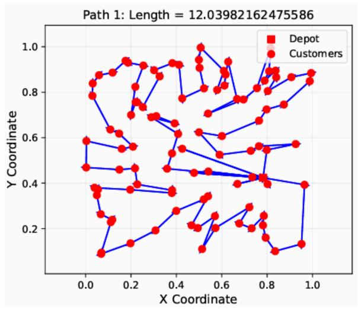

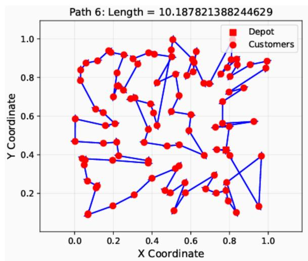

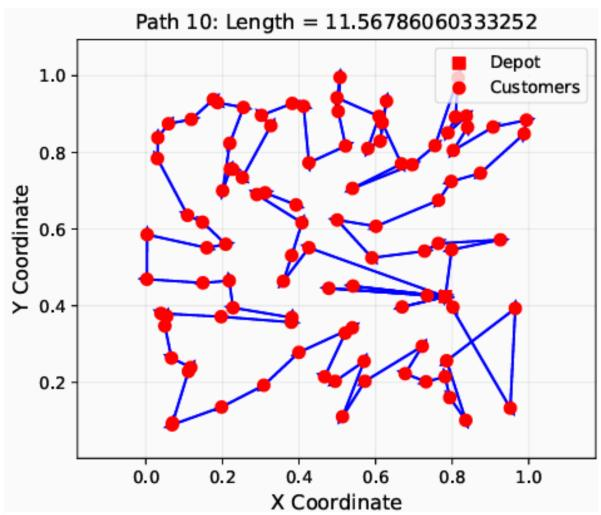  
Figure 1: Constructive decoding trajectories for three selected demand-reassigned variants at fixed customer coordinates. Visiting trajectories and route lengths vary across the examples.

Our contributions are threefold:

1. We formulate route membership as an explicit pairwise structural representation for autoregressive CVRP construction, distinguishing customer co-assignment from adjacency and visiting order.

2. We develop topology-aware route-consistency learning and route-context-guided decoding through symmetric pair prediction, imbalance-aware supervision, and additive logit fusion.

3. We evaluate the method using standard benchmarks, structured XML100 factors, controlled demand reassignment, prior-learning ablations, hyperparameter sensitivity, and computational overhead.

## 2. Related Work

## 2.1. Neural constructive solvers for vehicle routing

Neural routing policies combine representations of the instance with a learned construction rule. Pointer Networks introduced attention-based selection over input elements [15]; reinforcement learning extended this principle to combinatorial optimization and demanddependent routing states [6, 7]. Transformer-style attention and multiple-start optimization subsequently became common components of constructive solvers [8, 9]. Improvements to this family address diferent bottlenecks: symmetry-based training regularizes equivalent solutions [10], heavy decoders update representations of remaining nodes [11], and revised light decoders strengthen the use of context [12]. Large-scale training and reconstruction provide another direction [16]. Most of these approaches organize construction through successive next-node decisions. Insertion-based construction instead selects both a customer and an insertion position [17], illustrating that the construction interface itself can also be redesigned.

Generalization methods address the distribution or task on which these policies operate. Policy ensembles combine complementary behaviors across distributions [18, 19]. Crossproblem learning transfers a shared backbone to routing variants [20], while prompt learning adapts a pretrained routing model through selected prompts [21]. Recent Neurocomputing work also studies route diversity and complementary distance-aware branches [22, 23]. TRCM focuses on the structural target used within construction: customer co-assignment is learned explicitly and queried through the current route.

## 2.2. Structural and relational modeling in neural routing

Relational information enters neural routing at several levels. Residual edge-graph attention and neighborhood-based edge fusion enrich node representations with graph and edge features [24, 25]. Edge-based generation, including graph difusion, models a diferent representation of the solution [26]. These approaches demonstrate the usefulness of pairwise structure, but edge adjacency and route membership are distinct targets. A same-route label also covers customers separated by several visits. Existing representations may encode route information implicitly; they do not explicitly optimize the same-route co-assignment target used here.

Learned structural guidance can also act within an optimization procedure. Neural large-neighborhood search learns repair operations [27], delegation selects subproblems for improvement [28], and NeuroLKH uses learned scores to guide classical search [29]. Simulation-guided beam search and eficient active search increase inference efort through rollout or adaptation [13, 30]. TRCM supplies its relation signal directly to autoregressive action scoring, adding pairwise computation without introducing a separate search stage.

## 2.3. Imbalance-aware pairwise learning

Imbalanced supervision arises when the relations of interest occupy a small fraction of possible pairs. Focal Loss changes the emphasis on well-classified examples [31], while Class-Balanced Loss uses efective class counts [32]. Edge-representation learning treats relations as explicit prediction objects [33]. TopoEdge further studies imbalance in local edge-label context and introduces TE-based weighting [14]. These perspectives distinguish sample frequency, prediction dificulty, and graph context.

For route-consistency learning, TRCM combines inverse-frequency weights with TE computed from supervised same-route labels. TE measures the mixture of relation labels around a pair’s endpoints after propagation. Its purpose is to adjust learning emphasis for the relation predictor; it is not an estimator of route optimality.

## 3. Problem Formulation

## 3.1. Capacitated vehicle routing problem

Let $\mathcal { G } ~ = ~ ( \nu , \mathcal { E } )$ be a complete routing graph with depot 0, customer set $\begin{array} { r l } { \mathcal { V } _ { c } } & { { } = } \end{array}$ $\{ 1 , \ldots , n \}$ , customer demands $d _ { i }$ , vehicle capacity $Q$ , and travel costs $c _ { i j }$ . A route $R _ { k } = ( 0 , v _ { k , 1 } , \ldots , v _ { k , \ell _ { k } } , 0 )$ serves the customer set $\mathcal { C } ( R _ { k } )$ . A feasible solution R partitions the customers into capacity-feasible routes:

$$
\bigcup _ { R \in { \mathcal R } } { \mathcal C } ( R ) = \mathcal { V } _ { c } , \quad { \mathcal C } ( R _ { k } ) \cap { \mathcal C } ( R _ { l } ) = { \mathcal O } \ ( k \neq l ) , \quad \sum _ { i \in { \mathcal C } ( R ) } d _ { i } \leq Q .\tag{1}
$$

The objective is the total route length,

$$
\operatorname* { m i n } _ { \mathcal { R } } \sum _ { R _ { k } \in \mathcal { R } } \left( c _ { 0 , v _ { k , 1 } } + \sum _ { a = 1 } ^ { \ell _ { k } - 1 } c _ { v _ { k , a } , v _ { k , a + 1 } } + c _ { v _ { k , \ell _ { k } } , 0 } \right) .\tag{2}
$$

The evaluated synthetic instances use Euclidean travel costs.

## 3.2. Autoregressive neural construction

An encoder produces node representations $\mathbf { H } = \operatorname { E n c } _ { \theta } ( \mathcal { G } )$ . A decoder constructs a trajectory τ according to

$$
p _ { \theta } ( \tau \mid \mathcal { G } ) = \prod _ { t = 1 } ^ { T } p _ { \theta } ( \tau _ { t } \mid \mathcal { G } , \tau _ { < t } ) .\tag{3}
$$

At step t, its base logits $u _ { t } ( j )$ depend on the embeddings and current solver state. The feasible set $\mathcal { F } _ { t }$ excludes served and capacity-infeasible customers. Selecting the depot closes the current route and restores capacity according to the base solver. Multi-start decoding and test-time augmentation can produce several trajectories for the same instance.

## 3.3. Route membership versus edge adjacency

A reference solution $\mathcal { R } ^ { \star }$ defines customer-pair labels

$$
y _ { i j } = \mathbb { I } \{ \exists R \in \mathcal { R } ^ { \star } : i , j \in \mathcal { C } ( R ) \} , \qquad i , j \in \mathcal { V } _ { c } .\tag{4}
$$

The label depends on route membership, not on whether i and $j$ are consecutive. Permuting visits within a reference route leaves every $y _ { i j }$ unchanged, as illustrated in Figure 2.

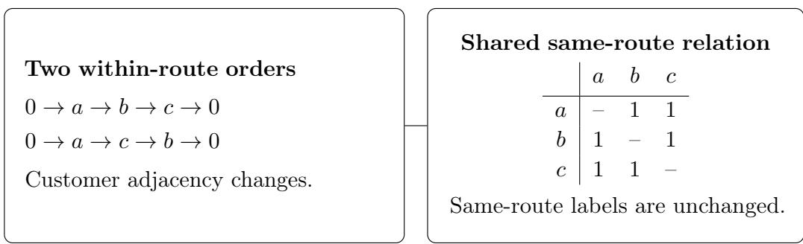  
Figure 2: Visiting order and route membership are diferent structural objects. Reordering customers $a , b , c$ changes their adjacency relations while preserving their same-route labels.

Appendix A gives this property together with the symmetry and aggregation results used below.

The predictor estimates a customer-only matrix $\mathbf { P } = [ P _ { i j } ] \in [ 0 , 1 ] ^ { n \times n }$ , where $P _ { i j }$ represents the probability of same-route co-assignment. The depot is excluded because all vehicle routes visit it. A real-valued predicted matrix need not be exactly transitive or define a feasible partition. We therefore use P as a soft route-consistency prior queried during construction.

Table 1: Main notation. The encoder parameters θ and the reweighting balance β are distinct.
<table><tr><td>Symbol</td><td>Meaning</td></tr><tr><td> $\nu _ { c } , 0$ </td><td>Customer set and depot</td></tr><tr><td> ${ \mathcal { R } } ^ { \star } , y _ { i j }$ </td><td>Reference route solution and same-route label</td></tr><tr><td> $\mathcal { P }$ </td><td>Supervised customer-pair set for training</td></tr><tr><td> $\mathbf { P } = [ P _ { i j } ]$ </td><td>Dense route-consistency prior matrix</td></tr><tr><td> ${ \bf H } , g _ { \phi }$ </td><td>Encoder representations and symmetric pair predictor</td></tr><tr><td> $\widetilde { \bf A }$ </td><td>Row-normalized relation-graph adjacency with self-loops</td></tr><tr><td> $\alpha , L , \beta$ </td><td>TE temperature, propagation depth, and weighting balance</td></tr><tr><td> ${ \mathbf { } } S _ { t } , { \mathcal { F } } _ { t }$ </td><td>Customers in the current partial route and feasible actions</td></tr><tr><td> $u _ { t } ( j ) , r _ { t } ( j ) , \lambda$ </td><td>Base logit, route-compatibility score, and fusion strength</td></tr></table>

## 4. Topology-Aware Route-Consistency Modeling

## 4.1. Framework overview

TRCM connects ofline relation learning with autoregressive construction (Figure 3). Reference routes provide same-route labels for an auxiliary pair predictor. Augmentation enriches its inputs, and topology and frequency weights modulate the pairwise learning objective. At inference, the trained predictor computes a new matrix for the current instance. Compatibility with the current route then complements the base decoder’s logits.

(a) Topology-aware prior learning  
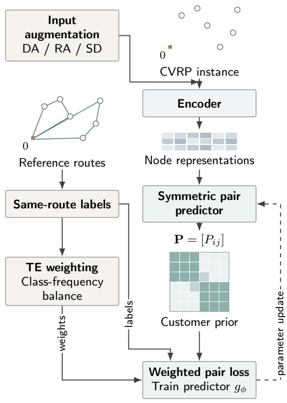  
Learn predictor parameters ofline. Compute a new customer prior for each test instance.

(b) Prior-guided autoregressive decoding  
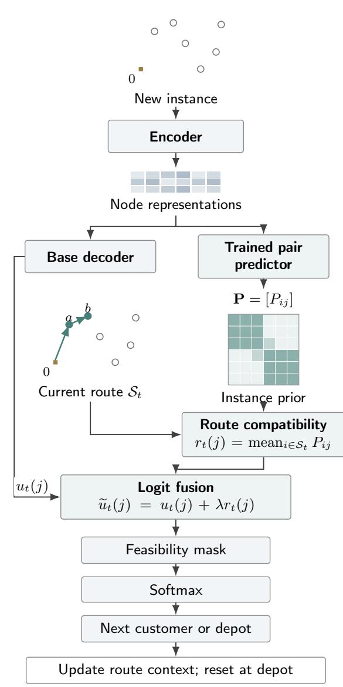  
Figure 3: TRCM architecture. (a) Augmented inputs and reference-route labels train a symmetric pair predictor with topology and class-frequency weighting. (b) Shared node representations support base decoding and instance-specific prior prediction. The prior P and current route $S _ { t }$ determine compatibility scores for logit fusion, followed by feasibility masking and action selection. A depot return resets the route context. Graphs and matrix shading are schematic.

## 4.2. Same-route relation prediction

For customer embeddings $\mathbf { h } _ { i }$ and $\mathbf { h } _ { j }$ , the predictor uses

$$
\mathbf { z } _ { i j } = [ \mathbf { h } _ { i } + \mathbf { h } _ { j } \parallel | \mathbf { h } _ { i } - \mathbf { h } _ { j } | \parallel \mathbf { h } _ { i } \odot \mathbf { h } _ { j } ] , \qquad P _ { i j } = g _ { \phi } ( \mathbf { z } _ { i j } ) ,\tag{5}
$$

where ∥ is concatenation and $\odot$ is element-wise multiplication. The head $g _ { \phi }$ is a two-layer MLP followed by a sigmoid. Each feature operation is symmetric, giving $P _ { i j } = P _ { j i }$ . This symmetry concerns exchanging pair endpoints; the reference label’s invariance concerns reordering an entire route. Both support a relation representation that is independent of a chosen serialization.

## 4.3. Structure-preserving augmentation

Training instances are paired with high-quality reference routes. The augmentation set contains geometric augmentation (DA), route-refactor augmentation (RA), and shufledemand augmentation (SD). DA includes rotation, reflection, shrinking or scaling, and small coordinate perturbations. RA uses reference-route refactoring inspired by partialsolution reconstruction [11]. SD permutes customer demands within each reference route while retaining its co-assignment labels.

The preserved property depends on the transformation. Rotation and reflection preserve Euclidean distances, and uniform scaling preserves route-length rankings. Within-route demand permutation preserves each reference route’s total load and therefore its capacity feasibility. Small coordinate perturbations retain reference membership labels as training targets. Augmentation thus supplies varied inputs for learning the reference relation without requiring a unique visiting order.

## 4.4. Topological entropy reweighting

Let P denote the supervised pair set, with $\mathcal { P } _ { c } = \{ ( i , j ) \in \mathcal { P } : y _ { i j } = c \}$ . Same-route pairs can be rare: for reference route sizes $\ell _ { 1 } , \ldots , \ell _ { m }$ , their fraction among distinct unordered pairs is $\begin{array} { r } { \sum _ { k } \ell _ { k } ( \ell _ { k } - 1 ) / [ n ( n - 1 ) ] } \end{array}$ ]. Frequency weights address this imbalance. TE additionally describes the relation-label context of each pair [14].

Construct the customer relation graph from supervised pairs, treating the endpoint relation symmetrically. For a node incident to supervision, define

$$
q _ { i , c } ^ { ( 0 ) } = \frac { \sum _ { j : ( i , j ) \in \mathcal { P } } \mathbb { I } \{ y _ { i j } = c \} } { \sum _ { j : ( i , j ) \in \mathcal { P } } 1 } , \qquad c \in \{ 0 , 1 \} .\tag{6}
$$

Collect these distributions in $\mathbf { Q } ^ { ( 0 ) }$ . With row-normalized relation adjacency $\widetilde { \bf A }$ including self-loops, propagate

$$
\mathbf { Q } ^ { ( l ) } = \widetilde { \mathbf { A } } \mathbf { Q } ^ { ( l - 1 ) } , \qquad l = 1 , \dots , L .\tag{7}
$$

The pair context and entropy are

$$
\begin{array} { r } { \mathbf { g } _ { i j } ^ { ( L ) } = \frac { 1 } { 2 } ( \mathbf { q } _ { i } ^ { ( L ) } + \mathbf { q } _ { j } ^ { ( L ) } ) , } \end{array}\tag{8}
$$

$$
\mathrm { T E } _ { i j } ^ { ( L ) } = - \sum _ { c \in \{ 0 , 1 \} } g _ { i j , c } ^ { ( L ) } \log ( g _ { i j , c } ^ { ( L ) } + \epsilon ) ,\tag{9}
$$

where ϵ stabilizes the logarithm. Higher entropy indicates a more mixed endpoint relationlabel context (Figure 4), rather than geometric boundary distance or route optimality. The supervised relation graph defines this context separately from the dense prediction matrix $\mathbf { P } = [ P _ { i j } ]$

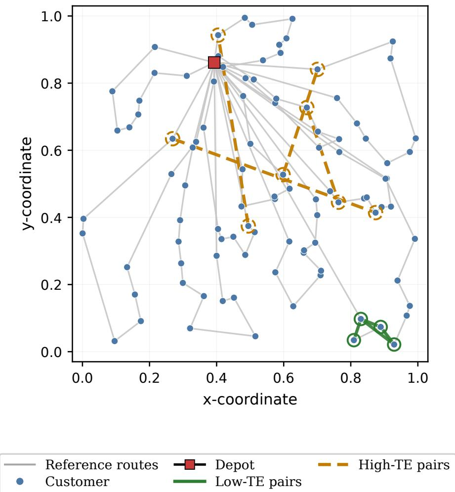  
Figure 4: Qualitative pair contexts for TE-based supervision. Green solid and orange dashed links indicate low- and high-TE examples, respectively. Gray lines show reference routes, blue points denote customers, and the red square is the depot.

The unnormalized weights are

$$
w _ { i j } ^ { \mathrm { T E } } = \exp ( \mathrm { T E } _ { i j } ^ { ( L ) } / \alpha ) , \qquad w _ { i j } ^ { \mathrm { q t y } } = \frac { | \mathcal { P } | } { | \mathcal { P } _ { y _ { i j } } | } ,\tag{10}
$$

where $\alpha > 0$ controls the topology-weight contrast. Normalize each type by its mean over supervised pairs in the mini-batch:

$$
\bar { w } _ { i j } ^ { a } = \frac { w _ { i j } ^ { a } } { | \mathcal { P } | ^ { - 1 } \sum _ { ( p , q ) \in \mathcal { P } } w _ { p q } ^ { a } } , \qquad a \in \{ \mathrm { T E } , \mathrm { q t y } \} .\tag{11}
$$

The final weighting and prior-learning loss are

$$
w _ { i j } = \beta \bar { w } _ { i j } ^ { \mathrm { T E } } + ( 1 - \beta ) \bar { w } _ { i j } ^ { \mathrm { q t y } } ,\tag{12}
$$

$$
\mathcal { L } _ { \mathrm { p r i o r } } = \frac { 1 } { | \mathcal { P } | } \sum _ { ( i , j ) \in \mathcal { P } } w _ { i j } \mathrm { B C E } ( P _ { i j } , y _ { i j } ) ,\tag{13}
$$

where $\mathrm { B C E } ( p , y ) = - y \log p - ( 1 - y ) \log ( 1 - p )$ with numerical stabilization. We use $\beta = 0 . 5$ , reserving θ for backbone parameters. Algorithm 1 summarizes predictor learning.

## 4.5. Prior-guided autoregressive decoding

Let $\boldsymbol { S } _ { t } \subseteq \boldsymbol { \mathcal { V } } _ { c }$ contain the customers selected since the most recent depot visit. Candidate compatibility is

$$
r _ { t } ( j ) = \left\{ \begin{array} { l l } { | S _ { t } | ^ { - 1 } \sum _ { i \in S _ { t } } P _ { i j } , } & { j \in \mathscr { V } _ { c } , \ | S _ { t } | > 0 , } \\ { 0 , } & { j = 0 \mathrm { ~ o r ~ } | S _ { t } | = 0 . } \end{array} \right.\tag{14}
$$

The average queries consistency with the accumulated customer set, and does not depend on its enumeration. With prior strength $\lambda \geq 0$ , fusion gives

$$
\widetilde { u } _ { t } ( j ) = u _ { t } ( j ) + \lambda r _ { t } ( j ) , \qquad p _ { t } ( j ) = \frac { \exp ( \widetilde { u } _ { t } ( j ) ) } { \sum _ { k \in \mathcal { F } _ { t } } \exp ( \widetilde { u } _ { t } ( k ) ) } , \quad j \in \mathcal { F } _ { t } .\tag{15}
$$

Infeasible actions receive zero probability. A depot action resets $\boldsymbol { S } _ { t } ;$ the base solver retains its capacity, served-customer and route-closure rules. The predictor parameters are shared across instances, while P is computed anew for each instance. Algorithm 2 gives the decoding procedure.

At a fixed state, fusion increases relative preference for candidates with higher compatibility. Since $r _ { t } ( 0 ) = 0$ , the depot logit is unchanged, but its normalized probability can decrease as customer logits increase. The odds relation and a bound on this fixed-state efect are derived in Appendix A.2.

## 4.6. Computational complexity

For fixed embedding and hidden dimensions, dense pair prediction requires $O ( n ^ { 2 } )$ evaluations and $O ( n ^ { 2 } )$ memory for P. Intermediate pair features can increase the practical peak memory. The prior is computed once per instance and can be shared across decoding starts.

Route aggregation can maintain $\begin{array} { r } { a _ { t } ( j ) = \sum _ { i \in \mathcal { S } _ { t } } P _ { i j } } \end{array}$ . Selecting customer i adds row $\mathbf { P } _ { i , : }$ selecting the depot resets the accumulator. This equivalent incremental implementation costs $O ( n ^ { 2 } )$ per trajectory with $O ( n )$ additional state, as shown in Appendix A.4. The reported wall-clock overhead is evaluated separately in Section 5.7.

## 5. Experiments

## 5.1. Experimental setup

We evaluate CVRP50 and CVRP100 generated from the standard POMO distribution [9], using 10,000 test instances for each size. Prior learning uses 1M instances with high-quality reference routes from the LEHD data-generation procedure [11]. We also evaluate all 10,000 instances of XML100, a structured benchmark available through CVRPLIB [34], and study 500 demand-reassigned variants of one fixed geometry.

POMO is the controlled backbone. The non-augmented POMO/TRCM pair and their eightfold-augmented pair use matched decoding configurations. Non-augmented inference retains the underlying multi-start procedure. Contextual comparisons include HGS [3], LKH3 [2], OR-Tools [35], PtrNet [15], AM [8], LEHD [11], ELG [19], ReLD [12], E-GAT [24], and GASE [25]. These methods difer in architecture and inference procedure; the paired POMO comparisons isolate the addition of TRCM under the reported settings.

Routing metrics are average objective (Obj), the reported relative gap to the comparison’s reference solution (Gap), and inference time. Prior prediction is measured by accuracy, F1, precision and recall. Because same-route labels are imbalanced, we emphasize F1 alongside accuracy. The predictor has a hidden dimension of 256 and uses

128-dimensional encoder embeddings. Experiments run on one NVIDIA RTX 4090; Table 2 summarizes the settings.

Table 2: Experimental settings for route-consistency learning and inference.
<table><tr><td>Setting</td><td>Value</td></tr><tr><td>Autoregressive backbone</td><td>POMO</td></tr><tr><td>Training instances</td><td>1M</td></tr><tr><td>Test instances</td><td>10,000</td></tr><tr><td>Node embedding dimension</td><td>128</td></tr><tr><td>Pairwise predictor</td><td>Two-layer MLP, hidden dimension 256</td></tr><tr><td>Optimizer</td><td>Adam</td></tr><tr><td>Learning rate</td><td>1 × 10−4</td></tr><tr><td>Training epochs</td><td>40</td></tr><tr><td>Batch size</td><td>1024</td></tr><tr><td>TE temperature α</td><td>1.0</td></tr><tr><td>Reweighting balance β</td><td>0.5</td></tr><tr><td>Prior strength λ</td><td>1.0</td></tr><tr><td>Augmentation</td><td>Rotation, reflection, shrinking, noise, RA, SD</td></tr><tr><td>Inference</td><td>Non-augmented / eightfold augmentation</td></tr><tr><td>Hardware</td><td>NVIDIA RTX 4090</td></tr></table>

## 5.2. Overall performance

Table 3 reports the routing comparison. Without test-time augmentation, TRCM reduces the CVRP50 gap from 3.67% to 3.28% and the CVRP100 gap from 2.11% to 1.99%. These are reductions of 0.39 and 0.12 percentage points, respectively. Average objectives decrease from 10.74 to 10.70 and from 15.84 to 15.82. The results show that the learned relation signal can complement the base policy in both non-augmented settings.

Eightfold augmentation produces a mixed interaction. On CVRP100, TRCM reduces the gap from 1.61% to 1.49% and the objective from 15.76 to 15.74. On CVRP50, the gap increases from 0.58% to 0.77%, and the objective increases from 10.42 to 10.44. Thus, the interaction between augmentation and route-level guidance is not uniformly beneficial. The two tested sizes also do not establish that the benefit grows with problem size.

Table 3: Performance on synthetic CVRP benchmarks. Obj is average route length, Gap is the percentage gap to the comparison’s reference values, and Time is inference time (s: seconds, m: minutes, h: hours). POMO/TRCM rows form the controlled backbone pairs; other methods use their respective inference procedures.
<table><tr><td colspan="2"></td><td colspan="3">CVRP50</td><td colspan="3">CVRP100</td></tr><tr><td>Type</td><td>Method</td><td>Obj</td><td>Gap (%)</td><td>Time</td><td>Obj</td><td>Gap (%)</td><td>Time</td></tr><tr><td rowspan="3">Classical</td><td>HGS</td><td>10.36</td><td>0.00</td><td>21h</td><td>15.51</td><td>0.00</td><td>32h</td></tr><tr><td>LKH3</td><td>10.38</td><td>0.19</td><td>7h</td><td>15.65</td><td>0.90</td><td>13h</td></tr><tr><td>OR-Tools</td><td>10.98</td><td>5.98</td><td>1016s</td><td>17.09</td><td>10.19</td><td>1054s</td></tr><tr><td rowspan="8">Neural</td><td>PtrNet</td><td>11.39</td><td>9.94</td><td>&lt; 1s</td><td>17.23</td><td>11.09</td><td>&lt; 1s</td></tr><tr><td>AM</td><td>10.98</td><td>5.98</td><td>3s</td><td>16.80</td><td>8.32</td><td>8s</td></tr><tr><td>AM Sampling</td><td>10.59</td><td>2.22</td><td>7m</td><td>16.16</td><td>4.19</td><td>30m</td></tr><tr><td>LEHD Greedy</td><td>10.92</td><td>5.41</td><td>2s</td><td>16.22</td><td>4.58</td><td>30s</td></tr><tr><td>ELG×8Aug</td><td>10.47</td><td>1.06</td><td>10s</td><td>15.84</td><td>2.13</td><td>3.18m</td></tr><tr><td>ReLD×8Aug</td><td>10.43</td><td>0.66</td><td>9s</td><td>15.80</td><td>1.87</td><td>1.34m</td></tr><tr><td>E-GAT GASE</td><td>10.80</td><td>4.25</td><td>7s</td><td>16.69</td><td>6.68</td><td>17s</td></tr><tr><td></td><td>10.74</td><td>3.52</td><td>3s</td><td>16.37</td><td>4.60</td><td>7s</td></tr><tr><td rowspan="2">Backbone</td><td>POMO</td><td>10.74</td><td>3.67</td><td>1s</td><td>15.84</td><td>2.11</td><td>8s</td></tr><tr><td>TRCM</td><td>10.70</td><td>3.28</td><td>3s</td><td>15.82</td><td>1.99</td><td>15s</td></tr><tr><td rowspan="2">Backbone×8</td><td>POMO×8Aug</td><td>10.42</td><td>0.58</td><td>26s</td><td>15.76</td><td>1.61</td><td>5m</td></tr><tr><td>TRCM×8Aug</td><td>10.44</td><td>0.77</td><td>40s</td><td>15.74</td><td>1.49</td><td>7m</td></tr></table>

## 5.3. Structured distribution analysis on XML100

XML100 varies depot position, customer distribution, demand distribution and average route size [34]. We compare POMO×8Aug and TRCM×8Aug across all 10,000 instances. For model m and group g, let $\mathrm { O b j } _ { m , g }$ denote the reported group objective summary. The comparison is

$$
D _ { g } = 1 0 0 \frac { \mathrm { O b j } _ { \mathrm { T R C M } \times 8 , g } - \mathrm { O b j } _ { \mathrm { P O M O } \times 8 , g } } { \mathrm { O b j } _ { \mathrm { P O M O } \times 8 , g } } \% .\tag{16}
$$

Negative values favor TRCM. The factor levels are overlapping summaries of the same benchmark, rather than independent test datasets.

Table 4 shows an overall diference of −0.24%, with favorable mean diferences for all 19 factor levels. Across depot positions, the diferences are −0.22% for random, −0.33% for centered and −0.18% for cornered depots. Clustered customers yield a larger improvement (−0.32%) than random customers (−0.17%), with mixed layouts at −0.24%.

The largest demand-factor improvement occurs under unitary demands (−1.04%). Equal demands make geometry and route organization comparatively informative for co-assignment, which is consistent with the intended structural role of the prior. Among route-size levels, ultra-long routes show the largest improvement (−0.53%), while medium routes show the smallest (−0.03%). A longer partial route supplies more pair relations for compatibility aggregation, but the observed trend is not monotonic. These factor summaries identify conditions in which the average benefit is larger; they do not isolate causal efects of individual factors.

Table 4: XML100 factor-wise relative objective diferences for TRCM×8Aug against POMO×8Aug. Negative values favor TRCM. Diferences are displayed to two decimal places. Each factor family summarizes the same 10,000 instances.
<table><tr><td>Factor</td><td>Level</td><td>Instances</td><td>Difference (%)</td></tr><tr><td>Overall</td><td>All</td><td>10000</td><td>-0.24</td></tr><tr><td rowspan="3">Depot</td><td>Random</td><td>3402</td><td>-0.22</td></tr><tr><td>Centered</td><td>3322</td><td>-0.33</td></tr><tr><td>Cornered</td><td>3276</td><td>-0.18</td></tr><tr><td rowspan="3">Customers</td><td>Random</td><td>3360</td><td>-0.17</td></tr><tr><td>Clustered</td><td>3322</td><td>-0.32</td></tr><tr><td>Random-clustered</td><td>3318</td><td>-0.24</td></tr><tr><td rowspan="6">Demand</td><td>Unitary</td><td>1432</td><td>-1.04</td></tr><tr><td>Small values, large CV</td><td>1428</td><td>-0.10</td></tr><tr><td>Small values, small CV</td><td>1428</td><td>-0.16</td></tr><tr><td>Large values, large CV</td><td>1428</td><td>-0.05</td></tr><tr><td>Large values, small CV</td><td>1428</td><td>-0.23</td></tr><tr><td>Quadrant-dependent Many small, few large</td><td>1428 1428</td><td>-0.07 -0.06</td></tr><tr><td rowspan="5">Route size</td><td>Very short</td><td>1667</td><td>-0.28</td></tr><tr><td>Short</td><td>1667</td><td>-0.27</td></tr><tr><td>Medium</td><td>1667</td><td>-0.03</td></tr><tr><td>Long</td><td>1667</td><td>-0.12</td></tr><tr><td>Very long</td><td>1666</td><td>-0.24</td></tr><tr><td></td><td>Ultra long</td><td>1666</td><td>-0.53</td></tr></table>

## 5.4. Controlled Stability under Demand Reassignment

We keep customer coordinates fixed and construct 500 demand-reassigned variants of one base instance. This controlled test measures variation in solver objectives. It difers from adversarial routing or robust optimization with uncertain travel times [36, 37].

For model $m ,$ let $f _ { m } ^ { ( 0 ) }$ be its objective on the base instance and $f _ { m } ^ { ( k ) }$ its objective on variant k. Define

$$
\Delta _ { m } ^ { ( k ) } = f _ { m } ^ { ( k ) } - f _ { m } ^ { ( 0 ) } , \qquad A _ { m } ^ { ( k ) } = | \Delta _ { m } ^ { ( k ) } | .\tag{17}
$$

The signed fluctuation retains the direction of change, while the absolute fluctuation measures its magnitude without cancellation. Figures 5 and 6 display signed trends and absolute-fluctuation distributions for LEHD, POMO, POMO×8, TRCM and TRCM×8.

The mean absolute fluctuations are 0.352 for LEHD, 0.246 for POMO, 0.236 for POMO×8, 0.197 for TRCM and 0.190 for TRCM×8. TRCM therefore shows lower objective variation than the corresponding POMO settings in this controlled case. This metric measures stability relative to each solver’s base objective; it does not measure optimality gaps or direct agreement between route partitions.

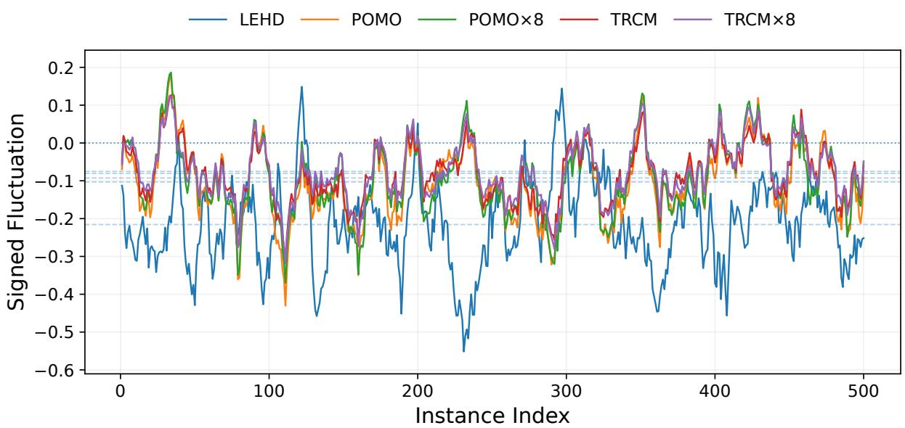  
Figure 5: Signed objective-fluctuation trends for 500 demand-reassigned variants of one fixed geometry. Curves show rolling means and horizontal reference lines show model-wise means.

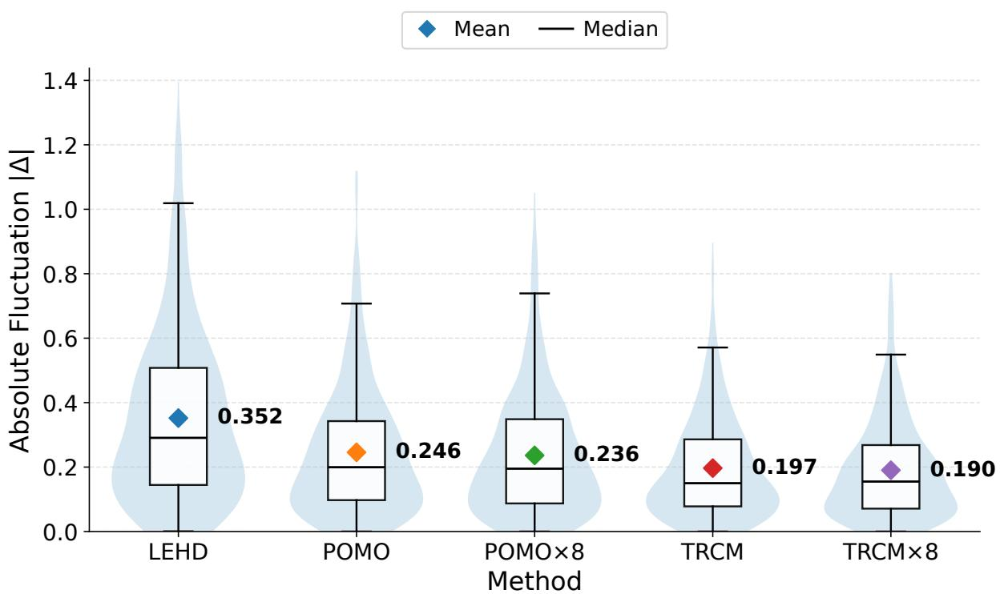  
Figure 6: Absolute objective-fluctuation distributions for the same variants. Diamond markers denote means and horizontal lines within boxes denote medians. TRCM has smaller mean fluctuations than the corresponding POMO settings.

## 5.5. Ablation study

Table 5 evaluates prior prediction. The full configuration reaches F1 0.8065. Removing RA, SD or DA lowers F1 to 0.7841, 0.7825 or 0.7886, respectively. Removing TE produces the largest decrease, to 0.7560, supporting the contribution of topology-aware weighting in the evaluated predictor.

Table 5: Ablation of prior-prediction training. ∆F1 is the change from the full model.
<table><tr><td>Model</td><td> ${ \mathrm { A c c . } }$ </td><td>F1</td><td>Prec.</td><td>Rec.</td><td> $\Delta \mathrm { F } 1$ </td></tr><tr><td>TRCM (full)</td><td>0.9336</td><td>0.8065</td><td>0.8002</td><td>0.8131</td><td>0.0000</td></tr><tr><td> $\mathrm { w / o }$  RA</td><td>0.9147</td><td>0.7841</td><td>0.6890</td><td>0.9096</td><td>-0.0224</td></tr><tr><td> $\mathrm { w / o }$  SD</td><td>0.9249</td><td>0.7825</td><td>0.7720</td><td>0.7933</td><td>-0.0240</td></tr><tr><td> $\mathrm { w / o }$  DA</td><td>0.9355</td><td>0.7886</td><td>0.8923</td><td>0.7065</td><td>-0.0179</td></tr><tr><td> $\mathrm { w / o }$  TE</td><td>0.9111</td><td>0.7560</td><td>0.7099</td><td>0.8085</td><td>-0.0505</td></tr></table>

RA: route-refactor augmentation; SD: within-route demand shufling; DA: geometric augmentation.

The precision–recall profiles reveal complementary efects. Without RA, recall increases to 0.9096 but precision falls to 0.6890. Without DA, precision reaches 0.8923 while recall falls to 0.7065; accuracy is slightly higher than in the full configuration, despite the lower F1. The ablation thus characterizes recovery of the reference relation under imbalanced supervision. Its F1 diferences concern predictor quality and are not direct estimates of downstream routing gains.

## 5.6. Hyperparameter sensitivity

Figure 7 varies $\lambda \in \{ 0 . 1 , 0 . 5 , 1 , 3 , 5 \}$ on CVRP100. Both inference settings have their lowest displayed objective at λ = 1, with annotated values 15.8249 and 15.7438 for nonaugmented and eightfold-augmented TRCM. Moderate fusion is most efective in the tested grid; large coeficients deteriorate the objective. Equation (A.1) explains why increasing λ strengthens the influence of compatibility on action preferences, without identifying a unique cause for the deterioration.

Figure 8 varies the TE temperature $\alpha \in \{ 0 . 1 , 0 . 5 , 1 , 2 , 3 \}$ and propagation depth $L \in \{ 0 , 1 , 2 \}$ The best annotated setting is $( \alpha , L ) \ = \ ( 1 , 1 )$ , with F1 0.8065. Small temperatures emphasize high-entropy pairs more strongly, whereas large temperatures flatten relative weights. The observed intermediate optimum indicates a useful balance for this configuration. One propagation step improves the displayed optimum over zero steps; a second step provides no further best-score improvement. These measurements evaluate relation-prediction F1.

(a) TRCM: non-augmented  
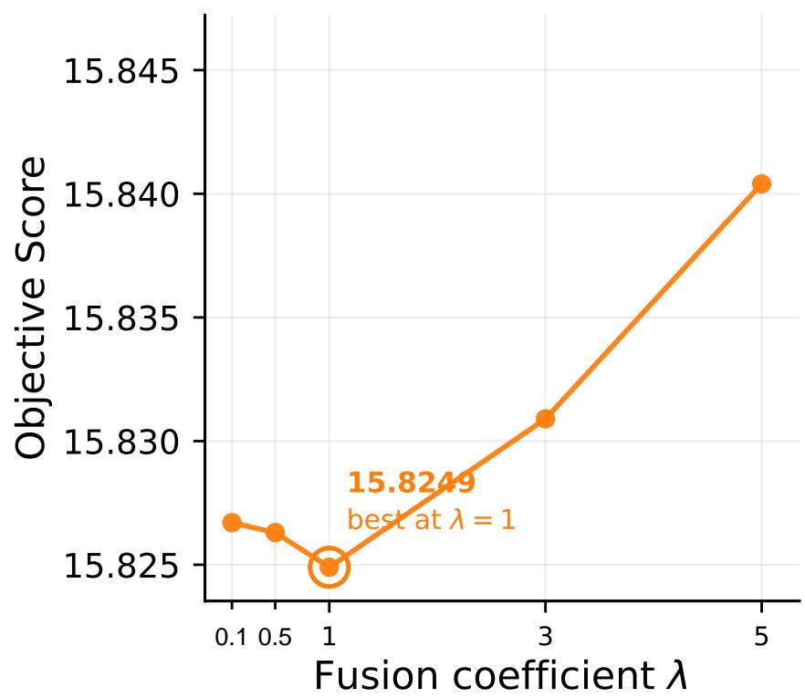

(b) TRCM: eightfold augmentation  
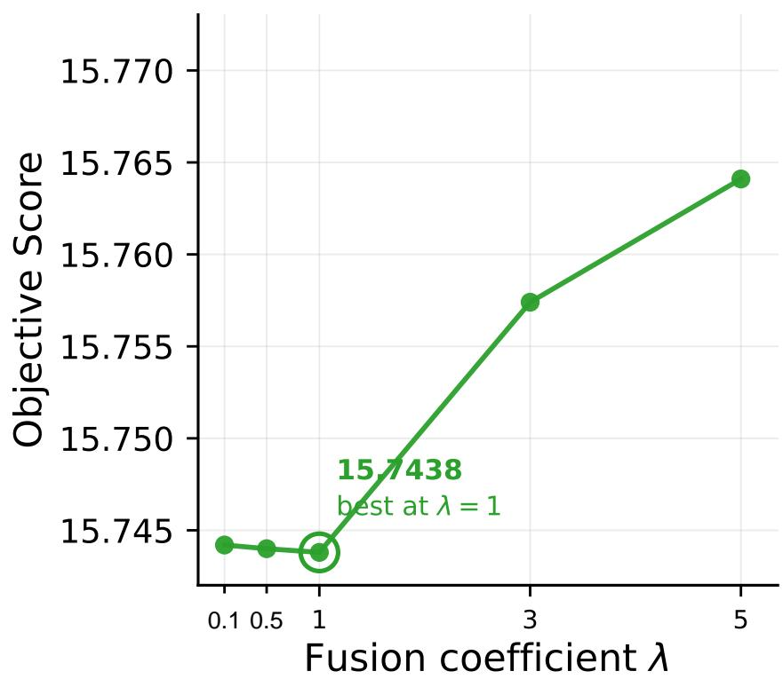  
TRCM×8Figure 7: CVRP100 objective sensitivity to fusion strength: (a) non-augmented TRCM; (b) eightfoldaugmented TRCM. Both settings have their best displayed value at λ = 1.

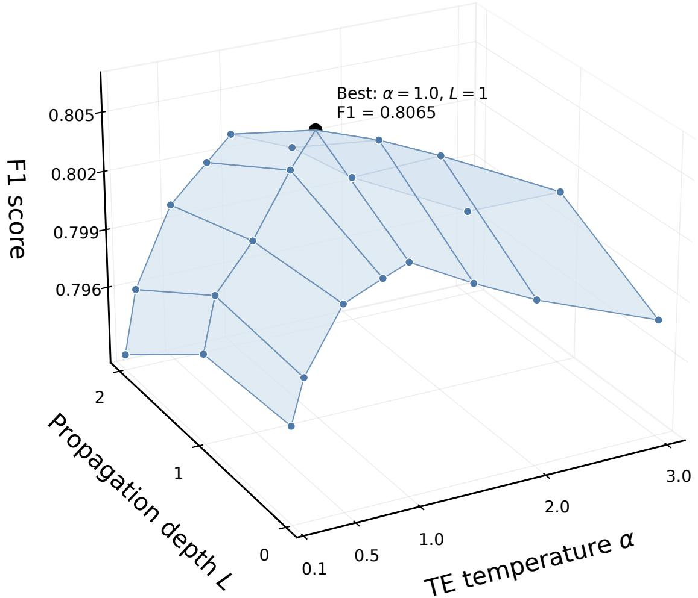  
Figure 8: Prior-prediction F1 as a function of TE temperature and propagation depth. The best annotated setting is α = 1, L = 1, with F1 0.8065.

## 5.7. Computational overhead

Table 6 summarizes the paired inference times. Without augmentation, time increases from 1 to 3 seconds on CVRP50 and from 8 to 15 seconds on CVRP100. With eightfold augmentation, it increases from 26 to 40 seconds and from 5 to 7 minutes, respectively. The corresponding ratios range from 1.40 to 3.00. Reference routes are prepared ofline and their generation cost is excluded from inference timing.

Table 6: Inference times under matched decoding configurations. The time ratio is TRCM time divided by POMO time.
<table><tr><td>Dataset</td><td>Setting</td><td>POMO</td><td>TRCM</td><td>Time ratio</td></tr><tr><td>CVRP50</td><td>Non-augmented</td><td>1s</td><td>3s</td><td>3.00×</td></tr><tr><td>CVRP100</td><td>Non-augmented</td><td>8s</td><td>15s</td><td>1.88×</td></tr><tr><td>CVRP50</td><td>Eightfold augmentation</td><td>26s</td><td>40s</td><td>1.54×</td></tr><tr><td>CVRP100</td><td>Eightfold augmentation</td><td>5m</td><td>7m</td><td>1.40×</td></tr></table>

These comparisons use matched decoding configurations, not matched wall-clock budgets. They quantify the cost of the prior pathway in the reported settings. Contextual times for diferent literature solvers are not a hardware-normalized eficiency ranking.

## 6. Discussion

Complementary structural information. Route membership and local transitions answer diferent questions. The decoder evaluates the next visit given the current state, while the prior estimates compatibility with the customers accumulated in the current route. Nonadjacent customers contribute to this compatibility. The soft-prior interface allows these signals to cooperate without requiring the predicted matrix to be decoded into a hard partition.

Distribution and augmentation efects. The XML100 patterns are consistent with coassignment being more useful when geometry or accumulated route context is informative, as in clustered, unitary-demand and ultra-long-route groups. On CVRP50, TRCM with eightfold augmentation performs worse than the corresponding POMO setting, indicating that route-level guidance and augmented inference are not uniformly complementary.

Reference-partition dependence. Supervision is induced by a chosen reference solution. Diferent near-optimal solutions may assign some customers to diferent routes, so agreement with one reference partition and solution quality are related but distinct objectives. This motivates retaining a soft relation representation and evaluating the complete solver separately from its pair classifier.

Quality–cost trade-of. Dense pair prediction makes the relation available for any partialroute query, at quadratic computation and storage cost. Sharing the instance prior across decoding starts and updating route scores incrementally can avoid redundant work. The measured overhead nevertheless remains material, and should be considered alongside the modest routing-quality diferences.

Scope of controlled stability. The demand-reassignment study shows lower objective variation for one fixed geometry; its 500 variants characterize stability within this controlled setting. Further validation across backbones, scales and independent runs can clarify the wider applicability of route-consistency guidance.

## 7. Conclusion

We presented TRCM, an explicit route-membership pathway for autoregressive neural CVRP construction. Symmetric pair prediction models customer co-assignment, topologyaware supervision addresses relation-learning imbalance, and current-route aggregation connects the learned prior to node-level decisions. The POMO-based evaluation shows improvements in both non-augmented synthetic settings and on average across XML100, a mixed interaction with eightfold augmentation, and lower objective variation in a controlled demand-reassignment case.

These results support route membership as a complementary structural signal whose value depends on the problem distribution and decoding configuration. Reference dependence and the cost of dense pair prediction remain practical considerations. Future work can examine how to improve the reliability and computational eficiency of this signal while extending its evaluation to broader routing settings.

## Acknowledgements

This work was partially supported by the National Natural Science Foundation of China under Grant No. 62502345, the Natural Science Foundation of Shanghai under Grant No. 25ZR1402511, and the Fundamental Research Funds for the Central Universities.

## Data availability

The XML100 instances and reference solutions are publicly available through CVRPLIB at https://galgos.inf.puc-rio.br/cvrplib/en/xml100. Synthetic CVRP instances and reference-route supervision follow the procedures described in Section 5.1.

## Appendix A. Analytical properties

Appendix A.1. Invariance of route membership

Proposition 1. Permuting customers within each reference route or permuting the routes leaves the same-route labels in Eq. (4) unchanged. For fixed encoder representations, Eq. (5) gives $P _ { i j } = P _ { j i }$ . For fixed P and a fixed current-route customer set, Eq. (14) is invariant to the order in which that set is enumerated.

Proof. The label depends only on membership of i and j in the same customer set ${ \mathcal { C } } ( R )$ Neither permutation changes that set relation. The feature sum, absolute diference, and element-wise product are each symmetric in their two inputs, so their concatenation and deterministic predictor output are symmetric. Finally, a finite sum over $S _ { t }$ is independent of its enumeration. □

These properties do not imply invariance of the base logits to the entire decoding history. Two trajectories with the same customer set can still have diferent current nodes or decoder states, so their final fused distributions can difer.

Appendix A.2. Relative preferences and a bound on additive fusion

At a fixed decoding state, let $p _ { t } ^ { \mathrm { b a s e } }$ denote the unfused distribution over the same feasible set. Softmax normalization cancels in each pairwise odds ratio, so Eq. (15) gives

$$
\log \frac { p _ { t } ( j ) } { p _ { t } ( k ) } - \log \frac { p _ { t } ^ { \mathrm { b a s e } } ( j ) } { p _ { t } ^ { \mathrm { b a s e } } ( k ) } = \lambda \big ( r _ { t } ( j ) - r _ { t } ( k ) \big ) .\tag{A.1}
$$

Thus, greater compatibility increases relative preference. The following bound controls the change in an individual feasible action’s probability.

Proposition 2. At a fixed decoding state and feasible set, assume $r ( j ) \in [ 0 , 1 ]$ and $\lambda \geq 0$ Let $p ^ { \mathrm { b a s e } } ( j ) = \exp ( u ( j ) ) / Z$ and $p ( j ) = \exp ( u ( j ) + \lambda r ( j ) ) / Z ^ { \prime }$ . Then

$$
\left| \log { \frac { p ( j ) } { p ^ { \mathrm { b a s e } } ( j ) } } \right| \leq \lambda , \qquad \left| \log _ { 1 0 } { \frac { p ( j ) } { p ^ { \mathrm { b a s e } } ( j ) } } \right| \leq { \frac { \lambda } { \ln 1 0 } } .\tag{A.2}
$$

Proof. Since $1 \leq \exp ( \lambda r ( j ) ) \leq \exp ( \lambda )$ , summing over the same feasible set gives $Z \le$ $Z ^ { \prime } \le \exp ( \lambda ) Z$ . Therefore $0 \leq \log ( Z ^ { \prime } / Z ) \leq \lambda$ . Substituting into $\log [ p ( j ) / p ^ { \mathrm { b a s e } } ( j ) ] =$ $\lambda r ( j ) - \log ( Z ^ { \prime } / Z )$ gives a value in $[ - \lambda , \lambda ]$ . Division by ln 10 gives the base-10 bound.

For the depot, $r ( 0 ) = 0$ and $p ( 0 ) / p ^ { \mathrm { b a s e } } ( 0 ) = Z / Z ^ { \prime } \le 1$ . If a feasible customer has positive score, the inequality is strict. Thus, an unchanged depot logit can accompany a lower depot probability. For a constant customer score c, relative customer odds are unchanged, but each customer/depot odds ratio is multiplied by $\exp ( \lambda c )$ . These are local algebraic statements; they do not impose a route-level performance ordering.

## Appendix A.3. Complete relation-graph limiting case

Proposition 3. If the TE propagation graph is complete and unweighted, with a self-loop at every node, its row-normalized adjacency is $\widetilde { \mathbf { A } } = \mathbf { 1 1 } ^ { \mathsf { T } } / n$ . For any initial relation distributions, after one propagation step all node distributions coincide. Consequently, all pair TE values are equal and all normalized TE weights equal one.

Proof. Each row of $\widetilde { \bf A }$ is $\mathbf { 1 } ^ { \mathsf { T } } / n ,$ , so every row of $\mathbf { Q } ^ { ( 1 ) }$ is the mean of the rows of $\mathbf { Q } ^ { ( 0 ) }$ Further propagation leaves this shared row unchanged. Averaging any two endpoints therefore produces the same vector $\mathbf { g } _ { i j } ^ { ( L ) }$ for $L \geq 1$ , giving identical entropies and identical unnormalized weights. Dividing by their mini-batch mean yields one. □

In this case the quantity component can still vary by class, but the topology component cannot distinguish pairs. The supervised relation graph, rather than the density of $\mathbf { P }$ determines whether TE can distinguish local label contexts.

## Appendix A.4. Incremental route aggregation

For a current route of length s, direct computation of every candidate score costs $O ( n s )$ Summing over steps yields $O ( n ^ { 3 } )$ in the unrestricted worst case. Alternatively, keep a vector a and a route-customer count s. When customer i is selected, set a $ \mathbf { a } + \mathbf { P } _ { i } ,$ and $s \gets s + 1$ ; query $r ( j ) = a _ { j } / s$ . On a depot action reset $\mathbf { a } = \mathbf { 0 }$ and $s = 0$ . There are n customer updates and at most a linear number of nonempty-route closures, giving $O ( n ^ { 2 } )$ aggregation work per trajectory and $O ( n )$ additional state. These costs describe the equivalent incremental evaluation of Eq. (14).

## Appendix B. Learning and decoding procedures

The algorithms specify the prior-head update and its decoder interface. The supervised pair set $\mathcal { P }$ and its relation graph are training inputs; the dense prior matrix $\mathbf { P } = [ P _ { i j } ]$ is predicted for each inference instance. Feasibility masking, action selection, state updates, and final route closure use the base solver’s conventions.

Algorithm 1 Topology-aware prior-head learning   
Require: Training instances and routes $\overline { { ( \mathcal { G } , \mathcal { R } ^ { \star } ) } }$ ; encoder Enc ; predictor $g _ { \phi } ;$ supervised pair set   
$\mathcal { P }$ and relation graph; $L , \alpha , \beta$   
Ensure: Learned predictor $g _ { \phi }$   
1: for each training mini-batch do   
2: Apply reference-label-preserving augmentation to the batch   
3: H $ \operatorname { E n c } _ { \theta } ( \widetilde { \mathcal { G } } )$   
4: Convert the reference routes to labels $y _ { i j }$ on $\mathcal { P }$   
5: Predict $P _ { i j }  g _ { \phi } ( \mathbf { z } _ { i j } )$ using Eq. (5)   
6: Construct $\mathbf { \hat { Q } } ^ { ( 0 ) }$ and propagate with Eq. (7)   
7: Compute $\mathrm { T E } _ { i j } ^ { ( L ) }$ using Eq. (9)   
8: Compute normalized TE and quantity weights   
9: $w _ { i j }  \beta \bar { w } _ { i j } ^ { \mathrm { T E } } + ( 1 - \beta ) \bar { w } _ { i j } ^ { \mathrm { q t y } }$   
10: Evaluate $\dot { \mathcal { L } } _ { \mathrm { p r i o r } }$ using Eq. (13)   
11: Update $\phi$ by gradient descent   
12: end for   
13: return $g _ { \phi }$

Algorithm 2 Customer-prior-guided autoregressive decoding   
Require: Instance ${ \overline { { \mathcal { G } ; } } }$ encoder and decoder; learned $g _ { \phi } ; \lambda$   
Ensure: A feasible depot-to-depot routing trajectory   
1: H $ \operatorname { E n c } _ { \theta } ( { \mathcal { G } } )$   
2: Predict $\mathbf { P } = [ P _ { i j } ] \in [ 0 , 1 ] ^ { n \times n }$ over customers   
3: Initialize the base solver at the depot; $\tau  \emptyset ; S  \emptyset$   
4: while unserved customers remain do   
5: Obtain base logits $u _ { t }$ and feasible set $\mathcal { F } _ { t }$ from the solver   
6: for each $j \in \mathcal { F } _ { t }$ do   
7: if $j \neq 0$ and $s \neq \emptyset$ then   
8: $r _ { t } ( j ) \gets \frac { 1 } { | S | } \sum _ { i \in S } P _ { i j }$   
9: else   
10: $r _ { t } ( j ) \gets 0$   
11: end if   
12: $\widetilde { u } _ { t } ( j ) \gets u _ { t } ( j ) + \lambda r _ { t } ( j )$   
13: end for   
14: Select $a _ { t }$ using the base solver’s selection rule on masked softmax $( \widetilde { u } _ { t } )$   
15: Append $a _ { t }$ to $\tau$ and update the base solver state   
16: if $a _ { t } = 0$ then   
17: $s  \emptyset$   
18: else   
19: $S \gets S \cup \{ a _ { t } \}$   
20: end if   
21: end while   
22: Finalize the last depot return using the base solver’s route-closure convention   
23: return τ

## References

[1] P. Toth, D. Vigo (Eds.), Vehicle Routing: Problems, Methods, and Applications, 2nd Edition, Society for Industrial and Applied Mathematics, Philadelphia, PA, USA, 2014. doi:10.1137/1.9781611973594.

[2] K. Helsgaun, An extension of the lin-kernighan-helsgaun TSP solver for constrained traveling salesman and vehicle routing problems, Technical report, Roskilde University (2017).

[3] T. Vidal, Hybrid genetic search for the CVRP: Open-source implementation and ${ \mathrm { S W A P } } ^ { * }$ neighborhood, Computers & Operations Research 140 (2022) 105643. doi: 10.1016/j.cor.2021.105643.

[4] N. A. Wouda, L. Lan, ALNS: A python implementation of the adaptive large neighbourhood search metaheuristic, Journal of Open Source Software 8 (81) (2023) 5028. doi:10.21105/joss.05028.

[5] N. A. Wouda, L. Lan, W. Kool, PyVRP: A high-performance VRP solver package, INFORMS Journal on Computing 36 (4) (2024) 943–955. doi:10.1287/ijoc.2023. 0055.

[6] I. Bello, H. Pham, Q. V. Le, M. Norouzi, S. Bengio, Neural combinatorial optimization with reinforcement learning (2016). arXiv:1611.09940, doi:10.48550/arXiv.1611.

[7] M. Nazari, A. Oroojlooy, L. V. Snyder, M. Takáč, Reinforcement learning for solving the vehicle routing problem, in: Advances in Neural Information Processing Systems, Vol. 31, Curran Associates, Inc., 2018.

[8] W. Kool, H. van Hoof, M. Welling, Attention, learn to solve routing problems!, International Conference on Learning Representations (2019). arXiv:1803.08475. URL https://openreview.net/forum?id=ByxBFsRqYm

[9] Y.-D. Kwon, J. Choo, B. Kim, I. Yoon, Y. Gwon, S. Min, POMO: Policy optimization with multiple optima for reinforcement learning, in: Advances in Neural Information Processing Systems, Vol. 33, Curran Associates, Inc., 2020, pp. 21188–21198.

[10] M. Kim, J. Park, J. Park, Sym-NCO: Leveraging symmetricity for neural combinatorial optimization, in: Advances in Neural Information Processing Systems, Vol. 35, Curran Associates, Inc., 2022, pp. 1936–1949. doi:10.52202/068431-0141.

[11] F. Luo, X. Lin, F. Liu, Q. Zhang, Z. Wang, Neural combinatorial optimization with heavy decoder: Toward large scale generalization, in: Advances in Neural Information Processing Systems, Vol. 36, Curran Associates, Inc., 2023, pp. 8845– 8864. doi:10.52202/075280-0387.

[12] Z. Huang, J. Zhou, Z. Cao, Y. Xu, Rethinking light decoder-based solvers for vehicle routing problems, in: International Conference on Learning Representations, 2025. URL https://openreview.net/forum?id=4pRwkYpa2u

[13] J. Choo, Y.-D. Kwon, J. Kim, J. Jae, A. Hottung, K. Tierney, Y. Gwon, Simulationguided beam search for neural combinatorial optimization, in: Advances in Neural Information Processing Systems, Vol. 35, Curran Associates, Inc., 2022, pp. 8760–8772. doi:10.52202/068431-0637.

[14] X. Cheng, Y. Wang, Y. Liu, Y. Zhao, C. C. Aggarwal, T. Derr, Edge classification on graphs: New directions in topological imbalance, in: Proceedings of the Eighteenth ACM International Conference on Web Search and Data Mining, WSDM ’25, Associa tion for Computing Machinery, 2025, pp. 392–400. doi:10.1145/3701551.3703518.

[15] O. Vinyals, M. Fortunato, N. Jaitly, Pointer networks, in: Advances in Neural Information Processing Systems, Vol. 28, Curran Associates, Inc., 2015, pp. 2692– 2700.

[16] F. Luo, X. Lin, Y. Wu, Z. Wang, X. Tong, M. Yuan, Q. Zhang, Boosting neural combinatorial optimization for large-scale vehicle routing problems, in: International Conference on Learning Representations, 2025. URL https://openreview.net/forum?id=TbTJJNjumY

[17] F. Luo, X. Lin, M. Zhong, F. Liu, Z. Wang, J. Sun, Q. Zhang, Learning to insert for constructive neural vehicle routing solver, in: Advances in Neural Information Processing Systems, Vol. 38, 2025, pp. 96953–96992. doi:10.52202/085713-2918.

[18] Y. Jiang, Z. Cao, Y. Wu, W. Song, J. Zhang, Ensemble-based deep reinforcement learning for vehicle routing problems under distribution shift, in: Advances in Neural Information Processing Systems, Vol. 36, Curran Associates, Inc., 2023, pp. 53112– 53125. doi:10.52202/075280-2311.

[19] C. Gao, H. Shang, K. Xue, D. Li, C. Qian, Towards generalizable neural solvers for vehicle routing problems via ensemble with transferrable local policy, in: Proceedings of the Thirty-Third International Joint Conference on Artificial Intelligence, IJCAI-24, 2024, pp. 6914–6922. doi:10.24963/ijcai.2024/764.

[20] Z. Lin, Y. Wu, B. Zhou, Z. Cao, W. Song, Y. Zhang, S. Jayavelu, Cross-problem learning for solving vehicle routing problems, in: Proceedings of the Thirty-Third International Joint Conference on Artificial Intelligence, IJCAI-24, International Joint Conferences on Artificial Intelligence Organization, 2024, pp. 6958–6966. doi: 10.24963/ijcai.2024/769.

[21] F. Liu, X. Lin, W. Liao, Z. Wang, Q. Zhang, X. Tong, M. Yuan, Prompt learning for generalized vehicle routing, in: Proceedings of the Thirty-Third International Joint Conference on Artificial Intelligence, IJCAI-24, 2024, pp. 6976–6984. doi: 10.24963/ijcai.2024/771.

[22] Q. Guan, H. Cao, T. Niu, L. Jia, S. Xue, B. Chen, Diverse route-driven deep reinforcement learning for vehicle routing problems, Neurocomputing 653 (2025) 131099. doi:10.1016/j.neucom.2025.131099.

[23] Y.-B. Jiang, D.-Y. Tao, W.-J. Chen, F.-R. Xu, Dual-branch distance-aware neural solver for cross-distribution vehicle routing problems, Neurocomputing 679 (2026) 133239. doi:10.1016/j.neucom.2026.133239.

[24] K. Lei, P. Guo, Y. Wang, X. Wu, W. Zhao, Solve routing problems with a residual edge-graph attention neural network, Neurocomputing 508 (2022) 79–98. doi:10. 1016/j.neucom.2022.08.005.

[25] Z. Wang, R. Bai, F. Khan, E. Özcan, T. Zhang, Gase: graph attention sampling with edges fusion for solving vehicle routing problems, Memetic Computing 16 (3) (2024) 337–353. doi:10.1007/s12293-024-00428-0.

[26] Z. Sun, Y. Yang, DIFUSCO: Graph-based difusion solvers for combinatorial optimization, in: Advances in Neural Information Processing Systems, Vol. 36, Curran Associates, Inc., 2023, pp. 3706–3731. doi:10.52202/075280-0164.

[27] A. Hottung, K. Tierney, Neural large neighborhood search for the capacitated vehicle routing problem, in: ECAI 2020, Vol. 325 of Frontiers in Artificial Intelligence and Applications, IOS Press, 2020, pp. 443–450. doi:10.3233/faia200124.

[28] S. Li, Z. Yan, C. Wu, Learning to delegate for large-scale vehicle routing, in: Advances in Neural Information Processing Systems, Vol. 34, Curran Associates, Inc., 2021, pp. 26198–26211.

[29] L. Xin, W. Song, Z. Cao, J. Zhang, NeuroLKH: Combining deep learning model with lin-kernighan-helsgaun heuristic for solving the traveling salesman problem, in: Advances in Neural Information Processing Systems, Vol. 34, Curran Associates, Inc., 2021, pp. 7472–7483.

[30] A. Hottung, Y.-D. Kwon, K. Tierney, Eficient active search for combinatorial optimization problems, International Conference on Learning Representations (2022). URL https://arxiv.org/abs/2106.05126

[31] T.-Y. Lin, P. Goyal, R. Girshick, K. He, P. Dollár, Focal loss for dense object detection, in: Proceedings of the IEEE International Conference on Computer Vision, IEEE, 2017, pp. 2980–2988.

[32] Y. Cui, M. Jia, T.-Y. Lin, Y. Song, S. Belongie, Class-balanced loss based on efective number of samples, in: Proceedings of the IEEE/CVF Conference on Computer Vision and Pattern Recognition, IEEE, 2019, pp. 9268–9277.

[33] P. Bielak, T. Kajdanowicz, N. V. Chawla, AttrE2vec: Unsupervised attributed edge representation learning, Information Sciences 592 (2022) 82–96. doi:10.1016/j.ins. 2022.01.048.

[34] E. Queiroga, R. Sadykov, E. Uchoa, T. Vidal, 10,000 optimal CVRP solutions for testing machine learning based heuristics, in: AAAI-22 Workshop on Machine Learning for Operations Research (ML4OR), 2021. URL https://openreview.net/forum?id=yHiMXKN6nTl

[35] Google, OR-Tools, online documentation, accessed 19 October 2026 (2026). URL https://developers.google.com/optimization

[36] J. Zhou, Y. Wu, Z. Cao, W. Song, J. Zhang, Z. Shen, Collaboration! towards robust neural methods for routing problems, in: Advances in Neural Information Processing Systems, Vol. 37, Curran Associates, Inc., 2024, pp. 121731–121764. doi:10.52202/079017-3869.

[37] P. Xiao, Z. Zhang, J. Chen, J. Wang, Z. Zhang, Neural combinatorial optimization for robust routing problem with uncertain travel times, in: Advances in Neural Information Processing Systems, Vol. 37, Curran Associates, Inc., 2024, pp. 134841– 134867. doi:10.52202/079017-4285.