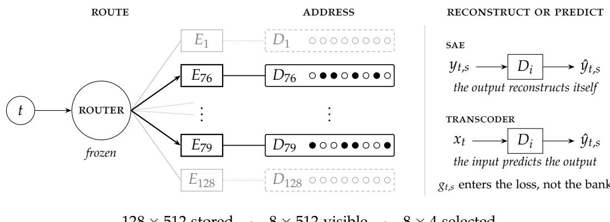
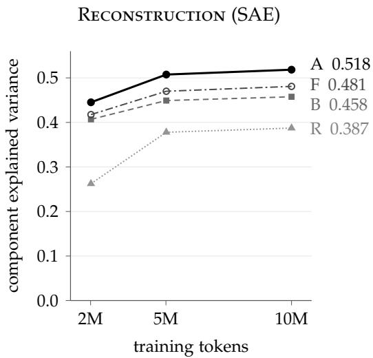
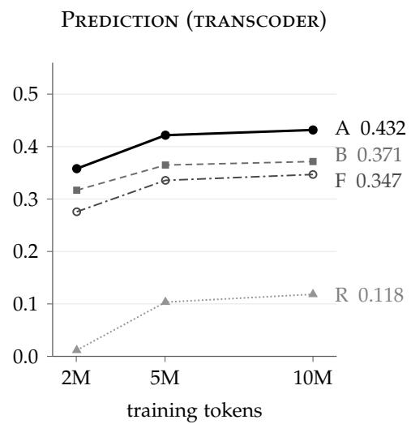

# The Router Already Knows

Andrew Bistras1,2 Marty Johnson1,2

1University of California, Los Angeles 2Astrid Cybernetics Preprint, October 2026

Abstract. Mixture-of-experts (MoE) models already make a sparse choice for every token: which experts should process it. We ask whether a sparse dictionary should reuse that choice. NR-SAE gives each routed expert a small dictionary and opens only those the frozen router selects. At block 15 of Gemma 4 26B-A4B, after ten million C4 training tokens and across three seeds, the expert-aligned autoencoder explains 0.518 of the variance in router-weighted expert outputs on a fixed evaluation capture. A rank-addressed control with the same parameters but sixteen times as many candidates reaches 0.481, a candidate-matched control 0.458, and an architecture-matched control with randomized expert identity 0.387. A transcoder variant also leads all three controls: 0.432, against 0.347, 0.371, and 0.118. Part of this advantage is architectural: each expert writes into a subspace of at most a quarter of the model width, so naming the expert names the subspace. How much it explains, we have not measured. At this layer and budget, the router already knows something a dictionary would otherwise have to learn. Our implementation did not train faster, and semantic interpretability, downstream loss, and causal faithfulness remain untested.

## 1 Introduction

We propose that a sparse dictionary for a mixture-of-experts layer need not learn where to look. The router already knows.

A mixture-of-experts (MoE) layer owns many parameters and consults few of them. A router selects a handful of expert networks for each token, and their weighted outputs are summed (Shazeer et al., 2017). A sparse autoencoder (SAE) makes a second sparse choice, writing a dense activation as a few directions from a much larger learned dictionary (Cunningham et al., 2024; Gao et al., 2025). Where the dictionary sits decides what structure it can see. Placed after the sum, it sees only the recombined update. Placed across the individual expert outputs without their identities, it treats them as one population. Either way the router’s partition is discarded, unless someone hands it back.

NR-SAE hands it back. Each routed expert receives a small dictionary, and the frozen router serves as its address: when expert 76 runs, dictionary 76 opens; otherwise dictionary 76 is neither scored nor selected (Figure 1). Our question is narrower than whether MoE experts are interpretable. It is whether the expert identities chosen by a pretrained router are useful structure for sparse dictionary learning.

We contribute (i) the native-router factorization at a reconstructive and a predictive seam, (ii) matched controls that separate stable expert identity from conditional capacity and dictionary width, and (iii) a timing measurement showing that our grouped implementation does not yet turn its arithmetic advantage into speed.

  
128 × 512 stored · 8 × 512 visible · 8 × 4 selected  
Figure 1. The router chooses the dictionary. A pretrained MoE layer routes each token to eight of its 128 experts (left). NR-SAE reuses that selection to open the matching 512-feature banks, each of which selects four features (center). A token therefore considers 4,096 of 65,536 stored features and selects 32, without a second router. The same bank layout is trained separately for two tasks (right): reconstructing an expert’s output, or predicting it from the shared input. The shared expert is unchanged and omitted.

## 2 Method

## 2.1 Expert-aligned dictionaries

For token t, let $i _ { t , s }$ be the expert at routing rank $s \in \{ 1 , \ldots , 8 \} , g _ { t , s }$ its router weight, and $y _ { t , s } \in \mathbb { R } ^ { 2 8 1 6 }$ its raw output, taken before routed summation and normalization. Each of the 128 routed experts owns a bank of 512 features. Given an input $u _ { t , s } ,$ defined per seam in §2.2, the bank of the selected expert $i = i _ { t , s }$ produces

$$
\hat { y } _ { t , s } ~ = ~ D _ { i } \mathrm { T o p K } _ { 4 } \big ( \mathrm { R e L U } \big ( E _ { i } u _ { t , s } + b _ { i } \big ) \big ) .\tag{1}
$$

Top $\mathrm { K _ { 4 } }$ keeps the four largest post-ReLU entries and zeroes the rest. Zero-valued entries remain eligible, so four is a ceiling on the number of active features rather than a promise. Centering, omitted from (1), uses one pooled training mean of the targets, and in the transcoder one of the inputs, shared by every bank in every layout; neither carries expert identity. With eight routed experts per token, a token sees 4,096 candidate features and selects 32 slots.

Training minimizes normalized squared error on router-weighted outputs over each batch B:

$$
\begin{array} { r } { \mathcal { L } _ { \mathcal { B } } = \frac { \sum _ { ( t , s ) \in \mathcal { B } } \Vert \boldsymbol { g } _ { t , s } \left( \boldsymbol { y } _ { t , s } - \hat { \boldsymbol { y } } _ { t , s } \right) \Vert _ { 2 } ^ { 2 } } { \sum _ { ( t , s ) \in \mathcal { B } } \Vert \boldsymbol { g } _ { t , s } \left( \boldsymbol { y } _ { t , s } - \boldsymbol { \bar { y } } \right) \Vert _ { 2 } ^ { 2 } } , } \end{array}\tag{2}
$$

where y¯ is that pooled target mean. The denominator, the batch’s total sum of squares about y¯, is the same for every layout in a panel, so losses are directly comparable, and predicting y¯ alone scores exactly zero in every layout. Router weights enter only here; the banks receive unweighted inputs.

Part of what the router knows is plain arithmetic. Expert i computes $y = W _ { i } h ,$ where $W _ { i } \in \mathbb { R } ^ { 2 8 1 6 \times 7 0 4 }$ is its down-projection and $h \in \mathbb { R } ^ { 7 0 4 }$ its hidden activation. Its outputs therefore lie in a subspace of dimension at most 704, a quarter of the model width. A dictionary that is told which expert ran is thereby told which subspace to expect, before it has learned anything. Each 512-feature bank is smaller than that

704-dimension ceiling, though we have not measured how many dimensions the outputs actually use.

## 2.2 Two seams

We test the factorization at two points. The SAE receives the expert output itself, $u _ { t , s } = y _ { t , s } ,$ , and reconstructs it. The transcoder receives $x _ { t } ,$ the common input to the routed experts, and predicts each selected expert’s output (Dunefsky et al., 2024). The first asks whether expert outputs admit expert-local dictionaries; the second, whether those dictionaries can describe each expert’s computation from its input.

## 2.3 Relation to prior work

Switch SAEs and multi-expert SAEs learn an auxiliary router over dense-model activations (Mudide et al., 2025; Xu et al., 2025); the latter call such mixtures MoE-SAEs, which is one reason we do not. RouterInterp runs in the opposite direction, using SAE features to explain a pretrained MoE’s routing, and proposes that each expert specializes in many fine-grained features rather than one broad domain (Lasy et al., 2026); per-expert dictionaries are well placed to test that proposal. Herbst et al. (2026) find that expert neurons are less polysemantic than dense feed-forward neurons, and argue for interpreting experts directly, without a trained dictionary. Their argument makes each expert’s own neurons a natural reference point for our banks, though not a matched one; we have not yet measured it (§5). Routers and experts are also geometrically coupled during training (Ahrac et al., 2026). Attention-output SAEs train one dictionary on the concatenated outputs of all heads, before the output projection, so features stay attributable to heads without splitting the dictionary (Kissane et al., 2024). Mixtures of decoders are a recent alternative to transcoders for sparse layer approximation (Oldfield et al., 2025).

Here the native router is inherited and frozen, and its decisions index dictionaries trained on the outputs it selected. The contribution is controlled evidence for that factorization, not a new router.

## 3 Experimental design

## 3.1 Matched controls

A dictionary can look better because it stores more features, scores fewer candidates, or merely preserves some partition. We compare four layouts (Table 1). All select 32 slots per token and use the same loss.

F, the wide rank bank, matches A’s stored features and parameters but gives each of its eight rank banks 8,192 candidates, sixteen times as many as an A bank. Of the two rank-addressed layouts, it is the one matched to A in parameters.

B, the rank bank, matches A’s candidate count with one 512-feature bank per routing rank, shared across expert identities.

R keeps A’s architecture exactly but applies a per-sequence bijection from expert IDs to bank IDs, in training and evaluation alike. It preserves parameters, candidates, selected slots, the routed components, and eight distinct banks per token, while destroying any stable relationship between expert and bank. On average an R bank receives as much data as an A bank, but must spend it on every expert’s outputs rather than one expert’s; in the transcoder, moreover, a bank cannot tell which of the eight selected experts it is meant to predict.

Table 1. Matched layouts. All select 32 slots per token. F matches A’s stored features and parameters; B matches its candidates; R matches everything but a stable address, permuting expert identities afresh for each sequence.
<table><tr><td>Layout</td><td>Dictionary address</td><td> $\mathbf { B a n k s } \times \mathbf { w i d t h }$ </td><td>Stored features</td><td>Candidates per token</td></tr><tr><td>A NR-SAE</td><td>true expert identity</td><td> $1 2 8 \times 5 1 2$ </td><td>65,536</td><td>4,096</td></tr><tr><td>F Wide rank bank</td><td>router rank, 1–8</td><td> $8 \times 8 { , } 1 9 2$ </td><td>65,536</td><td>65,536</td></tr><tr><td>B Rank bank</td><td>router rank, 1–8</td><td> $8 \times 5 1 2$ </td><td>4,096</td><td>4,096</td></tr><tr><td>R Random identity</td><td>permuted identity</td><td> $1 2 8 \times 5 1 2$ </td><td>65,536</td><td>4,096</td></tr></table>

No single control carries the claim; the three contrasts carry it together. A−F holds stored capacity and parameters fixed, A−B the visible candidate budget, and A−R the architecture itself, while removing the stable expert address. None of the four layouts is a global SAE over the aggregated MoE output.

## 3.2 Training and evaluation

We train at block 15 (one-indexed) of the thirty in the pretrained Gemma 4 26B-A4B (Gemma Team, 2026), on packed C4 (Raffel et al., 2020). Each run sees ten million tokens, 611 updates of 16,384 tokens under one learning-rate schedule, with seeds 0–2. We evaluate checkpoints at nominal 2M, 5M, and 10M tokens on one fixed evaluation capture: the same ordered 250,000 tokens from the C4 validation split, in 625 packed sequences (§5 explains why we do not call it held out). All three checkpoints come from one cosine schedule, so the earlier two are snapshots of an unfinished run rather than runs trained to those budgets.

The endpoint is component explained variance, 1 − SSE/SST, with one denominator per panel. Intervals are 95% paired hierarchical bootstrap intervals over seeds and sequences, from 20,000 replicates, with no correction for multiplicity. With three seeds they chiefly reflect variation across sequences; per-seed values are given in Table A1.

## 4 Results

## 4.1 Component fidelity

Table 2 gives the endpoints and Figure 2 the learning curves. At ten million tokens the aligned SAE explains 0.518 of component variance on the evaluation capture. The wide rank bank F reaches 0.481, a margin of 0.038 [0.035, 0.040]. The candidatematched B reaches 0.458, and R 0.387.

The lead survives the harder task of prediction. The aligned transcoder reaches 0.432, against 0.347 for F and 0.371 for B, margins of 0.085 and 0.060; the narrowest margin is thus against F in reconstruction and against B in prediction. Against R the margin is 0.313. R withholds what the router knows: each bank’s data is spread across every expert and, in the transcoder, a bank cannot tell which expert it is predicting. The A−R margins therefore measure that knowledge as a whole, not inductive bias alone.

  
Figure 2. Expert identity leads throughout. Three-seed mean component explained variance on the fixed evaluation capture, at the three checkpoints of a single cosine schedule; the 2M and 5M points are therefore snapshots of unfinished runs. A leads every control at every checkpoint in both panels. Per-seed values are in Table A1.

Table 2. Endpoints at ten million tokens. Three-seed mean component explained variance (EV) on the fixed evaluation capture. Margins are A minus the layout named, with 95% paired hierarchical bootstrap intervals; margins and intervals were computed before rounding.
<table><tr><td rowspan="2">Layout</td><td colspan="2">Reconstruction (SAE)</td><td colspan="2">Prediction (transcoder)</td></tr><tr><td>EV</td><td>A − layout</td><td>EV</td><td>A − layout</td></tr><tr><td>A NR-SAE</td><td>0.518</td><td></td><td>0.432</td><td></td></tr><tr><td>F Wide rank bank</td><td>0.481</td><td>0.038 [0.035, 0.040]</td><td>0.347</td><td>0.085 [0.082, 0.088]</td></tr><tr><td>B Rank bank</td><td>0.458</td><td>0.061 [0.059, 0.062]</td><td>0.371</td><td>0.060 [0.058, 0.062]</td></tr><tr><td>R Random identity</td><td>0.387</td><td>0.131 [0.127, 0.135]</td><td>0.118</td><td>0.313 [0.308, 0.320]</td></tr></table>

A leads every control at every checkpoint in both panels, and at every checkpoint its weakest seed exceeds every control’s strongest (Table A1). The plainest reading is that, at this layer and budget, stable expert identity indexes a dictionary better than router rank, random identity, or a much wider rank dictionary does. The pretrained router has supplied a useful address.

## 4.2 Systems cost

A scores one sixteenth as many encoder candidates as F. Its decoding, dispatch, and optimizer work are no smaller, and neither, so far, is its clock time. At ten million tokens A used 1.10–1.12 times F’s training chip-seconds in the SAE panel and 1.10– 1.16 times in the transcoder panel, on same-generation accelerators with matched timing boundaries (Appendix A). We did not complete a profile, so dispatch, the fixed-capacity scan, small matrix multiplications, and dense optimizer work remain suspects rather than findings. A fused implementation is a separate project.

## 5 Limitations and next steps

The result is evidence for conditional factorization: at this layer and budget, stable expert identities are better dictionary addresses than router rank, random identity, or a much wider rank dictionary.

What comes free. Each expert writes into a subspace of at most 704 of 2,816 dimensions (§2.1), so part of A’s margin may be knowledge the router supplies before any dictionary is trained. We have not measured how much. The obvious reference point is the expert’s own neurons: keep, for each routed expert, the four terms $h _ { j } w _ { j }$ of largest norm in $\begin{array} { r } { y = \sum _ { j } h _ { j } w _ { j } } \end{array}$ , where $w _ { j }$ is the jth column of $W _ { i }$ . This top-four native-neuron baseline needs no training, but it is not a matched dictionary. It draws on 704 candidates rather than 512, its coefficients are signed, and it reads the expert’s hidden activations; in the transcoder it must run the very expert it approximates. We have not run it. A learned router over the same 128 banks, in the manner of Switch SAEs (Mudide et al., 2025), would test whether native addresses are better than learned ones or merely free.

What is not shown. Nothing here shows that individual features mean anything to a human. We report component explained variance only, at a single sparsity: not routed-branch variance, full-block reconstruction, logits, loss recovered, or any task endpoint. Fidelity after recomposition is unknown. We have not shown semantic specialization, causal control, downstream benefit, preserved perplexity, or faithful replacement of the MoE block. Partitioned dictionaries can learn the same feature more than once (Xu et al., 2025); we have not measured whether ours do.

Scope. One model, one layer, one corpus, three seeds, and ten million tokens. At 611 updates the comparison measures early sample efficiency, not the asymptote. All layouts shared one optimizer and schedule, and F, with the widest banks, may improve with its own tuning or a longer horizon.

Hygiene. The evaluation capture was excluded from gradient updates but consulted during earlier development of the activation rule, which is why we call it fixed rather than held out. The six aligned runs were carried over from that earlier experiment, and their results were known; before training the eighteen new controls we fixed the comparison matrix, the endpoint, and the planned contrasts. Final evidence was content-hashed after it was generated, which establishes lineage, not preregistration. Both asymmetries make the comparison less confirmatory than it looks, and either could favor A. Retraining the aligned runs alongside the controls, and evaluating on a fresh slice, would remove them.

Next. Replication across layers and a second open MoE would establish breadth. A sparsity sweep with loss recovered would establish practical value. Feature labeling, intervention, and a census of duplicated features would test whether the better dictionaries are also better explanations. A fused sparse kernel would test whether the factorization can become a speedup.

## 6 Conclusion

At this layer and budget, native routing improves sparse component fidelity under controls for candidate count, parameter count, selected-slot budget, and arbitrary partitioning. It does not yet make training cheaper, and it has not yet been shown to make features clearer. The modest conclusion is enough: a mixture-of-experts model has already carved its computation at useful joints, and a sparse account of that computation should begin by respecting the cut.

Every routed model offers the same cut. We have examined one layer of one.

Acknowledgments. This work was supported with Cloud TPUs from Google’s TPU Research Cloud (TRC). We thank the teams who made Gemma 4, C4, JAX, and MaxText available to researchers. Claude (Anthropic) was used to edit the text, typeset the source, and redraw the figures from our data. We have checked every claim and reference and take full responsibility for them.

Code and data. Code, frozen configurations, aggregate results, figures, and an animated routing schematic are available at github.com/andrewbistras/moe-sae. Model weights and source data remain subject to their original licenses.

## References

Sagi Ahrac, Noya Hochwald, and Mor Geva. Routers learn the geometry of their experts: Geometric coupling in sparse mixture-of-experts. arXiv:2605.12476, 2026.

Hoagy Cunningham, Aidan Ewart, Logan Riggs, Robert Huben, and Lee Sharkey. Sparse autoencoders find highly interpretable features in language models. In International Conference on Learning Representations, 2024.

Jacob Dunefsky, Philippe Chlenski, and Neel Nanda. Transcoders find interpretable LLM feature circuits. In Advances in Neural Information Processing Systems, 2024.

Leo Gao, Tom Dupré la Tour, Henk Tillman, Gabriel Goh, Rajan Troll, Alec Radford, Ilya Sutskever, Jan Leike, and Jeffrey Wu. Scaling and evaluating sparse autoencoders. In International Conference on Learning Representations, 2025.

Gemma Team. Gemma 4 technical report. arXiv:2607.02770, 2026.

Jeremy Herbst, Stefan Wermter, and Jae Hee Lee. The expert strikes back: Interpreting mixture-of-experts language models at expert level. In International Conference on Machine Learning, 2026. arXiv:2604.02178.

Connor Kissane, Robert Krzyzanowski, Joseph Isaac Bloom, Arthur Conmy, and Neel Nanda. Interpreting attention layer outputs with sparse autoencoders. arXiv:2406.17759, 2024.

Ilya Lasy, Yinuo Nora Cai, and Kola Ayonrinde. RouterInterp: Understanding superposed specialisation in mixture of experts routing. In International Conference on Machine Learning, 2026.

Anish Mudide, Joshua Engels, Eric J. Michaud, Max Tegmark, and Christian Schroeder de Witt. Efficient dictionary learning with switch sparse autoencoders. In International Conference on Learning Representations, 2025.

James Oldfield, Shawn Im, Sharon Li, Mihalis A. Nicolaou, Ioannis Patras, and Grigorios G. Chrysos. Towards interpretability without sacrifice: Faithful dense layer decomposition with mixture of decoders. In Advances in Neural Information Processing Systems, 2025.

Colin Raffel, Noam Shazeer, Adam Roberts, Katherine Lee, Sharan Narang, Michael Matena, Yanqi Zhou, Wei Li, and Peter J. Liu. Exploring the limits of transfer learning with a unified text-to-text transformer. Journal of Machine Learning Research, 21(140):1–67, 2020.

Noam Shazeer, Azalia Mirhoseini, Krzysztof Maziarz, Andy Davis, Quoc V. Le, Geoffrey E. Hinton, and Jeff Dean. Outrageously large neural networks: The sparsely-gated mixtureof-experts layer. In International Conference on Learning Representations, 2017.

Zhen Xu, Zhen Tan, Song Wang, Kaidi Xu, and Tianlong Chen. Beyond redundancy: Diverse and specialized multi-expert sparse autoencoder. arXiv:2511.05745, 2025.

model revision 24548b62aa021d562695c04aaf7758a1ea47990b   
data revision 1588ec454efa1a09f29cd18ddd04fe05fc8653a2   
report identity fc1d6d4112dbd2f5cea075e1c257424c7fc6e917d66b9e6c5d42814a0940f460   
evidence identity 4b8bf760befc6b8dbca2efe209e5de9c1ed47ce67f46e3a1cd9e0dbc9370329f

## A Reproducibility details

Runs. The final comparison contains 24 training runs, six aligned runs carried over from the preceding experiment and 18 newly trained controls, and 72 evaluated cells: two panels, three seeds, four layouts, and three checkpoints. The nominal 2M and 5M checkpoints fall after 2,015,232 and 5,013,504 tokens (updates 123 and 306). The final batch masks its last 10,624 tokens, so training ends at exactly 10,000,000.

Table A1. Per-seed values. Component explained variance for each seed, in ascending order. At every checkpoint in both panels, A’s lowest seed exceeds every control’s highest.
<table><tr><td></td><td>2M</td><td></td><td></td><td>5M</td><td></td><td></td><td>10M</td></tr><tr><td>Reconstruction (SAE)</td><td></td><td></td><td></td><td></td><td></td><td></td><td></td></tr><tr><td>A NR-SAE</td><td></td><td>0.4440.4450.447</td><td></td><td>0.5070.5080.508</td><td></td><td></td><td>0.5180.5180.519</td></tr><tr><td>F Wide rank bank</td><td></td><td>0.4170.4180.418</td><td></td><td>0.4680.4710.472</td><td></td><td></td><td>0.4780.4810.483</td></tr><tr><td>B Rank bank</td><td>0.4050.4070.409</td><td></td><td></td><td>0.4480.4490.450</td><td></td><td></td><td>0.4570.4580.458</td></tr><tr><td>R Random identity</td><td>0.2620.2620.263</td><td></td><td></td><td>0.3780.3780.378</td><td></td><td></td><td>0.3870.387 0.388</td></tr><tr><td>Prediction (transcoder)</td><td></td><td></td><td></td><td></td><td></td><td></td><td></td></tr><tr><td>A NR-SAE</td><td></td><td>0.3570.3580.359</td><td></td><td>0.421 0.4220.422</td><td></td><td></td><td>0.4320.4320.432</td></tr><tr><td>F Wide rank bank</td><td>0.2750.2760.276</td><td></td><td></td><td>0.3350.3360.336</td><td></td><td>0.3450.3470.349</td><td></td></tr><tr><td>B Rank bank</td><td>0.3150.3170.318</td><td></td><td></td><td>0.3640.3650.366</td><td></td><td></td><td>0.371 0.3710.373</td></tr><tr><td>R Random identity</td><td>0.011 0.011 0.013</td><td></td><td></td><td>0.101 0.104 0.105</td><td></td><td></td><td>0.117 0.118 0.120</td></tr></table>

Optimization. Parameters and matrix multiplications use bfloat16; Adam moments and reductions use float32. Adam uses $\beta _ { 1 } = 0 . 9 , \beta _ { 2 } = 0 . 9 9 9 , { \epsilon } = 1 0 ^ { - 8 } ,$ no weight decay, and global gradient clipping at 1.0. The learning rate warms up linearly over 61 updates to $3 \times 1 0 ^ { - 4 }$ , then follows a cosine decay to $3 \times 1 0 ^ { - 5 }$ . Decoder columns are initialized at unit norm and encoders at the decoder transpose, with zero encoder biases. Decoder gradients are projected onto the tangent space, and columns are renormalized.

Activation and dispatch. ReLU followed by TopK, with zero-valued entries eligible for selection; ties break by ascending global latent ID. Expert dispatch uses a 10% capacity margin, and any capacity overflow or dropped token is a hard error.

Timing scope. The timed region includes the fixed-capacity scan and the synchronized optimizer loop, including time spent waiting for input. It excludes prefetch; one-time accelerator and executable-graph preflight; lowering and compilation; checkpoint serialization; and evaluation.

Model and data. The model is google/gemma-4-26B-A4B; the data are allenai/c4, configuration en, with the training split for optimization and the validation split for evaluation. Revisions, and the canonical identities computed after the results existed (these are not raw-file digests):