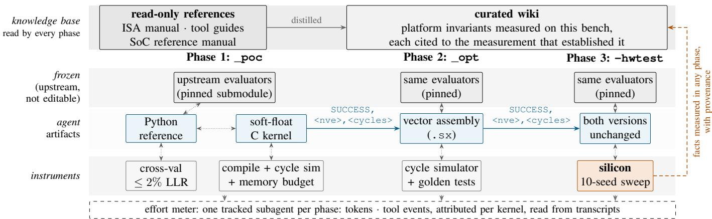
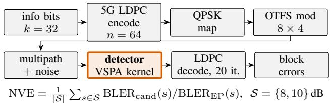
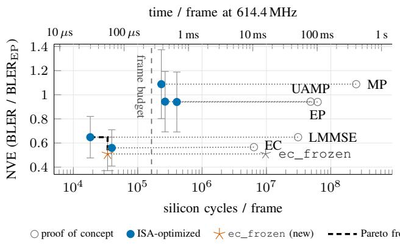

# Toward Agentic AI for the 6G Physical Layer: From Algorithm Discovery to Verified Baseband Silicon

Eric Mittag∗‡ , Lukas Brechtel∗‡ , Maximilian Stark† , Hans D. Schotten∗¶ ∗German Research Center for Artificial Intelligence (DFKI), Kaiserslautern, Germany †CTO System Innovation, NXP Semiconductors, Hamburg, Germany ¶RPTU University Kaiserslautern-Landau, Germany

Abstract—6G will be designed faster than it can be built: AI-driven search already proposes physical-layer algorithms at machine speed, while carrying a single one onto embedded baseband silicon remains specialist work. That silicon imposes hard memory and numeric limits, but also exposes cost structures a GPU lacks, and a design flow that never runs on the target sees neither. We present an agentic workflow in which an LLM coding agent implements algorithms on a commercial baseband SoC, optimizes them down to agent-written vector assembly, and validates them on silicon. The agent is guided by a knowledge base of measured platform facts, checked at every step against evaluators it is instructed never to edit, and metered per phase. We showcase the workflow on an AI-discovered orthogonal time frequency space (OTFS) detector portfolio on the open 6G4All platform. It yields twelve kernels that run cycle-exactly on silicon, their optimized versions at 18 k–405 k cycles (30–660 µs) per frame. It also yields a new detector shaped by the chip’s measured costs that needs 13.9% fewer cycles than the port of the discovered detector while matching its error rate, with a measured edge our evaluation cannot statistically resolve, a structure that a hardware-blind search objective had no reason to find. What is not specific to OTFS is the workflow: an LLM agent exploring an implementation space under real hardware limits, with the cost of every choice measured rather than assumed.

Index Terms—Agentic AI, 6G, large language models, physical layer, baseband processing, OTFS, hardware-in-the-loop

## I. INTRODUCTION

Whatever 6G turns out to be (new waveforms, integrated sensing, AI-native receivers), each of its features will in the end be a signal-processing algorithm that has to run inside the cycle, memory and power envelope of baseband silicon. How fast those features reach real radios will therefore be limited less by algorithm ideas than by the path from idea to silicon. Candidate algorithms already arrive faster than they can be deployed: large language model (LLM)-driven evolutionary search explores physical-layer solution spaces wholesale, and the framework of Aït Aoudia et al. [1] explored 1114 distinct orthogonal time frequency space (OTFS) equalizer architectures and produced a detector that outperforms published baselines, in simulation and on graphics processing units (GPUs). Carrying any one of those ideas onto an embedded baseband processor remains specialist work. Such parts earn their power efficiency by omitting what a general-purpose core provides: the digital signal processor (DSP) used here has no scalar floating-point unit at all, so scalar float arithmetic falls back on software emulation and costs orders of magnitude more than the same work on the vector array. Respecting that asymmetry is not an optimization detail; it decides whether an algorithm fits at all. Agentic artificial intelligence (AI) has reached the physical layer at the level of intent and configuration, in simulation [2]; this paper turns it toward implementation on the silicon itself: we demonstrate, on the open 6G4All platform [3], that an appropriately instrumented environment lets an LLM coding agent do that specialist work end to end (implement, optimize at assembly level, validate on silicon) at measured cost. If new algorithms can reach real baseband hardware this cheaply, the hardware stops being where 6G research ends and becomes part of the loop that proposes it.

A hardware-blind flow misses the platform in both directions. At its published operating point the discovered detector’s serialized channel representation occupies some 63 MB against roughly 28 kB of usable target memory (Table I); no word length closes three orders of magnitude, which is why this campaign runs at reduced grid dimensions, a consequence of the platform rather than a convenience, and a constraint the algorithm must be designed around rather than engineered away. And the platform’s advantages are equally invisible to a search whose evaluator prices only GPU latency: that objective [1] leaves memory and DSP arithmetic unpriced, so nothing rewards the structures this chip’s cost model does, which is where the campaign’s new detector comes from (Sec. IV-B).

We report one campaign, run end to end with the OTFS portfolio as its demonstration workload. It makes three contributions. (i) An agentic workbench in which every claim the agent makes is falsifiable: measured platform knowledge, machine-checkable tooling, frozen evaluators and a perphase effort meter (Sec. III). (ii) An executed showcase: four classical baselines and a discovered detector re-derived clean-room, optimized in agent-written vector assembly and validated on silicon, plus a new detector designed under the platform’s measured cost model that lands on the campaign’s error-rate/cycle Pareto front (Secs. IV–V). (iii) A per-phase accounting of engineering effort, metered from the agent’s own transcripts rather than self-reported (Sec. V-C). A preregistered, exploratory ablation probes the knowledge layer it

KEPT PER OUTPUT ROW. ROW 1 IS THE FRAMEWORK’S SELECTED   
SOLUTION (NVE 0.549; AS SHIPPED, COMPLEX64/INT64, 2.7× MORE);   
ROW 2 IS THE CHEAPEST POINT ON ITS PUBLISHED FRONT, SO THE GAP IS   
NOT AN ARTIFACT OF PICKING THE LARGEST VARIANT. THE LAST ROW IS   
THE SIMULATOR’S LINKER MAP, WHICH EXPOSES 8 704 B OF THE 16 KB IPPU.

## TABLE I

DESIGN RULE CHECK OF THE PUBLISHED CHANNEL REPRESENTATION AGAINST THE TARGET: FOOTPRINT OF THE SPARSE DELAY-DOPPLER VIEW AT 16-BIT I/Q PLUS 16-BIT INDEX; T O P\_K IS THE NUMBER OF TAPS

<table><tr><td>Grid</td><td>top_k</td><td>Coefficients</td><td>Footprint</td></tr><tr><td>64 × 64 (selected soln.)</td><td>2560</td><td>1.05 · 107</td><td>62.9MB</td></tr><tr><td>64 × 64 (alt. Pareto pt.)</td><td>1536</td><td> $6 . 2 9 \cdot 1 0 ^ { 6 }$ </td><td>37.7MB</td></tr><tr><td>8 × 4 (top-8 view)</td><td>8</td><td> $2 . 5 6 \cdot 1 0 ^ { 2 }$ </td><td>1.5 kB</td></tr><tr><td colspan="4">Available on target (DMEM usable + IPPU)</td></tr><tr><td colspan="4"></td></tr><tr><td colspan="4">of which portable to the cycle simulator</td></tr></table>

self on two kernels (Sec. V-D): there, documentation changed not what the agent could reach but how deep it went.

## II. BACKGROUND AND RELATED WORK

## A. Platform and Source Framework

The campaign runs on 6G4All [3]: a LimeSDR-Micro board around the NXP LA9310, a commercial baseband system-onchip (SoC) pairing a Cortex-M4 control core with a secondgeneration Vector Signal Processing Accelerator (VSPA) vector DSP (614.4 MHz, 16 arithmetic units, up to 16 complex single-precision operations per clock). The VSPA clock is exactly four times the part’s maximum converter rate of 153.6 MS/s, so streaming work has a budget of four cycles per sample at the maximum rate. The working memories are hard limits: 16 kB of data memory (DMEM) (12 160 B usable for static data), 32 kB program memory (PRAM), and 16 kB of auxiliary Intervector Permutation Processing Unit (IPPU) data memory used as spill space. Firmware, drivers, kernel library and test infrastructure are open repositories.

The discovery framework of [1], with its companion study [4], couples an LLM that writes candidate algorithms with an evolutionary archive and a Sionna-based link-level evaluator [5]. Its OTFS repository ships one discovered artifact, an expectation consistency (EC) detector with Doppler block-diagonalization, Cholesky solves and a Richardson halfpass, plus four tuned classical baselines: linear minimum mean square error (LMMSE), expectation propagation (EP) [6], Gaussian message passing (MP) [7], and unitary approximate message passing (UAMP) [8]; notably none is a neural network: the search produced structure plus scalar constants, which is what an embedded target can afford. Its fitness is computed entirely in simulation, modeling neither the cost of transcendentals on a DSP without scalar floating-point arithmetic nor the candidate’s memory footprint (Table I): no variant on the published Pareto front is buildable as published.

## B. Related Work

End-to-end learned transceivers and learned pilotless receivers [9], [10], [11] optimize fixed differentiable architectures at footprints far beyond embedded baseband budgets;

LLM-guided program search, covering FunSearch [12], AlphaEvolve [13] and [1] for the physical layer (PHY), closes its loop against software evaluators.

Classical word-length optimization [14], [15], [16] assigns precisions to a fixed dataflow. Neither lever applies here: this part computes in single precision only, so there are no word lengths to choose, and closing the gap in Table I needs the channel recomputed rather than stored, a change of algorithm, not of precision.

Agentic implementation is an active line whose neighboring axes are occupied: agents write low-level code for generalpurpose CPUs [17], close loops against measured hardware on microcontrollers [18] and on GPUs with profiler feedback, reported cost and kernels no human wrote [19], [20], and carry wireless functions to programmable radios, taking MATLAB through high-level synthesis (HLS) to bitstream and board with resource and latency results [21], or to verified over-theair emission [22].

Unoccupied is their conjunction on a fixed-function baseband part: assembly-level optimization against a vector DSP’s own instruction set architecture (ISA), gated by an external reference chain re-checked on silicon, with per-phase effort reported as a result. The workbench described next is built to close that gap.

## III. THE AGENTIC WORKBENCH

The campaign is run by a general-purpose LLM coding agent operating a Linux bench host with no PHY-specific finetuning.1 What makes hardware engineering work is not the model but the workbench around it: four components, and a pipeline that decides when each instrument is used (Fig. 1).

The knowledge base holds read-only references (VSPA instruction-set manual, SoC reference manual, tool guides) and a curated wiki of invariants measured on this bench, each cited to its measurement. Facts the agent settles are written back with provenance: 61 in this campaign, 43 of them reused by later phases, two contradicting the ISA manual.

The instruments make every step machine-checkable: the vendor toolchain compiles C and VSPA assembly against a fixed linker map whose overflow errors are themselves fitness signals; a cycle-accurate simulator returns pass/fail and a cycle count for any kernel; and a scripted debug bridge loads the kernel onto the core and reads the result back, a source-tosilicon verdict in seconds without a boot flow or probe.

The campaign template freezes what the agent must not touch: the discovery framework is pinned as a git submodule and the harness imports its channel model, low-density parity-check (LDPC) codec, quadrature amplitude modulation (QAM) mapper and reference detectors call-for-call (Fig. 2); every candidate follows a fixed contract (faithful Python reference model, float32 C or assembly kernel, golden vectors derived from the model, self-checking tests) and is scored by one command whose first output line is machine-parseable, SUCCESS, <nve>, <cycles>.

1Claude Fable 5 at high reasoning effort for every metered phase; all reported figures come from a single-model record.

  
Fig. 1. The campaign as three metered phases. The agent writes its artifacts only in the agent lane: the evaluators above are pinned upstream code it is instructed not to edit, and the instruments below bind every artifact to an executable reference. Silicon appears once, at the end; facts measured there return to the knowledge base.

The effort meter runs each phase as its own tracked subagent and reads tokens and tool events from transcripts; nothing is self-reported.

Pipeline. Every algorithm passes three gated phases (Fig. 1): \_poc produces a Python reference (cross-validated where an upstream one exists) and a correctness-first C kernel, \_opt the ISA-optimized version, and -hwtest, the only phase that touches silicon, the validation. The ordering uses each instrument where it is strong. Cross-validation against the upstream implementation and golden vectors anchor semantics before any optimization exists. The headless simulator then carries the optimization loop, where most iterations happen, and scales with compute rather than benches: many candidates can be optimized in parallel against one board. Silicon appears once, at the end, because the simulator proves to be an exact cost oracle (Sec. V-A finds the difference to be zero on all twelve kernels), so hardware validation confirms rather than discovers. Clean-room rules complete the protocol: the agent’s only sources are the template, the pinned checkout and the platform documentation, so measured effort reflects derivation, not copying.

## IV. EXPERIMENTAL CAMPAIGN

The workload comes from the discovery framework [1] itself: re-derive its four classical OTFS baselines and its discovered EC detector, clean-room, as verified VSPA kernels, then design one new detector under the platform’s measured cost model. Dimensions follow from Table I: M = 8 delay by N = 4 Doppler bins, quadrature phase shift keying (QPSK), top-8 sparse channel view (top-20 for the EC detectors, full channel for LMMSE), every hyperparameter dimensionless. Before any C port began, each baseline’s reference model had to pass cross-validation against the upstream torch implementation on identical frames (median relative log-likelihood ratio (LLR) deviation below 2%, zero confident sign flips); all four passed with median deviations of $1 . 3 \cdot 1 0 ^ { - 7 }$ to $7 . 6 \cdot 1 0 ^ { - 7 }$ . The discovered detector is gated by the coded normalized validation error (NVE) evaluation alone (Fig. 2), which resolves NVE differences only coarsely (Sec. V-B).

  
Fig. 2. The evaluation chain behind every NVE. Only the shaded block is the agent’s; every other stage is the framework’s own code [1], imported unmodified. Frames run in batches of eight until 50 block errors accumulate, capped at 1600 (Sec. V-B).

## A. ISA-Targeted Porting and Optimization

With the workload and its gates fixed, the ports could begin. The optimization gains are structural before they are instructional. The block-circulant structure of the delay-Doppler channel along Doppler lets N independent M × M solves replace the dense MN × MN solve (lmmse\_opt, 1693× over its proof of concept); for QPSK the MP edge distributions factor exactly into I and Q, collapsing each edge message from four log-values to two reals (mp\_opt, 1066×). In every optimized kernel the C driver retains no scalar floating-point arithmetic at all: transcendentals are polynomial chains on the vector array, and divisions use the special-function unit’s reciprocal. Where optimization changes numerics, the contract requires the optimized version to carry its own reference model and re-earn its NVE rather than inherit it. All six did: five exactly equal to their proof of concept, ec2rich within 0.006, inside the protocol’s resolution. The poc-to-opt ratios of 154–1693× (Table II) are therefore the priced distance between a working kernel and a fast one, not the speedup of one artifact.

## B. Platform-Derived Detector Design: ec\_frozen

The human brief asked only for one new detector of the agent’s own, shaped by what it had learned about the platform, and gated it on the Pareto front; the frozen inverse, its stabilizers and the iteration count below are the agent’s choices, documented with their measured motivation in the kernel’s record. That record also lists the variants the agent measured and rejected on its design-time two-point protocol: plain frozen Richardson (NVE 1.83), the frozen step without Jacobi smoothing (3.17) or with only the leading half (0.764), and four iterations instead of three (0.572 against 0.530). The campaign’s own profiles supplied that motivation: in the kernels that solve per-block systems the solves dominate, with eight Gauss-Jordan solves at 38% of ${ \tt e c 2 r i c h \_ o p t ^ { \prime } s }$ cycles, while the nonlinear projection costs a fraction of a solve round. ec\_frozen exploits that imbalance. Like the discovered detector it splits the channel into N independent blocks along Doppler, but it pays for each block’s regularized inverse once, up front. Every subsequent EC iteration reuses that stale, frozen inverse only as a preconditioner: instead of refactorizing the block system, whose diagonal changes every iteration as the site precisions evolve, it applies the frozen inverse and corrects the result with a single Richardson step, a handful of matrix-vector products. Naively this diverges once precisions grow (re-measured spectral radius up to 43); three measured stabilizers make it work: the system is symmetrically rescaled so the correction stays exact at both extremes of precision, each frozen apply is bracketed by Jacobi smoothing steps, and every correction starts from the previous iterate rather than from zero. Because a refinement costs 2.8 k cycles against 7.6 k for a factorized solve round, a third EC iteration becomes affordable. It closes with a linear-collapsed QPSK demapper and is gated by reaching the Pareto front of the campaign’s own ports. Algorithm 1 gives the procedure and its main hyperparameters.

TABLE II  
THE OTFS KERNEL PORTFOLIO. CYCLES PER FRAME, IDENTICAL IN SIMULATOR AND ON SILICON (SEC. V-A); NVE AT THE PROTOCOL’S RESOLUTION, WITH APPROXIMATE 95% INTERVALS OF ABOUT ±0.15 (SEC. V-B). ⋆ DESIGNED IN THIS CAMPAIGN.
<table><tr><td>Kernel</td><td>NVE</td><td></td><td>Cycles vs. PoC</td><td>DMEM</td><td>PRAM</td></tr><tr><td> $\mathtt { l m m s e \_ p o c }$ </td><td>0.65</td><td>31 008 649</td><td></td><td>69.5%</td><td>49.0%</td></tr><tr><td> $\mathtt { l m m s e \_ o p t }$ </td><td>0.65</td><td>18318</td><td>1693×</td><td>97.9%</td><td>50.5%</td></tr><tr><td> $\tt e p \mathrm { \_ p o o c }$ </td><td>0.94</td><td>62 503 987</td><td></td><td>76.9%</td><td>51.0%</td></tr><tr><td>ep_opt</td><td>0.94</td><td>405 379</td><td>154×</td><td>100%</td><td>70.5%</td></tr><tr><td>mp_poc</td><td>1.09</td><td>248 238 967</td><td></td><td>83.6%</td><td>53.1%</td></tr><tr><td> $\mathrm { m p \_ o p t }$ </td><td>1.09</td><td>232 847</td><td>1066×</td><td>95.8%</td><td>54.2%</td></tr><tr><td>uamp_poc</td><td>0.94</td><td>48 598151</td><td></td><td>82.4%</td><td>83.5%</td></tr><tr><td> $\mathtt { u a m p \_ o p t }$ </td><td>0.94</td><td>266 422</td><td>182×</td><td>98.9%</td><td>95.8%</td></tr><tr><td> $\mathtt { e c 2 r i c h \_ p o c }$ </td><td>0.57</td><td>6389937</td><td></td><td>90.0%</td><td>87.2%</td></tr><tr><td> $\mathtt { e c 2 r i c h \_ o p t }$ </td><td>0.56</td><td>39520</td><td>162×</td><td>98.9%</td><td>88.8%</td></tr><tr><td> $\mathsf { e c \_ f r o z e n \_ p o c ^ { \star } }$ </td><td>0.51</td><td>9710079</td><td></td><td>97.3%</td><td>81.1%</td></tr><tr><td> $\mathtt { e c \_ f r o z e n \_ o p t } ^ { \star }$ </td><td>0.51</td><td>34010</td><td>286×</td><td>98.9%</td><td>88.0%</td></tr></table>

## V. RESULTS

## A. Silicon Validation

All twelve kernels were promoted to silicon in the separated hardware phase, over a self-hosted transport that needs no debug probe. Every kernel reproduced its simulator cy-

$$
\mathbf { H } _ { n } , \mathbf { y } _ { n } \colon
$$

$$
{ \hat { \sigma } } ^ { 2 } \mathbf { : }
$$

$$
1 . 1 5 ; \mathbf { z } _ { n } ;
$$

$$
\eta . \ \mathbf { x } _ { \mathrm { l i n } } .
$$

$$
\mathbf { p } _ { \mathrm { n l } } \mathbf { \dot { \mathbf { \rho } } }
$$

$$
\mathbf { p } _ { A } , \mathbf { r } _ { A } \colon
$$

$$
( \eta , \ { \hat { \mathbf { x } } } , \ \mathbf { x } _ { \mathrm { l i n } } , \ \mathbf { r } _ { A }
$$

$$
( \cdot ) ^ { - 1 / 2 }
$$

$$
[ p _ { \operatorname* { m a x } } ^ { - 1 } , p _ { \operatorname* { m a x } } ] . \ T { = } 3
$$

$$
\omega { = } 0 . 8 ,
$$

$$
\delta { = } 0 . 6 8 ,
$$

$$
p _ { \operatorname* { m a x } } { = } 6 4
$$

Require: per block n: $\mathbf { G } _ { n } = \mathbf { H } _ { n } ^ { \sf H } \mathbf { H } _ { n } / \hat { \sigma } ^ { 2 } , \mathbf { b } _ { n } = \mathbf { H } _ { n } ^ { \sf H } \mathbf { y } _ { n } / \hat { \sigma } ^ { 2 }$   
1: $\mathbf { \dot { B } } _ { n } \longleftarrow ( \mathbf { G } _ { n } + \mathbf { I } ) ^ { - 1 }$ for all n ▷ the only inverses   
2: $\pi  1 , \eta  \mathbf { 0 } , \mathbf { z } _ { n }  \mathbf { B } _ { n } \mathbf { b } _ { n }$ ▷ exact at π = 1   
3: for $t = 1 , \dots , T$ do   
4: $\mathbf { i f } \ t > 1$ then z ← FROZENSOLV $\vec { \ b { \mathfrak { z } } } ( \pmb { \pi } , \pmb { \eta } , \hat { \mathbf { x } } )$   
5: $\mathbf { x } _ { \mathrm { { l i n } } } \gets \mathbf { F } ^ { \mathsf { H } } \mathbf { z } ; \mathbf { v } \gets$ mean over n of diag ${ \bf B } _ { n } / ( { \bf 1 } + ( \pmb { \pi } - { \bf 1 } )$ diag $\cdot \mathbf { B } _ { n } )$   
6: $\mathbf { p } \gets \mathrm { m i n } ( 1 / \mathbf { v } , p _ { \mathrm { m a x } } ) , \mathbf { p } _ { A } \gets [ \mathbf { p } - \boldsymbol { \pi } ] , \mathbf { r } _ { A } \gets ( \mathbf { p } \mathbf { x } _ { \mathrm { l i n } } - \boldsymbol { \eta } ) / \mathbf { p } _ { A }$   
7: $\hat { \mathbf { x } }  \kappa \operatorname { t a n h } ( 2 \kappa \mathbf { p } _ { A } \mathbf { r } _ { A } )$ per component, $\kappa = 2 ^ { - 1 / 2 } ;$ pnl ← its   
precision, averaged over Doppler   
8: $\pmb { \eta }  ( 1 - \delta ) \pmb { \eta } + \delta ( \mathbf { p } _ { \mathrm { n l } } \hat { \mathbf { x } } - \mathbf { p } _ { A } \mathbf { r } _ { A } )$   
9: $\pmb { \pi }  [ ( 1 - \delta ) \pmb { \pi } + \delta [ \mathbf { p } _ { \mathrm { n l } } - \mathbf { p } _ { A } ] ]$   
10: one more FROZENSOLVE, then the collapsed QPSK demap   
11: function FROZENSOLVE(π, η, xˆ) ▷ each block n   
12: $\mathbf { A } _ { n } \gets \mathbf { G } _ { n } + \mathrm { d i a g } \boldsymbol { \pi } , \mathbf { c } _ { n } \gets \mathbf { b } _ { n } + \boldsymbol { \pi } \left( \mathbf { F } ( \boldsymbol { \eta } / \boldsymbol { \pi } ) \right) _ { n }$   
13: $\mathbf { s } \gets ( \mathbf { 1 } + ( \pmb { \pi } - \mathbf { 1 } ) \mathrm { d i a g } \mathbf { B } _ { n } ) ^ { - 1 / 2 } , \mathbf { w } \gets \omega / ( \mathrm { d i a g } \mathbf { G } _ { n } + \boldsymbol { \pi } )$   
14: ${ \bf z } _ { n } \gets ( { \bf F } \hat { \bf x } ) _ { n }$ ▷ warm start   
15: $\mathbf { z } _ { n } \gets \dot { \mathbf { z } } _ { n } + \mathbf { w } ( \mathbf { c } _ { n } - \mathbf { A } _ { n } \mathbf { z } _ { n } )$ ▷ Jacobi   
16: $\mathbf { z } _ { n }  \mathbf { z } _ { n } + \mathbf { s B } _ { n } \big ( \mathbf { s } ( \mathbf { c } _ { n } - \mathbf { A } _ { n } \mathbf { z } _ { n } ) \big )$ ▷ frozen   
17: ${ \bf z } _ { n } \gets { \bf z } _ { n } + { \bf w } ( { \bf c } _ { n } - { \bf A } _ { n } { \bf z } _ { n } )$ ▷ Jacobi

cle count exactly, with zero difference, across four orders of magnitude of frame cost, soft-float C and agent-written assembly, 0–8704 B of IPPU data memory (in bytes, since simulator and chip expose different ceilings), and up to 100% DMEM occupancy; at 248 M cycles that is agreement to one part in $2 . 5 \cdot 1 0 ^ { 8 }$ . A smoke kernel shows a reproducible onecycle offset, so the instrument resolves a single cycle and the twelve exact matches are not measurement insensitivity. The agreement is a property of the code, not of one trace: most detectors have data-dependent cycle counts (mp\_poc varies 2.8× across seeds), ten-seed sweeps, each seed a fresh channel, noise and payload draw, exercise those paths on every kernel. A seed passes when simulator and silicon cycle counts are equal, the LLRs meet the golden tolerance (absolute $5 \cdot 1 0 ^ { - 3 } ~ $ , relative $2 \cdot 1 0 ^ { - 3 } )$ , and every LLR the reference is confident about $\left( \left| \mathrm { L L R } \right| \ > \ 1 \right)$ keeps its sign: agreement is exact in cycles, toleranced in values and exact in confident bit decisions. Across 120 seed runs: 113 pass, 6 are generator margin-guard rejections (ep\_opt seeds 101 and 108, both MP kernels’ seeds 102 and 109; re-running their host generators reproduces each rejection, so none is a masked dependency failure), and one fails, the uamp\_opt seed discussed below. Two mechanisms by which silicon might still have diverged were falsified. The same workspace is placed roughly 500 kB apart in the simulator and chip address maps yet costs identical cycles, so placement does not affect timing; and kernels at 100% DMEM occupancy match as exactly as those at 69.5%, so the chip adds no memory wait states the simulator omits.

What the hardware phase caught was faults in the verification tooling, not the silicon, in two ways. First, the multi-seed sweep script silently classified missing Python dependencies as margin-guard skips and returned success; a table of skipped seeds was indistinguishable from a clean pass. Second, the frame generators’ float32 twin cannot see the assembly kernels’ special-function arithmetic: one uamp\_opt seed misses the golden tolerance by 1.4×, bit-identically on silicon and in the simulator and with no confident sign flipped, while the twin that screens seeds scores that frame at 0.1% of its budget. We keep and report the seed. The fixes are a sweep that tells a failed generator from a guard rejection, and a twin that emulates the special-function approximations, as several kernels’ reference models already do for their exponential, instead of exact float32. This is the sim-to-real lesson displaced one level: on a silicon-exact simulator the residual reality gap moves out of the hardware and into the verification models.

## B. The Pareto Front and the Frame Budget

Fig. 3 shows the result. The optimization phase moves each algorithm two to three decades or more left at unchanged NVE; the surviving front has two points, lmmse\_opt at 18 318 cycles and the new ec\_frozen\_opt at 34 010, so 1.9× the cycles buys a measured 0.14 of NVE (0.65 against 0.51), itself within the intervals of Fig. 3. Against our port of the framework’s own discovered detector, ec\_frozen\_opt needs 34 010 against 39 520 cycles, a deterministic 13.9% reduction, at a measured NVE of 0.51 against 0.56.

That NVE margin, however, is not resolved by this protocol. The protocol is the framework’s own Monte-Carlo setting (batches of eight, 50 block errors or at most 1600 frames per point), kept unmodified and frozen before the campaign so that no agent could tune the gate it is scored by; it separates detectors that differ by tens of percent, as EP, UAMP and MP do from ec\_frozen\_opt (Fig. 3), but not the front’s members from each other. The evaluation stores rates, not counts. The stopping rule lets the counts be recovered uniquely, and the same procedure reproduces the reduction sweep’s recorded counts in all 50 cases. Treating the curtailed sampling as negative-binomial then gives approximate 95% intervals of ±0.14 and ±0.15, about threefold the separation. Over all six stored signal-to-noise ratio (SNR) points (2–12 dB) neither detector is consistently ahead (equal counts at 2 and 4 dB, ec\_frozen\_opt lower at 8 and 10 dB, ec2rich\_opt at 6 and 12 dB), and every pair’s 95% Clopper–Pearson intervals overlap. The runs shared frames only up to 8 dB, since each stopping point shifts the random stream, so the records allow no paired comparison. The defensible claim is therefore its place on the front: strictly cheaper at an error rate this protocol cannot separate, that is, NVE parity rather than superiority. Settling the error-rate difference needs a paired re-evaluation that retains per-frame outcomes. Cycle counts carry no such caveat; they are deterministic and exact.

  
Fig. 3. Coded error rate versus measured silicon cycles per frame; the top axis converts cycles to time, the dashed vertical marks the $2 6 7 \mu \mathrm { s }$ frame budget. Dotted ties link each algorithm’s two versions (only ec2rich’s is non-horizontal, 0.006 apart). The black dashed staircase is the Pareto front of the measured values. Vertical bars: approximate 95% NVE intervals of the optimized kernels (Sec. V-B); cycles are exact. The three kernels near the front overlap in NVE; EP, UAMP and MP lie above them and are dominated by ec\_frozen\_opt even at the interval level.

The counts are also affordable: the frame spans $N / \Delta f =$ 267 µs at the upstream subcarrier spacing ∆f=15 kHz, a budget of roughly 164 k cycles at 614.4 MHz, and both front points sit inside it (lmmse\_opt at 11%, ec\_frozen\_opt at 21%, the discovered detector’s port at 24%). Both front kernels are free of data-dependent branches and returned the same count on every seed, so these are worst-case figures, not averages. mp\_opt, uamp\_opt and ep\_opt exceed it by 1.4×, 1.6× and 2.5×. The reduction that forces the small grid also shortens the frame, so this is a statement about the operating point; what it establishes is that the front’s detection kernel fits the frame budget on this target with margin. The counter runs from the call, with inputs already in DMEM, to the return, so moving a frame in and its LLRs out is not included.

## C. Engineering Effort

Table III is the campaign’s effort record: agent output tokens per phase (including billed reasoning tokens), deduplicated per API response. It counts the metered phases only, excluding the coordinating sessions, and each phase optimizes once to a depth the agent chooses: these are not the tokens to reach a best kernel. Tokens are the only effort metric we report: monetary cost moves with prices and caching discounts, and would not be reproducible from the archive. Tokens omit wall-clock time and the human preparation of the workbench. Human input to each phase was its task brief; in the seven phases whose transcripts are retained, the only further input was eleven continuation prompts without technical content. Three observations follow.

Deriving an algorithm is cheap and uniform; making it fast is not: across the five ports the proof-of-concept phases cost 219.5 k output tokens and the optimization phases 1604.5 k, a 7.3× asymmetry, and proof-of-concept cost is flat (38.5–52.5 k) whether the algorithm is a one-shot linear solve (LMMSE) or a fifteen-iteration message-passing scheme (MP).

TABLE III  
MEASURED ENGINEERING EFFORT PER ALGORITHM AND PHASE: AGENT OUTPUT TOKENS (103, INCL. BILLED REASONING), DEDUPLICATED PER API RESPONSE.
<table><tr><td></td><td colspan="2">Output tokens  $( 1 0 ^ { 3 } )$ </td><td></td></tr><tr><td>Algorithm</td><td>PoC</td><td>Opt</td><td>HW Total</td></tr><tr><td>LMMSE</td><td>38.5</td><td>228.5 12.5</td><td>279.5</td></tr><tr><td>EP</td><td>41.2</td><td>387.4</td><td>12.5 441.0</td></tr><tr><td>MP</td><td>39.7</td><td>249.4 14.7</td><td>303.7</td></tr><tr><td>UAMP</td><td>47.7</td><td>432.0 32.4</td><td>512.0</td></tr><tr><td>EC (discovered)</td><td>52.5</td><td>307.2 13.5</td><td>373.2</td></tr><tr><td>ec_frozen (new)</td><td>83.7</td><td>241.9 11.4</td><td>337.0</td></tr><tr><td>18 metered phases</td><td>303.2</td><td>1846.4</td><td>97.0 2246.6</td></tr></table>

Silicon is the cheapest phase: validating all twelve kernels cost 97.0 k tokens, 4% of the metered total, a consequence of the simulator being exact, inverting the assumption that hardware is the scarce tier.

Documented knowledge is reused across phases: the final optimization phase, re-run blind on a stripped repository, passed its golden test on the first simulator run and built no probe kernels, having inherited four candidates’ documented ISA facts (an audit traces 43 of 50 earlier facts into reuse).

The phases ran in sequence by design, so per-algorithm effort is a point on a learning trajectory, not an independent sample.

## D. Ablation of the Knowledge Layer

Repeating the LMMSE port clean-room reproduced the campaign closely (same NVE; 18 111 against 18 318 cycles), suggesting its operating points are set by the protocol rather than by one run. That control makes a stronger experiment possible: whole phases re-run with the knowledge layer reduced or removed, pre-registered with token caps and outcome criteria fixed in advance and withheld from the workers, which saw only their task brief, on LMMSE, the portfolio’s simplest port and the only one whose campaign run started from the same knowledge state as the documented arm, and on EP, the port that leans hardest on hand-built approximations: it needs a vector exponential and a log-sum-exp the ISA does not provide, and runs at 100% DMEM. The two bracket the portfolio by design; each arm re-runs whole phases at 0.24– 0.46 M output tokens, which is why the ablation covers these two rather than all six and runs each cell once.

Removing documentation changed optimization tokens-to-SUCCESS by 0.71× (LMMSE) and 1.07× (EP), and every LMMSE arm found the block-diagonal mathematics unaided, the documentation-free one first, in its proof of concept. What changed was depth: the manuals-only arm reached a slightly faster kernel than the wiki-plus-manuals arm (16 728 against 18 111 cycles), while the two documentation-free arms stayed largely in C with the SDK’s intrinsics instead of descending to hand-scheduled assembly, and settled 2.2× and 1.8× slower. The brief invited assembly where it paid and gated only on improving over the proof of concept, identically in every arm. The effect is consistent with the ISA documentation carrying it, since manuals alone sufficed, rather than with the campaign’s accumulated fact base. The ablation scores the knowledge layer only by what the agent produced. It does not measure the second function: facts written back with provenance are what let a human audit a campaign at all, including the reuse audit above and the two entries that contradict the ISA manual.

TABLE IV  
LINK COST OF THE GRID REDUCTION: CODED BLER- $1 0 ^ { - 1 }$ CROSSINGS OFTHE UPSTREAM DETECTORS THROUGH ONE CHAIN AT BOTH OPERATINGPOINTS: LITE $( 8 \times 4 , \mathrm { Q P S K } .$ , CODEWORD n=64) AND FULL $( 6 4 \times 6 4$ 16-QAM, n=16 384; 3- VS 6-PATH CHANNEL). PRE-REGISTERED SWEEP,≥50 BLOCK ERRORS OR 1600 FRAMES PER POINT; $\Delta _ { \mathrm { r e d } } = \mathrm { F U L L - L I T E }$
<table><tr><td>Detector</td><td>lite (dB)</td><td>full (dB)</td><td> $\Delta _ { \mathrm { r e d } }$  (dB)</td></tr><tr><td>UAMP</td><td>8.55</td><td>12.54</td><td>+3.98</td></tr><tr><td>MP</td><td>9.03</td><td>13.14</td><td>+4.11</td></tr><tr><td>EC (discovered)</td><td>7.92</td><td>12.30</td><td>+4.38</td></tr><tr><td>EP</td><td>8.58</td><td>13.08</td><td>+4.50</td></tr><tr><td>LMMSE</td><td>7.82</td><td>14.55</td><td>+6.73</td></tr></table>

With one run per cell and kernels that are not accuracymatched, since each arm re-earned its NVE in its own environment, this is exploratory and holds for these two kernels only. Gates and tooling alone were enough to carry even the documentation-free arms to correct kernels.

## VI. DISCUSSION AND LIMITATIONS

What does the forced reduction cost? A pre-registered sweep of the upstream detectors through one chain at both operating points measures it (Table IV): the full protocol’s $\mathrm { \bf B L E R - } 1 0 ^ { - 1 }$ crossings sit 4.0–4.5 dB above the lite protocol’s for four detectors but 6.7 dB for LMMSE, quantifying the ranking inversion behind the front. The claim is therefore not that a designed detector beats a classical one at this size, but that the loop produced a front-defining design in the regime that favors the simple linear solve most, at a measured cost.

Why the search missed it. The cost model that makes ec\_frozen attractive does not exist on a GPU, where factorization is not the bottleneck: the framework’s own Krylov/preconditioned family drew 130 candidates and scored second-worst of eleven [1]. We do not claim the search could not have found this detector; its objective gave it no gradient toward it. The remedy is analytical and cheap, a design rule check at search time (footprint against data memory, code against program memory, operations against a slot budget) which this campaign calibrates with the twelve kernels’ measured silicon cycles.

Limitations. The campaign’s results hold for one operating point: $8 \times 4$ (Table I), QPSK, NVE at two SNR points; NVE is normalized to each protocol’s own EP baseline, so our values are not comparable with the framework’s published ones, and dominance at 64 × 64 is not established. Scaling is not demonstrated: the Doppler-block decomposition makes the N blocks independent, so a frame can stream block by block through double-buffered direct memory access (DMA), but at 64×64 one block’s Gram matrix alone (32 kB in single precision) exceeds DMEM, so tiling must also reach inside the block, or the workload must move to a larger member of the family; no kernel has run in a live stack; and one optimized kernel misses the golden tolerance on one seed in ten, identically in simulator and silicon and with no bit decision changed (Sec. V-A). The ablation covers two of six algorithms with one run per cell (Sec. V-D), its arms still saw the vendor SDK’s example assembly, and ablating the full campaign remains open. Silicon validation covers correctness, memory fit and cycles; power, energy per frame and the DMA cost of moving a frame in and out were not measured. No non-agentic flow (compiler with hand-written intrinsics, autotuning, or an engineer under the same budget) was run as a baseline; the nearest point is the ablation’s documentationfree arms, which stayed largely in C with the SDK’s intrinsics, 1.8–2.2× slower than assembly (Sec. V-D). The campaign therefore establishes feasibility at a measured agent cost, not a productivity gain over such flows.

## VII. CONCLUSION AND OUTLOOK

This work showed, for one detector portfolio on one commercial baseband SoC, that the step from a discovered algorithm to optimized silicon can be automated. Inside an instrumented workbench of measured platform knowledge, machine-checkable tooling and evaluators frozen by protocol, an LLM agent carried a discovered OTFS portfolio to verified, ISA-optimized kernels, with no vector assembly written by hand.

The result holds where it can be checked. All twelve kernels reproduce their simulator cycle counts exactly on silicon; the optimized versions run at 18 k–405 k cycles (30–660 µs) per frame, and the two kernels on the resulting error-rate/cycle front spend 11% and 21% of the 267 µs frame. A detector designed under the platform’s measured cost model, reusing one frozen inverse instead of refactorizing, needs 13.9% fewer cycles than the discovered detector’s port while matching its error rate, with a measured edge the protocol cannot statistically resolve, a structure the source search objective did not reward. The campaign also measures how that effort was distributed: of 2.25 M metered agent tokens, 14% went to proof of concept, 82% to assembly optimization and 4% to hardware.

Nothing in the workflow is specific to OTFS, although only OTFS detection has been tested: what the campaign demonstrates is a way of working, with measured platform cost inside the loop that writes the code and every claim checked against something the agent is not permitted to edit. That is the direction 6G4All is built for: baseband hardware as a place where new algorithms are routinely tried, not only finally shipped. Because the platform is inexpensive commodity hardware, the environment scales outward: next are an over-the-air testbed running agent-produced kernels under real channels, and lab instrumentation (vector signal analysis, power, controlled radio frequency (RF)) so the agent sees every RF-relevant property, not only cycles and bitexactness. Larger members of the vendor’s baseband line (up to eight VSPA cores) admit the grids where iterative detectors earn their cost back. A discovery run under a hardware-aware objective is the experiment this work sets up.

## ACKNOWLEDGMENT

This work has been supported by the Federal Ministry of Research, Technology and Space of the Federal Republic of Germany (grant agreements 16KIS2402K, Open6GHub+, and 16KISS008, XCOM).

Use of AI-generated content. Anthropic Claude Fable 5 generated the VSPA artifacts studied in Sections III–V and, together with Claude Opus 5 and Opus 5.5, materially assisted the organization, drafting and revision of all manuscript sections, figures and tables. The authors critically reviewed and edited all AI-generated text, checked the technical claims and reported quantities against source code, tests and archived measurement records, approved the final manuscript, and take full responsibility for its accuracy, originality and integrity.

## REFERENCES

[1] F. Aït Aoudia et al., Autonomous discovery of wireless communications algorithms, 2026. arXiv: 2607.17762.

[2] Z. Li et al., Agentic wireless communication for 6G: Intent-aware and continuously evolving physical-layer intelligence, 2026. arXiv: 2602.17096.

[3] E. Mittag et al., “6G4All: An open SDR platform on a commercial baseband SoC with OpenAirInterface for 6G research and deployment,” in Proc. IEEE Int. Symp. Personal, Indoor and Mobile Radio Commun. (PIMRC), to appear, 2026.

[4] F. Aït Aoudia et al., The AI Telco Engineer: Toward autonomous discovery of wireless communications algorithms, 2026. arXiv: 2604.19803.

[5] J. Hoydis et al., Sionna: An open-source library for next-generation physical layer research, 2022. arXiv: 2203.11854.

[6] H. Li et al., “Low complexity receiver via expectation propagation for OTFS modulation,” IEEE Commun. Lett., vol. 25(no. 10), pp. 3180–3184, 2021. DOI: 10.1109/LCOMM.2021.3101827

[7] P. Raviteja et al., “Interference cancellation and iterative detection for orthogonal time frequency space modulation,” IEEE Trans. Wireless Commun., vol. 17(no. 10), pp. 6501–6515, 2018. DOI: 10.1109/TWC.2018.2860011

[8] Z. Yuan et al., “Iterative detection for orthogonal time frequency space modulation with unitary approximate message passing,” IEEE Trans. Wireless Commun., vol. 21(no. 2), pp. 714–725, 2022.

[9] T. O’Shea and J. Hoydis, “An introduction to deep learning for the physical layer,” IEEE Trans. Cogn. Commun. Netw., vol. 3(no. 4), pp. 563–575, 2017.

[10] S. Dörner et al., “Deep learning based communication over the air,” IEEE J. Sel. Topics Signal Process., vol. 12(no. 1), pp. 132–143, 2018.

[11] F. Aït Aoudia and J. Hoydis, “End-to-end learning for OFDM: From neural receivers to pilotless communication,” IEEE Trans. Wireless Commun., vol. 21(no. 2), pp. 1049–1063, 2022.

[12] B. Romera-Paredes et al., “Mathematical discoveries from program search with large language models,” Nature, vol. 625, pp. 468–475, 2024.

[13] A. Novikov et al., AlphaEvolve: A coding agent for scientific and algorithmic discovery, 2025. arXiv: 2506.13131.

[14] W. Sung and K.-I. Kum, “Simulation-based word-length optimization method for fixed-point digital signal processing systems,” IEEE Trans. Signal Process., vol. 43(no. 12), pp. 3087–3090, 1995. DOI: 10.1109/78.476465

[15] G. A. Constantinides et al., “Wordlength optimization for linear digital signal processing,” IEEE Trans. Comput.-Aided Design Integr. Circuits Syst., vol. 22(no. 10), pp. 1432–1442, 2003.

[16] D. Ménard et al., “Floating-to-fixed-point conversion for digital signal processors,” EURASIP J. Appl. Signal Process., vol. 2006, pp. 1–19, 2006, Article ID 96421. DOI: 10.1155/ASP/2006/96421

[17] B. Mikek et al., Agentic code optimization via compiler-LLM cooperation, 2026. arXiv: 2604.04238.

[18] Z. Zhang et al., Embedded Arena: Iterative optimization via hardware feedback, 2026. arXiv: 2606.16190.

[19] Z. Zhang et al., CudaForge: An agentframework with hardwarefeedbackfor CUDA kernel optimization, 2025. arXiv: 2511.01884.

[20] M. Luo et al., Agentic kernel optimization: Generating state-of-the-art GPU kernels without hand-written CUDA, 2026. arXiv: 2608.14560.

[21] J. Lei et al., A2H-MAS: An algorithm-to-HLS multi-agent systemfor automated and reliable FPGA implementation, formerly A2HCoder, 2026. arXiv: 2508.10904.

[22] J. Lei et al., RadioMaster: Multi-agent system for autonomous radio signal generation, v2: From Intent to Air, 2026. arXiv: 2606.01862.