# TriGeoBench: A Multimodal Mathematical Geometry Benchmark with Figures and TikZ

Jing Wang1,\* Yitong Yang1,\* Hao Dou1,\* Yaomin Wu1,\* Shuting He1 Tingfei Shen2 Jia Wu2 Jiaqi Li1 Yinglin Wang1,†

1School of Computing and Artificial Intelligence

2School of Information Management and Engineering Shanghai University of Finance and Economics, Shanghai, China wang.yinglin@shufe.edu.cn

## Abstract

Multimodal Large Language Models show strong vision–language capabilities, yet their geometry-centric reasoning remains insufficiently understood. Existing mathematical benchmarks typically rely on rasterized fig ures and cover limited geometric knowledge areas and response formats, making it difficult to assess whether models reason over geometric structures or exploit superficial visual patterns. We introduce TriGeoBench, a geometry-centric multimodal benchmark constructed from Chinese middle- and high-school mathematics examinations. TriGeoBench contains 7,000 question–answer pairs and 12,235 geometric figures with TikZ code, spanning plane geometry, solid geometry, analytic geometry, function, and vector geometry across diverse response formats. Each instance forms a {question–answer pair, image, TikZ} triplet: question–answer pairs are stored in LAT X, images as RGB figures, and TikZ preserves geometric topology, symbolic annotations, and relational structure. We evaluate representative open- and closed-source MLLMs through image-to-TikZ and multimodal reasoning probes. Results reveal persistent finegrained structure and image–text alignment challenges. Oracle experiments with humancurated reference TikZ suggest that accurate executable representations provide complementary geometric cues; they do not evaluate an end-to-end conversion pipeline. TriGeoBench offers a testbed for structure-aware mathematical reasoning.

## 1 Introduction

Multimodal Large Language Models (MLLMs) (Liu et al., 2023; Zhu et al., 2023; Hurst et al., 2024; Team et al., 2023; Li et al., 2023)

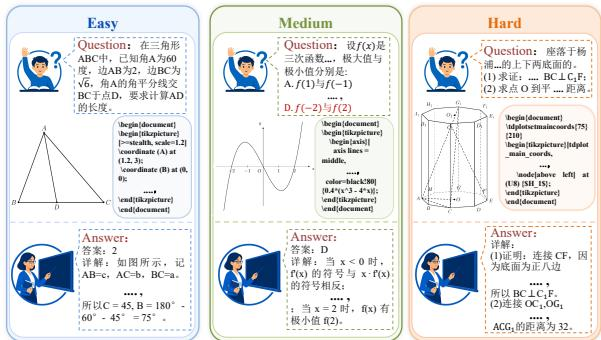  
Figure 1: TriGeoBench examples at Easy, Medium, and Hard difficulty levels, with aligned problem text, figures, editable TikZ code, and solutions. Appendix G provides English translations and romanizations.

demonstrate strong vision–language capabilities, including visual perception (Liu et al., 2024; Hudson and Manning, 2019), chart understanding (Masry et al., 2022; Yang et al., 2024), document comprehension (Mathew et al., 2021; Tang et al., 2025), visual question answering (Lu et al., 2022), and multimodal reasoning (Yue et al., 2025). Joint visual–textual modeling enables instruction alignment, object and relation recognition, text and layout interpretation, and cross-modal reasoning, supported by large-scale vision–language data.

Multimodal benchmarks evaluate visual recognition, reasoning, domain-specific understanding, hallucination detection, and instruction following (Li et al., 2024c; Caffagni et al., 2024). Mathematical reasoning demands understanding mathematical language, interpreting figures, and integrating both to derive answers. Recent benchmarks (Wang et al., 2024; Zhang et al., 2024b; Li et al., 2026; Wang et al., 2025b) evaluate models’ integrated understanding and reasoning on problems involving text, symbols, and visual figures. Unlike text-only evaluation (Cobbe et al., 2021; Hendrycks et al., 2021a; Gao et al., 2024), these benchmarks examine diagram interpretation, symbol–figure alignment, and the integration of multiple information sources for mathematical derivation. However, geometry-centric evaluation retains two limitations: (1) Lack of precise structural representations of figures. Most benchmarks rely on rasterized figures that do not explicitly preserve topology, geometric relations, or symbolic annotations. Consequently, evaluation emphasizes visual appearance and cannot clearly determine whether models reason over precise structures or correctly map mathematical symbols to diagrammatic entities. (2) Limited coverage of geometric knowledge areas and problem formats. Existing datasets often cover only subsets of geometry and restricted question types, with limited plane and solid geometry or response-format diversity. They therefore provide a coarse view of reasoning.

To address these limitations, we introduce Tri-GeoBench, a geometry-centric multimodal benchmark for mathematical reasoning and structureaware diagram understanding. It is constructed from public Chinese middle- and high-school examination problems and solution materials that reflect authentic pedagogical distributions. Manual transcription, figure authoring, and independent human verification yield 7,000 question–answer pairs and 12,235 high-quality figures with corresponding TikZ code. The dataset spans plane geometry, solid geometry, analytic geometry, function, and vector geometry, and includes single-choice, fill-in-theblank, proof, and essay questions. Each statement is represented in LATEX and each figure as editable TikZ, preserving topology, symbolic annotations, and relational structure more faithfully than raster images alone. Figure 1 presents representative examples across difficulty levels.

We evaluate TriGeoBench through unified image-to-TikZ and multimodal reasoning protocols for representative general-purpose MLLMs. Current models still struggle to recover fine-grained relations, annotations, and spatial constraints from figures. For reasoning, we compare text, raster figures, human-curated reference TikZ, and their combination. The reference-code condition is an oracle diagnostic of whether an accurate executable representation is useful once available, rather than an image-to-TikZ-to-reasoning system. Its descriptive gains suggest complementary geometric cues, while raw code can expose exact construction parameters. Our contributions are:

• TriGeoBench Benchmark. We introduce a large-scale geometry-centric multimodal benchmark from authentic Chinese examination problems, covering diverse knowledge areas and response formats.

• Unified Representation. Each instance is a {question–answer pair, image, TikZ} triplet: text is stored in LATEX, the figure as RGB, and editable TikZ preserves geometric structure and annotations.

• Broad Evaluation of General-Purpose MLLMs. Unified probes of image-to-TikZ and mathematical reasoning reveal limitations in precise image–text alignment and structured figure understanding.

## 2 Related Work

Mathematical and geometry benchmarks. Mathematical benchmarks progress from text-only reasoning in MATH (Hendrycks et al., 2021b) to visual evaluation in MathVista (Lu et al., 2024), MATH-Vision (Wang et al., 2024), and Math-Verse (Zhang et al., 2024b). Specialized benchmarks VisioMath (Li et al., 2026), GeoEval (Zhang et al., 2024a), and SOLIDGEO (Wang et al., 2025b) show persistent difficulties in fine-grained diagram understanding, image–text alignment, and spatial reasoning. Geometry3K (Lu et al., 2021) uses formal language to describe texts and diagrams; GeoQA (Chen et al., 2021), GeoQA+ (Cao and Xiao, 2022), and UniGeo (Chen et al., 2022) introduce programs or proof annotations; PGPS9K (Zhang et al., 2023) further annotates finegrained geometric primitives and diagram clauses. These datasets use explicit structure but mostly retain raster diagrams or task-specific annotations rather than editable, compilable representations.

Graphics program synthesis. Symbolic formats such as LAT X, SVG, and TikZ are readable, editable, and executable. Image-to-LATEX emphasizes formula and handwriting recognition (Gervais et al., 2025); DeepSVG (Carlier et al., 2020) and VGBench (Zou et al., 2024) study vector understanding. DeTikZify (Belouadi et al., 2024), GeoGramBench (Luo et al., 2025), symbolic graphics programming (Chen et al., 2025), OmniSVG (Yang et al., 2025), and InternSVG (Wang et al., 2025a) emphasize graphics reconstruction rather than reasoning. Table 1 also compares DaTikZ v1/v3 and

SciTikZ. TriGeoBench’s triplets connect graphics generation with structure-aware reasoning.

## 3 TriGeoBench

TriGeoBench comprises question–answer pairs, associated images, and corresponding TikZ code. It evaluates whether models reason over structured figures rather than superficial textual or visual cues.

## 3.1 Data Collection Principles

TriGeoBench is built around three principles: diversity, figure-grounded reasoning, and structural representation. Here, figure-grounded means that a diagram contains solution-relevant, nondecorative geometric information used by the reference solution or needed to disambiguate relations. It does not imply strict unsolvability from text alone, because redundant wording, learned priors, or prior exposure may support a correct answer without the figure. Each figure is paired with executable TikZ code to preserve topology, annotations, and geometric relations.

We focus on geometry problems from publicly available Chinese middle- and high-school mathematics exams and their corresponding solution materials from the past three years. These sources reflect authentic pedagogical distributions, enforce standardized mathematical notation, and exhibit naturally coupled text–figure reasoning patterns. As a result, the dataset is well suited not only for evaluating multimodal mathematical reasoning, but also for supporting auxiliary tasks such as imageto-TikZ. Tab. 1 presents a detailed comparison between TriGeoBench and existing benchmarks.

## 3.2 Annotation

TriGeoBench is constructed through a three-stage annotation pipeline: source collection and preprocessing, manual conversion to symbolic representations, and independent human verification.

Collection and preprocessing. We collect publicly available Chinese mathematics examination papers from online educational platforms, school repositories, and open exam archives, covering both junior and senior secondary education. These materials typically contain question statements, answer keys, and detailed solution analyses. We extract figure-containing problems related to our target knowledge areas and segment each candidate into structured components, including the question stem, answer, solution, and associated figure(s).

To reduce noise from heterogeneous layouts and document formats, we normalize mathematical notation, remove irrelevant document artifacts, and align each question with its corresponding figure region. Annotators filter out problems without valid figures, visually degraded samples, and highly redundant templates, ensuring that retained instances require meaningful text–figure interaction. We also remove irrelevant metadata, personal information, and source-specific formatting artifacts during preprocessing. To reduce leakage and duplication, we perform near-duplicate filtering within the corpus and compare candidates with public geometry and visual-math benchmarks when applicable. Because the sources are public and proprietary pretraining corpora are unknown, these checks reduce obvious overlap but cannot rule out training-set contamination; details are in the appendices.

Manual conversion to LAT X and TikZ. To obtain machine-usable and editable representations, annotators manually transcribe each problem statement into LATEX and author the corresponding TikZ code using the original figure as reference. They follow shared annotation guidelines to preserve mathematical notation, problem semantics, geometric topology, hidden edges, labels, incidence relations, and relative positioning. Complex figures are iteratively compiled and compared with the source diagram until their visual and structural content is faithfully represented.

Independent verification and correction. Every converted instance undergoes a separate human review against the original source materials. Reviewers check the LATEX for semantic correctness and the TikZ code for compilability, visual fidelity, and structural consistency with the original figure. In particular, they identify notation errors, missing or distorted problem semantics, text–figure mismatches, and inaccurate geometric topology or label placement. Items with errors are returned for correction, and figures are manually redrawn when needed. This verification stage ensures that the final dataset is syntactically standardized, semantically faithful, and structurally aligned across question text, figures, and TikZ representations. Additional annotation details are provided in the appendices.

The annotation interface presents source images, transcribed LATEX, and authored TikZ side by side, with compilation checks during editing. The review system records annotation status and acceptance decisions, tracks each instance through correction, and helps avoid duplicated or conflicting edits. Reviewers verify mathematical correctness, text–figure consistency, and rendering quality before accepting an item (Appendix B).

<table><tr><td>Benchmark</td><td>Size</td><td colspan="3">Data Type</td><td colspan="3">Task Type</td><td colspan="4">Knowledge</td><td>Ann.</td><td>Source</td></tr><tr><td></td><td></td><td>Text</td><td>Img.</td><td>TikZ</td><td>QA</td><td>Img2 TikZ</td><td>Fn.</td><td>Vec</td><td>PG</td><td>SG</td><td>AG</td><td></td><td></td></tr><tr><td>DaTikZ v1</td><td>117,832</td><td>X</td><td>√</td><td>√</td><td>x</td><td>√</td><td>X</td><td>x</td><td>X</td><td>X</td><td>x</td><td>A</td><td>TEX.SE and arXiv</td></tr><tr><td>DaTikZ v3</td><td>456,469</td><td>x</td><td>√</td><td>√</td><td>x</td><td>√</td><td>x</td><td>X</td><td>x</td><td>x</td><td>x</td><td>A</td><td>TEX.SE and arXiv</td></tr><tr><td>SciTikZ</td><td>230K</td><td>X</td><td>√</td><td>√</td><td>x</td><td>√</td><td>√</td><td>√</td><td>J</td><td>√</td><td>√</td><td>M</td><td>Scientific diagrams</td></tr><tr><td>Geometry3K</td><td>3,002</td><td>√</td><td>√</td><td>x</td><td>√</td><td>X</td><td>x</td><td>x</td><td>1</td><td>x</td><td>x</td><td>M</td><td>Textbooks</td></tr><tr><td>MATH</td><td>12,500</td><td>√</td><td>x</td><td>x</td><td>√</td><td>x</td><td>x</td><td>X</td><td>x</td><td>x</td><td>x</td><td>M</td><td>Competitions</td></tr><tr><td>UniGeo</td><td>14,541</td><td>√</td><td>√</td><td>x</td><td>√</td><td>X</td><td>x</td><td>x</td><td>√</td><td>x</td><td>x</td><td>AM</td><td>GeoQA and web</td></tr><tr><td>PGPS9K</td><td>9,022 / 4,000</td><td>√</td><td>√</td><td>x</td><td>√</td><td>x</td><td>x</td><td>X</td><td>√</td><td>x</td><td>x</td><td>M</td><td>Geometry3K and web</td></tr><tr><td>MATH-Vision</td><td>3,040</td><td>√</td><td>√</td><td>x</td><td>√</td><td>X</td><td>X</td><td>x</td><td>√</td><td>√</td><td>√</td><td>M</td><td>Competitions</td></tr><tr><td>MathVerse</td><td>2,612</td><td>√</td><td>√</td><td>x</td><td>√</td><td>X</td><td>√</td><td>x</td><td>√</td><td>√</td><td>一</td><td>M</td><td>Public datasets</td></tr><tr><td>SolidGeo</td><td>3,113</td><td>√</td><td>√</td><td>X</td><td>√</td><td>X</td><td>X</td><td>√</td><td>X</td><td>√</td><td>x</td><td>A M</td><td>K12 / competitions</td></tr><tr><td>VisioMath</td><td>1,800 / 8,070</td><td>√</td><td>√</td><td>x</td><td>√</td><td>x</td><td>√</td><td>x</td><td>1</td><td></td><td></td><td>M</td><td>Chinese exams</td></tr><tr><td>TriGeoBench</td><td>7,000 / 12,235</td><td></td><td></td><td></td><td></td><td></td><td></td><td></td><td></td><td></td><td></td><td>M</td><td>Chinese exams</td></tr></table>

Table 1: Comparison with mathematical-reasoning and image-to-TikZ datasets. DaTikZ v1 and v3 are shown because they are the releases used by the AutomaTikZ and TikZero baselines, respectively; v2 is an intermediate release. Ann.: A denotes automatic and M manual annotation. Knowledge: Fn., function; Vec, vector geometry; PG, plane geometry; SG, solid geometry; AG, analytic geometry.

## 3.3 Standardized Data Organization

To support downstream usage, we decouple the textual and graphical components of each instance. Specifically, the problem content is stored in LAT X form, while each figure is stored separately in TikZ form. In the text, the original figure locations are replaced with explicit placeholders that specify the figure identity and local position, with each placeholder linked to the corresponding figure through the question ID and figure index. The unified representation enables flexible training and fine-tuning for a range of downstream tasks. To further support fine-grained evaluation and analysis, we categorize TriGeoBench along three dimensions:

• Knowledge point. Each problem is labeled with one or more knowledge areas, including plane geometry, solid geometry, analytic geometry, function, and vector geometry. Since many problems involve multiple topics, we use both the question stem and the official solution for model-assisted labeling, and manually resolve ambiguous or overlapping cases. Fig. 2 (a) shows the distribution across knowledge areas.

• Problem type. We classify questions into four response formats: single choice, fill-in-theblank, proof-based, and essay questions, with their statistical distribution shown in Fig. 2 (b).

Initial labels are proposed by a large language model based on the question form and answer structure, and are subsequently verified by human annotators.

• Figure complexity and problem difficulty. We annotate both dimensions in two stages. First, K-means initializes three heuristic strata: reference-solution length approximates problem difficulty, while TikZ-code length approximates figure complexity, as shown in Fig. 2 (d). Second, experienced teachers and educational experts calibrate the labels. They adjust difficulty according to solution strategy, inference depth, and text–figure interaction, and refine complexity using labeled entities, auxiliary constructions, geometric relations, and spatial dependencies. These strata describe dataset-level difficulty and do not guarantee monotonic accuracy for every model. Fig. 2 (c) shows the difficulty distribution.

After manual conversion and independent human verification, TriGeoBench comprises 7,000 question–answer pairs paired with 12,235 highquality geometric figures. Compared with prior benchmarks, TriGeoBench offers broader topical coverage, more diverse question formats, and native TikZ-based figure representations, making it suited for both multimodal mathematical reasoning and figure generation tasks.

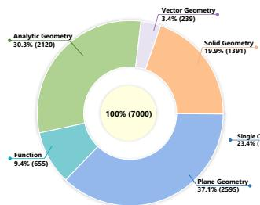  
(a) Distribution of knowledge point

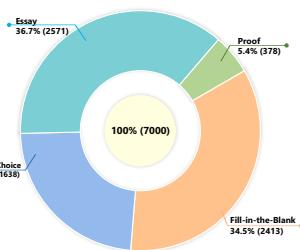  
(b) Distribution of problem type

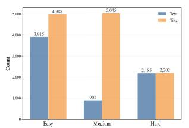  
(c) Distribution of TikZ and text difficulty levels

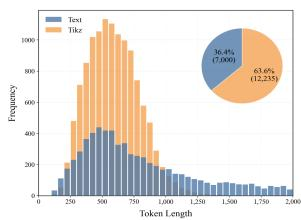  
(d) Distribution of token length  
Figure 2: Detailed statistics of the TriGeoBench dataset. In (c) and (d), Text denotes the question–answer pair, while TikZ denotes the code corresponding to the image.

## 4 Experiments

We design two tasks: Image-to-TikZ evaluates conversion into editable code that recovers visual structure, geometric relations, and annotations; Multimodal Mathematical Reasoning assesses joint statement–diagram interpretation, symbol–figure alignment, and answer derivation. Together, they probe diagram generation and geometric reasoning. Evaluation Models. We evaluate a broad spectrum of MLLMs on TriGeoBench, including both opensource and closed-source models. The open-source set covers eight model families: Qwen3-VL models (Bai et al., 2025) of different scales, Qwen2.5- VL (Bai Shuai et al., 2025), GLM-4.5V and GLM-4.1V-9B-Thinking (Hong et al., 2025), Llama-3.2- Vision (Meta, 2024), Gemma3 (Aishwarya Kamath et al., 2025), LLaVA-OneVision (Li et al., 2024a), and InternVL3 (Zhu et al., 2025). The closedsource set includes four representative models: Gemini-3.1-Pro (Google DeepMind, 2026), GPT-5.4 (OpenAI, 2026), Seed-2.0-Pro (ByteDance Seed Team, 2026), and Qwen3.5-Plus (Qwen Team, 2026).

Evaluation Metrics. For the Image-to-TikZ task, we use four complementary metrics. Gen Acc measures whether the generated TikZ code can be successfully compiled, evaluating executability. Image Metrics assess visual consistency between rendered predictions and ground-truth images. TikZ Metrics compare generated and reference code to quantify symbolic and structural similarity. Human Acc measures the proportion of rendered figures judged by humans as visually and mathematically faithful. For mathematical reasoning, we report answer accuracy using an LLM-based grader, counting each sub-question independently. Formal definitions are provided in the appendices.

Evaluation Datasets. We construct the evaluation set by sampling 1,000 instances from TriGeoBench across different difficulty levels, including 500

Easy, 300 Medium, and 200 Hard problems. This stratified sampling strategy ensures that the test set covers a broad range of reasoning demands and figure complexities. The remaining instances are used as the training set for fine-tuning small-scale multimodal large language models.

## 4.1 A Unified Image-to-TikZ Probe

Scope and Interpretation. All problem statements and evaluation prompts are in Chinese, so scores jointly reflect Chinese comprehension, mathematical reasoning, visual understanding, and structuredinput use; model comparisons are not languagecontrolled estimates of geometry ability alone. Text+TikZ uses human-curated reference code and serves as an oracle diagnostic, not an end-to-end conversion pipeline. We report descriptive point estimates from a fixed run and do not treat small differences as statistically conclusive. Public sources and unknown proprietary pretraining corpora also prevent a complete contamination guarantee.

Our goal is to probe general-purpose MLLMs under a unified prompting protocol, not to establish state-of-the-art performance against task-specific systems. DeTikZify, AutomaTikZ, and TikZero use distinct training corpora and task-specific optimization; their direct evaluation on TriGeoBench remains future work.

Evaluation of MLLMs on TriGeoBench. Tab. 2 summarizes the performance of representative open-source and closed-source MLLMs on the TriGeoBench evaluation set. Closed-source models have higher human-evaluated point estimates than open-source models, indicating limited opensource performance on this Chinese geometryfocused generation probe. Among all evaluated models, Gemini-3.1-Pro achieves the best overall performance, with a generation accuracy (Gen Acc) of 96.1% and a human-evaluated accuracy (Human Acc) of 73.7%. This suggests that the model can not only generate compilable outputs at a high rate, but also more frequently produce geometrically correct results. In contrast, although GPT-5.4 also attains a high generation accuracy of 95.6%, its human-evaluated accuracy is only 43.9%, revealing a clear gap between compilation success and actual geometric correctness. These results show that automatic metrics alone cannot fully capture geometric correctness, making human evaluation necessary for assessing structural and semantic fidelity. We further analyze human-evaluated accuracy across different complexity levels for all models, as shown in Fig. 3. Open-source models have particularly low point estimates on Medium and Hard samples, where matching the input geometry remains difficult. Closed-source models have higher estimates across the reported complexity strata. Overall Human Acc tends to decrease with figure complexity, although these strata need not produce a monotonic ordering for every model.

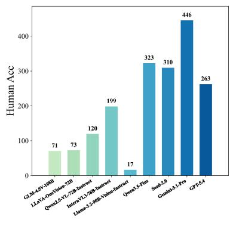  
(a) Easy

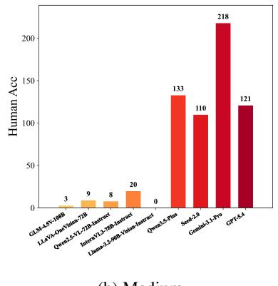  
(b) Medium

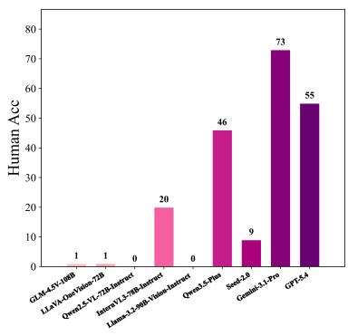  
(c) Hard

Figure 3: Human accuracy of different models on Image-to-TikZ tasks across difficulty levels.
<table><tr><td rowspan="2">Model</td><td rowspan="2">Gen Acc ↑</td><td colspan="4">Image Metrics</td><td colspan="3">TikZ Metrics</td><td rowspan="2">Human Acc ↑</td></tr><tr><td>SSIM  $\times 1 0 ^ { 2 } \uparrow$ </td><td>KID  $\times 1 0 ^ { 3 } \downarrow$ </td><td>CLIP  $\times 1 0 ^ { 2 } \uparrow$ </td><td>DINO  $\times 1 0 ^ { 2 } \uparrow$ </td><td>cBLEU ↑</td><td>MTE  $\times 1 0 ^ { 2 } \uparrow$ </td><td>TED↓</td></tr><tr><td colspan="10">Open-Source Models</td></tr><tr><td>Llama-3.2-90B-Vision-Instruct</td><td>80.5%</td><td>77.54</td><td>30.9</td><td>77.86</td><td>54.61</td><td>35.27</td><td>64.22</td><td>74.67</td><td>1.7%</td></tr><tr><td>GLM-4.5V-108B</td><td>76.4%</td><td>75.45</td><td>4.0</td><td>94.54</td><td>87.17</td><td>45.91</td><td>76.37</td><td>6.55</td><td>7.5%</td></tr><tr><td>Qwen2.5-VL-72B-Instruct</td><td>93.5%</td><td>80.66</td><td>67.8</td><td>70.47</td><td>41.60</td><td>50.39</td><td>76.52</td><td>7.26</td><td>12.8%</td></tr><tr><td>LLaVA-OneVision-72B</td><td>68.8%</td><td>89.03</td><td>96.3</td><td>81.56</td><td>66.62</td><td>22.39</td><td>50.61</td><td>56.60</td><td>4.1%</td></tr><tr><td>InternVL3-78B-Instruct</td><td>78.4%</td><td>74.52</td><td>6.9</td><td>92.80</td><td>82.52</td><td>39.53</td><td>70.92</td><td>9.47</td><td>8.3%</td></tr><tr><td colspan="10">Closed-Source Models</td></tr><tr><td>Qwen3.5-Plus Seed-2.0-Pro</td><td>88.2%</td><td>86.33</td><td>6.7</td><td>97.03</td><td>94.12</td><td>63.91</td><td>82.35</td><td>5.28</td><td>50.2%</td></tr><tr><td>Gemini-3.1-Pro</td><td>93.0%</td><td>85.70</td><td>8.2</td><td>94.70</td><td>89.66</td><td>52.44</td><td>78.44</td><td>5.83</td><td>42.9%</td></tr><tr><td></td><td>96.1%</td><td>86.44</td><td>2.2</td><td>97.76</td><td>95.92</td><td>63.78</td><td>82.73</td><td>3.89</td><td>73.7%</td></tr><tr><td>GPT-5.4</td><td>95.6%</td><td>80.72</td><td>11.7</td><td>94.35</td><td>88.20</td><td>53.08</td><td>71.53</td><td>6.57</td><td>43.9%</td></tr></table>

Table 2: TriGeoBench results. Green shading marks the best in each column; bold marks the second-best.

Inference and fine-tuning evaluation on smallscale MLLMs. To further validate the effectiveness and discriminative ability of TriGeoBench, we conduct LoRA fine-tuning experiments on several recent representative small-scale vision–language models, with results reported in Tab. 3. For a fair comparison, all models are fine-tuned under the same LoRA configuration, including learning rate, rank, and number of epochs. This controlled setup enables a direct comparison of model adaptability under the same training budget. The results on Gen Acc show that LoRA fine-tuning does not consistently improve all models. For instance, Qwen3- VL-2B and Qwen3-VL-4B even exhibit decreased Gen Acc after fine-tuning. This suggests that supervised fine-tuning alone is insufficient for strongly format-constrained tasks, and future work may benefit from compilation-aware training signals, such as format rewards, compilation-success rewards, or image-consistency rewards.

For Image Metrics, fine-tuning also does not yield consistent improvements. Unlike natural images, geometric figures often contain large blank regions, simple line segments, and sparse symbols, allowing general-purpose visual metrics such as CLIP and DINO to assign relatively high scores even to imperfect outputs. Therefore, image-level similarity metrics are useful but insufficient for evaluating fine-grained geometric faithfulness. In contrast, TikZ Metrics generally improve more substantially after fine-tuning, indicating that LoRA-SFT helps models learn domain-specific code patterns, command usage, and structured representations. Improvements in cBLEU, MTE, and TED suggest that fine-tuned models generate code closer to the reference TikZ programs at the token, editdistance, or tree-structure level. Nevertheless, the same geometric figure can often be represented by multiple valid TikZ programs using different coordinate systems, drawing orders, macros, or equivalent constructions. Thus, code-level metrics reflect alignment with the reference coding style, but cannot fully determine whether the generated code produces a correct image. To address these limitations, we include human evaluation to better assess geometric structures and symbolic relationships. Human-evaluated point estimates increase after LoRA fine-tuning for every model, although small differences are not statistically conclusive. This pattern suggests that LoRA-SFT can aid adaptation to image-to-TikZ generation despite discrepancies between metrics and generation quality.

<table><tr><td rowspan="2">Model</td><td rowspan="2">Stage</td><td rowspan="2">Gen  $\mathbf { A c c } \uparrow$ </td><td colspan="4">Image Metrics</td><td colspan="3">TikZ Metrics</td><td rowspan="2">Human  $\mathbf { A c c } \uparrow$ </td></tr><tr><td>SSIM  $\times 1 0 ^ { 2 . }$ </td><td>KID  $\times 1 0 ^ { 3 } \downarrow$ </td><td>CLIP  $\times 1 0 ^ { 2 } \uparrow$ </td><td>DINO  $\times 1 0 ^ { 2 } \uparrow$ </td><td>cBLEU ↑</td><td>MTE  $\times 1 0 ^ { 2 } \uparrow$ </td><td>TED↓</td></tr><tr><td>Qwen3-VL-2B</td><td>Base model LoRA-SFT</td><td>77.7% 72.7%</td><td>86.95 77.35</td><td>64.0 2.9</td><td>85.82 95.53</td><td>73.26 88.01</td><td>38.34 69.39</td><td>61.99 85.67</td><td>228.24 4.26</td><td>8.8% 12.0%</td></tr><tr><td>Qwen3-VL-4B</td><td>Base model LoRA-SFT</td><td>80.1% 71.6%</td><td>80.63 82.49</td><td>4.4 2.5</td><td>94.32 95.69</td><td>86.53 89.25</td><td>42.58 69.71</td><td>65.88 85.88</td><td>58.52 4.11</td><td>5.4% 13.4%</td></tr><tr><td>Qwen3-VL-8B</td><td>Base model LoRA-SFT</td><td>60.1% 75.6%</td><td>81.26 82.89</td><td>3.8 3.8</td><td>95.38 94.90</td><td>88.27 88.86</td><td>40.91 69.85</td><td>64.12 85.86</td><td>75.16 4.27</td><td>0.6% 27.0%</td></tr><tr><td>GLM-4.1V-9B- Thinking</td><td>Base model LoRA-SFT</td><td>74.6% 95.5%</td><td>80.72 81.66</td><td>14.5 3.7</td><td>91.18 95.12</td><td>87.73 88.36</td><td>64.50 39.33</td><td>83.65 70.05</td><td>8.28 11.18</td><td>0.6% 4.2%</td></tr><tr><td>Llama-3.2VL-11B</td><td>Base model LoRA-SFT</td><td>28.7% 88.0%</td><td>89.64 82.40</td><td>139.5 1.0</td><td>75.16 96.34</td><td>57.10 91.25</td><td>8.45 70.09</td><td>22.75 85.88</td><td>139.14 4.08</td><td>0.3% 15.0%</td></tr><tr><td>Gemma3-12B</td><td>Base model LoRA-SFT</td><td>87.0% 72.7%</td><td>87.81 82.11</td><td>87.1 2.1</td><td>81.60 95.84</td><td>65.34 89.81</td><td>47.20 62.93</td><td>75.57 80.86</td><td>7.26 5.42</td><td>0.6% 11.3%</td></tr></table>

Table 3: Results for six small-scale MLLMs before and after fine-tuning. Bold marks the better result within a model pair; green shading marks the best result in a column.

## 4.2 Multimodal Mathematical Reasoning

Following the LLM-as-Judge paradigm (Li et al., 2024b), we use a fixed grading prompt with itemlevel rules and JSON outputs. The maximum score equals the number of required answers, with one point per correct answer. Human-audit scores are normalized by this maximum. A human audit of 300 responses (78 choice, 84 fill-in, 53 proof, and 85 solution items) yields 91.7% exact and 99.0% within-one-point agreement, Pearson r = 0.629, Spearman $\rho = 0 . 6 0 7$ , and normalized-score MAE = 0.062; details are in the appendices.

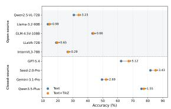

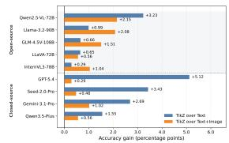  
(b) Model-wise TikZ gains.

(a) Text vs. Text+TikZ.  
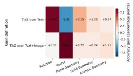

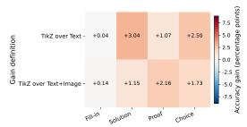  
(c) By knowledge point.  
(d) By question type.  
Figure 4: Oracle effect of human-curated reference TikZ: (a) Text-only versus Text+TikZ; (b) point differences over Text-only and Text+Figure; and (c–d) differences by knowledge point and question type.

Table 4 reports reasoning accuracy under four input settings: Text-only, Text+Figure, Text+TikZ, and Text+Figure+TikZ. Overall, closed-source models have higher point estimates across most settings. Seed-2.0-Pro performs best overall, while GPT-5.4 benefits from reference TikZ. Among open-source models, GLM-4.5V-108B performs best on average, whereas Llama-3.2-90B and LLaVA-OneVision-72B remain weaker. These comparisons indicate limited open-source performance on Chinese geometry-intensive reasoning under our setting, rather than a language-controlled estimate of geometry ability.

<table><tr><td rowspan="2">Model</td><td colspan="2">Text-only</td><td>Text+Figure</td><td colspan="2">Text+TikZ</td><td colspan="2">Text+Figure+TikZ</td></tr><tr><td></td><td></td><td></td><td></td><td></td><td>Easy Med. Hard Avg. Easy Med. Hard Avg. Easy Med. Hard Avg. Easy Med. Hard Avg.</td></tr><tr><td colspan="7">Open-Source Models</td></tr><tr><td>Qwen2.5-VL-72B</td><td></td><td></td><td></td><td>33.29 28.05 28.81 30.67 37.39 28.88 28.02 32.79 38.57 29.73 28.98 33.90 41.10 30.98 22.99 34.94</td><td></td><td></td><td></td></tr><tr><td>GLM-4.5V-108B</td><td></td><td></td><td></td><td></td><td></td><td></td><td>49.3138.1734.8143.13 48.96 38.3739.30 43.4751.0539.51 29.6743.79 52.14 40.06 33.1544.98</td></tr><tr><td>Llama-3.2-90B-Vision</td><td></td><td></td><td></td><td></td><td></td><td>13.0414.5710.3813.3312.7814.6710.6413.2614.5713.4216.3914.3216.8814.2412.9715.34</td><td></td></tr><tr><td>InternVL3-78B</td><td></td><td></td><td></td><td></td><td></td><td>LLaVA-OneVision-72B 21.8817.11 16.0918.95 22.2519.1917.61 20.03 21.37 22.4616.5819.60 24.2914.7717.87 20.59</td><td></td></tr><tr><td colspan="2"></td><td colspan="8">30.3921.6723.4526.5929.2822.5824.7926.64 29.6926.9023.5926.8831.0622.22 25.3427.68</td></tr><tr><td>Qwen3.5-Plus</td><td></td><td></td><td></td><td>Closed-Source Models</td><td></td><td></td><td></td><td></td></tr><tr><td>Seed-2.0-Pro</td><td></td><td></td><td></td><td></td><td></td><td></td><td></td><td>73.87 80.13 68.57 75.81 73.67 77.69 64.44 74.20 75.65 80.49 73.63 77.36 75.37 76.86 65.57 74.76 79.10 84.63 82.70 81.76 83.29 84.44 85.56 84.02 84.88 86.46 81.87 85.19 83.88 85.20 84.66 84.50</td></tr><tr><td>Gemini-3.1-Pro</td><td></td><td></td><td>64.18 40.84 21.13 49.45 60.32 32.33 13.30 43.00 67.89 44.30 18.69 52.14 60.91 31.97 19.10 44.02</td><td></td><td></td><td></td><td></td><td></td></tr><tr><td>GPT-5.4</td><td></td><td></td><td>60.82 64.23 60.92 62.20 69.67 65.64 59.57 66.84 69.59 67.27 58.66 67.32 70.15 66.61 56.99 67.13</td><td></td><td></td><td></td><td></td><td></td></tr><tr><td></td><td></td><td></td><td></td><td></td><td></td><td></td><td></td><td></td></tr></table>

Table 4: Reasoning accuracy (%) across input settings. Green marks the best result per column; bold marks the second-best. Instruct suffixes are omitted; full names appear in Table 2.

Seed-2.0-Pro’s 81.76% Text-only score does not contradict figure-grounding: some items contain redundant text, while priors or prior exposure may support correct answers. Aggregate accuracy cannot establish image necessity.

Gemini-3.1-Pro performs best on image-to-TikZ but decreases from 49.45 with Text-only to 43.00 with Text+Figure in reasoning. Image-to-TikZ emphasizes reconstruction, code generation, and format adherence, whereas reasoning also depends on Chinese comprehension, answer formatting, and grader parsing. The decrease may reflect multimodal-input or evaluation-format sensitivity; we do not attribute it solely to geometry reasoning.

Figure 4 compares model-wise point estimates. In Text+TikZ, each model receives the reference program associated with the problem; no program is generated from the test image at inference time. Text+TikZ is higher than Text-only for every model, but several open-source differences are below one percentage point and are not statistically conclusive. Adding reference code to Text+Figure also produces positive differences. Because the oracle code can expose exact construction parameters, these are upper-bound diagnostics, not deployableconverter gains.

Exploratory cross-dataset check. On 100 samples from each of MathVerse, MATH-Vision, and VisioMath, Table 5 reports Seed-2.0-Pro increases from 57% to 70%, 69% to 78%, and 81% to 84% with human-verified Text+TikZ. These exploratory results do not evaluate automatic conversion or establish robust generalization, and the VisioMath

<table><tr><td>Benchmark</td><td>Text+Fig.</td><td>Text+TikZ</td><td>Gain</td></tr><tr><td>MathVerse</td><td>57</td><td>70</td><td>+13</td></tr><tr><td>MATH-Vision</td><td>69</td><td>78</td><td>+9</td></tr><tr><td>VisioMath</td><td>81</td><td>84</td><td>+3</td></tr></table>

Table 5: Exploratory Seed-2.0-Pro accuracy (%) on 100 samples per benchmark. TikZ is human-authored and verified; Gain is Text+TikZ minus Text+Figure.

gain is modest.

Figure 4 further breaks down the gains by knowledge point and question type. Figure 4c reports positive point differences across most knowledge areas, especially geometry-related categories where relations among points, lines, curves, and spatial configurations are central. Figure 4d shows larger differences for solution- and proof-style problems than short-answer cases, suggesting potential value for multi-step geometric reasoning.

However, the benefits of additional modalities are not always additive. Although oracle Text+TikZ has higher point estimates than Textonly, Text+Figure+TikZ does not always achieve the best absolute accuracy for every model. This indicates that current MLLMs still struggle to fuse redundant visual and symbolic inputs. Thus, Tri-GeoBench provides a diagnostic of structured representations and exposes the unresolved challenge of reliable text–figure–structure fusion.

## 5 Conclusion

TriGeoBench represents geometry problems as aligned question–answer, image, and TikZ triplets. Its unified probes expose limitations in structure understanding and image–text alignment, while oracle results with human-curated reference TikZ suggest that accurate executable representations can provide complementary geometric cues.

## Limitations

TriGeoBench focuses on Chinese secondary-school problems, so scores conflate Chinese comprehension, mathematical reasoning, vision, and structured-input use and may not transfer to other languages or curricula. Public sources and unknown proprietary pretraining corpora prevent a complete contamination guarantee; deduplication only reduces obvious overlap. Reference TikZ may expose exact construction parameters, and equivalent programs complicate automatic evaluation. Future work evaluates automatic conversion pipelines and task-specific systems, expands the dataset’s scope, and strengthens structure-aware evaluation.

## References

Johan Ferret Aishwarya Kamath et al. 2025. Gemma 3 technical report. arXiv preprint arXiv:2503.19786.

Shuai Bai, Yuxuan Cai, et al. 2025. Qwen3-vl technical report. arXiv preprint arXiv:2511.21631.

Liu Xuejing Bai Shuai, Chen Keqin et al. 2025. Qwen2.5-vl technical report. arXiv preprint arXiv:2502.13923.

Jonas Belouadi, Simone Paolo Ponzetto, and Steffen Eger. 2024. DeTikZify: Synthesizing graphics programs for scientific figures and sketches with TikZ. In The Thirty-eighth Annual Conference on Neural Information Processing Systems.

ByteDance Seed Team. 2026. Doubao-1.5-pro / seed1.5. https://seed.bytedance.com/en/seed2.

Davide Caffagni, Federico Cocchi, Luca Barsellotti, Nicholas Moratelli, Sara Sarto, Lorenzo Baraldi, Marcella Cornia, and Rita Cucchiara. 2024. The revolution of multimodal large language models: A survey. Findings ofthe associationfor computational linguistics: ACL 2024, pages 13590–13618.

Jie Cao and Jing Xiao. 2022. An augmented benchmark dataset for geometric question answering through dual parallel text encoding. In Proceedings of the 29th International Conference on Computational Linguistics, COLING 2022, Gyeongju, Republic ofKorea, October 12-17, 2022, pages 1511–1520. International Committee on Computational Linguistics.

Alexandre Carlier, Martin Danelljan, Alexandre Alahi, and Radu Timofte. 2020. Deepsvg: A hierarchical generative network for vector graphics animation. In Advances in Neural Information Processing Systems, volume 33, pages 16351–16361. Curran Associates, Inc.

Jiaqi Chen, Tong Li, Jinghui Qin, Pan Lu, Liang Lin, Chongyu Chen, and Xiaodan Liang. 2022. UniGeo: Unifying geometry logical reasoning via reformulating mathematical expression. In Proceedings of the 2022 Conference on Empirical Methods in Natural Language Processing, pages 3313–3323, Abu Dhabi, United Arab Emirates. Association for Computational Linguistics.

Jiaqi Chen, Jianheng Tang, Jinghui Qin, Xiaodan Liang, Lingbo Liu, Eric Xing, and Liang Lin. 2021. GeoQA: A geometric question answering benchmark towards multimodal numerical reasoning. In Findings of the Associationfor Computational Linguistics: ACL-IJCNLP 2021, pages 513–523, Online. Association for Computational Linguistics.

Yamei Chen, Haoquan Zhang, Yangyi Huang, Zeju Qiu, Kaipeng Zhang, Yandong Wen, and Weiyang Liu. 2025. Symbolic graphics programming with large language models. arXiv preprint arXiv:2509.05208.

Karl Cobbe, Vineet Kosaraju, Mohammad Bavarian, Mark Chen, Heewoo Jun, Lukasz Kaiser, Matthias Plappert, Jerry Tworek, Jacob Hilton, Reiichiro Nakano, et al. 2021. Training verifiers to solve math word problems. arXiv preprint arXiv:2110.14168.

Bofei Gao, Feifan Song, Zhe Yang, Zefan Cai, Yibo Miao, Qingxiu Dong, Lei Li, Chenghao Ma, Liang Chen, Runxin Xu, et al. 2024. Omni-math: A universal olympiad level mathematic benchmark for large language models. arXiv preprint arXiv:2410.07985.

Philippe Gervais, Anastasiia Fadeeva, and Andrii Maksai. 2025. Mathwriting: A dataset for handwritten mathematical expression recognition. In Proceedings ofthe 31st ACM SIGKDD Conference on Knowledge Discovery and Data Mining V.2, KDD ’25, page 5459–5469, New York, NY, USA. Association for Computing Machinery.

Google DeepMind. 2026. Gemini 3.1 pro. https: //deepmind.google/models/model-cards/ gemini-3-1-pro/.

Dan Hendrycks, Collin Burns, Saurav Kadavath, Akul Arora, Steven Basart, Eric Tang, Dawn Song, and Jacob Steinhardt. 2021a. Measuring mathematical problem solving with the math dataset. arXiv preprint arXiv:2103.03874.

Dan Hendrycks, Collin Burns, Saurav Kadavath, Akul Arora, Steven Basart, Eric Tang, Dawn Song, and Jacob Steinhardt. 2021b. Measuring mathematical problem solving with the math dataset. In Proceedings of the Neural Information Processing Systems Track on Datasets and Benchmarks, volume 1.

Wenyi Hong, Wenmeng Yu, Xiaotao Gu, et al. 2025. Glm-4.5 v and glm-4.1 v-thinking: Towards versatile multimodal reasoning with scalable reinforcement learning. arXiv preprint arXiv:2507.01006.

Drew A Hudson and Christopher D Manning. 2019. Gqa: A new dataset for real-world visual reasoning

and compositional question answering. In Proceed ings of the IEEE/CVF conference on computer vision and pattern recognition, pages 6700–6709.

Aaron Hurst, Adam Lerer, Adam P Goucher, Adam Perelman, Aditya Ramesh, Aidan Clark, AJ Ostrow, Akila Welihinda, Alan Hayes, Alec Radford, et al. 2024. Gpt-4o system card. arXiv preprint arXiv:2410.21276.

Bo Li, Yuanhan Zhang, Dong Guo, Renrui Zhang, Feng Li, Hao Zhang, Kaichen Zhang, Peiyuan Zhang, Yanwei Li, Ziwei Liu, et al. 2024a. Llavaonevision: Easy visual task transfer. arXiv preprint arXiv:2408.03326.

Can Li, Ying Liu, Ting Zhang, Mei Wang, and Hua Huang. 2026. Visiomath: Benchmarking figurebased mathematical reasoning in lmms. In International Conference on Learning Representations.

Haitao Li, Qian Dong, Junjie Chen, Huixue Su, Yujia Zhou, Qingyao Ai, Ziyi Ye, and Yiqun Liu. 2024b. Llms-as-judges: A comprehensive survey on llm-based evaluation methods. Preprint, arXiv:2412.05579.

Jian Li, Weiheng Lu, Hao Fei, Meng Luo, Ming Dai, Min Xia, Yizhang Jin, Zhenye Gan, Ding Qi, Chaoyou Fu, et al. 2024c. A survey on benchmarks of multimodal large language models. arXiv preprint arXiv:2408.08632.

Junnan Li, Dongxu Li, Silvio Savarese, and Steven Hoi. 2023. Blip-2: Bootstrapping language-image pretraining with frozen image encoders and large language models. In International conference on machine learning, pages 19730–19742. PMLR.

Haotian Liu, Chunyuan Li, Qingyang Wu, and Yong Jae Lee. 2023. Visual instruction tuning. Advances in neural information processing systems, 36:34892– 34916.

Yuan Liu, Haodong Duan, Yuanhan Zhang, Bo Li, Songyang Zhang, Wangbo Zhao, Yike Yuan, Jiaqi Wang, Conghui He, Ziwei Liu, et al. 2024. Mmbench: Is your multi-modal model an all-around player? In European conference on computer vision, pages 216–233. Springer.

Pan Lu, Hritik Bansal, Tony Xia, Jiacheng Liu, Chunyuan Li, Hannaneh Hajishirzi, Hao Cheng, Kai-Wei Chang, Michel Galley, and Jianfeng Gao. 2024. Mathvista: Evaluating mathematical reasoning of foundation models in visual contexts. In International Conference on Learning Representations (ICLR).

Pan Lu, Ran Gong, Shibiao Jiang, Liang Qiu, Siyuan Huang, Xiaodan Liang, and Song-Chun Zhu. 2021. Inter-gps: Interpretable geometry problem solving with formal language and symbolic reasoning. In The Joint Conference of the 59th Annual Meeting of the Association for Computational Linguistics and the 11th International Joint Conference on Natural Language Processing (ACL-IJCNLP 2021).

Pan Lu, Swaroop Mishra, Tanglin Xia, Liang Qiu, Kai-Wei Chang, Song-Chun Zhu, Oyvind Tafjord, Peter Clark, and Ashwin Kalyan. 2022. Learn to explain: Multimodal reasoning via thought chains for science question answering. Advances in neural information processing systems, 35:2507–2521.

Shixian Luo, Zezhou Zhu, Yu Yuan, Yuncheng Yang, Lianlei Shan, and Yong Wu. 2025. Geogrambench: Benchmarking the geometric program reasoning in modern llms. arXiv preprint arXiv:2505.17653.

Ahmed Masry, Xuan Long Do, Jia Qing Tan, Shafiq Joty, and Enamul Hoque. 2022. Chartqa: A benchmark for question answering about charts with visual and logical reasoning. In Findings ofthe associationfor computational linguistics: ACL 2022, pages 2263– 2279.

Minesh Mathew, Dimosthenis Karatzas, and CV Jawahar. 2021. Docvqa: A dataset for vqa on document images. In Proceedings ofthe IEEE/CVF winter conference on applications of computer vision, pages 2200–2209.

Meta. 2024. Llama-3.2-11b-vision. https: //huggingface.co/meta-llama/Llama-3. 2-11B-Vision.

OpenAI. 2026. Gpt-5.4. https://openai.com/ index/introducing-gpt-5-4/.

Qwen Team. 2026. Qwen3.5-plus. https://www. alibabacloud.com/help/en/model-studio/ models.

Jingqun Tang, Qi Liu, Yongjie Ye, Jinghui Lu, Shu Wei, An-Lan Wang, Chunhui Lin, Hao Feng, Zhen Zhao, Yanjie Wang, et al. 2025. Mtvqa: Benchmarking multilingual text-centric visual question answering. In Findings of the Association for Computational Linguistics: ACL 2025, pages 7748–7763.

Gemini Team, Rohan Anil, Sebastian Borgeaud, Jean-Baptiste Alayrac, Jiahui Yu, Radu Soricut, Johan Schalkwyk, Andrew M Dai, Anja Hauth, Katie Millican, et al. 2023. Gemini: a family of highly capable multimodal models. arXiv preprint arXiv:2312.11805.

Haomin Wang, Jinhui Yin, Qi Wei, Wenguang Zeng, Lixin Gu, Shenglong Ye, Zhangwei Gao, Yaohui Wang, Yanting Zhang, Yuanqi Li, et al. 2025a. Internsvg: Towards unified svg tasks with multimodal large language models. arXiv preprint arXiv:2510.11341.

Ke Wang, Junting Pan, Weikang Shi, Zimu Lu, Houxing Ren, Aojun Zhou, Mingjie Zhan, and Hongsheng Li. 2024. Measuring multimodal mathematical reasoning with math-vision dataset. In The Thirty-eight Conference on Neural Information Processing Systems Datasets and Benchmarks Track.

Peijie Wang, Chao Yang, Zhong-Zhi Li, Fei Yin, Dekang Ran, Mi Tian, Zhilong Ji, Jinfeng Bai, and Cheng-Lin Liu. 2025b. Solidgeo: Measuring multimodal spatial math reasoning in solid geometry. arXiv preprint arXiv:2505.21177.

Xudong Yang, Yifan Wu, Yizhang Zhu, Nan Tang, and Yuyu Luo. 2024. Askchart: Universal chart understanding through textual enhancement. arXiv preprint arXiv:2412.19146.

Yiying Yang, Wei Cheng, Sijin Chen, Xianfang Zeng, Jiaxu Zhang, Liao Wang, Gang Yu, Xingjun Ma, and Yu-Gang Jiang. 2025. Omnisvg: A unified scalable vector graphics generation model. arXiv preprint arXiv:2504.06263.

Xiang Yue, Tianyu Zheng, Yuansheng Ni, Yubo Wang, Kai Zhang, Shengbang Tong, Yuxuan Sun, Botao Yu, Ge Zhang, Huan Sun, et al. 2025. Mmmu-pro: A more robust multi-discipline multimodal understanding benchmark. In Proceedings of the 63rd Annual Meeting of the Association for Computational Linguistics (Volume 1: Long Papers), pages 15134– 15186.

Jiaxin Zhang, Zhong-Zhi Li, Ming-Liang Zhang, Fei Yin, Cheng-Lin Liu, and Yashar Moshfeghi. 2024a. GeoEval: Benchmark for evaluating LLMs and multimodal models on geometry problem-solving. In Findings of the Association for Computational Linguistics: ACL 2024, pages 1258–1276, Bangkok, Thailand. Association for Computational Linguistics.

Ming-Liang Zhang, Fei yin, and Cheng-Lin Liu. 2023. A multi-modal neural geometric solver with textual clauses parsed from diagram. In Proceedings ofthe Thirty-Second International Joint Conference on Artificial Intelligence, IJCAI-23, pages 3374–3382. International Joint Conferences on Artificial Intelligence Organization. Main Track.

Renrui Zhang, Dongzhi Jiang, Yichi Zhang, Haokun Lin, Ziyu Guo, Pengshuo Qiu, Aojun Zhou, Pan Lu, Kai-Wei Chang, Yu Qiao, Peng Gao, and Hongsheng Li. 2024b. Mathverse: Does your multi-modal llm truly see the&nbsp;diagrams in&nbsp;visual math problems? In Computer Vision – ECCV 2024: 18th European Conference, Milan, Italy, September 29–October 4, 2024, Proceedings, Part VIII, page 169–186, Berlin, Heidelberg. Springer-Verlag.

Deyao Zhu, Jun Chen, Xiaoqian Shen, Xiang Li, and Mohamed Elhoseiny. 2023. Minigpt-4: Enhancing vision-language understanding with advanced large language models. arXiv preprint arXiv:2304.10592.

Jinguo Zhu, Weiyun Wang, Zhe Chen, Zhaoyang Liu, Shenglong Ye, Lixin Gu, Hao Tian, Yuchen Duan, Weijie Su, Jie Shao, et al. 2025. Internvl3: Exploring advanced training and test-time recipes for open-source multimodal models. arXiv preprint arXiv:2504.10479.

Bocheng Zou, Mu Cai, Jianrui Zhang, and Yong Jae Lee. 2024. VGBench: Evaluating large language models on vector graphics understanding and generation. In Proceedings ofthe 2024 Conference on Empirical Methods in Natural Language Processing, pages 3647–3659, Miami, Florida, USA. Association for Computational Linguistics.

## A Data Source, Licensing, and Leakage

Data sources. TriGeoBench is constructed from publicly accessible Chinese junior- and seniorsecondary mathematics examination materials, including online educational platforms, school repositories, and open exam archives. The raw materials typically contain question statements, answer keys, solution analyses, and associated figures. During preprocessing, we remove irrelevant metadata, source-specific headers and footers, question indices that do not affect problem semantics, and any personal or institution-specific information when present.

Licensing and release. Since the raw examination materials are collected from heterogeneous public sources, their redistribution conditions may vary. We therefore release the processed dataset in a form that follows the applicable licensing constraints of the original sources. When necessary, we provide derived annotations, normalized LATEX question–answer pairs, rendered figures, TikZ code, and metadata, while avoiding redistribution of source documents that are not explicitly licensed for reuse. The final release includes a data statement describing source categories, preprocessing steps, and usage restrictions.

Deduplication and leakage control. To reduce duplicate or near-duplicate samples, we conduct filtering over the collected corpus using textual similarity and manual inspection. Problems based on highly redundant templates are removed during annotation. We further check candidate samples against representative public geometry and multimodal mathematical reasoning benchmarks when applicable. However, because some large multimodal models may have been trained on broad web-scale data, we cannot fully rule out prior exposure to public examination problems. We therefore report the dataset construction procedure transparently and encourage future evaluations to consider potential training-data contamination when interpreting results.

Privacy and sensitive information. The dataset is built from educational mathematics problems rather than personal records. We remove names, school-specific metadata, document headers, and other irrelevant identifying information when they appear in source documents. The retained content focuses on mathematical problem statements, solutions, figures, and structured annotations.

## B Annotation Details

## B.1 Collection and Preprocessing

We collect publicly available Chinese mathematics examination papers from online educational platforms, school repositories, and open exam archives. The collected materials cover both junior and senior secondary education and typically include question statements, answer keys, and detailed solution analyses. These materials provide both the problem context and the intended reasoning process, which helps verify whether extracted figures contain solution-relevant, nondecorative information.

From the raw materials, we extract candidate problems that contain figures and are relevant to one or more target knowledge areas, including plane geometry, solid geometry, analytic geometry, functions, and vector geometry. Each candidate problem is segmented into structured components, including the question stem, answer, solution, and associated figure(s). Due to heterogeneous layouts and document styles, we perform careful normalization, including cleaning line breaks, removing question indices, deleting irrelevant headers and footers, standardizing mathematical notation, and aligning each question with its corresponding figure region.

After preprocessing, annotators screen the candidate pool by removing questions without valid figures, cases with severely degraded visual quality, and problems based on clearly redundant templates. This filtering step improves the quality and diversity of the dataset while ensuring that the retained instances require meaningful text–figure reasoning rather than relying only on textual shortcuts or superficial visual patterns.

## B.2 Manual Conversion to LAT X and TikZ

To obtain unified and editable representations, human annotators manually transcribe each problem statement into LAT X and author the corresponding figure in TikZ using the original source as reference. Shared annotation guidelines require annotators to preserve mathematical notation and problem semantics while producing complete, compilable code. The full guidelines are provided in the “Guidelines for Manual Image-to-TikZ Annotation”

section below.

Manual TikZ authoring is particularly demanding because complex figures require precise topology, geometric incidence, symbolic labels, hidden edges, auxiliary lines, and relative positioning. Annotators therefore compile and compare each representation with the original figure throughout the authoring process, with particular attention to solid-geometry diagrams, function plots with critical points, and figures involving multiple nested geometric relations.

## B.3 Independent Verification and Correction

For every manually converted instance, an independent reviewer compares the transcribed LATEX and authored TikZ code with the original source materials. The verification process focuses on four recurring categories of errors:

1. Mathematical notation errors. These include malformed fractions, missing operators, incorrect symbols, and wrong subscripts or superscripts.

2. Semantic omissions or distortions. These include missing conditions, incomplete solution steps, incorrect answer transcription, or changes in the meaning of the original problem.

3. Text–figure inconsistencies. These include mismatched point labels, missing geometric objects, inconsistent references between the question and the figure, or incorrect association between a figure and its problem statement.

4. TikZ structural errors. These include incorrect topology, missing auxiliary lines, inaccurate relative positions, misplaced labels, missing hidden edges, and incorrect rendering of geometric or functional relations.

Items that do not pass review are returned to the annotators for correction or complete redrawing when necessary. The final TikZ code must be compilable and preserve the mathematical intent and visual reasoning structure of the original figure.

To support large-scale and traceable human annotation, we use an internal annotation and review system, as illustrated in Figure 5. The system presents the original problem image, the manually transcribed LAT X text, and the authored TikZ code in a unified interface, allowing annotators to compare the source material directly with the structured representation. Annotators can edit the problem statement, solution, answer, and figure code while immediately checking whether the TikZ code compiles and visually matches the original diagram. This interface reduces context switching during annotation and helps annotators focus on mathematical fidelity rather than file-level operations.

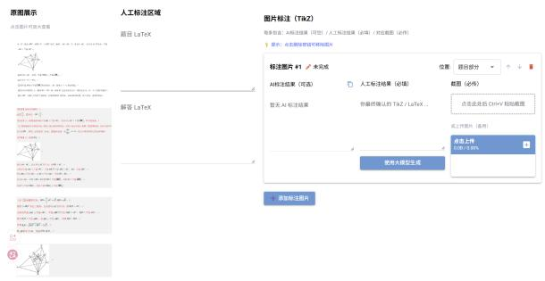

(a) Annotation interface  
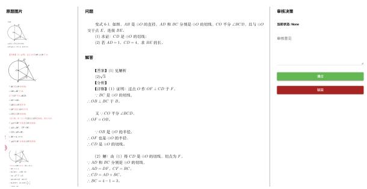  
(b) Review text

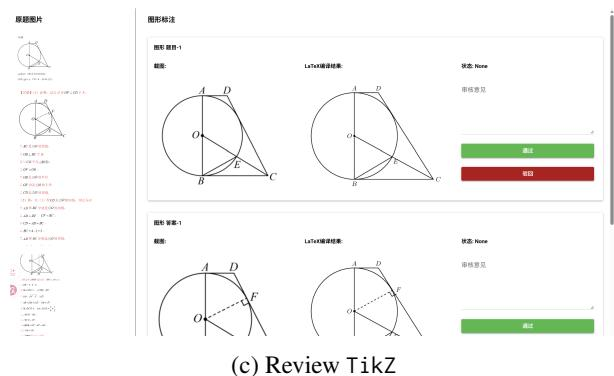  
Figure 5: Annotation and review interfaces for side-byside comparison, LAT X/TikZ editing, and independent verification. English translations and Pinyin of interface labels appear in Appendix G.4.

The review system provides an additional quality-control layer. Each annotated instance is submitted for inspection, where reviewers check mathematical correctness, text–figure consistency, and rendering quality before accepting the item into the final dataset. Items with unresolved errors are returned for further correction. The system records annotation status and review decisions, enabling us to track the progress of each instance and avoid duplicated or conflicting edits. This system-based workflow makes manual authoring and verification more consistent, auditable, and scalable than independent offline editing.

## C Evaluation Metrics

We evaluate the generated TikZ/LATEX outputs from four complementary perspectives: renderability, visual fidelity, code-level similarity, and humanverified correctness. In addition, for the mathematical reasoning task, we report answer accuracy based on automatic grading by an LLM judge.

## C.1 Render Success Rate

Render success rate, also referred to as generation accuracy (Gen Acc), measures whether the predicted TikZ/LAT X code can be successfully compiled into a valid image. Given N test samples and $N _ { \mathrm { o k } }$ successfully rendered samples, it is defined as:

$$
\mathrm { G e n A c c } = { \frac { N _ { \mathrm { { o k } } } } { N } } .\tag{1}
$$

This metric evaluates the syntactic correctness and executability of generated code. Since TikZ generation is sensitive to missing environments, invalid commands, and syntax errors, Gen Acc is an important indicator of practical usability.

## C.2 Visual Similarity Metrics

To evaluate whether the rendered image from generated code matches the ground-truth figure, we use both low-level and high-level visual metrics.

SSIM. The Structural Similarity Index Measure (SSIM) measures local structural consistency between the predicted image x and the ground-truth image y:

$$
\mathrm { S S I M } ( x , y ) = \frac { ( 2 \mu _ { x } \mu _ { y } + C _ { 1 } ) ( 2 \sigma _ { x y } + C _ { 2 } ) } { ( \mu _ { x } ^ { 2 } + \mu _ { y } ^ { 2 } + C _ { 1 } ) ( \sigma _ { x } ^ { 2 } + \sigma _ { y } ^ { 2 } + C _ { 2 } ) } .\tag{2}
$$

Here, $\mu , \sigma ^ { 2 }$ , and $\sigma _ { x y }$ denote image means, variances, and covariance, respectively. SSIM captures luminance, contrast, and structural similarity, making it suitable for checking whether lines, shapes, and local geometric patterns are preserved.

CLIP and DINO similarity. We further compute feature-level cosine similarity using CLIP and DINOv2 visual encoders:

$$
\mathrm { S i m } ( x , y ) = \frac { f _ { x } ^ { \top } f _ { y } } { \| f _ { x } \| _ { 2 } \| f _ { y } \| _ { 2 } } ,\tag{3}
$$

where $f _ { x }$ and $f _ { y }$ denote visual embeddings of the predicted and reference images. CLIP similarity reflects high-level semantic alignment, while DINO similarity is more sensitive to visual layout and geometric structure, which is particularly useful for mathematical diagrams.

KID. Kernel Inception Distance (KID) measures dataset-level distributional similarity between generated and reference images. It is based on the squared Maximum Mean Discrepancy:

$$
\begin{array} { l } { { \mathrm { M M D } ^ { 2 } ( X , Y ) = \displaystyle \frac { 1 } { m ^ { 2 } } \sum _ { i , j } k ( x _ { i } , x _ { j } ) } } \\ { { { } + \displaystyle \frac { 1 } { n ^ { 2 } } \sum _ { i , j } k ( y _ { i } , y _ { j } ) } } \\ { { { } - \displaystyle \frac { 2 } { m n } \sum _ { i , j } k ( x _ { i } , y _ { j } ) , } } \end{array}\tag{4}
$$

where X and $Y$ are feature sets extracted from generated and reference images. Unlike pairwise metrics such as SSIM, CLIP, and DINO, KID evaluates whether the overall generated image distribution matches the reference distribution. Lower KID indicates better distributional consistency.

## C.3 Code-level Similarity Metrics

We evaluate the similarity between generated and reference TikZ code using lexical, token-level, and structural metrics.

Code BLEU. Code BLEU (cBLEU) is computed using sentence-level BLEU:

$$
{ \mathrm { B L E U } } = B P \cdot \exp \left( \sum _ { n = 1 } ^ { N } w _ { n } \log p _ { n } \right) ,\tag{5}
$$

where $p _ { n }$ is the modified n-gram precision, $w _ { n }$ is the weight for each n-gram order, and $B P$ is the brevity penalty. cBLEU measures lexical and local syntactic overlap between generated and reference code.

Token F1. Token F1 measures token-level agreement after normalizing and tokenizing the generated and reference code:

$$
\begin{array} { c c c } { \displaystyle { P = \frac { T P } { T P + F P } , \qquad R = \frac { T P } { T P + F N } , } } \\ { \displaystyle { F 1 = \frac { 2 P R } { P + R } . } } \end{array}\tag{6}
$$

Compared with BLEU, Token F1 is less sensitive to local ordering differences and is useful when semantically similar TikZ programs are written in different syntactic forms.

Tree Edit Distance. Tree Edit Distance (TED) measures structural discrepancy between generated and reference TikZ code. We construct lightweight syntax trees by extracting key graphical primitives and commands, such as \draw, \node, \path, circle, rectangle, arc, and plot. TED is defined as:

$$
\mathrm { T E D } ( T _ { 1 } , T _ { 2 } ) = \operatorname* { m i n } \sum _ { i } \mathrm { c o s t } ( o p _ { i } ) ,\tag{7}
$$

where $o p _ { i }$ denotes insertion, deletion, or substitution operations. Lower TED indicates stronger structural consistency between the predicted and reference programs.

## C.4 Human Evaluation Accuracy

Automatic metrics cannot fully determine whether a generated diagram is mathematically faithful, especially when different TikZ programs may produce visually equivalent or semantically acceptable figures. Therefore, we additionally report human evaluation accuracy for the Image-to-TikZ task. Human annotators inspect the rendered prediction and judge whether it is visually and semantically consistent with the ground-truth figure. Given N evaluated samples and $N _ { \mathrm { p a s s } }$ samples judged as acceptable, Human Acc is defined as:

$$
\mathrm { H u m a n A c c } = \frac { N _ { \mathrm { p a s s } } } { N } .\tag{8}
$$

A sample is considered acceptable only if the rendered figure preserves the key mathematical objects, labels, geometric relations, and visual structure required by the original problem.

## C.5 Mathematical Reasoning Accuracy

For the mathematical reasoning task, we evaluate model answers using an LLM-based grader with a fixed grading prompt. The grader compares the model response against the reference solution and returns a structured judgment. Accuracy is computed as:

$$
\mathrm { A c c } = \frac { N _ { \mathrm { c o r r e c t } } } { N _ { \mathrm { t o t a l } } } ,\tag{9}
$$

where $N _ { \mathrm { c o r r e c t } }$ is the number of correctly answered questions and $N _ { \mathrm { t o t a l } }$ is the total number of evaluated questions. If a problem contains multiple sub-questions, each sub-question is counted as an independent unit. Thus, a model receives credit for each correctly answered sub-question rather than only for the entire problem.

## C.6 Overall Average Score

For the Image-to-TikZ task, we also report an aggregated average score by normalizing all metrics into a common higher-is-better scale. For example, cBLEU is divided by 100, KID and TED are transformed by reciprocal normalization, and cosine similarities are mapped to [0, 1] when necessary:

$$
\begin{array} { r } { \widetilde { \mathrm { K I D } } = \frac { 1 } { 1 + \operatorname* { m a x } ( \mathrm { K I D } , 0 ) } , } \\ { \widetilde { \mathrm { T E D } } = \frac { 1 } { 1 + \operatorname* { m a x } ( \mathrm { T E D } , 0 ) } . } \end{array}\tag{10}
$$

The final average score is:

$$
\mathrm { A V G } = \frac { 1 } { \left| \mathcal { M } \right| } \sum _ { m \in \mathcal { M } } \widetilde { m } ,\tag{11}
$$

where M denotes the set of normalized metrics. This score provides a compact summary of renderability, visual fidelity, code similarity, and structural consistency.

## C.7 Quality Control

To ensure consistency across modalities, each finalized instance is checked from three perspectives. First, the problem text, answer, and solution must preserve the semantics of the original source. Second, the rendered figure from the TikZ code must match the original figure in terms of key geometric objects, labels, topology, and relative spatial relations. Third, textual references in the problem must be aligned with the corresponding visual entities in the figure. These checks ensure that each data instance forms a coherent {LATEX question–answer pair, image, TikZ} triplet suitable for both imageto-TikZ generation and multimodal mathematical reasoning evaluation.

## D Guidelines for Manual Image-to-TikZ Annotation

Human annotators follow a common checklist when converting mathematical figures into structured symbolic representations. The checklist emphasizes identification of core visual elements and faithful, compilable LATEX/TikZ authoring.

## Manual Image-to-TikZ Annotation Checklist

Inspect the source problem image and record the core visual information in the mathematical and geometric domains, including the coordinate-system type, function expressions, graphical boundaries, coordinates of special points, auxiliary lines, filled regions, and legend descriptions. Then manually author clear academic-style LATEX drawing code. The requirements are as follows: The requirements are as follows

1. Prefer the TikZ package to ensure the clarity of vector graphics.

2. Strictly follow the parameter specifications in the original figure and do not omit any important details.

3. Keep the code structure clean and well organized, with detailed comments to facilitate subsequent parameter adjustment.

4. Provide a brief explanation indicating how the key parts of the code correspond to the visual elements in the original figure.

## E Generated Token Analysis

Figure 6 reports the average number of generated tokens across difficulty levels and input formats. The number of output tokens generally increases with problem difficulty, indicating that harder geometric problems tend to require longer reasoning chains. In contrast, introducing additional input modalities, such as figures or TikZ, does not substantially increase the number of generated tokens. This suggests that the performance changes observed in the main experiments are mainly associated with differences in available geometric information and multimodal fusion ability, rather than with a systematic increase in generation length or reasoning cost.

## F Prompt for LLM-as-Judge Evaluation

To evaluate the correctness of model-generated answers, we adopt an LLM-as-Judge evaluation protocol. Given a problem statement, the reference solution, and the student’s answer, the judge model is instructed to assign a score based on answer-level correctness. For a problem requiring multiple answers, the maximum score is defined as the number of required answers, and each correctly answered item receives one point. An English translation of the Chinese evaluation prompt is shown below.

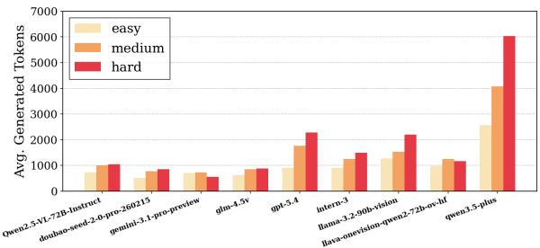

(a) Only Text  
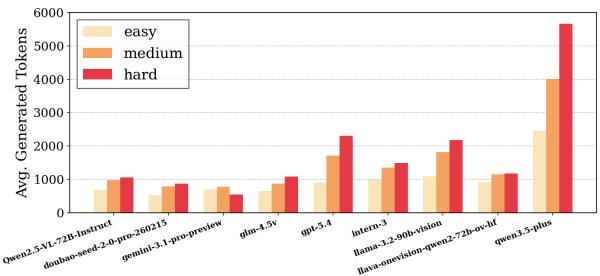  
(c) Text+TikZ

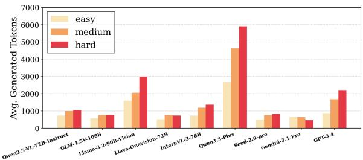  
(b) Text+Figure

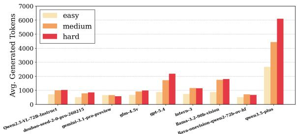  
(d) Text+Figure+TikZ  
Figure 6: Average generated token count across difficulty levels and input formats.

## Prompt Template for LLM-as-Judge Evaluation

You are a rigorous mathematics and geometry grading teacher. Please judge the student’s solution according to the reference answer. The grading rules are as follows:

1. First determine the total score of the problem. If the problem requires multiple answers, the maximum score is equal to the number of required answers.

2. Each correctly answered item receives 1 point, while incorrect items receive 0 points.

Please output the result in JSON format, including the following fields: score as an integer indicating the final score obtained by the student, max\_score as an integer indicating the maximum score of the problem, and comment as a brief explanation.

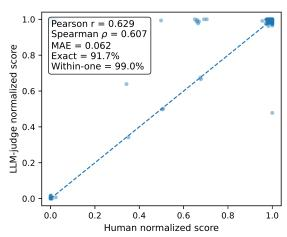

Problem: {question}

Reference Answer: {solution}

Student Answer: {answer}

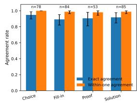  
(a) Score-level agreement  
(b) Agreement by question type  
Figure 7: Agreement between the LLM-based evaluator and human audit results. Left: normalized scorelevel correlation between human scores and LLM-judge scores. Right: exact agreement and within-one-point agreement across question types, with 95% bootstrap confidence intervals.

## F.1 Reliability Analysis of LLM-based Evaluation

To assess the LLM-based evaluator, we conduct a human-audit agreement analysis on 300 sampled responses: 78 choice, 84 fill-in, 53 proof, and 85 solution items. Human annotators independently score each response using the same criteria as the LLM judge, and we compare the scores after normalization by each problem’s maximum score.

Figure 7a reports Pearson $r = 0 . 6 2 9$ , Spearman $\rho = 0 . 6 0 7$ , and normalized-score $\mathbf { M A E } = 0 . 0 6 2$ Exact agreement is 91.7% and within-one-point agreement is 99.0%. Figure 7b further breaks down agreement by question type. The point estimates are higher for objective formats than for proofand solution-style problems, where valid reasoning paths are more diverse.

Overall, this audit supports the fixed grader for large-scale descriptive evaluation while motivating explicit JSON scoring rules for open-ended responses.

## G Translations of the Dataset Examples

Figure 1 preserves the Chinese excerpts in the dataset examples. The translations and toneless Pinyin romanizations below follow the visible excerpts, including their ellipses; they do not reconstruct conditions or derivations omitted from the figure. Mathematical symbols retain their original notation.

## G.1 Easy Example

Question (English). In triangle ABC, angle A is $6 0 ^ { \circ }$ , side $A B$ is 2, and side BC is $\sqrt { 6 }$ . The angle bisector of A meets BC at D. Find the length of AD.

Question (Pinyin). Zai sanjiaoxing $A B C$ zhong, yizhi jiao A wei 60 du, bian AB wei 2, bian $B C$ wei ${ \sqrt { 6 } } ,$ jiao A de jiao pingfenxian jiao $B C$ yu dian D, yaoqiu jisuan AD de changdu.

Answer excerpt (English). Answer: 2. Detailed solution: As shown, let $A B = c , A C = b ,$ and $B C = a . \ldots$ Therefore, $C \ = \ 4 5 ^ { \circ }$ and $B =$ $1 8 0 ^ { \circ } - 6 0 ^ { \circ } - 4 5 ^ { \circ } = 7 5 ^ { \circ }$

Answer excerpt (Pinyin). Da’an: 2. Xiangjie: Ru tu suo shi, ji $A B = c , A C = b , B C = a . \ . . .$ Suoyi $C = 4 5 ^ { \circ } , B = 1 8 0 ^ { \circ } - 6 0 ^ { \circ } - 4 5 ^ { \circ } = 7 5 ^ { \circ }$

## G.2 Medium Example

Question excerpt (English). Let $f ( x )$ be a cubic function . . . Its local maximum and minimum values are, respectively: A. f(1) and $f ( - 1 ) ; \ldots \mathrm { ~ D ~ }$ $f ( - 2 )$ and f(2).

Question excerpt (Pinyin). She $f ( x )$ shi sanci hanshu . . . , jida zhi yu jixiao zhi fenbie shi: $\mathbf { A } . f ( 1 )$ yu $f ( - 1 ) ; \ldots { \mathrm { ~ D } } . { \mathrm { ~ } } f ( - 2 ) { \mathrm { ~ y u ~ } } f ( 2 )$

Answer excerpt (English). Answer: D. Detailed solution: When $x < 0 , f ^ { \prime } ( x )$ and $x f ^ { \prime } ( x )$ have opposite signs; . . . when $x = 2 , f ( x )$ has a local minimum f(2).

Answer excerpt (Pinyin). Da’an: D. Xiangjie: Dang $x < 0$ shi, $f ^ { \prime } ( x )$ de fuhao yu x $: f ^ { \prime } ( x )$ de fuhao xiangfan; . . . dang $x = 2$ shi, $f ( x )$ you jixiao zhi $f ( 2 )$

## G.3 Hard Example

Question excerpt (English). Located in Yangpu . . . the upper and lower bases . . . (1) Prove: . . . $B C \perp C _ { 1 } F$ . (2) Find the distance from point O to the plane . . . .

Question excerpt (Pinyin). Zuoluo yu Yangpu . . . de shangxia liang dimian de. (1) Qiuzheng: . . . $B C \bot C _ { 1 } F _ { \cdot }$ . (2) Qiu dian O dao ping . . . juli.

Answer excerpt (English). Detailed solution: (1) Proof: Connect CF. Since the base is a regular octagon $\dots , B C \bot C _ { 1 } F . \ ( 2 )$ Connect $O C _ { 1 }$ and $O G _ { 1 } \ldots$ the distance to $A C G _ { 1 }$ is 32.

Answer excerpt (Pinyin). Xiangjie: (1) Zhengming: Lianjie $C F .$ , yinwei dimian wei zheng bajiaoxing . . . , suoyi $B C \perp C _ { 1 } F . \ ( 2 )$ Lianjie $O C _ { 1 }$ $O G _ { 1 } \ldots A C G _ { 1 }$ de juli wei 32.

## G.4 Annotation Interface Labels

The screenshots in Figure 5 illustrate the interface rather than additional evaluation examples. The following glossary translates the Chinese controls and headings (toneless Pinyin in italics).

• Yuan tu zhanshi / yuan ti tupian: source image; dianji tupian ke fangda chakan: click the image to enlarge.

• Rengong biaozhu quyu: manual annotation area; timu / wenti: question; jieda: solution; da’an: answer; fenxi: analysis; xiangjie: detailed solution.

• Tupian biaozhu / tuxing biaozhu: image/figure annotation; biaozhu tupian: annotated image; wei wancheng: incomplete.

• Mei tiao baohan: each entry contains; AI biaozhu jieguo: AI annotation result; rengong biaozhu jieguo: human annotation result; duiying jietu: corresponding screenshot.

• Ke kong / kexuan: optional; bitian: required field; bichuan: required upload; weizhi: position; timu bufen: question section.

• Tishi: dianji shanchu anniu ke yichu tupian: tip: click delete to remove an image; zanwu AI biaozhu jieguo: no AI annotation result yet.

• Ni zuizhong queren de TikZ / LaTeX: your final confirmed TikZ / LaTeX; dianji cichu hou Ctrl+V zhantie jietu: click here and press Ctrl+V to paste a screenshot.

• Huo shangchuan tupian (beiyong): or upload an image (alternative); dianji shangchuan: click to upload; shiyong da moxing shengcheng: generate using a large model; tianjia biaozhu tupian: add an annotated image.

• Shenhe juece: review decision; dangqian zhuangtai / zhuangtai: current status / status; shenhe yijian: review comments; tongguo: accept; bohui: reject.

• Jietu: screenshot; LaTeX bianyi jieguo: La-TeX compilation result; tuxing timu-1 / tuxing da’an-1: question figure 1 / answer figure 1.

Circle problem displayed in the review interface. English. As shown, AB is a diameter of circle O, and AD and BC are tangents. CO bisects ̸ BCD and intersects the circle at E; connect BE. (1) Prove that CD is tangent to circle O. (2) If $A D = 1$ and $C D = 4$ , find BE. Answer: (1) see the solution; (2) 3. The visible solution draws $O F \bot C D$ at F. Since BC is tangent, $O B \bot B C$ The angle bisector gives $O F = O B$ , so OF is a radius and CD is tangent. Tangent lengths give $A D = D F , C F = B C , C D = A D + B C$ , and $B C = 3$

Pinyin. Ru tu, AB shi yuan O de zhijing, AD he BC fenbie shi yuan O de qiexian, CO pingfen ̸ BCD, qie yu yuan O jiao yu dian E, lianjie BE. (1) Qiuzheng: CD shi yuan O de qiexian. (2) Ruo $A D = 1 , C D = 4$ , qiu BE de chang. Da’an: (1) jian jiexi; (2) 3. Xiangjie: guo dian O zuo OF ⊥ CD yu F. Yinwei BC shi yuan O de qiexian, suoyi $O B \bot B C$ yu B. You yinwei CO pingfen ̸ BCD, suoyi $O F = O B$ . OB shi yuan O de banjing, suoyi OF ye shi yuan O de banjing, CD shi yuan O de qiexian. You (1) de CD shi yuan O de qiexian, qiedian wei F; AD he BC fenbie shi yuan O de qiexian; AD = DF, $C F = B C$ $\begin{array} { r } { C D = A D + B C , B C = 4 - 1 = 3 } \end{array}$