# Turning TS2Vec into a Foundation Model for Time Series Classification

Vasilii Feofanov 42 NL vfeofanov@42.com

Andrei Ermakov 42 NL

Zhenghan Tai University of Toronto

Irina Rish Université de Montréal Mila - Quebec AI Institute

## Abstract

TS2Vec is one of the strongest self-supervised methods for time series classification, introduced in 2022. It is designed to be trained anew on every dataset: selfsupervised pre-training followed by linear probing. Since then, the field has shifted towards foundation models that reuse one encoder across datasets. Yet TS2Vec offers a compact convolutional architecture that operates directly on temporal samples and accepts variable-length inputs without resampling. We ask whether these properties can be retained when the encoder is pre-trained only once, and show that they can: TS2Vec can essentially be turned into a foundation model. Three changes suffice: pre-train on a synthetic corpus, feed the encoder a raw amplitude view and an instance-normalized shape view of the input through two small stems, and distill one specialist encoder per view into a single encoder. The result, TS2Vec-FM, is a 1.6M-parameter dilated convolutional network that, kept frozen, reaches 83.3% on UCR-128 and 75.3% on UEA-27 under linear probing, within 0.3 pp of MantisV2, the current state of the art, and above TS2Vec trained separately on each target dataset. What we find most interesting is how different TS2Vec-FM is from other foundation models in design: near-parity is reached without attention, without a patch tokenizer, and without intermediatelayer extraction, using an “old-school” convolutional encoder and a two-layer MLP stem.

## 1 Introduction

Time series foundation models (TSFMs) aim to provide a single frozen encoder whose features are useful across downstream datasets, removing the need to train a specialized model per task [Feofanov et al., 2026a, Lin et al., 2024, Goswami et al., 2024]. Most of TSFMs use transformer architecture pre-trained on a large corpus of time series, real and / or synthetic [Xie et al., 2026]. Prior to foundation models, the same problem was attacked from another angle: self-supervised methods such as TS2Vec [Yue et al., 2022], T-Loss [Franceschi et al., 2019] and TNC [Tonekaboni et al., 2021] train a small encoder separately on each target dataset. TS2Vec in particular remains a standard and strong baseline, but its design is viewed as somewhat outdated, and it has never been evaluated as a universal encoder itself. This paper asks whether it can become one.

The answer is yes, with three changes (Figure 1): pretrain once on synthetic data; give the encoder raw and instance-normalized input views through separate stems; and distill [Hinton et al., 2015] two resulting specialists into a single encoder. The specialists retain the original TS2Vec architecture and

(a) One encoder, two views of the input

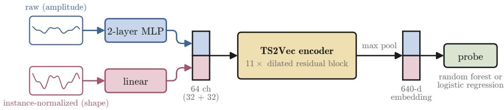

(b) Training: pre-train two specialists, then distill them into one encoder  
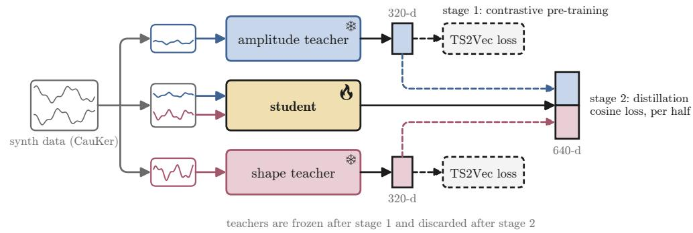  
Figure 1: TS2Vec-FM architecture and training. (a) Raw and instance-normalized inputs pass through an MLP and a linear stem, respectively. Their concatenation feeds a shared convolutional trunk and temporal max pooling. (b) Two specialists are pretrained on synthetic data with the TS2Vec objective and then frozen. On the same data, each teacher supervises one 320-dimensional half of the student through timestamp-level and pooled cosine losses. Downstream, only a classifier on frozen student features is fitted.

contrastive objective, while the student uses the same residual-block design with modified input and output layers and is trained by distillation.

The result is notable for two reasons. First, the resulting 1.6M-parameter encoder is competitive: frozen, it outperforms per-dataset TS2Vec and the evaluated forecasting-based extractors, and comes within a few tenths of a percentage point of MantisV2 while using about 25% fewer parameters. Second, it reaches this performance with a markedly different design — convolutions instead of attention, a two-layer MLP stem instead of a hand-designed multi-view tokenizer, and the final representation rather than a selected intermediate layer. This near-parity suggests that the information exposed to the encoder may matter more than the specific tokenizer design; our ablations point in particular to the complementarity of amplitude and shape.

## 2 From per-dataset TS2Vec to a foundation model

Original TS2Vec. The reference encoder first maps each timestamp to 64 channels, then applies ten hidden residual blocks and one output block with exponentially increasing dilation, producing a 320-dimensional representation at every timestamp. It is trained on aligned regions of two overlapping contextual crops with a hierarchical objective that contrasts both timestamps within a series and instances within a batch. A global series embedding is the temporal maximum of these representations. Appendix A specifies the architecture, crops, and losses exactly.

Step 1: the pre-training regime. We pretrain once on univariate synthetic series generated by CauKer [Xie et al., 2026] algorithm, so all encoder weight updates use synthetic data. The advantage of the TS2Vec architercture is that a convolutional encoder needs no fixed input size, so series keep their native lengths. However, similar to most time series foundation models, our encoder is univariate, so for multivariate datasets, we encode channels independently with the embeddings concatenated.

Step 2: normalization. Original TS2Vec does not apply instance-wise normalization. For classification, however, absolute signal values may contain discriminative information. We therefore pretrain separate TS2Vec encoders on raw and instance-normalized inputs. The results (Table 2) have been quite unexpected. The encoder without normalization performs significantly better on the multivariate (UEA) datasets, while the encoder with normalization greatly outperforms its counterpart on the univariate (UCR) datasets: instance normalization gains 2.9 pp on UCR but costs 1.5 pp on UEA, and the raw-input encoder is the mirror image. We suggest that this phenomenon is explained by the nature of contrastive pre-training which looks for shortcuts to discriminate different samples in the embedding space. In the un-normalized case, the shortcut is the amplitude of the signal, so embeddings encode mostly this kind of information. In the normalized case, the shortcut is rather the shape of the signal. More arguments to this hypothesis gives the fact that in many multivariate datasets a deviation of one channel compared to the others gives a discriminative signal, so encoding signal amplitude is important.

Step 3: architecture. Given the aforementioned results, we slightly modify the encoder to include both normalized and raw views: the instance-normalized view is linearly mapped into 32 channels, while the raw view is embedded through a two-layer MLP with a GELU nonlinearity. Their concatenation forms the 64-channel input of the shared convolutional part. So, we retain the TS2Vec residual-block design and increase the output dimension from 320 to 640, yielding a 1.64M-parameter encoder. We note that the asymmetry between the two views matters as the raw view needs the extra nonlinearity to align its encodings with the normalized one.

Step 4: distillation. The performance discrepancy between the normalized and un-normalized encoders has motivated us to use them as teachers (further also called specialists) to distill their knowledge into our dual-input single encoder. We use a factorized objective, matching each half of the 640-dimensional student representation to its corresponding teacher by cosine loss, per timestamp and after pooling. What is interesting is that directly pre-training the dual-input encoder with the usual TS2Vec contrastive objective yields inferior results (Table 2).

## 3 Experimental Results

Setup. Further, we refer our approach (synthetic pre-training, dual-input architecture, distillation) as TS2Vec-FM. We compare it with other methods by evaluating frozen representations on UCR-128 [Dau et al., 2019] and UEA-27 [Bagnall et al., 2018], following Feofanov et al. [2026a]. Datasetspecific classifiers are a 200-tree random forest (RF), averaged over three predictor seeds, and logistic regression (LogReg) preceded by StandardScaler. Pre-training checkpoints are selected by UCR RF accuracy at seed 42; UEA is not used for checkpoint selection. We compare against Catch22+ [Lubba et al., 2019], MOMENT [Goswami et al., 2024], TiRex [Auer et al., 2025b], Chronos-2 [Ansari et al., 2025], TiViT-H / TiConvNext [Roschmann et al., 2025], NuTime [Lin et al., 2024], and Mantis (V2 checkpoint, Feofanov et al., 2026a,b).

The recipe produces a competitive TSFM (Table 1). The proposed TS2Vec-FM shows the secondbest result, trailing MantisV2 by 0.19 / 0.60 pp with RF and 0.28 / 0.22 pp with LogReg, respectively, while using about 25% fewer parameters. At the same time, it outperforms the forecasting- and visionbased extractors (10–170× as many parameters), except TiConvNext on UCR LogReg. We would like to note that unlike MantisV2, our encoder uses native lengths and does not need interpolate each series to a fixed length. In Appendix D, we show that interpolating series worsen the performance of TS2Vec-FM.

It also beats TS2Vec trained per dataset. Under both the random forest and logistic regression probe, the margin between the foundation model and per-dataset encoder is more that 1.9 % on UCR. The gap widens even more on multivariate UEA-27, even though TS2Vec-FM was pre-trained on univariate data. Note that in the original TS2Vec paper, they use an RBF-SVM with hyperparameters tuned, which increases the probing performance, though still below TS2Vec-FM with logistic regression. We have also tried to reproduce the results published by Yue et al. [2022] in two different setups: first, our reimplementation of the original protocol that reproduces the published UCR-128 performance to within 0.8 pp with a per-dataset correlation of 0.984, and second, we have run the authors’ unmodified code that reproduces fifteen of the sixteen evaluable headline metrics of the original paper (across all classification, forecasting and anomaly detection) within 5% relative (see Appendix C).

Table 1: Zero-shot feature extraction accuracy (%), with parameters counted after layer pruning where applicable. The dashed rule separates the original per-dataset TS2Vec, which is not a foundation model: it trains one encoder on each dataset’s own training split (128 UCR and 27 UEA encoders of 0.6M parameters). ‡With its original RBF-SVM probe it reaches 82.10 on UCR.
<table><tr><td rowspan="2">Model</td><td rowspan="2">Type</td><td rowspan="2">Params</td><td colspan="2">Random forest</td><td colspan="2">LogReg</td></tr><tr><td>UCR</td><td>UEA</td><td>UCR</td><td>UEA</td></tr><tr><td>Catch22+</td><td>statistics</td><td></td><td>79.69</td><td>69.63</td><td>77.04</td><td>67.56</td></tr><tr><td>MOMENT</td><td>forecasting</td><td>161.4M</td><td>77.89</td><td>69.91</td><td>79.84</td><td>71.74</td></tr><tr><td>NuTime</td><td>classification</td><td>2.0M</td><td>77.32</td><td>71.99</td><td>79.05</td><td>74.91</td></tr><tr><td>TiRex</td><td>forecasting</td><td>16.5M</td><td>80.13</td><td>69.52</td><td>82.02</td><td>72.48</td></tr><tr><td>Chronos-2</td><td>forecasting</td><td>44.0M</td><td>80.02</td><td>69.67</td><td>82.44</td><td>72.43</td></tr><tr><td>TiViT-H</td><td>vision</td><td>276.6M</td><td>79.43</td><td>70.91</td><td>82.88</td><td>73.30</td></tr><tr><td>TiConvNext</td><td>vision</td><td>180.3M</td><td>80.29</td><td>71.05</td><td>83.47</td><td>73.50</td></tr><tr><td>MantisV2</td><td>classification</td><td>2.2M</td><td>81.95</td><td>74.20</td><td>83.60</td><td>75.52</td></tr><tr><td>TS2Vec-FM, one encoder</td><td>classification</td><td>1.64M</td><td>81.76</td><td>73.60</td><td>83.32</td><td>75.30</td></tr><tr><td colspan="7">Reference (not zero-shot: one encoder trained per target dataset)</td></tr><tr><td>TS2Vec, per dataset‡</td><td>self-supervised</td><td>0.6M each</td><td>79.83</td><td>69.50</td><td>81.36</td><td>70.79</td></tr></table>

Table 2: What each ingredient contributes (random forest, %) at 100K, 1M and 2M synthetic series. Instance normalization trades UEA for UCR at every scale, the specialists and the direct contrastive baseline do not improve with more data, and distillation consolidates the two specialists into the stronger single encoder at every scale. †mean over three pre-training seeds; ‡with gradient clipping.
<table><tr><td rowspan="2">Encoder input</td><td rowspan="2">Training</td><td colspan="2">100K series</td><td colspan="2">1M series</td><td colspan="2">2M series</td></tr><tr><td>UCR</td><td>UEA</td><td>UCR</td><td>UEA</td><td>UCR</td><td>UEA</td></tr><tr><td>raw only</td><td>contrastive</td><td>77.43†</td><td>72.02†</td><td>76.99</td><td>71.56</td><td>77.68</td><td>72.22</td></tr><tr><td>normalized only</td><td>contrastive</td><td>80.35†</td><td>70.56†</td><td>80.26</td><td>69.78</td><td>79.89</td><td>70.19</td></tr><tr><td>dual-input</td><td>contrastive</td><td>80.52†</td><td>73.41†</td><td>80.52</td><td>73.41</td><td>80.52</td><td>73.07</td></tr><tr><td>dual-input</td><td>distillation (ours)</td><td>81.08†</td><td>73.90†</td><td>81.62†</td><td>73.48†</td><td>81.76</td><td>73.60</td></tr></table>

Ablation of the recipe (Table 2). We first ask whether more synthetic data helps. For the ingredients taken alone the answer is negative: from 100K to 1M and 2M series, the two specialists and the dual-input encoder pre-trained directly with the contrastive TS2Vec loss stay within seed noise or slightly degrade (the instance-normalized specialist loses 0.5 pp on UCR). The distilled encoder is the only one that benefits: on UCR it gains 0.54 pp from 100K to 1M (81.08 to 81.62%, three pre-training seeds each, seed standard deviation 0.12 pp) and a further 0.14 pp at 2M, while on UEA it stays flat (73.9, 73.5 and 73.6%). We detail the scaling experiments further in Appendix D. The comparison with the directly pre-trained dual-input encoder also isolates the contribution of distillation: it is superior at every scale, and its margin widens with data, from 0.56 pp at 100K to 1.10 pp at 1M and 1.24 pp at 2M on UCR. We also note that we had to use gradient clipping for the contrastive baseline due to numerical instability. The pattern suggests that direct training underuses the complementary views, while already-specialized teachers keep both subspaces alive. This is, in effect, a learned substitute for what hand-designed TSFM tokenizers provide by construction when they devote separate branches to the normalized signal and to raw patch statistics [Feofanov et al., 2026a, Lin et al., 2024].

## 4 Discussion

In this paper, we introduced TS2Vec-FM, showing that synthetic pretraining and specialist distillation can make a compact convolutional encoder competitive for cross-dataset classification while retaining native-length processing. The results motivate revisiting earlier self-supervised architectures, adapting them to the current setup and thereby enriching the family of available time series foundation models.

Limitations. The 2M headline model is trained at a single pre-training seed, although the 100K ablations and the 1M student use three seeds. TS2Vec-FM remains slightly below MantisV2 on all four metrics, so our claim is competitive performance with a smaller encoder rather than superiority. Evaluation is limited to UCR and UEA, and whether specialist distillation generalizes to other backbones and tokenizer designs remains open.

## References

Abdul Fatir Ansari, Oleksandr Shchur, Jaris Küken, Andreas Auer, Boran Han, Pedro Mercado, Syama Sundar Rangapuram, Huibin Shen, Lorenzo Stella, Xiyuan Zhang, et al. Chronos-2: From univariate to universal forecasting. arXiv preprint arXiv:2510.15821, 2025.

Andreas Auer, Daniel Klotz, Sebastinan Böck, and Sepp Hochreiter. Pre-trained forecasting models: Strong zero-shot feature extractors for time series classification. arXiv preprint arXiv:2510.26777, 2025a.

Andreas Auer, Patrick Podest, Daniel Klotz, Sebastian Böck, Günter Klambauer, and Sepp Hochreiter. TiRex: Zero-shot forecasting across long and short horizons with enhanced in-context learning. arXiv preprint arXiv:2505.23719, 2025b.

Anthony Bagnall, Hoang Anh Dau, Jason Lines, Michael Flynn, James Large, Aaron Bostrom, Paul Southam, and Eamonn Keogh. The UEA multivariate time series classification archive, 2018. arXiv preprint arXiv:1811.00075, 2018.

Hoang Anh Dau, Anthony Bagnall, Kaveh Kamgar, Chin-Chia Michael Yeh, Yan Zhu, Shaghayegh Gharghabi, Chotirat Ann Ratanamahatana, and Eamonn Keogh. The UCR time series archive. IEEE/CAA Journal ofAutomatica Sinica, 6(6):1293–1305, 2019.

Emadeldeen Eldele, Mohamed Ragab, Zhenghua Chen, Min Wu, Chee Keong Kwoh, Xiaoli Li, and Cuntai Guan. Time-series representation learning via temporal and contextual contrasting. In Proceedings of the Thirtieth International Joint Conference on Artificial Intelligence, IJCAI-21, pages 2352–2359, 2021.

Vasilii Feofanov, Songkang Wen, Shifeng Xie, Simon Roschmann, Marius Alonso, Hongbo Guo, Romain Ilbert, Malik Tiomoko, Quentin Bouniot, Zeynep Akata, Lujia Pan, Jianfeng Zhang, and Ievgen Redko. Mantis: Lightweight foundation model for time series classification. In Fortythird International Conference on Machine Learning, 2026a. URL https://openreview.net/ forum?id=gbJMAjXLZ4.

Vasilii Feofanov, Songkang Wen, Jianfeng Zhang, Lujia Pan, and Ievgen Redko. Mantisv2: Closing the zero-shot gap in time series classification with synthetic data and test-time strategies, 2026b. URL https://arxiv.org/abs/2602.17868.

Navid Mohammadi Foumani, Chang Wei Tan, Geoffrey I Webb, Hamid Rezatofighi, and Mahsa Salehi. Series2vec: similarity-based self-supervised representation learning for time series classification: Nm foumani et al. Data Mining and Knowledge Discovery, 38(4):2520–2544, 2024.

Jean-Yves Franceschi, Aymeric Dieuleveut, and Martin Jaggi. Unsupervised scalable representation learning for multivariate time series. Advances in neural information processing systems, 32, 2019.

Mononito Goswami, Konrad Szafer, Arjun Choudhry, Yifu Cai, Shuo Li, and Artur Dubrawski. MOMENT: A family of open time-series foundation models. arXiv preprint arXiv:2402.03885, 2024.

Geoffrey Hinton, Oriol Vinyals, and Jeff Dean. Distilling the knowledge in a neural network. In NeurIPS Deep Learning and Representation Learning Workshop, 2015.

Seunghan Lee, Taeyoung Park, and Kibok Lee. Soft contrastive learning for time series. In International Conference on Learning Representations, volume 2024, pages 46815–46839, 2024.

Chenguo Lin, Xumeng Wen, Wei Cao, Congrui Huang, Jiang Bian, Stephen Lin, and Zhirong Wu. NuTime: Numerically multi-scaled embedding for large- scale time-series pretraining. Transactions on Machine Learning Research, 2024. ISSN 2835-8856. URL https://openreview.net/ forum?id=TwiSBZ0p9u.

Jiexi Liu and Songcan Chen. Timesurl: Self-supervised contrastive learning for universal time series representation learning. In Proceedings of the AAAI conference on artificial intelligence, volume 38, pages 13918–13926, 2024.

Carl H Lubba, Sarab S Sethi, Philip Knaute, Simon R Schultz, Ben D Fulcher, and Nick S Jones. catch22: CAnonical Time-series CHaracteristics: Selected through highly comparative time-series analysis. Data mining and knowledge discovery, 33(6):1821–1852, 2019.

Dongsheng Luo, Wei Cheng, Yingheng Wang, Dongkuan Xu, Jingchao Ni, Wenchao Yu, Xuchao Zhang, Yanchi Liu, Yuncong Chen, Haifeng Chen, et al. Time series contrastive learning with information-aware augmentations. In Proceedings ofthe AAAI conference on artificial intelligence, volume 37, pages 4534–4542, 2023.

Sriram Mandalika and Lalitha V. Comad: A multiple-teacher self-supervised distillation framework, 2025. URL https://arxiv.org/abs/2508.04816.

Yessin Moakher, Youssef Attia El Hili, and Vasilii Feofanov. Utica: Multi-objective self-distllation foundation model pretraining for time series classification, 2026. URL https://arxiv.org/ abs/2603.01348.

Vladyslav Moroshan, Julien Siems, Arber Zela, Timur Carstensen, and Frank Hutter. Tempopfn: Synthetic pre-training of linear rnns for zero-shot time series forecasting. arXiv preprint arXiv:2510.25502, 2025.

Aaryan Nagpal, Debdeep Sanyal, Murari Mandal, Dhruv Kumar, and Saurabh Deshpande. Mix, don’t pick: Why synthetic corpus composition matters for time series foundation model pretraining, 2026. URL https://arxiv.org/abs/2606.09912.

Franco Martino O’Rourke, Ana Trisovic, and Dimitris Bertsimas. A causal dag prior for synthetic time-series classification datasets, 2026. URL https://arxiv.org/abs/2606.21776.

Simon Roschmann, Quentin Bouniot, Vasilii Feofanov, Ievgen Redko, and Zeynep Akata. Time series representations for classification lie hidden in pretrained vision transformers. arXiv preprint arXiv:2506.08641, 2025. URL https://arxiv.org/abs/2506.08641.

Sana Tonekaboni, Danny Eytan, and Anna Goldenberg. Unsupervised representation learning for time series with temporal neighborhood coding. arXiv preprint arXiv:2106.00750, 2021.

Shifeng Xie, Vasilii Feofanov, Jianfeng Zhang, Themis Palpanas, and Ievgen Redko. Cauker: Classification time series foundation models can be pretrained on synthetic data. In The Fourteenth International Conference on Learning Representations, 2026. URL https://openreview.net/ forum?id=xBW2FIfswU.

Zhihan Yue, Yujing Wang, Juanyong Duan, Tianmeng Yang, Congrui Huang, Yunhai Tong, and Bixiong Xu. TS2Vec: Towards universal representation of time series. Proceedings ofthe AAAI Conference on Artificial Intelligence, 36(8):8980–8987, Jun. 2022. doi: 10.1609/aaai.v36i8.20881. URL https://ojs.aaai.org/index.php/AAAI/article/view/20881.

George Zerveas, Srideepika Jayaraman, Dhaval Patel, Anuradha Bhamidipaty, and Carsten Eickhoff. A transformer-based framework for multivariate time series representation learning. In Proceedings of the 27th ACM SIGKDD conference on knowledge discovery & data mining, pages 2114–2124, 2021.

## A TS2Vec: architecture and objective

This section gives more details on the TS2Vec model and training objective. Our implementation follows the authors’ released code [Yue et al., 2022].

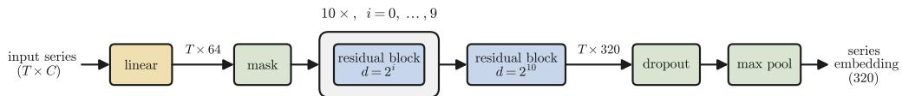  
Figure 2: Reference TS2Vec encoder. Ten width-64 residual blocks with dilation $2 ^ { i }$ are followed by a width-320 output block; one block is detailed in Figure 3.

Encoder. Let $\mathbf { X } _ { i } = ( \mathbf { x } _ { i , 1 } , \ldots , \mathbf { x } _ { i , T } ) \in \mathbb { R } ^ { T \times C }$ denote series i. A learned affine map sends each timestamp from $C$ input channels to a hidden width $H \stackrel { - } { = } 6 4$ , with $\mathbf { W } _ { \mathrm { i n } } \in \mathbb { R } ^ { \hat { H } \times C }$ and $\mathbf { b _ { \mathrm { i n } } } ^ { \mathbf { \lambda } } \in \mathbb { R } ^ { H }$ . During pre-training, an independent mask $m _ { i , t } \sim$ Bernoulli(0.5) is sampled for each contextual view, and a masked timestamp is replaced by the zero vector after the affine map:

$$
\mathbf { h } _ { i , t } ^ { ( 0 ) } = m _ { i , t } \big ( \mathbf { W } _ { \mathrm { i n } } \mathbf { x } _ { i , t } + \mathbf { b } _ { \mathrm { i n } } \big ) .\tag{1}
$$

Missing timestamps are masked in the same way. The trunk contains eleven residual blocks indexed by $k = 0 , \ldots , 1 0$ , each with two samepadded one-dimensional convolutions of kernel size three and dilation $\bar { \delta } _ { k } = 2 ^ { k }$ . Writing $\mathcal { C } _ { k , 1 }$ and $\mathcal { C } _ { k , 2 }$ for these convolutions, a block is

$$
\mathbf { u } ^ { ( k ) } = \mathcal { C } _ { k , 1 } \Big ( \mathrm { G E L U } ( \mathbf { h } ^ { ( k ) } ) \Big ) ,\tag{2}
$$

$$
\mathbf { h } ^ { ( k + 1 ) } = \mathcal { C } _ { k , 2 } \Big ( \mathrm { G E L U } ( \mathbf { u } ^ { ( k ) } ) \Big ) + \mathcal { P } _ { k } ( \mathbf { h } ^ { ( k ) } ) .
$$

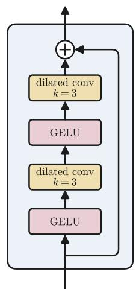

(3)

The first ten blocks preserve width 64; the final block maps 64 to the representation dimension $D = 3 2 0$ . The residual projection $\mathcal { P } _ { k }$ is the identity when dimensions agree and a pointwise convolution otherwise. Dropout with probability 0.1 follows the trunk. The output of the last block is the timestamp representation $\mathbf { r } _ { i , t } = \mathbf { h } _ { i , t } ^ { ( 1 1 ) } \in \mathbb { R } ^ { D }$ ; we drop the series index i when it is not needed. For a univariate input this encoder contains 637,248 trainable parameters.

Figure 3: One TS2Vec residual block: two GELU– dilated-convolution pairs plus a skip connection (identity, or a $1 \times 1$ convolution when the width changes).

## Input length and receptive field. The encoder is fully convolutional

and the readout is a max-pool over all timestamps, so the model accepts any length T with cost linear in T, and the series embedding always depends on every timestamp. What is bounded is the context of each timestamp representation: with symmetric padding, $\mathbf { r } _ { t }$ sees at most $\textstyle 1 + 4 \sum _ { k = 0 } ^ { 1 0 } 2 ^ { k } = 8 1 8 9$ timestamps (±4094 around t). For $T \leq 8 1 8 9$ every $\mathbf { r } _ { t }$ observes the whole series; this holds for all 128 UCR datasets (longest: Rock, $T = 2 8 4 4 )$ and for 26 of the 27 UEA datasets (MotorImagery, $T = 3 0 0 0 )$ . Beyond that bound no single $\mathbf { r } _ { t }$ sees the whole series and the only cross-window integration is the order-free max-pool, so a class that is defined by relating two events more than ∼8k steps apart cannot be represented, whereas locally detectable patterns still are. The one benchmark case beyond the bound, EigenWorms $( T = 1 7 , { \dot { 9 } } 8 4 )$ , is nevertheless handled well (88.0% RF and 90.8% LogReg versus 81.4% and 88.5% for MantisV2, Appendix E). A second, more practical limitation is the trained receptive field: pre-training used 512-timestamp series, which the 8189- timestamp field covers many times over, so the long-range taps of the last blocks (dilations 128 to 1024) were mostly fitted against zero padding and only receive signal at both ends on long inputs. We do not quantify this shift; downsampling very long inputs or pre-training on longer series are the natural remedies.

Contextual crops. For each minibatch, TS2Vec samples an overlap length L uniformly from $\{ 2 , \ldots , T \}$ . It samples an overlap $[ a , b )$ with $b - a = L$ , a left extension boundary $a _ { \mathrm { e } } \in \{ 0 , \ldots , a \}$ and an extended right boundary $\bar { b _ { \mathrm { e } } } \in \{ \bar { b } , \dots , T \}$ . Each series receives a shift $o _ { i } \in \{ - a _ { \mathrm { e } } , \ldots , T - b _ { \mathrm { e } } \}$ The two encoder inputs are

$$
\widetilde { \mathbf { X } } _ { i } ^ { A } = \mathbf { X } _ { i } [ o _ { i } + a _ { \mathrm { e } } : o _ { i } + b ] , \qquad \widetilde { \mathbf { X } } _ { i } ^ { B } = \mathbf { X } _ { i } [ o _ { i } + a : o _ { i } + b _ { \mathrm { e } } ] .\tag{4}
$$

Their contexts differ, but the last L outputs of the first view and the first L outputs of the second refer to the same timestamps. Stacking these aligned timestamp representations $\mathbf { r } _ { i , t }$ over the minibatch gives A, $\mathbf { B } \in \mathbb { R } ^ { B \times L \times D }$ , with minibatch size B.

Dual contrastive loss. For an anchor ${ \bf q } ,$ positive p and negative set ${ \mathcal { N } } .$ , define

$$
\ell ( { \mathbf { q } } , { \mathbf { p } } ; { \mathcal { N } } ) = - \log { \frac { \exp ( { \mathbf { q } } ^ { \top } { \mathbf { p } } ) } { \exp ( { \mathbf { q } } ^ { \top } { \mathbf { p } } ) + \sum _ { \mathbf { n } \in { \mathcal { N } } } \exp ( { \mathbf { q } } ^ { \top } { \mathbf { n } } ) } } .\tag{5}
$$

The implementation uses raw dot products: it applies neither $\ell _ { 2 }$ normalization nor a temperature parameter. The negative collections below are indexed lists rather than mathematical sets: equalvalued vectors remain distinct denominator terms, and ∥ denotes list concatenation. Instance contrast fixes a timestamp t and treats the other series in both views as negatives:

$$
\mathcal { N } _ { \mathrm { i n s t } } ^ { A } ( i , t ) = ( \mathbf { A } _ { j , t } ) _ { j \neq i } \parallel ( \mathbf { B } _ { j , t } ) _ { j \neq i } ,\tag{6}
$$

$$
\mathcal { N } _ { \mathrm { i n s t } } ^ { B } ( i , t ) = ( \mathbf { B } _ { j , t } ) _ { j \neq i } \parallel ( \mathbf { A } _ { j , t } ) _ { j \neq i } ,\tag{7}
$$

$$
\mathcal { L } _ { \mathrm { i n s t } } ( \mathbf { A } , \mathbf { B } ) = \frac { 1 } { 2 B L } \sum _ { i = 1 } ^ { B } \sum _ { t = 1 } ^ { L } \Bigl [ \ell ( \mathbf { A } _ { i , t } , \mathbf { B } _ { i , t } ; \mathcal { N } _ { \mathrm { i n s t } } ^ { A } ( i , t ) ) + \ell ( \mathbf { B } _ { i , t } , \mathbf { A } _ { i , t } ; \mathcal { N } _ { \mathrm { i n s t } } ^ { B } ( i , t ) ) \Bigr ] .\tag{8}
$$

Temporal contrast instead fixes a series i and treats all other aligned timestamps in both views as negatives. Thus

$$
\mathcal { N } _ { \mathrm { t e m p } } ^ { A } ( i , t ) = ( \mathbf { A } _ { i , s } ) _ { s \neq t } \parallel ( \mathbf { B } _ { i , s } ) _ { s \neq t } ,\tag{9}
$$

$$
\mathcal { N } _ { \mathrm { t e m p } } ^ { B } ( i , t ) = ( \mathbf { B } _ { i , s } ) _ { s \neq t } \parallel ( \mathbf { A } _ { i , s } ) _ { s \neq t } ,\tag{10}
$$

$$
\mathcal { L } _ { \mathrm { t e m p } } ( \mathbf { A } , \mathbf { B } ) = \frac { 1 } { 2 B L } \sum _ { i = 1 } ^ { B } \sum _ { t = 1 } ^ { L } \left[ \ell ( \mathbf { A } _ { i , t } , \mathbf { B } _ { i , t } ; \mathcal { N } _ { \mathrm { t e m p } } ^ { A } ( i , t ) ) + \ell ( \mathbf { B } _ { i , t } , \mathbf { A } _ { i , t } ; \mathcal { N } _ { \mathrm { t e m p } } ^ { B } ( i , t ) ) \right] .\tag{11}
$$

Both objectives are symmetric across the two views. The positive is included once in the denominator of Equation (5); only the anchor self-similarity is excluded.

Hierarchical contrasting. Set $( \mathbf { A } ^ { ( 0 ) } , \mathbf { B } ^ { ( 0 ) } ) = ( \mathbf { A } , \mathbf { B } )$ and obtain scale $s + 1$ by max-pooling each representation over adjacent pairs of timestamps with stride two: $L _ { s + 1 } = \lfloor L _ { s } / 2 \rfloor$ . For odd $L _ { s } ,$ the unmatched final timestamp is dropped, exactly as in the released implementation. This continues until $L _ { S - 1 } = 1$ , where $S \stackrel { \triangledown } { = } \lfloor \log _ { 2 } \bar  L \mathbf { \} } \rvert + 1$ . Define $\beta _ { s } = \mathbf { 1 } [ L _ { s } > 1 ]$ , which switches temporal contrast off at the singleton scale. The optimized objective is

$$
\begin{array} { r l } { \displaystyle \mathcal { L } _ { \mathrm { h i e r } } = \frac { 1 } { S } \sum _ { s = 0 } ^ { S - 1 } \Big [ \alpha \mathcal { L } _ { \mathrm { i n s t } } \big ( \mathbf { A } ^ { ( s ) } , \mathbf { B } ^ { ( s ) } \big ) } & { { } } \\ { + \beta _ { s } ( 1 - \alpha ) \mathcal { L } _ { \mathrm { t e m p } } \big ( \mathbf { A } ^ { ( s ) } , \mathbf { B } ^ { ( s ) } \big ) \Big ] , \quad } & { { } \alpha = \frac { 1 } { 2 } . } \end{array}\tag{12}
$$

Consequently, fine scales discriminate timestamps as well as series, while the singleton top scale contributes instance contrast only. The original paper writes the unweighted sum ${ \mathcal { L } } _ { \mathrm { { i n s t } } } + { \mathcal { L } } _ { \mathrm { { t e m p } } }$ at each non-singleton scale; the released code uses $\begin{array} { r } { \alpha = \frac { 1 } { 2 } } \end{array}$ as above, which differs by the global factor $\textstyle { \frac { 1 } { 2 } }$ Equation (12) states the implementation used in our experiments.

Optimization and readout. We use AdamW with learning rate $1 0 ^ { - 3 }$ , weight decay $1 0 ^ { - 2 }$ and batch size 8 when reproducing per-dataset TS2Vec. The foundation-model specialists use batch size 128 at the same learning rate; the throughput experiments use batch size 512 and learning rate $4 \times 1 0 ^ { - 3 }$ Checkpoints contain a running arithmetic average initialized from the starting weights and updated after every optimizer step. At test time masking and dropout are disabled, timestamp representations are max-pooled over the complete series. Original per-dataset TS2Vec maps all $\dot { C }$ channels jointly through $\mathbf { W } _ { \mathrm { i n } }$ and therefore always returns one 320-dimensional vector. Our foundation encoder is pre-trained on univariate synthetic series; when evaluating it on multivariate data, we instead encode the $C$ channels independently and concatenate them, giving a 320C-dimensional frozen representation.

## B Related work

Self-supervised representation learning for time series. A first line of work learns representations without labels by training an encoder on the target dataset and then fitting a simple classifier on its frozen output. T-Loss uses a triplet loss over subsequences [Franceschi et al., 2019], TNC contrasts temporal neighborhoods [Tonekaboni et al., 2021], TS-TCC combines temporal and contextual contrasting [Eldele et al., 2021], TST reconstructs masked timestamps with a transformer [Zerveas et al., 2021], and TS2Vec optimizes a hierarchical contrastive loss over two overlapping views of each series [Yue et al., 2022]. TS2Vec has remained a standard baseline, and subsequent work refines its objective through soft contrastive assignments [Lee et al., 2024], information-aware augmentation [Luo et al., 2023], frequency-domain augmentation [Liu and Chen, 2024], and augmentation-free similarity prediction [Foumani et al., 2024]. What these methods share is the training regime rather than the objective: the encoder is fitted to the dataset on which it is evaluated. Transfer between datasets has been examined within this line, but from a single real source dataset and in comparison with other per-dataset methods [Franceschi et al., 2019, Yue et al., 2022].

Foundation models for time series classification. A second line pre-trains one encoder on a large corpus, keeps it frozen, and fits only a probe on each downstream dataset. NuTime [Lin et al., 2024], MOMENT [Goswami et al., 2024], Mantis [Feofanov et al., 2026a,b] follow this protocol with transformer encoders and tokenizers built for time series. Several of these tokenizers keep the normalized shape of a window and its amplitude statistics in separate input branches [Lin et al., 2024, Feofanov et al., 2026a], on the view that both are informative for classification. MantisV2 additionally reports that test-time choices matter, in particular which intermediate layer is read and how output tokens are aggregated [Feofanov et al., 2026b], and UTICA keeps the same backbone while replacing the contrastive objective with self-distillation from a slowly updated copy of the student [Moakher et al., 2026]. A related body of work obtains competitive frozen features from models never trained for classification, such as vision transformers [Roschmann et al., 2025] and forecasters [Auer et al., 2025a], and reports the same sensitivity to layer selection and token aggregation.

Synthetic corpora and distillation. Since large curated collections of real series are scarce, pretraining data for these models is increasingly synthetic. CauKer generates series by composing Gaussian process kernels inside structural causal models and reports regular scaling in both corpus size and model capacity [Xie et al., 2026]. Other priors have been proposed for classification [O’Rourke et al., 2026] and forecasting [Moroshan et al., 2025], and mixing several generators is reported to be preferable to selecting one [Nagpal et al., 2026]. Distillation has been applied to time series models mostly for compression, transferring a large pre-trained encoder into a smaller one. Using it to merge several specialized models into a single one is a classical idea from the distillation literature [Hinton et al., 2015], and has been studied more extensively in vision, where teachers trained under different objectives may disagree and have to be reconciled [Mandalika and V, 2025].

## C Per-dataset baseline reproduction

Our central comparison is against TS2Vec trained the way it was designed to be trained, so the credibility of that baseline matters as much as the credibility of our own model. We therefore validated it twice: once at the level of the per-dataset protocol we use for the paired comparison (§C.1–C.3), and once by reproducing the original paper end to end across all three of its tasks (§C.4).

## C.1 Protocol

For each of the 128 UCR datasets we train one TS2Vec encoder from scratch with the reference implementation and its defaults: ten dilated residual blocks, hidden width 64, a 320-dimensional representation, learning rate 10−3, batch size 8, maximum training length 3000, Bernoulli(0.5) timestamp masking, and the upstream iteration rule of 200 iterations for training sets with at most 105 values and 600 iterations otherwise. Frozen representations are then probed two ways: with the upstream grid-searched RBF-SVM, which is what the original paper reports, and with the StandardScaler plus logistic regression probe of Table 1, so that the comparison against our encoder is probe-matched. Aggregated over all 128 datasets this gives 82.10% (RBF-SVM) and 81.36% (logistic regression); the same frozen representations under the random-forest probe of Table 1 (200 trees, three predictor seeds) give 79.83%.

The UEA-27 entries of Table 1 follow the same recipe with upstream’s multivariate handling: one encoder per dataset whose input projection maps all C channels jointly, series standardized per channel with training-split statistics, the same optimizer, iteration rule and final-checkpoint readout, and the paper’s two probes on the resulting 320-dimensional embeddings. This gives 69.50% (random forest)

and 70.79% (logistic regression); per dataset the numbers track the published TS2Vec UEA table closely (e.g. 0.99 vs. 0.987 on ArticularyWordRecognition, 0.32 vs. 0.308 on EthanolConcentration, 0.68 vs. 0.682 on PEMS-SF).

## C.2 Agreement with the published numbers

The original paper tabulates per-dataset accuracies for all 128 UCR datasets (its Table 9, default batch size 8); its headline 0.830 averages the 125 datasets on which every baseline runs, dropping the three DodgerLoop datasets with missing values. Over all 128 datasets our reproduction reaches 82.10% against the published 82.87%, a gap of 0.77 pp, with a mean absolute per-dataset deviation of 1.65 pp and a per-dataset Pearson correlation of 0.984; on the paper’s 125-dataset subset the aggregates are 82.25% against 82.96%. Agreement is not concentrated in the aggregate: 69 of the 128 datasets are within 1 pp, 98 within 2 pp, and 119 within 5 pp.

Eight datasets deviate by more than 5 pp, all downward. We rerun these datasets at four additional pre-training seeds (Table 3). The reruns show substantial seed sensitivity on several of the largest discrepancies: replacing the seed-42 values by five-seed means raises the UCR-128 aggregate from 82.10% to 82.23%. PLAID remains an unresolved exception, with $3 4 . 9 \pm 1 0 . 1 \%$ across five seeds against 56.1% published. We retain seed 42 for the main per-dataset reproduction to keep this baseline protocol uniform.

Table 3: The eight datasets on which the seed-42 reproduction deviates from the published value by more than 5 pp, with a four-extra-seed diagnostic (per-dataset TS2Vec, RBF-SVM probe, %). The main per-dataset baseline uses seed 42.
<table><tr><td rowspan="2">Dataset</td><td rowspan="2"></td><td colspan="5">ours, per pre-training seed</td><td rowspan="2"> $\mathrm { m e a n } \pm \mathrm { s d }$ </td></tr><tr><td>published 42</td><td>43</td><td>44</td><td>45</td><td>46</td></tr><tr><td>PLAID</td><td>56.1</td><td>37.4</td><td>30.9</td><td>19.4</td><td>42.8</td><td>44.1</td><td> $3 4 . 9 \pm 1 0 . 1$ </td></tr><tr><td>Car</td><td>83.3</td><td>70.0</td><td>78.3</td><td>71.7</td><td>83.3</td><td>70.0</td><td> $7 4 . 7 \pm 5 . 9$ </td></tr><tr><td>DodgerLoopDay</td><td>56.2</td><td>47.5</td><td>48.8</td><td>48.8</td><td>50.0</td><td>52.5</td><td> $4 9 . 5 \pm 1 . 9$ </td></tr><tr><td>Herring</td><td>64.1</td><td>56.2</td><td>59.4</td><td>59.4</td><td>68.8</td><td>57.8</td><td> $6 0 . 3 \pm 4 . 9$ </td></tr><tr><td>FaceFour</td><td>93.2</td><td>86.4</td><td>84.1</td><td>90.9</td><td>89.8</td><td>89.8</td><td> $8 8 . 2 \pm 2 . 9$ </td></tr><tr><td>MiddlePhalanxOutlineCorrect</td><td>83.8</td><td>77.3</td><td>78.0</td><td>83.8</td><td>80.1</td><td>79.4</td><td> $7 9 . 7 \pm 2 . 5$ </td></tr><tr><td>PhalangesOutlinesCorrect</td><td>80.9</td><td>75.3</td><td>81.0</td><td>81.5</td><td>82.1</td><td>79.7</td><td> $7 9 . 9 \pm 2 . 7$ </td></tr><tr><td>WormsTwoClass</td><td>80.5</td><td>75.3</td><td>75.3</td><td>67.5</td><td>76.6</td><td>79.2</td><td> $7 4 . 8 \pm 4 . 4$ </td></tr></table>

## C.3 The paired comparison

Table 4 gives the three comparisons summarised in Section 3. Under the matched logistic-regression probe our single frozen encoder improves on 128 dataset-specific encoders by 1.95 pp, winning on 88 datasets, tying on 9 and losing on 31; the Wilcoxon signed-rank test rejects equality at $p = 1 . 3 \overset { - } { \times } 1 0 ^ { - 6 }$ Giving the baseline its own RBF-SVM probe, which is worth 0.74 pp to it, leaves a 1.22 pp advantage at $p = 0 . 0 2$ . Against the published per-dataset numbers on all 128 datasets the two are statistically indistinguishable (83.32% vs 82.87%, $p = 0 . 4 3 )$ , which is the honest reading: our encoder clearly beats a faithful reimplementation of per-dataset TS2Vec, and ties the numbers as originally published.

Table 4: TS2Vec-FM (one encoder, frozen, synthetic pre-training only) against TS2Vec trained per dataset (TS2Vec/ds) on UCR-128. W / T / L counts the datasets on which TS2Vec-FM wins, ties and loses against that row; p-values (two-sided Wilcoxon signed-rank) are given in the text.
<table><tr><td>Method</td><td>Probe</td><td>UCR acc.</td><td>W/T/L of TS2Vec-FM</td></tr><tr><td>TS2Vec-FM</td><td>LogReg</td><td>83.32</td><td></td></tr><tr><td>TS2Vec/ds (reproduced)</td><td>LogReg</td><td>81.36</td><td>88/9/31</td></tr><tr><td>TS2Vec/ds (reproduced)</td><td>RBF-SVM</td><td>82.10</td><td>71/11/46</td></tr><tr><td>TS2Vec/ds (published)</td><td>RBF-SVM</td><td>82.87</td><td>62/10/56</td></tr></table>

## C.4 Independent reproduction of the original paper

The protocol above validates only the classification numbers we compare against. To check that the baseline is faithful more broadly, we separately reproduced the whole TS2Vec paper — classification, forecasting and anomaly detection — by running the authors’ released code unmodified (commit b0088e14, no source edits) on its own scripts and seeds. We couldn’t match exactly the environment and used torch 2.5.1 with Python 3.9, i.e., bit-exact reproduction is therefore impossible by construction.

We follow [Yue et al., 2022] exactly in metrics and evaluation protocol. For more details, please see their paper. Table 5 lists every headline metric. 15 of 16 metrics land within 5% relative of the published value and thirteen within 3%. The two flagship accuracies, 0.830 on UCR-125 and 0.712 on UEA-29, come back as 0.8257 and 0.7055; anomaly-detection precision on KPI matches to three decimals in both settings. Agreement holds per dataset as well: 109 of 125 UCR datasets and 25 of 29 UEA datasets fall within run-to-run noise, with mean deviations of −0.39 and −0.68 pp. Note that this table uses the original paper’s benchmark subsets, UCR-125 and UEA-29, rather than the UCR-128 and UEA-27 used elsewhere in this paper.

Three qualifications belong with these numbers. First, the reproduction is consistently and slightly pessimistic on classification, so the residual is best attributed to the forced library and hardware change rather than to seed selection; 70% of our per-dataset means still fall inside the paper’s own batch-size sensitivity band. Second, the one genuine miss is the UEA average rank (2.776 vs 2.40). That statistic is hypersensitive on a 29-dataset benchmark where six methods cluster tightly: a 0.9% accuracy change produces a 15.7% rank change, and three datasets (DuckDuckGeese, MotorImagery, EigenWorms) contribute 8 of the 11 shifted rank units, in each case from an accuracy change below 0.02. TS2Vec still ranks first, but its margin over T-Loss narrows from 0.72 to 0.26 rank units. Third, coverage is incomplete as Yahoo Webscope has been discontinued and we have not performed the experiments on the associated data. All baseline numbers are taken as published; no baseline was re-run, so every rank above compares our TS2Vec against the paper’s reported baselines.

Taken together with §C.2, the two exercises corroborate each other. On the paper’s 125-dataset subset, with the same upstream probe and the same seed, the per-dataset protocol of §C.1 gives 82.25% and the unmodified-code reproduction gives 82.61%, against a published 82.96%. We conclude that the baseline our main claim is measured against is a faithful TS2Vec, and that the small residual against the published aggregate is environmental rather than methodological.

Table 5: Reproducing the original TS2Vec paper with unmodified released code. Accuracy and F1/precision/recall higher is better; MSE/MAE lower is better. †mean over three seeds (42, the paper’s own, plus 43 and 44; 1–3 for anomaly detection, as in the released scripts). Status uses a 5% relative tolerance.
<table><tr><td>Task</td><td>Benchmark</td><td>Metric</td><td>published</td><td>ours†</td></tr><tr><td rowspan="6">classification</td><td>UCR-125</td><td>accuracy</td><td>0.830</td><td>0.8257</td></tr><tr><td>UCR-125</td><td>avg. rank</td><td>1.82</td><td>1.876</td></tr><tr><td>UEA-29</td><td>accuracy</td><td>0.712</td><td>0.7055</td></tr><tr><td>UEA-29</td><td>avg. rank</td><td>2.40</td><td>2.776</td></tr><tr><td>UCR-125, B=4</td><td>accuracy</td><td>0.824</td><td>0.8267</td></tr><tr><td>UCR-125, B=16</td><td>accuracy</td><td>0.827</td><td>0.8250</td></tr><tr><td rowspan="4">forecasting</td><td>univariate</td><td>avg. MSE</td><td>0.209</td><td>0.2056</td></tr><tr><td>univariate</td><td>avg. MAE</td><td>0.296</td><td>0.2936</td></tr><tr><td>multivariate</td><td>avg. MSE</td><td>0.828</td><td>0.8441</td></tr><tr><td>multivariate</td><td>avg. MAE</td><td>0.636</td><td>0.6420</td></tr><tr><td rowspan="6">anomaly detection</td><td>KPI, normal</td><td>F1</td><td>0.677</td><td>0.6582</td></tr><tr><td>KPI, normal</td><td>precision</td><td>0.929</td><td>0.9279</td></tr><tr><td>KPI, normal</td><td>recall</td><td>0.533</td><td>0.5110</td></tr><tr><td>KPI, cold-start</td><td>F1</td><td>0.676</td><td>0.6644</td></tr><tr><td>KPI, cold-start</td><td>precision</td><td>0.907</td><td>0.9072</td></tr><tr><td>KPI, cold-start</td><td>recall</td><td>0.540</td><td>0.5244</td></tr></table>

## D Scaling and checkpoint selection

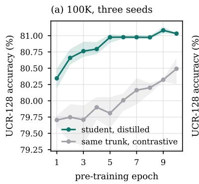

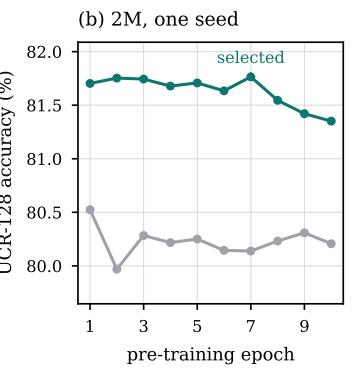

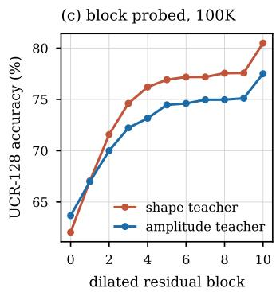  
Figure 4: Colours are shared across panels; accuracy is UCR-128 with the random-forest probe. (a) At 100K, the distilled student stabilizes after the first few epochs and remains above the same trunk trained contrastively; bands span the three pre-training seeds. (b) At 2M (one seed) the student peaks at epoch 7 and then declines, while the gradient-clipped contrastive control stays within 0.56 pp of its epoch-1 accuracy across ten epochs. (c) Probing each dilated residual block of the two 100K specialists: accuracy increases with depth and the final block is best for both.

Checkpoint selection. Downstream accuracy is not monotone in pre-training epoch, so we select the checkpoint on UCR random-forest accuracy at pre-training seed 42 (Figure 4a,b). At 100K the student is stable: it rises to 81.13/81.07/81.04% at epoch 9 across the three seeds, and any epoch from 5 on is within 0.2 pp of that. At 2M the same recipe peaks earlier and then decays — 81.70% at epoch 1, 81.76% at epoch 7, 81.35% at epoch 10 — while the pre-training loss keeps falling, so more optimization of the contrastive teachers’ objective stops buying downstream accuracy well before convergence. The teachers behave the same way and are selected independently: at 2M the amplitude teacher improves over its three epochs (77.43 to 77.68%) while the shape teacher degrades (79.89 to 79.49%), so they are taken at epochs 3 and 1. The specialists are trained for three epochs only, and a 100-epoch run of both at 100K (batch 512, learning rate $4 \times 1 0 ^ { - 3 }$ , seed 42) shows why: the shape specialist peaks at epoch 5 (80.65%) and drifts down to 79.79% by epoch 100, the amplitude specialist peaks at epoch 10 (77.19%) and falls to 74.67%. Epoch 3 is within 0.4 pp of the best epoch of either curve, and the frontier in Table 7 shows that 16 times more updates at batch 8 do not help either, so longer specialist training buys nothing. The contrastive control requires a separate stability qualification. Without clipping, nominally identical 1M runs agree through roughly 200 updates but undergo gradient explosions at different steps and differ by 4.15 pp at the same 1954-update checkpoint. With a global gradient clip of 10, the 1M run and its exact-seed repeat agree within 0.15 pp over their shared three epochs. The clipped 2M control is correspondingly stable, starting at 80.52% and remaining between 79.97% and 80.52% over ten epochs.

Input length. A convolutional encoder accepts any length, so we evaluate at native lengths; resampling every series to 512 steps, the preprocessing that fixed-context TSFMs require, costs 0.20/0.22 pp on UCR and 0.90/0.56 pp on UEA with the random-forest and logistic-regression probes (Table 6). Native lengths therefore matter more on the multivariate archive, where series run from 25 steps (JapaneseVowels) to 17984 (EigenWorms), so one fixed context must both upsample and heavily compress, than on UCR. The comparison matters because our baselines are evaluated at 512: the model stays within 0.5 pp of MantisV2 on UCR under the baselines’ own input handling, so the result is not an artifact of longer inputs.

Table 6: Native lengths versus resampling to 512 steps, for the released 2M model (epoch 7, %).
<table><tr><td>Input handling</td><td>UCR RF</td><td>UCR LogReg</td><td>UEA RF</td><td>UEA LogReg</td></tr><tr><td>native lengths</td><td>81.76</td><td>83.32</td><td>73.60</td><td>75.30</td></tr><tr><td>resampled to 512</td><td>81.57</td><td>83.10</td><td>72.70</td><td>74.74</td></tr></table>

Where the representation lives. We probed each of the eleven dilated residual blocks of both 100K specialists (Figure 4c). Accuracy increases with depth throughout, and the largest single jump is into the final block: 75.11 to 77.50% for the amplitude specialist and 77.58 to 80.49% for the shape specialist. The ordering is unchanged at a fixed length of 512. For both specialists the final block gives the highest UCR RF accuracy among the evaluated layers. This comparison also changes feature dimensionality: hidden blocks output 64 channels, whereas the final block outputs 320. We therefore use the final block for downstream evaluation.

Batch size and learning rate. The teachers’ optimization frontier is flat (Table 7): across a 64-fold range of batch size and a fourfold range of learning rate, the best epoch of each configuration spans 1.1 pp for the amplitude view and 0.7 pp for the shape view, with no interior optimum worth tuning for. We therefore train the teachers at batch 128 with learning rate $1 0 ^ { - 3 }$ , which is best for the shape view and within 0.3 pp of best for the amplitude view, and note that the reference implementation’s batch of 8 is not better despite 16 times more updates. The student is trained at batch 512 with learning rate $4 \times 1 0 ^ { - 3 }$ purely for throughput at 2M scale; at 100K, where both are available, that substitution costs 0.18 pp (81.08 to 80.90%).

Table 7: Teacher pre-training frontier at 100K (UCR random forest, best of the trained epochs, pre-training seed 42, %). Dashes are configurations we did not run.
<table><tr><td></td><td colspan="3">amplitude view</td><td colspan="3">shape view</td></tr><tr><td>Batch</td><td> $1 0 ^ { - 3 }$ </td><td> $2 \cdot 1 0 ^ { - 3 }$ </td><td> $4 \cdot 1 0 ^ { - 3 }$ </td><td> $1 0 ^ { - 3 }$ </td><td> $2 \cdot 1 0 ^ { - 3 }$ </td><td> $4 \cdot 1 0 ^ { - 3 }$ </td></tr><tr><td>8</td><td>77.31</td><td></td><td></td><td>79.80</td><td></td><td></td></tr><tr><td>128</td><td>77.53</td><td>77.36</td><td></td><td>80.49</td><td>80.33</td><td></td></tr><tr><td>256</td><td>77.73</td><td>77.82</td><td></td><td>80.01</td><td>80.34</td><td></td></tr><tr><td>512</td><td>77.52</td><td>77.40</td><td>76.70</td><td>79.84</td><td>80.25</td><td>80.26</td></tr></table>

## E Full results

This section provides the complete per-dataset results that correspond to the aggregated Table 1. Tables 8–11 show UCR-128 and UEA-27 performance, each under the random-forest probe (200 trees, mean over predictor seeds 0/1/2) and the StandardScaler plus logistic-regression probe (seed 0). Input handling follows each model’s prescribed configuration: ours, TiRex, Chronos-2, TiViT-H, TiConvNext and Catch22+ consume native lengths, while MOMENT, NuTime and Mantis interpolate to 512. The TS2Vec/ds column is the original TS2Vec trained on each dataset’s own training split (§C.1), so unlike every other column it is not a zero-shot result.

Table 8: Per-dataset accuracy (%) on UCR-128 with the random-forest probe (mean over predictor seeds 0/1/2). TS2Vec / ds is the original TS2Vec trained on each dataset (the reference row of Table 1); TS2Vec-FM is our single frozen encoder. Best per row in bold.
<table><tr><td></td><td>Catch22+</td><td>MOMENT</td><td></td><td>TiRex</td><td></td><td>TiViT-H</td><td>TiConvNext</td><td>MantisV2</td><td>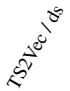</td><td>TS2Vec-FM</td></tr><tr><td>ACSF1</td><td>82.3</td><td>82.0</td><td>75.0</td><td>85.0</td><td>84.7</td><td>85.0</td><td>86.7</td><td>82.3</td><td>87.7</td><td>86.7</td></tr><tr><td>Adiac</td><td>73.4</td><td>78.9</td><td>73.6</td><td>78.5</td><td>81.1</td><td>70.6</td><td>65.5</td><td>84.8</td><td>77.0</td><td>80.6</td></tr><tr><td>AllGestureWiimoteX</td><td>59.6</td><td>61.4</td><td>65.0</td><td>65.0</td><td>60.4</td><td>60.3</td><td>66.8</td><td>68.4</td><td>70.5</td><td>69.1</td></tr><tr><td>AllGestureWiimoteY</td><td>63.2</td><td>66.2</td><td>63.0</td><td>70.5</td><td>64.2</td><td>65.1</td><td>68.0</td><td>69.1</td><td>72.4</td><td>74.7</td></tr><tr><td>AllGestureWiimoteZ</td><td>54.6</td><td>57.7</td><td>62.2</td><td>60.6</td><td>62.0</td><td>61.3</td><td>60.7</td><td>68.8</td><td>68.0</td><td>69.7</td></tr><tr><td>ArrowHead</td><td>74.1</td><td>79.4</td><td>77.3</td><td>78.9</td><td>77.9</td><td>76.4</td><td>77.1</td><td>80.6</td><td>76.6</td><td>81.1</td></tr><tr><td>Beef</td><td>68.9</td><td>78.9</td><td>66.7</td><td>84.4</td><td>73.3</td><td>75.6</td><td>82.2</td><td>68.9</td><td>67.8</td><td>72.2</td></tr><tr><td>BeetleFly</td><td>78.3</td><td>95.0</td><td>80.0</td><td>91.7</td><td>86.7</td><td>93.3</td><td>95.0</td><td>98.3</td><td>80.0</td><td>93.3</td></tr><tr><td>BirdChicken</td><td>85.0</td><td>98.3</td><td>96.7</td><td>88.3</td><td>90.0</td><td>85.0</td><td>100.0</td><td>90.0</td><td>95.0</td><td>90.0</td></tr><tr><td>BME</td><td>100.0</td><td>98.7</td><td>84.7</td><td>96.0</td><td>96.7</td><td>97.8</td><td>99.3</td><td>99.6</td><td>90.2</td><td>97.1</td></tr><tr><td>Car</td><td>75.6</td><td>75.6</td><td>76.7</td><td>66.7</td><td>73.9</td><td>73.9</td><td>72.2</td><td>75.6</td><td>78.9</td><td>77.2</td></tr><tr><td>CBF</td><td>97.6</td><td>96.8</td><td>97.3</td><td>99.1</td><td>99.3</td><td>99.8</td><td>99.4</td><td>99.5</td><td>98.7</td><td>98.4</td></tr><tr><td>Chinatown</td><td>98.0</td><td>97.8</td><td>92.8</td><td>96.9</td><td>97.2</td><td>96.3</td><td>87.2</td><td>95.3</td><td>97.4</td><td>97.2</td></tr><tr><td>ChlorineConcentration</td><td>66.8</td><td>69.7</td><td>67.1</td><td>70.2</td><td>71.0</td><td>70.8</td><td>70.7</td><td>70.4</td><td>69.6</td><td>68.2</td></tr><tr><td>CinCECGTorso</td><td>88.7</td><td>68.3</td><td>73.1</td><td>89.8</td><td>81.4</td><td>81.6</td><td>81.0</td><td>80.9</td><td>69.6</td><td>72.2</td></tr><tr><td>Coffee</td><td>98.8</td><td>92.9</td><td>92.9</td><td>98.8</td><td>92.9</td><td>100.0</td><td>100.0</td><td>100.0</td><td>97.6</td><td>100.0</td></tr><tr><td>Computers</td><td>73.5</td><td>62.7</td><td>76.3</td><td>76.0</td><td>74.1</td><td>73.3</td><td>74.1</td><td>72.1</td><td>64.8</td><td>69.9</td></tr><tr><td>CricketX</td><td>69.7</td><td>68.5</td><td>66.7</td><td>69.2</td><td>69.9</td><td>71.4</td><td>66.4</td><td>77.4</td><td>68.5</td><td>70.8</td></tr></table>

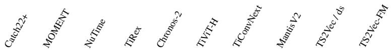

<table><tr><td rowspan=1 colspan=6>CricketY                       69.2   67.4  68.9  72.2   71.4</td><td rowspan=1 colspan=5>71.3    66.5   78.8   70.4   70.7</td></tr><tr><td rowspan=1 colspan=6>CricketZ                       74.3   74.9  67.8  72.5   73.0</td><td rowspan=1 colspan=5>76.4   71.2  81.7   75.0   75.3</td></tr><tr><td rowspan=1 colspan=3>Crop                          75.2   71.4</td><td rowspan=1 colspan=3>67.5  72.0   72.1</td><td rowspan=1 colspan=2>65.5   64.1</td><td rowspan=1 colspan=3>73.4    73.3   74.0</td></tr><tr><td rowspan=1 colspan=3>DiatomSizeReduction             94.0   88.2</td><td rowspan=1 colspan=3>86.2  86.2   90.0</td><td rowspan=1 colspan=2>86.5   90.1</td><td rowspan=1 colspan=3>83.0   91.5   86.9</td></tr><tr><td rowspan=1 colspan=3>DistalPhalanxOutlineAgeGroup     71.7   75.3</td><td rowspan=1 colspan=3>73.9  74.1   78.2</td><td rowspan=1 colspan=2>78.2   77.7</td><td rowspan=1 colspan=3>76.0   72.4   73.1</td></tr><tr><td rowspan=1 colspan=1>DistalPhalanxOutlineCorrect</td><td rowspan=1 colspan=1>79.1</td><td rowspan=1 colspan=1>79.6</td><td rowspan=1 colspan=1>77.8</td><td rowspan=1 colspan=2>78.7   80.3</td><td rowspan=1 colspan=2>77.9   75.5</td><td rowspan=1 colspan=3>78.9   78.7   78.7</td></tr><tr><td rowspan=1 colspan=1>DistalPhalanxTW</td><td rowspan=1 colspan=1>64.7</td><td rowspan=1 colspan=1>65.7</td><td rowspan=1 colspan=1>68.8</td><td rowspan=1 colspan=1>66.7</td><td rowspan=1 colspan=1>69.3</td><td rowspan=1 colspan=2>67.1   69.5</td><td rowspan=1 colspan=3>70.7   66.2   68.3</td></tr><tr><td rowspan=1 colspan=1>DodgerLoopDay</td><td rowspan=1 colspan=2>64.2   45.8</td><td rowspan=1 colspan=1>54.2</td><td rowspan=1 colspan=1>50.4</td><td rowspan=1 colspan=1>49.2</td><td rowspan=1 colspan=2>44.2   53.3</td><td rowspan=1 colspan=3>53.3   58.3   63.6</td></tr><tr><td rowspan=1 colspan=1>DodgerLoopGame</td><td rowspan=1 colspan=2>83.3   81.2</td><td rowspan=1 colspan=1>78.3</td><td rowspan=1 colspan=1>76.3</td><td rowspan=1 colspan=1>83.3</td><td rowspan=1 colspan=1>81.6</td><td rowspan=1 colspan=1>78.3</td><td rowspan=1 colspan=3>80.0   85.7   88.2</td></tr><tr><td rowspan=1 colspan=1>DodgerLoopWeekend</td><td rowspan=1 colspan=1>98.6</td><td rowspan=1 colspan=1>97.6</td><td rowspan=1 colspan=1>95.9</td><td rowspan=1 colspan=1>94.9</td><td rowspan=1 colspan=1>96.4</td><td rowspan=1 colspan=1>92.8</td><td rowspan=1 colspan=1>90.1</td><td rowspan=1 colspan=1>95.2</td><td rowspan=1 colspan=2>96.1   98.4</td></tr><tr><td rowspan=1 colspan=1>Earthquakes</td><td rowspan=1 colspan=1>75.1</td><td rowspan=1 colspan=1>74.6</td><td rowspan=1 colspan=1>74.3</td><td rowspan=1 colspan=1>74.8</td><td rowspan=1 colspan=1>74.6</td><td rowspan=1 colspan=1>74.1</td><td rowspan=1 colspan=1>74.6</td><td rowspan=1 colspan=1>74.3</td><td rowspan=1 colspan=2>74.8    74.8</td></tr><tr><td rowspan=1 colspan=1>ECG200</td><td rowspan=1 colspan=1>85.0</td><td rowspan=1 colspan=1>87.0</td><td rowspan=1 colspan=1>82.3</td><td rowspan=1 colspan=1>86.0</td><td rowspan=1 colspan=1>84.0</td><td rowspan=1 colspan=1>83.0</td><td rowspan=1 colspan=1>78.3</td><td rowspan=1 colspan=1>83.7</td><td rowspan=1 colspan=2>83.0   84.0</td></tr><tr><td rowspan=1 colspan=1>ECG5000</td><td rowspan=1 colspan=1>94.0</td><td rowspan=1 colspan=1>93.8</td><td rowspan=1 colspan=1>93.3</td><td rowspan=1 colspan=1>93.3</td><td rowspan=1 colspan=1>93.3</td><td rowspan=1 colspan=1>94.0</td><td rowspan=1 colspan=1>93.9</td><td rowspan=1 colspan=1>93.8</td><td rowspan=1 colspan=1>93.7</td><td rowspan=1 colspan=1>94.3</td></tr><tr><td rowspan=1 colspan=1>ECGFiveDays</td><td rowspan=1 colspan=1>79.8</td><td rowspan=1 colspan=1>81.3</td><td rowspan=1 colspan=1>78.7</td><td rowspan=1 colspan=1>89.5</td><td rowspan=1 colspan=1>91.0</td><td rowspan=1 colspan=1>93.5</td><td rowspan=1 colspan=1>97.1</td><td rowspan=1 colspan=1>87.1</td><td rowspan=1 colspan=1>99.9</td><td rowspan=1 colspan=1>99.9</td></tr><tr><td rowspan=1 colspan=1>ElectricDevices</td><td rowspan=1 colspan=1>74.0</td><td rowspan=1 colspan=1>72.6</td><td rowspan=1 colspan=1>70.7</td><td rowspan=1 colspan=1>70.4</td><td rowspan=1 colspan=1>74.9</td><td rowspan=1 colspan=1>76.2</td><td rowspan=1 colspan=1>76.2</td><td rowspan=1 colspan=1>74.2</td><td rowspan=1 colspan=1>70.7</td><td rowspan=1 colspan=1>72.5</td></tr><tr><td rowspan=1 colspan=1>EOGHorizontalSignal</td><td rowspan=1 colspan=1>59.5</td><td rowspan=1 colspan=1>56.5</td><td rowspan=1 colspan=1>45.2</td><td rowspan=1 colspan=1>53.1</td><td rowspan=1 colspan=1>53.9</td><td rowspan=1 colspan=1>53.9</td><td rowspan=1 colspan=1>56.3</td><td rowspan=1 colspan=1>58.8</td><td rowspan=1 colspan=1>58.4</td><td rowspan=1 colspan=1>58.0</td></tr><tr><td rowspan=1 colspan=1>EOGVerticalSignal</td><td rowspan=1 colspan=1>50.9</td><td rowspan=1 colspan=1>45.3</td><td rowspan=1 colspan=1>26.7</td><td rowspan=1 colspan=1>41.4</td><td rowspan=1 colspan=1>38.4</td><td rowspan=1 colspan=1>44.2</td><td rowspan=1 colspan=1>37.6</td><td rowspan=1 colspan=1>48.2</td><td rowspan=1 colspan=1>46.7</td><td rowspan=1 colspan=1>43.0</td></tr><tr><td rowspan=1 colspan=1>EthanolLevel</td><td rowspan=1 colspan=1>38.0</td><td rowspan=1 colspan=1>44.0</td><td rowspan=1 colspan=1>34.9</td><td rowspan=1 colspan=1>30.6</td><td rowspan=1 colspan=1>43.7</td><td rowspan=1 colspan=1>40.5</td><td rowspan=1 colspan=1>34.8</td><td rowspan=1 colspan=1>37.9</td><td rowspan=1 colspan=1>32.3</td><td rowspan=1 colspan=1>58.8</td></tr><tr><td rowspan=1 colspan=1>FaceAll</td><td rowspan=1 colspan=1>76.8</td><td rowspan=1 colspan=1>71.8</td><td rowspan=1 colspan=1>64.9</td><td rowspan=1 colspan=1>76.5</td><td rowspan=1 colspan=1>70.2</td><td rowspan=1 colspan=1>69.1</td><td rowspan=1 colspan=1>68.7</td><td rowspan=1 colspan=1>72.1</td><td rowspan=1 colspan=1>74.6</td><td rowspan=1 colspan=1>73.6</td></tr><tr><td rowspan=1 colspan=1>FaceFour</td><td rowspan=1 colspan=1>89.8</td><td rowspan=1 colspan=1>76.9</td><td rowspan=1 colspan=1>80.3</td><td rowspan=1 colspan=1>79.2</td><td rowspan=1 colspan=1>68.2</td><td rowspan=1 colspan=1>64.8</td><td rowspan=1 colspan=1>81.8</td><td rowspan=1 colspan=1>91.7</td><td rowspan=1 colspan=1>77.3</td><td rowspan=1 colspan=1>91.3</td></tr><tr><td rowspan=1 colspan=1>FacesUCR</td><td rowspan=1 colspan=1>85.6</td><td rowspan=1 colspan=1>79.6</td><td rowspan=1 colspan=1>71.4</td><td rowspan=1 colspan=1>80.0</td><td rowspan=1 colspan=1>76.0</td><td rowspan=1 colspan=1>78.1</td><td rowspan=1 colspan=1>76.7</td><td rowspan=1 colspan=3>84.4   89.0   85.1</td></tr><tr><td rowspan=1 colspan=1>FiftyWords</td><td rowspan=1 colspan=1>72.6</td><td rowspan=1 colspan=1>71.0</td><td rowspan=1 colspan=1>61.4</td><td rowspan=1 colspan=1>63.8</td><td rowspan=1 colspan=1>66.9</td><td rowspan=1 colspan=1>64.2</td><td rowspan=1 colspan=1>67.4</td><td rowspan=1 colspan=3>71.1   63.2   66.4</td></tr><tr><td rowspan=1 colspan=1>Fish</td><td rowspan=1 colspan=1>76.2</td><td rowspan=1 colspan=1>84.8</td><td rowspan=1 colspan=1>91.6</td><td rowspan=1 colspan=1>83.2</td><td rowspan=1 colspan=1>86.3</td><td rowspan=1 colspan=1>90.3</td><td rowspan=1 colspan=1>90.7</td><td rowspan=1 colspan=3>93.1   90.7   94.1</td></tr><tr><td rowspan=1 colspan=1>FordA</td><td rowspan=1 colspan=1>91.0</td><td rowspan=1 colspan=1>86.1</td><td rowspan=1 colspan=1>89.3</td><td rowspan=1 colspan=1>94.1</td><td rowspan=1 colspan=1>91.7</td><td rowspan=1 colspan=1>89.7</td><td rowspan=1 colspan=1>90.8</td><td rowspan=1 colspan=3>93.0   92.4   91.5</td></tr><tr><td rowspan=1 colspan=1>FordB</td><td rowspan=1 colspan=1>72.9</td><td rowspan=1 colspan=1>73.7</td><td rowspan=1 colspan=1>75.3</td><td rowspan=1 colspan=1>81.4</td><td rowspan=1 colspan=1>79.2</td><td rowspan=1 colspan=1>77.9</td><td rowspan=1 colspan=1>76.3</td><td rowspan=1 colspan=3>79.8   76.6   77.9</td></tr><tr><td rowspan=1 colspan=1>FreezerRegularTrain</td><td rowspan=1 colspan=1>100.0</td><td rowspan=1 colspan=1>91.1</td><td rowspan=1 colspan=1>97.7</td><td rowspan=1 colspan=1>92.6</td><td rowspan=1 colspan=1>97.2</td><td rowspan=1 colspan=1>98.3</td><td rowspan=1 colspan=1>99.1</td><td rowspan=1 colspan=3>98.6   98.4   97.9</td></tr><tr><td rowspan=1 colspan=1>FreezerSmallTrain</td><td rowspan=1 colspan=1>92.5</td><td rowspan=1 colspan=1>78.8</td><td rowspan=1 colspan=1>94.0</td><td rowspan=1 colspan=1>82.1</td><td rowspan=1 colspan=1>91.8</td><td rowspan=1 colspan=1>93.5</td><td rowspan=1 colspan=1>95.6</td><td rowspan=1 colspan=3>93.5   83.2   96.3</td></tr><tr><td rowspan=1 colspan=1>Fungi</td><td rowspan=1 colspan=1>92.3</td><td rowspan=1 colspan=1>100.0</td><td rowspan=1 colspan=1>70.1</td><td rowspan=1 colspan=1>84.1</td><td rowspan=1 colspan=1>91.0</td><td rowspan=1 colspan=1>91.4</td><td rowspan=1 colspan=1>88.4</td><td rowspan=1 colspan=3>94.3   94.4    98.0</td></tr><tr><td rowspan=1 colspan=1>GestureMidAirD1</td><td rowspan=1 colspan=1>67.9</td><td rowspan=1 colspan=1>67.4</td><td rowspan=1 colspan=1>65.6</td><td rowspan=1 colspan=1>66.2</td><td rowspan=1 colspan=1>66.9</td><td rowspan=1 colspan=1>70.0</td><td rowspan=1 colspan=1>73.6</td><td rowspan=1 colspan=1>71.3</td><td rowspan=1 colspan=2>62.1    62.8</td></tr><tr><td rowspan=1 colspan=1>GestureMidAirD2</td><td rowspan=1 colspan=1>62.1</td><td rowspan=1 colspan=1>57.7</td><td rowspan=1 colspan=1>56.7</td><td rowspan=1 colspan=1>65.1</td><td rowspan=1 colspan=1>74.4</td><td rowspan=1 colspan=1>66.7</td><td rowspan=1 colspan=1>67.9</td><td rowspan=1 colspan=1>61.5</td><td rowspan=1 colspan=2>54.1   61.3</td></tr><tr><td rowspan=1 colspan=1>GestureMidAirD3</td><td rowspan=1 colspan=1>39.2</td><td rowspan=1 colspan=1>38.5</td><td rowspan=1 colspan=1>39.2</td><td rowspan=1 colspan=1>39.0</td><td rowspan=1 colspan=1>35.4</td><td rowspan=1 colspan=1>44.1</td><td rowspan=1 colspan=1>46.9</td><td rowspan=1 colspan=1>43.8</td><td rowspan=1 colspan=1>38.2</td><td rowspan=1 colspan=1>30.8</td></tr><tr><td rowspan=1 colspan=1>GesturePebbleZ1</td><td rowspan=1 colspan=1>87.8</td><td rowspan=1 colspan=1>87.8</td><td rowspan=1 colspan=1>89.1</td><td rowspan=1 colspan=1>87.0</td><td rowspan=1 colspan=1>88.6</td><td rowspan=1 colspan=1>86.6</td><td rowspan=1 colspan=1>82.9</td><td rowspan=1 colspan=1>92.1</td><td rowspan=1 colspan=1>89.5</td><td rowspan=1 colspan=1>89.5</td></tr><tr><td rowspan=1 colspan=1>GesturePebbleZ2</td><td rowspan=1 colspan=1>73.8</td><td rowspan=1 colspan=1>86.5</td><td rowspan=1 colspan=1>83.8</td><td rowspan=1 colspan=1>87.6</td><td rowspan=1 colspan=1>81.9</td><td rowspan=1 colspan=1>84.4</td><td rowspan=1 colspan=1>84.4</td><td rowspan=1 colspan=1>91.1</td><td rowspan=1 colspan=1>83.8</td><td rowspan=1 colspan=1>85.7</td></tr><tr><td rowspan=1 colspan=1>GunPoint</td><td rowspan=1 colspan=1>94.7</td><td rowspan=1 colspan=1>98.7</td><td rowspan=1 colspan=1>94.2</td><td rowspan=1 colspan=1>96.4</td><td rowspan=1 colspan=1>99.6</td><td rowspan=1 colspan=1>99.3</td><td rowspan=1 colspan=1>96.7</td><td rowspan=1 colspan=1>97.8</td><td rowspan=1 colspan=1>95.3</td><td rowspan=1 colspan=1>99.3</td></tr><tr><td rowspan=1 colspan=1>GunPointAgeSpan</td><td rowspan=1 colspan=1>98.8</td><td rowspan=1 colspan=1>95.3</td><td rowspan=1 colspan=1>97.2</td><td rowspan=1 colspan=1>98.2</td><td rowspan=1 colspan=1>98.5</td><td rowspan=1 colspan=1>98.7</td><td rowspan=1 colspan=1>96.7</td><td rowspan=1 colspan=1>98.4</td><td rowspan=1 colspan=1>99.2</td><td rowspan=1 colspan=1>99.5</td></tr><tr><td rowspan=1 colspan=1>GunPointMaleVersusFemale</td><td rowspan=1 colspan=1>99.4</td><td rowspan=1 colspan=1>99.2</td><td rowspan=1 colspan=1>97.9</td><td rowspan=1 colspan=1>99.5</td><td rowspan=1 colspan=1>98.8</td><td rowspan=1 colspan=1>99.7</td><td rowspan=1 colspan=1>99.8</td><td rowspan=1 colspan=1>100.0</td><td rowspan=1 colspan=1>100.0</td><td rowspan=1 colspan=1>100.0</td></tr><tr><td rowspan=1 colspan=1>GunPointOldVersus Young</td><td rowspan=1 colspan=1>100.0</td><td rowspan=1 colspan=1>96.0</td><td rowspan=1 colspan=1>100.0</td><td rowspan=1 colspan=1>96.7</td><td rowspan=1 colspan=1>97.8</td><td rowspan=1 colspan=1>98.5</td><td rowspan=1 colspan=1>99.4</td><td rowspan=1 colspan=1>99.7</td><td rowspan=1 colspan=1>100.0</td><td rowspan=1 colspan=1>100.0</td></tr><tr><td rowspan=2 colspan=1>HamHandOutlines</td><td rowspan=1 colspan=1>60.6</td><td rowspan=1 colspan=1>73.3</td><td rowspan=1 colspan=1>71.1</td><td rowspan=1 colspan=1>71.4</td><td rowspan=1 colspan=1>64.1</td><td rowspan=1 colspan=1>65.1</td><td rowspan=1 colspan=1>63.5</td><td rowspan=1 colspan=1>67.0</td><td rowspan=1 colspan=1>78.7</td><td rowspan=1 colspan=1>73.3</td></tr><tr><td rowspan=1 colspan=1>90.4</td><td rowspan=1 colspan=1>90.9</td><td rowspan=1 colspan=1>89.6</td><td rowspan=1 colspan=1>87.6</td><td rowspan=1 colspan=1>91.1</td><td rowspan=1 colspan=1>88.7</td><td rowspan=1 colspan=1>88.7</td><td rowspan=1 colspan=1>90.4</td><td rowspan=1 colspan=1>91.7</td><td rowspan=1 colspan=1>91.8</td></tr><tr><td rowspan=1 colspan=1>Haptics</td><td rowspan=1 colspan=1>48.4</td><td rowspan=1 colspan=1>52.4</td><td rowspan=1 colspan=1>47.4</td><td rowspan=1 colspan=1>52.7</td><td rowspan=1 colspan=1>54.4</td><td rowspan=1 colspan=1>50.8</td><td rowspan=1 colspan=1>51.4</td><td rowspan=1 colspan=1>50.1</td><td rowspan=1 colspan=1>48.1</td><td rowspan=1 colspan=1>50.4</td></tr><tr><td rowspan=1 colspan=1>Herring</td><td rowspan=1 colspan=1>52.1</td><td rowspan=1 colspan=1>58.9</td><td rowspan=1 colspan=1>64.6</td><td rowspan=1 colspan=1>63.5</td><td rowspan=1 colspan=1>66.7</td><td rowspan=1 colspan=1>59.4</td><td rowspan=1 colspan=1>55.7</td><td rowspan=1 colspan=1>63.0</td><td rowspan=1 colspan=1>60.9</td><td rowspan=1 colspan=1>64.1</td></tr><tr><td rowspan=1 colspan=1>HouseTwenty</td><td rowspan=1 colspan=1>96.9</td><td rowspan=1 colspan=1>93.8</td><td rowspan=1 colspan=1>88.5</td><td rowspan=1 colspan=1>96.9</td><td rowspan=1 colspan=1>95.8</td><td rowspan=1 colspan=1>97.8</td><td rowspan=1 colspan=1>95.0</td><td rowspan=1 colspan=1>95.2</td><td rowspan=1 colspan=1>95.0</td><td rowspan=1 colspan=1>73.9</td></tr><tr><td rowspan=1 colspan=1>InlineSkate</td><td rowspan=1 colspan=1>38.9</td><td rowspan=1 colspan=1>32.2</td><td rowspan=1 colspan=1>32.0</td><td rowspan=1 colspan=1>44.9</td><td rowspan=1 colspan=1>41.9</td><td rowspan=1 colspan=1>38.5</td><td rowspan=1 colspan=1>45.8</td><td rowspan=1 colspan=1>38.5</td><td rowspan=1 colspan=1>39.9</td><td rowspan=1 colspan=1>44.0</td></tr><tr><td rowspan=1 colspan=1>InsectEPGRegularTrain</td><td rowspan=1 colspan=1>100.0</td><td rowspan=1 colspan=1>93.0</td><td rowspan=1 colspan=1>100.0</td><td rowspan=1 colspan=1>96.9</td><td rowspan=1 colspan=1>95.2</td><td rowspan=1 colspan=1>100.0</td><td rowspan=1 colspan=1>98.9</td><td rowspan=1 colspan=1>100.0</td><td rowspan=1 colspan=1>100.0</td><td rowspan=1 colspan=1>100.0</td></tr><tr><td rowspan=1 colspan=1>InsectEPGSmallTrain</td><td rowspan=1 colspan=1>100.0</td><td rowspan=1 colspan=1>82.5</td><td rowspan=1 colspan=1>100.0</td><td rowspan=1 colspan=1>88.9</td><td rowspan=1 colspan=1>87.1</td><td rowspan=1 colspan=1>94.5</td><td rowspan=1 colspan=1>95.0</td><td rowspan=1 colspan=1>100.0</td><td rowspan=1 colspan=1>100.0</td><td rowspan=1 colspan=1>100.0</td></tr><tr><td rowspan=1 colspan=1>InsectWingbeatSound</td><td rowspan=1 colspan=1>62.9</td><td rowspan=1 colspan=1>62.6</td><td rowspan=1 colspan=1>51.7</td><td rowspan=1 colspan=1>65.1</td><td rowspan=1 colspan=1>62.7</td><td rowspan=1 colspan=1>52.6</td><td rowspan=1 colspan=1>53.7</td><td rowspan=1 colspan=1>60.6</td><td rowspan=1 colspan=1>61.8</td><td rowspan=1 colspan=1>63.6</td></tr><tr><td rowspan=1 colspan=1>ItalyPowerDemand</td><td rowspan=1 colspan=1>95.4</td><td rowspan=1 colspan=1>94.8</td><td rowspan=1 colspan=1>87.4</td><td rowspan=1 colspan=1>96.2</td><td rowspan=1 colspan=1>95.6</td><td rowspan=1 colspan=1>87.8</td><td rowspan=1 colspan=1>92.5</td><td rowspan=1 colspan=1>92.5</td><td rowspan=1 colspan=1>91.8</td><td rowspan=1 colspan=1>95.3</td></tr><tr><td rowspan=1 colspan=1>LargeKitchenAppliances</td><td rowspan=1 colspan=1>81.7</td><td rowspan=1 colspan=1>73.4</td><td rowspan=1 colspan=1>75.6</td><td rowspan=1 colspan=1>80.5</td><td rowspan=1 colspan=1>87.3</td><td rowspan=1 colspan=1>81.6</td><td rowspan=1 colspan=1>87.0</td><td rowspan=1 colspan=2>76.6   82.7</td><td rowspan=1 colspan=1>87.0</td></tr><tr><td rowspan=1 colspan=1>Lightning2</td><td rowspan=1 colspan=1>73.2</td><td rowspan=1 colspan=1>78.7</td><td rowspan=1 colspan=1>67.8</td><td rowspan=1 colspan=1>74.3</td><td rowspan=1 colspan=1>72.7</td><td rowspan=1 colspan=1>76.0</td><td rowspan=1 colspan=1>74.3</td><td rowspan=1 colspan=1>72.7</td><td rowspan=1 colspan=2>80.9   76.0</td></tr><tr><td rowspan=1 colspan=1>Lightning7</td><td rowspan=1 colspan=1>76.7</td><td rowspan=1 colspan=1>73.5</td><td rowspan=1 colspan=1>65.8</td><td rowspan=1 colspan=1>73.5</td><td rowspan=1 colspan=1>65.3</td><td rowspan=1 colspan=1>74.9</td><td rowspan=1 colspan=1>73.1</td><td rowspan=1 colspan=1>72.1</td><td rowspan=1 colspan=2>78.1   72.6</td></tr><tr><td rowspan=1 colspan=1>Mallat</td><td rowspan=1 colspan=1>95.6</td><td rowspan=1 colspan=1>91.6</td><td rowspan=1 colspan=1>83.1</td><td rowspan=1 colspan=1>91.7</td><td rowspan=1 colspan=1>90.2</td><td rowspan=1 colspan=1>90.3</td><td rowspan=1 colspan=1>83.9</td><td rowspan=1 colspan=1>88.9</td><td rowspan=1 colspan=2>88.1    93.5</td></tr><tr><td rowspan=1 colspan=1>Meat</td><td rowspan=1 colspan=1>92.2</td><td rowspan=1 colspan=1>92.2</td><td rowspan=1 colspan=1>92.8</td><td rowspan=1 colspan=1>86.1</td><td rowspan=1 colspan=1>93.3</td><td rowspan=1 colspan=1>83.9</td><td rowspan=1 colspan=1>86.7</td><td rowspan=1 colspan=3>91.1   93.3   92.8</td></tr><tr><td rowspan=1 colspan=1>MedicalImages</td><td rowspan=1 colspan=1>77.4</td><td rowspan=1 colspan=1>71.4</td><td rowspan=1 colspan=1>71.3</td><td rowspan=1 colspan=1>70.9</td><td rowspan=1 colspan=1>72.5</td><td rowspan=1 colspan=1>75.0</td><td rowspan=1 colspan=1>73.7</td><td rowspan=1 colspan=3>75.2   71.6   71.5</td></tr><tr><td rowspan=1 colspan=1>MelbournePedestrian</td><td rowspan=1 colspan=1>96.0</td><td rowspan=1 colspan=1>86.4</td><td rowspan=1 colspan=1>91.7</td><td rowspan=1 colspan=1>88.1</td><td rowspan=1 colspan=1>89.3</td><td rowspan=1 colspan=1>80.7</td><td rowspan=1 colspan=1>81.9</td><td rowspan=1 colspan=3>95.1   94.9   95.8</td></tr><tr><td rowspan=1 colspan=1>MiddlePhalanxOutlineAgeGroup</td><td rowspan=1 colspan=1>59.5</td><td rowspan=1 colspan=1>56.5</td><td rowspan=1 colspan=1>60.6</td><td rowspan=1 colspan=1>60.0</td><td rowspan=1 colspan=1>55.8</td><td rowspan=1 colspan=1>60.4</td><td rowspan=1 colspan=1>63.0</td><td rowspan=1 colspan=3>58.0   59.5   56.5</td></tr><tr><td rowspan=1 colspan=1>MiddlePhalanxOutlineCorrect</td><td rowspan=1 colspan=1>81.1</td><td rowspan=1 colspan=1>85.8</td><td rowspan=1 colspan=1>78.9</td><td rowspan=1 colspan=1>81.8</td><td rowspan=1 colspan=1>87.2</td><td rowspan=1 colspan=1>82.5</td><td rowspan=1 colspan=1>81.6</td><td rowspan=1 colspan=3>83.4   84.1    81.3</td></tr><tr><td rowspan=1 colspan=1>MiddlePhalanxTW</td><td rowspan=1 colspan=1>58.4</td><td rowspan=1 colspan=1>57.8</td><td rowspan=1 colspan=1>52.8</td><td rowspan=1 colspan=1>57.4</td><td rowspan=1 colspan=1>57.1</td><td rowspan=1 colspan=1>55.2</td><td rowspan=1 colspan=1>56.9</td><td rowspan=1 colspan=3>53.2   55.6   58.0</td></tr><tr><td rowspan=1 colspan=1>MixedShapesRegularTrain</td><td rowspan=1 colspan=1>93.1</td><td rowspan=1 colspan=1>91.7</td><td rowspan=1 colspan=1>93.8</td><td rowspan=1 colspan=1>94.7</td><td rowspan=1 colspan=1>94.3</td><td rowspan=1 colspan=1>95.1</td><td rowspan=1 colspan=1>95.6</td><td rowspan=1 colspan=3>94.7   89.1    92.7</td></tr><tr><td rowspan=1 colspan=1>MixedShapesSmallTrain</td><td rowspan=1 colspan=1>88.3</td><td rowspan=1 colspan=1>85.1</td><td rowspan=1 colspan=1>90.8</td><td rowspan=1 colspan=1>90.9</td><td rowspan=1 colspan=1>90.2</td><td rowspan=1 colspan=1>91.9</td><td rowspan=1 colspan=1>91.8</td><td rowspan=1 colspan=3>91.6   82.6   87.5</td></tr><tr><td rowspan=1 colspan=1>MoteStrain</td><td rowspan=1 colspan=1>88.2</td><td rowspan=1 colspan=1>89.0</td><td rowspan=1 colspan=1>94.8</td><td rowspan=1 colspan=1>91.9</td><td rowspan=1 colspan=1>93.3</td><td rowspan=1 colspan=1>85.9</td><td rowspan=1 colspan=1>90.5</td><td rowspan=1 colspan=3>93.1   88.9   89.5</td></tr><tr><td rowspan=1 colspan=1>NonInvasiveFetalECGThorax1</td><td rowspan=1 colspan=1>88.8</td><td rowspan=1 colspan=1>88.6</td><td rowspan=1 colspan=1>78.0</td><td rowspan=1 colspan=1>86.6</td><td rowspan=1 colspan=1>83.0</td><td rowspan=1 colspan=1>81.4</td><td rowspan=1 colspan=1>82.4</td><td rowspan=1 colspan=3>86.4    88.0   91.9</td></tr><tr><td rowspan=1 colspan=1>NonInvasiveFetalECGThorax2</td><td rowspan=1 colspan=1>90.9</td><td rowspan=1 colspan=1>91.0</td><td rowspan=1 colspan=1>81.7</td><td rowspan=1 colspan=1>88.8</td><td rowspan=1 colspan=1>86.8</td><td rowspan=1 colspan=2>87.5   86.9</td><td rowspan=1 colspan=3>88.7   91.6   93.8</td></tr><tr><td rowspan=1 colspan=1>OliveOil</td><td rowspan=1 colspan=1>84.4</td><td rowspan=1 colspan=1>88.9</td><td rowspan=1 colspan=1>70.0</td><td rowspan=1 colspan=1>87.8</td><td rowspan=1 colspan=1>85.6</td><td rowspan=1 colspan=2>57.8   85.6</td><td rowspan=1 colspan=3>86.7   86.7   90.0</td></tr><tr><td rowspan=1 colspan=1>OSULeaf</td><td rowspan=1 colspan=1>68.3</td><td rowspan=1 colspan=1>75.2</td><td rowspan=1 colspan=1>80.0</td><td rowspan=1 colspan=1>91.7</td><td rowspan=1 colspan=1>89.5</td><td rowspan=1 colspan=1>94.6</td><td rowspan=1 colspan=1>97.9</td><td rowspan=1 colspan=3>93.5   67.2   81.5</td></tr><tr><td rowspan=1 colspan=1>PhalangesOutlinesCorrect</td><td rowspan=1 colspan=1>82.5</td><td rowspan=1 colspan=1>82.2</td><td rowspan=1 colspan=1>77.7</td><td rowspan=1 colspan=1>82.0</td><td rowspan=1 colspan=1>83.5</td><td rowspan=1 colspan=1>79.6</td><td rowspan=1 colspan=1>79.5</td><td rowspan=1 colspan=3>82.4   83.6   82.7</td></tr><tr><td rowspan=1 colspan=1>Phoneme</td><td rowspan=1 colspan=1>32.2</td><td rowspan=1 colspan=1>29.4</td><td rowspan=1 colspan=1>29.1</td><td rowspan=1 colspan=1>37.7</td><td rowspan=1 colspan=1>39.4</td><td rowspan=1 colspan=1>35.5</td><td rowspan=1 colspan=1>37.4</td><td rowspan=1 colspan=3>36.4    28.4   30.8</td></tr><tr><td rowspan=1 colspan=1>PickupGestureWiimoteZ</td><td rowspan=1 colspan=1>69.3</td><td rowspan=1 colspan=1>58.7</td><td rowspan=1 colspan=1>66.7</td><td rowspan=1 colspan=1>73.3</td><td rowspan=1 colspan=1>68.0</td><td rowspan=1 colspan=1>82.0</td><td rowspan=1 colspan=1>82.0</td><td rowspan=1 colspan=3>78.7   87.3   88.0</td></tr><tr><td rowspan=1 colspan=1>PigAirwayPressure</td><td rowspan=1 colspan=1>23.7</td><td rowspan=1 colspan=1>10.7</td><td rowspan=1 colspan=1>34.8</td><td rowspan=1 colspan=1>34.6</td><td rowspan=1 colspan=1>33.3</td><td rowspan=1 colspan=1>47.4</td><td rowspan=1 colspan=1>57.7</td><td rowspan=1 colspan=3>49.0   59.8   37.3</td></tr><tr><td rowspan=1 colspan=1>PigArtPressure</td><td rowspan=1 colspan=1>89.1</td><td rowspan=1 colspan=1>53.7</td><td rowspan=1 colspan=1>93.6</td><td rowspan=1 colspan=1>87.3</td><td rowspan=1 colspan=1>80.6</td><td rowspan=1 colspan=1>81.7</td><td rowspan=1 colspan=1>90.9</td><td rowspan=1 colspan=3>93.4   91.2   92.5</td></tr><tr><td rowspan=1 colspan=1>PigCVP</td><td rowspan=1 colspan=1>51.3</td><td rowspan=1 colspan=1>44.1</td><td rowspan=1 colspan=1>82.9</td><td rowspan=1 colspan=1>83.5</td><td rowspan=1 colspan=1>67.3</td><td rowspan=1 colspan=2>67.9   71.3</td><td rowspan=1 colspan=3>89.7   75.2   88.6</td></tr><tr><td rowspan=1 colspan=1>PLAID</td><td rowspan=1 colspan=1>87.5</td><td rowspan=1 colspan=1>73.9</td><td rowspan=1 colspan=1>77.7</td><td rowspan=1 colspan=1>86.8</td><td rowspan=1 colspan=1>85.9</td><td rowspan=1 colspan=2>87.1   89.2</td><td rowspan=1 colspan=3>81.9   29.5   87.5</td></tr><tr><td rowspan=1 colspan=1>Plane</td><td rowspan=1 colspan=1>100.0</td><td rowspan=1 colspan=1>99.7</td><td rowspan=1 colspan=1>100.0</td><td rowspan=1 colspan=1>100.0</td><td rowspan=1 colspan=1>100.0</td><td rowspan=1 colspan=2>100.0  100.0</td><td rowspan=1 colspan=3>100.0  100.0  100.0</td></tr><tr><td rowspan=1 colspan=1>PowerCons</td><td rowspan=1 colspan=1>99.4</td><td rowspan=1 colspan=1>94.1</td><td rowspan=1 colspan=1>93.3</td><td rowspan=1 colspan=1>89.8</td><td rowspan=1 colspan=1>94.1</td><td rowspan=1 colspan=2>89.1   90.7</td><td rowspan=1 colspan=3>96.5   97.4   95.9</td></tr><tr><td rowspan=1 colspan=1>ProximalPhalanxOutlineAgeGroup</td><td rowspan=1 colspan=5>84.7   83.4  85.0  85.2   85.7</td><td rowspan=1 colspan=5>85.4   85.4   82.9   83.4   84.7</td></tr></table>

<table><tr><td>ProximalPhalanxOutlineCorrect</td><td>86.5</td><td>86.0</td><td>83.7</td><td>87.7</td><td>87.1</td><td>85.1</td><td>83.3</td><td>86.7</td><td>90.0</td><td>89.0</td></tr><tr><td>ProximalPhalanxTW</td><td>80.3</td><td>81.1</td><td>81.5</td><td>80.7</td><td>79.8</td><td>77.7</td><td>79.2</td><td>82.1</td><td>80.7</td><td>81.6</td></tr><tr><td>RefrigerationDevices</td><td>54.9</td><td>54.9</td><td>53.7</td><td>56.8</td><td>55.0</td><td>54.7</td><td>59.1</td><td>56.4</td><td>57.2</td><td>55.6</td></tr><tr><td>Rock</td><td>62.0</td><td>83.3</td><td>65.3</td><td>90.0</td><td>87.3</td><td>89.3</td><td>90.0</td><td>82.0</td><td>42.0</td><td>74.7</td></tr><tr><td>ScreenType</td><td>52.7</td><td>42.8</td><td>50.6</td><td>51.6</td><td>48.7</td><td>54.5</td><td>54.0</td><td>46.0</td><td>44.4</td><td>49.3</td></tr><tr><td>SemgHandGenderCh2</td><td>92.7</td><td>77.8</td><td>85.6</td><td>88.2</td><td>89.1</td><td>83.9</td><td>87.2</td><td>91.4</td><td>91.6</td><td>90.2</td></tr><tr><td>SemgHandMovementCh2</td><td>86.1</td><td>42.5</td><td>67.6</td><td>64.9</td><td>62.6</td><td>53.7</td><td>59.7</td><td>73.1</td><td>77.2</td><td>69.1</td></tr><tr><td>SemgHandSubjectCh2</td><td>88.4</td><td>65.0</td><td>76.2</td><td>82.4</td><td>82.6</td><td>78.2</td><td>82.4</td><td>83.4</td><td>85.3</td><td>81.5</td></tr><tr><td>ShakeGestureWiimoteZ</td><td>84.7</td><td>84.0</td><td>91.3</td><td>88.0</td><td>86.0</td><td>84.7</td><td>82.7</td><td>93.3</td><td>86.7</td><td>91.3</td></tr><tr><td>ShapeletSim</td><td>97.0</td><td>95.9</td><td>92.0</td><td>94.3</td><td>100.0</td><td>100.0</td><td>100.0</td><td>95.9</td><td>98.1</td><td>100.0</td></tr><tr><td>ShapesAll</td><td>82.1</td><td>83.2</td><td>83.9</td><td>83.6</td><td>88.4</td><td>86.8</td><td>84.4</td><td>87.0</td><td>86.6</td><td>87.3</td></tr><tr><td>SmallKitchenAppliances</td><td>83.0</td><td>71.1</td><td>82.0</td><td>83.8</td><td>83.7</td><td>82.8</td><td>83.0</td><td>83.7</td><td>77.5</td><td>78.6</td></tr><tr><td>SmoothSubspace</td><td>98.7</td><td>95.8</td><td>87.3</td><td>92.2</td><td>92.9</td><td>93.3</td><td>92.7</td><td>95.1</td><td>93.8</td><td>95.1</td></tr><tr><td>SonyAIBORobotSurface1</td><td>84.0</td><td>85.4</td><td>80.9</td><td>86.2</td><td>66.3</td><td>78.8</td><td>76.4</td><td>82.3</td><td>81.3</td><td>90.6</td></tr><tr><td>SonyAIBORobotSurface2</td><td>88.4</td><td>82.8</td><td>83.9</td><td>82.5</td><td>84.7</td><td>90.4</td><td>91.9</td><td>92.2</td><td>88.1</td><td>89.4</td></tr><tr><td>StarLightCurves</td><td>97.0</td><td>97.7</td><td>97.9</td><td>97.9</td><td>98.0</td><td>97.9</td><td>98.0</td><td>98.1</td><td>96.9</td><td>98.1</td></tr><tr><td>Strawberry</td><td>93.3</td><td>95.7</td><td>93.6</td><td>95.3</td><td>94.3</td><td>92.7</td><td>94.1</td><td>95.9</td><td>96.1</td><td>95.7</td></tr><tr><td>SwedishLeaf</td><td>91.1</td><td>92.1</td><td>92.2</td><td>93.8</td><td>93.8</td><td>94.1</td><td>93.8</td><td>95.5</td><td>91.4</td><td>93.0</td></tr><tr><td>Symbols</td><td>96.2</td><td>93.8</td><td>93.9</td><td>93.7</td><td>97.5</td><td>97.8</td><td>97.6</td><td>97.0</td><td>96.4</td><td>98.1</td></tr><tr><td>SyntheticControl</td><td>99.2</td><td>95.8</td><td>97.2</td><td>98.7</td><td>99.3</td><td>99.6</td><td>99.8</td><td>99.0</td><td>99.3</td><td>99.7</td></tr><tr><td>ToeSegmentation1</td><td>85.5</td><td>93.1</td><td>84.4</td><td>94.7</td><td>92.4</td><td>94.2</td><td>86.1</td><td>95.5</td><td>93.4</td><td>92.7</td></tr><tr><td>ToeSegmentation2</td><td>78.5</td><td>84.6</td><td>73.8</td><td>90.3</td><td>87.7</td><td>85.6</td><td>85.1</td><td>88.2</td><td>88.2</td><td>91.3</td></tr><tr><td>Trace</td><td>100.0</td><td>99.0</td><td>99.0</td><td>100.0</td><td>100.0</td><td>100.0</td><td>100.0</td><td>100.0</td><td>100.0</td><td>100.0</td></tr><tr><td>TwoLeadECG</td><td>85.8</td><td>94.8</td><td>91.7</td><td>95.1</td><td>93.1</td><td>99.4</td><td>98.3</td><td>99.6</td><td>97.2</td><td>99.6</td></tr><tr><td>TwoPatterns</td><td>99.4</td><td>91.6</td><td>85.0</td><td>98.1</td><td>90.8</td><td>94.7</td><td>96.9</td><td>98.2</td><td>99.8</td><td>98.8</td></tr><tr><td>UMD</td><td>94.0</td><td>98.4</td><td>93.5</td><td>91.9</td><td>99.3</td><td>98.6</td><td>99.1</td><td>98.1</td><td>97.0</td><td>98.8</td></tr><tr><td>UWaveGestureLibraryAll</td><td>94.5</td><td>91.6</td><td>88.8</td><td>90.7</td><td>92.3</td><td>86.4</td><td>87.0</td><td>88.5</td><td>86.6</td><td>87.3</td></tr><tr><td>UWaveGestureLibraryX</td><td>80.6</td><td>79.4</td><td>81.2</td><td>78.2</td><td>80.4</td><td>79.5</td><td>79.9</td><td>81.3</td><td>77.3</td><td>77.6</td></tr><tr><td>UWaveGestureLibraryY</td><td>72.5</td><td>71.4</td><td>73.9</td><td>72.4</td><td>73.4</td><td>73.9</td><td>76.3</td><td>75.7</td><td>69.1</td><td>70.6</td></tr><tr><td>UWaveGestureLibraryZ</td><td>75.2</td><td>73.4</td><td>75.2</td><td>73.6</td><td>74.6</td><td>74.3</td><td>75.6</td><td>75.9</td><td>74.5</td><td>72.9</td></tr><tr><td>Wafer</td><td>99.9</td><td>98.8</td><td>99.3</td><td>99.9</td><td>98.5</td><td>99.5</td><td>99.9</td><td>99.4</td><td>99.0</td><td>99.5</td></tr><tr><td>Wine</td><td>63.6</td><td>75.3</td><td>71.0</td><td>63.0</td><td>87.0</td><td>51.2</td><td>66.0</td><td>80.9</td><td>76.5</td><td>74.7</td></tr><tr><td>WordSynonyms</td><td>63.9</td><td>61.9</td><td>53.0</td><td>52.0</td><td>57.1</td><td>56.7</td><td>55.7</td><td>61.8</td><td>57.9</td><td>56.2</td></tr><tr><td>Worms</td><td>72.3</td><td>73.6</td><td>72.3</td><td>80.1</td><td>76.6</td><td>83.1</td><td>80.1</td><td>75.8</td><td>64.9</td><td>82.7</td></tr><tr><td>WormsTwoClass</td><td>81.8</td><td>80.1</td><td>78.4</td><td>84.8</td><td>81.4</td><td>83.5</td><td>82.3</td><td>81.8</td><td>85.7</td><td>83.5</td></tr><tr><td>Yoga</td><td>82.9</td><td>83.7</td><td>82.1</td><td>76.8</td><td>81.6</td><td>80.9</td><td>81.4</td><td>84.8</td><td>84.2</td><td>83.4</td></tr><tr><td>Mean</td><td>79.69</td><td>77.89</td><td>77.32</td><td>80.13</td><td>80.02</td><td>79.43</td><td>80.29</td><td>81.95</td><td>79.83</td><td>81.76</td></tr></table>

Table 9: Per-dataset accuracy (%) on UCR-128 with the logistic-regression probe. Columns as in Table 8.  
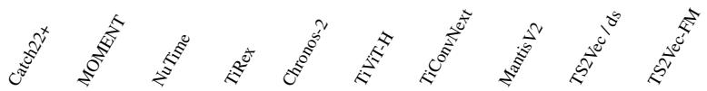

<table><tr><td>Dataset</td><td></td><td>V</td><td>V</td><td>7</td><td>C</td><td>7</td><td>2</td><td>V</td><td>2</td><td>7</td></tr><tr><td>ACSF1</td><td>70.0</td><td>75.0</td><td>70.0</td><td>75.0</td><td>86.0</td><td>83.0</td><td>83.0</td><td>76.0</td><td>85.0</td><td>85.0</td></tr><tr><td>Adiac</td><td>66.5</td><td>77.7</td><td>80.1</td><td>78.3</td><td>82.9</td><td>71.9</td><td>70.6</td><td>83.6</td><td>77.5</td><td>80.3</td></tr><tr><td>AllGesture WiimoteX</td><td>54.9</td><td>66.1</td><td>60.7</td><td>70.1</td><td>68.4</td><td>67.0</td><td>69.4</td><td>73.0</td><td>72.0</td><td>74.7</td></tr><tr><td>AllGestureWiimoteY</td><td>52.3</td><td>70.3</td><td>65.3</td><td>73.1</td><td>70.4</td><td>73.7</td><td>72.3</td><td>74.7</td><td>75.0</td><td>77.1</td></tr><tr><td>AllGestureWiimoteZ</td><td>48.3</td><td>60.6</td><td>54.1</td><td>63.4</td><td>66.0</td><td>67.7</td><td>65.9</td><td>68.1</td><td>65.6</td><td>72.3</td></tr><tr><td>ArrowHead</td><td>71.4</td><td>77.7</td><td>72.6</td><td>78.3</td><td>85.1</td><td>82.3</td><td>82.3</td><td>85.1</td><td>78.9</td><td>82.9</td></tr><tr><td>Beef</td><td>63.3</td><td>80.0</td><td>73.3</td><td>93.3</td><td>70.0</td><td>76.7</td><td>83.3</td><td>73.3</td><td>73.3</td><td>76.7</td></tr><tr><td>BeetleFly</td><td>70.0</td><td>95.0</td><td>70.0</td><td>90.0</td><td>80.0</td><td>85.0</td><td>95.0</td><td>85.0</td><td>80.0</td><td>85.0</td></tr><tr><td>BirdChicken</td><td>80.0</td><td>100.0</td><td>100.0</td><td>90.0</td><td>90.0</td><td>90.0</td><td>95.0</td><td>90.0</td><td>90.0</td><td>90.0</td></tr><tr><td>BME</td><td>99.3</td><td>99.3</td><td>96.7</td><td>99.3</td><td>100.0</td><td>100.0</td><td>100.0</td><td>100.0</td><td>96.7</td><td>99.3</td></tr><tr><td>Car</td><td>83.3</td><td>90.0</td><td>73.3</td><td>80.0</td><td>85.0</td><td>81.7</td><td>85.0</td><td>81.7</td><td>88.3</td><td>88.3</td></tr><tr><td>CBF</td><td>97.3</td><td>98.9</td><td>99.0</td><td>99.7</td><td>100.0</td><td>99.9</td><td>99.9</td><td>99.7</td><td>99.8</td><td>99.6</td></tr><tr><td>Chinatown</td><td>97.7</td><td>98.3</td><td>96.2</td><td>98.3</td><td>98.5</td><td>96.8</td><td>93.9</td><td>96.2</td><td>97.7</td><td>98.3</td></tr><tr><td>ChlorineConcentration</td><td>58.9</td><td>77.9</td><td>60.9</td><td>80.2</td><td>76.7</td><td>76.2</td><td>77.7</td><td>71.1</td><td>75.9</td><td>76.6</td></tr><tr><td>CinCECGTorso</td><td>84.3</td><td>76.8</td><td>85.5</td><td>95.7</td><td>89.9</td><td>93.6</td><td>94.2</td><td>85.1</td><td>78.1</td><td>80.2</td></tr><tr><td>Coffee</td><td>100.0</td><td>96.4</td><td>100.0</td><td>100.0</td><td>100.0</td><td>100.0</td><td>100.0</td><td>100.0</td><td>100.0</td><td>100.0</td></tr><tr><td>Computers</td><td>66.8</td><td>61.2</td><td>78.8</td><td>80.0</td><td>76.8</td><td>76.4</td><td>82.8</td><td>70.4</td><td>66.0</td><td>70.8</td></tr><tr><td>CricketX</td><td>61.0</td><td>74.4</td><td>70.5</td><td>70.0</td><td>75.6</td><td>75.9</td><td>74.9</td><td>78.2</td><td>72.8</td><td>78.2</td></tr><tr><td>CricketY</td><td>59.5</td><td>70.8</td><td>69.0</td><td>75.4</td><td>73.6</td><td>78.7</td><td>74.6</td><td>81.5</td><td>74.6</td><td>78.2</td></tr><tr><td>CricketZ</td><td>63.3</td><td>74.4</td><td>65.9</td><td>73.3</td><td>72.3</td><td>79.7</td><td>75.9</td><td>81.3</td><td>80.0</td><td>81.5</td></tr><tr><td>Crop</td><td>68.7</td><td>72.3</td><td>69.0</td><td>70.3</td><td>71.6</td><td>68.7</td><td>67.4</td><td>73.5</td><td>73.4</td><td>72.8</td></tr><tr><td>DiatomSizeReduction</td><td>96.7</td><td>94.1</td><td>91.5</td><td>92.8</td><td>94.8</td><td>96.7</td><td>96.7</td><td>92.8</td><td>96.7</td><td>94.1</td></tr><tr><td>DistalPhalanxOutlineAgeGroup</td><td>71.2</td><td>66.9</td><td>70.5</td><td>74.8</td><td>74.1</td><td>71.2</td><td>72.7</td><td>77.7</td><td>71.2</td><td>73.4</td></tr><tr><td>DistalPhalanxOutlineCorrect</td><td>75.4</td><td>75.4</td><td>74.3</td><td>75.0</td><td>76.4</td><td>75.4</td><td>76.8</td><td>76.8</td><td>76.8</td><td>74.3</td></tr><tr><td>DistalPhalanxTW</td><td>61.9</td><td>62.6</td><td>68.3</td><td>65.5</td><td>65.5</td><td>66.9</td><td>65.5</td><td>68.3</td><td>65.5</td><td>66.9</td></tr><tr><td>DodgerLoopDay</td><td>57.5</td><td>43.8</td><td>55.0</td><td>55.0</td><td>52.5</td><td>50.0</td><td>56.2</td><td>50.0</td><td>51.2</td><td>67.5</td></tr></table>

<table><tr><td rowspan=1 colspan=6>DodgerLoopGame               85.5   84.1  81.9  79.0   89.1</td><td rowspan=1 colspan=5>84.1   84.1  86.2   83.3   91.3</td></tr><tr><td rowspan=1 colspan=3>DodgerLoopWeekend             97.8   98.6</td><td rowspan=1 colspan=3>96.4  95.7   96.4</td><td rowspan=1 colspan=2>94.9   91.3</td><td rowspan=1 colspan=3>97.1   96.4   98.4</td></tr><tr><td rowspan=1 colspan=3>Earthquakes                     74.1   70.5</td><td rowspan=1 colspan=1>73.4</td><td rowspan=1 colspan=2>69.1   74.8</td><td rowspan=1 colspan=2>70.5   69.8</td><td rowspan=1 colspan=3>71.9    69.8   72.7</td></tr><tr><td rowspan=1 colspan=3>ECG200                       85.0   90.0</td><td rowspan=1 colspan=1>85.0</td><td rowspan=1 colspan=2>83.0   84.0</td><td rowspan=1 colspan=2>86.0   86.0</td><td rowspan=1 colspan=3>88.0    87.0   91.0</td></tr><tr><td rowspan=1 colspan=1>ECG5000</td><td rowspan=1 colspan=2>93.9   93.3</td><td rowspan=1 colspan=1>91.9</td><td rowspan=1 colspan=2>93.9   93.4</td><td rowspan=1 colspan=2>93.8   93.1</td><td rowspan=1 colspan=3>93.5   93.7   94.3</td></tr><tr><td rowspan=1 colspan=1>ECGFiveDays</td><td rowspan=1 colspan=2>87.0   97.0</td><td rowspan=1 colspan=1>89.9</td><td rowspan=1 colspan=2>97.6   99.1</td><td rowspan=1 colspan=1>97.9</td><td rowspan=1 colspan=1>99.0</td><td rowspan=1 colspan=3>99.3   100.0   99.7</td></tr><tr><td rowspan=1 colspan=1>ElectricDevices</td><td rowspan=1 colspan=1>67.5</td><td rowspan=1 colspan=1>74.0</td><td rowspan=1 colspan=1>67.9</td><td rowspan=1 colspan=2>67.1   71.7</td><td rowspan=1 colspan=1>76.3</td><td rowspan=1 colspan=1>77.6</td><td rowspan=1 colspan=3>71.8   66.4   68.4</td></tr><tr><td rowspan=1 colspan=1>EOGHorizontalSignal</td><td rowspan=1 colspan=1>52.8</td><td rowspan=1 colspan=1>56.4</td><td rowspan=1 colspan=1>53.3</td><td rowspan=1 colspan=2>57.2   58.8</td><td rowspan=1 colspan=1>59.7</td><td rowspan=1 colspan=1>57.5</td><td rowspan=1 colspan=3>56.9   54.1   60.8</td></tr><tr><td rowspan=1 colspan=1>EOGVerticalSignal</td><td rowspan=1 colspan=1>47.8</td><td rowspan=1 colspan=1>50.0</td><td rowspan=1 colspan=1>33.1</td><td rowspan=1 colspan=2>41.7   43.9</td><td rowspan=1 colspan=1>47.2</td><td rowspan=1 colspan=1>42.5</td><td rowspan=1 colspan=3>51.4   49.7   42.5</td></tr><tr><td rowspan=1 colspan=1>EthanolLevel</td><td rowspan=1 colspan=1>56.8</td><td rowspan=1 colspan=1>68.2</td><td rowspan=1 colspan=1>52.0</td><td rowspan=1 colspan=1>50.8</td><td rowspan=1 colspan=1>65.4</td><td rowspan=1 colspan=1>58.4</td><td rowspan=1 colspan=1>58.0</td><td rowspan=1 colspan=3>59.2   48.6   64.6</td></tr><tr><td rowspan=1 colspan=1>FaceAll</td><td rowspan=1 colspan=1>80.2</td><td rowspan=1 colspan=1>77.9</td><td rowspan=1 colspan=1>72.1</td><td rowspan=1 colspan=1>78.8</td><td rowspan=1 colspan=1>75.3</td><td rowspan=1 colspan=1>75.2</td><td rowspan=1 colspan=1>73.7</td><td rowspan=1 colspan=3>75.7   89.3   79.4</td></tr><tr><td rowspan=1 colspan=1>FaceFour</td><td rowspan=1 colspan=1>88.6</td><td rowspan=1 colspan=1>87.5</td><td rowspan=1 colspan=1>96.6</td><td rowspan=1 colspan=1>95.5</td><td rowspan=1 colspan=1>90.9</td><td rowspan=1 colspan=1>87.5</td><td rowspan=1 colspan=1>92.0</td><td rowspan=1 colspan=3>98.9   89.8   94.3</td></tr><tr><td rowspan=1 colspan=1>FacesUCR</td><td rowspan=1 colspan=1>85.0</td><td rowspan=1 colspan=1>89.1</td><td rowspan=1 colspan=1>82.0</td><td rowspan=1 colspan=1>87.8</td><td rowspan=1 colspan=1>85.8</td><td rowspan=1 colspan=1>87.5</td><td rowspan=1 colspan=1>85.6</td><td rowspan=1 colspan=1>91.2</td><td rowspan=1 colspan=1>94.1</td><td rowspan=1 colspan=1>93.8</td></tr><tr><td rowspan=1 colspan=1>FiftyWords</td><td rowspan=1 colspan=1>72.3</td><td rowspan=1 colspan=1>77.6</td><td rowspan=1 colspan=1>71.6</td><td rowspan=1 colspan=1>72.3</td><td rowspan=1 colspan=1>79.6</td><td rowspan=1 colspan=1>78.7</td><td rowspan=1 colspan=1>77.1</td><td rowspan=1 colspan=1>82.0</td><td rowspan=1 colspan=1>79.8</td><td rowspan=1 colspan=1>82.0</td></tr><tr><td rowspan=1 colspan=1>Fish</td><td rowspan=1 colspan=1>86.3</td><td rowspan=1 colspan=1>96.0</td><td rowspan=1 colspan=1>91.4</td><td rowspan=1 colspan=1>90.3</td><td rowspan=1 colspan=1>94.3</td><td rowspan=1 colspan=1>94.9</td><td rowspan=1 colspan=1>97.1</td><td rowspan=1 colspan=1>96.0</td><td rowspan=1 colspan=1>97.7</td><td rowspan=1 colspan=1>96.6</td></tr><tr><td rowspan=1 colspan=1>FordA</td><td rowspan=1 colspan=1>87.4</td><td rowspan=1 colspan=1>90.6</td><td rowspan=1 colspan=1>90.6</td><td rowspan=1 colspan=1>94.7</td><td rowspan=1 colspan=1>92.8</td><td rowspan=1 colspan=1>91.4</td><td rowspan=1 colspan=1>92.3</td><td rowspan=1 colspan=1>94.3</td><td rowspan=1 colspan=1>90.7</td><td rowspan=1 colspan=1>91.2</td></tr><tr><td rowspan=1 colspan=1>FordB</td><td rowspan=1 colspan=1>72.7</td><td rowspan=1 colspan=1>75.6</td><td rowspan=1 colspan=1>76.5</td><td rowspan=1 colspan=1>81.6</td><td rowspan=1 colspan=1>80.7</td><td rowspan=1 colspan=1>79.6</td><td rowspan=1 colspan=1>77.9</td><td rowspan=1 colspan=1>81.0</td><td rowspan=1 colspan=1>76.4</td><td rowspan=1 colspan=1>73.6</td></tr><tr><td rowspan=1 colspan=1>FreezerRegularTrain</td><td rowspan=1 colspan=1>99.2</td><td rowspan=1 colspan=1>98.8</td><td rowspan=1 colspan=1>99.4</td><td rowspan=1 colspan=1>99.1</td><td rowspan=1 colspan=1>99.5</td><td rowspan=1 colspan=1>99.6</td><td rowspan=1 colspan=1>99.8</td><td rowspan=1 colspan=2>99.6   99.1</td><td rowspan=1 colspan=1>99.2</td></tr><tr><td rowspan=1 colspan=1>FreezerSmallTrain</td><td rowspan=1 colspan=1>94.1</td><td rowspan=1 colspan=1>81.9</td><td rowspan=1 colspan=1>98.6</td><td rowspan=1 colspan=1>89.1</td><td rowspan=1 colspan=1>96.9</td><td rowspan=1 colspan=1>98.4</td><td rowspan=1 colspan=1>99.0</td><td rowspan=1 colspan=2>98.5   93.5</td><td rowspan=1 colspan=1>94.2</td></tr><tr><td rowspan=1 colspan=1>Fungi</td><td rowspan=1 colspan=1>91.9</td><td rowspan=1 colspan=1>100.0</td><td rowspan=1 colspan=1>74.7</td><td rowspan=1 colspan=1>95.2</td><td rowspan=1 colspan=1>94.6</td><td rowspan=1 colspan=1>97.8</td><td rowspan=1 colspan=1>99.5</td><td rowspan=1 colspan=2>97.3   96.2</td><td rowspan=1 colspan=1>97.8</td></tr><tr><td rowspan=1 colspan=1>GestureMidAirD1</td><td rowspan=1 colspan=1>62.3</td><td rowspan=1 colspan=1>68.5</td><td rowspan=1 colspan=1>68.5</td><td rowspan=1 colspan=1>69.2</td><td rowspan=1 colspan=1>73.1</td><td rowspan=1 colspan=1>75.4</td><td rowspan=1 colspan=1>76.2</td><td rowspan=1 colspan=3>77.7   66.2   66.2</td></tr><tr><td rowspan=1 colspan=1>GestureMidAirD2</td><td rowspan=1 colspan=1>63.8</td><td rowspan=1 colspan=1>57.7</td><td rowspan=1 colspan=1>56.2</td><td rowspan=1 colspan=1>61.5</td><td rowspan=1 colspan=1>70.0</td><td rowspan=1 colspan=1>66.2</td><td rowspan=1 colspan=1>67.7</td><td rowspan=1 colspan=3>64.6   60.8   68.5</td></tr><tr><td rowspan=1 colspan=1>GestureMidAirD3</td><td rowspan=1 colspan=1>40.8</td><td rowspan=1 colspan=1>36.9</td><td rowspan=1 colspan=1>44.6</td><td rowspan=1 colspan=1>40.8</td><td rowspan=1 colspan=1>35.4</td><td rowspan=1 colspan=1>46.9</td><td rowspan=1 colspan=1>49.2</td><td rowspan=1 colspan=3>44.6   39.2   35.4</td></tr><tr><td rowspan=1 colspan=1>GesturePebbleZ1</td><td rowspan=1 colspan=1>82.0</td><td rowspan=1 colspan=1>89.5</td><td rowspan=1 colspan=1>89.5</td><td rowspan=1 colspan=1>88.4</td><td rowspan=1 colspan=1>90.1</td><td rowspan=1 colspan=1>90.7</td><td rowspan=1 colspan=1>85.5</td><td rowspan=1 colspan=3>93.0   91.9   90.7</td></tr><tr><td rowspan=1 colspan=1>GesturePebbleZ2</td><td rowspan=1 colspan=1>70.3</td><td rowspan=1 colspan=1>89.2</td><td rowspan=1 colspan=1>77.2</td><td rowspan=1 colspan=1>84.2</td><td rowspan=1 colspan=1>86.7</td><td rowspan=1 colspan=1>85.4</td><td rowspan=1 colspan=1>81.6</td><td rowspan=1 colspan=3>90.5   86.1   84.2</td></tr><tr><td rowspan=1 colspan=1>GunPoint</td><td rowspan=1 colspan=1>92.7</td><td rowspan=1 colspan=1>100.0</td><td rowspan=1 colspan=1>97.3</td><td rowspan=1 colspan=1>98.0</td><td rowspan=1 colspan=1>99.3</td><td rowspan=1 colspan=1>99.3</td><td rowspan=1 colspan=1>99.3</td><td rowspan=1 colspan=2>98.0   98.0</td><td rowspan=1 colspan=1>100.0</td></tr><tr><td rowspan=1 colspan=1>GunPointAgeSpan</td><td rowspan=1 colspan=1>94.3</td><td rowspan=1 colspan=1>97.8</td><td rowspan=1 colspan=1>96.8</td><td rowspan=1 colspan=1>99.1</td><td rowspan=1 colspan=1>99.1</td><td rowspan=1 colspan=1>99.4</td><td rowspan=1 colspan=1>98.7</td><td rowspan=1 colspan=1>99.4</td><td rowspan=1 colspan=1>98.7</td><td rowspan=1 colspan=1>98.1</td></tr><tr><td rowspan=1 colspan=1>GunPointMaleVersusFemale</td><td rowspan=1 colspan=1>100.0</td><td rowspan=1 colspan=1>99.7</td><td rowspan=1 colspan=1>98.7</td><td rowspan=1 colspan=1>99.4</td><td rowspan=1 colspan=1>99.4</td><td rowspan=1 colspan=1>100.0</td><td rowspan=1 colspan=1>99.7</td><td rowspan=1 colspan=1>100.0</td><td rowspan=1 colspan=1>100.0</td><td rowspan=1 colspan=1>100.0</td></tr><tr><td rowspan=1 colspan=1>GunPointOldVersusYoung</td><td rowspan=1 colspan=1>100.0</td><td rowspan=1 colspan=1>92.7</td><td rowspan=1 colspan=1>100.0</td><td rowspan=1 colspan=1>96.5</td><td rowspan=1 colspan=1>97.8</td><td rowspan=1 colspan=1>98.7</td><td rowspan=1 colspan=1>99.4</td><td rowspan=1 colspan=1>99.7</td><td rowspan=1 colspan=1>100.0</td><td rowspan=1 colspan=1>100.0</td></tr><tr><td rowspan=1 colspan=1>Ham</td><td rowspan=1 colspan=1>62.9</td><td rowspan=1 colspan=1>65.7</td><td rowspan=1 colspan=1>73.3</td><td rowspan=1 colspan=1>70.5</td><td rowspan=1 colspan=1>69.5</td><td rowspan=1 colspan=1>74.3</td><td rowspan=1 colspan=1>72.4</td><td rowspan=1 colspan=1>70.5</td><td rowspan=1 colspan=1>73.3</td><td rowspan=1 colspan=1>73.3</td></tr><tr><td rowspan=1 colspan=1>HandOutlines</td><td rowspan=1 colspan=1>88.4</td><td rowspan=1 colspan=1>94.1</td><td rowspan=1 colspan=1>88.6</td><td rowspan=1 colspan=1>87.6</td><td rowspan=1 colspan=1>93.8</td><td rowspan=1 colspan=1>94.3</td><td rowspan=1 colspan=1>92.2</td><td rowspan=1 colspan=1>93.0</td><td rowspan=1 colspan=1>91.9</td><td rowspan=1 colspan=1>93.8</td></tr><tr><td rowspan=1 colspan=1>Haptics</td><td rowspan=1 colspan=1>41.9</td><td rowspan=1 colspan=1>49.0</td><td rowspan=1 colspan=1>42.5</td><td rowspan=1 colspan=1>47.7</td><td rowspan=1 colspan=1>50.3</td><td rowspan=1 colspan=1>49.4</td><td rowspan=1 colspan=1>52.3</td><td rowspan=1 colspan=1>50.3</td><td rowspan=1 colspan=1>48.4</td><td rowspan=1 colspan=1>49.7</td></tr><tr><td rowspan=1 colspan=1>Herring</td><td rowspan=1 colspan=1>57.8</td><td rowspan=1 colspan=1>64.1</td><td rowspan=1 colspan=1>53.1</td><td rowspan=1 colspan=1>60.9</td><td rowspan=1 colspan=1>51.6</td><td rowspan=1 colspan=1>53.1</td><td rowspan=1 colspan=1>60.9</td><td rowspan=1 colspan=1>68.8</td><td rowspan=1 colspan=1>67.2</td><td rowspan=1 colspan=1>70.3</td></tr><tr><td rowspan=1 colspan=1>HouseTwenty</td><td rowspan=1 colspan=1>95.0</td><td rowspan=1 colspan=1>93.3</td><td rowspan=1 colspan=1>89.9</td><td rowspan=1 colspan=1>98.3</td><td rowspan=1 colspan=1>97.5</td><td rowspan=1 colspan=1>98.3</td><td rowspan=1 colspan=1>98.3</td><td rowspan=1 colspan=1>93.3</td><td rowspan=1 colspan=1>93.3</td><td rowspan=1 colspan=1>78.2</td></tr><tr><td rowspan=1 colspan=1>InlineSkate</td><td rowspan=1 colspan=1>37.8</td><td rowspan=1 colspan=1>36.4</td><td rowspan=1 colspan=1>35.6</td><td rowspan=1 colspan=1>43.8</td><td rowspan=1 colspan=1>43.6</td><td rowspan=1 colspan=1>39.8</td><td rowspan=1 colspan=1>44.7</td><td rowspan=1 colspan=1>39.1</td><td rowspan=1 colspan=1>42.4</td><td rowspan=1 colspan=1>44.5</td></tr><tr><td rowspan=1 colspan=1>InsectEPGRegularTrain</td><td rowspan=1 colspan=1>99.2</td><td rowspan=1 colspan=1>94.8</td><td rowspan=1 colspan=1>100.0</td><td rowspan=1 colspan=1>99.6</td><td rowspan=1 colspan=1>100.0</td><td rowspan=1 colspan=1>100.0</td><td rowspan=1 colspan=1>100.0</td><td rowspan=1 colspan=1>100.0</td><td rowspan=1 colspan=1>100.0</td><td rowspan=1 colspan=1>100.0</td></tr><tr><td rowspan=1 colspan=1>InsectEPGSmallTrain</td><td rowspan=1 colspan=1>93.2</td><td rowspan=1 colspan=1>83.5</td><td rowspan=1 colspan=1>100.0</td><td rowspan=1 colspan=1>95.6</td><td rowspan=1 colspan=1>92.0</td><td rowspan=1 colspan=1>98.8</td><td rowspan=1 colspan=1>98.8</td><td rowspan=1 colspan=1>100.0</td><td rowspan=1 colspan=1>100.0</td><td rowspan=1 colspan=1>100.0</td></tr><tr><td rowspan=1 colspan=1>InsectWingbeatSound</td><td rowspan=1 colspan=1>58.2</td><td rowspan=1 colspan=1>62.1</td><td rowspan=1 colspan=1>51.0</td><td rowspan=1 colspan=1>62.5</td><td rowspan=1 colspan=1>63.1</td><td rowspan=1 colspan=1>55.1</td><td rowspan=1 colspan=1>56.5</td><td rowspan=1 colspan=1>59.6</td><td rowspan=1 colspan=1>63.4</td><td rowspan=1 colspan=1>62.6</td></tr><tr><td rowspan=1 colspan=1>ItalyPowerDemand</td><td rowspan=1 colspan=1>93.9</td><td rowspan=1 colspan=1>95.4</td><td rowspan=1 colspan=1>91.2</td><td rowspan=1 colspan=1>96.0</td><td rowspan=1 colspan=1>96.4</td><td rowspan=1 colspan=1>94.1</td><td rowspan=1 colspan=1>93.8</td><td rowspan=1 colspan=1>94.6</td><td rowspan=1 colspan=1>95.5</td><td rowspan=1 colspan=1>96.2</td></tr><tr><td rowspan=1 colspan=1>LargeKitchenAppliances</td><td rowspan=1 colspan=1>83.7</td><td rowspan=1 colspan=1>76.0</td><td rowspan=1 colspan=1>77.1</td><td rowspan=1 colspan=1>82.9</td><td rowspan=1 colspan=1>86.1</td><td rowspan=1 colspan=1>87.2</td><td rowspan=1 colspan=1>89.3</td><td rowspan=1 colspan=1>81.6</td><td rowspan=1 colspan=1>85.6</td><td rowspan=1 colspan=1>89.3</td></tr><tr><td rowspan=1 colspan=1>Lightning2</td><td rowspan=1 colspan=1>75.4</td><td rowspan=1 colspan=1>78.7</td><td rowspan=1 colspan=1>73.8</td><td rowspan=1 colspan=1>73.8</td><td rowspan=1 colspan=1>78.7</td><td rowspan=1 colspan=1>82.0</td><td rowspan=1 colspan=1>83.6</td><td rowspan=1 colspan=1>78.7</td><td rowspan=1 colspan=1>88.5</td><td rowspan=1 colspan=1>80.3</td></tr><tr><td rowspan=1 colspan=1>Lightning7</td><td rowspan=1 colspan=1>69.9</td><td rowspan=1 colspan=1>74.0</td><td rowspan=1 colspan=1>78.1</td><td rowspan=1 colspan=1>80.8</td><td rowspan=1 colspan=1>79.5</td><td rowspan=1 colspan=1>84.9</td><td rowspan=1 colspan=1>76.7</td><td rowspan=1 colspan=1>86.3</td><td rowspan=1 colspan=1>84.9</td><td rowspan=1 colspan=1>78.1</td></tr><tr><td rowspan=1 colspan=1>Mallat</td><td rowspan=1 colspan=1>88.7</td><td rowspan=1 colspan=1>91.9</td><td rowspan=1 colspan=1>84.9</td><td rowspan=1 colspan=1>95.5</td><td rowspan=1 colspan=1>94.7</td><td rowspan=1 colspan=1>97.7</td><td rowspan=1 colspan=1>96.4</td><td rowspan=1 colspan=1>92.0</td><td rowspan=1 colspan=1>88.5</td><td rowspan=1 colspan=1>91.1</td></tr><tr><td rowspan=1 colspan=1>Meat</td><td rowspan=1 colspan=1>93.3</td><td rowspan=1 colspan=1>100.0</td><td rowspan=1 colspan=1>93.3</td><td rowspan=1 colspan=1>90.0</td><td rowspan=1 colspan=1>93.3</td><td rowspan=1 colspan=1>81.7</td><td rowspan=1 colspan=1>85.0</td><td rowspan=1 colspan=1>96.7</td><td rowspan=1 colspan=1>91.7</td><td rowspan=1 colspan=1>93.3</td></tr><tr><td rowspan=1 colspan=1>MedicalImages</td><td rowspan=1 colspan=1>67.9</td><td rowspan=1 colspan=1>74.6</td><td rowspan=1 colspan=1>70.9</td><td rowspan=1 colspan=1>72.5</td><td rowspan=1 colspan=1>74.7</td><td rowspan=1 colspan=1>73.2</td><td rowspan=1 colspan=1>75.1</td><td rowspan=1 colspan=1>77.1</td><td rowspan=1 colspan=1>76.1</td><td rowspan=1 colspan=1>78.7</td></tr><tr><td rowspan=1 colspan=1>MelbournePedestrian</td><td rowspan=1 colspan=1>90.3</td><td rowspan=1 colspan=1>89.5</td><td rowspan=1 colspan=1>93.3</td><td rowspan=1 colspan=1>89.4</td><td rowspan=1 colspan=1>90.5</td><td rowspan=1 colspan=1>86.3</td><td rowspan=1 colspan=1>87.0</td><td rowspan=1 colspan=1>95.8</td><td rowspan=1 colspan=1>94.7</td><td rowspan=1 colspan=1>96.5</td></tr><tr><td rowspan=1 colspan=1>MiddlePhalanxOutlineAgeGroup</td><td rowspan=1 colspan=1>55.8</td><td rowspan=1 colspan=1>50.6</td><td rowspan=1 colspan=1>55.2</td><td rowspan=1 colspan=1>48.7</td><td rowspan=1 colspan=1>55.2</td><td rowspan=1 colspan=1>55.8</td><td rowspan=1 colspan=1>52.6</td><td rowspan=1 colspan=1>54.5</td><td rowspan=1 colspan=1>50.6</td><td rowspan=1 colspan=1>48.1</td></tr><tr><td rowspan=1 colspan=1>MiddlePhalanxOutlineCorrect</td><td rowspan=1 colspan=1>77.7</td><td rowspan=1 colspan=1>80.8</td><td rowspan=1 colspan=1>74.9</td><td rowspan=1 colspan=1>80.8</td><td rowspan=1 colspan=1>83.5</td><td rowspan=1 colspan=1>79.4</td><td rowspan=1 colspan=1>81.8</td><td rowspan=1 colspan=1>84.2</td><td rowspan=1 colspan=1>78.7</td><td rowspan=1 colspan=1>82.8</td></tr><tr><td rowspan=1 colspan=1>MiddlePhalanxTW</td><td rowspan=1 colspan=1>54.5</td><td rowspan=1 colspan=1>54.5</td><td rowspan=1 colspan=1>44.2</td><td rowspan=1 colspan=1>50.0</td><td rowspan=1 colspan=1>50.0</td><td rowspan=1 colspan=1>51.9</td><td rowspan=1 colspan=1>48.1</td><td rowspan=1 colspan=1>51.3</td><td rowspan=1 colspan=1>51.3</td><td rowspan=1 colspan=1>55.2</td></tr><tr><td rowspan=1 colspan=1>MixedShapesRegularTrain</td><td rowspan=1 colspan=1>91.5</td><td rowspan=1 colspan=1>93.6</td><td rowspan=1 colspan=1>93.6</td><td rowspan=1 colspan=1>97.0</td><td rowspan=1 colspan=1>96.7</td><td rowspan=1 colspan=1>97.8</td><td rowspan=1 colspan=1>97.8</td><td rowspan=1 colspan=1>97.4</td><td rowspan=1 colspan=1>91.5</td><td rowspan=1 colspan=1>94.6</td></tr><tr><td rowspan=1 colspan=1>MixedShapesSmallTrain</td><td rowspan=1 colspan=1>86.9</td><td rowspan=1 colspan=1>89.0</td><td rowspan=1 colspan=1>92.1</td><td rowspan=1 colspan=1>93.6</td><td rowspan=1 colspan=1>93.9</td><td rowspan=1 colspan=1>95.0</td><td rowspan=1 colspan=1>95.4</td><td rowspan=1 colspan=1>94.6</td><td rowspan=1 colspan=1>85.2</td><td rowspan=1 colspan=1>91.3</td></tr><tr><td rowspan=1 colspan=1>MoteStrain</td><td rowspan=1 colspan=1>85.0</td><td rowspan=1 colspan=1>90.5</td><td rowspan=1 colspan=1>95.5</td><td rowspan=1 colspan=1>92.4</td><td rowspan=1 colspan=1>92.6</td><td rowspan=1 colspan=1>91.6</td><td rowspan=1 colspan=1>90.7</td><td rowspan=1 colspan=2>93.9   87.4</td><td rowspan=1 colspan=1>89.3</td></tr><tr><td rowspan=1 colspan=1>NonInvasiveFetalECGThorax1</td><td rowspan=1 colspan=1>89.9</td><td rowspan=1 colspan=1>92.4</td><td rowspan=1 colspan=1>85.4</td><td rowspan=1 colspan=1>89.9</td><td rowspan=1 colspan=1>88.4</td><td rowspan=1 colspan=1>90.0</td><td rowspan=1 colspan=1>89.1</td><td rowspan=1 colspan=2>92.9   93.1</td><td rowspan=1 colspan=1>95.1</td></tr><tr><td rowspan=1 colspan=1>NonInvasiveFetalECGThorax2</td><td rowspan=1 colspan=1>91.8</td><td rowspan=1 colspan=1>93.7</td><td rowspan=1 colspan=1>90.3</td><td rowspan=1 colspan=1>90.3</td><td rowspan=1 colspan=1>91.3</td><td rowspan=1 colspan=1>92.4</td><td rowspan=1 colspan=1>92.3</td><td rowspan=1 colspan=2>93.6   93.7</td><td rowspan=1 colspan=1>95.4</td></tr><tr><td rowspan=1 colspan=1>OliveOil</td><td rowspan=1 colspan=1>83.3</td><td rowspan=1 colspan=1>90.0</td><td rowspan=1 colspan=1>76.7</td><td rowspan=1 colspan=1>93.3</td><td rowspan=1 colspan=1>83.3</td><td rowspan=1 colspan=1>73.3</td><td rowspan=1 colspan=1>90.0</td><td rowspan=1 colspan=2>86.7   83.3</td><td rowspan=1 colspan=1>90.0</td></tr><tr><td rowspan=1 colspan=1>OSULeaf</td><td rowspan=1 colspan=1>73.6</td><td rowspan=1 colspan=1>79.3</td><td rowspan=1 colspan=1>86.0</td><td rowspan=1 colspan=1>93.8</td><td rowspan=1 colspan=1>93.8</td><td rowspan=1 colspan=1>98.3</td><td rowspan=1 colspan=1>99.2</td><td rowspan=1 colspan=2>96.3   77.7</td><td rowspan=1 colspan=1>86.8</td></tr><tr><td rowspan=1 colspan=1>PhalangesOutlinesCorrect</td><td rowspan=1 colspan=1>74.6</td><td rowspan=1 colspan=1>81.4</td><td rowspan=1 colspan=1>74.7</td><td rowspan=1 colspan=1>79.3</td><td rowspan=1 colspan=1>82.3</td><td rowspan=1 colspan=1>80.0</td><td rowspan=1 colspan=1>78.3</td><td rowspan=1 colspan=3>79.5   80.8   81.4</td></tr><tr><td rowspan=1 colspan=1>Phoneme</td><td rowspan=1 colspan=1>24.2</td><td rowspan=1 colspan=1>30.0</td><td rowspan=1 colspan=1>27.6</td><td rowspan=1 colspan=1>39.0</td><td rowspan=1 colspan=1>41.7</td><td rowspan=1 colspan=1>39.6</td><td rowspan=1 colspan=1>39.7</td><td rowspan=1 colspan=3>35.5   28.1    30.4</td></tr><tr><td rowspan=1 colspan=1>PickupGestureWiimoteZ</td><td rowspan=1 colspan=1>66.0</td><td rowspan=1 colspan=1>70.0</td><td rowspan=1 colspan=1>64.0</td><td rowspan=1 colspan=1>84.0</td><td rowspan=1 colspan=1>66.0</td><td rowspan=1 colspan=1>92.0</td><td rowspan=1 colspan=1>88.0</td><td rowspan=1 colspan=1>76.0</td><td rowspan=1 colspan=2>88.0   90.0</td></tr><tr><td rowspan=1 colspan=1>PigAirwayPressure</td><td rowspan=1 colspan=1>14.4</td><td rowspan=1 colspan=1>11.1</td><td rowspan=1 colspan=1>45.2</td><td rowspan=1 colspan=1>41.8</td><td rowspan=1 colspan=1>41.8</td><td rowspan=1 colspan=1>63.0</td><td rowspan=1 colspan=1>74.5</td><td rowspan=1 colspan=1>57.7</td><td rowspan=1 colspan=2>56.2   32.7</td></tr><tr><td rowspan=1 colspan=1>PigArtPressure</td><td rowspan=1 colspan=1>76.4</td><td rowspan=1 colspan=1>54.8</td><td rowspan=1 colspan=1>94.2</td><td rowspan=1 colspan=1>88.9</td><td rowspan=1 colspan=1>84.1</td><td rowspan=1 colspan=1>88.9</td><td rowspan=1 colspan=1>93.3</td><td rowspan=1 colspan=1>90.9</td><td rowspan=1 colspan=2>94.7   88.9</td></tr><tr><td rowspan=1 colspan=1>PigCVP</td><td rowspan=1 colspan=1>41.8</td><td rowspan=1 colspan=1>53.4</td><td rowspan=1 colspan=1>88.5</td><td rowspan=1 colspan=1>86.5</td><td rowspan=1 colspan=1>78.8</td><td rowspan=1 colspan=1>79.3</td><td rowspan=1 colspan=1>83.2</td><td rowspan=1 colspan=3>93.8   84.1   94.2</td></tr><tr><td rowspan=1 colspan=1>PLAID</td><td rowspan=1 colspan=1>65.4</td><td rowspan=1 colspan=1>78.6</td><td rowspan=1 colspan=1>75.6</td><td rowspan=1 colspan=1>87.0</td><td rowspan=1 colspan=1>88.6</td><td rowspan=1 colspan=1>91.8</td><td rowspan=1 colspan=1>93.1</td><td rowspan=1 colspan=1>85.3</td><td rowspan=1 colspan=2>26.3   90.5</td></tr><tr><td rowspan=1 colspan=1>Plane</td><td rowspan=1 colspan=1>99.0</td><td rowspan=1 colspan=1>100.0</td><td rowspan=1 colspan=1>100.0</td><td rowspan=1 colspan=1>100.0</td><td rowspan=1 colspan=1>100.0</td><td rowspan=1 colspan=1>100.0</td><td rowspan=1 colspan=1>100.0</td><td rowspan=1 colspan=1>100.0</td><td rowspan=1 colspan=2>100.0  100.0</td></tr><tr><td rowspan=1 colspan=1>PowerCons</td><td rowspan=1 colspan=1>98.9</td><td rowspan=1 colspan=1>95.6</td><td rowspan=1 colspan=1>97.2</td><td rowspan=1 colspan=1>93.9</td><td rowspan=1 colspan=1>93.3</td><td rowspan=1 colspan=1>90.6</td><td rowspan=1 colspan=1>92.2</td><td rowspan=1 colspan=1>97.2</td><td rowspan=1 colspan=2>96.7   97.2</td></tr><tr><td rowspan=1 colspan=1>ProximalPhalanxOutlineAgeGroup</td><td rowspan=1 colspan=1>83.9</td><td rowspan=1 colspan=1>82.9</td><td rowspan=1 colspan=1>85.4</td><td rowspan=1 colspan=1>84.9</td><td rowspan=1 colspan=1>83.4</td><td rowspan=1 colspan=1>82.9</td><td rowspan=1 colspan=1>82.9</td><td rowspan=1 colspan=3>83.9   81.5   82.4</td></tr><tr><td rowspan=1 colspan=1>ProximalPhalanxOutlineCorrect</td><td rowspan=1 colspan=1>84.5</td><td rowspan=1 colspan=1>88.7</td><td rowspan=1 colspan=1>83.8</td><td rowspan=1 colspan=1>88.7</td><td rowspan=1 colspan=1>88.3</td><td rowspan=1 colspan=1>87.3</td><td rowspan=1 colspan=1>86.3</td><td rowspan=1 colspan=3>87.6   88.3   90.4</td></tr><tr><td rowspan=1 colspan=1>ProximalPhalanxTW</td><td rowspan=1 colspan=1>79.0</td><td rowspan=1 colspan=1>79.5</td><td rowspan=1 colspan=1>78.5</td><td rowspan=1 colspan=1>76.1</td><td rowspan=1 colspan=1>75.6</td><td rowspan=1 colspan=1>76.1</td><td rowspan=1 colspan=1>74.6</td><td rowspan=1 colspan=3>76.1    78.5   79.5</td></tr><tr><td rowspan=1 colspan=1>RefrigerationDevices</td><td rowspan=1 colspan=1>53.3</td><td rowspan=1 colspan=1>51.5</td><td rowspan=1 colspan=1>56.3</td><td rowspan=1 colspan=1>54.1</td><td rowspan=1 colspan=1>56.8</td><td rowspan=1 colspan=1>57.6</td><td rowspan=1 colspan=1>59.7</td><td rowspan=1 colspan=3>52.5   57.9   57.9</td></tr><tr><td rowspan=1 colspan=1>Rock</td><td rowspan=1 colspan=1>80.0</td><td rowspan=1 colspan=1>90.0</td><td rowspan=1 colspan=1>76.0</td><td rowspan=1 colspan=1>88.0</td><td rowspan=1 colspan=1>90.0</td><td rowspan=1 colspan=1>96.0</td><td rowspan=1 colspan=1>92.0</td><td rowspan=1 colspan=3>84.0   64.0   90.0</td></tr><tr><td rowspan=1 colspan=1>ScreenType</td><td rowspan=1 colspan=1>46.9</td><td rowspan=1 colspan=1>39.2</td><td rowspan=1 colspan=1>46.9</td><td rowspan=1 colspan=1>52.8</td><td rowspan=1 colspan=1>53.9</td><td rowspan=1 colspan=1>53.6</td><td rowspan=1 colspan=1>49.9</td><td rowspan=1 colspan=3>50.9   38.7    46.9</td></tr><tr><td rowspan=1 colspan=1>SemgHandGenderCh2</td><td rowspan=1 colspan=1>92.0</td><td rowspan=1 colspan=1>76.5</td><td rowspan=1 colspan=1>86.2</td><td rowspan=1 colspan=1>85.8</td><td rowspan=1 colspan=1>88.8</td><td rowspan=1 colspan=2>90.2   91.0</td><td rowspan=1 colspan=3>89.7   90.5   90.0</td></tr><tr><td rowspan=1 colspan=1>SemgHandMovementCh2</td><td rowspan=1 colspan=1>65.8</td><td rowspan=1 colspan=1>44.4</td><td rowspan=1 colspan=1>62.4</td><td rowspan=1 colspan=1>52.0</td><td rowspan=1 colspan=1>57.6</td><td rowspan=1 colspan=2>56.0   59.1</td><td rowspan=1 colspan=3>62.4    80.9   62.4</td></tr><tr><td rowspan=1 colspan=1>SemgHandSubjectCh2</td><td rowspan=1 colspan=2>82.7   70.9</td><td rowspan=1 colspan=1>75.6</td><td rowspan=1 colspan=2>81.3   84.4</td><td rowspan=1 colspan=5>86.4   84.9  85.3   90.4   85.3</td></tr></table>

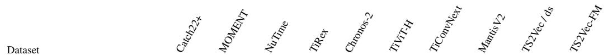

<table><tr><td>ShakeGestureWiimoteZ</td><td>82.0</td><td>84.0</td><td>90.0</td><td>88.0</td><td>92.0</td><td>84.0</td><td>86.0</td><td>92.0</td><td>94.0</td><td>92.0</td></tr><tr><td>ShapeletSim</td><td>95.6</td><td>96.7</td><td>92.8</td><td>96.7</td><td>100.0</td><td>100.0</td><td>100.0</td><td>97.8</td><td>97.8</td><td>100.0</td></tr><tr><td>ShapesAll</td><td>78.0</td><td>84.8</td><td>87.2</td><td>86.3</td><td>89.7</td><td>91.2</td><td>89.7</td><td>90.2</td><td>88.2</td><td>91.0</td></tr><tr><td>SmallKitchenAppliances</td><td>77.3</td><td>61.1</td><td>82.9</td><td>81.3</td><td>81.1</td><td>82.1</td><td>82.7</td><td>78.7</td><td>70.9</td><td>72.5</td></tr><tr><td>SmoothSubspace</td><td>94.0</td><td>98.0</td><td>94.7</td><td>96.7</td><td>96.7</td><td>96.7</td><td>98.0</td><td>97.3</td><td>96.7</td><td>98.0</td></tr><tr><td>SonyAIBORobotSurface1</td><td>75.9</td><td>82.5</td><td>81.5</td><td>93.7</td><td>82.4</td><td>86.4</td><td>85.0</td><td>83.4</td><td>82.9</td><td>89.5</td></tr><tr><td>SonyAIBORobotSurface2</td><td>92.8</td><td>89.1</td><td>88.4</td><td>89.1</td><td>88.5</td><td>93.8</td><td>94.5</td><td>93.7</td><td>87.2</td><td>93.5</td></tr><tr><td>StarLightCurves</td><td>96.0</td><td>96.4</td><td>97.5</td><td>97.4</td><td>97.5</td><td>97.4</td><td>97.2</td><td>97.3</td><td>96.2</td><td>97.6</td></tr><tr><td>Strawberry</td><td>94.3</td><td>96.2</td><td>95.9</td><td>96.5</td><td>97.3</td><td>95.7</td><td>95.4</td><td>96.2</td><td>96.2</td><td>98.1</td></tr><tr><td>SwedishLeaf</td><td>89.8</td><td>93.1</td><td>93.9</td><td>95.4</td><td>94.7</td><td>95.8</td><td>94.6</td><td>97.3</td><td>93.1</td><td>94.7</td></tr><tr><td>Symbols</td><td>95.5</td><td>95.6</td><td>96.9</td><td>96.7</td><td>98.4</td><td>98.6</td><td>98.6</td><td>97.7</td><td>95.6</td><td>92.4</td></tr><tr><td>SyntheticControl</td><td>98.0</td><td>97.7</td><td>97.3</td><td>99.3</td><td>99.7</td><td>100.0</td><td>100.0</td><td>99.0</td><td>99.7</td><td>99.3</td></tr><tr><td>ToeSegmentation1</td><td>75.9</td><td>94.7</td><td>84.2</td><td>96.9</td><td>91.7</td><td>93.9</td><td>90.4</td><td>96.5</td><td>93.4</td><td>93.9</td></tr><tr><td>ToeSegmentation2</td><td>76.9</td><td>90.8</td><td>86.9</td><td>91.5</td><td>86.2</td><td>90.0</td><td>87.7</td><td>93.1</td><td>92.3</td><td>91.5</td></tr><tr><td>Trace</td><td>100.0</td><td>99.0</td><td>100.0</td><td>100.0</td><td>100.0</td><td>100.0</td><td>100.0</td><td>100.0</td><td>100.0</td><td>100.0</td></tr><tr><td>TwoLeadECG</td><td>95.1</td><td>99.2</td><td>96.2</td><td>98.5</td><td>99.3</td><td>100.0</td><td>99.3</td><td>99.9</td><td>99.5</td><td>99.8</td></tr><tr><td>TwoPatterns</td><td>97.9</td><td>99.2</td><td>94.2</td><td>99.6</td><td>99.5</td><td>99.8</td><td>99.9</td><td>99.7</td><td>100.0</td><td>99.9</td></tr><tr><td>UMD</td><td>99.3</td><td>99.3</td><td>97.2</td><td>95.8</td><td>99.3</td><td>99.3</td><td>99.3</td><td>99.3</td><td>98.6</td><td>99.3</td></tr><tr><td>UWaveGestureLibraryAll</td><td>91.7</td><td>96.0</td><td>93.2</td><td>94.3</td><td>95.9</td><td>94.4</td><td>93.7</td><td>95.1</td><td>92.0</td><td>93.0</td></tr><tr><td>UWaveGestureLibraryX</td><td>78.1</td><td>79.3</td><td>80.0</td><td>80.0</td><td>82.1</td><td>83.1</td><td>84.2</td><td>84.5</td><td>78.2</td><td>81.2</td></tr><tr><td>UWaveGestureLibraryY</td><td>68.8</td><td>71.4</td><td>69.6</td><td>70.7</td><td>73.9</td><td>77.4</td><td>77.4</td><td>76.6</td><td>66.6</td><td>72.9</td></tr><tr><td>UWaveGestureLibraryZ</td><td>71.7</td><td>74.0</td><td>75.5</td><td>73.3</td><td>75.5</td><td>77.4</td><td>77.4</td><td>77.5</td><td>72.3</td><td>74.9</td></tr><tr><td>Wafer</td><td>99.4</td><td>99.4</td><td>99.6</td><td>99.9</td><td>99.8</td><td>99.9</td><td>100.0</td><td>99.7</td><td>99.6</td><td>99.6</td></tr><tr><td>Wine</td><td>70.4</td><td>83.3</td><td>77.8</td><td>87.0</td><td>85.2</td><td>66.7</td><td>83.3</td><td>83.3</td><td>79.6</td><td>77.8</td></tr><tr><td>WordSynonyms</td><td>56.4</td><td>68.5</td><td>60.0</td><td>59.9</td><td>66.8</td><td>67.7</td><td>67.7</td><td>71.2</td><td>68.3</td><td>71.0</td></tr><tr><td>Worms</td><td>58.4</td><td>68.8</td><td>76.6</td><td>79.2</td><td>77.9</td><td>77.9</td><td>85.7</td><td>77.9</td><td>64.9</td><td>79.2</td></tr><tr><td>WormsTwoClass</td><td>72.7</td><td>75.3</td><td>67.5</td><td>80.5</td><td>80.5</td><td>81.8</td><td>84.4</td><td>79.2</td><td>63.6</td><td>77.9</td></tr><tr><td>Yoga</td><td>71.1</td><td>85.1</td><td>74.9</td><td>79.5</td><td>81.9</td><td>84.0</td><td>87.9</td><td>85.6</td><td>85.0</td><td>86.2</td></tr><tr><td>Mean</td><td>77.04</td><td>79.84</td><td>79.05</td><td>82.02</td><td>82.44</td><td>82.88</td><td>83.47</td><td>83.60</td><td>81.36</td><td>83.32</td></tr></table>

Table 10: Per-dataset accuracy (%) on UEA-27 with the random-forest probe (mean over predictor seeds 0/1/2). TS2Vec/ds is the original TS2Vec trained on each dataset (the reference row of Table 1); TS2Vec-FM is our single frozen encoder. Best per row in bold.
<table><tr><td rowspan="2"></td><td colspan="3"></td><td rowspan="2"></td><td colspan="3"></td><td rowspan="2"></td><td rowspan="2"></td><td rowspan="2"></td></tr><tr><td></td><td></td><td></td><td>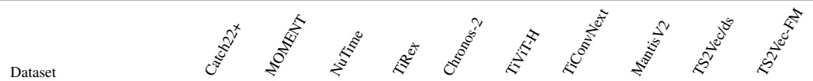</td><td></td><td></td></tr><tr><td></td><td></td><td></td><td></td><td></td><td>99.3</td><td>98.3</td><td>98.0</td><td>99.2</td><td></td><td></td></tr><tr><td>ArticularyWordRecognition BasicMotions</td><td>96.0 100.0</td><td>98.4 97.5</td><td>99.1 100.0</td><td>99.0 96.7</td><td>100.0</td><td>98.3</td><td>100.0</td><td>100.0</td><td>96.0 99.2</td><td>99.1 100.0</td></tr><tr><td>CharacterTrajectories</td><td></td><td>97.0</td><td>96.7</td><td>96.0</td><td>96.3</td><td>93.7</td><td>95.2</td><td>97.6</td><td>98.7</td><td>98.6</td></tr><tr><td>Cricket</td><td>98.1 94.4</td><td>97.2</td><td>99.1</td><td>99.5</td><td>98.6</td><td>100.0</td><td>99.5</td><td>98.6</td><td>97.7</td><td>98.6</td></tr><tr><td>DuckDuckGeese</td><td>51.3</td><td>44.7</td><td>42.7</td><td>42.0</td><td>41.3</td><td>43.3</td><td>44.0</td><td>54.0</td><td>53.3</td><td>50.7</td></tr><tr><td>EigenWorms</td><td>87.5</td><td>76.1</td><td>73.5</td><td>78.6</td><td>80.2</td><td>88.8</td><td>93.1</td><td>81.4</td><td>82.4</td><td>88.0</td></tr><tr><td>Epilepsy</td><td>98.6</td><td>99.3</td><td>100.0</td><td>100.0</td><td>100.0</td><td>100.0</td><td>100.0</td><td>99.8</td><td>92.5</td><td>98.8</td></tr><tr><td>ERing</td><td>88.3</td><td>96.8</td><td>97.7</td><td>97.7</td><td>98.8</td><td>98.1</td><td>96.3</td><td>98.8</td><td>84.2</td><td>92.7</td></tr><tr><td>EthanolConcentration</td><td>42.7</td><td>29.5</td><td>41.3</td><td>27.5</td><td>34.9</td><td>38.7</td><td>36.6</td><td>41.8</td><td>30.9</td><td>35.6</td></tr><tr><td>FaceDetection</td><td>52.7</td><td>55.4</td><td>56.9</td><td>61.3</td><td>57.2</td><td>55.0</td><td>53.2</td><td>54.9</td><td>50.9</td><td>53.5</td></tr><tr><td>FingerMovements</td><td>49.7</td><td>53.0</td><td>52.7</td><td>52.0</td><td>52.3</td><td>53.7</td><td>53.3</td><td>55.0</td><td>52.0</td><td>54.0</td></tr><tr><td>HandMovementDirection</td><td>33.8</td><td>29.3</td><td>28.8</td><td>31.5</td><td>27.5</td><td>28.8</td><td>32.9</td><td>27.9</td><td>32.9</td><td>29.3</td></tr><tr><td>Handwriting</td><td>28.1</td><td>26.0</td><td>20.5</td><td>25.3</td><td>25.8</td><td>23.7</td><td>24.9</td><td>28.1</td><td>39.6</td><td>30.7</td></tr><tr><td>Heartbeat</td><td>75.0</td><td>73.2</td><td>77.6</td><td>72.5</td><td>73.2</td><td>72.5</td><td>73.5</td><td>79.2</td><td>74.8</td><td>77.6</td></tr><tr><td>InsectWingbeatSubset</td><td>36.2</td><td>26.7</td><td>61.4</td><td>28.7</td><td>28.0</td><td>32.0</td><td>32.4</td><td>60.7</td><td>27.4</td><td>63.9</td></tr><tr><td>Japanese Vowels</td><td>95.5</td><td>88.5</td><td>93.4</td><td>89.3</td><td>81.6</td><td>88.2</td><td>87.2</td><td>94.0</td><td>98.2</td><td>94.0</td></tr><tr><td>Libras</td><td>83.9</td><td>84.6</td><td>87.8</td><td>89.6</td><td>86.5</td><td>90.4</td><td>90.7</td><td>92.4</td><td>82.8</td><td>83.3</td></tr><tr><td>LSST</td><td>61.6</td><td>63.1</td><td>56.7</td><td>57.3</td><td>58.9</td><td>59.5</td><td>60.0</td><td>66.0</td><td>54.3</td><td>66.7</td></tr><tr><td>MotorImagery</td><td>43.3</td><td>52.3</td><td>48.0</td><td>49.3</td><td>53.0</td><td>51.0</td><td>49.0</td><td>46.7</td><td>49.3</td><td>55.0</td></tr><tr><td>NATOPS</td><td>71.5</td><td>83.5</td><td>83.3</td><td>83.0</td><td>83.9</td><td>86.9</td><td>85.7</td><td>88.9</td><td>89.3</td><td>89.1</td></tr><tr><td>PEMS-SF</td><td>84.0</td><td>99.6</td><td>99.2</td><td>99.6</td><td>99.6</td><td>97.3</td><td>97.7</td><td>99.6</td><td>67.1</td><td>100.0</td></tr><tr><td>PhonemeSpectra</td><td>25.0</td><td>21.1</td><td>26.6</td><td>26.9</td><td>27.1</td><td>27.1</td><td>27.1</td><td>32.1</td><td>20.3</td><td>25.9</td></tr><tr><td>RacketSports</td><td>80.0</td><td>84.6</td><td>91.2</td><td>83.6</td><td>82.5</td><td>85.3</td><td>85.1</td><td>91.0</td><td>85.5</td><td>89.0</td></tr><tr><td>SelfRegulationSCP1</td><td>77.0</td><td>77.5</td><td>79.5</td><td>78.8</td><td>78.5</td><td>79.9</td><td>79.3</td><td>81.3</td><td>78.7</td><td>76.2</td></tr><tr><td>SelfRegulationSCP2</td><td>49.3</td><td>49.1</td><td>50.7</td><td>49.6</td><td>51.7</td><td>49.1</td><td>50.6</td><td>51.7</td><td>55.2</td><td>52.4</td></tr><tr><td>SpokenArabicDigits</td><td>89.0</td><td>94.5</td><td>90.2</td><td>75.5</td><td>76.2</td><td>89.3</td><td>91.4</td><td>93.7</td><td>94.8</td><td>96.0</td></tr><tr><td>UWaveGestureLibrary</td><td>87.6</td><td>89.2</td><td>88.9</td><td>86.1</td><td>88.3</td><td>85.4</td><td>81.6</td><td>89.0</td><td>88.5</td><td>88.5</td></tr><tr><td>Mean</td><td>69.63</td><td>69.91</td><td>71.99</td><td>69.52</td><td>69.67</td><td>70.91</td><td>71.05</td><td>74.20</td><td>69.50</td><td>73.60</td></tr></table>

Table 11: Per-dataset accuracy (%) on UEA-27 with the logistic-regression probe. Columns as in Table 10.
<table><tr><td colspan="3"></td><td colspan="3"></td><td colspan="3"></td><td colspan="3">MantisV2</td></tr><tr><td>Dataset</td><td>Catch22+</td><td>MOMENT</td><td>NuTime</td><td>TiRex</td><td>Chronos-2</td><td>TiViT-H</td><td>TiConvNext</td><td></td><td>TS2Vec/ds</td><td>TS2Vec-FM</td></tr><tr><td>ArticularyWordRecognition</td><td>93.3</td><td>98.7</td><td>99.3</td><td>99.0</td><td>99.3</td><td>98.3</td><td>97.7</td><td>99.3</td><td>99.0</td><td>99.3</td></tr><tr><td>BasicMotions</td><td>100.0</td><td>100.0</td><td>100.0</td><td>100.0</td><td>100.0</td><td>100.0</td><td>100.0</td><td>100.0</td><td>100.0</td><td>100.0</td></tr><tr><td>CharacterTrajectories</td><td>98.4</td><td>98.4</td><td>98.5</td><td>96.9</td><td>97.4</td><td>96.6</td><td>97.1</td><td>98.7</td><td>99.4</td><td>99.0</td></tr><tr><td>Cricket</td><td>90.3</td><td>98.6</td><td>100.0</td><td>100.0</td><td>100.0</td><td>100.0</td><td>100.0</td><td>98.6</td><td>98.6</td><td>100.0</td></tr><tr><td>DuckDuckGeese</td><td>42.0</td><td>48.0</td><td>50.0</td><td>38.0</td><td>34.0</td><td>48.0</td><td>56.0</td><td>50.0</td><td>56.0</td><td>56.0</td></tr><tr><td>EigenWorms</td><td>76.3</td><td>83.2</td><td>87.0</td><td>84.0</td><td>84.0</td><td>93.1</td><td>96.2</td><td>88.5</td><td>80.9</td><td>90.8</td></tr><tr><td>Epilepsy</td><td>96.4</td><td>99.3</td><td>100.0</td><td>100.0</td><td>100.0</td><td>100.0</td><td>100.0</td><td>100.0</td><td>94.9</td><td>99.3</td></tr><tr><td>ERing</td><td>90.7</td><td>97.0</td><td>98.1</td><td>97.8</td><td>97.8</td><td>98.5</td><td>98.1</td><td>98.9</td><td>89.3</td><td>96.7</td></tr><tr><td>EthanolConcentration</td><td>37.3</td><td>47.1</td><td>41.1</td><td>40.3</td><td>54.8</td><td>50.6</td><td>46.0</td><td>42.6</td><td>31.6</td><td>37.6</td></tr><tr><td>FaceDetection</td><td>54.7</td><td>62.1</td><td>61.9</td><td>66.0</td><td>63.6</td><td>60.0</td><td>58.1</td><td>58.3</td><td>50.3</td><td>59.6</td></tr><tr><td>FingerMovements</td><td>52.0</td><td>57.0</td><td>61.0</td><td>62.0</td><td>60.0</td><td>57.0</td><td>53.0</td><td>64.0</td><td>59.0</td><td>56.0</td></tr><tr><td>HandMovementDirection</td><td>35.1</td><td>31.1</td><td>37.8</td><td>32.4</td><td>33.8</td><td>29.7</td><td>39.2</td><td>31.1</td><td>29.7</td><td>32.4</td></tr><tr><td>Handwriting</td><td>23.1</td><td>37.9</td><td>25.3</td><td>41.6</td><td>35.4</td><td>33.4</td><td>34.7</td><td>39.9</td><td>52.9</td><td>47.2</td></tr><tr><td>Heartbeat</td><td>75.6</td><td>70.2</td><td>74.1</td><td>77.1</td><td>75.1</td><td>72.7</td><td>74.1</td><td>79.5</td><td>68.8</td><td>78.0</td></tr><tr><td>InsectWingbeatSubset</td><td>32.4</td><td>29.8</td><td>61.8</td><td>39.3</td><td>34.4</td><td>41.1</td><td>42.2</td><td>60.4</td><td>31.0</td><td>60.9</td></tr><tr><td>JapaneseVowels</td><td>96.5</td><td>92.4</td><td>98.1</td><td>94.1</td><td>90.0</td><td>94.9</td><td>94.3</td><td>95.9</td><td>98.6</td><td>97.6</td></tr><tr><td>Libras</td><td>84.4</td><td>85.6</td><td>91.7</td><td>89.4</td><td>90.6</td><td>92.8</td><td>92.8</td><td>94.4</td><td>83.3</td><td>91.1</td></tr><tr><td>LSST</td><td>50.9</td><td>60.5</td><td>55.7</td><td>59.2</td><td>60.1</td><td>60.1</td><td>59.1</td><td>65.9</td><td>50.7</td><td>64.3</td></tr><tr><td>MotorImagery</td><td>50.0</td><td>49.0</td><td>59.0</td><td>48.0</td><td>53.0</td><td>57.0</td><td>50.0</td><td>50.0</td><td>50.0</td><td>55.0</td></tr><tr><td>NATOPS</td><td>81.7</td><td>84.4</td><td>86.7</td><td>83.9</td><td>82.2</td><td>87.2</td><td>87.2</td><td>89.4</td><td>95.0</td><td>92.2</td></tr><tr><td>PEMS-SF</td><td>71.1</td><td>78.6</td><td>89.6</td><td>77.5</td><td>81.5</td><td>70.5</td><td>80.3</td><td>83.2</td><td>67.1</td><td>82.1</td></tr><tr><td>PhonemeSpectra</td><td>20.6</td><td>19.9</td><td>24.8</td><td>23.6</td><td>24.3</td><td>25.2</td><td>25.7</td><td>32.2</td><td>17.2</td><td>22.6</td></tr><tr><td>RacketSports</td><td>73.0</td><td>84.9</td><td>91.4</td><td>88.8</td><td>86.8</td><td>86.8</td><td>85.5</td><td>90.1</td><td>85.5</td><td>89.5</td></tr><tr><td>SelfRegulationSCP1</td><td>74.4</td><td>82.6</td><td>85.7</td><td>85.0</td><td>85.0</td><td>85.0</td><td>85.0</td><td>86.7</td><td>80.2</td><td>81.9</td></tr><tr><td>SelfRegulationSCP2</td><td>47.8</td><td>51.1</td><td>55.0</td><td>49.4</td><td>48.3</td><td>52.8</td><td>49.4</td><td>51.1</td><td>53.9</td><td>54.4</td></tr><tr><td>SpokenArabicDigits</td><td>90.0</td><td>97.9</td><td>96.5</td><td>96.4</td><td>91.6</td><td>96.0</td><td>96.7</td><td>98.0</td><td>98.1</td><td>98.8</td></tr><tr><td>UWaveGestureLibrary Mean</td><td>85.9 67.56</td><td>91.6 71.74</td><td>92.5 74.91</td><td>87.2 72.48</td><td>92.5 72.43</td><td>91.9 73.30</td><td>85.9 73.50</td><td>92.2 75.52</td><td>90.3 70.79</td><td>90.6</td></tr></table>