# UniWALM: Unified World Action Language Model for Embodied Robot Control

Rahul Sajnani1,2, Diego Romeres2, Mingyuan Zhang2,3, Kai Gao2 Carl Qi2,4, Baichuan Huang2 Srinath Sridhar1, Dylan Randle2, Lillian J. Ratliff2,5, Jose Barreiros2, Manikantan Nambi2, Jeroen Vanbaar2 1Brown University 2Amazon 3Northeastern University 4UT Austin 5University of Washington Project page: rahulsajnani.github.io/projects/uniwalm/

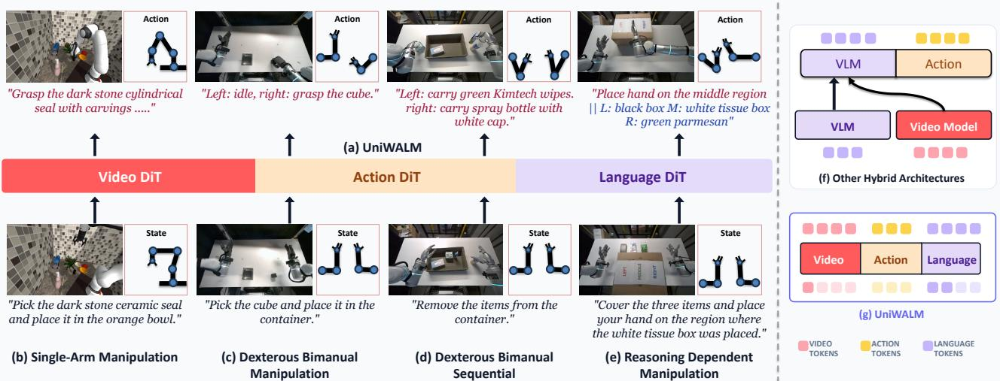  
Figure 1: (a) UniWALM is a unified World Action Language Model that extends a single video-model backbone to act and reason by co-generating video, action, and language through one shared diffusion process — no separate language model fused onto a world-action model. This supports (b) single and (c) bimanual dexterous manipulation with (d) multi-stage manipulation and (e) memory-dependent reasoning. Prior work (f) composes a VLM with a VLA and a video model in pipeline or parallel; UniWALM (g) tunes a single unified representation end-to-end. Each manipulation example displays the input task instruction at the bottom and the generated video, action, and subtask at the top. In (e) the predicted subtask and textual memory (shown as ‘subtask || memory’) are re-consumed as the next-step prompt.

Abstract: Motivated by the human ability to integrate experience across language, perception, and action, we introduce UniWALM, a unified world-action-language model that learns video, action, and language in a single shared representation, where each modality is both a conditioning signal and a supervision target. We ask: can jointly generating language enrich this shared representation, improving manipulation and supporting memory-dependent behavior? Unlike prior approaches that attach a reasoning or vision-language model to a video-action backbone and run them as distinct stages, UniWALM unifies all three modalities inside a single mixture-of-transformers backbone whose permodality diffusion heads co-denoise synchronously, decoding subtask and textual memory in the same pass as action with no separate planning stage; the generated language is re-consumed on the next step, closing a language-as-memory loop without an external planner or memory bank. To keep the action stream reliable under this richer objective, we further introduce Flow Matching with Correction (FMC), a training objective that teaches recovery from perturbed action trajectories at no inference-time cost. UniWALM consistently improves over same-backbone baselines (e.g., FastWAM [1]) on compositional pick-and-place (MolmoSpaces) and across the memory-dependent subset of RMBench [2], where it reaches 34.5% without any pretrained language or reasoning model and exceeds Mem-0’s keyframeequipped setup (28.5%) using only a single anchor frame. On a real-world Find-the-Item task, generating textual memory lifts success from 11.1% to 61.1%, while state-of-the-art VLAs stay at or below chance (≤ 33.3%).

## 1 Introduction

Humans integrate perception, language, and action in an any-to-any manner: regions like the posterior parietal and premotor cortex continuously fuse afferent inputs with efferent motor copies [3], and cognitive representations are inherently shaped by what an agent can do in the world [4, 5]. For embodied agents, language, video, and action are three comple mentary views of a single interaction; a unified representation should let each one inform the others: language guiding physical prediction, visual dynamics grounding action, and action anchoring predictions in embodied behavior. Multimodal models have operationalized this framing for vision and text [6, 7, 8] but largely omit action and motor control.

The same substrate that integrates these modalities also remembers: the hippocampus, which the brain uses to recall past experience, is also recruited to imagine the future and locate the self in time [9, 10]. We routinely enlist language itself as working memory (counting out loud, repeating a phone number, silently rehearsing a passage while reading to retain it) to track state through long-horizon, memory-dependent tasks. A truly unified representation should therefore not only let modalities inform one another but also let generated language serve as the working memory that threads behavior across step boundaries. Concretely, because language is co-denoised with action in one representation, the generated string serves as a learned, in-loop plan (next subtask) and textual memory (what has been done so far), while an anchor-frame visual memory preserves scene context across occlusion; re-consumed on the next step, these close a memory loop with no external planner, VLM, or retrieval buffer.

Recent robotic foundation models connect video, language, and action, but typically along only a subset of these directions. Vision-language-action models [11, 12] consume language as fixed conditioning but do not generate it. Chainof-thought VLAs [13, 14, 15, 16, 17] generate intermediate language within a control step, but autoregressively, so action must wait for token decoding, and the generated string is not re-consumed across steps. World-action models (DreamZero [18], FastWAM [1]) co-model video and action but drop language entirely. Memory-augmented systems [19, 20, 2] attach retrieval buffers or an external planner to a pretrained backbone; π0.7 [20] supplies language from a high-level semantic policy while a separate world model generates subgoal images that condition a VLA (Fig. 1(f)). On memory-dependent evaluations like RMBench [2]’s M(n) subset, where decisions require n task-relevant past observations, policies that condition only on the current frame and prompt collapse.

A natural response is to compose a pretrained vision-language model with a video-action backbone and supply reasoning via auxiliary conditioning or an additional loss (Fig. 1(f)). This family (hybrid planner + VLA systems [20], concurrent compositional WALMs) is more accurately described as WAM + VLM features: it typically uses two vision backbones optimized for different objectives and only loosely coupled, treats language as an external hidden state rather than a generation target, and bolts memory on as a separate retrieval module. UniWALM (Fig. 1(g)) uses a single video backbone jointly optimized for all three modalities, with video, action, and language as first-class diffusion heads co-denoised in one pass; the generated language is re-consumed next step, closing a language-as-memory loop with no external planner, VLM, or memory bank. Where prior world-action models supervise the backbone with frame-level predictive structure (future video), UniWALM adds a task-level predictive stream (future subtask and task state as language), a second, longerhorizon supervision signal that frame prediction alone cannot cheaply express.

In this work we study two questions: (i) does jointly generating language enrich the shared representation of a videoaction model and improve manipulation? (Fig. 1(g)) and (ii) can a policy use its own generated language, re-consumed across steps, as working memory on memory-dependent tasks? (Fig. 2)

Contributions. We introduce UniWALM, a multimodal world-model architecture that takes a step toward any-to-any modeling across language, video, and actions, where each modality serves as both a conditioning signal and a supervision target. Specifically:

• World-Action-Language Model (WALM): We introduce WALM, a unified World Action Language Model implemented as a mixture of transformers that takes video, language, and actions as input and generates all three as output. The language stream emits a subtask and textual memory in the same denoising pass as action, and re-consumes them as prompt on the next control step, closing a language-as-memory loop. UniWALM’s language and action experts are trained from scratch on a video-only backbone: no pretrained language or reasoning model is used.

• Flow Matching with Correction (FMC). We introduce FMC to improve the reliability of generated actions. During training, FMC perturbs action trajectories and supervises a corrective velocity that returns the perturbed denoising path toward the clean trajectory. This trains recovery from action-space perturbations without adding model capacity or sampling steps at inference.

• Evaluation in simulation and real-world manipulation. UniWALM achieves the highest success on all three Molmo-Spaces [21] compositional pick-and-place variants, improving over the same-backbone FastWAM baseline by +14.8% on average (Tab. 1). On RMBench’s memory-dependent M(n) subset, UniWALM reaches 34.5% without pretrained language or reasoning model, improving over same-backbone FastWAM (13.3%) by +21.2 points and above Mem-0’s keyframe-equipped setup (28.5%) using a single anchor frame instead of per-task privileged keyframes (Tab. 3). On a real-world bimanual Find-the-Item task, generating textual memory lifts success from 11.1% (FastWAM, same video backbone, no language) to 61.1%, while state-of-the-art VLAs stay at or below chance (≤ 33.3%) (Tab. 2).

Together, these results motivate further investigation of any-to-any world modeling as a foundation for generalist embodied agents.

## 2 Related Works

Generalist Visuomotor Policies. Generalist robot policies [11, 22, 23, 24, 25, 14, 26, 27] improve over single-task models [28, 29] by initializing from vision-language backbones [30, 31, 32, 33, 34, 35] and training for action. These policies map observations to actions but do not model world dynamics or reason over long-horizon subtasks.

World-Action Models. A recent line of works [1, 18, 36, 37, 38, 39, 40] adds a video-prediction objective, jointly modeling world dynamics and action. FastWAM [1], closest to our work, couples a pretrained Wan2.2 [41] video DiT with a parallel action DiT through unified attention. These models treat language purely as a conditioning input, never as a generation target and provide no mechanism for subtask reasoning or memory.

Reasoning, Memory, and Hybrid Policies. Long-horizon and memory-dependent tasks have motivated explicit reasoning and memory [2, 42], and hybrid systems [20, 43, 44, 45, 46] that combine a high-level VLM planner, a low-level policy, and a video model to imagine action effects. Because these components are trained separately on heterogeneous data, they lack a shared representation and execute planning and control asynchronously.

Unified and Omnimodal Models. Any-to-any modeling originates in multimodal LLMs [8, 7] which omit generating actions, and vision works like 4M [6], which unify many modalities via masked token modeling but target perception rather than control and do not reason. Concurrent work [46] additionally generates actions, DINO features, semantics, and video, but cannot reason or preserve memory during manipulation. Concurrent omnimodal models such as Cosmos 3 [47] extend any-to-any modeling to action within a single framework, but decode text autoregressively in one tower and continuous modalities by diffusion in another, running reasoning and generation as separate stages in a 64B model. UniWALM instead generates language, video, and action entirely by diffusion in one shared representation, denoising language and action synchronously so that reasoning and control co-refine in a single unified model.

An extended discussion contrasting UniWALM with CoT / inner-monologue policies, multi-scale memory VLAs, and recent unified models is deferred to Sec. A.

## 3 UniWALM

UniWALM jointly models the future video, robot actions, and language within a shared multimodal representation, enabling reasoning and control to be learned together. Next, we describe its world-action-language formulation, multimodal co-training, and corrective flow-matching objective.

## 3.1 Reasoning with Video Action Models

Video Action Models typically map the current observation and a coarse prompt to near-term video and actions, with no explicit mechanism to generate language that can reason about subtasks or maintain task memory. We introduce UniWALM, a World Action Language Model (WALM) that jointly generates future video, actions, and language within a unified model. Its language generation expert is a diffusion model that provides language reasoning in the form of subtasks and memory.

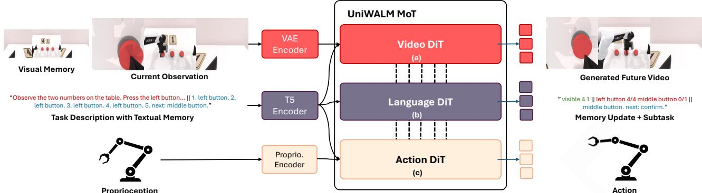  
Figure 2: Overview of UniWALM. UniWALM is a unified mixture-of-transformers (MoT) world-action-language model that co-denoises video, language, and action in a single shared representation. Given the current observation, task instruction, proprioception, an optional visual memory F (one or more frames; in our experiments a single anchor at episode start), and the previously generated textual memory, UniWALM processes inputs through a (a) video, (b) language, and (c) action DiT that share features via unified self-attention. The language stream emits a subtask together with a textual memory string, which is re-consumed as the prompt on the next control step, closing a language-as-memory loop across time. Video generation is disabled at inference, so the language and action DiTs run without producing future frames.

World Action Language Model (WALM). World Action Language Models are a new class of models that take as input the current observation (O, k RGB views1), robot state (S), visual memory F (a set of one or more frames), and task prompt (T) to predict future video (V), action (A), language (L), and a learned task-completion signal (β) using a Mixture of Transformers (MoT) architecture with a single shared representation. UniWALM (Fig. 2) is a step towards a single-representation, synchronous WALM. Formally, UniWALM jointly generates

$$
\begin{array} { r } { \nabla _ { 1 : H } , ( \mathcal { A } , \beta ) _ { 1 : N } , L : = \mathrm { U n i W A L M } \big ( \mathcal { O } , \mathcal { S } , \mathcal { F } , T \big ) , } \end{array}
$$

where $\mathcal { V } _ { 1 : H }$ is H future frames, $( \mathcal { A } , \beta ) _ { 1 : N }$ is a chunk of N future actions each augmented with a 1-D task-completion signal β that fires at subtask completion, and L is a compact string (subtask ∥ textual memory) re-consumed as prompt on the next control step. The visual memory F is an optional input, enabled for memory-dependent tasks (see Sec. 3.3) and omitted for standard manipulation. $\beta$ gates when the textual memory is advanced, so memory updates only at subtask completions.

Generating Video, Action, and Language. Given a pretrained video model, the observation frames are encoded first and passed through the video DiT. We replicate the video DiT’s structure, matching its depth (30 layers) while reducing hidden dimension, to define the action and language DiTs, whose weights are initialized from scratch. Each layer of the video, action, and language DiT processes features via unified self-attention enabling feature sharing between modalities.

Training the Language Expert for Reasoning. Per-frame RGB prediction captures short-horizon dynamics but cannot cheaply carry task-level information (what subtask is active, what has been done), and we need this signal produced in the same pass as action rather than through a separate autoregressive planner. We therefore adopt a discrete language diffusion [48] expert that denoises in tandem with video and action, giving us speed and architectural symmetry with the video model. At each training step we perturb ground-truth text $( L _ { G T } )$ depending on the diffusion time step, t, and predict the correct token embedding (Lˆ) using a cross entropy objective $( \mathcal { L } _ { l a n g } )$

$$
\begin{array} { r l } & { L _ { t } : = \mathrm { R a n d o m R e p l a c e } ( L _ { G T } , t ) } \\ & { \hat { L } : = \mathrm { D i f f u s i o n S t e p } ( L _ { t } , t ) } \\ & { \mathcal { L } _ { l a n g } : = \mathrm { C r o s s E n t r o p y } ( \hat { L } , L _ { G T } ) . } \end{array}
$$

This teaches the model to freeze already-correct tokens and update the incorrect ones based on the condition. We use the language expert to predict the next subtask the robot should perform, and additionally emit textual memory for memorydependent tasks.

## 3.2 Multi-Modal Co-Training

Co-training Objective. UniWALM trains Video DiT, Action DiT, and Language DiT in a co-training objective that combines the following:

$$
\begin{array} { r l } & { \mathcal { L } _ { v i d e o } : = | | ^ { v } v _ { t } ^ { \theta } - { } ^ { v } v _ { t } ^ { G T } | | _ { 1 } } \\ & { \mathcal { L } _ { a c t i o n } : = | | ^ { a } v _ { t } ^ { \theta } - { } ^ { a } v _ { t } ^ { G T } | | _ { 1 } } \\ & { \mathcal { L } : = \mathcal { L } _ { v i d e o } + \mathcal { L } _ { a c t i o n } + \alpha \mathcal { L } _ { l a n g } } \end{array}
$$

Here, $\mathcal { L } _ { v i d e o } , \mathcal { L } _ { a c t i o n }$ are flow-matching losses; $\mathcal { L } _ { l a n g }$ is the discrete diffusion loss (Sec. 3.1). The $v / a _ { \mathcal { V } _ { t } ^ { \theta } }$ and $v / a _ { \mathit { v } _ { t } ^ { G T } }$ are predicted and ground truth velocities for video/action modality respectively.

We use an $\ell _ { 1 }$ penalty for the flow-matching terms, which we find more stable than $\ell _ { 2 }$ for learning actions. Together, these three terms supervise the shared representation at two levels of abstraction in parallel: $\mathcal { L } _ { v i d e o }$ is frame-level predictive structure (per-step dense RGB prediction, which prior world-action models like FastWAM [1] and DreamZero [18] already use), while $\mathcal { L } _ { l a n g }$ is task-level predictive structure (future subtask and task state as a short string), a longer-horizon signal that frame prediction alone cannot cheaply express; the action loss anchors both to physical behavior. Training with both predictive levels in one backbone, rather than only one, is what lets a single end-to-end policy internalize the structure usually externalized to a planner or VLM. During training, either all or a subset of the mixture of transformers can be trained in tandem depending on the availability of data to reap benefits from all modalities

## 3.3 Memory

UniWALM integrates three memory mechanisms directly into the shared representation: a textual memory that is reconsumed as the next-step prompt (closing a language-as-memory loop without an external planner), a visual memory that admits one or more keyframes, and a task-completion channel that gates when the textual memory is updated. Full implementation details (RoPE-shifted keyframe tokenization, task-completion supervision, and RMBench-specific training configuration) are in Sec. B.4.

Textual Memory Re-consumption. Policies that reason once per step cannot carry information across step boundaries, which is exactly what long-horizon and memory-dependent tasks require. At inference, the language head emits a compact string (subtask ∥ textual memory) in the same denoising pass as action. For memory-dependent tasks, this string is reconsumed as prompt on the next control step, closing a language-as-memory loop without an external planner or memory bank.

Visual Memory. Textual memory alone struggles with scene state that is hard to describe in words (precise object locations, occluded layouts), so we add a lightweight visual-memory stream F the policy can always attend to. For tasks that hide or move objects mid-episode, F preserves the layout otherwise lost as observations advance.

Task-Completion Signal (β). If the textual memory is rewritten at every control step, intermediate reasoning overwrites past progress and the summary ceases to be a reliable record of what has been done, especially since the language stream has no explicit supervision for when a subtask is actually complete. We therefore co-train a 1-D task-completion channel $\beta ,$ appended to the action vector, that fires at subtask completion and gates when the textual memory is updated, so the memory advances only at subtask boundaries rather than every step. Because $\beta$ is concatenated into the action vector, it is supervised jointly with the action by $\mathcal { L } _ { a c t i o n }$ (Sec. 3.2) and requires no additional loss term.

Taken together, these three mechanisms correspond to three distinct learned abstractions over the task that live in the shared representation: the generated subtask is a plan (what to do next), the generated textual memory is a running summary (what has been done), and $\beta$ is a task-completion signal (when to commit a subtask as done). All three are first-class outputs of the same backbone that generates video and action, not external modules bolted onto a pretrained VLM or retrieval buffer.

## 3.4 Flow Matching with Correction (FMC)

Flow matching [28, 49, 50] learns a parameterized velocity field $v _ { t } ^ { \theta }$ that transports samples from a Gaussian prior $\mathcal { N } ( 0 , I )$ to the data distribution $p _ { \mathrm { d a t a } } ( x )$ via a continuous normalizing flow. During training, a data sample $x \sim p _ { d a t a } ( x )$ is linearly noised to $x _ { t } = ( 1 - t ) x + t \epsilon$ at timestep t where $t \in [ 0 , 1 ]$ . The parameterized function learns to estimate the velocity $\begin{array} { r } { v _ { t } : = \frac { d } { d t } x _ { t } = ( \epsilon - x ) } \end{array}$ using a mean-square-error objective $| | v _ { t } ^ { \theta } - v _ { t } | | _ { 2 }$ where $v _ { t } ^ { \theta } : = p _ { \theta } ( x _ { t } , t )$ is the predicted velocity. Then data is sampled $x _ { 1 } \sim \mathcal { N } ( 0 , I )$ and denoised to the clean sample $\begin{array} { r } { x : = x _ { 1 } - \int _ { 0 } ^ { 1 } v _ { t } ^ { \theta } d t . } \end{array}$

Flow matching is a ubiquitous objective in training large scale video and action policies because it supports high-quality generation with relatively few sampling steps. However, policies trained with flow matching often exhibit minor deviations during the generation process resulting in imprecise rollouts. To curb this, we implement a flow correction strategy that simulates a perturbed noisy trajectory to teach the model to self-correct to a clean denoising trajectory, which we call Flow Matching with Correction (FMC).

Given a clean action $x _ { 0 }$ (cf. Fig. 3(a)), we first construct a perturbed action $x _ { 0 } ^ { p } : = x _ { 0 } + \epsilon _ { 1 }$ where $\epsilon _ { 1 } \sim \mathcal { N } ( 0 , s I )$ where s is the noise scale for perturbation (cf. Algo. 1). The goal of flow correction is to avoid denoising to the perturbed action $x _ { 0 } ^ { p }$ and instead denoise to the correct action $x _ { 0 }$ . Using the same noise sample $\epsilon ,$ the corresponding point at time t is

$$
x _ { t } ^ { p } : = ( 1 - t ) x _ { 0 } ^ { p } + t \epsilon ,
$$

which lies off the nominal denoising trajectory. Applying the standard flow-matching target at this point would continue denoising without explicitly removing this deviation. Instead, FMC chooses a target velocity such that one reverse step of size $\Delta t$ from $x _ { t } ^ { \mathrm { p } }$ returns to the nominal trajectory at $x _ { t - \Delta t } = x _ { t } ^ { \mathrm { p } } - \Delta t v _ { \mathrm { c o r r } }$ . Solving for the correction target yields

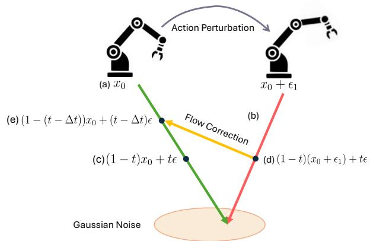  
Figure 3: Flow Matching with Correction (FMC). A clean action x0 (green path) and its perturbed counterpart $x _ { 0 } + \epsilon _ { 1 }$ (red path) are noised to the same time t. The model is trained to transport the perturbed sample back onto the clean trajectory within $\Delta t$ (yellow arrow), while the clean branch follows standard flow matching. This requires no extra conditioning or model capacity and leaves inference unchanged.

$$
v _ { \mathrm { c o r r } } : = \frac { x _ { t } ^ { \mathrm { p } } - x _ { t - \Delta t } } { \Delta t } = \left( \epsilon - x _ { 0 } \right) + \frac { 1 - t } { \Delta t } \epsilon _ { 1 } .
$$

$$
v _ { c o r r }
$$

$$
\epsilon - x _ { 0 }
$$

rection term that cancels the perturbation $\epsilon _ { 1 }$ , and it reduces exactly to the standard target when $\epsilon _ { 1 } = 0 .$

Algorithm 1 Flow Matching with Correction   
Require: Clean sample $x _ { 0 } ,$ model $v _ { \theta } ,$ correction prob $p = 0 . 5 .$ , step $\Delta t ,$ Noise Scale for Perturbation $s = 0 . 2$   
1: Sample $t \sim \mathcal { U } ( 0 , \bar { 1 } ) , \quad \epsilon \sim \mathcal { N } ( 0 , I )$   
2: if $( ( \bar { \mathrm { r a n d } } ( ) < \dot { p } ) \& \dot { \& } ( t \geq 0 . 5 ) )$ then ▷ Correction branch   
3: Sample noise $\epsilon _ { 1 } \sim \mathcal { N } ( 0 , s I )$   
4: $x _ { t } ^ { \mathrm { p } } \gets ( 1 - t ) ( x _ { 0 } + \epsilon _ { 1 } ) + t \dot { \epsilon }$ ▷ Perturbed action   
5: $\ddot { x _ { t - \Delta t } } \dot { \langle - \left( 1 - ( t - \Delta t ) \right) } x _ { 0 } + ( t - \Delta t ) \epsilon$   
6: $v _ { \mathrm { t a r g e t } }  \frac { x _ { t } ^ { \mathrm { p } } - x _ { t - \Delta t } } { \Delta t }$ ▷ Correction Velocity   
7: $x _ { \mathrm { i n } } \gets x _ { t } ^ { \mathsf { p } }$   
8: else ▷ Standard Flow Matching Branch   
9: $x _ { \mathrm { i n } }  ( 1 - t ) x _ { 0 } + t \epsilon$   
10: $v _ { \mathrm { t a r g e t } }  \epsilon - x _ { 0 }$   
11: end if   
12: $\mathcal { L } \gets \lVert v _ { \theta } ( x _ { \mathrm { i n } } , t ) - v _ { \mathrm { t a r g e t } } \rVert _ { 1 }$

Since the correction term scales with $( 1 - t ) / \Delta t .$ , we apply the correction branch only for $t \geq 0 . 5 .$ , ensuring the sample is close to the noise manifold and the correction magnitude remains bounded; at smaller t the injected noise $\epsilon _ { 1 }$ dominates and correction provides no meaningful signal. The procedure is detailed in Algo. 1. FMC teaches the policy to both denoise and self-correct in tandem. Since the corrected velocity field coincides with the standard flow-matching field on the clean path, inference is unchanged: no additional conditioning, sampling steps, or model capacity is required. This results in more precise actions and improves the policy’s success rate (Tab. 4).

FMC is related in spirit to corrective imitation approaches such as DAgger-style residual correction [51], yet operates entirely within the denoising process and does not require expert relabeling. It is also related to consistency-style objectives, but differs in its goal: rather than accelerating sampling, FMC trains recovery from local action-space perturbations around the ground-truth trajectory. A hyperparameter sweep over the perturbation scale, drift strength, and correction threshold on a 2D robot-trajectory benchmark is given in Sec. B.5.

## 3.5 Architecture and Training Details

Architecture. UniWALM’s architecture consists of a video prediction backbone [41] and expands it to add action and language DiTs. Our action and language DiT models are designed to match the video DiT and have 30 layers each. We reduce the size of the architecture by lowering the hidden dimension resulting in 1B action DiT (hidden dim = 1024) and 0.5B language DiT (hidden dim = 512). Fig. 4 displays one instance of the MoT layer. Each modality in the MoT expert layer has its own adaptive layer norm for time conditioning followed by Q, K, V projection. These query, key, and value tokens from video, action, and language are concatenated along the token dimension to perform a unified self-attention. We use RoPE position encoding on the query and key for unified self attention. The unified self-attention is followed by a cross attention operation that attends video, action, and language (queries) to the task instruction and proprioception (keys).

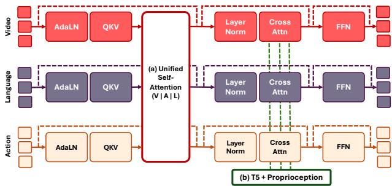  
Figure 4: Mixture of Transformers Layer. Each modality is processed by its own transformer that performs adaptive layer norm followed by Q,K,V projection. The (a) unified self-attention enables feature sharing between different modalities. Each modality transformer then cross attends to the (b) task instruction and proprioception for conditional generation of video, language, and action in a unified architecture.

Implementation Details. Our approach initializes from a Wan2.2 pretrained model and attaches an action and language DiT expert. We fine-tune the video backbone with LoRA (rank 256) [52], restricting its update to a low-rank subspace. This reduces trainable parameters and makes optimization easier and more stable on limited data. During training, we randomly drop proprioception with a probability of 10%, and use a single image as input. We ensure that the reasoning tokens only attend to the visual features and input prompt and allow the action tokens to attend to the language tokens during generation (Fig. 2). The model is trained with 8-bit AdamW optimizer [53, 54] on 12 H200 nodes with 8 gpus each for 44 hours. We use an image resolution of 224 x 448 for simulator (two views) and 224 x 672 (three views) for real world experiments. The language and action DiT are initialized from scratch. We turn off video generation during inference, similar to FastWAM, and the language DiT runs synchronously with the action DiT. Unoptimized UniWALM without language generation runs at 76 ms and with the language expert runs at 123 ms to generate an action chunk of 32 with 10 denoising steps. Our model allows interleaved language generation by caching language features from the last step to choose the frequency of language generation.

Full training configuration: action chunk N = 32, video horizon H = 5, 20 action and language denoising steps at inference, batch size 3840, learning rate 4e−4, 15k steps on the 221K-trajectory MolmoSpaces mixture (the ablation in Tab. 4 uses a 38K Pick&Place subset). Our model generates 64 language tokens for each diffusion forward process.

Data Flexibility. UniWALM by construction has a modular architecture and training objective that supports co-training (by masking attention) on heterogeneous data (e.g., video-only, video-action, video-VQA, and video-action-VQA) within one representation. We validate the design on in-domain video-action and reasoning data and leave large-scale multisource co-training to future work.

## 4 Experiments

We evaluate UniWALM along two axes: Q1: does jointly generating language enrich the shared representation of a video-action model and improve manipulation? Q2: can a policy use its own generated language as working memory on memory-dependent tasks? The evaluation setup involves five simulation tasks on MolmoSpaces, the memory-dependent M(n) subset of RMBench, and three real-world dexterous tasks (one of which requires memory). For fairness to baselines, we enable the anchor frame (visual memory) and the task-completion signal (β) only on RMBench M(n); on MolmoSpaces and all real-world experiments (including Find-the-Item) UniWALM runs with neither mechanism, so the manipulation and real-world comparisons use the same inputs as the baselines and the entire memory signal on Find-the-Item comes from UniWALM’s own re-consumed language. UniWALM and FastWAM [1] share the same Wan2.2 video backbone and action-expert size; UniWALM adds language generation, FMC, LoRA finetuning, and (only for RMBench) the anchor frame.

(b) Find the Item (Memory Task)  
(a) MolmoBot Pick&Place Benchmark  
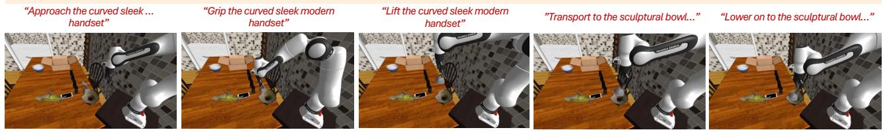  
” Pick up the curved sleek modern handset and place it in or on the sculptural bowl with earthy texture.”

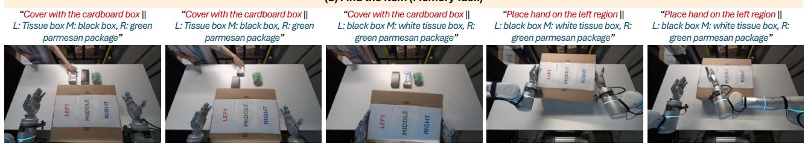  
"Cover the three items and place your hand on the region where the black box was placed.”

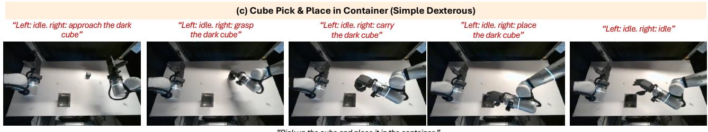

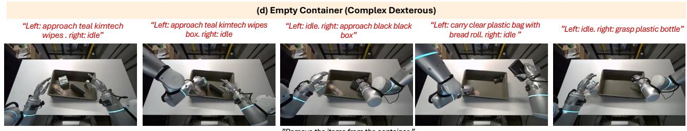  
Figure 5: Qualitative Results of UniWALM. Our work can perform various tasks including: (a) pick and place tasks, (b) find the item memory task, (c) simple high-dexterous task, and (d) complex dexterous bi-manual task involving difficult items to grasp. For each demonstration, the top row displays the subtasks and memory predicted by the model, and the task instruction is shown below the images. Note, in (b) we make the task difficult by shifting items mid way during roll out for the policy to update its memory. In (d) UniWALM reasons about both the hands and retries to remove objects with varying geometries.

MolmoSpaces (sim, manipulation). MolmoSpaces [21] contains 221K trajectories across Pick, Pick-RandCam, Pick&Place, Pick&Place-NextTo, and Pick&Place-Color on a DROID-style [55] Franka setup; we evaluate on 1000 OOD episodes per task using the Filament renderer, comparing against MolmoBot [23], π [11], and FastWAM [1].

RMBench M(n) (sim, memory). RMBench [2] organizes memory-dependent manipulation by the number n of taskrelevant past observations required for optimal action; we evaluate on all four M(n) tasks (Press Button, Blocks Ranking Try, Cover Blocks, Battery Try) on a dual-arm AgileX tabletop, with 50 demos / 100 rollout episodes per task, against same-backbone FastWAM, Mem-0 [2] (with and without privileged keyframes), and concurrent WLA-0 [56].

Real-World (dexterous, bi-manual). Two Flexiv Rizon arms with dexterous hands (Sharpa Wave or Paxini) over three tasks (Fig. 5): Cube Pick & Place (simple, 44-DoF), Empty Container (bi-manual, varied items), and Find the Item (memory; items are covered mid-episode and queried). We evaluate on 20 held-out episodes per dexterous task and 18 for the memory task against $\pi _ { 0 . 5 }$ [11], GROOT-N1.7 [24], FastWAM [1], and MolmoBot [23]. Full environment and per-task details are deferred to Sec. B.

Q1: Language generation improves manipulation. On MolmoSpaces (Tab. 1), UniWALM surpasses MolmoBot on all Pick&Place variants by $+ 7 \%$ on average without video history, despite using neither video history nor a large-scale pretrained vision-language generator (only the Wan2.2 video backbone is pretrained; language and action DiTs are trained from scratch). That UniWALM still beats grounding- and language-pretrained baselines on compositional placement indicates the gains stem from the unified representation rather than inherited VLM priors. FastWAM shares the same Wan2.2 backbone and action DiT structure, and is effectively the frame-level world model ablation of our co-training objective (video + action, no task-level language stream); against it, UniWALM improves success by 14.8% on average, isolating the benefit of adding task-level predictive structure. UniWALM underperforms on the two short-horizon grasponly tasks (Pick, Pick-RandCam), which are bounded by a 303-step budget that penalizes our more deliberate trajectories; our gains grow with task compositionality (highest on Pick&Place-NextTo and Pick&Place-Color), indicating the unified representation contributes most where reasoning and placement precision, not raw reaching speed, are the bottleneck.

Table 1: Success rate on the MolmoB0t v2 benchmark (1000 episodes per task, Filament renderer, 95% confidence intervals). Best / second-best per column.
<table><tr><td></td><td>Pre-Training Data</td><td>Pick↑</td><td></td><td></td><td></td><td>Pick-RandCam ↑ Pick&amp;Place ↑ Pick&amp;Place-Color ↑ Pick&amp;Place-NextTo ↑</td></tr><tr><td>π0.5-Finetuned [11]</td><td>Grounding + Language</td><td> $2 5 . 8 \pm 2 . 7 1$ </td><td> $2 9 . 7 \pm 2 . 8 3$ </td><td> $4 3 . 5 \pm 3 . 0 7$ </td><td> $4 8 . 3 \pm 3 . 1 0$ </td><td> $2 8 . 7 \pm 2 . 8 0$ </td></tr><tr><td>Molmobot-Pi0 [23]</td><td>Grounding + Language</td><td> $3 3 . 3 \pm 2 . 9 2$ </td><td> $3 9 . 8 \pm 3 . 0 3$ </td><td> $4 6 . 6 \pm 3 . 0 9$ </td><td> $4 6 . 2 \pm 3 . 0 9$ </td><td> $2 4 . 5 \pm 2 . 6 6$ </td></tr><tr><td>FastWAM [1]</td><td>Video</td><td> $3 0 . 1 \pm 2 . 8 4$ </td><td> $3 6 . 3 \pm 2 . 9 8$ </td><td> $5 1 . 1 \pm 3 . 1 0$ </td><td> $5 4 . 4 \pm 3 . 0 9$ </td><td> ${ \bf 3 2 . 0 \pm 2 . 8 9 }$ </td></tr><tr><td>Molmobot-Img [23]</td><td>Video + Grounding + Language</td><td> ${ \bf 6 1 . 4 } \pm 3 . 0 2$ </td><td> ${ \bf 6 2 . 1 } \pm 3 . { \bf 0 1 }$ </td><td> $6 2 . 9 \pm 2 . 9 9$ </td><td> ${ \bf 6 7 . 8 \pm 2 . 8 9 }$ </td><td> $2 1 . 0 \pm 2 . 5 2$ </td></tr><tr><td>Molmobot (With history) [23]</td><td>Video + Grounding + Language</td><td> ${ \bf 6 4 . 0 \pm 2 . 9 8 }$ </td><td> ${ \bf 6 3 . 7 \pm 2 . 9 8 }$ </td><td> ${ \bf 6 6 . 5 \pm 2 . 9 2 }$ </td><td> ${ \bf 6 7 . 8 \pm 2 . 8 9 }$ </td><td> $2 6 . 4 \pm 2 . 7 3$ </td></tr><tr><td>UniWALM (Ours)</td><td>Video</td><td> $4 9 . 2 \pm 3 . 1 0$ </td><td> $5 1 . 0 \pm 3 . 1 0$ </td><td> ${ \bf 6 8 . 0 \pm 2 . 8 9 }$ </td><td> ${ \bf 7 0 . 8 \pm 2 . 8 1 }$ </td><td> ${ \bf 3 8 . 8 \pm 3 . 0 2 }$ </td></tr></table>

Table 2: Real-world evaluation. Success rate (%) on three dexterous bi-manual tasks — simple dexterity (Cube Pick&Place), complex item removal (Empty Container), and the Find the Item memory task; 95% CI [low, high]. 20 rollouts per dexterous task and 18 for the memory task (58 rollouts in total). Best / second-best per column.
<table><tr><td></td><td>Cube Pick&amp;Place</td><td>Empty Container</td><td>Find the Item</td><td>Average</td></tr><tr><td></td><td>Dexterous - Simple</td><td>Dexterous - Complex</td><td>Memory</td><td></td></tr><tr><td>π0.5 [11]</td><td>40.0 [20, 60]</td><td>20.0 [0, 40]</td><td>5.6 [0, 15.6]</td><td>21.9 [11.2, 32.5]</td></tr><tr><td>Groot-N1.7 [24]</td><td>80.0 [60, 100]</td><td>10.0 [0, 15]</td><td>11.1 [0, 25.6]</td><td>33.7 [21.5, 45.9]</td></tr><tr><td>FastWAM [1]</td><td>70.0 [50, 90]</td><td>50.0 [30, 70]</td><td>11.1 [0, 25.6]</td><td>43.7 [30.9, 56.5]</td></tr><tr><td>MolmoB0t [23]</td><td>80.0 [60, 100]</td><td>20.0 [0, 40]</td><td>33.3 [11.6, 55]</td><td>44.4 [31.7, 57.2]</td></tr><tr><td>UniWALM (Ours)</td><td>95.0 [85, 100]</td><td>50.0 [30, 70]</td><td>61.1 [39.6, 82.6]</td><td>68.7 [56.8, 80.6]</td></tr></table>

On the two non-memory real-world tasks (Tab. 2), UniWALM reaches 95.0% on Cube Pick&Place (vs. 80.0% for the next-best baseline) and ties FastWAM at 50.0% on Empty Container. FastWAM matches us on Empty Container as that task requires no task-level reasoning, consistent with reasoning helping specifically where it is needed. Per-component attribution of the manipulation gain is in Sec. 4.1.

Q2: Generated language serves as working memory. On RMBench’s memory-dependent M(n) subset (Tab. 3, qualitative rollouts in Fig. 6), UniWALM succeeds 34.5% on average without any pretrained language or reasoning model, versus 13.3% for same-backbone FastWAM and 5–13% for other memoryless baselines (Mem-0 with its key memory ablated collapses to 4.8%); it also exceeds Mem-0’s keyframe-equipped setup (28.5%) using only a single anchor frame rather than per-task privileged keyframes. On RMBench we match the Mem-0 and WLA-0 input setup (visual memory + task-completion channel + textual memory), while using less information: no history keyframes. FastWAM shares our backbone and action-expert size but has no language stream; same-backbone FastWAM reaches only 13.3%, so the +21.2-point RMBench gap is attributable to the language-memory loop and the anchor-frame visual memory, with permechanism attribution in Tab. 5. Concurrent WLA-0 [56] scores higher but is a pipeline of a pretrained VLM plus a pretrained image-generation model linked via meta-queries; it inherits web-scale language and image-generation priors that UniWALM does not use, and does not form a unified representation. On the real-world Find-the-Item task (Tab. 2,

## Press Button (target: 4 left, 1 middle, then confirm)

next subtask: left button. memory: visible 4 1 || left button 0/4 middle button 0/1 || left button.

next subtask: left button. memory: visible 4 1 || left button 1/4 middle button 0/1 || left button.

next subtask: left button. memory: visible 4 1 || left button 2/4 middle button 0/1 || left button.

## next subtask: left button.

memory: visible 4 1 || left button 3/4 middle button 0/1 || left button. next: middle button.

## next subtask: middle button.

memory: visible 4 1 || left button 4/4 middle button 0/1 || middle button. next: confirm.

## Battery Try (find working (battery, slot, orientation) pairs)

next subtask: dual positive. memory: left none right none || dual positive. next: left negative.

next subtask: dual positive. memory: left none right none || dual positive. next: left negative.

next subtask: left   
negative.   
memory: left pos right pos || left negative. next: done. next subtask: right   
negative.   
memory: left neg right pos || right negative.   
next: left.

## Blocks Ranking Try (find target permutation by trial and press to confirm)

next subtask: press. memory: press 0 swap 0 checking || press. next: swap middle right.

next subtask: swap middle right. memory: press 1 swap 0 swapping || swap middle right. next: press.

next subtask: press. memory: press 1 swap checking || press. next: swap left right.

next subtask: swap left right. memory: press 2 swap 1 swapping || swap left right. next: press.

next subtask: right   
negative.   
memory: left neg right pos || right negative.   
next: done.

next subtask: press. memory: press 2 swap 1 checking || press. next: done.

## Cover Blocks (cover blocks then uncover in red – green – blue order)

next subtask: cover left. memory: covered none || cover left. next: cover middle.

next subtask: cover   
middle.   
memory: covered left || cover middle. next:   
cover right.

next subtask: cover right. memory: covered left middle || cover right. next: open middle.

next subtask: open middle. memory: covered left middle right || open middle. next: open right.

next subtask: open left. memory: covered left || open left. next: done.

Figure 6: RMBench M(n) qualitative rollouts. Each row is a successful UniWALM rollout on one M(n) task; we display a subsampled sequence of inference steps for clarity. Below each panel we show the predicted next subtask and the generated textual memory that is re-consumed as the prompt on the next control step; within the memory string, “||” separates memory components (task state, progress counters, and the next subtask). Reading left-to-right shows how the language-memory loop accumulates task-relevant state (button counts, battery orientations, tried permutations, cover progress) that memoryless baselines lose across steps.

rollouts in Fig. 9), we use textual memory only (no anchor frame, no task-completion channel) forfairness to the baselines (π , GR00T-N1.7, FastWAM, MolmoBot), which have no anchor-frame mechanism; the entire memory signal therefore comes from UniWALM’s own re-consumed language string. Objects are covered mid-episode, so any policy that re-plans from the current frame loses their identities; UniWALM’s re-consumed textual memory retains them across steps, raising success from 11.1% (FastWAM, same video backbone, no language) to 61.1%, while VLA and WAM baselines stay at or below chance (≤ 33.3%). This gap indicates that generating language reasoning, not action quality alone, drives memory-dependent performance. Per-mechanism attribution of the memory gain is in Sec. 4.1; a Press Button failure case is in Sec. B.

Table 3: RMBench evaluation on the M(n) memory subset. Success rate (%) per task on the four M(n) RMBench [2] tasks. Baselines and Mem-0 w/o Key operate without keyframes; UniWALM uses a single initial anchor frame plus a generated textual memory. Best / second-best per column in the without-keyframes block.
<table><tr><td>Method</td><td>Battery Try</td><td>Blocks Ranking Try</td><td>Cover Blocks</td><td>Press Button</td><td>Average</td></tr><tr><td colspan="6">Without keyframes</td></tr><tr><td>DP [28]</td><td>10%</td><td>10%</td><td>0%</td><td>0%</td><td>5.0%</td></tr><tr><td>ACT [29]</td><td>19%</td><td>0%</td><td>0%</td><td>0%</td><td>4.8%</td></tr><tr><td>π0.5 [11]</td><td>16%</td><td>6%</td><td>0%</td><td>0%</td><td>5.5%</td></tr><tr><td>X-VLA [57]</td><td>26%</td><td>1%</td><td>2%</td><td>0%</td><td>7.3%</td></tr><tr><td>Mem-0 [2] (w/o Key)</td><td>13%</td><td>1%</td><td>5%</td><td>0%</td><td>4.8%</td></tr><tr><td>FastWAM [1]</td><td>16%</td><td>37%</td><td>0%</td><td>0%</td><td>13.3%</td></tr><tr><td>UniWALM (Ours)</td><td>25%</td><td>49%</td><td>13%</td><td>51%</td><td>34.5% (+21.2%)</td></tr><tr><td colspan="6">With keyframes</td></tr><tr><td>Mem-0 [2]</td><td>28%</td><td>18%</td><td>68%</td><td>0%</td><td>28.5%</td></tr><tr><td>WLA-0 [56]</td><td>45%</td><td>23%</td><td>84%</td><td>74%</td><td>56.5%</td></tr></table>

## 4.1 Ablations

Manipulation (Pick&Place). Tab. 4 ablates each module on manipulation. For each row we train on a single Pick&Place split (38K trajectories) and evaluate on the MolmoSpaces Pick&Place OOD test set (1000 episodes, Filament renderer). Language generation (Sec. 3.1) improves OOD success by 4.9 points (15.8% relative); Flow Correction (Sec. 3.4) adds 3.0 points (9.7% relative), producing more precise actions; LoRA (Sec. 3.5) improves over full fine-tuning while drastically reducing trainable parameters.

Overall, UniWALM improves the base WAM from 31.0% to 41.0% (+10 points, 32% relative) on this split, and circa 14.8 points (37% relative) on average across the full benchmark over FastWAM. These gains come from merely adding a 0.5B-parameter language expert. The language decoding paradigm (AR vs. diffusion) is orthogonal to our contribution: these ablations isolate the effect of language co-training within a shared diffusion representation, not the decoding paradigm.

Memory (Press Button). A permechanism ablation on RMBench Press Button (Tab. 5) confirms language generation carries the memory signal. Under a limited training budget, visual memory alone (anchor frame only, no language generation) reaches only 1%, while language generation alone (no anchor frame) reaches 15%; the fully trained UniWALM with both visual memory and language generation reaches 51%. Both mechanisms are needed, with generated language carrying most of the signal: it encodes

Table 4: Ablation on Pick&Place task. We ablate design choices of our policy based on Reasoning (R), Flow Matching with Correction (FMC), and LoRA. Best / second-best
<table><tr><td></td><td>Success Rate (%)</td></tr><tr><td>UniWALM (w/o R w/o FMC w/o LoRA) ≈ FastWAM</td><td> $3 1 . 0 0 \pm 2 . 8 7$ </td></tr><tr><td>UniWALM (R (3.1))</td><td> $3 5 . 9 0 \pm 2 . 9 7$ </td></tr><tr><td>UniWALM (R (3.1) + FMC (3.4))</td><td> ${ \bf 3 8 . 9 0 } \pm 3 . 0 2$ </td></tr><tr><td>UniWALM (Ours) (R (3.1) + FMC (3.4) + LoRA (3.5))</td><td> $\mathbf { 4 1 . 0 0 } \pm 3 . 0 4$ </td></tr></table>

Table 5: RMBench Memory Ablation on Press Button Task (Sec. 3.3). Effect of language generation, visual memory (anchor frame), and training length. UniWALM without both language generation and visual memory is architecturally identical to FastWAM (≃FastWAM). Visual memory alone (no language generation) reaches only 1%, while language generation alone (no visual memory) reaches 15% at 30k — language generation carries most of the memory signal. Combining both (30k) gives 18%, and continuing training to 100k reaches 51%.

<table><tr><td>Method</td><td>Steps</td><td>Press Button</td></tr><tr><td>UniWALM w/o language generation, w/o visual memory (≈FastWAM) [1]</td><td>100k</td><td>0%</td></tr><tr><td>UniWALM w/o language generation (textual memory (3.3))</td><td>30k</td><td>1%</td></tr><tr><td>UniWALM w/o visual memory (3.3)</td><td>30k</td><td>15%</td></tr><tr><td>UniWALM (full)</td><td>30k</td><td>18%</td></tr><tr><td>UniWALM (full)</td><td>100k</td><td>51%</td></tr></table>

the symbolic state the policy needs to decide whether to press a given button, while the visual anchor stabilizes which buttons remain targets as frames advance.

Press Button, target: 3 left, 4 middle, then confirm.

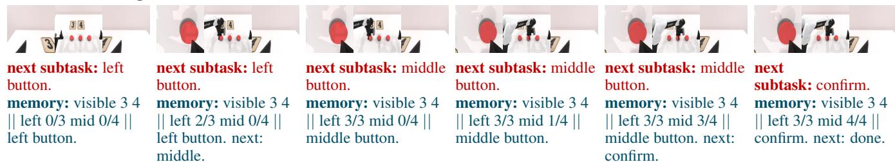  
Figure 7: Language-as-memory loop on Press Button. At each step UniWALM emits a next subtask and textual memory that is re-consumed as the next-step prompt; press counters transition cleanly (left 0/3 → 3/3; middle 1/4 → 4/4) until confirm. Intermediate frames skipped for clarity; see Fig. 6 for all four M(n) tasks.

Qualitative Rollouts. We provide per-task rollout galleries that visualize how UniWALM’s predicted subtasks and textual memory evolve across time: RMBench M(n) (Fig. 6), MolmoSpaces Pick & Place (Fig. 13), real-world Empty Container (Fig. 8), and real-world Find the Item (Fig. 9).

Conclusion. We present UniWALM, a single-representation WALM that jointly denoises video, action, and language, and re-consumes its generated language as working memory for the next control step. Without any pretrained language or reasoning model, UniWALM achieves state-of-the-art on MolmoSpaces Pick&Place (+14.8 pts over FastWAM), lifts real-world Find-the-Item from 11.1% to 61.1%, and reaches 34.5% on RMBench M(n), exceeding both memoryless baselines and Mem-0 [2]’s keyframe-equipped setup while using only a single anchor frame.

Limitations. Failures include grasping complex geometries and cluttered scenes. On RMBench we observe cases where the subtask and textual memory correctly track state but the action expert fails to execute it (e.g., subtask-boundary over/undershoot from task-completion timing lag; Fig. 12), and near-identical observations with different underlying memory occasionally confuse the model; the full list of failure modes is in Sec. C.

Future Work. We aim to scale multimodal co-training (ego-video, VQA, grounding), extend FMC to learn from the model’s own rollout errors, and extend visual memory to multiple keyframes; see Sec. D for extended directions.

## References

[1] T. Yuan, Z. Dong, Y. Liu, and H. Zhao. Fast-WAM: Do World Action Models Need Test-time Future Imagination? arxiv:2603.16666, 2026.

[2] T. Chen, Y. Wang, M. Li, Y. Qin, H. Shi, Z. Li, Y. Hu, Y. J. Zhang, K. Wang, Y. Chen, H. Wang, R.-J. Xu, R. Wu, Y. Mu, Y. Yang, H. Dong, and P. Luo. Rmbench: Memory-dependent robotic manipulation benchmark with insights into policy design. arxiv:2603.01229, 2026.

[3] R. A. Andersen and C. A. Buneo. Sensorimotor integration in posterior parietal cortex. Advances in Neurology, 93: 159–177, 2003.

[4] M. A. Goodale and A. D. Milner. Separate visual pathways for perception and action. Trends Neurosci., 15:20–25, 1992.

[5] P. Cisek. Cortical mechanisms of action selection: the affordance competition hypothesis. Philosophical Trans. Royal Soc. B: Biological Sci., 362(1485):1585–1599, 2007.

[6] D. Mizrahi\*, R. Bachmann\*, O. F. Kar, T. Yeo, M. Gao, A. Dehghan, and A. Zamir. 4m: Massively multimoda masked modeling. In NeurIPS, 2023.

[7] S. Wu, H. Fei, L. Qu, W. Ji, and T.-S. Chua. Next-gpt: Any-to-any multimodal llm. ArXiv, abs/2309.05519, 2024.

[8] J. Zhan, J. Dai, J. Ye, Y. Zhou, D. Zhang, Z. Liu, X. Zhang, R. Yuan, G. Zhang, L. Li, H. Yan, J. Fu, T. Gui, T. Sun, Y.-G. Jiang, and X. Qiu. Anygpt: Unified multimodal llm with discrete sequence modeling. arxiv:2402.12226, 2025.

[9] D. Eagleman. The Brain: The Story of You. Canongate Books, 2015. ISBN 9781782116592. URL https: //books.google.com/books?id=gUTGBwAAQBAJ.

[10] A. Zadbood, J. Chen, Y. C. Leong, K. A. Norman, and U. Hasson. How we transmit memories to other brains: Constructing shared neural representations via communication. Cerebral Cortex, 27(10):4988–5000, 2017. doi: 10.1093/cercor/bhx202.

[11] Physical Intelligence, K. Black, N. Brown, J. Darpinian, K. Dhabalia, D. Driess, A. Esmail, M. Equi, C. Finn, N. Fusai, M. Y. Galliker, D. Ghosh, L. Groom, K. Hausman, B. Ichter, S. Jakubczak, T. Jones, L. Ke, D. LeBlanc, S. Levine, A. Li-Bell, M. Mothukuri, S. Nair, K. Pertsch, A. Z. Ren, L. X. Shi, L. Smith, J. T. Springenberg, K. Stachowicz, J. Tanner, Q. Vuong, H. R. Walke, A. Walling, H.-H. Wang, L. Yu, and U. Zhilinsky. π0.5: a vision-language-action model with open-world generalization. arxiv:2504.16054, 2025.

[12] F. Lin, K. Arora, J. Mercat, H. Nishimura, P. Shah, C. Xu, M. Zhang, M. Zolotas, M. Angeles, O. Pfannenstiehl, A. Beaulieu, and J. Barreiros. A systematic study of data modalities and strategies for co-training large behavior models for robot manipulation. arXiv:2602.01067, 2026.

[13] W. Huang, F. Xia, T. Xiao, H. Chan, J. Liang, P. Florence, A. Zeng, J. Tompson, I. Mordatch, Y. Chebotar, P. Sermanet, N. Brown, T. Jackson, L. Luu, S. Levine, K. Hausman, and B. Ichter. Inner monologue: Embodied reasoning through planning with language models. arXiv preprint arXiv:2207.05608, 2022.

[14] A. Brohan, N. Brown, J. Carbajal, Y. Chebotar, X. Chen, K. Choromanski, T. Ding, D. Driess, A. Dubey, C. Finn, P. Florence, C. Fu, M. G. Arenas, K. Gopalakrishnan, K. Han, K. Hausman, A. Herzog, J. Hsu, B. Ichter, A. Irpan, N. Joshi, R. Julian, D. Kalashnikov, Y. Kuang, I. Leal, L. Lee, T.-W. E. Lee, S. Levine, Y. Lu, H. Michalewski, I. Mordatch, K. Pertsch, K. Rao, K. Reymann, M. Ryoo, G. Salazar, P. Sanketi, P. Sermanet, J. Singh, A. Singh, R. Soricut, H. Tran, V. Vanhoucke, Q. Vuong, A. Wahid, S. Welker, P. Wohlhart, J. Wu, F. Xia, T. Xiao, P. Xu, S. Xu, T. Yu, and B. Zitkovich. RT-2: Vision-Language-Action Models Transfer Web Knowledge to Robotic Control. In arxiv:2307.15818, 2023.

[15] M. Zawalski, W. Chen, K. Pertsch, O. Mees, C. Finn, and S. Levine. Robotic control via embodied chain-of-thought reasoning. arXiv preprint arXiv:2407.08693, 2024.

[16] S. Belkhale, T. Ding, T. Xiao, P. Sermanet, Q. Vuong, J. Tompson, Y. Chebotar, D. Dwibedi, and D. Sadigh. Rt-h: Action hierarchies using language. arXiv preprint arXiv:2403.01823, 2024.

[17] Q. Zhao, Y. Lu, M. J. Kim, Z. Fu, Z. Zhang, Y. Wu, Z. Li, Q. Ma, S. Han, C. Finn, A. Handa, M.-Y. Liu, D. Xiang, G. Wetzstein, and T.-Y. Lin. Cot-vla: Visual chain-of-thought reasoning for vision-language-action models. arXiv preprint arXiv:2503.22020, 2025.

[18] S. Ye, Y. Ge, K. Zheng, S. Gao, S. Yu, G. Kurian, S. Indupuru, Y. L. Tan, C. Zhu, J. Xiang, A. Malik, K. Lee, W. Liang, N. Ranawaka, J. Gu, Y. Xu, G. Wang, F. Hu, A. Narayan, J. Bjorck, J. Wang, G. Kim, D. Niu, R. Zheng, Y. Xie, J. Wu, Q. Wang, R. Julian, D. Xu, Y. Du, Y. Chebotar, S. Reed, J. Kautz, Y. Zhu, L. J. Fan, and J. Jang. World Action Models are Zero-shot Policies. arxiv:2602.15922, 2026.

[19] M. Torne, K. Pertsch, H. R. Walke, K. Vedder, S. Nair, B. Ichter, A. Z. Ren, H.-H. Wang, J. Tang, K. Stachowicz, K. Dhabalia, M. R. Equi, Q. H. Vuong, J. T. Springenberg, S. Levine, C. Finn, and D. Driess. Mem: Multi-scale embodied memory for vision language action models. ArXiv, abs/2603.03596, 2026.

[20] Physical Intelligence, B. Ai, A. Amin, R. J. Aniceto, A. Balakrishna, G. Balke, K. Black, G. Bokinsky, S.-J. Cao, T. Charbonnier, V. Choudhary, F. Collins, K. Conley, G. Connors, J. Darpinian, K. Dhabalia, M. Dhaka, J. DiCarlo, D. Driess, M. Equi, A. Esmail, Y. Fang, C. Finn, C. Glossop, T. Godden, I. Goryachev, L. Groom, H. Habeeb, H. Hancock, K. Hausman, G. Hussein, V. Hwang, B. Ichter, C. Jacobsen, S. Jakubczak, R. Jen, T. Jones, G. Kammerer, B. Katz, L. Ke, M. Khadikov, C. Kuchi, M. Lamb, D. LeBlanc, B. LeCount, S. Levine, X. Li, A. Li-Bell, V. Lialin, Z.-Z. Liang, W. K. Lim, Y. Lu, E. Luo, V. Mano, N. Marwaha, A. Mongush, L. Murphy, S. Nair, T. M. Patterson, K. Pertsch, A. Z. Ren, G. Schelske, C. Sharma, B. Shi, L. X. Shi, L. Smith, J. T. Springenberg, K. Stachowicz, W. Stoeckle, J. Tang, J. Tanner, S. Tekeste, M. Torne, K. Vedder, Q. Vuong, A. Walling, H.-H. Wang, J. Wang, X. Wang, C. C. Whalen, S. J. Whitmore, B. Williams, C. Xu, S. Yoo, L. Yu, W. Zhang, Z. Zhang, and U. Zhilinsky. π0.7: a steerable generalist robotic foundation model with emergent capabilities. arxiv:2604.15483, 2026.

[21] Y. Kim, W. Pumacay, O. Rayyan, M. Argus, W. Han, E. VanderBilt, J. Salvador, A. Deshpande, R. Hendrix, S. Jauhri, S. Liu, N. M. Shafiullah, M. Guru, A. Eftekhar, K. Farley, D. Clay, J. Duan, A. A. Guru, P. Wolters, A. Herrasti, Y.-C. Lee, G. Chalvatzaki, Y. Cui, A. Farhadi, D. Fox, and R. Krishna. Molmospaces: A large-scale open ecosystem for robot navigation and manipulation. arxiv:2602.11337, 2026.

[22] K. Black, N. Brown, D. Driess, A. Esmail, M. Equi, C. Finn, N. Fusai, L. Groom, K. Hausman, B. Ichter, S. Jakubczak, T. Jones, L. Ke, S. Levine, A. Li-Bell, M. Mothukuri, S. Nair, K. Pertsch, L. X. Shi, J. Tanner, Q. Vuong, A. Walling, H.-H. Wang, and U. Zhilinsky. π0: A vision-language-action flow model for general robot control. ArXiv, abs/2410.24164, 2024.

[23] A. Deshpande, M. Guru, R. Hendrix, S. Jauhri, H. Fang, W. Pumacay, Y. Kim, Q. Pfeifer, Y.-C. Lee, P. Wolters, O. Rayyan, M. Zhang, K. Farley, W. Han, E. VanderBilt, D. Fox, A. Farhadi, G. Chalvatzaki, D. Shah, and R. Krishna. MolmoB0T: Large-Scale Simulation Enables Zero-Shot Manipulation. ArXiv, abs/2603.16861, 2026.

[24] Nvidia, J. Bjorck, F. Castaneda, N. Cherniadev, X. Da, R. Ding, LinxiJimFan, Y. Fang, D. Fox, F. Hu, S. Huang,˜ J. Jang, Z. Jiang, J. Kautz, K. Kundalia, L. Lao, Z. Li, Z. Lin, K. Lin, G. Liu, E. Llontop, L. Magne, A. Mandlekar, A. Narayan, S. Nasiriany, S. Reed, Y. L. Tan, G. Wang, Z. Wang, J. Wang, Q. Wang, J. Xiang, Y. Xie, Y. Xu, Z.-T. Xu, S. Ye, Z. Yu, A. Zhang, H. Zhang, Y. Zhao, R. Zheng, and Y. Zhu. Gr00t n1: An open foundation model for generalist humanoid robots. ArXiv, abs/2503.14734, 2025.

[25] Q. Wang, M.-S. Li, J. Guan, J. lu Ye, S. Xie, Y. Liu, J. Chen, Z. Liang, J. Zhang, X. Hu, X. Huang, P. Lin, J. Lin, D. Liu, S. Bai, J. Zhou, J. Zhang, H. Yuan, G. Zhou, H. Yin, Y. Wang, Y. Huang, Z. Lei, W. Peng, D. Chen, Y. Zheng, J. Fan, X. Zhuang, X. Zhou, H. Li, A.-J. Chen, T. Zhang, X.-J. Liu, Y. Sun, R. Chen, Z. Li, C. Lu, Z. Yang, T. Yu, and X.-H. Chen. Qwen-vla: Unifying vision-language-action modeling across tasks, environments, and robot embodiments. ArXiv, abs/2605.30280, 2026.

[26] Octo Model Team, D. Ghosh, H. Walke, K. Pertsch, K. Black, O. Mees, S. Dasari, J. Hejna, C. Xu, J. Luo, T. Kreiman, Y. Tan, L. Y. Chen, P. Sanketi, Q. Vuong, T. Xiao, D. Sadigh, C. Finn, and S. Levine. Octo: An open-source generalist robot policy. In RSS, Delft, Netherlands, 2024.

[27] TRI LBM Team, J. Barreiros, A. Beaulieu, A. Bhat, R. Cory, E. Cousineau, H. Dai, C.-H. Fang, K. Hashimoto, M. Z. Irshad, M. Itkina, N. Kuppuswamy, K.-H. Lee, K. Liu, D. McConachie, I. McMahon, H. Nishimura, C. Phillips-Grafflin, C. Richter, P. Shah, K. Srinivasan, B. Wulfe, C. Xu, M. Zhang, A. Alspach, M. Angeles, K. Arora, V. C. Guizilini, A. Castro, D. Chen, T.-S. Chu, S. Creasey, S. Curtis, R. Denitto, E. Dixon, E. Dusel, M. Ferreira, A. Goncalves, G. Gould, D. Guoy, S. Gupta, X. Han, K. Hatch, B. Hathaway, A. Henry, H. Hochsztein, P. Horgan, S. Iwase, D. Jackson, S. Karamcheti, S. Keh, J. Masterjohn, J. Mercat, P. Miller, P. Mitiguy, T. Nguyen, J. Nimmer, Y. Noguchi, R. Ong, A. Onol, O. Pfannenstiehl, R. Poyner, L. P. M. Rocha, G. Richardson, C. Rodriguez, D. Seale, M. Sherman, M. Smith-Jones, D. Tago, P. Tokmakov, M. Tran, B. V. Hoorick, I. Vasiljevic, S. Zakharov, M. Zolotas, R. Ambrus, K. Fetzer-Borelli, B. Burchfiel, H. Kress-Gazit, S. Feng, S. Ford, and R. Tedrake. A careful examination of large behavior models for multitask dexterous manipulation. arXiv:2507.05331, 2025.

[28] C. Chi, S. Feng, Y. Du, Z. Xu, E. Cousineau, B. Burchfiel, and S. Song. Diffusion policy: Visuomotor policy learning via action diffusion. Inter. J. Robo. Res., 44:1684 – 1704, 2023.

[29] T. Z. Zhao, V. Kim, J. Bohg, and C. Finn. Learning fine-grained bimanual manipulation with low-cost hardware. In RSS, 2023.

[30] A. Yang, A. Li, B. Yang, B. Zhang, B. Hui, B. Zheng, B. Yu, C. Gao, C. Huang, C. Lv, C. Zheng, D. Liu, F. Zhou, F. Huang, F. Hu, H. Ge, H. Wei, H. Lin, J. Tang, J. Yang, J. Tu, J. Zhang, J. Yang, J. Yang, J. Zhou, J. Zhou, J. Lin, K. Dang, K. Bao, K. Yang, L. Yu, L.-C. Deng, M. Li, M. Xue, M. Li, P. Zhang, P. Wang, Q. Zhu, R. Men, R. Gao, S. Liu, S. Luo, T. Li, T. Tang, W. Yin, X. Ren, X. Wang, X. Zhang, X. Ren, Y. Fan, Y. Su, Y.-C. Zhang, Y.-E. Zhang, Y. Wan, Y. Liu, Z. Wang, Z. Cui, Z. Zhang, Z. Zhou, and Z. Qiu. Qwen3 technical report. 2025.

[31] C. Clark, J. Zhang, Z. Ma, J. S. Park, M. Salehi, R. Tripathi, S. Lee, Z. Ren, C. D. Kim, Y. Yang, V. Shao, Y. Yang, W. Huang, Z. Gao, T. Anderson, J. Zhang, J. Jain, G. Stoica, W. Han, A. Farhadi, and R. Krishna. Molmo2: Open Weights and Data for Vision-Language Models with Video Understanding and Grounding. arxiv:2601.10611, 2026.

[32] G. Chen, Z. Li, S. Wang, J. Jiang, Y. Liu, L. Lu, D.-A. Huang, W. Byeon, M. Le, M. Ehrlich, T. Lu, L. Wang, B. Catanzaro, J. Kautz, A. Tao, Z. Yu, and G. Liu. Eagle 2.5: Boosting long-context post-training for frontie vision-language models. In NeurIPS, 2025.

[33] M. Shi, F. Liu, S. Wang, S. Liao, S. Radhakrishnan, D.-A. Huang, H. Yin, K. Sapra, Y. Yacoob, H. Shi, B. Catanzaro, A. Tao, J. Kautz, Z. Yu, and G. Liu. Eagle: Exploring the design space for multimodal llms with mixture of encoders. In ICLR, 2025.

[34] M. Caron, H. Touvron, I. Misra, H. Jegou, J. Mairal, P. Bojanowski, and A. Joulin. Emerging properties in self-´ supervised vision transformers. ICCV, pages 9630–9640, 2021.

[35] L. Mur-Labadia, M. Muckley, A. Bar, M. Assran, K. Sinha, M. Rabbat, Y. LeCun, N. Ballas, and A. Bardes. V-jepa 2.1: Unlocking dense features in video self-supervised learning. arxiv:2603.14482, 2026.

[36] M. J. Kim, Y. Gao, T.-Y. Lin, Y.-C. Lin, Y. Ge, G. Lam, P. Liang, S. Song, M.-Y. Liu, C. Finn, and J. Gu. Cosmos policy: Fine-tuning video models for visuomotor control and planning. arxiv:2601.16163, 2026.

[37] H.-Z. Bi, H. Tan, S. Xie, Z. Wang, S. Huang, H.-T. Liu, R. Zhao, Y. Feng, C. Xiang, Y. Rong, H. Zhao, H.-Y. Liu, Z.-Z. Su, L. Ma, H. Su, and J. Zhu. Motus: A unified latent action world model. ArXiv, abs/2512.13030, 2025.

[38] Y. Du, S. Yang, B. Dai, H. Dai, O. Nachum, J. Tenenbaum, D. Schuurmans, and P. Abbeel. Learning universal policies via text-guided video generation. In NeurIPS, 2023. doi:10.52202/075280-0403.

[39] L. Maes, Q. L. Lidec, D. Scieur, Y. LeCun, and R. Balestriero. Leworldmodel: Stable end-to-end joint-embedding predictive architecture from pixels. arxiv:2603.19312, 2026.

[40] Y. Lin, J. He, S. Bao, C. Zhao, Y. Li, X. Wang, Y. Wang, C. Chi, and J. Zhang. JEPA-WAM: Learning Vision-Language-Action Policies with Joint-Embedding World Modeling. 2026.

[41] T. Wan, A. Wang, B. Ai, B. Wen, C. Mao, C.-W. Xie, D. Chen, F. Yu, H. Zhao, J. Yang, J. Zeng, J. Wang, J. Zhang, J. Zhou, J. Wang, J. Chen, K. Zhu, K. Zhao, K. Yan, L. Huang, M. Feng, N. Zhang, P. Li, P. Wu, R. Chu, R. Feng, S. Zhang, S. Sun, T. Fang, T. Wang, T. Gui, T. Weng, T. Shen, W. Lin, W. Wang, W. Wang, W. Zhou, W. Wang, W. Shen, W. Yu, X. Shi, X. Huang, X. Xu, Y. Kou, Y. Lv, Y. Li, Y. Liu, Y. Wang, Y. Zhang, Y. Huang, Y. Li, Y. Wu, Y. Liu, Y. Pan, Y. Zheng, Y. Hong, Y. Shi, Y. Feng, Z. Jiang, Z. Han, Z.-F. Wu, and Z. Liu. Wan: Open and advanced large-scale video generative models. arxiv:2503.20314, 2025.

[42] H. Shi, B. Xie, Y. Liu, L. Sun, F. Liu, T. Wang, E. Zhou, H. Fan, X. Zhang, and G. Huang. MemoryVLA: Perceptualcognitive memory in vision-language-action models for robotic manipulation. arxiv:2508.19236, 2025.

[43] M. Torne, K. Pertsch, H. R. Walke, K. Vedder, S. Nair, B. Ichter, A. Z. Ren, H.-H. Wang, J. Tang, K. Stachowicz, K. Dhabalia, M. Equi, Q. H. Vuong, J. T. Springenberg, S. Levine, C. Finn, and D. Driess. Mem: Multi-scale embodied memory for vision language action models. arxiv:2603.03596, 2026.

[44] X. Cai, Y. Cai, B. Chen, J. Chen, Z. Chen, S. Feng, T. Hou, J. Huang, H. Jiang, R. Ju, D. Li, M. Li, S. Li, X. Li, Y. Li, Y. Liu, Z. Liu, J. Luo, J. Miao, R. Ni, B. Nie, M. Pan, X. Ren, J.-Y. Song, J. Wang, P. Wang, S. Wang, X. Wang, D. Wei, D. Wu, P. Xie, P. Yang, H. Ye, X. Yue, J.-Y. Zhang, Q. Zhang, X. Zhao, P. Zhou, and Y. Zhou. τ -vla: a hierarchical robot foundation model with world-model-guided test-time computation. arxiv:2608.16885, 2026.

[45] L. Li, Q. Zhang, Y. Luo, S. Yang, R. Wang, F. Han, M. Yu, Z. Gao, N. Xue, X. Zhu, Y. Shen, and Y. Xu. Causal world modeling for robot control. arxiv:2601.21998, 2026.

[46] G. Yan, J. Liu, Y. Fan, L. Cai, M.-W. Liao, J. Zhang, and D. Fox. Flex-π: A multi-stream world-action model with compute flexibility. arxiv:2608.10860, 2026.

[47] Aditi, N. Agarwal, A. Ali, J. Allen, M. Antolini, A. Aubame, A. G. Azzolini, J. Bai, M. Bala, Y. Balaji, J. Bapst, A. Basant, M. Beladiya, M. Bhat, Z. P. Bhat, D. F. Blick, V. Brighella, H. Cai, T. Cai, E. Cameracci, J. Cao, Y. Cao, M. T. Carlson, C. Casanova, T.-Y. Chang, Y. Chang, Y.-W. Chao, P. Chattopadhyay, R. Chaudhari, C. yun Chen, J.-Y. Chen, K. Chen, Q. Chen, W.-K. Chen, X. Chen, Y. Chen, A.-C. Cheng, C. Cheng, X. L. Chia, J. Choi, C. Chung, W. Cong, Y. Cui, M. Dadela, N. Dadhich, W. Dai, J. Daw, A. Degirmenci, R. V. D. Monte, R. T. Denomm ˘ e,´

S. Dharur, M. D. Lucca, K. Ding, W. Ding, Y. Ding, Y. Dong, N. Drumheller, Y.-L. Du, A. Dzhumamuratova, A. Efitorov, H. Eghbalzadeh, N. Eigbe, I. E. Hanafi, H. Eslami, B. Falk, J. Fan, J. Fan, A. Fasale, S. Fefilatyev, L. Feng, F. Ferroni, S. Fidler, X. Fu, V. Fugro, P. T. Gaikwad, T. Galda, K. Gao, Y. Gao, W.-H. Ge, S. Ghosh, A. Goel, V. Goel, A. Gokul, R. K. Govindaraju, J. Gu, M. Guerrero, E. Guo, A. Gupta, S. Gururani, H. Hadfield, S. Han, A. Handa, Z. Hao, M. Harrim, A. Hassani, N. Hayes-Roth, Y. He, C. S. Helvig, C. Hogg, M.-L. Huang, M. Huang, S. Huang, Y. Huang, J. S. Huffman, D. S. Hutchins, S. Indupuru, B. Ivanovic, A. Jain, J. Jang, R. Ji, Y. Jian, D. Jiang, J. Jin, A. V. Joshi, N. Y. Joshi, P. Joshi, J. Jung, W. Kang, S. Kassekert, J. Kautz, A. Khetan, J. Kiczka, S. Kierat, G. Kim, K. Kim, S. Kim, K. Kong, X. Kong, Z. Kong, T. Kornuta, E. Krivov, H. Kuang, S. Kumar, C.-W. Kuo, G. Kurian, W. Kutak, J. Lafleche, H. Lahkar, O. Laymoun, J. Lee, S.-G. Lee, G. Leone, B. Li, F. Li, J. Li, J. Li, L. Li, P. Li, S. Li, T. Li, X.-L. Li, X. Li, Z. Li, Z. Li, H. Liang, M. Liao, C.-H. Lin, T.-Y. Lin, M. Liu, S. Liu, Z. Liu, H. Lu, X. Lu, A. Luo, R. Luo, W.-J. Luo, J. Lyu, M. D. Ma, N. Ma, Q. Ma, D. Majchrowski, L.-A. Marcoux, M. Martin, Q. Miao, A. Mirzaei, S. Misra, K. Mo, D. D. Mohsin, H.-J. Moon, P. M. Morkisz, S. Motiian, K. Motkov, S. Nah, Y. S. Narang, D. Narayanan, T. Ngazimbi, J. Ouyang, D. Page, Y. Pang, S. Park, M. K. Patekar, M. Patwary, M. Pavone, T. X. Pham, W. Ping, S. Pouya, S. Prabhumoye, V. Praveen, D. Qu, H. Rabeti, M. Ramezanali, M. I. Reeb, X. Ren, K. Rumley, W. Rymer, J. Saito, Y. Seol, J. Shao, P. Shekdar, T. Shen, H. Shi, M. Shi, S. Shi, K. J. Shih, M. Shoeybi, M. Sieniawski, S. Song, A. Sotelo, A. M. Sotoodeh, S. Srinivasa, V. Srinivasakumar, B. Stefaniak, R. Steiger, S. Sun, J. Tang, S. Tang, Y. Tang, Y. Tang, T. Tavakkoli, K. Ting, K. Tomala, W.-C. Tseng, J. Y. Varghese, S. F. Vasil’ev, T. Volk, R. Wagwani, R. Waleffe, A. Z. Wang, B. Wang, H. Wang, Q. Wang, S. Wang, S. Wang, T. Wang, Y. Wang, Y. Wang, D. Wehr, F.-Y. Wei, X. Weng, J. Z. Wu, K. Wu, H. Xia, S. Xiao, T. Xiao, K. Xie, D. Xu, J. Xu, M. Xu, R. Xu, X. Xu, Y. Xu, D. Yang, D. Yang, H. Yang, X. Yang, X. Yang, Y. Yang, Y. You, Z. Yu, H. Yuan, S. C. K. Yuen, X. Zeng, P. Zeren, C. Zha, H. Zhang, J. Zhang, J. Zhang, L. Zhang, P. Zhang, S. Zhang, X. Zhang, Z. Zhang, A. X. Zhao, Y. Zhao, Y. Zhautouskaya, C. Zhou, F. Zhou, S. Zhu, Y. Zhu, D. Zhylko, and A. Zolkowski. Cosmos 3: Omnimodal world models for physical ai. ArXiv, abs/2606.02800, 2026.

[48] D. A. A. Ta¨ıga, J. Assiene, D. Calandriello, R. Chaabouni, J. Gante, T. von Glehn, N. Keating, C. Knutsen, M. Kukla, T. Liu, I. Lobov, O. Nabati, J. G. Oliveira, N. Perez-Nieves, N. Prutianova, B. Shahriari, J. Tarbouriech, P. Tyletski, C¸ aglar˘ Unl¨ u, C. Wu, G. Cameron, J. T. Connor, S. Girgin, M. R. Grootendorst, A. Levkovitch, E. Nachmani, O. San-¨ seviero, P. Stanczyk, Q. Berthet, A. Campbell, C. ment Crepy, V. D. Bortoli, A. Doucet, R.´ Elie, A. Galashov, K. Gr-´ eff, A. Jacq, D. Ruhe, Y.-H. Wu, S. Flennerhag, B. O’Donoghue, G. Scrivener, and S. Thakoor. DiffusionGemma Technical Report. 2026.

[49] Y. Lipman, R. T. Q. Chen, H. Ben-Hamu, M. Nickel, and M. Le. Flow matching for generative modeling. ArXiv, abs/2210.02747, 2022.

[50] P. Esser, S. Kulal, A. Blattmann, R. Entezari, J. Muller, H. Saini, Y. Levi, D. Lorenz, A. Sauer, F. Boesel, D. Podell, T. Dockhorn, Z. English, K. Lacey, A. Goodwin, Y. Marek, and R. Rombach. Scaling rectified flow transformers for high-resolution image synthesis. In ICML, 2024.

[51] S. Ross, G. J. Gordon, and J. A. Bagnell. A reduction of imitation learning and structured prediction to no-regret online learning. In International Conference on Artificial Intelligence and Statistics, 2010.

[52] E. J. Hu, Y. Shen, P. Wallis, Z. Allen-Zhu, Y. Li, S. Wang, and W. Chen. LoRA: Low-Rank Adaptation of Large Language Models. arxiv:2106.09685, 2021.

[53] I. Loshchilov and F. Hutter. Fixing Weight Decay Regularization in Adam. arxiv:1711.05101, 2017.

[54] T. Dettmers, M. Lewis, S. Shleifer, and L. Zettlemoyer. 8-bit optimizers via block-wise quantization. arxiv:2110.02861, 2021.

[55] A. Khazatsky, K. Pertsch, S. Nair, A. Balakrishna, S. Dasari, S. Karamcheti, S. Nasiriany, M. K. Srirama, L. Y. Chen, K. Ellis, P. D. Fagan, J. Hejna, M. Itkina, M. Lepert, Y. J. Ma, P. T. Miller, J. Wu, S. Belkhale, S. Dass, H. Ha, A. Jain, A. Lee, Y. Lee, M. Memmel, S. Park, I. Radosavovic, K. Wang, A. Zhan, K. Black, C. Chi, K. B. Hatch, S. Lin, J. Lu, J. Mercat, A. Rehman, P. R. Sanketi, A. Sharma, C. Simpson, Q. Vuong, H. R. Walke, B. Wulfe, T. Xiao, J. H. Yang, A. Yavary, T. Z. Zhao, C. Agia, R. Baijal, M. G. Castro, D. Chen, Q. Chen, T. Chung, J. Drake, E. P. Foster, J. Gao, V. Guizilini, D. A. Herrera, M. Heo, K. Hsu, J. Hu, M. Z. Irshad, D. Jackson, C. Le, Y. Li, K. Lin, R. Lin, Z. Ma, A. Maddukuri, S. Mirchandani, D. Morton, T. Nguyen, A. O’Neill, R. Scalise, D. Seale,

V. Son, S. Tian, E. Tran, A. E. Wang, Y. Wu, A. Xie, J. Yang, P. Yin, Y. Zhang, O. Bastani, G. Berseth, J. Bohg, K. Goldberg, A. Gupta, A. Gupta, D. Jayaraman, J. J. Lim, J. Malik, R. Mart´ın-Mart´ın, S. Ramamoorthy, D. Sadigh, S. Song, J. Wu, M. C. Yip, Y. Zhu, T. Kollar, S. Levine, and C. Finn. DROID: A Large-Scale In-The-Wild Robot Manipulation Dataset. arxiv:2403.12945v1, 2024.

[56] Y. Yang, Z. Liu, S. Kou, Y. Chen, Y. Hu, J. Zhou, B. Zhao, Z. Wei, X. Xia, X. Li, P. Liu, and Z. Deng. World-language-action model for unified world modeling, language reasoning, and action synthesis. ArXiv, abs/2606.05979, 2026.

[57] J. Zheng, J. Li, Z. Wang, D.-X. Liu, X. Kang, Y. Feng, Y. Zheng, J.-Y. Zou, Y.-L. Chen, J. Zeng, Y.-Q. Zhang, J.-M. Pang, J. Liu, T. Wang, and X. Zhan. X-vla: Soft-prompted transformer as scalable cross-embodiment visionlanguage-action model. ArXiv, abs/2510.10274, 2025.

[58] Z. Tan, S.-H. Liu, X. Yang, Q. Xue, and X. Wang. Ominicontrol: Minimal and universal control for diffusion transformer. 2025 IEEE/CVF International Conference on Computer Vision (ICCV), pages 14940–14950, 2024.

## Appendix Contents

A Related Works 17   
B Additional Experimental Details 18   
B.1 Qualitative Results 18   
B.2 RMBench Environment and Tasks 18   
B.3 RMBench Training Configuration 19   
B.4 Memory Architecture Details . 20   
B.5 Flow Matching with Correction (FMC) Ablations on 2D Robot Trajectories 21   
B.6 Failure Case: Press Button 21   
C Limitations 22   
D Additional Future Work 22

## A Related Works

Generalist Visuomotor Policies. Generalist robot policies [11, 22, 23, 24, 25, 14, 26, 27] improve over single-task models [28, 29] by initializing from vision-language backbones [30, 31, 32, 33, 34, 35] and training for action. These policies map observations to actions but do not model world dynamics or reason over long-horizon subtasks.

World-Action Models. A recent line of works [1, 18, 36, 37, 38, 39, 40] adds a video-prediction objective, jointly modeling world dynamics and action. FastWAM [1], closest to our work, couples a pretrained Wan2.2 [41] video DiT with a parallel action DiT through unified attention. These models treat language purely as a conditioning input, never as a generation target and provide no mechanism for subtask reasoning or memory.

Reasoning, Memory, and Hybrid Policies. Long-horizon and memory-dependent tasks have motivated explicit reasoning and memory [2, 42], and hybrid systems [20, 43, 44, 45, 46] that combine a high-level VLM planner, a low-level policy, and a video model to imagine action effects. Because these components are trained separately on heterogeneous data, they lack a shared representation and execute planning and control asynchronously.

Unified and Omnimodal Models. Any-to-any modeling originates in multimodal LLMs [8, 7] which omit generating actions, and vision works like 4M [6], which unify many modalities via masked token modeling but target perception rather than control and do not reason. Concurrent work [46] additionally generates actions, DINO features, semantics, and video, but cannot reason or preserve memory during manipulation. Concurrent omnimodal models such as Cosmos 3 [47] extend any-to-any modeling to action within a single framework, but decode text autoregressively in one tower and continuous modalities by diffusion in another, running reasoning and generation as separate stages in a 64B model. UniWALM instead generates language, video, and action entirely by diffusion in one shared representation, denoising language and action synchronously so that reasoning and control co-refine in a single unified model.

World-Action Models (WAM background). World-Action Models (WAMs) [1, 18, 36] extend video-generation backbones with a parallel action head so that action prediction can leverage the priors learned by large-scale video pretraining. FastWAM [1] — the WAM we compare against throughout — initializes from a pretrained Wan2.2 [41] video DiT and attaches a matched action DiT whose tokens attend to the video tokens through a per-layer unified self-attention, followed by a cross-attention over proprioception and the task prompt. Language is consumed only as fixed conditioning; there is no language expert and no memory over time. UniWALM keeps the same video backbone and unified-attention mechanism but adds (i) a language DiT that co-denoises subtasks and textual memory alongside action, (ii) an anchor-frame visual memory, and (iii) the FMC training objective; the FastWAM-to-UniWALM delta therefore isolates these three additions under matched backbone.

Multi-scale memory VLAs (π lineage). MEM [19] equips a pretrained VLA with mixed-modal memory: a shorthorizon stream of recent video frames compressed by a video encoder, and a long-horizon stream of language capturing abstracted semantic progress (e.g., which recipe stages are complete). $\pi _ { 0 . 7 } \ [ 2 0 ]$ builds on the $\pi _ { 0 . 6 } – \mathbf { M E M }$ architecture and inherits the same memory design. Both approaches thus combine visual and textual memory, similar to UniWALM. Two key differences: (i) MEM and $\pi _ { 0 . 7 }$ attach memory to a pretrained VLM/VLA backbone (autoregressive), whereas UniWALM’s language and action experts are trained from scratch on top of a video-only backbone; and (ii) UniWALM co-denoises language, action, and video synchronously in a single unified diffusion representation, whereas MEM’s longhorizon text summary is produced autoregressively by the pretrained VLM.

Language-generating policies (CoT lineage). A closely related line of work generates intermediate language during control: Inner Monologue [13], RT-2’s chain-of-thought [14], Embodied CoT (ECoT) [15], RT-H language action hierarchies [16], and CoT-VLA [17] predict rationales, subtasks, or “language actions” autoregressively and consume them as conditioning for the next action within the same control step. UniWALM differs on three axes. First, language is co-denoised synchronously with action in a single unified diffusion representation rather than produced autoregressively before conditioning. Second, the generated string is re-consumed as prompt on the following control step, closing an explicit memory loop across time rather than serving as within-step reasoning. Third, UniWALM supports both visual memory via anchor frames and textual memory via generated language, whereas the CoT lineage above uses only language-side reasoning. This distinction matters for memory-dependent tasks such as Find-the-Item: policies that reason once per step cannot carry information across step boundaries, whereas UniWALM’s readout persists as retrievable state.

## B Additional Experimental Details

## B.1 Qualitative Results

We provide qualitative rollout galleries that show how UniWALM’s predicted subtasks and (for memory tasks) its reconsumed textual memory evolve across time. Figure 6 covers the four RMBench M(n) tasks (Press Button, Battery Try, Blocks Ranking Try, Cover Blocks); Fig. 13 show MolmoSpaces Pick & Place rollouts across diverse scenes; Fig. 8 shows the real-world Empty Container task; and Fig. 9 shows the real-world Find the Item memory task where the textual memory preserves the hidden item–region mapping across the occlusion.

## B.2 RMBench Environment and Tasks

The simulation environment for memory tasks uses RMBench [2]. RMBench organizes memory-dependent manipulation by task memory complexity: $M ( N )$ denotes the class of tasks whose optimal decisions depend on retaining N task-relevant past observations, capturing non-local and multi-step temporal dependencies. We evaluate on the four M(N) tasks — (1)

Empty Container (real, bi-manual item removal)  
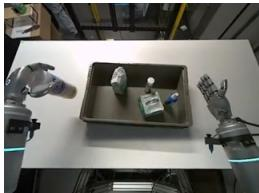  
subtask: left: carry Clorox wipes canister. right: idle

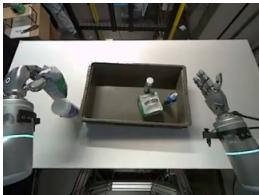  
subtask: left: carry green andand-white snack bag. right: idle

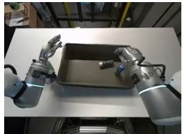  
subtask: left: idle. right: carry small white bottle

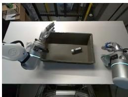  
subtask: left: idle. right: carry

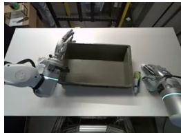  
subtask: left: idle. right: carry

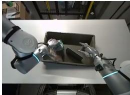  
subtask: left: carry green Kimtech wipes bag. right: idle

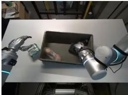  
subtask: left: idle. right: grasp

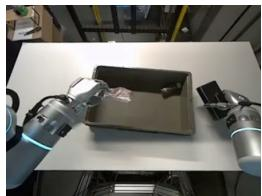  
subtask: left: carry clear plastic bag with bread roll. right: idle

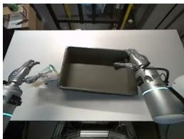  
subtask: left: place clear plastic bag of bread roll. right: idle

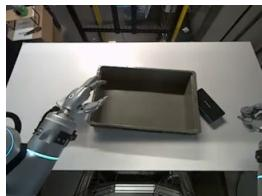  
subtask: left: idle. right: carry blue spray bottle

Figure 8: Empty Container (real, bi-manual) rollouts. Each row is a successful UniWALM rollout. The subtask under each frame is generated by the language DiT in tandem with the action (co-denoised in the same forward pass).

Press Button, (2) Blocks Ranking Try, (3) Cover Blocks, and (4) Battery Try — which each require repeated exploration or trial-and-error and cannot be solved from the current observation alone. RMBench is built on the RoboTwin 2.0 platform running on the SAPIEN physics engine, with a fixed dual-arm bimanual tabletop workspace using two AgileX arms. For each task we follow RMBench’s protocol of 50 expert demonstrations for training and 100 rollout episodes for evaluation. Because RMBench requires repeated-attempt, multi-step tracking, we enable the anchor frame and taskcompletion channel for this benchmark; the MolmoSpaces and real-world experiments do not require them and run without them. Their implementation details are given in Sec. 3.5. The following are the task descriptions:

• Press Button: press button involves pressing a button based on a count presented above the button. Given three buttons left, middle and right (confirm), the robot needs to read the number shown above left and middle button and press the respective button K times where K is the number displayed above the button. The robot then needs to press the confirm button. This task involves remembering the count of button presses followed pressing the confirm button.

• Blocks Ranking Try: The scene contains three colored blocks in a random initial arrangement and a confirm button. The task is to discover a specific target permutation by trial: the robot rearranges the blocks, hits the confirm button, receives feedback on whether the arrangement is correct, and repeats. Between attempts, the policy must retain which orderings have already been ruled out so it does not repeat a failed one.

• Cover Blocks: The robot faces three colored blocks and three covers. It first places a cover on each block from left to right, then must remove the covers in a fixed color order (red, then green, then blue) and return each cover to where it started. Because the blocks become visually hidden after covering, solving the second phase requires remembering which block was placed under each cover.

• Battery Try: A pair of batteries with random initial poses and a two-slot holder are staged on the table. The robot iteratively tries (battery, slot, orientation) combinations until both batteries seat correctly; combinations that previously failed must be recalled so the same attempt is not repeated.

## B.3 RMBench Training Configuration

For the RMBench M(n) evaluation we train a separate UniWALM on the RMBench-provided demonstrations for 100k optimizer steps with batch size 448, which takes approximately 36 hours on 10 H100 nodes. The language DiT emits 64 language tokens per diffusion forward pass; all other model settings match the Implementation Details in Sec. 3.5.

## Find the Item (real, memory)

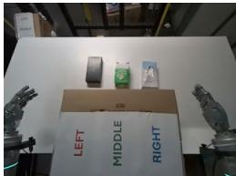

subtask: left: grasp the cardboard box. right: grasp the cardboard box memory: L:black box M:green parmesan package R:white tissue box

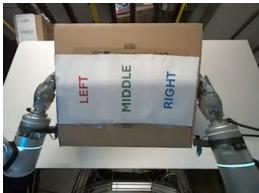

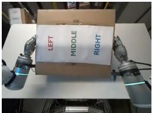

subtask: place hand on the region   
memory: L:black box M:green parmesan   
package R:white tissue box

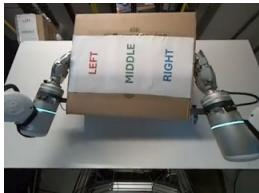

subtask: left: cover the cardboard box. right: cover the cardboard box memory: L:black box M:green par boxan package R:white tissue box

subtask: place hand on left region   
memory: L:black box M:green parmesan   
package R:white tissue box subtask: place hand on left region   
memory: L:black box M:green parmesan   
package R:white tissue box

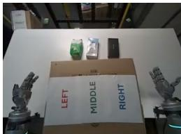

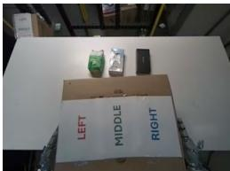

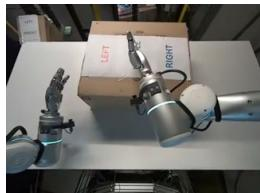

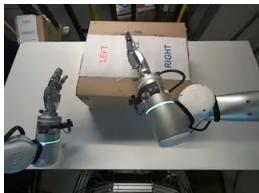

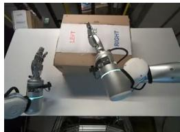

subtask: left: grasp the cardboard box. right: grasp the cardboard box memory: L:green parmesan package M:white tissue box R:black box

subtask: left: grasp the cardboard box. right: grasp the cardboard box memory: L:green parmesan package M:white tissue box R:black box

subtask: left: cover the cardboard box. right: cover the cardboard box memory: L:green parmesan package M:white tissue box R:black box

subtask: left: cover the cardboard box. right: cover the cardboard box memory: L:green parmesan package M:white tissue box R:black box

subtask: place hand on   
middle region   
memory: L:green   
parmesan package   
M:white tissue box   
R:black box

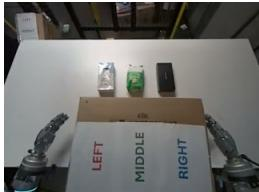

subtask: left: grasp the cardboard box. right: grasp the cardboard box memory: L:white tissue box M:green parmesan package R:black box

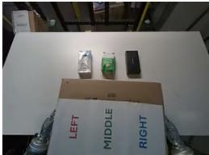

subtask: left: grasp the cardboard box. right: grasp the cardboard box memory: L:white tissue box M:green parmesan package R:black box

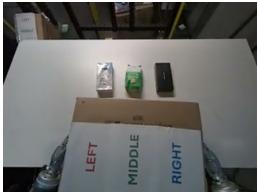

subtask: left: grasp the cardboard box. right: grasp the cardboard box memory: L:white tissue box M:green parmesan package R:black box

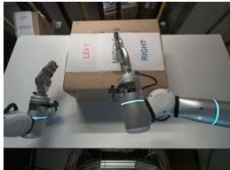

subtask: left: cover the cardboard box. right: grasp the cardboard box memory: L:white tissue box M:green parmesan package R:black box

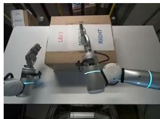

subtask: left: cover the cardboard box. right: grasp the cardboard box memory: L:white tissue box M:green parmesan package R:black box

Figure 9: Real-world Find the Item rollouts. Row 1: black box; Row 2: white tissue box; Row 3: green parmesan package (ends at the cover-complete moment). Items are hidden mid-episode under cardboard covers; the subtask and textual memory under each frame are generated by the language DiT in tandem with the action, and the memory string is re-consumed as the next-step prompt to preserve the item–region (L/M/R) mapping across the occlusion.

## B.4 Memory Architecture Details

The following architecture choices for UniWALM’s memory channels apply across all benchmarks, independent of the specific evaluation setup.

Visual Memory. UniWALM conditions on one or more visual-memory keyframes captured during the episode. In our current experiments we use a single anchor frame F taken at episode start, which provides a persistent visual reference of the initial scene layout (e.g., pre-occlusion object positions) that is otherwise lost as later observations advance. Each visual-memory frame is passed through the same VAE encoder as the current observation and concatenated along the token dimension into the video stream, so the language and action DiTs attend to it via the shared unified self-attention. To avoid position-encoding overlap with the current observation, we shift the RoPE [58] coordinates of each visualmemory frame by the frame width W and vary the 0th RoPE coordinate based on video timestep. The design accepts an arbitrary number of frames (e.g., a bank of task-relevant keyframes selected online), but we defer multi-frame visual memory to future work. Because the visual-memory keyframes and the observation are on separate RoPE grids, adding or removing memory frames does not change the network’s parameter count or interface; it only changes the number of memory tokens attended to.

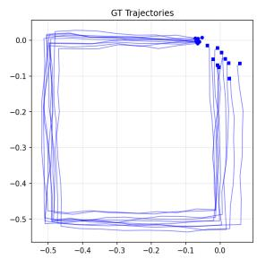  
(a) Square

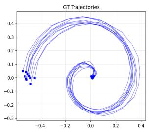  
(b) Spiral

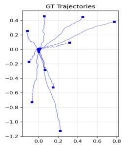  
(c) Line (radiating)

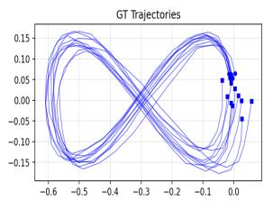  
(d) Figure-8  
Figure 10: 2D robot-trajectory benchmark used for FMC ablation. Each shape class contains multiple noisy demonstrations sharing a canonical motion pattern (blue curves show ground-truth trajectories). Shapes span repeating closed motion (Square, Figure-8), unbounded expansion (Spiral), and multi-modal starts (Line’s radial variants). The policy is trained to generate trajectories matching the full distribution of each class.

Task-Completion Supervision. Task-completion signals are sparse, so we supervise the appended 1-D channel as a step function within each action chunk: 0 before the subtask completes and 1 at and after the completion timestep. Being part of the action vector, the channel is trained by the same flow-matching objective $\mathcal { L } _ { a c t i o n }$ , with no extra head or loss term.

## B.5 Flow Matching with Correction (FMC) Ablations on 2D Robot Trajectories

To isolate the effect of FMC’s perturbation hyperparameters without confounds from downstream task-success noise, we ablate FMC on a controlled 2D robot-trajectory benchmark. The dataset (Fig. 10) consists of noisy demonstrations grouped into seven canonical motion classes representative of common robot end-effector trajectories (circle, star, spiral, line, arc, figure-8, square). The policy must learn to generate trajectories that match the full distribution of each class.

The sweep varies three FMC hyperparameters:

• s — the perturbation scale: standard deviation of the Gaussian noise $\epsilon _ { 1 } \sim \mathcal { N } ( 0 , s I )$ added to the clean action $x _ { 0 }$ to produce the perturbed sample $x _ { 0 } ^ { p } = x _ { 0 } + \epsilon _ { 1 }$ (same s as in Sec. 3.4).

• d — the drift strength: magnitude of the temporally correlated drift (a normalized 2D random walk along the time axis) that structures how the perturbed trajectory accumulates offset from the clean one; iid noise corresponds to $d = 0$

$t _ { \mathrm { c o r r u p t } } -$ the corruption time threshold: minimum diffusion time at which the correction branch is active. For $t < t _ { \mathrm { c o r r u p t } }$ the model trains with standard flow matching; for $t \geq t _ { \mathrm { c o r r u p t } }$ it trains the correction target $v _ { \mathrm { c o r r } }$

Each model is trained for 200k steps, and we evaluate 500 generated vs 1000 ground-truth trajectories per class using symmetric Chamfer distance in the flattened trajectory space. Chamfer is the appropriate signal here because FMC’s correction induces a different noise-to-data bijection than the baseline, so paired endpoint drift is dominated by this change of mapping rather than trajectory quality. The configuration adopted in the main paper $( s { = } 0 . 4 , d { = } 0 . 3 , t _ { \mathrm { c o r r u p t } } { \geq } 0 . 5 )$ falls out as the winner of the sweep, with the strongest average Chamfer improvement and wins on 5 of 7 trajectory classes (Tab. 6).

## B.6 Failure Case: Press Button

We observe cases where the language-memory loop tracks state correctly but the action executor over- or under-shoots by one press. On a Press Button episode with target counts $( \mathrm { l e f t } = 5 , \mathrm { m i d d l e } = 2 , \mathrm { c o n f i r m } = 1 )$ , the memory readout progresses cleanly to left 5/5, middle 2/2, confirm, next: done, yet the physical arm registers three middle presses instead of two (Fig. 12). The internal count is right; the task-completion channel fires one step late, so the action expert continues the current subtask for one extra press.

Table 6: Flow Matching with Correction (FMC) ablations on 2D robot trajectories. We train each configuration for 200k steps on seven 2D trajectory classes representative of robot end-effector motions (circle, star, spiral, line, arc, figure-8, square) and evaluate 500 unconditionally generated vs 1000 ground-truth trajectories per class using symmetric (two-way) Chamfer distance — averaging generated-to-GT and GT-to-generated nearest-neighbor distances (lower is better). We report the mean per-class relative change in Chamfer vs the linear flow-matching baseline, the number of classes on which the configuration beats the baseline, and the corresponding win rate. The last row is the configuration adopted in the main paper. Best .
<table><tr><td>Config</td><td>∆ Chamfer vs Base</td><td>Wins / 7</td><td>Win Rate</td></tr><tr><td>Baseline (linear flow matching)</td><td>±0.0%</td><td></td><td></td></tr><tr><td>FMC  $( s { = } 0 . 0 8 , d { = } 0 . 2 , t { \geq } 0 . 2 5 )$ </td><td>-0.1%</td><td>3/7</td><td>42.9%</td></tr><tr><td>FMC  $( s { = } 0 . 2 , d { = } 0 . 3 , t { \geq } 0 . 2 5 )$ </td><td>-2.3%</td><td>4/7</td><td>57.1%</td></tr><tr><td>FMC  $( s { = } 0 . 3 , d { = } 0 . 3 , t { \geq } 0 . 5 )$ </td><td>-1.2%</td><td>3/7</td><td>42.9%</td></tr><tr><td>FMC  $( s { = } 0 . 4 , d { = } 0 . 3 , t { \geq } 0 . 5 ) ( o u r s )$ </td><td>-4.0%</td><td>5/7</td><td>71.4%</td></tr></table>

## C Limitations

UniWALM exhibits four main failure modes. (i) Boundary misfires: the memory loop tracks state correctly but the taskcompletion signal β fires one step late or early, causing an extra or missed press (Fig. 12; detailed case in the Failure Case subsection above). (ii) Incorrect subtask prediction: on near-identical observations with different underlying memory state, the language stream occasionally emits the wrong next subtask. (iii) Grasp precision: complex-geometry objects and cluttered scenes still bound task success. (iv) Inference speed: generating an action chunk of 32 with the language expert at 10 denoising steps runs at 123 ms (76 ms without language; Sec. 3.5), which may be too slow for high-frequency closed-loop control.

## D Additional Future Work

Beyond the directions in the main paper, the UniWALM formulation opens several concrete extensions.

Pretrained VLM initialization for the language DiT. Our language DiT is trained from scratch. Initializing it from a pretrained vision-language model would inject broad semantic priors into the language-memory loop without altering the shared-denoising interface.

Retrieval-augmented memory with a learned selection criterion. The current textual memory is a single running string. Coupling it with an external episode log and a learned selection policy (choosing which past states or memory snippets to re-inject into the prompt) would extend the loop to long horizons and cross-episode settings.

FMC from a replay buffer of the robot’s own mistakes. FMC currently perturbs clean actions with Gaussian noise ϵ . A stronger variant is to construct the perturbation from the model’s actual rollout deviations: store rollout error pairs and train the correction target to recover the nominal path from these empirical errors rather than synthetic noise.

Confidence-based flow matching. A learned confidence head c ∈ (0, 1] over the predicted velocity, trained jointly with a log-penalty to prevent trivial collapse, would let the policy down-weight uncertain action predictions and expose an inference-time signal for guarded execution and targeted re-planning.

Multi-keyframe visual memory. Our visual-memory stream already supports an arbitrary number of frames (Sec. 3.5), but our experiments use a single anchor frame. A natural extension is to maintain a running history of keyframes (either at fixed intervals or selected online by the model) so the policy can attend to a bank of task-relevant past observations rather than a single snapshot at episode start.

Balancing multiple conditioning signals. When several conditioning streams are provided (e.g., a multi-keyframe visual-memory history, textual memory, current observation, and proprioception), careful training is required to prevent the policy from shortcutting to whichever stream is most predictive on the training distribution and ignoring the rest: for instance, collapsing onto the most recent keyframe while ignoring earlier ones, or ignoring the textual memory when the current frame alone is sufficient in-distribution. Explicit stream dropout, per-stream masking curricula, and informationtheoretic regularizers that encourage the action expert to attend to the situation-relevant signal are promising directions for scaling UniWALM to richer memory and observation channels.

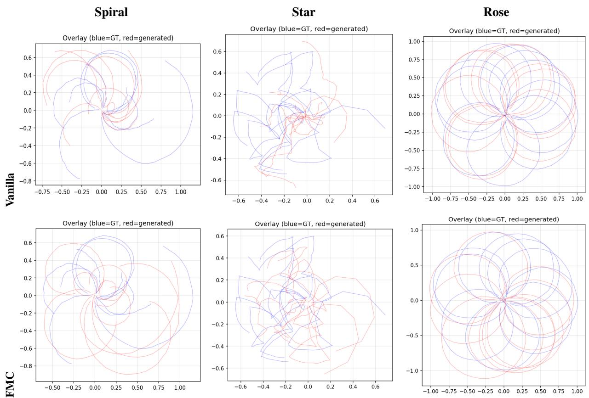  
Figure 11: FMC vs vanilla flow matching on 2D robot trajectories (overlay view). Blue curves are ground-truth demonstrations; red are model-generated trajectories, overlaid for direct comparison. Top row: vanilla flow matching frequently drifts off the demonstration manifold, truncates the shape, or collapses mode coverage. Bottom row: FMC tracks the ground-truth distribution more faithfully across all three shape classes, consistent with the quantitative Chamfer improvements in Tab. 6.

Safety via language traces of intent. Because UniWALM emits the next subtask and textual memory before the corresponding action is executed, the generated string is effectively a human-readable trace of the robot’s intention. This exposes a natural handle for safe deployment: downstream guards can veto or re-plan when the declared intention violates a constraint, operators can audit rollouts via the language log, and the trace supplies dense data for intention-conditioned alignment. Making this trace faithful (grounded in the actually-executed action), tamper-resistant, and expressive enough to cover safety-critical constraints is an important direction for future research.

## Failure case: Press Button (target: 5 left, 2 middle, 1 confirm; actual: 5-3-1)

next subtask: left button. memory: visible 5 2 || left button 0/5 middle button 0/2 || left button.

next subtask: middle button.   
memory: visible 5 2 || left button 5/5 middle button 0/2 || middle   
button.

next subtask: middle button. memory: visible 5 2 || left button 5/5 middle button 1/2 || middle button. next: confirm.

next subtask: confirm. memory: visible 5 2 || left button 5/5 middle button 2/2 || confirm. next: done.

## next subtask: confirm.

memory: visible 5 2 || left button 5/5 middle button 2/2 || confirm. next: done.

Figure 12: Timing-lag failure on Press Button. Target counts are (left = 5, middle = 2, confirm = 1). The memory readout tracks the intended count correctly (left 5/5, middle 2/2, confirm, next: done), but the action executor over-shoots by one press on middle, yielding 3 physical middle presses instead of 2. The language-memory loop is correct; the task-completion channel fires one step late, so the action expert continues the current subtask for one extra press.

MolmoSpaces Pick & Place  
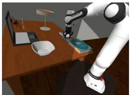

subtask: Now: Grasp the metallic cursive sign. Next: Close gripper on the metallic cursive sign subtask: Now: Lift the metallic cursive sign off the surface. Next: Transport to the smooth translucent glass bowl

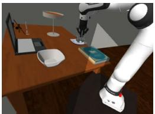

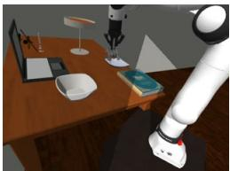  
subtask: Now: Carry to the smooth translucent glass bowl. Next: Release onto the smooth translucent glass bowl

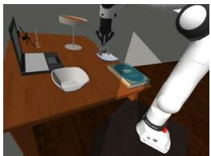  
subtask: Now: Carry to the smooth translucent glass bowl. Next: Release onto the smooth translucent glass bowl

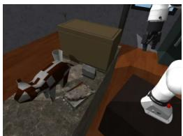  
subtask: Now: Open gripper. Next: Reach for the white calendar

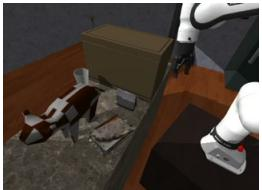

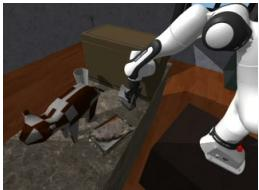

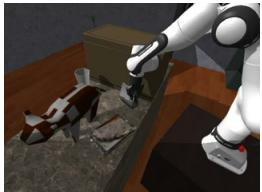

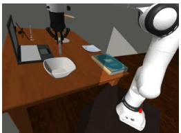  
subtask: Now: Firmly hold the white calendar. Next: Lift the white calendar  
subtask: Now: Set down on the smooth translucent glass bowl. Next: Open gripper

subtask: Now: Move hand toward the white calendar. Next: Close fingers around the white calendar

subtask: Now: Firmly hold the white calendar. Next: Pick up the white calendar

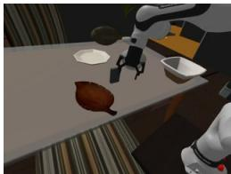

## subtask: Now: Grab the

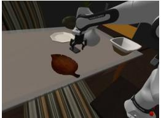  
subtask: Now: Grip the sleek ipod with screen and wheel. Next: Firmly hold the sleek ipod with screen and wheel

sleek ipod with screen and wheel. Next: Firmly hold the sleek ipod with screen and wheel

subtask: Now: Wrap fingers around the sleek ipod with screen and wheel. Next: Firmly hold the sleek ipod with screen and wheel

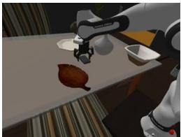

  
subtask: Now: Close fingers around the sleek ipod with screen and wheel. Next: Firmly hold the sleek ipod with screen and wheel

subtask: Now: Carry to the rusty metal tray with meat. Next: Set down on the rusty metal tray with meat

  
subtask: Now: Open gripper. Next: Withdraw from the brown wooden leaf tray

Figure 13: MolmoSpaces Pick & Place rollouts (sim). Each row is a successful UniWALM rollout across diverse scenes. The subtask under each frame is generated by the language DiT in tandem with the action (co-denoised in the same forward pass), not produced autoregressively before action.

## MolmoSpaces Pick & Place

  
subtask: Now: Close fingers around the calendar. Next: Secure grip on the calendar

  
subtask: Now: Close gripper on the calendar. Next: Lift the calendar off the surface

  
subtask: Now: Close gripper on the calendar. Next: Raise the calendar

subtask: Now: Wrap fingers around the gray cylindrical bacterium. Next: Firmly hold the gray cylindrical bacterium

subtask: Now: Failed to hold the gray cylindrical bacterium. Next: Move hand toward the gray cylindrical bacterium

subtask: Now: Lift the yellow handheld gps with antenna. Next: Carry to the shallow round wooden bowl with grain subtask: Now: Move hand toward the gray cylindrical bacterium. Next: Close fingers around the gray cylindrical bacterium subtask: Now: Wrap fingers around the gray cylindrical bacterium. Next: Firmly hold the gray cylindrical bacterium

  
subtask: Now: Carry to the shallow round wooden bowl with grain. Next: Put down on the shallow round wooden bowl with grain

  
subtask: Now: Carry to the shallow round wooden bowl with grain. Next: Put down on the shallow round wooden bowl with grain

  
subtask: Now: Raise the calendar. Next: Carry to the rustic gray bowl

  
subtask: Now: Carry to the shallow round wooden bowl with grain. Next: Put down on the shallow round wooden bowl with grain

  
subtask: Now: Release onto the rustic gray bowl. Next: Open gripper

subtask: Now: Wrap fingers around the gray cylindrical bacterium. Next: Close gripper on the gray cylindrical bacterium

  
subtask: Now: Place on the shallow round wooden bowl with grain. Next: Release gripper

Figure 14: MolmoSpaces Pick & Place rollouts (sim). Each row is a successful UniWALM rollout across diverse scenes. The subtask under each frame is generated by the language DiT in tandem with the action (co-denoised in the same forward pass), not produced autoregressively before action.