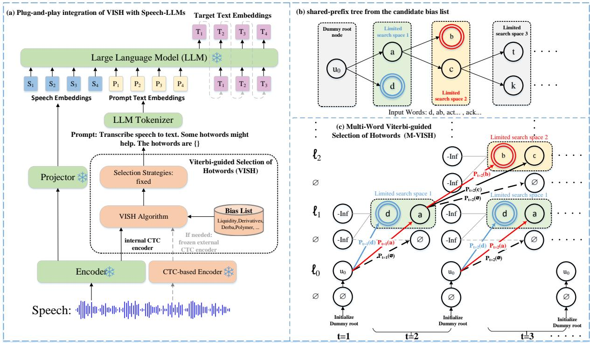
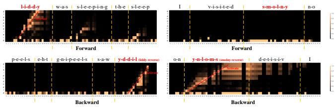

# VISH-ASR: VITERBI-GUIDED SELECTION OF HOTWORDS FOR SPEECH-LLM CONTEXTUAL ASR

Xiaoyu Gu1, Yu Xi1, Chencheng Wang1, Zonghan Zhou1, Haoyu Li2, Jing Peng1, Kai Yu1∗

1MoE Key Lab of Artificial Intelligence, AI Institute, X-LANCE Lab, Shanghai Jiao Tong University 2School of Intelligence Science and Technology, Nanjing University, Suzhou, China

## ABSTRACT

Prompt-based contextual ASR requires selecting a compact hotword subset from large dynamic inventories, yet existing pre-selection methods rely either on discrete ASR hypotheses that may discard acoustic evidence or on separately trained retrieval models. We propose Viterbi-guided Selection of Hotwords (VISH), a trainingfree, plug-and-play framework that directly verifies candidate-specific acoustic support over frame-level CTC posteriors. VISH formulates pre-selection as constrained posterior search; M-VISH makes large-list verification scalable through frame-synchronous sharedprefix Viterbi search with bounded top-K pruning, while Bi-MVISH exploits complementary backward evidence for robust verification. Across five benchmarks, M-VISH achieves up to 11.7% absolute improvement in Best-F1 over a strong learned-retrieval baseline and reduces candidate-search latency by 75.2% at 2,000 candidates relative to hypothesis-based filtering. These results demonstrate the effectiveness of posterior-level verification for accurate and scalable hotword pre-selection without additional model training.

Index Terms— automatic speech recognition, speech large language models, contextual ASR, hotword pre-selection

## 1. INTRODUCTION

End-to-end automatic speech recognition (ASR) performs well on general-domain corpora [1, 2], yet remains vulnerable to hotwords: semantically critical long-tail terms, such as contact names, locations, and products, that are sparsely represented in training data. These user- and task-specific terms are better supplied as external lexical context [3–5]. Contextual ASR has used weighted finite-state transducers (WFSTs) [6] and neural context injection [7–10]. Speech large language models (Speech LLMs) offer a new paradigm [11–13].

Speech-LLM contextualization follows two paradigms. Architecture modification or extensive fine-tuning learns hotword-aware representations [14–17], but is computationally costly, inflexible for dynamic contexts, and difficult to generalize without retraining. Alternatively, prompt-based systems inject hotwords directly into the input without adapting the Speech LLM [18–20], preserving model generality and enabling inexpensive per-request personalization. However, large candidate lists weaken prompt conditioning, increase interference, and cause bias-driven substitutions in both hotwords and background words [20]. Most systems therefore pre-select a compact candidate subset that retains acoustically supported hotwords while rejecting irrelevant alternatives [18].

Existing pre-selection methods differ mainly in how candidate evidence is obtained. Hypothesis-based filtering relies on discrete recognition outputs and candidate matching [12,21,22]. For example,

CTC-Assistant [22] first decodes a CTC hypothesis and then filters hotwords through lexical indexing and edit-distance matching; relevant acoustic evidence may therefore be lost when the candidate is absent from the discrete hypothesis. Learned speech–text retrievers, including BR-ASR, GLCLAP, and CLAR, require separately trained retrieval models [20, 23, 24]. Search-graph approaches based on WFST composition or lattice rescoring [25,26] often require decoderside graphs, lattices, or task-specific search structures, making them less convenient for black-box contextual ASR. CTC-based keyword spotting has also explored posterior-level keyword-constrained alignment for detection [27]; however, its objective is keyword detection rather than ranking and selecting a compact subset from a large, dynamically changing inventory for downstream contextual prompting.

We propose Viterbi-guided Selection of Hotwords (VISH), which formulates large-list hotword pre-selection as candidate-specific constrained search directly over frame-level CTC posterior trajectories. Unlike hypothesis-based filtering, VISH does not require a candidate to appear in a discrete first-pass transcript, and it requires no additional retrieval-model training. To make this formulation scalable, Multi-Word VISH (M-VISH) introduces a frame-synchronous sharedprefix search that reuses constrained-search computation among candidates with common token prefixes and bounds the active search space through top-K pruning. Bidirectional M-VISH (Bi-MVISH) further exploits complementary backward acoustic evidence to improve verification robustness.

The contributions of this work are threefold:

1. We formulate large-list hotword pre-selection as candidatespecific constrained search over frame-level CTC posteriors and propose VISH, enabling direct acoustic verification without relying on discrete ASR hypotheses or additional retrievalmodel training.

2. We introduce M-VISH, a frame-synchronous shared-prefix multi-candidate search with bounded top-K pruning, making acoustic verification scalable to large dynamic inventories. Bi-MVISH further exploits complementary backward evidence for more robust verification.

3. Experiments across multiple datasets and ASR systems demonstrate that improved pre-selection translates into lower downstream biased error while preserving overall recognition accuracy, with both native and external CTC posteriors supporting flexible integration.

## 2. METHODOLOGY

## 2.1. A plug-and-play VISH framework

Given speech and a candidate list, VISH estimates candidate-specific acoustic support from frame-level CTC posteriors obtained from an

  
Fig. 1. Overview of VISH and the M-VISH search procedure. (a) VISH verifies candidate hotwords using internal or external CTC posteriors and selects a compact subset for contextual prompting without modifying the downstream ASR model. (b) A shared-prefix trie organizes candidate CTC-token sequences to reuse Viterbi computations across candidates. (c) At each retained frame, M-VISH updates constrained Viterbi scores, retains the top- $K _ { \mathrm { p } }$ active prefixes, and records scores at terminal nodes for scalable large-list verification. Here, $p _ { t } ( k )$ denotes the CTC posterior of token k at frame t, and ℓ denotes the trie depth.

states follow

accessible internal encoder or a frozen external CTC scorer (Figure 1). Here, “training-free” means no additional task-specific or retrievalmodel training or fine-tuning: an off-the-shelf pretrained CTC scorer is used frozen for verification. An external scorer adds acousticencoding cost when internal posteriors are unavailable. VISH returns a compact prompt subset without downstream-model modification or decoder access. Verification relies on reliable candidate-token posterior evidence; unusual pronunciations or spelling variants may weaken the score.

## 2.2. Multi-word Viterbi-guided selection of hotwords

Let $p _ { t } ( k ) = P ( \pi _ { t } = k \mid \mathbf { x } )$ denote the frame-level CTC posterior for $k \in \Sigma \cup \{ \emptyset \}$ , where Σ is the CTC token vocabulary and ∅ is the blank symbol. Peak Suppression Decoding (PSD) removes frames satisfying $p _ { t } ( \boldsymbol { \mathcal { O } } ) > \tau _ { b }$ , yielding the ordered retained sequence $\widetilde { \mathbf { p } } = ( \widetilde { p } _ { 1 } , \dots , \widetilde { p } _ { R } )$ , where $R \leq T$ . Given a candidate w, let ${ \bf y } =$ $\left( y _ { 1 } , \dots , y _ { L } \right)$ denote its CTC-token sequence. VISH searches for its best constrained CTC alignment over any local interval:

$$
m _ { w } = \operatorname* { m a x } _ { \substack { 1 \leq a \leq b \leq R } } \sum _ { r = a } ^ { b } \log \widetilde { p } _ { r } ( \pi _ { r } ) , \qquad s _ { w } = \frac { m _ { w } } { N _ { w } } ,\tag{1}
$$

where $N _ { w }$ is the number of non-blank frames in the maximizing path. Normalizing the accumulated path score by its non-blank support reduces the duration bias of unnormalized path sums. No explicit duration bound is imposed; the constrained CTC states and accumulated posterior score determine the optimal local interval. For the blank-interleaved target $\mathbf { y } ^ { \prime } = ( \emptyset , y _ { 1 } , \emptyset , \dots , y _ { L } , \emptyset )$ , the active

$$
\alpha _ { r } ( s ) = \log \widetilde { p } _ { r } ( y _ { s } ^ { \prime } ) + \operatorname* { m a x } _ { q \in \mathcal { P } ( s ) } \alpha _ { r - 1 } ( q ) ,\tag{2}
$$

where ${ \mathcal { P } } ( s )$ denotes valid CTC predecessor states for stay, step, and skip transitions. Root states are reintroduced after each retained frame, allowing local matches to start throughout the utterance.

Independent candidate-wise scoring repeats these state updates for candidates sharing common token prefixes. M-VISH avoids this redundancy by organizing the candidate list $\boldsymbol { W } = \{ \boldsymbol { w } ^ { ( 1 ) } , \dots , \boldsymbol { w } ^ { ( N ) } \}$ into a shared-prefix trie, where each edge corresponds to a CTC token. Each active node u maintains a prefix score vector $\alpha _ { r } ^ { u }$ and a companion accumulator $\gamma _ { r } ^ { u }$ that follows the maximizing path and counts its non-blank aligned frames. The prefix-level confidence is

$$
\rho _ { r } ( u ) = \operatorname* { m a x } _ { s } \alpha _ { r } ^ { u } ( s ) .\tag{3}
$$

At each retained frame, only the top- $K _ { \mathrm { p } }$ prefixes ranked by $\rho _ { r } ( u )$ are retained and expanded. When a terminal node is reached, its best confidence and aligned length update $m _ { w }$ and $N _ { w }$ for the corresponding candidate. Algorithm 1 summarizes the search.

A dummy root stabilizes local-match initialization, while PSD suppresses unnecessary propagation through blank-dominated frames. After PSD, independent scoring costs $O ( R N \bar { L } )$ , whereas M-VISH costs $O ( R K _ { \mathrm { p } } \bar { L } )$ , with $K _ { \mathrm { p } } \ll N$ ; in the worst case, $R = T$

## 2.3. Bidirectional M-VISH

Bi-MVISH supplements forward search when candidate-onset evidence is weak. It reverses both the retained posterior sequence and each candidate CTC-token sequence, constructs the reversed trie, and applies the same M-VISH search. Because CTC collapse commutes with sequence reversal, reversing both sequences preserves valid alignments and transition rules. Mapping the terminal score back to the original candidate gives $s _ { w , \mathrm { b w d } }$ , which is averaged with the forward score $s _ { w } ,$ ,fwd:

Algorithm 1: Multi-Word Viterbi-guided Selection of Hot  
words (M-VISH)   
Input: Posteriors $\{ p _ { t } \} _ { t = 1 } ^ { T } ;$ candidates W; prefix budget   
$K _ { \mathrm { p } } ;$ PSD threshold $\tau _ { b } .$   
Output: Candidate scores $\{ s _ { w } : w \in W \} .$   
1 Form $\widetilde { \mathbf { p } } \gets [ p _ { t } : p _ { t } ( \mathcal { O } ) \leq \tau _ { b } ]$ in temporal order; let   
$R \gets | \widetilde { \mathbf { p } } | .$   
2 Build a trie for W with a dummy root; set $m _ { w } \gets - \infty$ and   
$N _ { w } \gets 0 .$   
3 Initialize active prefixes P from the root children.   
4 for $r \gets 1$ to R do   
5 foreach $u \in P$ do   
6 Update $\alpha _ { r } ^ { u }$ by (2) and update $\gamma _ { r } ^ { u }$ along the   
maximizing predecessors.   
7 $s _ { u } ^ { * } \gets \arg \operatorname* { m a x } _ { s } \alpha _ { r } ^ { u } ( s ) ; \rho _ { r } ( u ) \gets \alpha _ { r } ^ { u } ( s _ { u } ^ { * } ) .$   
8 Retain the top- $K _ { \mathrm { p } }$ prefixes in $P$ ranked by $\rho _ { r } ( u )$   
9 foreach terminal u $\in { \cal P }$ representing w do   
10 if $\rho _ { r } ( u ) > m _ { w }$ then   
11 $( \dot { m } _ { w } , N _ { w } ) \gets ( \rho _ { r } ( u ) , \gamma _ { r } ^ { u } ( s _ { u } ^ { * } ) )$   
12 Expand surviving prefixes and initialize child states   
from their parents.   
13 Add root children to $P ,$ initialized to start at retained   
frame $r + 1 .$   
14 return $\{ s _ { w } : w \in W \}$ , where $s _ { w } = m _ { w } / N _ { w }$ if $N _ { w } > 0 .$   
and $s _ { w } = - \infty$ otherwise.

$$
s _ { w , \mathrm { b i } } = \frac 1 2 \left( s _ { w , \mathrm { f w d } } + s _ { w , \mathrm { b w d } } \right) .\tag{4}
$$

M-VISH remains frame-synchronous, whereas Bi-MVISH uses future frames within each segment and therefore trades strict frame-level streaming for stronger segment-level verification.

## 3. EXPERIMENTAL SETUPS

## 3.1. Datasets and bias lists

Test datasets. We use the following test sets:

• STOP1/STOP2 [23, 28]: English named-entity retrieval sets derived from the STOP test and evaluation splits, containing queries with person names (STOP1) or location names (STOP2). Both are used only for hotword pre-selection evaluation.

• AISHELL-1-NE [3]: A Mandarin named-entity contextual-biasing set derived from AISHELL-1. It is used for both hotword preselection and downstream contextual ASR evaluation.

• Libri-clean/other-2k [29]: LibriSpeech test-clean and test-other with fixed 2,000-word candidate lists per utterance, used for both pre-selection and downstream ASR evaluation; test-other is the more challenging condition.

Bias lists. STOP1, STOP2, and AISHELL-1-NE follow their benchmark protocols. For LibriSpeech, following [30], rare words exclude the 5,000 most frequent training words. Each utterance uses a fixed 2,000-word list containing all ground-truth rare words plus randomly sampled distractors; the same seeded lists are shared across methods. For latency analysis, we additionally evaluate list sizes of 100, 500, 1,000, and 2,000.

## 3.2. Systems and inference setup

We evaluate Whisper-medium [31] (encoder–decoder ASR) and Prompt-SLAM-ASR [22] (Speech-LLM contextual ASR). The latter’s released model does not support Mandarin; we evaluate it only on LibriSpeech. Frozen SenseVoice-Small [32] supplies VISH’s frame-level CTC posteriors and tokenizer for both backbones. We fix $K _ { \mathrm { p } } ~ = ~ 4 0$ and $\tau _ { b } ~ = ~ 0 . 9 9 7$ across all datasets and evaluation settings. GLCLAP, M-VISH, and Bi-MVISH share fixed Top-10 selection and the prompt: “Transcribe speech to text. Some hotwords might help. The hotwords are $\{ \} ^ { \ast }$ . BR-ASR results are published; the backbone-only setting omits hotwords. For all methods, Table 4 measures candidate-search latency from available speech representations/CTC posteriors to candidate scores/retrieval results, excluding acoustic representation extraction.

## 3.3. Evaluation metrics

Best-F1 is the maximum F1 over candidate-score thresholds, measuring target–distractor score separability independently of a deployment selection budget. The fixed Top-10 downstream comparisons instead assess ASR utility under a shared prompt budget. We report character error rate (CER) and biased character error rate (B-CER) on AISHELL-1-NE, and word error rate (WER) and biased word error rate (B-WER) on LibriSpeech [30]. Biased metrics are computed over reference characters or words in the biasing vocabulary. Lower error rates are better.

## 4. RESULTS AND ANALYSIS

## 4.1. Hotword pre-selection performance

Table 1. Hotword pre-selection performance. Best-F1 (%) across five benchmarks. A1-NE denotes AISHELL-1-NE; L-clean-2k and L-other-2k denote LibriSpeech test-clean and test-other with 2,000 candidate hotwords, respectively. ∗ denotes our reproduced results; “–” indicates unreported results. Best results are bold.
<table><tr><td colspan="5">Method STOP1 STOP2 A1-NE L-clean-2k L-other-2k</td></tr><tr><td>GLCLAP [23]</td><td></td><td></td><td>97.0 一</td><td></td></tr><tr><td>CLAR [24]</td><td></td><td></td><td>97.0</td><td></td></tr><tr><td>GLCLAP [23]*</td><td>80.5</td><td>81.2</td><td>96.6 90.5</td><td>82.4</td></tr><tr><td>M-VISH</td><td>83.1</td><td>92.9</td><td>97.5 94.4</td><td>87.7</td></tr><tr><td>Bi-MVISH</td><td>83.1</td><td>93.8</td><td>97.6</td><td>95.3 88.8</td></tr></table>

CTC-Assistant serves as a representative hypothesis-based CTC filtering baseline. We use GLCLAP as our primary learned-retrieval baseline and reproduce it across all five benchmarks. We also include the original results of GLCLAP and CLAR where available. CTC-Assistant is omitted from Table 1 because its published per-word matching procedure [22] does not directly provide compatible fullinventory scores for threshold-based F1 evaluation. Compared with our reproduced GLCLAP baseline, M-VISH achieves absolute Best-F1 improvements of 0.9%–11.7% across all five benchmarks, with the largest gains on STOP2 (+11.7%) and Libri-other-2k (+5.3%). Bi-MVISH further improves Best-F1 by up to 1.1% in absolute terms on four of the five benchmarks, without additional retrieval-model training.

Table 2. Downstream contextual ASR performance. WER/B-WER (%) are reported for LibriSpeech and CER/B-CER (%) for AISHELL-1-NE. GT Bias denotes oracle hotword prompting. ∗ denotes our reproduced results. N/A indicates Prompt-SLAM-ASR model does not support Mandarin. Best non-oracle results are bold.
<table><tr><td colspan="4">ASR System L-clean-2k L-other-2k A1-NE</td></tr><tr><td>Whisper-medium [31]</td><td></td><td></td><td></td></tr><tr><td>+No Bias +GT Bias</td><td>3.1/14.0 2.2/6.2</td><td>7.1/29.9 5.6/15.9</td><td>7.3/21.3 4.3/7.4</td></tr><tr><td>+CTC-Assistant [22]*</td><td>2.4/7.8</td><td>6.2/18.8</td><td>4.7/9.9</td></tr><tr><td>+GLCLAP [23]*</td><td>2.4/7.6</td><td>6.1/18.2</td><td>4.6/9.1</td></tr><tr><td>+M-VISH +Bi-MVISH</td><td>2.4/7.5 2.3/6.9</td><td>6.0/18.3 5.9/17.3</td><td>4.4/7.8 4.4/7.6</td></tr><tr><td>Prompt-SLAM-ASR [22]</td><td></td><td></td><td></td></tr><tr><td>+No Bias</td><td>2.0/9.3</td><td>4.0/20.0</td><td>N/A</td></tr><tr><td>+GT Bias</td><td>1.2/2.8</td><td>2.4/5.8</td><td>N/A</td></tr><tr><td>+BR-ASR [20]</td><td>1.4/4.2</td><td>3.1/9.3</td><td>N/A</td></tr><tr><td>+CTC-Assistant [22]*</td><td>1.4/4.4</td><td>3.2/10.0</td><td></td></tr><tr><td></td><td>1.5/4.8</td><td>3.2/10.7</td><td>N/A</td></tr><tr><td>+GLCLAP [23]*</td><td></td><td></td><td>N/A</td></tr><tr><td>+M-VISH</td><td>1.4/4.2</td><td>3.1/8.7</td><td>N/A</td></tr><tr><td>+Bi-MVISH</td><td>1.4/3.7</td><td>3.1/8.0</td><td>N/A</td></tr></table>

## 4.2. Downstream contextual ASR performance

Table 2 shows improved pre-selection translates into lower biased error under the same Top-10 prompting protocol. Compared with reproduced GLCLAP, Bi-MVISH reduces B-WER from 7.6% to 6.9% and from 18.2% to 17.3% on Whisper L-clean-2k and L-other-2k, respectively, while reducing A1-NE B-CER from 9.1% to 7.6%. With Prompt-SLAM-ASR, the corresponding B-WER decreases from 4.8% to 3.7% and from 10.7% to 8.0%. M-VISH is already competitive, while bidirectional verification yields the most consistent gains without degrading overall WER/CER. The consistent improvements across both backbones further suggest the frozen external CTC evidence transfers effectively to downstream contextual prompting.

Table 3. Effect of CTC posterior source. Comparison of internal and external CTC encoders for Bi-MVISH with Prompt-SLAM-ASR using 2,000 candidate hotwords per utterance. Extra denotes additional encoder parameters beyond the ASR backbone. Clean and Other refer to LibriSpeech test-clean and test-other, respectively. Best results are bold.
<table><tr><td>Encoder</td><td>Params.</td><td>Extra</td><td></td><td></td><td>Test set Best-F1 WER/B-WER</td></tr><tr><td>SenseVoice-Small (external)</td><td>234M +234M</td><td></td><td>Clean Other</td><td>95.3 88.8</td><td>1.4/3.7 3.1/8.0</td></tr><tr><td>WavLM-Large</td><td></td><td></td><td>Clean</td><td>94.7</td><td>1.4/3.9</td></tr><tr><td>(internal)</td><td>315M</td><td>0</td><td>Other</td><td>87.8</td><td>3.0/8.6</td></tr></table>

## 4.3. Plug-and-play Adaptability

To further validate the plug-and-play property of VISH, we evaluate Bi-MVISH using either the native CTC posteriors of Prompt-SLAM-ASR or a frozen external SenseVoice-Small encoder, without additional training or downstream-model modification. As shown in Table 3, both sources enable effective hotword verification. Native posteriors require no additional encoder or acoustic forward pass, whereas the external scorer achieves higher Best-F1 and lower B-WER. These results demonstrate the flexibility of VISH across CTC posterior sources, with a trade-off between verification accuracy and computational cost.

  
Fig. 2. Forward and backward Bi-MVISH alignments for “liddy” (left) and “smolny” (right). Both directions detect “liddy”, whereas backward search recovers stronger evidence for “smolny” with its weak onset. Yellow dotted lines denote word boundaries.

## 4.4. Analysis of bidirectional verification

Forward Viterbi verification can underestimate a hotword when its onset is acoustically weak or ambiguous. As shown in Figure 2, both directions detect “liddy”, whereas forward search provides weak evidence for “smolny” and backward search anchors on its clearer ending. Averaging the complementary directional scores can therefore compensate for weak forward evidence, providing a qualitative explanation for the additional Bi-MVISH gains in Tables 1 and 2.

Table 4. Candidate-search efficiency. Average search latency (ms per utterance) with different bias list sizes, measured as the number of candidate hotwords per utterance. Acoustic representation extraction is excluded.
<table><tr><td>Bias List Size</td><td>100</td><td>500</td><td>1,000</td><td>2,000</td></tr><tr><td>CTC-Assistant [22]</td><td>46</td><td>206</td><td>398</td><td>817</td></tr><tr><td>GLCLAP [23]</td><td>61</td><td>65</td><td>74</td><td>78</td></tr><tr><td>M-VISH</td><td>71</td><td>85</td><td>117</td><td>203</td></tr><tr><td>Bi-MVISH</td><td>131</td><td>176</td><td>260</td><td>400</td></tr></table>

## 4.5. Candidate-search efficiency

Table 4 compares the candidate-search latency of VISH with hypothesis-based filtering and learned speech–text retrieval methods. All methods are evaluated with batch size 1 on the same GPU, excluding acoustic representation extraction. With 2,000 candidate hotwords, M-VISH reduces search latency from 817 ms for CTC-Assistant to 203 ms, a relative reduction of 75.2%. Bi-MVISH achieves a 51.0% relative reduction despite performing bidirectional search. Although GLCLAP achieves the lowest search latency (78 ms), it yields lower Best-F1 than VISH (Table 1). These results demonstrate that VISH achieves a favorable balance between hotword pre-selection accuracy and search efficiency for large candidate inventories.

## 5. CONCLUSION

We presented VISH, a training-free hotword pre-selector for candidate-specific verification over CTC posteriors, together with M-VISH for scalable shared-prefix search and Bi-MVISH for bidirectional verification. Across five benchmarks, M-VISH achieves absolute Best-F1 improvements of 0.9%–11.7% over our reproduced GLCLAP baseline, while Bi-MVISH consistently reduces downstream biased error without degrading overall ASR accuracy. At 2,000 candidates, M-VISH reduces candidate-search latency from 817 to 203 ms relative to CTC-Assistant. Native CTC posteriors provide a lower-overhead option when available, while an external frozen scorer offers stronger plug-and-play verification.

## 6. COMPLIANCE WITH ETHICAL STANDARDS

This study uses existing speech datasets, including STOP, AISHELL-1-NE, and LibriSpeech. No new human participants were recruited or recorded, and no animal experiments were conducted. All datasets were used in accordance with their respective access and licensing terms.

## 7. REFERENCES

[1] J. Li, “Recent advances in end-to-end automatic speech recognition,” arXiv preprint arXiv:2111.01690, 2021.

[2] S. Ji et al., “WavChat: A survey of spoken dialogue models,” arXiv:2411.13577, 2024.

[3] X. Shi, Y. Yang, Z. Li, Y. Chen, Z. Gao, and S. Zhang, “SeACo-Paraformer: A non-autoregressive ASR system with flexible and effective hotword customization ability,” in Proc. IEEE ICASSP, 2024, pp. 10346–10350.

[4] T. Hori, J. Cho, and S. Watanabe, “End-to-end speech recognition with word-based RNN language models,” in Proc. IEEE SLT, 2018, pp. 389–396.

[5] Z. Chen, M. Jain, Y. Wang, M. L. Seltzer, and C. Fuegen, “End-to-end contextual speech recognition using class language models and a token passing decoder,” in Proc. IEEE ICASSP, 2019, pp. 6186–6190.

[6] E. Bakhturina, Y. Zhang, and B. Ginsburg, “Shallow fusion of weighted finite-state transducer and language model for text normalization,” in Proc. Interspeech, 2022, pp. 491–495.

[7] G. Pundak, T. N. Sainath, R. Prabhavalkar, A. Kannan, and D. Zhao, “Deep context: end-to-end contextual speech recognition,” in Proc. IEEE SLT, 2018, pp. 418–425.

[8] M. Jain, G. Keren, J. Mahadeokar, G. Zweig, F. Metze, and Y. Saraf, “Contextual RNN-T for open domain ASR,” in Proc. Interspeech, 2020, pp. 11–15.

[9] E. Variani, D. Rybach, C. Allauzen, and M. Riley, “Hybrid autoregressive transducer (HAT),” in Proc. IEEE ICASSP, 2020, pp. 6139–6143.

[10] D. Zhao et al., “Shallow-fusion end-to-end contextual biasing,” in Proc. Interspeech, 2019, pp. 1418–1422.

[11] G. Song et al., “Contextual spelling correction with large language models,” in Proc. IEEE ASRU, 2023, pp. 1–8.

[12] Y. Asano et al., “Contextual ASR error handling with LLMs augmentation for goal-oriented conversational AI,” in Proceedings of the 31st International Conference on Computational Linguistics: Industry Track, 2025, pp. 374–386.

[13] J. Peng et al., “A survey on speech large language models for understanding,” IEEE Journal ofSelected Topics in Signal Processing, 2025.

[14] L. Fu, Y. Xin, S. Zeng, L. Fan, Y. Wu, and X. He, “Pac: Pronunciation-aware contextualized large language modelbased automatic speech recognition,” in ICASSP 2026-2026 IEEE International Conference on Acoustics, Speech and Signal Processing (ICASSP). IEEE, 2026, pp. 16377–16381.

[15] B. Ren, R. Fan, Y. Shen, W. Chen, and J. Li, “Rlbr: Reinforcement learning with biasing rewards for contextual speech

large language models,” in ICASSP 2026-2026 IEEE International Conference on Acoustics, Speech and Signal Processing (ICASSP). IEEE, 2026, pp. 17637–17641.

[16] R. Jing et al., “Rare word recognition and translation without fine-tuning via task vector in speech models,” arXiv:2512.21894, 2025.

[17] Y. Kong, J. Hou, J. Tang, B. Zhu, J. Zhang, and S. Xue, “Contextual biasing for LLM-based ASR with hotword retrieval and reinforcement learning,” arXiv:2512.21828, 2025.

[18] Z. Yang, S. Sun, X. Wang, Y. Zhang, L. Ma, and L. Xie, “Two stage contextual word filtering for context bias in unified streaming and non-streaming transducer,” arXiv:2301.06735, 2023.

[19] Z. Chen et al., “SALM: Speech-augmented language model with in-context learning for speech recognition and translation,” in Proc. IEEE ICASSP, 2024, pp. 13521–13525.

[20] X. Gong, A. Lv, Z. Wang, H. Zhu, and Y. Qian, “BR-ASR: Efficient and scalable bias retrieval framework for contextual biasing ASR in speech LLM,” arXiv:2505.19179, 2025.

[21] Z. Chen, M. Jain, Y. Wang, M. L. Seltzer, and C. Fuegen, “Joint grapheme and phoneme embeddings for contextual end-to-end ASR,” in Proc. Interspeech, 2019, pp. 3490–3494.

[22] G. Yang, Z. Ma, Z. Gao, S. Zhang, and X. Chen, “CTC-assisted LLM-based contextual ASR,” in Proc. IEEE SLT, 2024, pp. 126–131.

[23] Y. Kong et al., “GLCLAP: A novel contrastive learning pretrained model for contextual biasing in ASR,” in Proc. Interspeech, 2025, pp. 5173–5177.

[24] S. Huang, H. Shen, W. Zou, and Y. Chen, “CLAR: CIF-localized alignment for retrieval-augmented speech LLM-based contextual ASR,” arXiv:2603.25460, 2026.

[25] T. Hori, C. Hori, Y. Minami, and A. Nakamura, “Efficient WFST-based one-pass decoding with on-the-fly hypothesis rescoring in extremely large vocabulary continuous speech recognition,” IEEE Trans. Audio, Speech, Lang. Process., vol. 15, no. 4, pp. 1352–1365, 2007.

[26] W. Wang et al., “Contextual biasing with the Knuth-Morris-Pratt matching algorithm,” arXiv:2310.00178, 2023.

[27] Y. Xi, H. Li, X. Gu, H. Li, Y. Jiang, and K. Yu, “Streaming keyword spotting boosted by cross-layer discrimination consistency,” in Proc. IEEE ICASSP, 2025, pp. 1–5.

[28] P. Tomasello et al., “STOP: A dataset for spoken task oriented semantic parsing,” in Proc. IEEE Spoken Language Technology Workshop (SLT), 2023, pp. 991–998.

[29] V. Panayotov, G. Chen, D. Povey, and S. Khudanpur, “LibriSpeech: an ASR corpus based on public domain audio books,” in Proc. IEEE ICASSP, 2015, pp. 5206–5210.

[30] D. Le et al., “Contextualized streaming end-to-end speech recognition with trie-based deep biasing and shallow fusion,” arXiv:2104.02194, 2021.

[31] A. Radford, J. W. Kim, T. Xu, G. Brockman, C. McLeavey, and I. Sutskever, “Robust speech recognition via large-scale weak supervision,” in Proceedings of the 40th International Conference on Machine Learning, 2023, pp. 28492–28518.

[32] K. An et al., “FunAudioLLM: Voice understanding and generation foundation models for natural interaction between humans and LLMs,” arXiv:2407.04051, 2024.