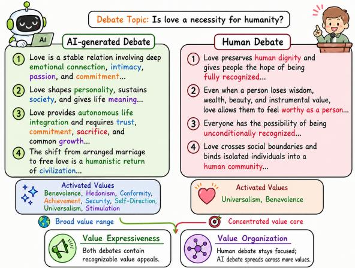
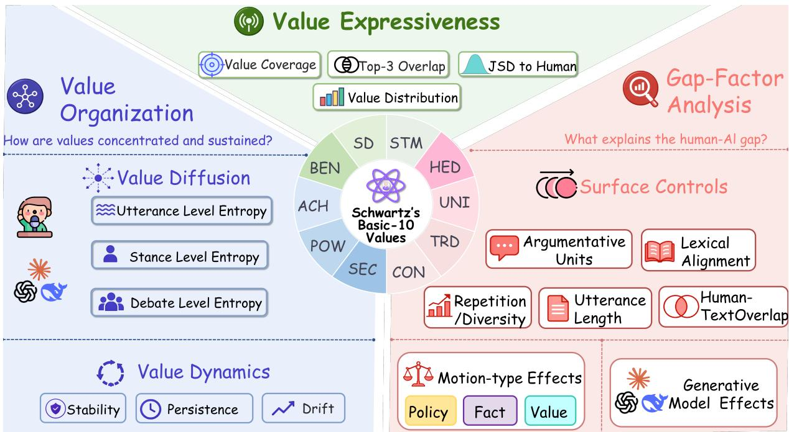
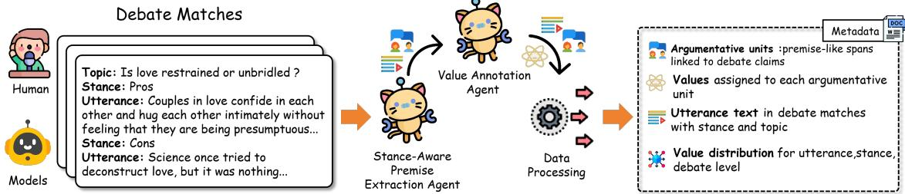
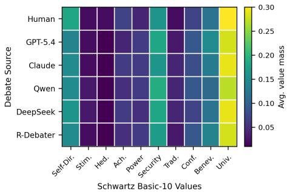
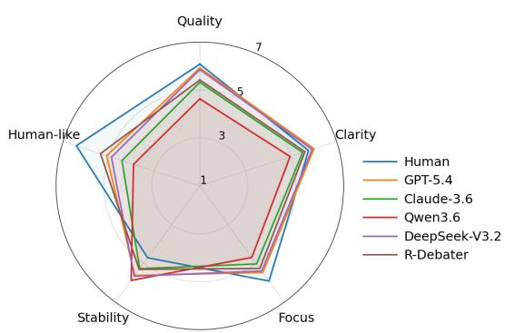

# Value-Rich, Differently Organized: Measuring Value Expression and Organization in AI-Generated Debates

Maoyuan Li1,2 Haoyuan Li2 Zhongsheng Wang2 Jiamou Liu2\* 1Wuhan College of Communication 2University of Auckland mli302@aucklanduni.ac.nz, hli962@aucklanduni.ac.nz zhongsheng.wang@auckland.ac.nz, jiamou.liu@auckland.ac.nz

## Abstract

Current evaluation of LLM-generated debate largely focuses on argumentative quality, leaving the value structure of generated arguments underexamined. We introduce a diagnostic metric framework for comparing how values are expressed and organized in human-reference and AI-generated debates. The framework separates value expression, the range of recognizable values a debate invokes, from value organization, how those values are distributed and sustained across turns. Grounded in Schwartz’s Basic-10 value theory, it represents debates as multi-level value distributions over argumentative units, utterances, stances, and full debates, enabling metrics for value coverage, alignment, diffusion, and cross-turn dynamics. Across multiple generation systems, AIgenerated debates are broadly value-expressive, often activating as many or more value dimensions than matched human references, but they organize these values differently. Their utterances are more locally value-diffuse, and source-blind judges distinguish value clarity from value focus. These findings show that debate evaluation should consider not only value presence, but also value organization. Code and supplementary materials are available at https://github.com/Maoyuan-li/ Value-Expression-and-Organization.

## 1 Introduction

Arguments gain much of their force from the values they bring into view. In debate, speakers do more than exchange claims and evidence: they reveal what they treat as fair, safe, free, dignified, or worth protecting. These value appeals shape why an argument feels compelling.

LLMs are increasingly able to generate fluent and persuasive debate utterances, and existing evaluation has largely focused on coherence, factuality, stance consistency, logical validity, and persuasiveness (Liang et al., 2024a; Wang et al., 2025). A separate line of value-oriented NLP has shown that human values can be identified in argumentative text, for example through Webis-ArgValues-22 and ValueEval (Kiesel et al., 2022, 2023). Yet the intersection remains underexplored: debate evaluation rarely asks how values are organized across turns, while value mining usually treats values as labels attached to isolated texts. We therefore ask how AI-generated debates compare with matched human debate references in value expression and value organization. As Figure 1 illustrates, a debate may be value-expressive by invoking recognizable value appeals, while differing in value organization: the AI-generated example spreads across a broader value range, whereas the human reference concentrates around a more compact core of Universalism and Benevolence.

  
Figure 1: Illustrative contrast between value expression and value organization.

We frame value-based debate analysis as comparing distributions of value appeals across matched human-reference and AI-generated debates. This raises two challenges. First, values are rarely stated as explicit labels: a speaker may never name “security” or “autonomy,” while still embedding those values in the arguments. Second, values operate at multiple levels, from local argumentative units to utterances, stances, and full debates. We therefore adopt Schwartz’s Basic-10 theory as a theorygrounded value space (Schwartz, 1992; Schwartz et al., 2012). Following the claim–premise view of argument structure in Stab and Gurevych (2014), we represent each argumentative unit as a stancespecific claim paired with a premise span extracted from the corresponding utterance. Each argumentative unit is assigned a soft distribution over the ten values, which is then aggregated at multiple levels.

This multi-level representation supports a diagnostic metric suite with two complementary components. For value expression, we measure how broadly a debate activates the Basic-10 value space and how closely its dominant values align with a paired human reference. For value organization, we define a family of metrics that treats debate values as both distributions and trajectories: entropy captures value diffusion, while stability, drift, and dominant-value persistence characterize how a stance carries its value profile across turns. These metrics shift attention from whether generated arguments mention human-recognizable values to how those values are structured and transformed within argumentative interaction.

We instantiate the framework in a paired benchmark comparing general-purpose LLMs with R-Debater (Li et al., 2025). Results show a consistent separation: AI-generated debates activate as many or more Basic-10 values as human references while distributing value mass differently across utterances and stances. These patterns persist after surface-level controls and are supported by sourceblind human evaluation.

Our contributions are: (1) a diagnostic distinction between value expression and value organization; (2) a Schwartz-grounded multi-level framework representing debate values as distributions over argumentative units, utterances, stances, and full debates; (3) a metric family covering value coverage, alignment, local concentration, and crossturn dynamics; and (4) a paired analysis showing that AI-generated debates activate broad value spaces while differing from human references in local concentration and cross-turn organization.

## 2 Related Work

Automated debate generation and evaluation. Early automated debate studies focused on the components needed to build debating systems, such as evidence retrieval (Rinott et al., 2015), argument construction (Gutfreund et al., 2016), stance modeling (Bar-Haim et al., 2017), and argument quality assessment (Bar-Haim et al., 2021; Toledo et al., 2019). Project Debater later integrated retrieval, argument mining, and speech planning into an autonomous debating system (Slonim et al., 2021). Recent LLM-based work has shifted toward debatelike interaction, using simulated agents and multiagent debate (Du et al., 2024; Liang et al., 2024b), retrieval-augmented debate generation (Li et al., 2025), and evaluation-guided optimization (Wang et al., 2025). Debate evaluation has also expanded from winning-stance prediction (Ruiz-Dolz et al., 2023) to multi-dimensional judging, chronological analysis (Liang et al., 2024a; Wang et al., 2025), and LLM-as-judge benchmarking (Sternlicht et al., 2025). However, none measures how values are distributed and sustained across debate turns.

Human values in argumentation. Values have long been central to argumentation theory. In valuebased argumentation, argument acceptability depends not only on logical relations, but also on the values promoted by an argument and the audience’s value ordering (Bench-Capon, 2003). Early valueoriented argument mining focused on identifying implicit human values behind natural-language arguments (Kiesel et al., 2022). Later work expanded this line with larger and more diverse resources, including Touché23-ValueEval (Mirzakhmedova et al., 2024) and the SemEval-2023 ValueEval shared task (Kiesel et al., 2023). Related valuemodeling datasets also study human values in social scenarios, dialogue, or LLM outputs, such as ValueNet (Qiu et al., 2022) and FULCRA (Yao et al., 2024). However, these studies treat values as labels for isolated texts. We instead study them as distributions in matched multi-turn debates.

## 3 Conceptual Framework

This section introduces the conceptual framework used to analyze value expression and value organization in human-reference and AI-generated debates. Figure 2 summarizes the framework and its three layers: value representation, value-based measurement, and paired-difference interpretation.

  
Figure 2: Conceptual framework. The shared Schwartz Basic-10 space (center) grounds two evaluation dimensions: value expression (breadth of value activation) and value organization (concentration and cross-turn dynamics). The right panel shows how paired differences are interpreted through surface controls, motion-type effects, and generation-system effects. Here, Human-TextOverlap denotes BLEU similarity between a generated debate and its matched human reference.

## 3.1 Shared Value Space

Value-based debate analysis requires a shared vocabulary for describing what values are invoked. We adopt Schwartz’s Basic-10 theory as this value space (Schwartz, 1992; Schwartz et al., 2012). Schwartz values are broad motivational goals guiding evaluations of actions and social arrangements, well suited to debate where arguments invoke safety, fairness, autonomy, or preservation. The Basic-10 level is broad enough to cover major motivational contrasts in debate. We use the framework to analyze textual value appeals expressed in debate discourse, not to infer the internal beliefs or moral commitments of a model. The same principle applies to human debate transcripts. Table 1 gives the acronyms used in Figure 2 and the debate-oriented interpretation of each value. The ten values define the value set V used throughout the paper. Each value distribution in the framework is a probability distribution over this Basic-10 value space.

## 3.2 Debate as a Multi-level Value Structure

We represent a debate formally as $d = ( q , \mathcal { Z } , \mathcal { C } , \mathcal { U } )$ where q is the topic, $\mathcal { Z } = \{ + , - \}$ denotes the pro and con stances, $\mathcal { C } = \{ c _ { + } , c _ { - } \}$ contains the corresponding stance-specific claims, and $u \ =$ $( u _ { 1 } , \ldots , u _ { n } )$ is the ordered utterance list. Each utterance $u _ { t }$ has text $x _ { t } .$ , stance $z _ { t } \in \mathcal { Z }$ , and turn index t. The two stances alternate in turn, i.e., $z _ { t } \neq z _ { t + 1 }$ for any t.

<table><tr><td>Acr.</td><td>Value</td><td>Debate-oriented interpretation</td></tr><tr><td>SD</td><td>Self-</td><td>Autonomy, independent thought,</td></tr><tr><td>STM</td><td>Direction Stimulation</td><td>freedom of choice. Novelty, challenge, innovation,</td></tr><tr><td>HED</td><td>Hedonism</td><td>change. Pleasure, comfort, enjoyment,</td></tr><tr><td>ACH</td><td></td><td>quality of life. Achievement Śuccess, competence, merit, pro-</td></tr><tr><td>POW</td><td>Power</td><td>ductivity. Authority, influence, status, con-</td></tr><tr><td>SEC</td><td>Security</td><td>trol over resources. Safety, stability, public order, risk</td></tr><tr><td>CON</td><td>Conformity</td><td>reduction. Rule-following, responsibility, so-</td></tr><tr><td>TRD</td><td>Tradition</td><td>cial norms. Heritage, customs, continuity, cul-</td></tr><tr><td>BEN</td><td></td><td>tural preservation. Benevolence Care for close others, responsibil-</td></tr><tr><td>UNI</td><td></td><td>ity, loyalty. Universalism Equality, justice, human rights, so-</td></tr></table>

Table 1: The Schwartz Basic-10 value space.

Following the claim–premise view of argument structure in Stab and Gurevych (2014), we adapt this structure to competitive debate, where the stance-specific claim is determined by the debate topic and the speaker’s stance. For an utterance $u _ { t }$ with stance $z _ { t }$ , SAPE-Agent extracts premise spans $\mathcal { P } ( u _ { t } ) = \{ p _ { t , 1 } , . . . , p _ { t , k _ { t } } \}$ from the utterance text $x _ { t }$ . We define an argumentative unit as the claim–premise pair

$$
a _ { t , i } = ( c _ { z _ { t } } , p _ { t , i } ) ,\tag{1}
$$

where $c _ { z _ { t } }$ is the stance-specific claim and $p _ { t , i }$ is an extracted premise. Accordingly, $A ( u _ { t } ) \ =$ $\{ a _ { t , 1 } , \dotsc , a _ { t , k _ { t } } \}$ denotes the argumentative units in utterance ut. A premise may support the stancespecific claim directly or indirectly through rebuttal, counterexample, framing, concession, or value weighing, without requiring a fine-grained debate-act taxonomy. A Basic-10 value distribution is first assigned to each argumentative unit, then aggregated to three structural levels: utterance, stance, and debate. These levels correspond to increasingly broader views of value expression. Let $\mathbf { p } ( a _ { t , i } ) \stackrel { - } { \in } \Delta ^ { | \mathcal { V } | - 1 }$ denote the Basic-10 value distribution associated with argumentative unit $a _ { t , i }$ in utterance $u _ { t }$ . At the utterance level, we ask what value profile is expressed by one debate turn. For utterance $u _ { t }$ with argumentative units $\boldsymbol { \mathcal { A } } ( u _ { t } ) = \{ a _ { t , 1 } , \ldots , a _ { t , k _ { t } } \}$ , the utterance distribution is:

$$
\mathbf { P } _ { \mathrm { u t t } } \big ( u _ { t } \big ) = \frac { 1 } { k _ { t } } \sum _ { a \in \mathcal { A } ( u _ { t } ) } \mathbf { p } ( a ) .\tag{2}
$$

Because it is an average of probability distributions, $\mathbf { P } _ { \mathrm { u t t } } ( u _ { t } )$ is also a probability distribution over V. At the stance level, we ask what value profile is carried by one stance across its same-stance utterances. Let ${ \mathcal { U } } _ { z } ( d ) = ( u _ { z , 1 } , \ldots , u _ { z , n _ { z } } )$ be the ordered subsequence of value-bearing utterances produced under stance z. The stance distribution is

$$
\mathbf { P } _ { \mathrm { s t a } } ( d \mid z ) = \frac { 1 } { n _ { z } } \sum _ { u \in \mathcal { U } _ { z } ( d ) } \mathbf { P } _ { \mathrm { u t t } } ( u ) .\tag{3}
$$

At the debate level, we summarize the overall value profile of the full exchange. Let $\mathcal { U } ^ { * } ( d )$ be the set of value-bearing utterances and $n ^ { * } = | \mathcal { U } ^ { * } ( d ) |$ . The debate distribution is

$$
\mathbf { P } _ { \mathrm { d e b } } ( d ) = \frac { 1 } { n ^ { * } } \sum _ { u _ { t } \in \mathcal { U } ^ { * } ( d ) } \mathbf { P } _ { \mathrm { u t t } } ( u _ { t } ) .\tag{4}
$$

## 3.3 Evaluation Dimensions

Table 2 summarizes the metrics.

Value expression. This dimension concerns the breadth and reference alignment of expressed values. It asks how broadly an AI-generated debate activates the Basic-10 value space and how its dominant values compare with those in the matched human reference.

1. Coverage counts the number of value dimensions activated above a threshold $\tau { : }$

$$
\mathrm { C o v e r a g e } _ { \tau } ( d ) = \sum _ { v \in \mathcal { V } } \mathbb { I } \left[ P _ { \mathrm { d e b } } ( v \mid d ) \geq \tau \right] .\tag{5}
$$

2. Top-k overlap measures agreement in dominant values. Let $\mathrm { T o p } _ { k } ( d )$ denote the set of k highestscoring values in $\mathbf { P } _ { \mathrm { d e b } } ( d )$ . For a matched human reference $d ^ { H }$ and generated debate $d ^ { M }$

$$
\operatorname { O v e r l a p } _ { k } ( d ^ { H } , d ^ { M } ) = { \frac { | \mathrm { T o p } _ { k } ( d ^ { H } ) \cap \mathrm { T o p } _ { k } ( d ^ { M } ) | } { k } } .\tag{6}
$$

3. Jensen–Shannon divergence measures alignment between the full debate-level value distributions:

$$
\mathrm { J S D } \left( { \bf P } _ { \mathrm { d e b } } ( d ^ { H } ) \parallel { \bf P } _ { \mathrm { d e b } } ( d ^ { M } ) \right) .\tag{7}
$$

Lower JSD values correspond to closer distributional alignment in the Basic-10 value space. These metrics do not capture whether values are locally focused or consistently carried across the debate. Value organization. This dimension concerns the internal shape of value expression. We measure both value concentration and value dynamics.

4. Value entropy measures concentration. For any value distribution P over V, define

$$
H ( \mathbf { P } ) = - \sum _ { v \in \mathcal { V } } P ( v ) \log P ( v ) .\tag{8}
$$

Applied to $\mathbf { P } _ { \mathrm { u t t } } ( u _ { t } ) , \mathbf { P } _ { \mathrm { s t a } } ( d \mathbf { \theta } \mid z )$ , and $\mathbf { P } _ { \mathrm { d e b } } ( d )$ this gives $H _ { \mathrm { u t t } } ( u _ { t } ) , H _ { \mathrm { s t a } } ( d { \it \Delta \phi } | { \it \Delta \ z } )$ , and $H _ { \mathrm { d e b } } ( d )$ Value dynamics are computed within each stance, because a debate alternates between competing stances. These metrics ask how a stance carries its own value profile across same-stance utterances:

5. Value stability measures how smoothly the utterance-level value distribution changes across same-stance utterances. Define $\mathrm { S t a b i l i t y } _ { z } ( d )$ as

$$
1 - \frac { 1 } { n _ { z } - 1 } \sum _ { i = 1 } ^ { n _ { z } - 1 } \mathrm { J S D } \left( \mathbf P _ { \mathrm { u t t } } ( u _ { z , i } ) \parallel \mathbf P _ { \mathrm { u t t } } ( u _ { z , i + 1 } ) \right) .\tag{9}
$$

Higher stability means less abrupt value change. We report the debate-level stability as the average of the two stance-level stability scores.

6. Value drift captures the opening-to-closing shift of a stance:

$$
\mathrm { D r i f t } _ { z } ( d ) = \mathrm { J S D } \big ( \mathbf { P } _ { \mathrm { u t t } } ( u _ { z , 1 } ) \ | | \ \mathbf { P } _ { \mathrm { u t t } } ( u _ { z , n _ { z } } ) \big ) .\tag{10}
$$

7. Dominant-value persistence captures whether prominent values continue across adjacent samestance utterances. Let $\mathrm { T o p } _ { k } ( u )$ be the set of top-k

<table><tr><td>Dimension</td><td>Metric</td><td>Conceptual question</td></tr><tr><td>Value Expression</td><td>Coverage</td><td>How many Basic-10 values are activated?</td></tr><tr><td>Value Expression</td><td>Top-k overlap</td><td>How much do generated and reference debates share dominant values?</td></tr><tr><td>Value Expression</td><td>JSD</td><td>How close is a generated debate&#x27;s value distribution to its matched reference?</td></tr><tr><td>Value Organization</td><td>Entropy</td><td>How concentrated or diffuse are value distributions at utter- ance, stance, and debate levels?</td></tr><tr><td>Value Organization</td><td>Stability</td><td>How smoothly does a stance-level value profile change across turns?</td></tr><tr><td>Value Organization</td><td>Drift</td><td>How far does a stance move from its opening value profile?</td></tr><tr><td>Value Organization</td><td>Persistence</td><td>Do dominant values recur across adjacent same-stance utter- ances?</td></tr></table>

Table 2: Evaluation dimensions and metrics.

values in utterance u. We define Persistence $k , z ^ { ( d ) }$ as

$$
{ \frac { 1 } { n _ { z } - 1 } } \sum _ { i = 1 } ^ { n _ { z } - 1 } \mathbb { I } [ \mathrm { T o p } _ { k } ( u _ { z , i } ) \cap \mathrm { T o p } _ { k } ( u _ { z , i + 1 } ) \neq \emptyset ] .\tag{11}
$$

Together, these metrics distinguish broad value activation from structured value organization.

## 3.4 Interpreting Paired Human–AI Differences

For any metric $\mu ,$ we compute the paired difference $\Delta \mu ( i , g ) = \mu ( d _ { i , g } ^ { M } ) - \bar { \mu } ( d _ { i } ^ { H } )$ , where $d _ { i } ^ { H }$ is the human reference for topic i and $d _ { i , g } ^ { M }$ is the generated debate from system g. Positive values indicate larger metric values for the generated debate; they do not imply higher quality. Later analyses ask whether these differences persist after controlling for surface form, motion type, and generation system.

## 4 Methodology

Figure 3 illustrates the operational pipeline used to instantiate the conceptual framework. We structure transcripts, extract premise spans, construct argumentative units by pairing each premise with the corresponding stance-specific claim, assign Basic-10 value distributions, aggregate across levels, and compute the metrics in Section 3. Full prompts are provided in Appendix A.

## 4.1 Transcript Structuring

We convert each debate transcript into a structured record containing debate ID, system source, topic, motion type, stance, turn index, and utterance text. This structure aligns generated debates with their matched human references and determines the utterance sequences used for stance-level aggregation and same-stance cross-turn metrics.

## 4.2 Premise Extraction and Argumentative-unit Construction

We implement a Stance-Aware Premise Extraction Agent (SAPE-Agent) to identify premise spans in each utterance. Input: debate topic, stance-specific claims, utterance text, and local context. Output: verbatim premise spans; multiple premises may be extracted per utterance. Extraction is conditioned on the debate topic, stance, and stancespecific claims, so that spans are identified relative to the argumentative role they play in the debate. For an utterance $u _ { t }$ with stance $z _ { t } ,$ each extracted premise $p _ { t , i }$ is paired with the corresponding stancespecific claim $c _ { z _ { t } }$ to construct the argumentative unit $a _ { t , i } = ( c _ { z _ { t } } , p _ { t , i } )$

## 4.3 Value Annotation

We implement a Value Annotation Agent (VA-Agent) to map each argumentative unit to soft scores over the Basic-10 value space V. The input includes the argumentative unit, the debate topic, the stance, value definitions, and retrieved humanannotated examples when available. The output is a ten-dimensional Basic-10 value distribution.

Let $s _ { v } ( a ) \in [ 0 , 1 ]$ be the average score assigned to value $v \in \mathcal V$ for argumentative unit a over R runs. The resulting vector $\mathbf { p } ( a ) = ( p ( v \mid a ) ) _ { v \in \mathcal { V } }$ is the Basic-10 value distribution used in subsequent aggregation, where

$$
p ( v \mid a ) = { \frac { s _ { v } ( a ) } { \sum _ { v ^ { \prime } \in \mathcal { V } } s _ { v ^ { \prime } } ( a ) } } .\tag{12}
$$

## 4.4 Aggregation and Metric Computation

After value annotation, we aggregate unit-level Basic-10 value distributions according to the three levels defined in Section 3: utterance, stance, and debate. Ordered same-stance utterances are retained for cross-turn organization metrics, including stability, drift, and dominant-value persistence. We then compute value expression and value organization metrics using the definitions in Section 3, together with the surface-control variables used in the empirical analysis.

  
Figure 3: Operational pipeline. Transcripts are structured with metadata, processed by SAPE-Agent (premise extraction and argumentative-unit construction) and VA-Agent (Basic-10 value annotation), then aggregated into utterance-, stance-, and debate-level representations for metric computation.

We validate output format, field completeness, span boundaries, and value-vector dimensionality for all pipeline outputs. Malformed annotations are regenerated or removed, and repeated scoring with averaging reduces instability in value assignment.

## 5 Experimental Design

The experiments address three questions: (RQ1) whether SAPE-Agent and VA-Agent provide reliable annotations; (RQ2) how AI-generated debates compare with human references in value expression and organization; and (RQ3) whether paired differences persist after controlling for surface factors, motion type, and generation system. RQ1 is addressed through annotation validation; RQ2–3 through paired comparison. Human evaluation is described in Section 7.

Annotation validation. We validate both agents on a manually checked subset. For SAPE-Agent, we measure observed agreement, Cohen’s κ (Cohen, 1960), and Krippendorff’s α (Krippendorff, 2004) against human premise-span annotations. For VA-Agent, human annotators assign Basic-10 value labels to sampled argumentative units. We evaluate VA-Agent as a multi-label value annotation model using precision, recall, and F1, and compare it with BERT, SVM, and direct LLM annotation baselines. The annotation protocol is shown in Appendix B.

Benchmark construction. To compare humanreference and AI-generated debates under aligned conditions, we construct a benchmark from OR-CHID (Zhao et al., 2023), a Chinese text-only corpus of real-world competitive debates. ORCHID contains 1,218 Chinese debates across 476 unique topics, with 2,436 stance-specific summaries and 14,133 fully annotated utterances, making it suitable for evaluating argumentative dialogue in Chinese (Zhao et al., 2023). For our study, we sample 60 distinct debate topics.

<table><tr><td>Component</td><td>Description</td></tr><tr><td>Human source</td><td>ORCHID Chinese competitive de- bates</td></tr><tr><td>Topics Human reference</td><td>60 sampled debate topics One human debate per topic</td></tr><tr><td>AI systems</td><td>GPT-5.4, Claudê-3.6 Sonnet, Qwen3.6-Plus, DeepSeek-V3.2,</td></tr><tr><td>Motion types Comparison</td><td>R-Debater Fact, value, policy Paired by topic, stance setting, lan- guage, turn structure, and approxi- mate utterance length</td></tr></table>

Table 3: Benchmark composition.

For each selected topic, we use one ORCHID debate as the human reference debate and generate corresponding AI debates using GPT-5.4, Claude-3.6 Sonnet, Qwen3.6-Plus, and DeepSeek-V3.2. We also include R-Debater (Li et al., 2025) as a debate-specific generation baseline. Each topic is assigned one of three motion types: fact, value, or policy (Rottenberg and Winchell, 2011), allowing us to examine whether paired differences vary with the argumentative demands associated with different motion types.

Paired comparison and analysis. For each topic, the human reference debate is paired with AI-generated debates under the same topic, stance setting, language, turn structure, and approximate utterance length. This design reduces topic and format-level confounds and allows value metrics to be interpreted as within-topic paired differences. We compute the paired difference $\Delta _ { \mu } ( i , g )$ defined in Section 3.4. Positive differences indicate larger metric values for the AI-generated debate relative to the matched human reference. We report paired differences for all metrics in Table 2, using Wilcoxon signed-rank tests (Wilcoxon, 1945), Holm correction within each metric family (Holm, 1979), and Cohen’s $d _ { z }$ (Lakens, 2013). Statistical significance indicates systematic difference, not superior debate quality. To test robustness, we regress paired differences on surface controls (token length, argumentative-unit count, lexical diversity, BLEU similarity, Self-BLEU repetition) with generationsystem and motion-type fixed effects. Generationsystem effects capture differences among GPT-5.4, Claude-3.6 Sonnet, Qwen3.6-Plus, DeepSeek-V3.2, and R-Debater. Motion-type effects capture differences among fact, value, and policy motions.

## 6 Results and Analysis

## 6.1 Annotation Validation

The annotation results indicate that SAPE-Agent and VA-Agent provide reliable signals for aggregate value analysis. For premise extraction, SAPE-Agent shows strong agreement with human annotations: observed agreement reaches 0.8612, Cohen’s κ is 0.7124 at the micro level and 0.6897 at the macro level, and Krippendorff’s α is 0.7035. The premise rate is also close between human annotation and SAPE-Agent, with 0.3840 for human annotation and 0.4075 for SAPE-Agent. Each identified premise is subsequently paired with the corresponding stance-specific claim to construct the argumentative units used in downstream value analysis. For Basic-10 value annotation, VA-Agent outperforms all baselines. It achieves precision 0.74, recall 0.91, and F1 0.82, compared with $\mathrm { F _ { 1 } }$ scores of 0.25 for BERT, 0.20 for SVM, and 0.64 for direct LLM annotation. The BERT, SVM, and direct LLM results are annotation baselines; they are not debate-generation systems in the paired benchmark.

## 6.2 Paired Comparison of Value Expression

AI-generated debates show broad value expression. Table 5 summarizes the expressiveness metrics, and Figure 4 visualizes aggregate Basic-10 value distributions across human-reference and AI-generated debates. Human references activate 4.883 Basic-10 values on average, whereas AI-generated debates activate between 5.4 and 5.6 values. The largest coverage is observed for GPT-5.4 (5.600), followed by Qwen3.6-Plus (5.567) and R-Debater (5.520). Thus, generated debates in this benchmark do not show reduced value coverage; in many cases, they activate a broader range of value dimensions.

<table><tr><td colspan="2">(a) SAPE-Agent validation</td></tr><tr><td>Metric</td><td>Value</td></tr><tr><td>Observed Agreement Cohen&#x27;s κ (micro) Cohen&#x27;s κ (macro) Krippendorff&#x27;s α (nominal) Premise Rate (Human)</td><td>0.8612 0.7124 0.6897 0.7035 0.3840</td></tr><tr><td colspan="2">Premise Rate (SAPE-Ágent) 0.4075</td></tr><tr><td colspan="2">(b) VA-Agent validation</td></tr><tr><td>Model</td><td>P/R/F1</td></tr><tr><td>BERT SVM</td><td>0.40 / 0.19 / 0.25 0.21 / 0.19 / 0.20</td></tr><tr><td>LLM (GPT-40)</td><td>0.63 / 0.65 / 0.64</td></tr><tr><td>VA-Agent</td><td>0.74 / 0.91 / 0.82</td></tr></table>

Table 4: Annotation validation. SAPE-Agent is evaluated against human premise-span annotations; each identified premise is subsequently paired with the corresponding stance-specific claim to construct an argumentative unit. VA-Agent is evaluated on multi-label Basic-10 value prediction at the argumentative-unit level.
<table><tr><td>System</td><td>Coverage</td><td>Top-3 Overlap</td><td>JSD</td></tr><tr><td>Human (reference)</td><td>4.883</td><td>1.000</td><td>0.000</td></tr><tr><td>GPT-5.4</td><td>5.600</td><td>0.572</td><td>0.133</td></tr><tr><td>Claude-3.6 Sonnet</td><td>5.450</td><td>0.628</td><td>0.128</td></tr><tr><td>Qwen3.6-Plus</td><td>5.567</td><td>0.650</td><td>0.115</td></tr><tr><td>DeepSeek-V3.2</td><td>5.400</td><td>0.667</td><td>0.102</td></tr><tr><td>R-Debater</td><td>5.520</td><td>0.633</td><td>0.123</td></tr></table>

Table 5: Value expression metrics. Coverage denotes the average number of activated Basic-10 values using threshold $\tau = 0 . 0 5$ . Top-3 Overlap and JSD compare each system’s debate-level value distribution with its matched human reference.

Broader coverage does not imply closer alignment with the matched human reference. Top-3 overlap ranges from 0.572 to 0.667, and JSD ranges from 0.102 to 0.133. DeepSeek-V3.2 has the closest distributional alignment, with the lowest JSD (0.102) and the highest Top-3 overlap (0.667), yet no system reproduces the reference value profile exactly. Together, Table 5 and Figure 4 show that value expression and reference alignment are separable: generated debates can activate broad value spaces while allocating value mass differently from matched human debates.

## 6.3 Paired Comparison of Value Organization

The strongest paired difference appears at the utterance level. Table 6 reports value entropy at all three aggregation levels. Human-reference utterances have a mean entropy of 1.252, while AIgenerated utterances range from 1.470 to 1.553. DeepSeek-V3.2 shows the largest utterance-level paired difference $( \Delta H _ { \mathrm { u t t } } = + 0 . 3 0 1 , d _ { z } = 1 . 3 0 1 )$

  
Figure 4: Aggregate Basic-10 value distributions across systems. Generation systems allocate value mass differently from matched human references. Color intensity indicates debate-level value mass.

followed by Qwen3.6-Plus $( \Delta H _ { \mathrm { u t t } } ~ = ~ + 0 . 2 6 5 .$ $d _ { z } = 1 . 0 1 8 )$ . The other systems also show large utterance-level differences, with $d _ { z }$ between 0.848 and 0.971. This indicates that generated utterances tend to distribute value mass across a broader range of Basic-10 dimensions.

The paired difference becomes smaller as value distributions are aggregated. At the stance level, human-reference entropy is 1.541, while AIgenerated debates range from 1.592 to 1.756. Claude-3.6 Sonnet shows the largest stance-level paired difference $( \Delta H _ { \mathrm { s t a } } = + 0 . 2 1 5 , d _ { z } = 0 . 8 2 8 )$ followed by GPT-5.4 $( \Delta H _ { \mathrm { s t a } } = + 0 . 1 7 1 , d _ { z }$ 0.637). At the debate level, the pattern is weaker and more generation-system dependent: humanreference debate-level entropy is 1.651, while AIgenerated debates range from 1.712 to 1.761. GPT-5.4 has a small and non-significant debate-level difference $( \Delta H _ { \mathrm { d e b } } = + 0 . 0 6 2$ , Holm $p = 0 . 1 3 9$ $d _ { z } = 0 . 2 2 8 )$ . This suggests that the main valueorganization difference is local: full-debate aggregation can partially mask the value diffusion visible in individual utterances.

Cross-turn dynamics show a second pattern. Human references have a stability score of 0.831, while AI-generated debates are higher, ranging from 0.915 for Claude-3.6 Sonnet to 0.952 for Qwen3.6-Plus. Qwen3.6-Plus, DeepSeek-V3.2, and R-Debater also have low drift values (0.047, 0.051, and 0.078) and perfect dominant-value persistence (1.000), while human references show higher drift (0.213) and slightly lower persistence (0.983). These results indicate smoother cross-turn value trajectories for several generation systems. Near-perfect persistence should be interpreted descriptively: it may reflect coherent value maintenance, but it may also indicate reduced adaptive

<table><tr><td colspan="5">(a) Utterance-level entropy  $H _ { \mathrm { u t t } }$ </td></tr><tr><td>System</td><td>Mean entropy</td><td> $\Delta H$ </td><td>Holm p</td><td> $d _ { z }$ </td></tr><tr><td>Human (ref)</td><td>1.252</td><td></td><td></td><td></td></tr><tr><td>GPT-5.4</td><td>1.470</td><td>+0.218</td><td> $3 . 4 5 \times 1 0 ^ { - 7 }$ </td><td>0.848</td></tr><tr><td>Claude-3.6</td><td>1.476</td><td>+0.224</td><td> $3 . 4 5 \times 1 0 ^ { - 7 }$ </td><td>0.901</td></tr><tr><td>Sonnet Qwen3.6-</td><td>1.517</td><td>+0.265</td><td> $2 . 9 3 \times 1 0 ^ { - 8 }$ </td><td>1.018</td></tr><tr><td>Plus DeepSeek-</td><td>1.553</td><td>+0.301</td><td> $1 . 9 8 \times 1 0 ^ { - 9 }$ </td><td>1.301</td></tr><tr><td>V3.2 R-Debater</td><td>1.532</td><td>+0.280</td><td> $3 . 7 1 \times 1 0 ^ { - 7 }$ </td><td>0.971</td></tr></table>

(b) Stance-level entropy Hsta
<table><tr><td colspan="5">(b) Stance-level entropy  $H _ { \mathrm { s t a } }$ </td></tr><tr><td>System</td><td>Mean entropy</td><td> $\Delta H$ </td><td>Holm p</td><td> $d _ { z }$ </td></tr><tr><td>Human (ref)</td><td>1.541</td><td></td><td></td><td></td></tr><tr><td>GPT-5.4</td><td>1.712</td><td>+0.171</td><td> $7 . 6 3 \times 1 0 ^ { - 5 }$ </td><td>0.637</td></tr><tr><td>Claude-3.6 Sonnet</td><td>1.756</td><td>+0.215</td><td> $1 . 4 0 \times 1 0 ^ { - 6 }$ </td><td>0.828</td></tr><tr><td>Qwen3.6-</td><td>1.592</td><td>+0.051</td><td> $4 . 1 2 \times 1 0 ^ { - 3 }$ </td><td>0.397</td></tr><tr><td>Plus DeepSeek-</td><td>1.634</td><td>+0.092</td><td> $4 . 3 9 \times 1 0 ^ { - 3 }$ </td><td>0.409</td></tr><tr><td>V3.2 R-Debater</td><td>1.649</td><td>+0.108</td><td> $8 . 4 0 \times 1 0 ^ { - 5 }$ </td><td>0.669</td></tr></table>

<table><tr><td colspan="5">(c) Debate-level entropy  $H _ { \mathrm { d e b } }$ </td></tr><tr><td>System</td><td>Mean entropy</td><td> $\Delta H$ </td><td>Holm p</td><td> $d _ { z }$ </td></tr><tr><td>Human (ref)</td><td>1.651</td><td></td><td></td><td></td></tr><tr><td>GPT-5.4</td><td>1.712</td><td>+0.062</td><td>0.139</td><td>0.228</td></tr><tr><td>Claude-3.6</td><td>1.756</td><td>+0.105</td><td>0.012</td><td>0.403</td></tr><tr><td>Sonnet Qwen3.6-</td><td>1.722</td><td>+0.072</td><td>0.033</td><td>0.269</td></tr><tr><td>Plus DeepSeek-</td><td>1.744</td><td>+0.093</td><td>0.016</td><td>0.382</td></tr><tr><td>V3.2 R-Debater</td><td>1.761</td><td>+0.110</td><td>0.026</td><td>0.323</td></tr></table>

Table 6: Multi-level value entropy. $\Delta H$ is computed as AI-generated debate minus its matched human reference at the corresponding aggregation level. Holm $p$ denotes the Wilcoxon signed-rank p-value after Holm correction within each level, and $d _ { z }$ is the paired standardized effect size. Higher entropy indicates a more diffuse value distribution and is interpreted descriptively rather than as a direct quality score. All paired differences are significant after Holm correction except GPT-5.4 at the debate level.

## movement across the exchange.

## 6.4 Analysis of Paired Human–AI Differences

We ask whether the paired differences can be explained by surface textual factors. Tab. 8 shows cross-system variation in length, argumentativeunit count, lexical diversity, BLEU similarity, and Self-BLEU; Tab. 9 controls for these factors. The adjusted differences remain positive for all dependent variables, with the strongest and most robust effect at the utterance level $( \Delta H _ { \mathrm { u t t } } = + 0 . 2 5 2 ,$ 95% $\mathrm { C I } \ [ + 0 . 2 0 5 , + 0 . 3 0 0 ] )$ . This suggests local value diffusion is not reducible to surface form.

<table><tr><td>System</td><td>Stability</td><td>Drift</td><td>Persistence</td></tr><tr><td>Human</td><td>0.831</td><td>0.213</td><td>0.983</td></tr><tr><td>GPT-5.4</td><td>0.933</td><td>0.217</td><td>0.988</td></tr><tr><td>Claude-3.6 Sonnet</td><td>0.915</td><td>0.221</td><td>0.979</td></tr><tr><td>Qwen3.6-Plus</td><td>0.952</td><td>0.047</td><td>1.000</td></tr><tr><td>DeepSeek-V3.2</td><td>0.950</td><td>0.051</td><td>1.000</td></tr><tr><td>R-Debater</td><td>0.928</td><td>0.078</td><td>1.000</td></tr></table>

Table 7: Cross-turn value organization. Stability measures how smoothly utterance-level value distributions change across same-stance utterances. Drift measures the opening-to-closing change in a stance’s value distribution. Persistence measures whether dominant values are repeatedly maintained across adjacent samestance utterances and persistence is computed with k = 3. Higher stability or persistence is not necessarily better; near-perfect persistence may indicate very smooth value maintenance, but should not be read as inherently superior.

Generation-system effects are significant only for stability $( p = . 0 0 3 )$ , indicating clearer systemlevel variation in cross-turn dynamics than in entropy. Motion-type effects are significant for all dependent variables, and Tab. 10 shows: fact motions have the largest debate-level entropy increase, value motions are more model-dependent, and policy motions are heterogeneous. Thus, paired differences persist after surface controls, but their magnitude and direction depend on motion type.

## 7 Human Evaluation

Setup. We conduct a source-blind evaluation with 120 judges from university debate teams. The evaluation contains two complementary judgment components. Judges rate debates on overall quality, value clarity, value focus, perceived value stability, and perceived human-debate likeness using 7-point Likert scales. They also perform sourceblind pairwise comparisons between debates on the same topic drawn from different sources and choose which debate better maintains a focused value core. Debate sources are hidden and the presentation order is randomized.

Results and analysis. Figure 5 and Table 11 show a clear separation between value clarity and value focus. Human references receive the highest perceived human-debate likeness score $( 6 . 4 2 \pm 0 . 3 8 )$ , while the closest AI-generated debates are $\mathrm { G P T - 5 . 4 ~ ( 5 . 0 9 \pm 0 . 4 7 ) }$ and DeepSeek-$\nabla 3 . 2 \left( 4 . 8 8 \pm 0 . 4 9 \right)$ . By contrast, AI-generated debates receive high value-clarity ratings: GPT-5.4 obtains the highest clarity score $( 6 . 0 1 \pm 0 . 4 6 )$ , followed by DeepSeek-V3.2 (5.93±0.49), both above the human-reference mean $( 5 . 7 7 \pm 0 . 6 1 )$ . The contrast is most visible in value focus. Human references receive the highest focus score $( 5 . 9 1 \pm 0 . 5 6 ) $ and are selected in 74% of the pairwise focus comparisons involving a human-reference debate. These results support the $\mathrm { p a p e r } ^ { \prime } \mathrm { s }$ central distinction: generated debates can present value appeals clearly while differing from human references in how those appeals are focused and organized.

  
Figure 5: Source-blind human evaluation on five dimensions.

## 8 Qualitative Case Study

Table 12 compares human-reference and R-Debater utterances on "Love is a necessity for humanity." Human turns concentrate on Universalism and Benevolence; R-Debater activates care, pleasure, conformity, achievement, security, autonomy, and stimulation within the same motion—illustrating local value diffusion without implying either pattern is superior. The case makes the entropy result interpretable: the difference lies in how selectively and consistently values are organized within a local argumentative frame.

## 9 Conclusion

We introduced a diagnostic framework for measuring value expression and value organization in AIgenerated debate. Our results show that generated debates often invoke broad human-recognizable values, while differing from human references in local concentration and cross-turn dynamics. Debate evaluation should therefore consider not only which values appear, but how value appeals are structured across argumentative exchange.

## Limitations

Our framework studies textual value appeals through Schwartz’s Basic-10 value space. This provides a compact and theory-grounded basis for comparing human-reference and AI-generated debates, but it cannot cover every culturally specific, ideological, religious, rhetorical, or domainspecific value that may appear in debate. Other value frameworks may reveal complementary patterns.

Our main benchmark is based on Chinese competitive debate transcripts and a fixed-turn matched evaluation design. This improves comparability across human-reference and AI-generated debates, but it simplifies real debate interaction, where speakers may respond to interruptions, audience feedback, identity cues, and spontaneous strategic shifts. The cross-lingual analysis in Appendix C is exploratory, and broader multilingual evaluation remains future work.

The analysis also depends on automatic premise extraction, subsequent argumentative-unit construction, and Basic-10 value annotation. Although SAPE-Agent and VA-Agent are validated against human annotations, errors may remain for implicit, metaphorical, or culturally specific value appeals. In addition, value entropy, stability, drift, and persistence are descriptive measures of value organization, not direct quality scores. High entropy may indicate value diffusion, but it may also reflect inclusive or multi-perspective argumentation. For this reason, the framework is best understood as a lens for comparison and diagnosis. It identifies systematic organizational patterns, but it does not by itself determine whether a given value pattern is rhetorically desirable, ethically preferable, or strategically effective.

Finally, our results concern values expressed in generated debate text. They should not be interpreted as evidence about a model’s internal beliefs, moral commitments, or alignment state. Nor do they replace evaluations of factuality, persuasiveness, or debate success. The contribution is instead to show that value organization is a distinct and necessary dimension of debate evaluation.

## Ethical Considerations

This work studies values expressed in debate text. We do not infer private moral commitments of individual speakers, demographic groups, or model users, nor do we treat generated value appeals as evidence of a model’s internal beliefs or moral alignment state. Our analysis is conducted at the level of debate utterances and aggregate humanreference/AI-generation comparisons.

The human evaluation is source-blind and asks judges to assess debate texts. We collected limited demographic and debate-background information, including age, gender, education, and debate experience, solely for sample characterization and report these data only in aggregate. The main risks are annotator burden and possible exposure to controversial debate topics; these should be mitigated through clear task descriptions, informed consent, fair compensation, and the option to withdraw.

A value-based debate evaluation framework could be misused to optimize persuasive messaging or target audiences through value appeals. Our intended use is different: to provide diagnostic tools for evaluating, auditing, and understanding AI-generated debate. We therefore frame the metrics as descriptive measures of value expression and organization, not as tools for manipulating audiences, ranking speakers morally, or declaring one debate source inherently superior.

The ORCHID corpus is used in accordance with its publicly available release terms. Code and supplementary materials for our pipeline and paired benchmark are publicly available at https://github.com/Maoyuan-li/ Value-Expression-and-Organization.

## References

Roy Bar-Haim, Indrajit Bhattacharya, Francesco Dinuzzo, Amrita Saha, and Noam Slonim. 2017. Stance classification of context-dependent claims. In Proceedings of the 15th Conference of the European Chapter of the Association for Computational Linguistics: Volume 1, Long Papers, pages 251–261, Valencia, Spain. Association for Computational Linguistics.

Roy Bar-Haim, Liat Ein Dor, Matan Orbach, Elad Venezian, and Noam Slonim. 2021. Advances in debating technologies: Building ai that can debate humans. In Proceedings ofthe 59th Annual Meeting ofthe Associationfor Computational Linguistics and the 11th International Joint Conference on Natural Language Processing: Tutorial Abstracts, pages 1–5.

Trevor J. M. Bench-Capon. 2003. Persuasion in practical argument using value-based argumentation frameworks. Journal of Logic and Computation, 13(3):429–448.

Jacob Cohen. 1960. A coefficient of agreement for

nominal scales. Educational and Psychological Measurement, 20(1):37–46.

Yilun Du, Shuang Li, Antonio Torralba, Joshua B. Tenenbaum, and Igor Mordatch. 2024. Improving factuality and reasoning in language models through multiagent debate. In Proceedings ofthe 41st International Conference on Machine Learning, volume 235 of Proceedings ofMachine Learning Research, pages 11733–11763. PMLR.

Dan Gutfreund, Yoav Katz, and Noam Slonim. 2016. Automatic arguments construction: From search engine to research engine. In AAAI Fall Symposium Series.

Sture Holm. 1979. A simple sequentially rejective multiple test procedure. Scandinavian Journal ofStatistics, 6(2):65–70.

Johannes Kiesel, Milad Alshomary, Nicolas Handke, Xiaoni Cai, Henning Wachsmuth, and Benno Stein. 2022. Identifying the human values behind arguments. In Proceedings of the 60th Annual Meeting of the Associationfor Computational Linguistics (Volume 1: Long Papers), pages 4459–4471, Dublin, Ireland. Association for Computational Linguistics.

Johannes Kiesel, Milad Alshomary, Nailia Mirzakhmedova, Maximilian Heinrich, Nicolas Handke, Henning Wachsmuth, and Benno Stein. 2023. SemEval-2023 task 4: ValueEval: Identification of human values behind arguments. In Proceedings of the 17th International Workshop on Semantic Evaluation (SemEval-2023), pages 2287–2303, Toronto, Canada. Association for Computational Linguistics.

Klaus Krippendorff. 2004. Reliability in content analysis: Some common misconceptions and recommendations. Human Communication Research, 30(3):411– 433.

Daniël Lakens. 2013. Calculating and reporting effect sizes to facilitate cumulative science: A practical primer for t-tests and anovas. Frontiers in Psychology, 4:863.

Maoyuan Li, Zhongsheng Wang, Haoyuan Li, and Jiamou Liu. 2025. R-Debater: Retrieval-augmented debate generation through argumentative memory. arXiv preprint arXiv:2512.24684.

Jingcong Liang, Rong Ye, Meng Han, Ruofei Lai, Xinyu Zhang, Xuanjing Huang, and Zhongyu Wei. 2024a. Debatrix: Multi-dimensional debate judge with iterative chronological analysis based on LLM. In Findings of the Association for Computational Linguistics: ACL 2024, pages 14575–14595, Bangkok, Thailand. Association for Computational Linguistics.

Tian Liang, Zhiwei He, Wenxiang Jiao, Xing Wang, Yan Wang, Rui Wang, Yujiu Yang, Shuming Shi, and Zhaopeng Tu. 2024b. Encouraging divergent thinking in large language models through multi-agent debate. In Proceedings of the 2024 Conference on Empirical Methods in Natural Language Processing,

pages 17889–17904, Miami, Florida, USA. Association for Computational Linguistics.

Nailia Mirzakhmedova, Johannes Kiesel, Milad Alshomary, Maximilian Heinrich, Nicolas Handke, Xiaoni Cai, Valentin Barriere, Doratossadat Dastgheib, Omid Ghahroodi, Mohammad Ali Sadraei Javaheri, Ehsaneddin Asgari, Lea Kawaletz, Henning Wachsmuth, and Benno Stein. 2024. The Touché23- ValueEval dataset for identifying human values behind arguments. In Proceedings of the 2024 Joint International Conference on Computational Linguistics, Language Resources and Evaluation, pages 16121–16134, Torino, Italia. ELRA and ICCL.

Liang Qiu, Yizhou Zhao, Jinchao Li, Pan Lu, Baolin Peng, Jianfeng Gao, and Song-Chun Zhu. 2022. ValueNet: A new dataset for human value driven dialogue system. In Proceedings of the AAAI Conference on Artificial Intelligence, volume 36, pages 11183–11191.

Ruty Rinott, Lena Dankin, Carlos Alzate Perez, Mitesh M. Khapra, Ehud Aharoni, and Noam Slonim. 2015. Show me your evidence: An automatic method for context dependent evidence detection. In Proceedings ofthe 2015 Conference on Empirical Methods in Natural Language Processing, pages 440–450, Lisbon, Portugal. Association for Computational Linguistics.

Annette T. Rottenberg and Donna Haisty Winchell. 2011. Elements of Argument: A Text and Reader. Bedford/St. Martin’s, Boston.

Ramon Ruiz-Dolz, Stella Heras, and Ana Garcia. 2023. Automatic debate evaluation with argumentation semantics and natural language argument graph networks. In Proceedings of the 2023 Conference on Empirical Methods in Natural Language Processing, pages 6030–6040, Singapore. Association for Computational Linguistics.

Shalom H. Schwartz. 1992. Universals in the content and structure of values: Theoretical advances and empirical tests in 20 countries. In Mark P. Zanna, editor, Advances in Experimental Social Psychology, volume 25, pages 1–65. Academic Press.

Shalom H. Schwartz, Jan Cieciuch, Michele Vecchione, Eldad Davidov, Ronald Fischer, Constanze Beierlein, Alice Ramos, Markku Verkasalo, Jan-Erik Lönnqvist, Kursad Demirutku, Ozlem Dirilen-Gumus, and Mark Konty. 2012. Refining the theory of basic individual values. Journal of Personality and Social Psychology, 103(4):663–688.

Noam Slonim, Yonatan Bilu, Carlos Alzate, Roy Bar-Haim, Ben Bogin, Francesca Bonin, Leshem Choshen, Edo Cohen-Karlik, Lena Dankin, Lilach Edelstein, Liat Ein-Dor, Roni Friedman-Melamed, Assaf Gavron, Ariel Gera, Martin Gleize, Shai Gretz, Dan Gutfreund, Alon Halfon, Daniel Hershcovich, and 34 others. 2021. An autonomous debating system. Nature, 591(7850):379–384.

Christian Stab and Iryna Gurevych. 2014. Annotating argument components and relations in persuasive essays. In Proceedings of COLING 2014, the 25th International Conference on Computational Linguistics: Technical Papers, pages 1501–1510, Dublin, Ireland. Dublin City University and Association for Computational Linguistics.

Noy Sternlicht, Ariel Gera, Roy Bar-Haim, Tom Hope, and Noam Slonim. 2025. Debatable intelligence: Benchmarking LLM judges via debate speech evaluation. In Proceedings of the 2025 Conference on Empirical Methods in Natural Language Processing, pages 18850–18869, Suzhou, China. Association for Computational Linguistics.

Assaf Toledo, Shai Gretz, Edo Cohen-Karlik, Roni Friedman, Elad Venezian, Dan Lahav, Michal Jacovi, Ranit Aharonov, and Noam Slonim. 2019. Automatic argument quality assessment-new datasets and methods. In Proceedings ofthe 2019 Conference on Empirical Methods in Natural Language Processing and the 9th International Joint Conference on Natural Language Processing (EMNLP-IJCNLP), pages 5625–5635.

Fuyu Wang, Jiangtong Li, Kun Zhu, and Changjun Jiang. 2025. InspireDebate: Multi-dimensional subjectiveobjective evaluation-guided reasoning and optimization for debating. In Proceedings of the 63rd Annual Meeting of the Association for Computational Linguistics (Volume 1: Long Papers), pages 27525– 27544, Vienna, Austria. Association for Computational Linguistics.

Frank Wilcoxon. 1945. Individual comparisons by ranking methods. Biometrics Bulletin, 1(6):80–83.

Jing Yao, Xiaoyuan Yi, Yifan Gong, Xiting Wang, and Xing Xie. 2024. Value FULCRA: Mapping large language models to the multidimensional spectrum of basic human value. In Proceedings of the 2024 Conference of the North American Chapter of the Associationfor Computational Linguistics: Human Language Technologies (Volume 1: Long Papers), pages 8762–8785, Mexico City, Mexico. Association for Computational Linguistics.

Xiutian Zhao, Ke Wang, and Wei Peng. 2023. Orchid: A chinese debate corpus for target-independent stance detection and argumentative dialogue summarization. In Proceedings of the 2023 Conference on Empirical Methods in Natural Language Processing, pages 9358–9375.

## A Prompts

This appendix reports the prompts used in the LLM-based components of our pipeline. For debate generation, we call the API once per turn and prompt the model to generate only the next utterance under the assigned side and debate context. The SAPE-Agent extracts premise spans from each utterance; each premise is paired with the corresponding stance-specific claim to construct an argumentative unit, and the VA-Agent assigns soft Schwartz Basic-10 value scores to each resulting argumentative unit.

## Prompt for Debate Utterance Generation

Role: You are a competitive debate speaker participating in an ongoing structured debate.

Task: Given the debate topic, the assigned side, and the preceding debate history, generate only the next utterance for the current turn. The utterance should advance the assigned side's position while responding naturally to the opponent's previous argument.

Guidelines: Stay strictly on the assigned side. Use the debate history to maintain continuity with earlier turns and to respond to the opponent's most recent utterance. The utterance may introduce new reasons, defend previous claims, challenge the opponent's reasoning, provide examples, make concessions, or compare the importance of competing concerns. Do not generate the opponent's utterance. Do not generate future turns. Do not summarize the whole debate. Avoid greetings, stage directions, speaker labels, self-references as an AI system, and meta-commentary about the task. Do not mention value categories, annotation procedures, entropy, or any downstream evaluation metric.

Input:   
Debate topic: {DEBATE\_TOPIC}   
Current side: {SIDE}   
Current side position: {CURRENT\_SIDE\_POSITION}   
Opponent side position: {OPPONENT\_SIDE\_POSITION}   
Turn index: {TURN\_INDEX}   
Turn role: {TURN\_ROLE}   
Debate history: {DEBATE\_HISTORY}   
Opponent's previous utterance: {OPPONENT\_PREVIOUS\_UTTERANCE}   
Current side's previous utterances: {CURRENT\_SIDE\_PREVIOUS\_UTTERANCES}   
Target utterance length: {TARGET\_LENGTH}

Output: A single debate utterance for the current turn only.

## Prompt for SAPE-Agent

Role: You are a premise-span extraction agent for debate utterances.

Task: Given one debate utterance and its stance-specific claim, extract the original text spans that function as premises for that stance-specific claim. The opponent-side claim and local debate context may be used to interpret rebuttals, counterarguments, comparisons, concessions, framing, or value weighing.

Guidelines: Extract only premise-like spans from the current utterance. Each extracted span must be copied verbatim from the utterance. A valid span should provide a reason, evidence, example, causal explanation, comparison, objection, concession, framing move, or value-weighing statement. Do not rewrite, summarize, paraphrase, complete, or infer missing arguments. Do not assign value labels, stance labels, or debate-act labels. Ignore greetings, filler, repeated topic statements, discourse markers, and purely rhetorical emphasis unless they contain substantive reasoning. If one sentence contains multiple independent premises,

<table><tr><td>System</td><td>BLEU vs Ref.</td><td>Self-BLEU</td><td>Lexical Diversity</td><td>Tokens</td><td>#Arg. Units</td></tr><tr><td>Human</td><td></td><td> $0 . 2 4 7 \pm 0 . 0 2 6$ </td><td> $0 . 1 1 0 \pm 0 . 0 1 0$ </td><td> $9 6 3 . 4 \pm 8 4 . 0$ </td><td> $2 5 . 6 4 \pm 3 . 5 2$ </td></tr><tr><td>GPT-5.4</td><td> $0 . 0 2 3 \pm 0 . 0 0 6$ </td><td> $0 . 3 8 0 \pm 0 . 0 2 1$ </td><td> $0 . 1 0 3 \pm 0 . 0 0 5$ </td><td> $9 2 5 . 0 \pm 4 7 . 1$ </td><td> $2 3 . 7 9 \pm 1 . 4 6$ </td></tr><tr><td>Claude-3.6 Sonnet</td><td> $0 . 0 2 7 \pm 0 . 0 0 6$ </td><td> $0 . 5 3 4 \pm 0 . 0 4 5$ </td><td> $0 . 0 9 5 \pm 0 . 0 0 7$ </td><td> $8 2 7 . 0 \pm 6 6 . 7$ </td><td> $2 5 . 5 1 \pm 2 . 1 5$ </td></tr><tr><td>Qwen3.6-Plus</td><td> $0 . 0 3 2 \pm 0 . 0 0 8$ </td><td> $0 . 5 4 5 \pm 0 . 0 3 7$ </td><td> $0 . 1 4 8 \pm 0 . 0 0 8$ </td><td> $8 7 0 . 1 \pm 7 9 . 3$ </td><td> $2 1 . 3 8 \pm 2 . 9 7$ </td></tr><tr><td>DeepSeek-V3.2</td><td> $0 . 0 5 2 \pm 0 . 0 1 2$ </td><td> $0 . 3 9 7 \pm 0 . 0 2 7$ </td><td> $0 . 1 1 1 \pm 0 . 0 1 0$ </td><td> $9 6 5 . 6 \pm 1 2 4 . 7$ </td><td> $2 6 . 5 4 \pm 3 . 2 0$ </td></tr><tr><td>R-Debater</td><td> $0 . 0 4 6 \pm 0 . 0 1 4$ </td><td> $0 . 4 3 1 \pm 0 . 0 3 3$ </td><td> $0 . 1 0 7 \pm 0 . 0 1 1$ </td><td> $9 7 6 . 6 \pm 1 6 5 . 7$ </td><td> $2 1 . 5 4 \pm 2 . 2 5$ </td></tr></table>

Table 8: Surface-level textual variables used in the paired-difference analysis. Values are mean ± standard deviation over matched debates. BLEU measures similarity to the matched human reference. Self-BLEU measures withindebate repetition. Lexical Diversity denotes a type-token-based lexical diversity measure. Tokens denotes the total token count of the standardized debate transcript. #Arg. Units denotes the number of argumentative units constructed by pairing each extracted premise with its stance-specific claim.
<table><tr><td>Predictor</td><td> $\Delta H _ { \mathrm { u t t } }$ </td><td> $\Delta H _ { \mathrm { s t a } }$ </td><td> $\Delta H _ { \mathrm { d e b } }$ </td><td>∆ Stability</td></tr><tr><td>∆ Tokens</td><td>-0.007 (.978)</td><td>0.332 (.145)</td><td>0.375 (.126)</td><td>-0.588* (.034)</td></tr><tr><td>∆ ArgUnits</td><td>0.146 (.430)</td><td>-0.037 (.836)</td><td>-0.037 (.851)</td><td>0.437 (.059)</td></tr><tr><td>∆ LexDiv</td><td>0.041 (.911)</td><td>0.140 (.643)</td><td>0.253 (.475)</td><td>0.058 (.854)</td></tr><tr><td>BLEU vs Ref.</td><td>0.257 (.251)</td><td>0.169 (.473)</td><td>0.023 (.923)</td><td>0.236 (.313)</td></tr><tr><td>∆ Self-BLEU</td><td>-0.124(.534)</td><td>-0.178 (.279)</td><td>-0.035 (.847)</td><td>0.265 (.146)</td></tr><tr><td>Generation-system FE joint p</td><td>.376</td><td>.230</td><td>.258</td><td>.003</td></tr><tr><td>Motion-type FE joint p</td><td>.007</td><td>&lt;.001</td><td>.004</td><td>&lt;.001</td></tr><tr><td>Adjusted mean difference</td><td>+0.252</td><td>+0.047</td><td>+0.083</td><td>+0.118</td></tr><tr><td>Adjusted difference 95% CI</td><td> $[ + 0 . 2 0 5 , + 0 . 3 0 0 ]$ </td><td>[+0.000, +0.094]</td><td>[+0.032, +0.134]</td><td>[+0.103,+0.132]</td></tr><tr><td>N</td><td>300</td><td>300</td><td>300</td><td>300</td></tr><tr><td>Adjusted  $R ^ { 2 }$ </td><td>.111</td><td>.197</td><td>.130</td><td>.316</td></tr></table>

Table 9: Surface-control regression results. Dependent variables are paired human-reference/AI-generation differences. Coefficients are standardized, with p-values in parentheses. Surface controls include token-length difference, argumentative-unit-count difference, lexical-diversity difference, BLEU similarity to the matched human reference, and Self-BLEU repetition. Generation-system fixed effects and motion-type fixed effects are included. FE denotes fixed effects, and each joint p tests whether the corresponding group of fixed-effect terms is jointly significant. Adjusted mean differences are estimated marginal mean differences after controlling for surface variables and averaging over generation-system and motion-type fixed effects. $^ { * } p < . 0 5$

Guidelines: Assign one score from 0 to 1 for each Basic-10 value. The scores are soft multi-label intensity scores and do not need to sum to 1. A high score means that the value is clearly expressed or strongly implied by the argumentative unit. A medium score means that the value is indirectly but reasonably implied. A low score means that the value is weakly related or absent. Annotate only the values expressed in the text span. Do not infer the speaker's private beliefs. Do not evaluate factual correctness, persuasiveness, logical validity, fluency, politeness, or emotional force. Use retrieved human-annotated examples only as calibration references. Do not copy their labels mechanically. Do not output chain-of-thought.

## Value set:

Self-Direction: independent thought and action, including choosing, creating, exploring, autonomy, freedom, and intellectual independence.

Stimulation: excitement, novelty, and challenge in life, including seeking change, variety, adventure, and new experiences.

Hedonism: pleasure and sensuous gratification for oneself, including enjoyment, comfort, satisfaction, and positive personal experience.

Achievement: personal success through demonstrating competence according to social standards, including ambition, capability, accomplishment, and

<table><tr><td>Motion Type</td><td>System</td><td>Coverage</td><td>JSD</td><td> $H _ { \mathrm { d e b } }$ </td><td>Stability</td><td>Drift</td><td>Persistence</td><td> $\Delta H _ { \mathrm { d e b } }$ </td></tr><tr><td rowspan="6">Fact</td><td>Human</td><td>4.450</td><td>0.000</td><td>1.511</td><td>0.856</td><td>0.176</td><td>1.000</td><td>0.000</td></tr><tr><td>GPT-5.4</td><td>5.850</td><td>0.134</td><td>1.763</td><td>0.919</td><td>0.268</td><td>0.971</td><td>+0.252</td></tr><tr><td>Claude-3.6 Sonnet</td><td>5.450</td><td>0.132</td><td>1.762</td><td>0.905</td><td>0.276</td><td>0.979</td><td>+0.251</td></tr><tr><td>Qwen3.6-Plus</td><td>5.400</td><td>0.112</td><td>1.686</td><td>0.956</td><td>0.046</td><td>1.000</td><td>+0.175</td></tr><tr><td>DeepSeek-V3.2</td><td>5.100</td><td>0.107</td><td>1.684</td><td>0.953</td><td>0.056</td><td>1.000</td><td>+0.173</td></tr><tr><td>R-Debater</td><td>5.560</td><td>0.112</td><td>1.726</td><td>0.921</td><td>0.079</td><td>1.000</td><td>+0.215</td></tr><tr><td rowspan="6">Value</td><td>Human</td><td>5.250</td><td>0.000</td><td>1.754</td><td>0.777</td><td>0.294</td><td>0.967</td><td>0.000</td></tr><tr><td>GPT-5.4</td><td>5.300</td><td>0.138</td><td>1.672</td><td>0.946</td><td>0.139</td><td>0.993</td><td>-0.082</td></tr><tr><td>Claude-3.6 Sonnet</td><td>5.150</td><td>0.133</td><td>1.712</td><td>0.926</td><td>0.180</td><td>0.993</td><td>-0.042</td></tr><tr><td>Qwen3.6-Plus</td><td>5.950</td><td>0.164</td><td>1.782</td><td>0.936</td><td>0.058</td><td>1.000</td><td>+0.028</td></tr><tr><td>DeepSeek-V3.2</td><td>5.550</td><td>0.140</td><td>1.800</td><td>0.945</td><td>0.056</td><td>1.000</td><td>+0.046</td></tr><tr><td>R-Debater</td><td>5.490</td><td>0.131</td><td>1.769</td><td>0.946</td><td>0.102</td><td>1.000</td><td>+0.015</td></tr><tr><td rowspan="6">Policy</td><td>Human</td><td>4.950</td><td>0.000</td><td>1.688</td><td>0.861</td><td>0.167</td><td>0.983</td><td>0.000</td></tr><tr><td>GPT-5.4</td><td>5.650</td><td>0.128</td><td>1.702</td><td>0.934</td><td>0.244</td><td>1.000</td><td>+0.014</td></tr><tr><td>Claude-3.6 Sonnet</td><td>5.750</td><td>0.118</td><td>1.794</td><td>0.914</td><td>0.207</td><td>0.964</td><td>+0.106</td></tr><tr><td>Qwen3.6-Plus</td><td>5.350</td><td>0.068</td><td>1.699</td><td>0.964</td><td>0.038</td><td>1.000</td><td>+0.011</td></tr><tr><td>DeepSeek-V3.2</td><td>5.550</td><td>0.059</td><td>1.748</td><td>0.951</td><td>0.040</td><td>1.000</td><td>+0.060</td></tr><tr><td>R-Debater</td><td>5.510</td><td>0.126</td><td>1.715</td><td>0.916</td><td>0.054</td><td>1.000</td><td>+0.027</td></tr></table>

Table 10: Motion-type variation in value expression and value organization. Across fact, value, and policy motion types, AI-generated debates remain broadly value-expressive while showing different debate-level entropy and cross-turn dynamics from matched human references. Coverage is computed with threshold τ = 0.05. JSD measures the divergence between each generation system and the matched human-reference debate-level distribution; the Human row is therefore set to 0.000 by construction.
<table><tr><td>Source</td><td>Quality</td><td>Clarity</td><td>Focus</td><td>Perceived Stability</td><td>Human-debate Likeness</td><td>Focus Pref.</td></tr><tr><td>Human</td><td> ${ \bf 6 . 0 8 \pm 0 . 5 4 }$ </td><td> $5 . 7 7 \pm 0 . 6 1$ </td><td> ${ \bf 5 . 9 1 \pm 0 . 5 6 }$ </td><td> $\mathbf { 4 . 7 1 \pm 0 . 5 1 }$ </td><td> ${ \bf 6 . 4 2 \pm 0 . 3 8 }$ </td><td>0.74</td></tr><tr><td>GPT-5.4</td><td> $5 . 9 2 \pm 0 . 4 6$ </td><td> ${ \bf 6 . 0 1 \pm 0 . 4 6 }$ </td><td> $5 . 4 7 \pm 0 . 5 2$ </td><td> $5 . 6 2 \pm 0 . 6 3$ </td><td> $5 . 0 9 \pm 0 . 4 7$ </td><td>0.54</td></tr><tr><td>Claude-3.6 Sonnet</td><td> $5 . 3 2 \pm 0 . 5 5$ </td><td> $5 . 5 1 \pm 0 . 5 2$ </td><td> $5 . 0 3 \pm 0 . 5 8$ </td><td> $5 . 2 7 \pm 0 . 5 5$ </td><td> $4 . 4 2 \pm 0 . 5 1$ </td><td>0.36</td></tr><tr><td>Qwen3.6-Plus</td><td> $4 . 6 3 \pm 0 . 6 0$ </td><td> $4 . 9 6 \pm 0 . 6 2$ </td><td> $4 . 6 9 \pm 0 . 6 1$ </td><td> $5 . 8 8 \pm 0 . 6 0$ </td><td> $3 . 9 1 \pm 0 . 5 5$ </td><td>0.27</td></tr><tr><td>DeepSeek-V3.2</td><td> $5 . 8 5 \pm 0 . 4 8$ </td><td> $5 . 9 3 \pm 0 . 4 9$ </td><td> $5 . 3 9 \pm 0 . 5 3$ </td><td> $5 . 6 6 \pm 0 . 5 2$ </td><td> $4 . 8 8 \pm 0 . 4 9$ </td><td>0.51</td></tr><tr><td>R-Debater</td><td> $5 . 4 2 \pm 0 . 4 7$ </td><td> $5 . 6 1 \pm 0 . 4 4$ </td><td> $5 . 2 6 \pm 0 . 4 2$ </td><td> $5 . 3 1 \pm 0 . 4 3$ </td><td> $5 . 3 6 \pm 0 . 4 5$ </td><td>0.49</td></tr></table>

Table 11: Source-blind human evaluation of debate quality and value organization. The first five columns report human ratings on 7-point Likert scales as mean ± standard deviation. Focus Preference reports, for each source, the proportion of source-blind pairwise comparisons involving that source in which its debate was judged to maintain the more focused value core. Ties (“No clear difference”) are not counted as preferences for either source. Human-debate likeness denotes perceived resemblance to human competitive debate style, not an assumed quality target.

recognized performance.   
Power: social status and prestige, control or dominance   
over people and resources, including authority,   
influence, wealth, and social recognition.   
Security: safety, harmony, and stability of society,   
relationships, and self, including public order,   
national security, family security, health, and   
risk reduction.   
Conformity: restraint of actions, inclinations, and   
impulses likely to upset or harm others or violate   
social expectations and norms, including obedience,   
self-discipline, politeness, and responsibility.   
Tradition: respect, commitment, and acceptance of the   
customs and ideas that one's culture or religion   
provides, including humility, devotion, continuity,   
and preservation of inherited practices.   
Benevolence: preserving and enhancing the welfare of   
people with whom one is in frequent personal   
contact, including helpfulness, honesty, loyalty,   
forgiveness, and care for close others.   
Universalism: understanding, appreciation, tolerance,   
and protection for the welfare of all people and

for nature, including equality, social justice,   
broad-mindedness, peace, and environmental   
protection.   
Input:   
Argumentative unit: {ARGUMENTATIVE\_UNIT}   
Value definitions: {BASIC\_10\_VALUE\_DEFINITIONS}   
Retrieved human-annotated examples: {RETRIEVED\_EXAMPLES}   
Output: A JSON object containing ten Basic-10 value   
scores between 0 and 1.

## B ORCHID Annotation Protocol

We manually annotate an in-domain ORCHID subset consisting of 50 debates and 400 utterances. For SAPE-Agent validation, human annotations identify premise spans within the sampled utterances. Each identified premise is paired with the stance-specific claim determined by the debate topic and stance to construct an argumentative unit $\boldsymbol { a } = ( c _ { z } , p )$ . The annotation was conducted by a pool of 50 annotators. For VA-Agent validation, each argumentative unit was independently annotated by three annotators using hard multi-label assignments over the Schwartz Basic-10 value set. For each value, we apply majority voting: if at least two of the three annotators assign the value to the argumentative unit, the value is retained as a gold label. This procedure allows each argumentative unit to express multiple values while avoiding reliance on a single annotator’s judgment. We use this subset as an in-domain generalization check for SAPE-Agent and VA-Agent, while the main validation tables are reported in Section 6. This annotation subset validates the analysis pipeline; the main paper’s claims concern aggregate valueorganization patterns rather than correctness of individual value assignments.

<table><tr><td>Source</td><td>Utterance</td><td>Activated Values</td><td>Value-organization Interpretation</td></tr><tr><td>Human</td><td>Love preserves human dignity and gives Universalism; Benevolence people the hope of being fully recognized.</td><td></td><td>Appeals to dignity and recog- nition.</td></tr><tr><td>Human</td><td>Even when a person loses wisdom, wealth, Universalism; Benevolence beauty, and instrumental value, love allows</td><td></td><td>Affirms intrinsic human worth.</td></tr><tr><td>Human</td><td>them to feel worthy as a person. Everyone has the possibility of being uncon- Benevolence; Universalism ditionally recognized.</td><td></td><td>Foregrounds unconditional care.</td></tr><tr><td>Human</td><td>Love crosses social boundaries and binds Universalism; Benevolence isolated individuals into a human commu-</td><td></td><td>Appeals to inclusion and com- munity.</td></tr><tr><td>R-Debater</td><td>nity. Love is a stable relation involving deep emo- Benevolence; tional connection, intimacy, passion, and Conformity</td><td></td><td>Hedonism; Combines care, pleasure, and commitment.</td></tr><tr><td>R-Debater</td><td>commitment. Love shapes personality, sustains society, Achievement; and gives life meaning.</td><td>Benevolence</td><td>Security; Links love to growth and sta- bility.</td></tr><tr><td>R-Debater</td><td>Love provides autonomous life integration Self-Direction; Benevolence; Mixes autonomy, care, obli- and requires trust, commitment, sacrifice, Conformity; Achievement</td><td></td><td>gation, and growth.</td></tr><tr><td>R-Debater</td><td>and common growth. The shift from arranged marriage to free Self-Direction; Universalism; Appeals to free choice and love is a humanistic return of civilization. Stimulation</td><td></td><td>transformation.</td></tr></table>

Table 12: Qualitative illustration of local value organization on the motion “Love is a necessity for humanity.” Human-reference utterances concentrate on Universalism and Benevolence, while R-Debater utterances activate a broader set of values within the same motion. The example illustrates local value diffusion without treating either pattern as inherently superior.

## C Additional Cross-Lingual Analysis

Table 13 provides an exploratory cross-lingual comparison. We include this analysis for transparency, but do not use it as a main source of evidence because language, topic distribution, and dataset composition may jointly affect expressed value distributions.

<table><tr><td>Lang.</td><td>System</td><td>Cov.</td><td>JSD</td><td> $H _ { \mathrm { d e b } }$ </td><td>Stab.</td><td>Drift</td><td>Pers.</td></tr><tr><td rowspan="2">Chinese</td><td>Human</td><td>4.883</td><td>0.000</td><td>1.651</td><td>0.831</td><td>0.213</td><td>0.983</td></tr><tr><td>GPT-5.4</td><td>5.600</td><td>0.133</td><td>1.712</td><td>0.933</td><td>0.217</td><td>0.988</td></tr><tr><td rowspan="2">English</td><td>Human</td><td>5.117</td><td>0.000</td><td>1.709</td><td>0.827</td><td>0.193</td><td>0.950</td></tr><tr><td>GPT-5.4</td><td>5.533</td><td>0.142</td><td>1.731</td><td>0.926</td><td>0.211</td><td>0.984</td></tr></table>

Table 13: Exploratory cross-lingual comparison of value expression and organization. Results are reported for transparency only. Because language, topic distribution, and dataset composition may jointly affect value distributions, these results are not used as primary evidence for the paper’s main claims. JSD is computed against the matched human-reference debate distribution within each language.

## D Regression Specification

The main surface-control regression has the following form:

$$
\begin{array} { r l } & { \Delta Y _ { i , m } = \beta _ { 0 } + \beta _ { 1 } \Delta T o k e n s _ { i , m } } \\ & { \phantom { \beta _ { 0 } } + \beta _ { 2 } \Delta A r g U n i t s _ { i , m } + \beta _ { 3 } \Delta L e x D i v _ { i , m } } \\ & { \phantom { \beta _ { 0 } } + \beta _ { 4 } B L E U _ { i , m } + \beta _ { 5 } S e l f B L E U _ { i , m } } \\ & { \phantom { \beta _ { 0 } } + \gamma _ { m } + \delta _ { t } + \epsilon _ { i , m } , } \end{array}
$$

where $\Delta Y _ { i , m }$ denotes a paired human-reference/AIgeneration difference for debate i and generation system $m , \gamma _ { m }$ denotes generation-system fixed effects, and $\delta _ { t }$ denotes motion-type fixed effects. The dependent variables are $\Delta H _ { \mathrm { u t t } } , \Delta H _ { \mathrm { s t a } } , \Delta H _ { \mathrm { d e b } } ,$ and ∆Stability.

## E Human Evaluation

The human evaluation contains two complementary judgment components: source-level 7-point ratings and source-blind pairwise focus comparisons. The questionnaire materials for both components are reported below.

## E.1 Evaluator Background Questionnaire

Please provide the following background information. Your responses will be reported only in aggregate form and will not be used to identify you.

1. Age:

2. Gender: □ Female □ Male □ Non-binary / Other □ Prefer not to say

3. Education level: □ Undergraduate □ Master’s □ PhD □ Other

4. Are you currently or have you previously been a member of a university debate team? □ Yes □ No

5. Years of debate experience:

6. Approximate number of debates judged:

7. Native or primary language:

8. Familiarity with debate evaluation: 1 2 3 4 5 6 7

## E.1.1 Paired Focus-choice Item

The following item is a shortened and Englishtranslated example included only to illustrate the questionnaire format. In the actual human evaluation, evaluators were shown the full debate materials rather than the shortened excerpts below. Full debate texts from the evaluated sources, together with the randomized source-blind evaluation items, are provided in the supplementary materials.

In addition to source-level rating questions, evaluators also completed a source-blind paired comparison. Each item presented two debates on the same topic drawn from two different sources among Human, GPT-5.4, Claude-3.6 Sonnet, Qwen3.6-Plus, DeepSeek-V3.2, and R-Debater. The source labels were hidden from evaluators, and the order of Debate A and Debate B was randomized. The example below shows one paired item used for the topic Is love restraint or unbridled expression?. The displayed order is illustrative only.

Background. You are invited to participate in a study on debate evaluation. In this task, you will read two debate samples on the same topic. Please evaluate the debates only according to the displayed text. Do not try to infer whether either debate was written by human debaters or generated by an AI system.

Debate Topic. Topic: Is love restraint or unbridled expression?

Pro position: Love is restraint.

Con position: Love is unbridled expression.

## Debate A

Pro. Love requires long-term care and maintenance. What preserves love is precisely the altruistic quality of restraint. True love is like seeing a beautiful flower: rather than picking it, one wants to water it and watch it grow. Through this restrained effort, two individuals can become “we” and better realize the purpose of love.

Con. Love is difficult to define. Parents who silently devote themselves to their children may appear restrained, while romantic partners may express themselves without reservation. Restraint and unbridled expression lie on a spectrum. We argue that only by encouraging people to be unreservedly themselves in love can love become a meaningful harbor rather than a constraint on human nature ...

## Debate B

Pro. When the expectations and boundaries of the person we love are exceeded, love asks whether we should display our feelings without restraint or make compromises for the other person. Restraint better captures the normal form of love because it requires attending to the other person’s feelings. A mother’s love is not to bind a child to herself, but to hide her concern in the luggage and the farewell embrace, encouraging the child to walk toward a wider world.

Con. Love is like a tide: unbridled expression allows affection to surge, whereas restraint uses reason to govern emotion. Love often begins as a surrender of free will. People say that one “falls in love,” not that one carefully reasons one’s way into love. Historical and literary love stories often show that love breaks through constraint, etiquette, class, gender, and social convention. ...

Rating Questions. For each debate, please rate the following dimensions on a 1–7 scale, where 1 means extremely poor and 7 means excellent.

1. Overall quality: How strong is the debate overall?

2. Value clarity: How clearly does the debate express value appeals?

3. Value focus: How focused is the debate around a stable value core?

4. Value stability: How consistently are values maintained across turns?

5. Human-debate likeness: How similar is the debate to a human competitive debate?

Paired Focus-choice Question. Which debate better maintains a focused value core across the exchange?

□ Debate A

□ Debate B

□ No clear difference

Optional Justification. Briefly explain the reason for your choice. Please refer to the debate content rather than guessing the source of the debate.

Focus Preference Aggregation. For a source s, we define its focus-preference rate as

$$
\mathrm { F o c u s P r e f } ( s ) = \frac { N _ { \mathrm { p r e f e r r e d } } ( s ) } { N _ { \mathrm { c o m p a r e d } } ( s ) } ,\tag{13}
$$

where $N _ { \mathrm { p r e f e r r e d } } ( s )$ is the number of pairwise comparisons in which a debate from source s was selected as maintaining the more focused value core, and $N _ { \mathrm { c o m p a r e d } } ( s )$ is the total number of pairwise comparisons involving source s. “No clear difference” responses are retained as ties and do not count as a preference for either source. Accordingly, Focus Preference values for different sources should not be interpreted as complementary Human–AI probabilities.

## E.2 Evaluator Background Statistics

A total of 120 evaluators participated in the human evaluation. All evaluators were active members or former members of debate teams at internationally competitive universities. They were recruited because of their prior experience in competitive debating, argument assessment, and debate adjudication. To preserve anonymity, we report only aggregate background information and do not disclose names, institutions, contact information, or any other personally identifiable details.

The evaluators were primarily university students or recent graduates, with an age range of 18–29 years. The mean age was 22.4 years. The gender distribution was relatively balanced, with 58 female evaluators, 60 male evaluators, and 2 evaluators who preferred not to disclose gender. Most evaluators were undergraduate or master’s students, reflecting the composition of university debate teams.

All evaluators had formal debate experience. On average, they had 3.8 years of competitive debate experience, with most participants having competed in university-level tournaments. In addition, 87 evaluators reported prior experience as debate judges or adjudicators. Since the evaluated materials were debate texts, this background ensured that the participants were familiar with argumentative quality, rebuttal structure, value expression, and the organization of debate speeches.

Overall, the evaluator pool was selected to represent experienced debate readers rather than general crowdworkers. This design was intended to ensure that the human evaluation focused on debatespecific qualities, including overall quality, value clarity, value focus, value stability, and humanlikeness.

## E.3 Single-Debate Rating Questionnaire Example

This appendix provides one concrete questionnaire item used in our human evaluation. The item is source-blind: evaluators are not informed whether the debate was written by human debaters or generated by a model. They are asked to evaluate the debate only according to the displayed text.

## Background

You are invited to participate in a study on debate evaluation. In this task, you will read one debate sample on the topic Is love a necessity for humanity? Please evaluate the debate based only on the text shown.

Your responses are anonymous and will only be used for research purposes. Please do not try to infer whether the debate was written by human debaters or generated by an AI system.

## Debate Topic

Topic: Is love a necessity for humanity?

Pro position: Love is a necessity for humanity.

Con position: Love is not a necessity for humanity.

## Debate Sample

Pro. When we talk about kinship, we know it comes from blood relations and shared life experience. When we talk about friendship, we know it comes from shared interests and mutual support. These emotions have reasons, but love is unreasonable. I do not understand why someone may not be objectively better, yet my heart is full of that person’s shadow. I do not know why all my ideal standards disappear the moment I meet that person. Even after hurt and conflict, when I receive an unexpected call late at night, what I still say is: “I am here.” I cannot explain the reason, but I know it is because you are you.

Therefore, love is somewhat absurd. Its absurdity lies in the fact that it escapes instrumental logic. It is a form of unconditional recognition. We argue that love builds the foundation of unconditional emotion and preserves for humanity a source of self-confirmation beyond instrumental value. This is where human dignity lies.

First, love preserves human dignity by giving people the hope of complete recognition. I may suffer misfortune. My wisdom, wealth, and beauty may all disappear. I may have no instrumental value to anyone. I may be abandoned by others and fall into desperation. But if humanity has love, I still retain hope: I may still be recognized by another person simply because I am myself. This means that the world does not evaluate a person only by their usefulness. Each person retains the possibility of being unconditionally recognized.

Second, love crosses the boundaries that people construct between one another. The unconditional nature of love makes it possible to transcend barriers and create human connection. Without love, we are merely billions of separate individuals or isolated groups. The unconditional nature of love allows humanity to cohere as a shared community.

Con. A necessity is an economic concept. It refers to a demand that is inelastic. We argue that calling love a necessity does not highlight its uniqueness or beauty. Instead, it may pressure people’s pursuit of happiness and trap them in anxiety and uncertainty. Love is not a necessity. In a pluralistic age, this view better allows people to live more freely and comfortably.

First, defining love as a necessity creates value pressure. If something is treated as a necessity, then when it conflicts with other values, it must be prioritized. But in reality, many people cherish the freedom of being single more than the value of romantic love. Some people find happiness in stable work, family health, self-realization, or personal freedom. If we define love as a necessity, we risk using this value to suppress people’s right to choose their own lives.

Second, treating love as a necessity may amplify the fear of lack. Food is a necessity, so people fear hunger. If love is also treated as such a necessity, then “not being loved” becomes a serious deficiency. This implication can push people into emotional anxiety. Love-related issues already easily trigger irrational emotions. Adding the label of necessity makes it harder for people to escape painful emotional attachments.

Love is not a superstition of fate or timing. It is a natural attraction. Once the fear of lack is introduced, love changes its nature. Love is not exchangeable or measurable. It can truly bloom only in freedom.

Pro. We must first clarify that a necessity for humanity is not the same as a necessity for every individual. We are not saying that every person must fall in love, just as reproduction may be necessary for humanity even though many families choose not to have children.

The opposition’s standard is simply that a person can survive without love. But this standard lacks ambition and would lead humanity backward. By that logic, cars are not necessary because we can walk; fire is not necessary because we can use candles; houses are not necessary because we can return to caves. This reduces humanity to a primitive condition.

Our standard is different. We argue that human beings should not be recognized merely through their instrumental attributes. A person should be respected because they are themselves. This is the irreducible bottom line of human dignity.

For example, we believe Black people should not be treated as tools of labor, and women should not be treated as tools of reproduction. These movements for equality are based on the idea that people should not be reduced to instruments. But even this is not enough. If someone likes me only because I am beautiful or rich, I will not be truly happy, because that person does not recognize me as myself. What I truly expect is to be recognized because I am who I am. This is the purpose that love fulfills for humanity.

Con. The opposition constantly shifts between love as a concept and love as a feeling. If you talk only about concepts, then evil and terrorism are also concepts produced by humanity, but they are obviously not necessities. If you talk about love as a feeling or enjoyment, then not everyone experiences it. Some people may never have such a feeling, yet they are still human.

More importantly, society assumes that survival is necessary, but not love. If someone wants to die because of love, a counselor or firefighter will stop them. This shows that we do not treat love as a necessity above life. If the proposition wants to overturn this assumption, then it must accept the consequence that people should not be stopped from dying for love. That is clearly unacceptable.

A necessity carries a cost: if one lacks it, one loses dignity. If I lack food, I may be reduced to begging. If I lack freedom, I may become a slave. If I lack moral conscience, I may be condemned as evil. But if someone lacks love, we should not say they have no dignity. The most dangerous thing is precisely to believe that without a particular person or a particular love, one cannot live or retain dignity. This is why treating love as a necessity can be harmful.

Finally, if my daughter one day asks me what love is, I would tell her: never believe that love is your necessity. If you have love, cherish it. If you do not have love, do not feel inferior. Your value is written and defined by yourself, not by whether you are loved.

## Evaluation Criteria

Please rate the debate sample on the following five dimensions. Each dimension uses a 1–7 scale.

1 = Extremely poor / Not at all.

7 = Excellent / Very strongly.

Overall Quality. How would you rate the overall quality of this debate, considering persuasiveness, coherence, logical structure, relevance to the topic, and effectiveness of rebuttal?

Value Clarity. How clearly does the debate express human values, such as dignity, freedom, autonomy, care, equality, responsibility, security, or human welfare?

Value Focus. How well does the debate maintain a focused value core instead of invoking too many unrelated values diffusely?

Value Stability. How stable are the expressed values across turns? In other words, does the debate maintain consistent value concerns rather than shifting abruptly between unrelated values?

Human-likeness. How much does the debate resemble human argumentative behavior in its reasoning style, rhetorical development, emotional texture, and response to the opponent?

## Scoring Table

<table><tr><td>Dimension</td><td></td><td></td><td>1 2 3 4 5 6 7</td><td></td><td></td><td></td><td></td></tr><tr><td>Overall Quality □ □ □ □ □ □ □</td><td></td><td></td><td></td><td></td><td></td><td></td><td></td></tr><tr><td>Value Clarity</td><td></td><td></td><td></td><td></td><td>□ □ □ □ □ □ □</td><td></td><td></td></tr><tr><td>Value Focus</td><td></td><td></td><td></td><td></td><td>□ □ □ □ □ □ □</td><td></td><td></td></tr><tr><td>Value Stability □ □ □ □ □ □ □</td><td></td><td></td><td></td><td></td><td></td><td></td><td></td></tr><tr><td>Human-likeness □ □ □ □ □ □ □</td><td></td><td></td><td></td><td></td><td></td><td></td><td></td></tr></table>

## Final Judgment

Please select the statement that best describes this debate sample.

✷ The debate has a clear and stable value core.

✷ The debate expresses values clearly but shifts between too many value concerns.

✷ The debate is logically clear but weak in value expression.

✷ The debate is value-rich but not well organized.

✷ The debate does not clearly express or organize values.

## Optional Comment

Please briefly explain your evaluation, especially if you gave very high or very low scores.

## F The Use of Large Language Models

We used AI writing assistants (Claude and Chat-GPT) for language polishing and improving the clarity of the manuscript. We also used GitHub Copilot to assist with implementation of the annotation pipeline and metric computation code. All scientific content, experimental design, analytical frameworks, results, and conclusions are entirely the work of the authors. AI assistants were not used to generate any experimental results, annotations, or analysis reported in this paper.