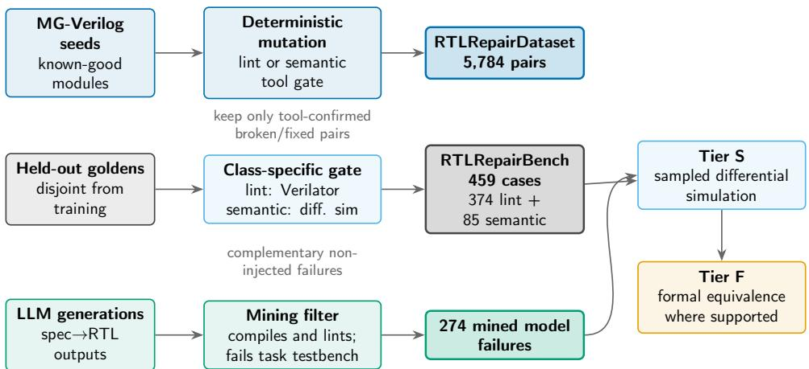
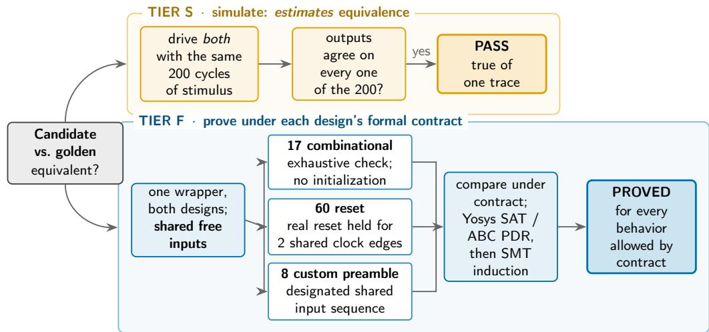

# What Do RTL Repair Benchmarks Actually Measure?

Yeyin (Eva) Zhu∗ NVIDIA evazhu@mit.edu

Rishabh Ranawat∗ Independent ranawat.rishabh@gmail.com

## Abstract

RTL repair benchmarks should measure whether a model can fix broken RTL given a specification. To this end, we construct and hash-bind RTLRepairDataset, 5,784 (broken, fixed) training pairs; RTLRepairBench, 459 held-out cases with 374 syntactic and 85 behavioral mutations; and an evaluation harness supporting simulation and formal equivalence. We then use this infrastructure to identify two measurement confounds. First, simulation and formal scoring give opposite signs for the apparent effect of providing a specification in one evaluated cohort; reset-aware rescoring attributes almost all of the simulation–formal disagreement to reset and first-cycle comparison semantics. Second, on 274 mined model failures, the specification-only minus specification-conditioned recovery point estimate ranges from 8.5 to +18.3 percentage points across six models. Thus, a conventional repair score need not isolate whether the model used the faulty RTL. We translate these findings into evaluation controls: report initialization, reset, first-cycle, and unknown-value semantics; disclose oracle coverage and undecided cases; and include a specification-only baseline. Together, the resources and audit provide both a benchmark for behavioral repair and a protocol for diagnosing what contributes to its measured score. We release the benchmark, the training set, construction code, sanitized aggregate evidence, and reproduction materials at https://github.com/Evaaaz/RTLRepairBench.

## 1 Introduction

Specification-to-RTL generation has been studied extensively, including work on RTLCoder [4], OriGen [2], and VeriReason [6]. Repair systems likewise use compiler, simulation, or testbench feedback to improve a candidate. Behavioral repair remains difficult to measure, however: a candidate can compile and still disagree with the intended design, and its score can depend on the oracle contract as well as on which inputs are supplied to the model.

We introduce a tool-gated pipeline and corresponding training and evaluation resources that separate compiler-diagnosed failures from lint-clean behavioral failures. We then use controlled ablations to audit two aspects of RTL-repair measurement: whether simulation and formal equivalence assign the same effect to a prompt intervention, and whether a successful output is a repair of the supplied RTL or a fresh implementation generated from the specification.

Contributions. We make three contributions. First, we construct and release RTLRepairDataset with its tool-gated builder, and release RTLRepairBench with gates that separate syntactic from behavioral failures. Second, we empirically identify two measurement confounds: sensitivity to reset and first-cycle comparison semantics, and the potential conflation of repair with specificationonly regeneration. Third, we convert these findings into concrete controls for RTL-repair evaluation, including explicit oracle contracts, oracle-coverage reporting, and specification-only baselines.

## 2 Related work

Generation and syntax repair. RTLCoder [4], OriGen [2], CRAFTRTL [3], CodeV [5], and VerilogDB [12] contribute models, data, or training procedures for spec RTL generation. RTL-Fixer [1] and OriGen’s self-reflection use compiler feedback to repair syntax or compilation failures. AutoChip [15] is broader: it uses both compiler and simulation feedback, including functional mismatches, to iteratively revise generated RTL. Our focus is complementary: we construct paired repair data and evaluate lint-clean behavioral failures under explicitly defined simulation and formal oracles.

Testbench-feedback, debugging, and semantic repair. Recent work in VeriReason [6], CodeV-R1 [11], and the method of Wang et al. [9] improves functional generation using testbench-derived rewards or preferences. VeriDebug [8] combines contrastive representations with guided Verilog correction, ARSP [7] targets functional repair through semantic partitioning, and VeriRAG [10] addresses the distinct problem of RTL repair for design-for-test compliance. RTLRepairBench differs by coupling a released paired repair resource with an audit of how oracle and input-condition choices change the measured outcome.

## 3 RTLRepairDataset, RTLRepairBench, and evaluation design

Figure 1 summarizes the pipeline, and Appendix B reports the exact split of the injected mutants. We ensure that RTLRepairDataset and RTLRepairBench use disjoint source seeds and that each broken/fixed pair is kept only when its class-specific gate confirms the injected failure. RTLRepair-Dataset contains 5,784 training pairs; RTLRepairBench contains 459 held-out cases, including four semantic operators unseen in training.

Training seeds originate from MG-Verilog [16, 17]; the held-out and decontamination pool uses VerilogEval [13] and RTLLM [14]. Normalized seed identifiers show no overlap between 1,895 distinct historical training seeds and the benchmark’s 130 distinct seeds. Appendix C reports the surviving snapshot and licensing records and their limits.

  
Figure 1: Tool-gated construction and evaluation. Training and held-out resources use disjoint seeds; mined model failures provide a complementary check beyond injected mutations.

Evaluation harness and oracle definitions. We have built an open-source evaluation harness that supports two types of oracles: Tier S: Simulation and Tier F: Formal Equivalence. Tier S runs the candidate and golden module for 200 cycles under identical sampled stimuli and checks their outputs at every compared cycle. The harness uses verilator [19] for linting and iverilog [20] for simulation. An observed mismatch is a counterexample under that trace and simulation contract, whereas agreement over 200 sampled cycles does not prove equivalence. Tier F applies the contract matched to each design: exhaustive combinational checking (17 cases), a declared reset sequence (60), or a designated preamble (8), followed by equivalence checking under stated initialization and unknown-value semantics. These assumptions matter when state is not fully initialized [18].

In the six-model subset selected for syntactic-repair recovery between 87.7% and 100.0%, behavioral recovery ranged descriptively from 10.6% to 75.3%. This subset exhibits a substantial gap while retaining the bug classes and oracle outcomes needed to investigate its source.

Mined failures. Synthetic mutations could introduce construction-specific bias. We therefore mine model-generated failures for which the spec RTL output compiles but fails the task testbench. We use this cohort to probe the relationship between specification and regeneration for repair tasks in Section 5.

## 4 Oracle sensitivity: the estimated specification effect reverses across contracts

To isolate the effect of the tool diagnostic and the specification provided to the models, we ran the evaluation with both oracles. This evaluation was restricted to the semantic candidates with definitive formal-equivalence verdicts (79 out of 85). We present the results for GPT-5.5 here for brevity, although we ran experiments across a variety of models.

Table 1: Same 79 cases (one retained candidate per arm), restricted to cases with definitive Tier F verdicts in both arms. Entries are passes/79 (percent); contrasts are +specification minus diagnostic from unrounded counts. Cycle 1 skips only the first comparison; reset-aware simulation applies the released two-edge reset heuristic and remains a bounded sampled test.
<table><tr><td>Scoring contract</td><td>Diagnostic</td><td>+ specification</td><td>Paired contrast</td></tr><tr><td>Tier S, cycles 0–199</td><td>60/79 (75.9%)</td><td>51/79 (64.6%)</td><td>-11.4 pp</td></tr><tr><td>Tier S, cycles 1–199</td><td>72/79 (91.1%)</td><td>78/79 (98.7%)</td><td>+7.6 pp</td></tr><tr><td>Tier S, reset-aware initialization</td><td>71/79 (89.9%)</td><td>78/79 (98.7%)</td><td>+8.9 pp</td></tr><tr><td>Tier F, per-design equivalence</td><td>71/79 (89.9%)</td><td>78/79 (98.7%)</td><td>+8.9 pp</td></tr></table>

Skipping only the first comparison reverses the descriptive contrast from 11.4 to +7.6 points. Reset-aware initialization changes one additional diagnostic-arm verdict; on this 79-case cohort its 158 verdicts coincide with Tier F. This agreement supports sensitivity to initialization and first-cycle semantics, but it does not make bounded simulation equivalent to formal proof.

This is an exploratory complete-case comparison from one greedy draw per arm, not a populationlevel effect estimate. Six of 85 cases lack a definitive Tier F verdict and are excluded; candidates also share source designs, so the 79 case outcomes should not be treated as independent replicates.

Within the definitive 79-case cohort, reset-aware rescoring cleared all 39 Tier-S-fail/Tier-F-proved outcomes (12 diagnostic-arm and 27 specification-arm). Across all 85 cases, it cleared 12/12 and 27/30 in the two arms, respectively. Reset and first-cycle semantics therefore explain almost all, but not every, observed simulation–formal disagreement. For benchmarks that rely on simulation matches [13, 14, 15], the reset sequence and first compared cycle are therefore part of the measurement definition and should be reported and audited.

## 5 Separating repair from specification-only regeneration

To test whether output correctness alone separates repair from fresh generation, each model received one of three inputs: (1) broken RTL without the specification, (2) broken RTL with the specification, or (3) the specification alone. The third arm is a necessary but not sufficient diagnostic: aggregate similarity between (2) and (3) cannot reveal whether an individual output used the broken RTL. We ran this evaluation on the 274-case mined dataset described in Section 3. Exact prompt templates and the surviving call and scoring settings are included in the released artifact.

Table 2 reports the six-model exploratory ablation after guarding the pre-initialization comparison. Each model starts from the same 274 failures; n is the intersection with a retained, scoreable candidate in all three arms. We report point estimates rather than nominal case-level p values because cases cluster within 112 source tasks and the panel was not designed for multiplicity-adjusted confirmatory inference.  
Table 2: Cycle-1 complete-case regeneration control. $\Delta _ { \mathrm { c 1 } }$ is specification-only minus specificationconditioned repair. Model names identify historical endpoint-output snapshots, not immutable provider revisions.
<table><tr><td>Model (family)</td><td>n</td><td>No spec</td><td>+spec</td><td>Spec only</td><td> $\Delta _ { \mathrm { c 1 } }$ </td></tr><tr><td>GPT-5.5 (OpenAI)</td><td>260</td><td>57.3%</td><td>81.5%</td><td>76.9%</td><td>-4.6 pp</td></tr><tr><td>Claude Opus 4.8 (Anthropic)</td><td>271</td><td>34.3%</td><td>71.6%</td><td>69.0%</td><td>-2.6 ppP</td></tr><tr><td>GPT-5.4-mini (OpenAI)</td><td>274</td><td>29.6%</td><td>51.5%</td><td>56.9%</td><td>+5.5 pp</td></tr><tr><td>GPT-4.1 (OpenAI)</td><td>271</td><td>27.3%</td><td>46.5%</td><td>38.0%</td><td>−8.5 pp</td></tr><tr><td>GPT-4o-mini (OpenAI)</td><td>274</td><td>19.0%</td><td>39.1%</td><td>41.2%</td><td>+2.2 pp</td></tr><tr><td>Claude Opus 4.6 (Anthropic)</td><td>273</td><td>9.5%</td><td>51.6%</td><td>70.0%</td><td>+18.3 pp</td></tr></table>

Specification-only recovery exceeds no-specification recovery for every model. Relative to specification-conditioned repair, however, the observed specification-only point estimate is lower for three models and higher for three, with $\Delta _ { \mathrm { c 1 } }$ ranging from 8.5 to +18.3 points. These results do not establish that a model ignored the faulty RTL internally; they show that output correctness alone cannot identify whether success arose from repair or regeneration. The specification-only arm exposes this ambiguity but does not resolve the mechanism.

## 6 Conclusion

Tool-diagnosed syntactic errors are easier for models to fix than behavioral bugs that compile cleanly for the evaluated models. RTLRepairDataset and RTLRepairBench make it possible to quantify this gap through a released, hash-bound training resource and its builder, a held-out evaluation set, mutation labels, and explicit oracle outcomes. The audit also shows that simulation and formalequivalence scores can disagree substantially, with reset and first-cycle semantics explaining almost all observed false divergences, and that a correct output need not demonstrate use of the supplied faulty RTL. More explicit oracle contracts and regeneration controls can therefore reduce misleading RTL-repair claims and improve reproducibility.

These findings motivate four reporting controls for RTL repair benchmarks: (1) separate syntactic from behavioral bugs; (2) state initialization, reset, first-comparison-cycle, and unknown-value semantics; (3) include a specification-only baseline as a diagnostic for possible regeneration; and (4) report oracle coverage and undecided cases. The baseline in (3) is necessary but not sufficient for mechanism attribution. These controls make the interpretation of a repair score reproducible alongside the score itself. A repair system or benchmark score can nevertheless create false confidence if deployed as a substitute for verification; generated RTL should continue to undergo independent simulation, formal analysis where supported, and human design review.

Limitations and Future Work. Our findings are descriptive and limited by the evaluated cohort sizes, a predominantly single-draw setting, and historical model-output snapshots. Future work should test repeated samples, a broader model roster, and larger and more diverse RTL designs to assess how well the findings generalize.

## References

[1] Y.-D. Tsai, M. Liu, and H. Ren. RTLFixer: Automatically Fixing RTL Syntax Errors with Large Language Model. DAC, 2024. https://doi.org/10.1145/3649329.3657353.

[2] F. Cui et al. OriGen: Enhancing RTL Code Generation with Code-to-Code Augmentation and Self-Reflection. ICCAD, 2024; arXiv:2407.16237.

[3] M. Liu, Y.-D. Tsai, W. Zhou, and H. Ren. CraftRTL: High-quality Synthetic Data Generation for Verilog Code Models with Correct-by-Construction Non-Textual Representations and Targeted Code Repair. ICLR, 2025; arXiv:2409.12993.

[4] S. Liu, W. Fang, Y. Lu, J. Wang, Q. Zhang, H. Zhang, and Z. Xie. RTLCoder: Fully Open-Source and Efficient LLM-Assisted RTL Code Generation Technique. IEEE TCAD, 44(4):1448–1461, 2025. https://doi.org/10.1109/TCAD.2024.3483089.

[5] Y. Zhao et al. CodeV: Empowering LLMs with HDL Generation through Multilevel Summarization. IEEE TCAD, 45(4):1893–1906, 2026. https://doi.org/10.1109/TCAD.2025.3604320.

[6] Y. Wang, G. Sun, W. Ye, G. Qu, and A. Li. VeriReason: Reinforcement Learning with Testbench Feedback for Reasoning-Enhanced Verilog Generation. GLSVLSI, pages 948–953, 2026. https://doi.org/10.1145/3787109.3815310.

[7] B. Yao, N. Wang, X. Liu, Y. Du, Y. Hu, H. Gao, Z. Jiang, and N. Guan. ARSP: Automated Repair of Verilog Designs via Semantic Partitioning. arXiv:2508.16517, 2025.

[8] N. Wang, B. Yao, J. Zhou, Y. Hu, X. Wang, Z. Jiang, and N. Guan. VeriDebug: A Unified LLM for Verilog Debugging via Contrastive Embedding and Guided Correction. ICLAD, pages 61–67, 2025. https://doi.org/10.1109/ICLAD65226.2025.00026.

[9] N. Wang, B. Yao, J. Zhou, Y. Hu, X. Wang, N. Guan, and Z. Jiang. Insights from Verification: Training a Verilog Generation LLM with Reinforcement Learning with Testbench Feedback. arXiv:2504.15804, 2025.

[10] H. Qi, Y. Du, L. Zhang, S. C. Liew, K. Chen, and Y. Du. VeriRAG: A Retrieval-Augmented Framework for Automated RTL Testability Repair. ISQED, 2026. https://doi.org/10.1109/ISQED69900.2026.11534732.

[11] Y. Zhu et al. QiMeng-CodeV-R1: Reasoning-Enhanced Verilog Generation. NeurIPS, 2025; arXiv:2505.24183.

[12] P. E. Calzada, Z. Ibnat, T. Rahman, K. Kandula, D. Lu, S. K. Saha, F. Farahmandi, and M. Tehranipoor. VerilogDB: The Largest, Highest-Quality Dataset with a Preprocessing Framework for LLM-based RTL Generation. arXiv:2507.13369, 2025.

[13] N. Pinckney, C. Batten, M. Liu, H. Ren, and B. Khailany. Revisiting VerilogEval: A Year of Improvements in Large-Language Models for Hardware Code Generation. ACM TODAES, 30(6):91:1–91:20, 2025. https://doi.org/10.1145/3718088.

[14] Y. Lu, S. Liu, Q. Zhang, and Z. Xie. RTLLM: An Open-Source Benchmark for Design RTL Generation with Large Language Model. ASP-DAC, pages 722–727, 2024. https://doi.org/10.1109/ASP-DAC58780.2024.10473904.

[15] S. Thakur et al. AutoChip: Automating HDL Generation Using LLM Feedback. arXiv:2311.04887, 2024 revision. https://arxiv.org/abs/2311.04887.

[16] Y. Zhang, Z. Yu, Y. Fu, C. Wan, and Y. C. Lin. MG-Verilog: Multi-grained Dataset Towards Enhanced LLM-assisted Verilog Generation. IEEE LAD, 2024. https://doi.org/10.1109/LAD62341.2024.10691738.

[17] GaTech-EIC. MG-Verilog dataset. https://huggingface.co/datasets/GaTech-EIC/MG-Verilog.

[18] YosysHQ. Equivalence and X-Propagation. EQY documentation, 2026. https://yosyshq.readthedocs.io/projects/eqy/en/latest/xprop.html.

[19] W. Snyder et al. Verilator: Open-source SystemVerilog simulator and lint system. https://verilator.org.

[20] S. Williams. Icarus Verilog. https://steveicarus.github.io/iverilog/.

[21] C. Wolf. Yosys Open SYnthesis Suite. https://yosyshq.net/yosys/.

[22] R. Brayton and A. Mishchenko. ABC: An Academic Industrial-Strength Verification Tool. CAV, LNCS 6174, pages 24–40, 2010. https://doi.org/10.1007/978-3-642-14295-6\_5.

## A Oracle definitions

  
Figure 2: High-level structure of the Tier S and Tier F oracles. Tier S agreement is evidence for one sampled trace; Tier F applies a design-matched combinational, reset, or preamble contract before attempting a proof with Yosys [21] SAT, ABC [22] PDR, and SMT induction.

## B Mutation distribution

Table 3: Mutation inventory and validation gates. A dash marks an operator absent from that split. RTLRepairBench includes four semantic operators that do not appear in RTLRepairDataset.
<table><tr><td>bucket</td><td>operator (what it breaks)</td><td>train</td><td></td><td>bench validation gate</td></tr><tr><td rowspan="6">lint</td><td>drop_endmodule — deletes the closing endmodule</td><td>1,000</td><td>130</td><td rowspan="6"></td></tr><tr><td>delete_semicolon — drops a statement terminator</td><td>1,000</td><td>130</td></tr><tr><td>drop_one_end — unbalances a begin/end block</td><td>1,000</td><td>55</td></tr><tr><td>rename_declaration — renames a declaration; its uses go undeclared</td><td>1,000</td><td>23</td></tr><tr><td>blocking_in_seq — = for &lt;= in a clocked block</td><td>1,000</td><td>36</td></tr><tr><td>width_mismatch — pins a parameterized vector to [3:0]</td><td>403</td><td></td></tr><tr><td rowspan="6"></td><td>op_swap — + ↔ - and &amp; ↔ I</td><td>300</td><td>20</td><td></td></tr><tr><td>flip_reset_polarity — drops the ! from an active-low reset test</td><td>81</td><td>2</td><td>differential iverilog sim</td></tr><tr><td>flip_equality — == ↔ !=</td><td></td><td>22</td><td></td></tr><tr><td>swap_ternary — swaps the two arms of a mux</td><td></td><td>20</td><td></td></tr><tr><td>swap_logical — &amp;&amp; ↔ |1</td><td></td><td>17</td><td></td></tr><tr><td>off_by_one_literal — nudges a sized literal by ±1</td><td></td><td>4</td><td></td></tr><tr><td>total</td><td></td><td>5,784</td><td>459</td><td></td></tr></table>

## C Data provenance and historical model metadata

Table 4: Surviving upstream records. “MIT” is the upstream repository or dataset-card declaration, not a project grant over every derived row.
<table><tr><td>Asset</td><td>surviving revision record</td><td>role</td><td>release boundary</td></tr><tr><td>MG-Verilog</td><td>82944845640b. . . (dataset snapshot), MIT</td><td>training seeds</td><td>training file released</td></tr><tr><td>VerilogEval</td><td>c498220 (abbreviated), MIT</td><td>held-out/mined tasks</td><td>benchmark released</td></tr><tr><td>RTLLM</td><td>41b2689 (abbreviated), MIT</td><td>decontamination/legacy probes</td><td>no legacy probe claim</td></tr></table>

The historical training output contains 1,895 distinct seeds; the released benchmark contains 130. We normalized seed identifiers before splitting and found zero overlap. The released training file has 5,775 pairs: relative to Table 3, it lacks 6 rename\_declaration and 3 width\_mismatch pairs. Table 1’s archive records the served alias azure/openai/gpt-5.5, greedy decoding, and a matched 4,096-token output budget. For the cross-model panel, retained scored outputs and aggregates survive, but exact immutable provider revisions, call times, and some request metadata do not. Consequently, all model labels denote historical endpoint-output snapshots rather than reproducible model versions.