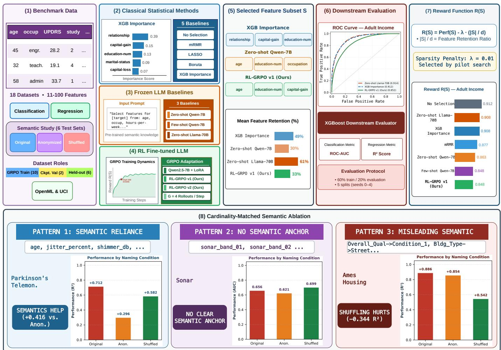
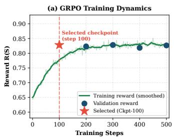
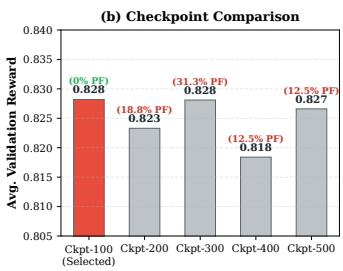
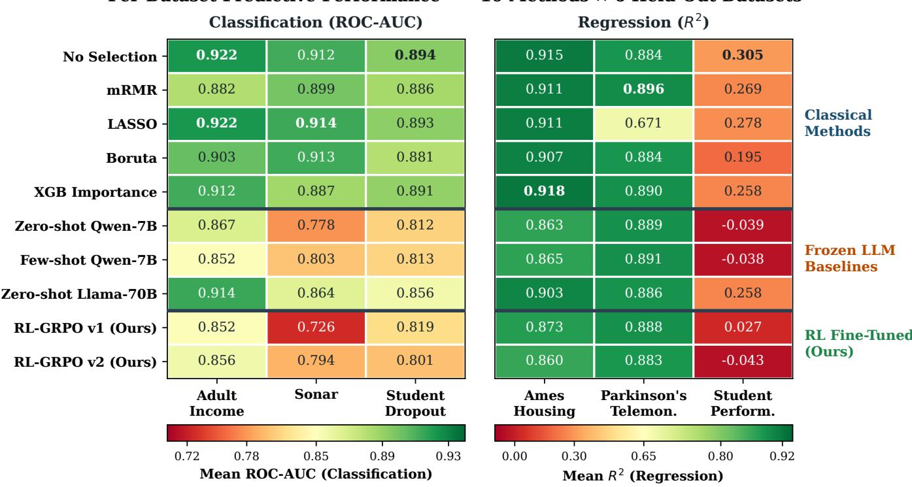
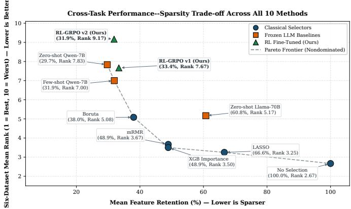
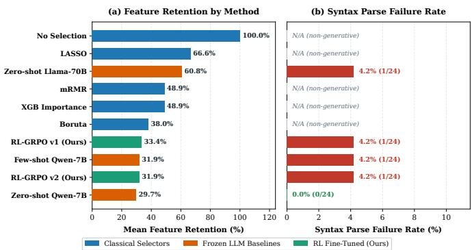
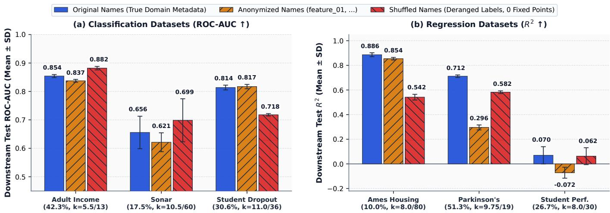

# When Do LLMs Help with Feature Selection? A Systematic Empirical Study

Fateme Memar

Department of Electrical Engineering

and Computer Science

University of Kansas

Lawrence, KS 66045, USA

amemar@ku.edu

Dongjie Wang

School of Information Science

China wangdongjie100@nenu.edu.cn

Arvin Agah Arvin Agah

Department of Electrical Engineering and Computer Science University of Kansas Lawrence, KS 66045, USA agah@ku.edu

Abstract—Large language models (LLMs) can leverage semantic feature names alongside summary statistics for tabular feature selection, yet it remains unclear when such information improves subset selection relative to established statistical methods. We investigate this question within an 18-dataset framework comprising 10 datasets for Group Relative Policy Optimization (GRPO) training, 2 for checkpoint validation, and 6 held-out evaluation datasets. We compare five classical baselines, frozen Qwen2.5-7B and Llama-3.3-70B selectors, and two GRPO-adapted Qwen2.5-7B models, reporting classification ROC-AUC and regression R2 separately and using dataset-wise ranks for cross-task comparison. Across five seeded evaluation partitions, classical selectors generally achieve higher predictive performance than the tested 7B LLM/RL selectors, including under a pre-specified ∼33% feature budget with strict trainonly classical fitting, while the 7B selectors retain compact subsets. A cardinality-matched semantic sensitivity experiment shows that, for Zero-shot Qwen-7B, informative feature names improve regression performance over anonymized and shuffled alternatives (+0.1964 and +0.1606 mean R2), whereas aggregate classification differences are smaller (+0.0159 and +0.0084 ROC-AUC) and dataset-dependent. These results characterize when semantic information benefits LLM-based feature selection and show that classical selectors remain strong baselines for predictive tabular feature selection.

Index Terms—feature selection, large language models, reinforcement learning, tabular data, semantic ablation

## I. INTRODUCTION

Feature selection—identifying a compact, informative subset of features before training a downstream predictor— is a foundational preprocessing decision in tabular machine learning [1], [2]. Irrelevant or redundant variables increase computational cost, obscure interpretability, and degrade generalization. Classical selectors such as minimum Redundancy Maximum Relevance (mRMR) [3], LASSO [4], Boruta [5], and tree-based importance [6] estimate feature utility from statistical relationships between inputs and targets, without explicitly exploiting real-world meaning in feature names.

Large language models (LLMs) introduce a different information source for feature selection [7], [8]. Models such as Qwen2.5-7B [9] and Llama-3.3-70B [10] combine semantic priors in feature names with coarse distributional summaries to propose compact subsets [11], [12]. Although recent work has explored LLM-based feature engineering and tabular reasoning [13]–[16], an important question remains: what information do LLM feature selectors exploit, when do semantic priors help or mislead, and how do their sparsity–performance trade-offs compare with classical selectors under controlled information and feature-budget conditions?

We organize the study around three research questions:

• RQ1 (Performance and sparsity): How do frozen-LLM, GRPO-adapted, and classical selectors compare across held-out tabular datasets in predictive performance and feature retention?

• RQ2 (Semantic mechanism): How much do meaningful feature names contribute when subset cardinality is controlled and dataset and target identities are masked?

• RQ3 (Robustness and controlled baselines): Are the comparisons stable across five seeded evaluation partitions, task-separated evaluation, and train-only classical selectors under an approximately matched feature budget?

To address these questions, we combine a held-out benchmark with two controlled experiments. A cardinality-matched semantic diagnostic compares Original, Anonymized, and Shuffled feature identities while masking dataset and target identities, and a train-only classical top-k control evaluates classical selectors under a one-third feature budget. Classification ROC-AUC and regression R2 are analyzed separately, using dataset-wise ranks for cross-task summaries and five seeded evaluation partitions to quantify variability.

Key findings. First, classical selectors generally provide stronger predictive performance than the tested LLM/RL selectors, including under the matched-budget, train-only control, while the 7B selectors produce compact subsets. Second, after controlling subset cardinality, meaningful feature names substantially improve Zero-shot Qwen-7B selection on the regression tasks, whereas classification effects are smaller and dataset-dependent. Third, GRPO adaptation changes selection behavior but does not yield consistent predictive superiority over either frozen LLM or classical alternatives.

Contributions. Rather than positioning LLMs as replacements for classical feature selectors, we characterize how semantic information, sparsity constraints, and RL adaptation interact in tabular feature selection:

1) Controlled feature-selection benchmark: We compare classical, frozen-LLM, and GRPO-adapted selectors in an 18-dataset training/validation/held-out framework.

2) Cardinality-matched semantic diagnostic: We introduce an exact-k three-condition experiment separating feature-name semantics from subset-size confounding.

  
Fig. 1. Overview of the experimental framework. The 18 datasets are partitioned into 10 for GRPO training, 2 for checkpoint validation, and 6 held-out evaluation datasets. Classical, frozen-LLM, and GRPO-adapted selectors are compared using task-separated ROC-AUC and $\scriptstyle \mathbf { \hat { \phi } } _ { R ^ { 2 } }$ , with additional cardinality matched semantic and train-only matched-budget controls.

3) Robustness and matched-budget controls: We use fivepartition uncertainty, task-separated rank evaluation, and train-only classical top-k controls.

## II. RELATED WORK

## A. Classical Feature Selection

Feature-selection methods are commonly categorized as filter, wrapper, and embedded approaches [1], [2], [17], [18]. Representative methods include mRMR [3], which balances target relevance and inter-feature redundancy; Boruta [5], an all-relevant random-forest wrapper; LASSO [4], which induces sparsity through $\ell _ { 1 }$ regularization; and XGBoost importance [6], which ranks features by tree-based gain. Unlike posthoc attribution methods such as SHAP [19] and LIME [20], our study focuses on pre-training subset selection and uses these four selectors alongside a No Selection control.

## B. Large Language Models for Tabular and Feature Tasks

LLMs are increasingly applied to tabular prediction and feature engineering. TabLLM [15], LIFT [21], and TableLlama [16] adapt LLMs to tabular tasks, while LMPriors [11], CAAFE [13], FeatLLM [14], and LLM-Select [12] use semantic metadata for feature construction or selection. However, the effect of feature-name semantics remains difficult to separate from subset size and evaluation protocol. We address this gap via cardinality-matched semantic interventions and controlled comparisons with classical and GRPO-adapted selectors.

## C. Reinforcement Learning for LLM Fine-Tuning

Reinforcement learning is widely used to align language models with task objectives [22]. PPO [23], DPO [24], and KTO [25] provide optimization paradigms, while GRPO [26], [27] estimates relative advantages from groups of sampled completions without a separate value critic. We combine GRPO with LoRA [28] using TRL [29] to optimize a downstream performance–sparsity objective for feature selection.

## D. Tabular Data Learning

Tree-based ensembles remain highly competitive on heterogeneous tabular data [30]–[32]. Neural alternatives include TabNet [33], TabTransformer [34], FT-Transformer [35], SAINT [36], and the TabPFN foundation-model family [37]. Given the continued strength of boosted trees, we use XG-Boost [6] as a fixed downstream evaluator across OpenML [38] and UCI [39] datasets.

## III. PROBLEM FORMULATION

## A. Feature Selection as Subset Search

Let $\mathbf { \mathcal { D } } = \{ ( \mathbf { x } _ { i } , y _ { i } ) \} _ { i = 1 } ^ { n }$ contain n observations and d candidate features $\mathcal { F } ~ = ~ \{ f _ { 1 } , \ldots , f _ { d } \}$ . A selector produces $S \subseteq { \mathcal { F } }$ evaluated by predictive performance and feature retention |S|/d [1]. For classification and regression tasks,

$$
\operatorname { P e r f } ( S ) = { \left\{ \begin{array} { l l } { \operatorname { A U C } ( S ) , } & { { \mathrm { c l a s s i f i c a t i o n } } , } \\ { R ^ { 2 } ( S ) , } & { { \mathrm { r e g r e s s i o n } } . } \end{array} \right. }\tag{1}
$$

ROC-AUC and $R ^ { 2 }$ are analyzed separately, with dataset-wise ranks used for cross-task summaries.

## B. Performance–Sparsity Reward

We define

$$
R ( S ) = \operatorname { P e r f } ( S ) - \lambda { \frac { | S | } { d } } ,\tag{2}
$$

where λ controls the sparsity penalty. We use $\lambda ~ = ~ 0 . 0 1$ selected by pilot search, and evaluate subsets with a fixed XGBoost downstream predictor [6]. This reward guides GRPO training, while ROC-AUC and $R ^ { 2 }$ remain the primary metrics.

## C. Feature-Selection Paradigms

We compare three mechanisms for constructing S:

1) Classical Statistical Selection. mRMR [3], LASSO [4], Boruta [5], and XGBoost importance [6] infer feature utility from tabular relationships; No Selection retains all features.

2) Frozen LLM Selection. Zero-shot and Few-shot Qwen-7B [9] and Zero-shot Llama-70B [10] select features from feature names and summary statistics without fine-tuning.

3) GRPO-Adapted LLM Selection. Qwen2.5-7B is adapted with GRPO [26], [27] and LoRA [28] using Eq. (2).

## D. Cardinality-Matched Semantic Diagnostic

To isolate feature-name semantics from subset size, we evaluate Zero-shot Qwen-7B under Original, Anonymized, and Shuffled features with dataset and target identities masked. For dataset d and completion c, cardinality is matched:

$$
| S _ { d , c } ^ { \mathrm { o r i g } } | = | S _ { d , c } ^ { \mathrm { a n o n } } | = | S _ { d , c } ^ { \mathrm { s h u f } } | .\tag{3}
$$

Original–Anonymized differences capture informative feature semantics, while Original–Shuffled differences capture sensitivity to misleading semantics at fixed cardinality.

## IV. METHOD

## A. LLM Feature-Selection Pipeline

Prompt construction. For each dataset, PromptBuilder creates a prompt containing dataset/task metadata and perfeature summaries. Numeric features include mean, standard deviation, range, and missing rate; categorical features include the top three category frequencies and missing rate. No individual rows, instance-level targets, or external descriptions are provided. Summary statistics are computed at the dataset level before downstream partitioning. Few-shot Qwen-7B prepends two exemplars drawn only from the 10 training datasets, using the top $\lfloor d / 2 \rfloor$ XGBoost-ranked features.

Output parsing. Using tag\_first=True, all LLM/RL selectors return

$$
\mathrm { S E L E C T E D \_ F E A T U R E S : } \quad [ ^ { \mathfrak { n } } \pounds \in \mathrm { a t u r e \_ a ^ { \mathfrak { n } } } , \quad \ . \ . \ . \mathrm { \textrm { \cite { H h t h a t i t h a t i t h a t i t h } } } ]
$$

  
Fig. 2. RL-GRPO v1 training and validation rewards across checkpoints 100– 500; Checkpoint-100 achieves the highest mean validation reward (0.8282).

OutputParser extracts the final tagged list, validates tokens against the feature set $V ,$ removes duplicates, and discards hallucinated names. Missing, invalid, or empty outputs trigger a keep-all fallback $\mathbf { \Omega } ( S { \mathbf \Omega } ) = { \mathbf \Omega } V )$ and are flagged with parse\_ok=False.

## B. GRPO Adaptation

We use Qwen2.5-7B-Instruct [9] as the RL base model and evaluate frozen Qwen-7B and 4-bit Llama-3.3-70B-Instruct [10] baselines. LoRA [28] is applied to q\_proj, k\_proj, v\_proj, and o\_proj with $r ~ = ~ 1 6 , ~ \alpha ~ = ~ 3 2$ dropout 0.05, and no bias.

GRPO [26], [27] is implemented with TRL [29]. For each prompt, the policy generates G = 4 completions, each parsed into $S _ { g }$ and scored by Eq. (2). Rewards are averaged across five seeded partitions of the current training dataset and normalized within the group to form relative advantages. Updates use KL regularization with $\beta = 0 . 1$ against the frozen reference model. Repeated subset evaluations are cached to avoid redundant XGBoost scoring.

## C. Training and Checkpoint Selection

The 18 datasets are split into 10 GRPO-training, 2 validation, and 6 held-out evaluation datasets; held-out datasets are excluded from GRPO training, few-shot exemplars, and checkpoint selection. The sparsity weight λ = 0.01 is selected from $\{ 0 . 0 1 , 0 . 0 2 , 0 . 0 3 , 0 . 0 5 , 0 . 1 0 , 0 . 1 5 , 0 . 2 0 \}$ on heart disease and fixed thereafter.

Both GRPO variants use Qwen2.5-7B-Instruct with batch size 1, learning rate $1 0 ^ { - 6 }$ , maximum gradient norm 0.1, gradient checkpointing, and maximum completion length 1024.

• RL-GRPO v1: Trained for 500 steps with temperature 0.7 and checkpoints every 100 steps. Checkpoint-100 attains the highest mean validation reward (0.8282) on mice protein and communities crime and is selected without consulting held-out datasets.

• RL-GRPO v2: Trained separately for 1,500 steps from the base model with newly initialized LoRA adapters and evaluated at the terminal checkpoint without validationbased checkpoint selection. Thus, v1 and v2 represent distinct GRPO configurations rather than an isolated training-duration comparison.

## D. Inference and Reproducibility

Each LLM/RL selector generates $\begin{array} { r l r } { K } & { { } = } & { 4 } \end{array}$ stochastic completions per dataset with temperature 0.7 and max\_new\_tokens=512. The four completion scores are averaged within each of five seeded evaluation partitions (seeds 0–4) to yield one observation per dataset–method pair and avoid pseudoreplication. Selection consistency is measured by mean pairwise Jaccard similarity over valid completions. Experiments use Py-Torch, HuggingFace transformers, peft, trl v0.29.1, scikit-learn [40], and xgboost [6].

## V. EXPERIMENTAL SETUP

## A. Datasets and Dataset Roles

We use 18 OpenML [38] and UCI [39] datasets: 10 for GRPO training (heart disease, german credit, wine quality, bank marketing, breast cancer, dermatology, ionosphere, spambase, optical digits, geo music), 2 for checkpoint validation (mice protein, $d = 7 7 ;$ communities crime, d = 100), and 6 for held-out evaluation (adult income, d = 13; parkinsons telemonitoring, $d = 1 9 ;$ ; student performance, d = 30; student dropout, $d \ = \ 3 6 ;$ sonar, $d \ = \ 6 0 ;$ ames housing, $d = 8 0 )$ , spanning classification and regression (d = 11–100). Held-out datasets are excluded from GRPO training, few-shot exemplars, reward updates, and checkpoint selection.

## B. Compared Methods

We compare ten configurations: No Selection; mRMR [3] and XGB Importance [6] $( \lfloor d / 2 \rfloor$ features), LASSO [4], and Boruta [5]; frozen Zero-shot and Few-shot Qwen-7B [9] and Zero-shot Llama-70B [10]; and RL-GRPO v1/v2.

In the primary benchmark, classical selectors are fitted on the full preprocessed dataset before downstream partitioning, whereas LLM selectors receive dataset-level summaries rather than row-level instances and labels. We therefore include a strict train-only matched-budget classical control (Section V-E) to address this information-regime asymmetry.

## C. Evaluation Protocol and Metrics

All methods are evaluated on the six held-out datasets across five seeded evaluation partitions (seeds 0–4); seed 42 is retained only as a reproduction reference and excluded from the $N = 5$ sample. Each partition uses 60% training, 20% evaluation, and 20% unused data, stratified for classification. A fixed XGBoost [6] model (100 estimators, maximum depth 4, learning rate 0.1, row/column subsample 0.8, seed s) is trained on the 60% training split using the selected subset S and evaluated on the corresponding 20% split.

For stochastic LLM/RL selectors, the K = 4 completion scores are averaged within each partition first, yielding N = 5 partition-level observations per dataset–method pair. We report classification ROC-AUC and regression $R ^ { 2 }$ separately, feature retention |S|/d, reward R(S), and dataset-wise performance ranks for cross-task summaries. Across partitions, we report mean±SD and descriptive t-based 95% confidence intervals; LLM/RL reliability is summarized by parse-failure rate and mean pairwise Jaccard similarity over valid completions.

## D. Cardinality-Matched Semantic Diagnostic

Zero-shot Qwen-7B is evaluated under Original, Anonymized, and Shuffled feature-name conditions across all six held-out datasets, with $K \ = \ 4$ completions per condition and the same five seeded evaluation partitions. Dataset and target names are masked in all conditions. For each dataset d and completion c, all three conditions use the exact cardinality $k _ { d , c }$ of the corresponding Original completion, enforcing ∆Retention = 0%. Shuffled names are assigned by a strict derangement with zero fixed points and mapped back to their true columns before evaluation. Prompt summary statistics remain unchanged across conditions. Selections are ordered by importance and truncated to $k _ { d , c }$ when necessary; outputs with fewer than $k _ { d , c }$ valid features are retried up to three times without random padding. No parse or exact-k failures occurred across the 72 generations.

## E. Train-Only Matched-Budget Classical Control

To control both information regime and subset size, we evaluate train-only classical selectors at a pre-specified budget matching RL-GRPO v1’s 33.37% mean retention:

$$
k _ { d } = \operatorname* { m a x } \bigl ( 1 , \operatorname { r o u n d } ( 0 . 3 3 3 7 d ) \bigr ) .\tag{4}
$$

This yields 32.68% mean realized retention across the six heldout datasets. Within each seed-specific partition (after initial dataset-level missing-value filtering and categorical encoding), mRMR Top-k, XGB Importance Top-k, and LASSO Top-k are fitted strictly on the 60% training split with no access to evaluation rows or labels; LASSO standardization is also fit train-only. LASSO ranks features by standardized coefficient magnitude. Boruta is omitted because its all-relevant procedure does not provide a strict top-k ordering.

## VI. RESULTS

## A. Overall Comparison

Table I reports performance across five seeded evaluation partitions for all 10 methods on the six held-out datasets. ROC-AUC and $R ^ { 2 }$ are reported separately, with dataset-wise ranks averaged across the six datasets for cross-task comparison and feature retention used to characterize sparsity.

1) RL Fine-Tuning vs. Base Model. RL-GRPO v1 improves mean regression $R ^ { 2 }$ over frozen Qwen-7B (0.596 vs. 0.571), mitigating its negative $R ^ { 2 }$ on student performance (+0.027 vs. −0.039), improving ames housing (0.873 vs. 0.863), and remaining similar on parkinsons telemonitoring (0.888 vs. 0.889). On classification, v1 improves on student dropout (0.819 vs. 0.812) but decreases on adult income (0.852 vs. 0.867) and sonar (0.726 vs. 0.778), lowering ROC-AUC from 0.819 to 0.799. Thus, GRPO adaptation produces a task-dependent trade-off rather than uniform improvement.

2) RL Fine-Tuning vs. Large Frozen LLM. Zero-shot Llama-70B achieves stronger aggregate performance than RL-GRPO v1, with mean classification ROC-AUC 0.878 vs. 0.799, regression $R ^ { 2 }$ 0.682 vs. 0.596, and rank 5.17 vs. 7.67. The exception is parkinsons telemonitoring, where v1 slightly exceeds Llama-70B (0.888 vs. 0.886). This advantage is accompanied by denser selection (60.8% vs. 33.4% retention).

3) Five-Partition Uncertainty and Parse Reliability. With only N = 5 partitions, even a unanimous 5–0 paired difference yields a minimum two-sided exact Wilcoxon $p \ = \ 0 . 0 6 2 5$ before multiplicity correction; comparisons are therefore interpreted descriptively rather than as evidence of statistical significance. Parse failures were 0/24 for Zero-shot Qwen-7B and 1/24 (4.2%) for each remaining LLM/RL method.

Per-Dataset Predictive Performance — 10 Methods × 6 Held-Out Datasets  
TABLE I  
PREDICTIVE PERFORMANCE ACROSS THE 6 HELD-OUT DATASETS OVER N = 5 SEEDED EVALUATION PARTITIONS (MEAN ± SD). CLASSIFICATION REPORTS ROC-AUC AND REGRESSION REPORTS R2; SUMMARY COLUMNS GIVE TASK-SPECIFIC MEANS, 6-DATASET MEAN RANK (1 = BEST), AND MEAN FEATURE RETENTION. BEST PREDICTIVE-PERFORMANCE AND RANK VALUES ARE BOLD.
<table><tr><td></td><td></td><td colspan="3">Classification (ROC-AUC)</td><td colspan="3">Regression (R2)</td><td colspan="4">Task-Separated Summary</td></tr><tr><td>Method</td><td>Category</td><td>Adult</td><td>Sonar</td><td>Dropout</td><td>Ames</td><td>Park.</td><td>Perform.</td><td>Clf AUC</td><td>Reg R2</td><td>Rank↓</td><td>Feat%</td></tr><tr><td>No Selection</td><td>Classical</td><td>0.922±.003</td><td>0.912±.042</td><td>0.894±.008</td><td>0.915±.009</td><td>0.884±.005</td><td>0.305±.056</td><td>0.909</td><td>0.701</td><td>2.67</td><td>100%</td></tr><tr><td>mRMR [3]</td><td>Classical</td><td>0.882±.004</td><td>0.899±.067</td><td>0.886±.009</td><td>0.911±.010</td><td>0.896±.006</td><td>0.269±.043</td><td>0.889</td><td>0.692</td><td>3.67</td><td>49%</td></tr><tr><td>LASSO [4]</td><td>Classical</td><td>0.922±.003</td><td>0.914±.036</td><td>0.893±.009</td><td>0.911±.008</td><td>0.671±.013</td><td>0.278±.054</td><td>0.910</td><td>0.620</td><td>3.25</td><td>67%</td></tr><tr><td>Boruta [5]</td><td>Classical</td><td>0.903±.003</td><td>0.913±.053</td><td>0.881±.009</td><td>0.907±.010</td><td>0.884±.005</td><td>0.195±.057</td><td>0.899</td><td>0.662</td><td>5.08</td><td>38%</td></tr><tr><td>XGB Imp. [6]</td><td>Classical</td><td>0.912±.002</td><td>0.887±.026</td><td>0.891±.008</td><td>0.918±.006</td><td>0.890±.015</td><td>0.258±.105</td><td>0.897</td><td>0.689</td><td>3.50</td><td>49%</td></tr><tr><td>Zero-shot Qwen-7B [9]</td><td>Frozen LLM</td><td>0.867±.005</td><td>0.778±.046</td><td>0.812±.009</td><td>0.863±.021</td><td>0.889±.009</td><td>−0.039±.044</td><td>0.819</td><td>0.571</td><td>7.83</td><td>30%</td></tr><tr><td>Few-shot Qwen-7B [9]</td><td>Frozen LLM</td><td>0.852±.006</td><td>0.803±.045</td><td>0.813±.007</td><td>0.865±.018</td><td>0.891±.013</td><td>−0.038±.043</td><td>0.823</td><td>0.573</td><td>7.00</td><td>32%</td></tr><tr><td>Zero-shot Llama-70B [10]</td><td>Frozen LLM</td><td>0.914±.003</td><td>0.864±.059</td><td>0.856±.009</td><td>0.903±.011</td><td>0.886±.005</td><td>0.258±.064</td><td>0.878</td><td>0.682</td><td>5.17</td><td>61%</td></tr><tr><td>RL-GRPO v1 (Ours) [26]</td><td>RL Fine-Tuned</td><td>0.852±.005</td><td>0.726±.057</td><td>0.819±.009</td><td>0.873±.015</td><td>0.888±.012</td><td>+0.027±.027</td><td>0.799</td><td>0.596</td><td>7.67</td><td>33%</td></tr><tr><td>RL-GRPO v2 (Ours) [26]</td><td>RL Fine-Tuned</td><td>0.856±.005</td><td>0.794±.051</td><td>0.801±.008</td><td>0.860±.013</td><td>0.883±.007</td><td>−0.043±.042</td><td>0.817</td><td>0.567</td><td>9.17</td><td>32%</td></tr></table>

  
Fig. 3. Per-dataset mean predictive performance across the 10 methods over N = 5 seeded evaluation partitions.

Figure 3 shows the same per-dataset pattern summarized in Table I: classical selectors generally rank more strongly, whereas the 7B LLM selectors retain substantially fewer features. We therefore next examine the performance–sparsity trade-off and a matched-budget classical control.

## B. Performance–Sparsity Trade-off

Figure 4 shows a trade-off rather than a uniformly dominant selector. Classical methods achieve stronger predictive ranks with higher retention, whereas the 7B LLM selectors retain 29.7%–33.4% of features but rank more weakly overall. The

Pareto frontier includes Zero-shot Qwen-7B, Few-shot Qwen-7B, Boruta, XGB Importance, LASSO, and No Selection. Among 7B methods, Few-shot Qwen-7B achieves rank 7.00 at 31.9% retention, compared with 7.67 at 33.4% for RL-GRPO v1 and 9.17 at 31.9% for v2.

Figure 5 summarizes retention and parse reliability. The 7B selectors retain 29.7%–33.4% of features, versus 60.8% for Llama-70B and 38.0%–66.6% for sparse classical selectors; parse failures remain rare across LLM/RL methods.

Matched-Budget Train-Only Classical Control. Table II shows that classical selectors remain stronger at approximately the same feature budget under strict train-only fitting. XGB Importance Top-k achieves classification ROC-AUC 0.890 ± 0.017 versus 0.799 ± 0.019 for RL-GRPO v1, while mRMR Top-k achieves regression $R ^ { 2 } ~ 0 . 6 6 3 \pm 0 . 0 3 3$ versus $0 . 5 9 6 \pm 0 . 0 1 5$ . The classical controls outperform v1 across all five partitions on five of six datasets; the exception is parkinsons telemonitoring, where v1 reaches $0 . 8 8 8 \pm 0 . 0 1 2$ versus $0 . 8 5 9 \pm 0 . 0 1 1$ for XGB Top-k and $0 . 8 5 5 \pm 0 . 0 3 6$ for mRMR Top-k. Thus, the classical advantage cannot be explained solely by larger subsets or full-dataset fitting.

  
Fig. 4. Performance–sparsity trade-off using six-dataset mean rank and mean feature retention; lower values are preferable on both axes.

  
Fig. 5. Mean feature retention and syntax parse failure rates across the primary benchmark methods.

## C. Effect of GRPO Training Configuration

Comparing RL-GRPO v1 and v2 shows a task-dependent effect. On classification, v2 improves on sonar (0.794 vs. 0.726) and slightly on adult income (0.856 vs. 0.852) but decreases on student dropout (0.801 vs. 0.819), raising mean ROC-AUC from 0.799 to 0.817. On regression, v2 performs worse on all three datasets—ames housing (0.860 vs. 0.873), parkinsons telemonitoring (0.883 vs. 0.888), and student performance (−0.043 vs. +0.027)—lowering mean $R ^ { 2 }$ from 0.596 to 0.567 and worsening mean rank from 7.67 to 9.17. Thus, v2 provides no consistent held-out generalization improvement over validation-selected v1.

## D. Feature Semantics Analysis

Figure 6 reports the cardinality-matched semantic diagnostic. Across regression datasets, Original feature names improve mean $R ^ { 2 }$ over Anonymized and Shuffled conditions $\mathrm { b y \ + 0 . 1 9 6 4 }$ and +0.1606, respectively. Classification effects are smaller (+0.0159 and +0.0084 ROC-AUC) and dataset-dependent. Relative to Anonymized, Original increases mean regression $R ^ { 2 }$ from 0.359 to 0.556, with gains on parkinsons telemonitoring (+0.416), student performance $( + 0 . 1 4 1 )$ , and ames housing (+0.032). Mean classification ROC-AUC increases more modestly from 0.759 to 0.775, while student dropout remains near parity.

TABLE II  
MATCHED-BUDGET TRAIN-ONLY CLASSICAL CONTROL NEAR RL-GRPO V1’S 33.4% RETENTION BUDGET OVER $N = 5$ PARTITIONS (MEAN ± SD).
<table><tr><td>Method</td><td>Mean Feat%</td><td>Clf AUC (3)</td><td> $\mathbf { R e g } \ R ^ { 2 } \ ( { \mathbf { 3 } } )$ </td></tr><tr><td>mRMR Top-k (Train-Only)</td><td>32.7%</td><td> $0 . 8 7 2 \pm . 0 1 6$ </td><td> $\mathbf { 0 . 6 6 3 \pm . 0 3 3 }$ </td></tr><tr><td>XGB Imp. Top-k (Train-Only)</td><td>32.7%</td><td> $\mathbf { 0 . 8 9 0 \pm . 0 1 7 }$ </td><td> $0 . 6 4 6 \pm . 0 2 8$ </td></tr><tr><td>LASSO Top-k (Train-Only)</td><td>32.7%</td><td> $0 . 8 7 7 \pm . 0 1 8$ </td><td> $0 . 6 3 1 \pm . 0 3 4$ </td></tr><tr><td>RL-GRPO v1 (Ours)</td><td>33.4%</td><td> $0 . 7 9 9 \pm . 0 1 9$ </td><td> $0 . 5 9 6 \pm . 0 1 5$ </td></tr></table>

The strongest Original–Anonymized effect occurs on parkinsons telemonitoring, where $R ^ { 2 }$ rises from 0.296 to 0.712 $( \Delta R ^ { 2 } \ = \ + 0 . 4 1 6 )$ . Shuffled names reveal sensitivity to misleading semantics: on ames housing, performance falls from 0.886 to 0.542 $( \Delta R ^ { 2 } = - 0 . 3 4 4 )$ . Original and Shuffled selections have prompt-label Jaccard 0.363 but true-column Jaccard 0.000, indicating reliance on semantic labels even when detached from their columns. Overall, authentic semantics provide useful information at fixed cardinality, particularly for regression, but their effect remains dataset-dependent.

## VII. DISCUSSION

Overall, LLM-based feature selection is neither uniformly superior nor inferior to classical selection. Classical selectors generally achieve stronger predictive performance, including under a matched-sparsity, strictly train-only control. The cardinality-matched semantic analysis shows that feature-name semantics can materially influence LLM selections [11], [12], but their effect is dataset-dependent and does not close the performance gap with target-supervised statistical methods.

## A. When Do Feature Semantics Help?

Semantic information is most useful when feature names carry meaningful domain information, particularly on regression tasks. The strongest effect occurs on parkinsons telemonitoring, where authentic feature names yield substantially higher performance than anonymized names at identical cardinality. Smaller gains occur on several other datasets, while student dropout shows near-parity. These results indicate that feature names can provide useful information beyond descriptive column statistics alone [12], [13].

However, semantic usefulness does not imply overall predictive superiority. Classical selectors retain stronger aggregate performance, including under the matched-budget train-only control, showing that useful semantic priors do not replace target-supervised statistical evidence.

## B. What Limits LLM Feature Selection?

The semantic and matched-budget controls highlight three mechanisms limiting metadata-driven LLM feature selection.

1) Cardinality Confounding Can Mimic Semantic Failure: Changing feature names can also change how many features an LLM selects, confounding semantic effects with subset size. Exact-cardinality matching removes this source of variation, allowing differences to be attributed more directly to feature-name information.

  
Fig. 6. Cardinality-matched semantic sensitivity of Zero-shot Qwen-7B across six held-out datasets over N = 5 seeded evaluation partitions. Original, Anonymized, and Shuffled conditions use identical per-completion cardinality (∆Retention = 0%).

2) Mismatched Semantics Can Redirect Selection: When plausible feature names are deliberately assigned to the wrong columns, performance can degrade substantially. On ames housing, Original and Shuffled selections retain promptlabel overlap (Jaccard = 0.363) but no true-column overlap (Jaccard = 0.000), showing that semantic labels can redirect selection even when detached from their underlying data.

3) Absence of Target-Supervised Statistical Inspection: Prompt-based LLM selectors observe feature names and marginal summaries but not direct feature–target relationships or higher-order interactions. The matched-budget train-only control shows that classical selectors remain stronger at comparable sparsity, suggesting that access to target-supervised statistical information contributes to their advantage.

These findings suggest that feature semantics are best treated as complementary information rather than a substitute for target-supervised selection. Classical controls therefore remain important when evaluating LLM-based feature selectors, and alternative RL configurations should be selected using validation data before deployment.

## C. Limitations

We highlight five limitations:

1) Predictive Performance: The GRPO policies do not outperform the strongest classical baselines overall; this study therefore focuses on characterizing when and how LLM-based selection behaves rather than claiming stateof-the-art predictive performance.

2) Single Base Architecture: All RL fine-tuning experiments use Qwen2.5-7B-Instruct [9].

3) Probe Model Scope: The semantic diagnostic evaluates Zero-shot Qwen-7B; RL-adapted or larger models may exhibit different sensitivity profiles.

4) Evaluation Replication: Evaluation uses N = 5 seeded partitions, allowing variability estimates but providing limited power for formal paired significance testing; comparisons are therefore interpreted descriptively.

5) Feature-Dimensionality Scope: The benchmark covers datasets with ≤ 100 features, so behavior in substantially higher-dimensional settings remains unresolved [1], [32].

## VIII. CONCLUSION

We presented a systematic study of LLM-based feature selection across an 18-dataset training/validation/held-out framework. Our conclusions align with our three contributions (Section I):

1) Controlled LLM feature-selection benchmark: Across five seeded evaluation partitions, classical selectors generally achieve stronger predictive performance than the frozen and GRPO-adapted LLM selectors, while the 7B models produce compact subsets. This advantage persists under a strictly train-only matched-budget control.

2) Cardinality-matched semantic diagnostic: At fixed subset cardinality, authentic feature names improve Zeroshot Qwen-7B selection most clearly on the regression tasks, while classification effects are smaller and datasetdependent. Misleading feature names can also redirect selection toward poorer subsets.

3) Robustness and matched-budget controls: Taskseparated metrics, cross-task ranks, and five seeded evaluation partitions show that GRPO adaptation produces task-dependent changes rather than consistent predictive gains. The v2 configuration does not consistently improve held-out performance over validation-selected v1.

Overall, feature semantics provide useful side information but do not replace target-supervised statistical evidence. Future work should examine higher-dimensional datasets, richer semantic metadata, additional foundation models, and alternative RL adaptation strategies.

## REFERENCES

[1] I. Guyon and A. Elisseeff, “An introduction to variable and feature selection,” Journal of Machine Learning Research, vol. 3, pp. 1157– 1182, 2003.

[2] Y. Saeys, I. Inza, and P. Larranaga, “A review of feature selection˜ techniques in bioinformatics,” Bioinformatics, vol. 23, no. 19, pp. 2507– 2517, 2007.

[3] C. Ding and H. Peng, “Minimum redundancy feature selection from microarray gene expression data,” Journal of Bioinformatics and Computational Biology, vol. 3, no. 2, pp. 185–205, 2005.

[4] R. Tibshirani, “Regression shrinkage and selection via the lasso,” Journal of the Royal Statistical Society: Series B (Methodological), vol. 58, no. 1, pp. 267–288, 1996.

[5] M. B. Kursa and W. R. Rudnicki, “Feature selection with the Boruta package,” Journal of Statistical Software, vol. 36, no. 11, pp. 1–13, 2010.

[6] T. Chen and C. Guestrin, “XGBoost: A scalable tree boosting system,” in Proceedings of the 22nd ACM SIGKDD International Conference on Knowledge Discovery and Data Mining, 2016, pp. 785–794.

[7] T. B. Brown, B. Mann, N. Ryder, M. Subbiah, J. Kaplan, P. Dhariwal, A. Neelakantan, P. Shyam, G. Sastry, A. Askell et al., “Language models are few-shot learners,” in Advances in Neural Information Processing Systems, vol. 33, 2020, pp. 1877–1901.

[8] A. Vaswani, N. Shazeer, N. Parmar, J. Uszkoreit, L. Jones, A. N. Gomez, L. Kaiser, and I. Polosukhin, “Attention is all you need,” in Advances in Neural Information Processing Systems, vol. 30, 2017.

[9] Qwen Team, “Qwen2.5 technical report,” arXiv preprint arXiv:2412.15115, 2024.

[10] A. Grattafiori et al., “The Llama 3 herd of models,” arXiv preprint arXiv:2407.21783, 2024.

[11] K. Choi, C. Cundy, S. Srivastava, and S. Ermon, “LMPriors: Pre-trained language models as task-specific priors,” in NeurIPS 2022 Workshop on Gaussian Processes, Spatiotemporal Modeling, and Decision-making Systems, 2022.

[12] D. P. Jeong, Z. C. Lipton, and P. Ravikumar, “LLM-Select: Feature selection with large language models,” Transactions on Machine Learning Research, 2025.

[13] N. Hollmann, S. Muller, and F. Hutter, “Large language models for au-¨ tomated data science: Introducing CAAFE for context-aware automated feature engineering,” in Advances in Neural Information Processing Systems, vol. 36, 2023.

[14] S. Han, J. Yoon, S. O. Arik, and T. Pfister, “Large language models can automatically engineer features for few-shot tabular learning,” in Proceedings of the 41st International Conference on Machine Learning, ser. Proceedings of Machine Learning Research, vol. 235, 2024, pp. 17 454–17 479.

[15] S. Hegselmann, A. Buendia, H. Lang, M. Agrawal, X. Jiang, and D. Sontag, “TabLLM: Few-shot classification of tabular data with large language models,” in Proceedings of the 26th International Conference on Artificial Intelligence and Statistics, ser. Proceedings of Machine Learning Research, vol. 206, 2023, pp. 5549–5581.

[16] T. Zhang, X. Yue, Y. Li, and H. Sun, “TableLlama: Towards open large generalist models for tables,” in Proceedings of the 2024 Conference of the North American Chapter of the Association for Computational Linguistics: Human Language Technologies, 2024, pp. 6024–6044.

[17] J. Li, K. Cheng, S. Wang, F. Morstatter, R. P. Trevino, J. Tang, and H. Liu, “Feature selection: A data perspective,” ACM Computing Surveys, vol. 50, no. 6, pp. 1–45, 2017.

[18] R. Kohavi and G. H. John, “Wrappers for feature subset selection,” Artificial Intelligence, vol. 97, no. 1–2, pp. 273–324, 1997.

[19] S. M. Lundberg and S.-I. Lee, “A unified approach to interpreting model predictions,” in Advances in Neural Information Processing Systems, vol. 30, 2017.

[20] M. T. Ribeiro, S. Singh, and C. Guestrin, ““Why Should I Trust You?”: Explaining the predictions of any classifier,” in Proceedings of the 22nd ACM SIGKDD International Conference on Knowledge Discovery and Data Mining, 2016, pp. 1135–1144.

[21] T. Dinh, Y. Zeng, R. Zhang, Z. Lin, M. Gira, S. Rajput, J.-y. Sohn, D. Papailiopoulos, and K. Lee, “LIFT: Language-interfaced fine-tuning for non-language machine learning tasks,” in Advances in Neural Information Processing Systems, vol. 35, 2022.

[22] L. Ouyang, J. Wu, X. Jiang, D. Almeida, C. Wainwright, P. Mishkin, C. Zhang, S. Agarwal, K. Slama, A. Ray et al., “Training language

models to follow instructions with human feedback,” in Advances in Neural Information Processing Systems, vol. 35, 2022.

[23] J. Schulman, F. Wolski, P. Dhariwal, A. Radford, and O. Klimov, “Proximal policy optimization algorithms,” arXiv preprint arXiv:1707.06347, 2017.

[24] R. Rafailov, A. Sharma, E. Mitchell, C. D. Manning, S. Ermon, and C. Finn, “Direct preference optimization: Your language model is secretly a reward model,” in Advances in Neural Information Processing Systems, vol. 36, 2023.

[25] K. Ethayarajh, W. Xu, N. Muennighoff, D. Jurafsky, and D. Kiela, “Model alignment as prospect theoretic optimization,” in Proceedings of the 41st International Conference on Machine Learning, ser. Proceedings of Machine Learning Research, vol. 235, 2024, pp. 12 634–12 651.

[26] Z. Shao, P. Wang, Q. Zhu, R. Xu, J. Song, X. Bi, H. Zhang, M. Zhang, Y. Li, Y. Wu et al., “DeepSeekMath: Pushing the limits of mathematical reasoning in open language models,” arXiv preprint arXiv:2402.03300, 2024.

[27] DeepSeek-AI, D. Guo, D. Yang, H. Zhang, J. Song, R. Zhang, R. Xu, Q. Zhu, S. Ma, P. Wang et al., “DeepSeek-R1: Incentivizing reasoning capability in LLMs via reinforcement learning,” arXiv preprint arXiv:2501.12948, 2025.

[28] E. J. Hu, Y. Shen, P. Wallis, Z. Allen-Zhu, Y. Li, S. Wang, L. Wang, and W. Chen, “LoRA: Low-rank adaptation of large language models,” arXiv preprint arXiv:2106.09685, 2021.

[29] L. von Werra, Y. Belkada, L. Tunstall, E. Beeching, T. Thrush, N. Lambert, and S. Huang, “TRL: Transformer reinforcement learning,” https://github.com/huggingface/trl, 2023.

[30] R. Shwartz-Ziv and A. Armon, “Tabular data: Deep learning is not all you need,” Information Fusion, vol. 81, pp. 84–90, 2022.

[31] L. Grinsztajn, E. Oyallon, and G. Varoquaux, “Why do tree-based models still outperform deep learning on typical tabular data?” in Advances in Neural Information Processing Systems, vol. 35, 2022.

[32] D. McElfresh, S. Khandagale, J. Valverde, V. Prasad C., G. Ramakrishnan, M. Goldblum, and C. White, “When do neural nets outperform boosted trees on tabular data?” in Advances in Neural Information Processing Systems, vol. 36, 2023.

[33] S. O. Arik and T. Pfister, “TabNet: Attentive interpretable tabular learn-¨ ing,” in Proceedings of the AAAI Conference on Artificial Intelligence, vol. 35, no. 8, 2021, pp. 6679–6687.

[34] X. Huang, A. Khetan, M. Cvitkovic, and Z. Karnin, “TabTransformer: Tabular data modeling using contextual embeddings,” arXiv preprint arXiv:2012.06678, 2020.

[35] Y. Gorishniy, I. Rubachev, V. Khrulkov, and A. Babenko, “Revisiting deep learning models for tabular data,” in Advances in Neural Information Processing Systems, vol. 34, 2021.

[36] G. Somepalli, M. Goldblum, A. Schwarzschild, C. B. Bruss, and T. Goldstein, “SAINT: Improved neural networks for tabular data via row attention and contrastive pre-training,” in International Conference on Learning Representations, 2022.

[37] N. Hollmann, S. Muller, L. Purucker, A. Krishnakumar, M. K¨ orfer, S. B.¨ Hoo, R. T. Schirrmeister, and F. Hutter, “Accurate predictions on small data with a tabular foundation model,” Nature, vol. 637, no. 8045, pp. 319–326, 2025.

[38] J. Vanschoren, J. N. van Rijn, B. Bischl, and L. Torgo, “OpenML: Networked science in machine learning,” ACM SIGKDD Explorations Newsletter, vol. 15, no. 2, pp. 49–60, 2014.

[39] D. Dua and C. Graff, “UCI machine learning repository,” https://archive. ics.uci.edu/ml, 2019.

[40] F. Pedregosa, G. Varoquaux, A. Gramfort, V. Michel, B. Thirion, O. Grisel, M. Blondel, P. Prettenhofer, R. Weiss, V. Dubourg et al., “Scikit-learn: Machine learning in Python,” Journal of Machine Learning Research, vol. 12, pp. 2825–2830, 2011.