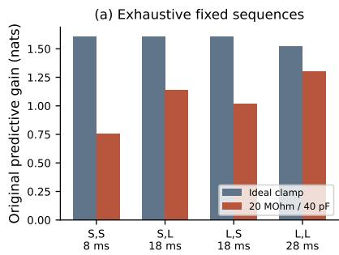
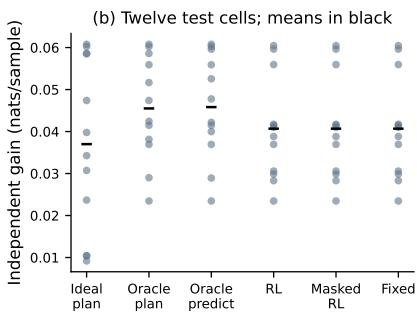
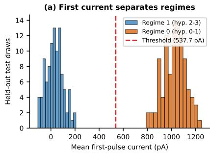
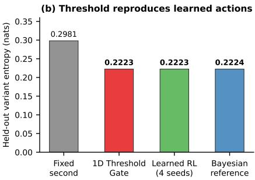

# When Does Feedback Help? Auditing Learned Voltage-Clamp Experimental Design

Rayan Nyaupane The University of Texas at Austin rayannyaupane@utexas.edu

Abhiram Bhupatiraju The University of Texas at Austin ab82836@my.texas.edu

## Abstract

A learned scientific controller can outperform a misspecified planner without benefiting from feedback. We audit two synthetic voltage-clamp tasks with a trainingselected fixed protocol, current masking, a Bayesian reference, and an excluded target. Five recurrent policies repeat one fixed protocol in all 1,200 off-grid rollouts; masking current changes no decision. In a crossed four-hypothesis task, a fixed diagnostic pulse is followed by one learned choice. Policies then use the first current, but tie a correctly specified Bayesian controller, and a fitted threshold reproduces the learned actions without being that controller. The excluded-target prediction gain is $4 . 6 9 9 1 \times 1 0 ^ { - 6 }$ nats per sample. Feedback use and protocol quality are separate tests. These cases establish neither biological discovery nor general RL superiority.

## 1 Question and contribution

Comparing a learned controller with an online planner mixes the observation model, the objective, intervention cost, the horizon, and whether outcomes change later actions. Protocol quality and feedback use are different tests: a controller that repeats a good fixed experiment has not shown that feedback improves discovery. We keep three questions separate. Does feedback change actions? Does it improve an independently scored outcome? Does learning outperform a simpler adaptive choice?

We apply four controls on two small voltage-clamp libraries: a training-selected fixed protocol, current masking, a correctly specified Bayesian reference, and an excluded prediction target. The first setting trains on distorted recordings and appears to beat ideal-clamp planners. The second rewards a different second pulse in different latent regimes. This is an empirical audit, not a new algorithm. Related amortized and reinforcement-learning design includes Deep Adaptive Design (Foster et al., 2021; Ivanova et al., 2021; Hedman et al., 2025), sequential RL (Blau et al., 2022; Shen et al., 2025), biological experimental design (Treloar et al., 2022), and waveform optimization for channel discrimination (Kargol, 2013).

## 2 Original task and prespecified audit

Cell, actions, and training. A synthetic three-state population, not a fitted real cell, follows $\dot { p } = p Q ( V _ { m } )$ with rates $k _ { j } ( \bar { V } ) = \dot { A _ { j } } \exp ( s _ { j } B _ { j } V )$ and current $I _ { \mathrm { i o n } } = g p _ { O } ( V _ { m } - E _ { \mathrm { r e v } } )$ . Occupancy persists between pulses. The distorted clamp uses $R _ { s } = 2 0 \ : \mathrm { M } \Omega$ and $C _ { m } = 4 0 \mathrm { p F } ,$ without compensation, leak, pipette capacitance, or offset, in a circuit motivated by Lei et al. (2020). A five-point log grid spans a factor of ten around the activation prefactor $A _ { 1 } ;$ other kinetics are known. Action S is 2 ms at +40 mV and action L is 12 ms at 0 mV, each with a 2 ms post-step at −80 mV. Two actions give durations of 8, 18, or 28 ms. That imbalance belongs to this task: comparisons match intervention count, not recording time. Equal recording time applies only inside the later crossed task. A GRU with eight hidden units sees current, command, mask, and elapsed time. Training is the original REINFORCE rule: 40 episodes after 12 baseline-only warmup episodes, Adam step size 0.2, entropy coefficient 0.05, and a moving baseline of rate 0.1. All seeds 0–4 are kept. The reward is predictive log-likelihood gain on a 6 ms +20 mV pulse that also entered training, so rescoring it is an optimization check. Belief updates use the true training apparatus and 50 pA Gaussian noise; training traces are noise-free.

  
Figure 1: (a) Fixed sequences on the original reward, including post-steps. (b) Independent gains within twelve cells. Points are designed conditions. RL, masked RL, and the training-selected fixed protocol coincide.

Controllers and held-out grid. We compare the five frozen policies with the training-selected fixed sequence, random actions, ideal-clamp information planners, and oracle-apparatus planners. Greedy maximizes expected parameter-entropy reduction. Lookahead enumerates remaining sequences, executes the first action, and replans; its horizon is the number of decisions left, two and then one, not a full contingent tree. Oracle planners know the test apparatus. A separate oracle predictive planner optimizes the original training target and never sees the new targets. The audit uses 256 posterior-predictive draws. Before seeing outcomes we fixed $A _ { 1 } / A _ { 1 } ^ { \mathrm { t r a i n } } \in \{ 0 . 7 , 1 . 4 , 2 . 2 \}$ $( R _ { s } , C _ { m } ) ^ { \mathit { \hat { \Pi } } } \in \{ ( 0 , 0 ) , ( 1 0 , 2 0 ) , ( 2 0 , 4 0 ) , ( 3 0 , 6 0 ) \}$ , noise standard deviations 0 and 50 pA, and recording seeds 100–109: twelve cells and 240 combinations per controller or training seed. Off-grid kinetics are absent from the inference grid. Test pulses at −20, +10, and +40 mV never enter training and start from rest. A shared scorer uses the true apparatus, isolating design quality under oracle inference. Masking removes only current, not timing or voltage.

## 3 Results

The learned policies look favorable only because they repeat a strong fixed protocol. On the distorted training cell, SS, SL, LS, and LL score 0.7543, 1.1379, 1.0206, and 1.2986 nats. All five policies choose LL, the training-selected sequence. On the ideal cell LL scores 1.5240, below SS at 1.6094. LL records for 28 ms, SS for 8 ms, and either mixed sequence for 18 ms. We make no equal-time claim for this 8/18/28 ms imbalance. Across all 1,200 rollouts (five seeds times 240 combinations), at both 0 and 50 pA, every policy chooses LL. Masking preserves all 1,200 sequences. That does not prove the network ignores every possible input. These policies had limited training on a fixed cell: 40 REINFORCE episodes after 12 warmup episodes, one apparatus, and a five-point grid on one prefactor. Failure to use feedback here does not establish that every well-trained recurrent policy would do the same. Oracle planners in Table 1 have higher mean predictive gain. RMSE and likelihood do not rank methods identically. The historical runner valued an unexecuted final measurement. The audit caps the horizon by remaining decisions; the supplement compares capped and uncapped plans. This correction changes a planner control, not the frozen policies.

Table 1: Independent means on the prespecified grid. Gain is nats per sample, RMSE is pA, and duration is ms. Oracle methods know the apparatus.
<table><tr><td>Controller</td><td>Gain ↑</td><td>RMSE↓</td><td>Duration</td></tr><tr><td>Fixed (training-selected)</td><td>0.0407</td><td>19.17</td><td>28.00</td></tr><tr><td>Random</td><td>0.0401</td><td>19.44</td><td>17.00</td></tr><tr><td>Ideal greedy</td><td>0.0370</td><td>20.88</td><td>9.08</td></tr><tr><td>Ideal lookahead</td><td>0.0370</td><td>20.88</td><td>9.08</td></tr><tr><td>Oracle greedy</td><td>0.0451</td><td>19.97</td><td>20.54</td></tr><tr><td>Oracle lookahead</td><td>0.0455</td><td>19.87</td><td>20.29</td></tr><tr><td>Oracle predictive</td><td>0.0458</td><td>20.19</td><td>18.75</td></tr><tr><td>Recurrent policy</td><td>0.0407</td><td>19.17</td><td>28.00</td></tr><tr><td>Policy, current masked</td><td>0.0407</td><td>19.17</td><td>28.00</td></tr></table>

## 4 A positive control

The original audit lacks a regime where feedback should help. We construct four synthetic hypotheses, not a fitted recording, on the same three-state channel under an ideal clamp. Two regimes differ in inactivation. Activation varies in the first and recovery in the second, so the useful second pulse can depend on the first current. At nominal noise the diagnostic pulse separates the regimes. Before freezing the task we retained three training-only pilots. Each either saturated identification or gave no benefit to a regime-informed second choice. Every method applies the same 30 ms diagnostic pulse and then chooses one of four equal-duration 30 ms pulses, so all methods record for 60 ms. The decision structure is a fixed diagnostic pulse followed by one learned choice. It tests observation-conditioned selection. It does not require long-horizon credit assignment or recurrent memory. Four 32-unit categorical policies train for 1,600 episodes. The fixed second pulse is chosen on 20 validation cells. Bayes minimizes expected final variant entropy from the observed current, with 64 noise draws per hypothesis and action, and does not see the regime label. Evaluation uses 200 held-out draws (50 per hypothesis), plus a doubled-noise shift.

Table 2: Crossed task on 200 simulated draws from four fixed hypotheses, not biological replicates. Entropy is nats and is lower when the experiment is informative. At 800 pA the learned values span four seeds.
<table><tr><td>Controller</td><td>400 pA ↓</td><td>800 pA ↓</td></tr><tr><td>Validation-selected fixed</td><td>0.2844</td><td>0.5366</td></tr><tr><td>Learned design (four seeds)</td><td>0.1992</td><td>0.4887–0.4912</td></tr><tr><td>Bayesian contingent design</td><td>0.1992</td><td>0.4887</td></tr><tr><td>Learned, current masked</td><td>0.2844</td><td>0.5366</td></tr></table>

At nominal noise, all four learned seeds and Bayes choose pulse 0 on all 100 regime-0 draws and pulse 1 on all 100 regime-1 draws. Masking makes every learned seed choose pulse 1, matching the fixed protocol. The paired fixed-minus-learned entropy improvement is 0.0852 nats (95% interval 0.0632–0.1086). Bayes ties the learned policies at this noise. At 800 pA the learned seeds make 6, 4, 1, and 4 nonstandard regime-1 choices; Bayes makes none. A prediction waveform was chosen after the first entropy result, so those scores are exploratory. On a fresh 200-draw block the learned-minusfixed gain on the excluded waveform is $4 . 6 9 9 1 \times 1 0 ^ { - 6 }$ nats per sample (interval $[ 2 . 4 9 , 7 . 2 0 ] \times 1 0 ^ { - 6 } )$

A fitted one-threshold rule reproduces the learned policies on the evaluated block (Figure 2). Finite agreement does not make the threshold the Bayesian controller. The rule was fit only on seeds 4000– 4199, minimizing mean variant entropy over thresholds on the mean first-pulse current. Current above 537.7 pA selects pulse 0 and lower current selects pulse 1. On seeds 5000–5199 the frozen rule matches all four learned policies on every draw. Both score 0.2223 nats, against 0.2981 for the fixed pulse. Bayes agrees on 199 of 200 draws and scores 0.2224 nats. Their paired difference is $4 . 3 9 \times 1 0 ^ { - 6 }$ nats, and the interval includes zero.

  
Figure 2: (a) Mean first-pulse current on seeds 5000–5199 around the validation-fit threshold (537.7 pA). (b) Held-out variant entropy. The threshold reproduces all learned actions on this test block; its entropy is nearly identical to the Bayesian reference, which agrees on 199 of 200 actions.

## 5 Implications and limitations

Table 3: Three questions, answered separately. Crossed-task entropy is the training objective. The independent outcome is the fresh excluded waveform. The simpler references are Bayes and the fitted threshold.
<table><tr><td>Question</td><td>Original task</td><td>Crossed task</td></tr><tr><td>Does feedback change actions?</td><td>No. All 1,200 rollouts are LL. Masking changes none.</td><td>Yes at nominal noise: the second pulse follows the first current.</td></tr><tr><td>Does it improve an independent outcome?</td><td>No. Learned and fixed scores coincide.</td><td>Fresh excluded-waveform gain: 4.6991 × 10−6 nats/sample.</td></tr><tr><td>Does learning beat a simpler adaptive choice?</td><td>No. It copies the training-selected sequence.</td><td>No. It ties Bayes. The threshold reproduces learned actions; Bayes agrees on 199 of 200 and is not that rule.</td></tr></table>

Table 3 is the comparison. The original policies had limited training on a fixed cell, so ignoring feedback there does not show that every well-trained recurrent policy would do the same. Recording durations remain 8, 18, or 28 ms on that task. The crossed task changes the second pulse, but only as one choice after a fixed diagnostic pulse, and its prediction gain is $4 . { \overset { \smile } { 6 } } 9 9 1 \times 1 0 ^ { - 6 }$ nats per sample. A fitted one-threshold rule reproduces the learned policies on seeds 5000–5199; it is not the Bayesian controller. Neither task shows general RL superiority.

Both tasks are synthetic, and the original scorer knows the apparatus. The crossed task omits clamp artifacts. Intervals describe simulated draws from four fixed hypotheses, not biological replication. The three failed pilots, the tiny prediction gain, and the threshold split on mean first-pulse current are part of the evidence, not a richer feedback policy. Evaluations of scientific agents should include fixed controls, finite-horizon planning, excluded targets, recording time, and observation ablations.

## References

A. Foster, D. R. Ivanova, I. Malik, and T. Rainforth. Deep Adaptive Design: Amortizing Sequential Bayesian Experimental Design. ICML, 2021.

D. R. Ivanova et al. Implicit Deep Adaptive Design: Policy-Based Experimental Design without Likelihoods. NeurIPS, 2021.

T. Blau, E. V. Bonilla, I. Chades, and A. Dezfouli. Optimizing Sequential Experimental Design with Deep Reinforcement Learning. ICML, 2022.

W. Shen, J. Dong, and X. Huan. Variational Sequential Optimal Experimental Design using Reinforcement Learning. Computer Methods in Applied Mechanics and Engineering, 444:118068, 2025.

M. Hedman, D. R. Ivanova, C. Guan, and T. Rainforth. Step-DAD: Semi-Amortized Policy-Based Bayesian Experimental Design. ICML, 2025.

N. J. Treloar, N. Braniff, B. Ingalls, and C. P. Barnes. Deep reinforcement learning for optimal experimental design in biology. PLOS Computational Biology, 18:e1010695, 2022.

A. Kargol. Wavelet-based protocols for ion channel electrophysiology. BMC Biophysics, 6:3, 2013.

C. L. Lei et al. Accounting for variability in ion current recordings using a mathematical model of artefacts in voltage-clamp experiments. Philosophical Transactions A, 378:20190348, 2020.