# When Fusion Order Maters: Insights on Progressive Multimodal Representation Learning for Cross-modal Retrieval

Haoxiang Zhao1,2, Bin Wang2, Yaofei Wang2, Xiao Lan3, Yunfeng Diao2, Xu Wang1

1University of Science and Technology of China

2Hefei University of Technology 3Sichuan University

## Abstract

Multimodal video retrieval combines visual, acoustic, and speech information, yet how their fusion order should depend on the data and the retrieval query remains unclear. We introduce Unified Progressive Representation Learning for Order Analysis, or UniPRO, to investigate this question through configurable fusion schedules with matched model components and training setings. Starting from text-to-video retrieval, we find that the tested one-by-one schedules outperform stacked fusion, while changing the order within one-by-one fusion also changes performance. To guide order selection, we examine two complementary considerations: learning dificulty under unequal modality availability and preservation of information relevant to the query. Complete-modality controls show that missing inputs alone cannot explain order sensitivity. At R@1, text and audio retrieval favor schedules that introduce the modality matching the query last. Controlled speech missingness during training and testing reverses the preferred order in both R@1 and SumR, with diferent crossover points. These findings motivate balancing the two considerations when selecting a fusion path. We then use them to predict a visual-last schedule for image queries, which achieves 97.9 R@1, the highest among the evaluated orders on MSR-VTT-9k. Main experiments on four text-to-video benchmarks establish the efectiveness of UniPRO, with component ablations assessing its supporting design. Together, the results identify fusion order as a task-dependent choice that should account jointly for modality availability and the retrieval query.

## Keywords

Cross-modal retrieval, progressive fusion order, multimodal learning

## 1 Introduction

Short-video platforms such as Kuaishou and TikTok contain rich visual, acoustic, and spoken information. Efective retrieval requires combining these complementary cues into a representation suitable for matching a query. The fusion process determines how the cues interact and contribute to matching, making its design central to multimodal video representation learning.

Recent advances have improved retrieval through stronger representations and richer modality coverage. CLIP-based methods adapt pretrained visual and language features to video retrieval [6, 19, 23]; audiovisual methods incorporate acoustic cues [9, 10, 16]; SAVE further separates speech semantics from general audio features [39]. These approaches improve the available information and its alignment, but the same inputs do not specify the order in which their representations should interact. We ask how fusion order afects retrieval with the supporting components held fixed, and what can guide its selection.

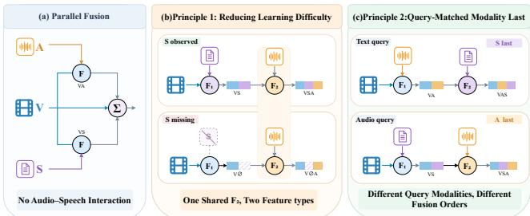  
Figure 1: Fusion order matters: unordered fusion, an unsuitable stacked order, and a preferred one-by-one order for text queries.

In progressive fusion, each interaction updates the representation passed to the next stage. An early modality can change the correspondences that a later stage must learn, while later interactions afect how earlier information contributes to matching. We introduce Unified Progressive Representation Learning for Order Analysis, or UniPRO, to compare these paths within a common framework. UniPRO prepares and aligns modality features before applying configurable gated fusion stages. With matched encoders, components, and training setings, we compare stacked and oneby-one fusion, then vary the order within the later. Figure 1 illustrates these choices. The tested one-by-one schedules outperform stacked fusion, but their internal order also maters: on MSR-VTT-9k, introducing audio before speech yields 53.9 text-to-video R@1, versus 53.2 for the reverse order.

Our first explanation concerns learning dificulty under unequal modality availability. Every sample has visual input, but usable audio and transcribed speech are less consistently available. A fusion stage may encounter diferent efective input paterns depending on the preceding order, motivating a path that simplifies the correspondences to be learned. To examine whether missingness explains the observed preference, we train and evaluate on complete samples with all three modalities. The order diference persists. Frozen-model tests further show that this learned diference can remain when inputs are removed only at inference. Missing inputs therefore cannot fully explain order sensitivity.

This result motivates a second perspective: preserving information relevant to the query. Speech is introduced last in the preferred text retrieval schedule, suggesting that later fusion may help retain cues compatible with the query modality. Natural modality groups motivate this hypothesis. We examine its prediction for audio queries using complete MSR-VTT samples: introducing audio last achieves higher R@1 in both retrieval directions, although the advantage does not extend to every recall cutof. These findings suggest complementary principles: favor a path suited to the observed input paterns, and favor later fusion of information matching the query.

The principles need to be considered together. In audio retrieval, increasing speech missingness in both training and test sets, with models retrained at each rate, reverses the preferred order in both audio-to-video R@1 and video-to-audio SumR. The crossover depends on the metric. We use this reasoning to predict an order for image queries: integrate visual, acoustic, and speech information, then revisit the original visual representation last. It achieves 97.9 R@1 on the full MSR-VTT-9k split, the highest among the evaluated alternatives. This transfer supports using the insights to guide order selection for another query modality.

Main experiments on four text-to-video benchmarks, reverse retrieval, and a second visual backbone assess the efectiveness ofthe complete UniPRO pipeline. Component ablations establish the contributions of transcript condensation, relation enhancement, and feature alignment. The order analyses address the separate question of how to choose the fusion path within that pipeline. Our contributions are threefold:

(1) We introduce UniPRO, a common framework for comparing fusion organization and modality order with matched representation components.

(2) We identify learning dificulty and preservation of queryrelevant information as complementary considerations for order selection, supported by complete-modality controls, query changes, and input-removal analyses.

(3) We evaluate UniPRO across four text-to-video benchmarks and use the resulting principles to predict an efective fu sion order for image queries.

## 2 Related Work

## 2.1 Cross-Modal Video Retrieval

Cross-modal video retrieval matches queries from diferent modalities to videos, with text-to-video retrieval receiving the most atention. CLIP provides a strong foundation for visual and language alignment [23]. CLIP4Clip adapts this foundation to video retrieval through temporal aggregation and cross-modal matching [19]. X-Pool uses text-conditioned atention to aggregate relevant frames [6], while UCoFiA models visual and textual correspondences at multiple granularities [34]. These methods primarily improve the match between text queries and visual content.

Audio and image queries extend retrieval beyond language. MAViL combines masked reconstruction, contrastive learning, and self-training to learn audiovisual representations [7]; AVSiam studies a shared Transformer backbone for audio and vision [15]. ImageBind and LanguageBind connect modalities through align ment centered on images and language, respectively [4, 40]. These approaches expand the available representations and query types. We examine how the order of candidate modality fusion afects retrieval across these query types.

## 2.2 Multimodal Video Representation Learning

Video provides complementary visual, acoustic, and spoken evidence. ECLIPSE combines sight and sound for eficient retrieval over long video sequences [16]. TEFAL aligns text separately with visual and audio features to capture relevant cues [9]. AVIGATE regulates the contribution of audio through gated atention, suppressing irrelevant sounds while keeping query and video encoding independent [10].

SAVE adds a separate speech-semantic branch and improves audiovisual alignment with soft-ALBEF [39]. Together, these methods improve information coverage, relevance, and alignment. UniPRO builds on this seting by examining a further choice: how diferent fusion paths combine the same inputs and interaction components.

## 2.3 Multimodal Interaction and Progressive Fusion

Multimodal fusion depends on the direction and location of information exchange. MulT uses directional atention between modality pairs to model dependencies in unaligned sequences [31]. Multimodal Botleneck Transformer restricts communication through botleneck tokens at multiple layers [21]. These architectures establish interaction direction and communication paths as important design choices.

Progressive fusion further updates representations through successive interactions. Pro-Fusion feeds information from late fusion back to earlier unimodal feature generators [25]. Refinement across network depth difers from changing the order of modality inputs within a fixed fusion structure. UniPRO studies the later by comparing stacked and one-by-one fusion, analyzing alternative orders, and testing whether the resulting insights extend across query modalities.

## 3 Method: UniPRO

UniPRO constructs a multimodal candidate representation from video frames, audio, and available speech transcripts. Figure 2 shows its text-to-video instantiation. We use V, A, and S for visual, acoustic, and speech-semantic features, respectively. T denotes the retrieval text query and is distinct from the transcript represented by S. The pipeline first prepares and aligns the modality features, then combines them according to a specified fusion schedule.

## 3.1 Modality Representations

We follow the modality encoding pipeline of SAVE [39], summarized in Equations 1 and 2. For a video $\mathcal { V } ,$ we uniformly sample � frames. The CLIP visual encoder, ${ \mathrm { C L I P } } _ { \operatorname { v i s } } ,$ , represents each frame by its �-dimensional [CLS] token from the final encoder layer [23]. This yields the visual sequence $\{ \nu _ { i } \} _ { i = 1 } ^ { m }$ 1

$$
\begin{array} { r } { \{ \begin{array} { l l } { \{ f _ { 1 } , \ldots , f _ { m } \}  \mathrm { v i d e o - t o - f r a m e s } ( \mathcal { V } , m ) , } \\ { \{ \nu _ { 1 } , \ldots , \nu _ { m } \}  \mathrm { C L I P } _ { \mathrm { v i s } } ( \{ f _ { 1 } , \ldots , f _ { m } \} ) , } \\ { \{ a _ { 1 } , \ldots , a _ { m } \}  \mathrm { R e s a m p l e r } ( \mathrm { A S T } ( \mathcal { A } ) , m ) . } \end{array}  } \end{array}\tag{1}
$$

The source soundtrack � is converted to Mel filter-bank features and encoded by AST [5]. A resampler maps the resulting acoustic sequence to � tokens. For speech semantics, Whisper large-v3 transcribes the soundtrack into words $\{ w _ { 1 } , \ldots , w _ { n } \} \ [ 2 4 ]$ The CLIP text encoder then produces �-dimensional tokens {��, $, s _ { 1 } , \ldots , s _ { n } , s _ { E } \}$ , including the start and end tokens �� and �� [23].

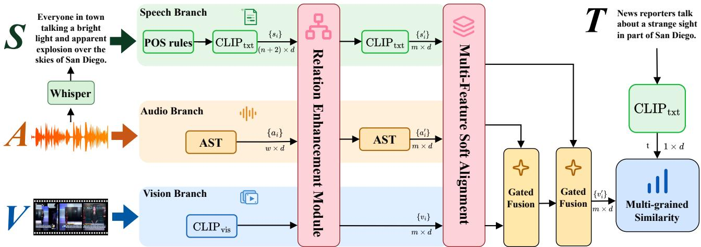  
Figure 2: UniPRO instantiated for text-to-video retrieval. POSR condenses speech transcripts; REM enhances audio–speech relations; MFSA aligns the three feature spaces. Two gated stages first condition visual features on audio and then on speech semantics. The final representation is compared with the independently encoded query.

$$
\{ \begin{array} { c } { \{ w _ { 1 } , \ldots , w _ { n } \}  \mathrm { W h i s p e r } ( \mathcal { A } ) , } \\ { \{ s _ { S } , s _ { 1 } , \ldots , s _ { n } , s _ { E } \}  \mathrm { C L I P } _ { \mathrm { t x t } } ( \{ w _ { 1 } , \ldots , w _ { n } \} ) . } \end{array}\tag{2}
$$

Following AVIGATE [10], we encode the retrieval query � with $\mathrm { C L I P _ { t x t } }$ to obtain �. Global similarity $s _ { g } ( V , T )$ measures the cosine similarity between the video representation and �. Local similarity $s _ { l } ( V , T )$ aggregates the cosine similarities between individual fused visual tokens and � through logarithmic and exponential operations. The final matching score averages these two similarities as $( s _ { g } + s _ { l } ) / 2$

## 3.2 Component Design

3.2.1 POS Rules. ASR transcripts can be lengthy and noisy, particularly in complex speech environments such as e-commerce livestreams. Direct truncation to the CLIP input limit may discard useful semantic cues. We therefore introduce part-of-speech rules, abbreviated POSR, to condense transcripts according to word category. It favors words likely to carry the entities, actions, and atributes needed for retrieval while adding litle computational overhead.

We tokenize the transcript with spaCy and assign Universal Dependencies UPOS tags [22]. Equation 3 defines the retention priorities. Words from higher-priority categories are selected first; uniform sampling resolves selection within the same category. The condensed transcript respects the CLIP input budget, retaining semantic coverage instead of relying only on a fixed prefix.

$$
P ( w _ { i } ) = \left\{ \begin{array} { l l } { 4 , } & { \mathrm { P O S } ( w _ { i } ) \in \{ \mathrm { P R O P N } , \mathrm { N O U N } \} , } \\ { 3 , } & { \mathrm { P O S } ( w _ { i } ) = \mathrm { V E R B } , } \\ { 2 , } & { \mathrm { P O S } ( w _ { i } ) = \mathrm { A D J } , } \\ { 1 , } & { \mathrm { P O S } ( w _ { i } ) \in \{ \mathrm { A D V } , \mathrm { N U M } \} . } \end{array} \right.\tag{3}
$$

3.2.2 Relation Enhancement Module. Acoustic features and speech semantics describe diferent aspects of the same sound track. Encoding them separately can leave useful relations implicit.

The relation enhancement module, REM, strengthens these relations through bidirectional atention before progressive fusion, allowing each stream to incorporate evidence from the other.

Let $S ~ = ~ \{ s _ { i } \} _ { i = 1 } ^ { L _ { s } }$ and $A ~ = ~ \{ a _ { i } \} _ { i = 1 } ^ { L _ { a } }$ denote the speech and audio sequences. A Transformer resampler with � learnable queries compresses each stream, as shown in Equation 4. Each original sequence then atends to the compressed sequence from the other modality. The atention update preserves the original sequence dimensions and is added through a residual connection. Finally, the resampler from SAVE produces � tokens for each enhanced stream, yielding ${ \pmb S } ^ { \prime } = \{ s _ { i } ^ { \prime } \} _ { i = 1 } ^ { m }$ and ${ \bf { A } } ^ { \prime } = \{ a _ { i } ^ { \prime } \} _ { i = 1 } ^ { m }$ in Equation 5.

$$
\bar { \mathbf { S } } = \mathcal { R } _ { x } ( \mathbf { S } ) , \qquad \bar { \mathbf { A } } = \mathcal { R } _ { x } ( \mathbf { A } )\tag{4}
$$

$$
\begin{array} { r } { \mathbf { S } ^ { \prime } = \mathcal { R } _ { m } \left( \mathbf { S } + \mathrm { A t t n } \left( \mathbf { S } , \bar { \mathbf { A } } , \bar { \mathbf { A } } \right) \right) , } \\ { \mathbf { A } ^ { \prime } = \mathcal { R } _ { m } \left( \mathbf { A } + \mathrm { A t t n } \left( \mathbf { A } , \bar { \mathbf { S } } , \bar { \mathbf { S } } \right) \right) . } \end{array}\tag{5}
$$

3.2.3 Multi-Feature Soft Alignment. The gated module in Equation 6 combines a residual visual stream with an auxiliary modality. Its atention weights depend on the compatibility of the query and key features, motivating alignment before fusion. SAVE uses soft-ALBEF [39] to address noisy audiovisual pairs when adapting ALBEF [13]. Its supervision is derived from ImageBind [4], whose embedding geometry difers from the shared CLIP space of visual and speech features. Aligning only vision and audio therefore leaves the relations involving speech insuficiently constrained. We extend this approach with multi-feature soft alignment, MFSA, to supervise all three modality pairs. Section 3.3 describes how the aligned streams enter successive fusion stages.

$$
\begin{array} { r } { \mathrm { G F M } ( { \mathbf V } , { \mathbf X } ) = { \mathbf V } + { \mathbf G } \odot \mathrm { A t t n } ( { \mathbf V } , { \mathbf X } , { \mathbf X } ) , \qquad } \\ { { \mathbf G } = \sigma \left( { \mathbf W } _ { g } \left[ { \mathbf V } ; \mathrm { A t t n } ( { \mathbf V } , { \mathbf X } , { \mathbf X } ) \right] + { \mathbf b } _ { g } \right) . } \end{array}\tag{6}
$$

MFSA aligns visual and acoustic features, visual and speech features, and acoustic and speech features. For each pair $( p , q ) \in$ $\{ ( \nu , a ) , ( \nu , s ) , ( a , s ) \}$ , ImageBind embeddings define a reference afinity matrix $\mathbf { M } _ { 0 } ^ { \mathcal { P } , q } \in \mathbb { R } ^ { B \times \dot { B } }$ over a batch of � examples [4]. Each entry is a cosine similarity between examples from the two modalities. We compute $\mathbf { M } _ { 1 } ^ { p , q }$ from the current network in the same way, then use the reference matrix as soft supervision for its row and column similarity distributions:

$$
\begin{array} { c } { { \displaystyle \mathcal { L } _ { \mathrm { S A } } ^ { p , q } = \frac { 1 } { B } \sum _ { i = 1 } ^ { B } d _ { \boldsymbol { \phi } } \left( \sigma ( \mathbf { M } _ { 0 } ^ { p , q } [ i , : ] ) , \sigma ( \mathbf { M } _ { 1 } ^ { p , q } [ i , : ] ) \right) } } \\ { { + \displaystyle \frac { 1 } { B } \sum _ { j = 1 } ^ { B } d _ { \boldsymbol { \phi } } \left( \sigma ( \mathbf { M } _ { 0 } ^ { p , q } [ : , j ] ) , \sigma ( \mathbf { M } _ { 1 } ^ { p , q } [ : , j ] ) \right) , } } \end{array}\tag{7}
$$

where � is softmax and $d _ { p }$ is the Pearson distance. Unlike losses based on absolute afinity values, such as MSE and Huber loss, Pearson distance emphasizes relative similarity paterns. This makes it suitable for preserving the ranking relations used in retrieval [8, 30].

The overall MFSA loss averages the three pairwise terms:

$$
\mathcal { L } _ { \mathrm { M F S A } } = \frac { 1 } { 3 } \left( \mathcal { L } _ { \mathrm { S A } } ^ { \nu , a } + \mathcal { L } _ { \mathrm { S A } } ^ { \nu , s } + \mathcal { L } _ { \mathrm { S A } } ^ { a , s } \right) .\tag{8}
$$

## 3.3 A Unified View of Progressive Fusion

Let ℱℓ(� , � ) denote the gated fusion stage in Equation 6. H supplies the atention query and residual stream, while X supplies the keys and values. A one-by-one schedule passes the updated repre sentation from one stage to the next:

$$
H ^ { ( 0 ) } = X _ { \pi _ { 1 } } , \qquad H ^ { ( \ell ) } = \mathcal { F } _ { \ell } ( H ^ { ( \ell - 1 ) } , X _ { \pi _ { \ell + 1 } } ) .\tag{9}
$$

Here � specifies the order of modality streams. The text retrieval comparison starts from the visual stream and applies either audio followed by speech or speech followed by audio:

$$
\begin{array} { r } { H _ { V A S } = \mathcal { F } _ { 2 } ( \mathcal { F } _ { 1 } ( V , A ) , S ) , } \\ { H _ { V S A } = \mathcal { F } _ { 2 } ( \mathcal { F } _ { 1 } ( V , S ) , A ) . } \end{array}\tag{10}
$$

A schedule specifies both the order and the direction ofinteraction. The stacked ASV variants first combine audio and speech, then interact with vision. We distinguish the variants by whether A or S supplies the first atention query. This distinction is necessary because the modality list ASV alone does not specify the atention direction.

All schedules use the same feature extraction and matching components, allowing us to examine how the organization of fusion afects the use of available evidence. Passing an updated representation to a later stage changes the information and optimization path encountered by that stage. The comparison therefore tests the efectiveness of specific schedules rather than assuming that progressive fusion is always beneficial.

## 3.4 Training and Transfer Across Query Modalities

Training combines the adaptive margin contrastive objective from AVIGATE [10] and the MFSA loss with equal weights. MFSA also weights its three pairwise terms equally. Candidate representations are matched to independently encoded queries: CLIP encodes text and image queries, while the acoustic encoder handles audio queries. The candidate video retains the modalities available under the evaluation protocol.

For image queries, we add a third gated stage that revisits the original visual tokens. VASV and VSAV both end with V and difer in the preceding order of A and S. VVAS and VAVS instead introduce the repeated V earlier. These four schedules have three independently parameterized fusion stages, while VAS provides the original reference with two stages. Repeated V always denotes the original visual representation, with frame positions added once.

## 4 Main Experiments

## 4.1 Datasets

We evaluate text-to-video retrieval on MSR-VTT [35], VATEX [32], and Charades [28], using four standard benchmarks. MSR-VTT contains 10,000 videos lasting approximately 10 to 32 seconds, each paired with 20 text descriptions. The MSR-VTT-9k split uses 9,000 videos and 180,000 video and text pairs for training, with 1,000 videos for testing [38]. The MSR-VTT-7k split contains 6,513 training, 497 validation, and 2,990 test videos [35]. VATEX contains 34,991 videos with multiple descriptions per video. Following the retrieval protocol of Chen et al. [1], we use the oficial training set of 25,991 videos and randomly divide the 3,000 oficial validation videos equally into validation and test sets. The 6,000 official test videos are excluded because their annotations are private [1, 32]. Charades contains 9,848 videos, each paired with one description. We follow its oficial split of 7,985 training and 1,863 test videos [28].

## 4.2 Text-to-Video Experimental Configuration

The visual branch uses pretrained CLIP ViT-B/32 and ViT-B/16 encoders [23]. The four-dataset comparison uses ViT-B/32; we additionally evaluate both retrieval directions on MSR-VTT-9k with ViT-B/16. The acoustic branch uses AST with a DeiT backbone pretrained on ImageNet and AudioSet [5]. Missing or invalid audio is represented by a zero vector. Whisper large-v3 transcribes the soundtrack [24], and the CLIP text encoder extracts speech semantics from the transcript [23]. We also use a zero vector when no usable speech transcript is available, allowing incomplete examples to remain in the same training and evaluation pipeline.

We train for five epochs with BertAdam, a warmup proportion of 0.1, and a 512-dimensional embedding space. Batch size is 64 for MSR-VTT-9k, VATEX, and Charades, and 96 for MSR-VTT-7k. We sample 12 frames for MSR-VTT and VATEX and 32 for Charades. Transcripts are limited to 77 tokens; acoustic and speech streams are resampled to 12 tokens. The gated fusion Transformer and query resampler each have four layers. Learning rates are $1 0 ^ { - 7 }$ for CLIP parameters and $1 0 ^ { - 4 }$ for other parameters. The contrastive margin is 0.1 for MSR-VTT and Charades and 0.05 for VATEX. These setings apply to the main text retrieval experiments; Section 6 specifies the protocols used to study other queries and modality availability.

## 4.3 Evaluation Metrics

We report recall at ranks 1, 5, and 10 for both text-to-video and video-to-text retrieval. R@K measures the proportion of queries whose correct match appears among the top K candidates. We also

Table 1: Text-to-video retrieval on four benchmarks.
<table><tr><td rowspan="2">Model</td><td colspan="4">MSR-VTT-9k</td><td colspan="4">MSR-VTT-7k</td><td colspan="4">VATEX</td><td colspan="4">Charades</td></tr><tr><td>R@1 R@5 R@10 SumR R@1 R@5 R@10 SumR R@1 R@5 R@10 SumR R@1 R@5 R@10 SumR</td><td></td><td></td><td></td><td></td><td></td><td></td><td></td><td></td><td></td><td></td><td></td><td></td><td></td><td></td><td></td></tr><tr><td>Vision-only methods</td><td></td><td></td><td></td><td></td><td></td><td></td><td></td><td></td><td></td><td></td><td></td><td></td><td></td><td></td><td></td><td></td></tr><tr><td>CLIP4Clip, Neurocomputing&#x27;22</td><td>44.5</td><td>71.4</td><td>81.6</td><td>197.5</td><td>29.4</td><td>54.9</td><td>65.8</td><td>150.1</td><td>61.6</td><td>91.1</td><td>95.8248.5</td><td></td><td>17.7</td><td>39.5</td><td>50.4 107.6</td><td></td></tr><tr><td>X-Pool, CVPR&#x27;22</td><td>46.9 72.8</td><td></td><td>82.2</td><td>201.9</td><td></td><td></td><td></td><td></td><td></td><td></td><td></td><td></td><td></td><td></td><td></td><td></td></tr><tr><td>TS2-Net, ECCV&#x27;22</td><td>47.0 74.5</td><td></td><td>83.8</td><td>205.3</td><td>29.9</td><td>56.4</td><td>67.3</td><td>153.6</td><td>59.1</td><td>90.0</td><td></td><td>95.2 244.3</td><td>16.9</td><td>38.5</td><td>49.5</td><td>104.9</td></tr><tr><td>X-CLIP, MM&#x27;22</td><td>46.1 73.0</td><td></td><td>83.1</td><td>202.2</td><td>31.2</td><td>57.4</td><td>68.1</td><td>156.7</td><td>62.2</td><td>90.9</td><td></td><td>95.4 248.5</td><td>18.9</td><td>41.3</td><td>53.0</td><td>113.2</td></tr><tr><td>CLIP-ViP, ICLR&#x27;23</td><td>46.5 72.1</td><td></td><td>82.5</td><td>201.1</td><td>30.2</td><td>56.0</td><td>69.1</td><td>155.3</td><td>62.1</td><td>90.2</td><td></td><td>97.0 249.3</td><td></td><td></td><td></td><td></td></tr><tr><td>STAN, CVPR&#x27;23</td><td>46.972.8</td><td></td><td>82.8</td><td>202.5</td><td></td><td></td><td></td><td></td><td></td><td></td><td></td><td></td><td></td><td></td><td></td><td>1</td></tr><tr><td>DiCoSA, IJCAI&#x27;23</td><td>47.5 74.7</td><td></td><td>83.8</td><td>206.0</td><td></td><td></td><td></td><td></td><td></td><td></td><td></td><td></td><td></td><td></td><td></td><td></td></tr><tr><td>PromptSwitch, ICCV&#x27;23</td><td>47.8 73.9</td><td></td><td>82.2</td><td>203.9</td><td></td><td></td><td></td><td></td><td></td><td></td><td></td><td></td><td></td><td></td><td></td><td></td></tr><tr><td>UATVR, ICCV&#x27;23</td><td>47.5 73.9</td><td></td><td>83.5</td><td>204.9</td><td></td><td></td><td></td><td></td><td>61.3</td><td>91.0</td><td></td><td>95.6 247.9</td><td></td><td></td><td></td><td></td></tr><tr><td>UCoFiA, ICCV’23</td><td>48.2 73.3</td><td></td><td>82.3</td><td>203.8</td><td>29.9</td><td>56.0</td><td>66.7</td><td>152.6</td><td>61.1</td><td>90.5</td><td></td><td></td><td>17.6</td><td>38.6</td><td>48.6 104.8</td><td></td></tr><tr><td>ProST, ICCV&#x27;23</td><td>48.2 74.6</td><td></td><td>83.4</td><td>206.2</td><td>30.4</td><td>56.7</td><td>67.7</td><td>154.8</td><td>60.6</td><td>90.5</td><td></td><td>95.4 246.5</td><td>17.8</td><td>37.0</td><td>48.3</td><td>103.1</td></tr><tr><td>DGL, AAAI&#x27;24</td><td>45.8 69.3</td><td></td><td></td><td>79.4 194.5</td><td></td><td></td><td></td><td></td><td>56.2</td><td>87.1</td><td></td><td>93.5 236.8</td><td></td><td></td><td></td><td></td></tr><tr><td>EERCF, AAAI&#x27;24</td><td>47.874.1</td><td></td><td>84.1</td><td>206.0</td><td>31.5</td><td>57.4</td><td>67.6</td><td>156.5</td><td>62.6</td><td>91.5</td><td></td><td>95.8 249.9</td><td></td><td></td><td></td><td></td></tr><tr><td>TeachCLIP, CVPR&#x27;24</td><td>46.874.3</td><td></td><td>82.6</td><td>203.7</td><td>30.9</td><td>57.1</td><td>68.0</td><td>156.0</td><td>63.6</td><td>91.9</td><td>96.1</td><td>251.6</td><td>19.2</td><td>40.1</td><td>51.2 110.5</td><td></td></tr><tr><td>TempMe, ICLR&#x27;25</td><td>46.1 71.8</td><td></td><td>80.7</td><td>198.6</td><td></td><td></td><td></td><td></td><td></td><td></td><td></td><td></td><td></td><td></td><td></td><td></td></tr><tr><td>DiscoVLA, CVPR&#x27;25</td><td>47.073.0</td><td></td><td>82.8</td><td>202.8</td><td></td><td></td><td></td><td></td><td></td><td></td><td></td><td></td><td></td><td></td><td></td><td>1</td></tr><tr><td>PIG, ICCV&#x27;25</td><td>48.6 72.8</td><td></td><td>81.6</td><td>203.0</td><td>31.8</td><td>57.3</td><td>68.0</td><td>157.1</td><td>64.0</td><td>91.5</td><td></td><td>96.6 252.1</td><td></td><td></td><td></td><td>1</td></tr><tr><td>Multimodal methods</td><td></td><td></td><td></td><td></td><td></td><td></td><td></td><td></td><td></td><td></td><td></td><td></td><td></td><td></td><td></td><td></td></tr><tr><td>ECLIPSE, ECCV&#x27;22</td><td>44.971.3</td><td></td><td>81.6</td><td>197.8</td><td>30.2</td><td>55.9</td><td>66.6</td><td>152.7</td><td>57.8</td><td>88.4</td><td></td><td>94.3 240.5</td><td>15.7</td><td></td><td></td><td></td></tr><tr><td>TEFAL, ICCV&#x27;23</td><td>49.4 75.9</td><td></td><td>83.9</td><td>209.2</td><td>32.6</td><td>59.1</td><td>69.3</td><td>161.0</td><td>61.0</td><td>90.4</td><td></td><td>95.3 246.7</td><td>18.5</td><td>37.3</td><td></td><td>48.6 104.4</td></tr><tr><td>AVIGATE, CVPR&#x27;25</td><td>50.2 74.3</td><td></td><td>83.2</td><td>207.7</td><td>32.7</td><td>59.8</td><td>70.2</td><td>162.7</td><td>63.1</td><td>90.7</td><td>95.5</td><td>249.3</td><td>18.8</td><td>40.0</td><td>51.8</td><td>110.6</td></tr><tr><td>SAVE, CVPR&#x27;26</td><td>51.3 78.0</td><td></td><td>86.9</td><td>216.2</td><td>33.5</td><td>60.9</td><td>71.4</td><td>165.8</td><td>66.1</td><td>92.6</td><td></td><td>96.8 255.5</td><td>20.8</td><td>44.7</td><td>55.9</td><td>121.4</td></tr><tr><td>UniPRO</td><td>53.9</td><td>79.6</td><td></td><td>87.4 220.9</td><td>34.1</td><td>61.7</td><td>71.9</td><td>167.7</td><td>67.0</td><td>93.1</td><td></td><td>96.8 256.9</td><td></td><td>22.1 45.4</td><td></td><td>56.5 124.0</td></tr></table>

report SumR to summarize the three recall values within each direction:

$$
{ \mathrm { S u m R } } = { \mathrm { R } } @ 1 + { \mathrm { R } } @ 5 + { \mathrm { R } } @ 1 0 .\tag{11}
$$

Retrieval scores and performance diferences are displayed to one decimal place. Rounding can introduce small discrepancies when subtracting or aggregating the displayed values.

## 4.4 Comparison Methods

We compare UniPRO with representative methods on MSR-VTT-9k, MSR-VTT-7k, VATEX, and Charades. The methods are grouped by the information used to represent candidate videos. Vision-only methods include CLIP4Clip [19], X-Pool [6], TS2- Net [18], X-CLIP [20], CLIP-ViP [36], STAN [17], DiCoSA [11], PromptSwitch [2], UATVR [3], UCoFiA [34], ProST [14], DGL [37], EERCF [29], TeachCLIP [30], TempMe [27], DiscoVLA [26], and PIG [12]. Multimodal methods additionally use acoustic or speech information and include ECLIPSE [16], TEFAL [9], AVIGATE [10], and SAVE [39].

## 4.5 Performance

Table 1 shows consistent gains in aggregate recall across the four benchmarks. On MSR-VTT-9k, UniPRO achieves 53.9 R@1, 79.6 R@5, and 87.4 R@10, yielding a SumR of 220.9 and improving on SAVE by 4.7 points. SumR reaches 167.7 on MSR-VTT-7k, 256.9 on VATEX, and 124.0 on Charades, with respective gains of 1.9, 1.4, and 2.6 points. These results establish the efectiveness of the complete UniPRO pipeline across the evaluated datasets. The component ablations below assess the contribution of its supporting modules, while the subsequent analyses isolate diferences between fusion schedules.

Reverse retrieval. Table 2 evaluates video queries against text candidates on MSR-VTT-9k. UniPRO achieves 50.5 R@1 and 217.2 SumR with ViT-B/32. Its R@1 exceeds AVIGATE, the strongest prior method at this cutof, by 0.8 points. Relative to SAVE, the gains are 1.6 R@1 points and 3.8 SumR points, with improvements at all three recall cutofs. The benefit of the learned video representation therefore extends to both the forward and reverse directions of the text–video task.

Visual backbone. Table 3 reports the corresponding comparison with ViT-B/16. UniPRO reaches 55.0 R@1 and 224.1 SumR for text-to-video retrieval, and 51.9 R@1 and 220.0 SumR for videoto-text retrieval. It improves on SAVE by 1.9 and 1.5 SumR points in the two directions. These results complement the four-dataset ViT-B/32 evaluation and show that the pipeline remains efective with the finer visual patch size. They assess the complete model; the analysis experiments below compare fusion schedules within their own matched configurations. Dashes in the tables denote unavailable results.

The main benchmarks measure overall retrieval quality under their standard splits. The analysis experiments use additional data constructions and query definitions to examine order sensitivity, so their scores are interpreted within each stated protocol.

Table 2: MSR-VTT-9k V2T with ViT-B/32.
<table><tr><td>Model</td><td>R@1 R@5 R@10 SumR</td><td></td><td></td><td></td></tr><tr><td>Vision-only methods</td><td></td><td></td><td></td><td></td></tr><tr><td>CLIP4Clip [19]</td><td>43.1</td><td>70.5</td><td>81.2</td><td>194.8</td></tr><tr><td>X-Pool [6]</td><td>44.4</td><td>73.3</td><td>84.0</td><td>201.7</td></tr><tr><td>TS2-Net [18]</td><td>45.3</td><td>74.1</td><td>83.7</td><td>203.1</td></tr><tr><td>X-CLIP [20]</td><td>46.8</td><td>73.3</td><td>84.0</td><td>204.1</td></tr><tr><td>DiCoSA [11]</td><td>46.7</td><td>75.2</td><td>84.3</td><td>206.2</td></tr><tr><td>PromptSwitch [2]</td><td>46.0</td><td>74.3</td><td>84.8</td><td>205.1</td></tr><tr><td>UATVR [3]</td><td>46.9</td><td>73.8</td><td>83.8</td><td>204.5</td></tr><tr><td>UCoFiA [34]</td><td></td><td>47.1 74.3</td><td>83.0</td><td>204.4</td></tr><tr><td>ProST [14]</td><td>46.3</td><td>74.2</td><td>83.2</td><td>203.7</td></tr><tr><td>DGL [37]</td><td>43.5</td><td>70.5</td><td>80.7</td><td>194.7</td></tr><tr><td>EERCF [29]</td><td>44.7</td><td>74.2</td><td>83.9</td><td>202.8</td></tr><tr><td>TempMe [27]</td><td>45.6</td><td>72.4</td><td>81.2</td><td>199.2</td></tr><tr><td>DiscoVLA [26]</td><td>47.7</td><td>73.6</td><td>83.6</td><td>204.9</td></tr><tr><td colspan="5">Multimodal methods</td></tr><tr><td>ECLIPSE [16]</td><td>44.7</td><td>71.3</td><td>82.8</td><td>198.8</td></tr><tr><td>TEFAL [9]</td><td>47.1</td><td>75.1</td><td>84.9</td><td>207.1</td></tr><tr><td>AVIGATE [10]</td><td>49.7</td><td>75.3</td><td>83.7</td><td>208.7</td></tr><tr><td>SAVE [39]</td><td>48.9</td><td>78.0</td><td>86.5</td><td>213.4</td></tr><tr><td>UniPRO</td><td>50.5</td><td>79.0</td><td></td><td>87.7 217.2</td></tr></table>

## 5 Ablation Experiments

Core Component Ablation. Table 4 evaluates the contributions of REM and POSR. Removing REM reduces SumR by 3.0 points for text-to-video retrieval and 0.9 points for video-to-text retrieval, supporting the value of interaction between acoustic and speech features before fusion. Removing POSR reduces SumR by 4.8 and 2.1 points and R@1 by 2.2 and 1.1 points, respectively. These changes are consistent with transcript condensation retaining useful semantics that a fixed truncation rule may discard.

Adding the original visual representation after progressive fusion reduces SumR by 2.4 and 0.4 points in the two directions. Reintroducing visual features at the output therefore does not automatically improve the learned multimodal representation; its efect depends on how that information enters the fusion process.

Multi-Feature Soft Alignment Ablation. Table 5 examines the pairwise alignment paths. Removing alignment between vision and speech reduces SumR by 2.3 points for text-to-video retrieval and 1.0 point for video-to-text retrieval. Removing alignment between audio and speech reduces SumR by 1.9 and 1.6 points. Both paths therefore contribute beyond audiovisual alignment alone.

Retaining only audiovisual alignment produces larger decreases of 3.3 and 1.9 SumR points. Together, these results support aligning all three modality pairs before fusion. The complete set of alignment paths provides a stronger common representation for the order comparisons that follow.

## 6 Analysis Experiments

We study fusion organization, modality availability, and query compatibility. CM-Pool pools complete samples from MSR-VTT, VATEX, and Charades for text retrieval controls. MSR-Avail groups the two MSR-VTT test splits by natural modality availability. MSR-Complete retains complete MSR-VTT samples for audio retrieval; MSR-SDrop introduces speech missingness in both its training and test sets. MSR-Frame uses the full MSR-VTT-9k split for image queries. Appendix A details construction and setings. Plots summarize the key comparisons, and Table 6 reports the inference-only control. Appendix B provides the complete numerical results underlying the plots.

Table 3: MSR-VTT-9k retrieval with ViT-B/16.
<table><tr><td>Model</td><td colspan="3">T2V</td><td colspan="3">V2T</td></tr><tr><td>R@1 R@5 R@10 SumR R@1 R@5 R@10 SumR</td><td></td><td></td><td></td><td></td><td></td><td></td></tr><tr><td>Vision-only methods</td><td></td><td></td><td></td><td></td><td></td><td></td></tr><tr><td>CLIP4Clip [19]</td><td>46.4 72.1</td><td></td><td>82.0 200.5</td><td>45.4 73.4</td><td></td><td>82.4 201.2</td></tr><tr><td>X-Pool [6]</td><td>48.2 273.7</td><td></td><td>82.6 204.5</td><td>46.4 73.9</td><td>84.1</td><td>204.4</td></tr><tr><td>TS2-Net [18]</td><td>49.4 75.6</td><td>85.3</td><td>210.3</td><td>46.6 75.9</td><td>84.9</td><td>207.4</td></tr><tr><td>X-CLIP [20]</td><td>49.3</td><td>75.8 84.8</td><td>209.9</td><td>48.9 76.3</td><td></td><td>85.4210.6</td></tr><tr><td>STAN [17]</td><td>50.0 75.2</td><td></td><td>84.1 209.3</td><td></td><td></td><td></td></tr><tr><td>UATVR [3]</td><td>50.8</td><td>76.3</td><td>85.5 212.6</td><td>48.1 76.3</td><td></td><td>85.4 209.8</td></tr><tr><td>UCoFiA [34]</td><td>49.8</td><td>74.6</td><td>83.5 207.9</td><td>49.1</td><td>77.0</td><td>83.8 209.9</td></tr><tr><td>ProST [14]</td><td>49.5</td><td>75.0</td><td>84.0 208.5</td><td>48.075.9</td><td>85.2</td><td>209.1</td></tr><tr><td>DGL [37]</td><td>48.3</td><td>71.8 80.6</td><td>200.7</td><td>45.7 74.0</td><td>82.9</td><td>202.6</td></tr><tr><td>EERCF [29]</td><td>49.9</td><td>76.5 84.2</td><td>210.6</td><td>47.8 75.3</td><td></td><td>85.4 208.5</td></tr><tr><td>TeachCLIP [30]</td><td>48.0</td><td>75.9 83.5</td><td>207.4</td><td></td><td></td><td></td></tr><tr><td>TempMe [27]</td><td>49.0</td><td>74.4 83.3</td><td>206.7</td><td>47.675.3</td><td></td><td>85.4 208.3</td></tr><tr><td>DiscoVLA [26]</td><td>50.5</td><td>75.6 83.8</td><td>209.9</td><td>49.2 76.0</td><td></td><td>84.7 209.9</td></tr><tr><td>PIG [12]</td><td>51.2</td><td>75.1 84.5</td><td>210.8</td><td></td><td></td><td></td></tr><tr><td colspan="7">Multimodal methods</td></tr><tr><td>TEFAL [9]</td><td>49.9</td><td>76.2</td><td>84.4 210.5</td><td></td><td></td><td></td></tr><tr><td>AVIGATE [10]</td><td>52.1</td><td>76.4</td><td>85.2 213.7</td><td>51.2</td><td>77.9 86.2</td><td>215.3</td></tr><tr><td>SAVE [39]</td><td>54.5</td><td>80.3</td><td>87.4 222.2</td><td>51.4</td><td>80.1 87.0</td><td>218.5</td></tr><tr><td>UniPRO</td><td>55.0 81.6</td><td></td><td>87.5 224.1</td><td>51.9</td><td>80.6</td><td>87.5 220.0</td></tr></table>

## 6.1 Fusion Organization and Order

We train and test on the full MSR-VTT-9k split, including naturally incomplete examples, with matched encoders, components, and training setings. Stacked ASV first combines audio and speech, with either S or A as its atention query Q, then introduces vision. VAS and VSA instead update the visual stream one modality at a time.

Figure 3 shows that both one-by-one schedules outperform the stacked variants at all three recall cutofs. VAS also improves R@1 over VSA by 0.7 percentage points. Fusion organization and the

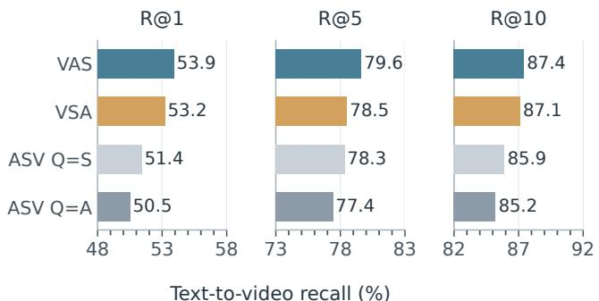  
Figure 3: Fusion organization on MSR-VTT-9k.

Table 4: Ablation of model components.
<table><tr><td>Experimental Setting</td><td colspan="2">Text-to-Video</td><td colspan="2">Video-to-Text</td></tr><tr><td></td><td>R@1</td><td>SumR</td><td>R@1</td><td>SumR</td></tr><tr><td>w/o REM</td><td>52.5</td><td>217.9</td><td>50.0</td><td>216.3</td></tr><tr><td>w/o POSR</td><td>51.7</td><td>216.1</td><td>49.4</td><td>215.1</td></tr><tr><td>+ Original Visual Fusion</td><td>52.7</td><td>218.5</td><td>50.1</td><td>216.8</td></tr><tr><td>UniPRO (Ours)</td><td>53.9</td><td>220.9</td><td>50.5</td><td>217.2</td></tr></table>

order within that organization therefore both mater. We next examine the roles of learning dificulty and information preservation.

## 6.2 Principle I

The first principle concerns learning dificulty under unequal input availability. All videos provide V, fewer provide usable A, and fewer still provide S. In VSA, the second stage combines audio with V when speech is absent and with VS when it is present. In VAS, an informative final S interaction receives VA because usable speech also implies available audio. This motivates a path with simpler effective input paterns, although patern counts alone do not measure optimization dificulty.

To control natural missingness, we select complete training and evaluation samples separately from MSR-VTT, VATEX, and Charades and concatenate the corresponding portions into CM-Pool. Figure 4 shows that VAS remains beter: T2V R@1 is 53.5 versus 52.7, and V2T R@1 is 52.0 versus 50.5. Missing inputs therefore cannot fully explain order sensitivity. The frozen-model control below tests whether this learned diference persists when modalities are removed only at inference.

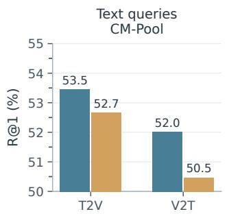

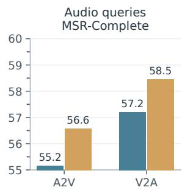  
Figure 4: R@1 with complete inputs: text on CM-Pool and audio on MSR-Complete.

Input removal after complete training. We next freeze the two text retrieval checkpoints trained on complete CM-Pool inputs. The same complete evaluation pool is tested with V, VA, all three inputs, and VS by zeroing the removed streams. Queries and candidate identities are unchanged, and neither model is retrained. This separates removing information at inference from learning a representation with that information present throughout training.

VAS and VSA are trained with matched setings apart from the fusion order. Table 6 shows that VAS maintains higher T2V R@1 across all four test input conditions. Its R@1 is 47.7 versus 45.6 with

Table 5: Ablation of soft alignment.
<table><tr><td>Setting</td><td colspan="3">Soft Alignment</td><td colspan="2">T2V</td><td colspan="2">V2T</td></tr><tr><td></td><td>V-A V-S</td><td></td><td>A-S</td><td>R@1</td><td>SumR</td><td>R@1</td><td>SumR</td></tr><tr><td>V-A Only</td><td>√</td><td>×</td><td>×</td><td>52.4</td><td>217.6</td><td>48.8</td><td>215.3</td></tr><tr><td>w/o V-S</td><td>√</td><td>X</td><td>√</td><td>52.4</td><td>218.6</td><td>49.4</td><td>216.2</td></tr><tr><td>w/o A-S</td><td>√</td><td>√</td><td>X</td><td>52.9</td><td>219.0</td><td>49.7</td><td>215.6</td></tr><tr><td>UniPRO (Ours)</td><td>√</td><td>√</td><td>√</td><td>53.9</td><td>220.9</td><td>50.5</td><td>217.2</td></tr></table>

V alone and 50.6 versus 49.7 with VA. Thus, the performance ranking associated with the training order persists when the available test modalities change.

Table 6: Text-to-video R@1 with test-time input removal.
<table><tr><td rowspan="2">Order</td><td colspan="3">Input</td><td rowspan="2">T2V</td></tr><tr><td>V A S</td><td></td><td>R@1</td></tr><tr><td>VAS</td><td>√</td><td>X</td><td>X</td><td>47.7</td></tr><tr><td>VAS</td><td>√√</td><td></td><td>X</td><td>50.6</td></tr><tr><td>VAS</td><td>√√√</td><td></td><td></td><td>53.5</td></tr><tr><td>VAS</td><td>√</td><td>× √</td><td></td><td>49.7</td></tr><tr><td>VSA</td><td>√</td><td>× ×</td><td></td><td>45.6</td></tr><tr><td>VSA</td><td>√ √ ×</td><td></td><td></td><td>49.7</td></tr><tr><td>VSA</td><td>√√√</td><td></td><td></td><td>52.7</td></tr><tr><td>VSA</td><td>√</td><td>× √</td><td></td><td>49.5</td></tr></table>

## 6.3 Principle II

VAS still outperforms VSA when all three modalities are present during training and evaluation. Thus, missing modalities cannot fully explain why one order works beter. We therefore seek a second principle to explain the remaining diference.

To identify this second principle, we compare retrieval performance across the three MSR-Avail groups in MSR-VTT-9k and MSR-VTT-7k. For each split, we use the same trained VAS model and full video candidate pool. Table 7 shows that the V+A+S group achieves the highest R@1 and R@5 on both splits, outperforming the V+A and V-only groups.

In VAS, S enters last. S represents the speech transcript, which is text like the retrieval query. This suggests a hypothesis: introducing the modality that matches the query last may help retain information useful for retrieval. We adopt this as Principle II. Since the groups contain diferent videos, this observation only suggests the hypothesis. We therefore test it in another retrieval task.

For audio queries, this hypothesis predicts that VSA will perform beter than VAS, because VSA introduces audio last. We test this prediction on MSR-Complete, using complete MSR-VTT samples for both training and evaluation. Each audio query is a fixed contiguous crop lasting 1/20 of its source soundtrack. The 638 video candidates retain V, the full soundtrack A containing the query crop, and S. We evaluate retrieval in both directions; Appendix A.3 details the protocol.

Figure 4 supports the prediction: VSA improves A2V R@1 from 55.2 to 56.6 and V2A R@1 from 57.2 to 58.5. Thus, the preferred order places S last for text queries and A last for audio queries. This agreement supports Principle II at R@1. It does not hold at every cutof: A2V R@5 is tied, and VAS has higher R@10. The text and audio experiments use diferent datasets, so their comparison does not isolate the efect of query modality alone.

Table 7: Text-to-video retrieval by modality availability.
<table><tr><td colspan="6">V A S Videos R@1 R@5 R@10</td></tr><tr><td colspan="6">MSR-VTT-9k</td></tr><tr><td> $\swarrow \ v$ </td><td></td><td>638</td><td>55.4</td><td>81.6</td><td>88.2</td></tr><tr><td> $\checkmark \prec$ </td><td></td><td>307</td><td>53.5</td><td>77.2</td><td>87.9</td></tr><tr><td> $\checkmark \ \times \ \times$ </td><td></td><td>55</td><td>39.2</td><td>69.7</td><td>75.6</td></tr><tr><td>All</td><td></td><td>1000</td><td>53.9</td><td>79.6</td><td>87.4</td></tr><tr><td colspan="6">MSR-VTT-7k</td></tr><tr><td>√√√</td><td></td><td>1872</td><td>34.9</td><td>62.3</td><td>72.1</td></tr><tr><td> $\checkmark \prec$ </td><td></td><td>963</td><td>33.9</td><td>62.1</td><td>72.7</td></tr><tr><td> $\checkmark \ \times \ \times$ </td><td></td><td>155</td><td>26.4</td><td>52.7</td><td>65.1</td></tr><tr><td>All</td><td></td><td>2990</td><td>34.1</td><td>61.7</td><td>71.9</td></tr></table>

## 6.4 Balancing the Principles

On MSR-Complete, we remove S from the same proportion of training and test samples, retaining V and A. At 10%, each split contains 90% V+A+S and 10% V+A samples. We train new VAS and VSA models at every rate from 0% to 100% under matched setings. Au dio queries and test candidates stay fixed. Appendix A.3 gives the configuration.

With partial S missingness, VSA’s audio fusion stage must handle both V and VS. For VAS, the final stage still combines VA with S whenever S is available. VSA therefore faces more varied inputs as considered in Principle I, while still following Principle II by placing audio last.

Figure 5 shows reversals in both R@1 and SumR. VSA has higher A2V R@1 through 60% missingness, whereas VAS is higher at 70%– 90%. With S fully absent, the scores are similar, at 55.8 versus 55.6. V2A SumR favors VSA at 0%–10%, then VAS from 20% onward. The crossover points depend on the retrieval direction and metric. These results support balancing the two principles as modality availability changes. Exact values appear in Appendix B.2, Ta bles 11 and 12.

## 6.5 Predicting an Order for Image Queries

We transfer the insights to MSR-Frame, using the full MSR-VTT-9k split of 9,000 training and 1,000 test videos. One random source frame serves as each image query and is fixed across schedules. Candidate videos retain their naturally available V, full A, and S. This evaluates source-frame matching rather than retrieval from unrelated external images.

The principles predict VASV: follow the visual, acoustic, and speech path, then revisit the original visual tokens last. VSAV tests the preceding A/S order; VVAS and VAVS test earlier positions for repeated V. All four repeated-V schedules have three independently parameterized gated stages, controlling for extra depth; VAS is the original two-stage reference.

Figure 6 supports the prediction. VASV achieves I2V R@1 of 97.9, exceeding VAS by 0.9 points, VSAV by 0.4, and VVAS/VAVS by 0.5. Its R@5 and R@10 are also at least as high as the tested

$$
\begin{array} { r l } { - \mathrm { ~  ~ \omega ~ } \forall \mathsf { A } \mathsf { S } } & { { } \mathrm { ~  ~ - \mathsf { o } ~ } \cdot \mathrm { ~  ~ \mathsf { V } \mathsf { S } \mathsf { A } ~ } } \end{array}
$$

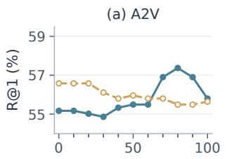

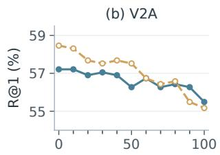

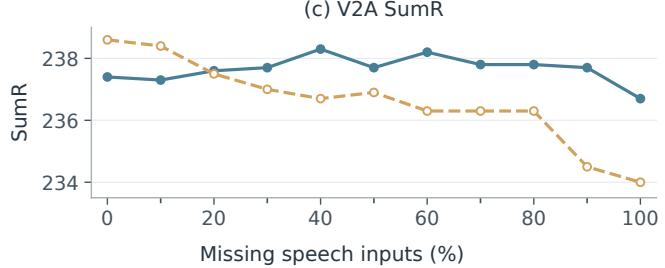  
Figure 5: R@1 and SumR under speech missingness.

alternatives. This supports transfer within the evaluated protocol, while broader robustness remains to be established. Complete metrics and baseline comparisons are in Appendix B.3.

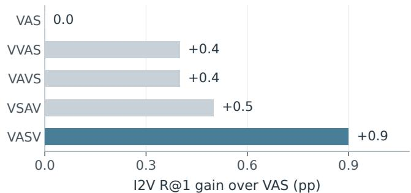  
Figure 6: Image retrieval gain over VAS, whose R@1 is 97.0%.

## 7 Conclusion

UniPRO makes fusion order an explicit choice within a common framework for progressive multimodal representation learning. Benchmark comparisons and component ablations establish the efectiveness of the complete pipeline. The evaluated one-by-one schedules outperform stacked fusion, while complete-input controls show that missingness alone cannot explain the remaining order diferences. Learning dificulty and preservation of information relevant to the query ofer complementary guidance. Reversals in both R@1 and SumR under speech missingness in training and testing motivate balancing these considerations, and their transfer predicts the best evaluated image retrieval order. Repeated-run evaluation and broader query protocols can further test the generality of these empirical principles. Fusion order should therefore reflect both the information available in a video and the information needed by its query.

## References

[1] Shizhe Chen, Yida Zhao, Qin Jin, and Qi Wu. 2020. Fine-Grained Video-Text Retrieval with Hierarchical Graph Reasoning. In Proceedings of the IEEE/CVF Conference on Computer Vision and Patern Recognition. 10638–10647.

[2] Chaorui Deng, Qi Chen, Pengda Qin, Da Chen, and Qi Wu. 2023. Prompt Switch: Eficient CLIP Adaptation for Text-Video Retrieval. In Proceedings of the IEEE/CVF International Conference on Computer Vision. 15648–15658.

[3] Bo Fang, Wenhao Wu, Chang Liu, Yu Zhou, Yuxin Song, Weiping Wang, Xiangbo Shu, Xiangyang Ji, and Jingdong Wang. 2023. UATVR: Uncertainty-Adaptive Text-Video Retrieval. In Proceedings ofthe IEEE/CVF International Conference on Computer Vision. 13723–13733.

[4] Rohit Girdhar, Alaaeldin El-Nouby, Zhuang Liu, Mannat Singh, Kalyan Vasudev Alwala, Armand Joulin, and Ishan Misra. 2023. ImageBind: One Embedding Space to Bind Them All. In Proceedings ofthe IEEE/CVF Conference on Computer Vision and Patern Recognition. 15180–15190.

[5] Yuan Gong, Yu-An Chung, and James Glass. 2021. AST: Audio Spectrogram Transformer. In Proceedings of Interspeech. 571–575. doi:10.21437/Interspeech. 2021-698

[6] Satya Krishna Gorti, Noël Vouitsis, Junwei Ma, Keyvan Golestan, Maksims Volkovs, Animesh Garg, and Guangwei Yu. 2022. X-Pool: Cross-Modal Language-Video Atention for Text-Video Retrieval. In Proceedings of the IEEE/CVF Conference on Computer Vision and Patern Recognition. 5006–5015.

[7] Po-Yao Huang, Vasu Sharma, Hu Xu, Chaitanya Ryali, Haoqi Fan, Yanghao Li, Shang-Wen Li, Gargi Ghosh, Jitendra Malik, and Christoph Feichtenhofer. 2023. MAViL: Masked Audio-Video Learners. In Advances in Neural Information Processing Systems, Vol. 36. 20371–20393. doi:10.52202/075280-0894

[8] Tao Huang, Shan You, Fei Wang, Chen Qian, and Chang Xu. 2022. Knowledge Distillation from a Stronger Teacher. In Advances in Neural Information Process ing Systems, Vol. 35. 33716–33727. doi:10.52202/068431-2443

[9] Sarah Ibrahimi, Xiaohang Sun, Pichao Wang, Amanmeet Garg, Ashutosh Sanan, and Mohamed Omar. 2023. Audio-Enhanced Text-to-Video Retrieval using Text-Conditioned Feature Alignment. In Proceedings of the IEEE/CVF International Conference on Computer Vision. 12054–12064.

[10] Boseung Jeong, Jicheol Park, Sungyeon Kim, and Suha Kwak. 2025. Learning Audio-guided Video Representation with Gated Atention for Video-Text Re trieval. In Proceedings of the IEEE/CVF Conference on Computer Vision and Patern Recognition. 26202–26211.

[11] PengJin, Hao Li, Zesen Cheng,Jinfa Huang, Zhennan Wang, Li Yuan, Chang Liu, and Jie Chen. 2023. Text-Video Retrieval with Disentangled Conceptualization and Set-to-Set Alignment. In Proceedings ofthe Thirty-Second International Joint Conference on Artificial Intelligence. 938–946. doi:10.24963/ijcai.2023/104

[12] Bangxiang Lan, Ruobing Xie, Ruixiang Zhao, Xingwu Sun, Zhanhui Kang, Gang Yang, and Xirong Li. 2025. Hybrid-Tower: Fine-grained Pseudo-query Interaction and Generation for Text-to-Video Retrieval. In Proceedings ofthe IEEE/CVF International Conference on Computer Vision. 24497–24506.

[13] Junnan Li, Ramprasaath R. Selvaraju, Akhilesh Gotmare, Shafiq Joty, Caiming Xiong, and Steven C. H. Hoi. 2021. Align Before Fuse: Vision and Language Representation Learning with Momentum Distillation. In Advances in Neural Information Processing Systems, Vol. 34. 9694–9705.

[14] Pandeng Li, Chen-Wei Xie, Liming Zhao, Hongtao Xie, Jiannan Ge, Yun Zheng, Deli Zhao, and Yongdong Zhang. 2023. Progressive Spatio-Temporal Prototype Matching for Text-Video Retrieval. In Proceedings ofthe IEEE/CVF International Conference on Computer Vision. 4100–4110.

[15] Yan-Bo Lin and Gedas Bertasius. 2024. Siamese Vision Transformers are Scalable Audio-visual Learners. In Computer Vision – ECCV2024. https://www.ecva.net/ papers/eccv\_2024/papers\_ECCV/papers/02220.pdf

[16] Yan-Bo Lin, Jie Lei, Mohit Bansal, and Gedas Bertasius. 2022. EclipSE: Eficient Long-Range Video Retrieval Using Sight and Sound. In Computer Vision – ECCV 2022 (Lecture Notes in Computer Science, Vol. 13694). Springer, 413–430. doi:10. 1007/978-3-031-19830-4\_24

[17] Ruyang Liu, Jingjia Huang, Ge Li, Jiashi Feng, Xinglong Wu, and Thomas H. Li. 2023. Revisiting Temporal Modeling for CLIP-Based Image-to-Video Knowledge Transferring. In Proceedings ofthe IEEE/CVF Conference on Computer Vision and Patern Recognition. 6555–6564.

[18] Yuqi Liu, Pengfei Xiong, Luhui Xu, Shengming Cao, and Qin Jin. 2022. TS2-Net: Token Shift and Selection Transformer for Text-Video Retrieval. In Computer Vision – ECCV 2022 (Lecture Notes in Computer Science, Vol. 13674). Springer, 319–335. doi:10.1007/978-3-031-19781-9\_19

[19] Huaishao Luo, Lei Ji, Ming Zhong, Yang Chen, Wen Lei, Nan Duan, and Tianrui Li. 2022. CLIP4Clip: An Empirical Study of CLIP for End-to-End Video Clip Retrieval and Captioning. Neurocomputing 508 (2022), 293–304. doi:10.1016/j. neucom.2022.07.028

[20] Yiwei Ma, Guohai Xu, Xiaoshuai Sun, Ming Yan, Ji Zhang, and Rongrong Ji. 2022. X-CLIP: End-to-End Multi-grained Contrastive Learning for Video-Text Retrieval. In Proceedings ofthe 30th ACMInternational Conference on Multimedia. 638–647. doi:10.1145/3503161.3547910

[21] Arsha Nagrani, Shan Yang, Anurag Arnab, Aren Jansen, Cordelia Schmid, and Chen Sun. 2021. Atention Botlenecks for Multimodal Fusion. In Advances in Neural Information Processing Systems, Vol. 34. 14200–14213. https://proceedings.neurips.cc/paper\_files/paper/2021/file/ 76ba9f564ebbc35b1014ac498fafadd0-Paper.pdf

[22] Joakim Nivre, Marie-Catherine de Marnefe, Filip Ginter, Jan Hajič, Christopher D. Manning, Sampo Pyysalo, Sebastian Schuster, Francis Tyers, and Daniel Zeman. 2020. Universal Dependencies v2: An Evergrowing Multilingual Treebank Collection. In Proceedings ofthe Twelfth Language Resources and Evalua tion Conference. European Language Resources Association, Marseille, France, 4034–4043.

[23] Alec Radford, Jong Wook Kim, Chris Hallacy, Aditya Ramesh, Gabriel Goh, Sandhini Agarwal, Girish Sastry, Amanda Askell, Pamela Mishkin, Jack Clark, Gretchen Krueger, and Ilya Sutskever. 2021. Learning Transferable Visual Mod els From Natural Language Supervision. In Proceedings ofthe 38th International Conference on Machine Learning. 8748–8763.

[24] Alec Radford, Jong Wook Kim, Tao Xu, Greg Brockman, Christine McLeavey, and Ilya Sutskever. 2023. Robust Speech Recognition via Large-Scale Weak Su pervision. In Proceedings of the 40th International Conference on Machine Learning. 28492–28518.

[25] Shiv Shankar, Laure Thompson, and Madalina Fiterau. 2022. Progressive Fusion for Multimodal Integration. arXivpreprintarXiv:2209.00302 (2022). doi:10.48550/ arXiv.2209.00302

[26] Leqi Shen, Guoqiang Gong, Tianxiang Hao, Tao He, Yifeng Zhang, Pengzhang Liu, Sicheng Zhao, Jungong Han, and Guiguang Ding. 2025. DiscoVLA: Discrepancy Reduction in Vision, Language, and Alignment for Parameter-Eficient Video-Text Retrieval. In Proceedings ofthe IEEE/CVF Conference on Computer Vision and Patern Recognition. 19702–19712.

[27] Leqi Shen, Tianxiang Hao, Tao He, Sicheng Zhao, Yifeng Zhang, Pengzhang Liu, Yongjun Bao, and Guiguang Ding. 2025. TempMe: Video Temporal Token Merg ing for Eficient Text-Video Retrieval. In International Conference on Learning Representations.

[28] Gunnar A. Sigurdsson, Gül Varol, Xiaolong Wang, Ali Farhadi, Ivan Laptev, and Abhinav Gupta. 2016. Hollywood in Homes: Crowdsourcing Data Collection for Activity Understanding. In Computer Vision – ECCV 2016 (Lecture Notes in Computer Science, Vol. 9905). Springer, 510–526. doi:10.1007/978-3-319-46448- 0\_31

[29] Kaibin Tian, Yanhua Cheng, Yi Liu, Xinglin Hou, Quan Chen, and Han Li. 2024. Towards Eficient and Efective Text-to-Video Retrieval with Coarse-to-Fine Vi sual Representation Learning. In Proceedings ofthe AAAIConference on Artificial Intelligence, Vol. 38. 5207–5214.

[30] Kaibin Tian, Ruixiang Zhao, Zijie Xin, Bangxiang Lan, and Xirong Li. 2024. Holistic Features Are Almost Suficient for Text-to-Video Retrieval. In Proceedings of the IEEE/CVF Conference on Computer Vision and Patern Recognition. 17138–17147.

[31] Yao-Hung Hubert Tsai, Shaojie Bai, Paul Pu Liang, J. Zico Kolter, Louis-Philippe Morency, and Ruslan Salakhutdinov. 2019. Multimodal Transformer for Unaligned Multimodal Language Sequences. In Proceedings ofthe 57th Annual Meeting of the Association for Computational Linguistics. Association for Computational Linguistics, 6558–6569. doi:10.18653/v1/P19-1656

[32] Xin Wang, Jiawei Wu, Junkun Chen, Lei Li, Yuan-Fang Wang, and William Yang Wang. 2019. VATEX: A Large-Scale, High-Quality Multilingual Dataset for Video-and-Language Research. In Proceedings ofthe IEEE/CVFInternational Conference on Computer Vision. 4581–4591.

[33] Yi Wang, Yinan He, Yizhuo Li, Kunchang Li, Jiashuo Yu, Xin Ma, Xinhao Li, Guo Chen, Xinyuan Chen, Yaohui Wang, Ping Luo, Ziwei Liu, Yali Wang, Limin Wang, and Yu Qiao. 2024. InternVid: A Large-Scale Video-Text Dataset for Mul timodal Understanding and Generation. In The Twelfth International Conference on Learning Representations. https://openreview.net/forum?id=MLBdiWu4Fw

[34] Ziyang Wang, Yi-Lin Sung, Feng Cheng, Gedas Bertasius, and Mohit Bansal. 2023. Unified Coarse-to-Fine Alignment for Video-Text Retrieval. In Proceedings ofthe IEEE/CVF International Conference on Computer Vision. 2816–2827.

[35] Jun Xu, Tao Mei, Ting Yao, and Yong Rui. 2016. MSR-VTT: A Large Video De scription Dataset for Bridging Video and Language. In Proceedings ofthe IEEE Conference on Computer Vision and Patern Recognition. 5288–5296.

[36] Hongwei Xue, Yuchong Sun, Bei Liu, Jianlong Fu, Ruihua Song, Houqiang Li, and Jiebo Luo. 2023. CLIP-ViP: Adapting Pre-trained Image-Text Model to Video-Language Alignment. In International Conference on Learning Representations.

[37] Xiangpeng Yang, Linchao Zhu, Xiaohan Wang, and Yi Yang. 2024. DGL: Dynamic Global-Local Prompt Tuning for Text-Video Retrieval. In Proceedings of the AAAI Conference on Artificial Intelligence, Vol. 38. 6540–6548.

[38] Youngjae Yu, Jongseok Kim, and Gunhee Kim. 2018. A Joint Sequence Fusion Model for Video Question Answering and Retrieval. In Computer Vision – ECCV 2018 (Lecture Notes in Computer Science, Vol. 11211). Springer, 487–503. doi:10. 1007/978-3-030-01234-2\_29

[39] Ruixiang Zhao, Zhihao Xu, Bangxiang Lan, Zijie Xin, Jingyu Liu, and Xirong Li. 2026. SAVE: Speech-Aware Video Representation Learning for Video-Text

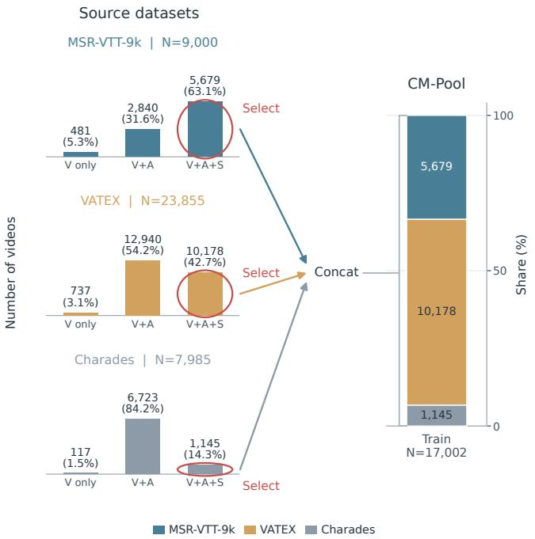  
Figure 7: CM-Pool training construction. Red ellipses mark selected complete-modality groups.

Retrieval. In Proceedings ofthe IEEE/CVFConference on Computer Vision and Pattern Recognition. 31166–31175.

[40] Bin Zhu, Bin Lin, Munan Ning, Yang Yan, Jiaxi Cui, Hongfa Wang, Yatian Pang, Wenhao Jiang, Junwu Zhang, Zongwei Li, Wancai Zhang, Zhifeng Li, Wei Liu, and Li Yuan. 2024. LanguageBind: Extending Video-Language Pretraining to N modality by Language-based Semantic Alignment. In International Conference on Learning Representations. 9588–9608. https://proceedings.iclr.cc/paper\_files paper/2024/file/2862ccf01e3843c81623b246895bcc45-Paper-Conference.pdf

## A Construction of the Analysis Datasets

The following protocols distinguish natural availability from controlled removal. V denotes video frames, A the soundtrack, and S usable ASR-derived speech. All schedules within a comparison share source examples, queries, and candidates.

## A.1 CM-Pool

Figures 7 and 8 summarize the construction of the CM-Pool training and test splits. We independently filter the training and test splits of MSR-VTT-9k, VATEX, and Charades, retaining videos with decodable visual content, valid nonzero audio, usable ASR transcripts, and associated text descriptions. The source splits contain 9,000/1,000 training/test videos for MSR-VTT-9k, 23,896/1,398 for locally available VATEX, and 7,985/1,863 for Charades. Filtering retains 5,679/638, 10,178/612, and 1,145/186 videos, respectively. We concatenate the retained training portions and test portions separately, yielding 17,002 training and 1,436 test videos, or 18,438 videos in total. Training and test identities remain disjoint, and dataset-specific ID prefixes prevent naming collisions. The separate VATEX validation split is excluded from this pool. The source modality distributions exclude 41 VATEX training videos with unavailable visual content; percentages are normalized over the remaining valid videos within each source split.

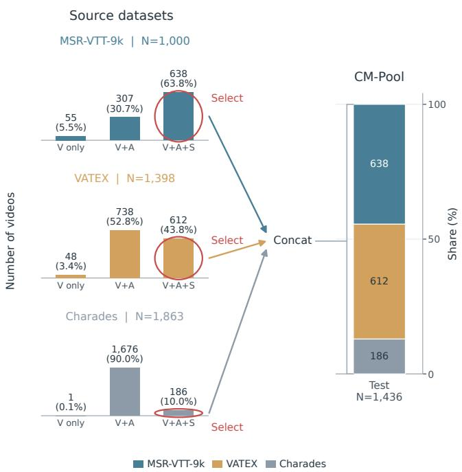  
Figure 8: CM-Pool test construction, using the same selection and concatenation procedure.

To avoid unequal caption multiplicities across sources, each training video contributes one deterministically selected text query per epoch. Each test video has one fixed text query, yielding 1,436 queries and 1,436 video candidates. VAS and VSA share the same videos and query-selection protocol.

## A.2 MSR-Avail

MSR-Avail partitions the test videos of MSR-VTT-9k and MSR-VTT-7k into three mutually exclusive groups according to their naturally available inputs: V+A+S, V+A without S, and V only. Figure 9 shows their sizes and within-benchmark proportions. MSR-VTT-9k contains 638, 307, and 55 videos in the three groups, respectively, totaling 1,000 videos; MSR-VTT-7k contains 1,872, 963, and 155, totaling 2,990 videos. Complete videos account for 63.8% and 62.6% of the respective test sets, while vision-only videos account for 5.5% and 5.2%.

## A.3 MSR-Complete and MSR-SDrop

MSR-Complete filters MSR-VTT training and evaluation samples for valid V, A, and S, retaining 5,679 training videos and 638 evaluation videos. For a soundtrack of length L, a random contiguous crop of length L/20 becomes the audio query. The crop is fixed across orders and removal conditions. Its positive candidate retains the full soundtrack containing the crop, video frames, and speech. A2V ranks the 638 videos; V2A ranks their associated audio crops.

Training. The complete-input VAS and VSA models use CLIP ViT-B/32, AST, POSR, REM, and three equally weighted alignment paths. Both use five epochs, global batch size 64, learning rate $1 0 ^ { - 4 } ,$ and seed 42. For MSR-SDrop, we repeat these training setings separately for each fusion order and each missing rate, with one run per configuration. A model is evaluated at the missing rate used for its training; the complete-input checkpoints are not reused across rates.

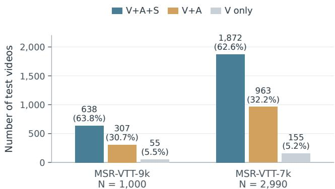  
Figure 9: Natural modality availability in MSR-Avail.

Speech removal. MSR-SDrop starts from MSR-Complete’s 5,679 training videos and 638 test videos. At each rate from 0% to 100% in steps of 10 percentage points, the same proportion of samples in each split loses S, while V and A remain available. For example, at 10%, each split contains 90% complete samples and 10% with only V+A. S token sequences and atention/segment masks are zeroed for the selected samples before training and evaluation. No samples are removed from the pools.

For each rate, VAS and VSA are trained separately on the corresponding incomplete training set and evaluated on the corresponding incomplete test set. Audio query crops and candidate identities stay fixed across rates. The test masks afect nested subsets of 0, 64, 128, 191, 255, 319, 383, 447, 510, 574, and 638 videos. The affected test videos are shared across orders. Encoders, REM, and fusion stages remain active. At 100% missingness, both orders receive only V and A, but their parameters were optimized separately; small score diferences from single runs should not be overinterpreted.

## A.4 MSR-Frame

We use the full MSR-VTT-9k split of 9,000 training and 1,000 test videos. One random source frame per video supplies its image query, fixed across orders and encoded independently. Candidates retain their natural A and S availability rather than being filtered to complete samples. Frames are extracted at 1 fps, uniformly selecting at most 12, with padding for shorter sequences and 224 × 224 inputs. I2V ranks 1,000 videos; V2I ranks their associated image queries. Queries come from their positive videos, so this measures source-frame matching. All schedules use CLIP ViT-B/32, AST, POSR, REM, and the three alignment paths, trained for five epochs with global batch size 64 and learning rate $1 0 ^ { - 4 }$ . Repeated-V schedules have three learned gated stages and reuse the original visual tokens with frame positions added once; VAS has two stages.

Additional benchmark setings. The inherited text retrieval configuration additionally uses intra-negative rate $\beta = 0 . 2$ , local aggregation temperature $\tau = 1$ , and MFSA scale $\alpha = 5 ;$ , with equal pairwise weights of $1 / 3 .$ Other main benchmark setings are given in Section 4.1.

## B Further Analysis Results

The tables below retain complete numerical results for the ploted order comparisons. Natural modality groups and the fixed-checkpoint input-removal control are reported in Tables 7 and 6 in the main paper.

## B.1 Fusion Organization and Complete Inputs

Table 8 complements Figure 3. Tables 9 and 10 give both retrieval directions for CM-Pool and MSR-Complete. The two constructions have diferent source datasets. The natural-group comparison is reported in Table 7 in the main paper.

Table 8: Fusion organization and order on MSR-VTT-9k.
<table><tr><td>Schedule</td><td>R@1</td><td></td><td>R@5 R@10</td></tr><tr><td>VAS</td><td>53.9</td><td>79.6</td><td>87.4</td></tr><tr><td>VSA</td><td>53.2</td><td>78.5</td><td>87.1</td></tr><tr><td>ASV (Q=S)</td><td>51.4</td><td>78.3</td><td>85.9</td></tr><tr><td>ASV (Q=A)</td><td>50.5</td><td>77.4</td><td>85.2</td></tr></table>

Table 9: Fusion order on CM-Pool.
<table><tr><td>Schedule</td><td colspan="3">T2V</td><td colspan="3">V2T</td></tr><tr><td></td><td>R@1 R@5</td><td>R@10</td><td></td><td>R@1</td><td>R@5</td><td>R@10</td></tr><tr><td>VAS</td><td>53.5</td><td>82.5</td><td>89.8</td><td>52.0</td><td>81.1</td><td>89.7</td></tr><tr><td>VSA</td><td>52.7</td><td>81.2</td><td>88.9</td><td>50.5</td><td>80.2</td><td>88.7</td></tr></table>

Table 10: Audio–video retrieval on MSR-Complete.
<table><tr><td rowspan="2">Schedule</td><td colspan="2">A2V</td><td colspan="3">V2A</td></tr><tr><td>R@1 R@5</td><td>R@10</td><td>R@1</td><td>R@5</td><td>R@10</td></tr><tr><td>VAS</td><td>55.2</td><td>87.2</td><td>94.8</td><td>57.2 86.5</td><td>93.7</td></tr><tr><td>VSA</td><td>56.6</td><td>87.2</td><td>93.1</td><td>58.5 86.4</td><td>93.7</td></tr></table>

## B.2 Controlled Speech Removal

Tables 11 and 12 give the values underlying Figure 5. Each row uses VAS and VSA models trained separately at that missing rate, with the same missing proportion in training and testing. Audio crops and candidate identities stay fixed across rates; Appendix A.3 gives the protocol.

Table 11: Audio-to-video retrieval with S missingness.
<table><tr><td rowspan="2">S (%) Videos</td><td rowspan="2"></td><td colspan="2">VAS</td><td colspan="3">VSA</td></tr><tr><td>R@1</td><td>R@5 R@10</td><td>R@1</td><td>R@5</td><td>R@10</td></tr><tr><td>0</td><td>0</td><td>55.2</td><td>87.2</td><td>94.8</td><td>56.6 87.2</td><td>93.1</td></tr><tr><td>10</td><td>64</td><td>55.2</td><td>86.7</td><td>94.2</td><td>56.6 86.8</td><td>93.1</td></tr><tr><td>20</td><td>128</td><td>55.0</td><td>86.7</td><td>94.0</td><td>56.6 87.0</td><td>93.3</td></tr><tr><td>30</td><td>191</td><td>54.9</td><td>87.0</td><td>94.5</td><td>56.1 86.8</td><td>93.3</td></tr><tr><td>40</td><td>255</td><td>55.3</td><td>86.7</td><td>94.5</td><td>55.8 86.5</td><td>93.1</td></tr><tr><td>50</td><td>319</td><td>55.5</td><td>86.2</td><td>94.2</td><td>56.0 86.5</td><td>93.0</td></tr><tr><td>60</td><td>383</td><td>55.5</td><td>86.4</td><td>94.0</td><td>55.8 85.9</td><td>93.1</td></tr><tr><td>70</td><td>447</td><td>56.9</td><td>86.5</td><td>94.0</td><td>55.8 86.5</td><td>93.3</td></tr><tr><td>80</td><td>510</td><td>57.4</td><td>86.5</td><td>93.7</td><td>55.5 86.8</td><td>93.3</td></tr><tr><td>90</td><td>574</td><td>56.9</td><td>86.2</td><td>93.7</td><td>55.5 86.5</td><td>93.3</td></tr><tr><td>100</td><td>638</td><td>55.8</td><td>85.9</td><td>93.6</td><td>55.6 86.4</td><td>93.1</td></tr></table>

Table 12: Video-to-audio retrieval with S missingness.

<table><tr><td rowspan="2">S (%) Videos</td><td rowspan="2"></td><td colspan="2">VAS</td><td colspan="3">VSA</td></tr><tr><td>R@1</td><td>R@5 R@10</td><td>R@1</td><td></td><td>R@5 R@10</td></tr><tr><td>0</td><td>0</td><td>57.2</td><td>86.5</td><td>93.7 58.5</td><td>86.4</td><td>93.7</td></tr><tr><td>10</td><td>64</td><td>57.2</td><td>86.5</td><td>93.6 58.3</td><td>86.4</td><td>93.7</td></tr><tr><td>20</td><td>128</td><td>56.9</td><td>87.0</td><td>93.7</td><td>57.7 86.1</td><td>93.7</td></tr><tr><td>30</td><td>191</td><td>57.1</td><td>87.0</td><td>93.6</td><td>57.5 85.9</td><td>93.6</td></tr><tr><td>40</td><td>255</td><td>56.9</td><td>87.5</td><td>93.9</td><td>57.7 85.4</td><td>93.6</td></tr><tr><td>50</td><td>319</td><td>56.3</td><td>87.5</td><td>93.9</td><td>57.5 85.7</td><td>93.7</td></tr><tr><td>60</td><td>383</td><td>56.7</td><td>87.5</td><td>94.0</td><td>56.7 85.7</td><td>93.9</td></tr><tr><td>70</td><td>447</td><td>56.3</td><td>87.5</td><td>94.0</td><td>56.4 85.7</td><td>94.2</td></tr><tr><td>80</td><td>510</td><td>56.4</td><td>87.2</td><td>94.2</td><td>56.6 85.7</td><td>94.0</td></tr><tr><td>90</td><td>574</td><td>56.3</td><td>87.2</td><td>94.2</td><td>55.5 85.1</td><td>93.9</td></tr><tr><td>100</td><td>638</td><td>55.5</td><td>87.0</td><td>94.2</td><td>55.2 85.1</td><td>93.7</td></tr></table>

## B.3 Image Retrieval

Table 13 reports all available image retrieval metrics and the CLIP4Clip [19] and ViCLIP [33] baselines. VASV exceeds their listed I2V R@1 values by 5.5 and 13.3 points. Unavailable reverse scores remain unspecified.

Table 13: Image–video retrieval on MSR-Frame.
<table><tr><td rowspan="2">Method</td><td colspan="3">I2V</td><td colspan="3">V2I</td></tr><tr><td>R@1</td><td>R@5</td><td>R@10</td><td>R@1</td><td>R@5</td><td>R@10</td></tr><tr><td>CLIP4Clip, Neurocomputing&#x27;22</td><td>92.4</td><td></td><td></td><td>一</td><td>1</td><td>1</td></tr><tr><td>ViCLIP, ICLR&#x27;24</td><td>84.6</td><td>一</td><td>一</td><td>一</td><td>1</td><td>一</td></tr><tr><td>VAS</td><td>97.0</td><td>98.8</td><td>99.3</td><td>95.7</td><td>99.0</td><td>99.4</td></tr><tr><td>VVAS</td><td>97.4</td><td>99.4</td><td>99.6</td><td>一</td><td></td><td>一</td></tr><tr><td>VAVS</td><td>97.4</td><td>99.4</td><td>99.4</td><td>一</td><td>一</td><td>一</td></tr><tr><td>VSAV</td><td>97.5</td><td>99.1</td><td>99.4</td><td>96.0</td><td>99.4</td><td>99.5</td></tr><tr><td>VASV</td><td>97.9</td><td>99.4</td><td>99.6</td><td>一</td><td>1</td><td></td></tr></table>