# When, Where, and What to Correct: Human-Guided Adaptive Residual Correction for Robot Policies

Anukriti Singh∗ University of Maryland, College Park College Park, MD anukriti@umd.edu

Maxime Caniot Enchanted Tools Paris, France

Pratap Tokekar University of Maryland, College Park College Park, MD

Firas Abi-Farraj Enchanted Tools Paris, France

Abstract: Imitation policies that reliably execute most of a manipulation trajectory can still fail in localized regions requiring last-mile precision. Updating the full policy or exploring residual actions everywhere treats this local failure as a global learning problem. We introduce Adaptive Residual Correction (ARC), a lightweight post-training module that uses reinforcement learning (RL) to learn a residual correction on top of a frozen policy while using sparse human corrections to structure autonomous exploration. Rather than treating human corrections as imitation targets, ARC uses pre-intervention states to determine when residual control should become active and correction geometry to determine where in residual action space autonomous refinement should explore; task reward determines what residual is ultimately executed. Across three precision-manipulation tasks on a real robot, ARC improves average task success from 33.3% to 75.0%. The human corrections define task-dependent 2–3-dimensional subspaces of the seven-joint residual space that retain 96.0–97.7% of squared correction magnitude. Together, these results show that sparse human corrections can localize and constrain autonomous post-training without requiring the observed correction itself to serve as the final action target (link).

Keywords: Learning from corrections, Residual reinforcement learning, Precise manipulation

## 1 Introduction

Modern imitation-learning policies can acquire broad manipulation competence from demonstrations, including complex closed-loop visuomotor behaviors [1, 2]. Yet even a policy that reliably reaches the relevant interaction can remain brittle to small execution errors and distribution shift, particularly when success depends on a short precision-critical segment of the task [1, 3]. In this regime, collecting substantially more demonstrations or post-training the entire policy treats a localized failure as a global learning problem. Residual learning instead keeps the base policy fixed and learns only the additional control required to correct its remaining failures [3, 4, 5, 6].

Residual learning is most useful when the correction itself is similarly targeted. Acting throughout the trajectory can degrade behavior the base policy already performs well, while arbitrary actionspace exploration wastes interaction on unlikely motions. Sparse human corrections provide structure for both problems. During an otherwise autonomous rollout, the human intervenes only when needed by adding a residual adjustment to the base-policy action; we refer to these intermittent adjustments as human corrections. Human-in-the-loop methods show that sparse interventions can efficiently guide policy improvement [7, 8], while intervention timing itself carries information beyond the corrective trajectory [9]. At autonomous deployment, no human is present: the residual policy must recognize robot-controlled states in which a human would soon have corrected, rather than states already altered by a correction. Likewise, the coordinated multi-joint geometry of the correction reveals which residual directions the human actually uses. Together, these signals local ize the temporal and action-space support in which residual learning should operate.

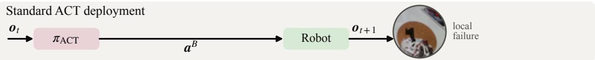

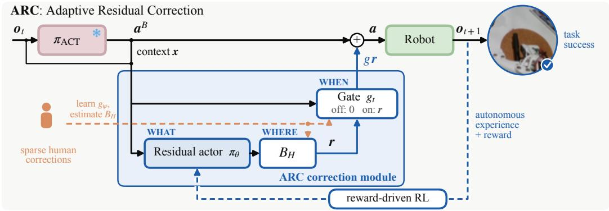  
Figure 1: ARC overview. Sparse human corrections train a pre-intervention gate and define a low-dimensional corrective subspace, which together constrain autonomous exploration in time and action space. Task reward trains the residual actor, whose gated correction is added to the frozen ACT action at deployment.

The human correction itself, however, need not be the final action an autonomous policy should reproduce. Recent methods use corrective actions directly, or through latent representations, as supervision for learned steering policies [10, 11], but a correction is chosen to recover from the particular state encountered during intervention, and directly imitating it does not encode whether its downstream consequence leads to task success [8]. For example, a locally sensible placement correction may still disturb another object and cause the task to fail.

This distinction motivates Adaptive Residual Correction (ARC), a lightweight plug-in module for improving a frozen base policy. During otherwise autonomous rollouts, the human provides sparse residual corrections only when needed. From approximately 8–10 such rollouts per task, ARC learns a pre-intervention gate identifying WHEN residual control should become active and a low-dimensional basis of the seven-joint residual action space restricting WHERE autonomous refinement searches. These correction rollouts are used only to learn the gate and corrective basis and are not added to the RL replay buffer. ARC then collects separate autonomous experience within this learned temporal and action-space support, and reinforcement learning determines WHAT correction improves task outcome. The base policy remains frozen and its original demonstrations are not revisited.

Relative to residual-RL methods [3, 4, 5, 6], ARC restricts both when the residual is active and where exploration occurs; relative to correction-supervised methods [10, 11], it uses human residuals to define the support of autonomous learning rather than as targets for the final residual actor.

We evaluate ARC on three precision-manipulation tasks on a real robot: aligning and stacking industrial trays, inserting a marker into a narrow groove, and stacking cups into a fixed receiver. After two autonomous collect–reward–update rounds, ARC improves average task success from 33.3% to 75.0%. Experiments further show that pre-intervention states yield a gate that transfers to autonomous execution, human residuals define stable low-dimensional corrective supports, and directly predicting the human correction produces residual behavior different from reward-driven ARC even when supervision is restricted to the same corrective subspace.

## 2 Related Work

Residual refinement. ResiP [3] adds closed-loop residual RL to a frozen action-chunked policy, while Policy Decorator [4], ResFiT [5], and MiDAS [6] study residual post-training and low-data adaptation. These methods do not by themselves determine when refinement should be active or how human corrections should constrain residual search.

Learning from corrections. HIL-SERL [7] incorporates online interventions into real-world RL, SiLRI [8] balances imitation and reinforcement from potentially suboptimal interventions, and FlowDAgger [10] and UniSteer [11] transform corrections into supervision for steering policies. ARC instead uses corrections primarily to define temporal and action-space support rather than as targets for its reward-trained actor.

Structuring refinement. DGN [12] shapes exploration from demonstrations, SART [13] restricts variation to human-identified precision regions, Wang et al. [9] study intervention timing, and FRS [14] uses coarse guidance to bootstrap RL. ARC uses the same sparse correction to define both temporal and action-space support, while task reward determines the final residual.

## 3 Adaptive Residual Correction (ARC)

## 3.1 Problem Formulation

Let $o _ { t } \in \mathcal { O }$ denote the robot observation and $a _ { t } \in \mathcal { A } \subseteq \mathbb { R } ^ { 7 }$ the seven-joint arm action at time $t ;$ the gripper remains controlled by the base policy. We study post-training of a pretrained policy $\pi _ { B }$ with $a _ { t } ^ { B } = \pi _ { B } ( o _ { t } )$ , using sparse human corrections while keeping $\pi _ { B }$ frozen. During otherwise autonomous rollouts, a human uses a SpaceMouse, a six-degree-of-freedom handheld controller, to add a residual adjustment to the base action rather than replacing it. If $a _ { t } ^ { H }$ is the resulting action, the human residual is $\begin{array} { r } { r _ { t } ^ { H } = a _ { t } ^ { H } - a _ { t } ^ { B } } \end{array}$

A correction contains information beyond this instantaneous action: its onset indicates when the base trajectory is becoming unreliable, while its coordinated joint residual identifies useful corrective directions. ARC uses both signals to restrict autonomous learning instead of treating $r _ { t } ^ { H }$ as the final policy target. We write the adapted action as $a _ { t } = a _ { t } ^ { B } + g _ { t } r _ { t }$ , where $g _ { t } \in \{ 0 , 1 \}$ is a binary gate and $r _ { t } = B _ { H } z _ { t }$ is the residual action. Here, $B _ { H } \in \mathbb { R } ^ { 7 \times d _ { H } }$ is a human-derived corrective basis and $z _ { t } \in \mathbb { R } ^ { d _ { H } }$ is its coefficient vector. Thus, $B _ { H } z _ { t }$ maps the low-dimensional coefficients back to the seven-joint residual action space. Residual components operate on $x _ { t } = [ \phi _ { B } ( I _ { t } ) , q _ { t } , a _ { t } ^ { B } ]$ , where $I _ { t }$ is the image observation, $\phi _ { B } ( I _ { t } )$ is the frozen ACT visual representation, and $q _ { t }$ is proprioception.

## 3.2 WHEN: Localizing Residual Refinement

A classifier trained on states during an active human correction may rely on states already altered by the human. ARC instead predicts an upcoming correction from robot-controlled states. Using only the first state of each correction bout would provide one positive example per bout; we instead use a short preceding window to provide more positive examples and represent a small region where correction is imminent rather than one exact frame. For each correction bout beginning at $t _ { 0 } .$ , the preceding $L = 5$ states are positive examples; correction-active frames are excluded and sufficiently distant robot-controlled states form negatives.

We train a binary gate classifier $g _ { \psi }$ that outputs $p _ { t } = g _ { \psi } ( x _ { t } ) = P ( y _ { t } = 1 \mid x _ { t } )$ , where $y _ { t } = 1$ denotes a correction beginning within the next L states. Episode-level splits prevent nearby frames from the same rollout appearing in both training and validation. At deployment, $p _ { t }$ is thresholded and passed through temporal hysteresis to produce the binary gate $g _ { t }$ used in $a _ { t } = a _ { t } ^ { B } + g _ { t } r _ { i }$ . The probability threshold is chosen from leave-one-episode-out predictions using Youden’s J statistic, while the on/off durations are fixed from human correction timing statistics. These values are not tuned using autonomous deployment rollouts. When $g _ { t } = 0$ , ARC exactly recovers the frozen base action.

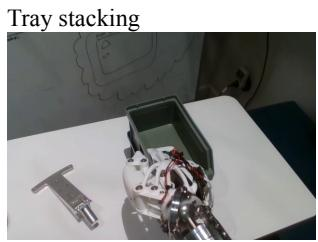

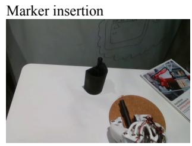

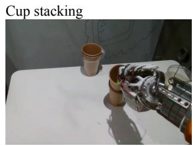

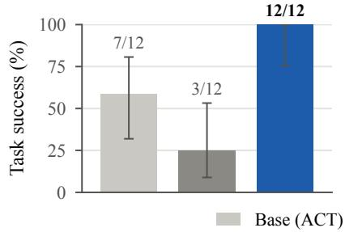

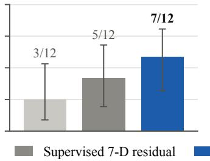

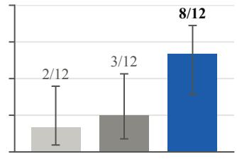  
Figure 2: Performance on a real robot. Base ACT, direct supervised seven-joint residual correction, and ARC over 12 trials per method and task. Labels show exact successes; error bars are 95% Wilson confidence intervals.

## 3.3 WHERE: Human-Supported Corrective Action Space

Human corrections induce coordinated changes across joints, motivating a low-dimensional cor rective basis rather than independent joint perturbations. Because zero residual has a meaningful physical interpretation, for residuals $\{ r _ { i } ^ { H } \} _ { i = 1 } ^ { \dot { N } }$ we compute the uncentered second moment $M _ { H } =$ $\begin{array} { r } { \frac { 1 } { N } \sum _ { i = 1 } ^ { N } r _ { i } ^ { H } ( r _ { i } ^ { H } ) ^ { \top } } \end{array}$ , whose leading eigenvectors form the corrective basis $B _ { H } = [ v _ { 1 } , \dots , v _ { d _ { H } } ]$ . We select candidate subspaces using the fraction of total squared residual magnitude captured by the retained directions together with leave-one-episode-out stability. Once selected, $B _ { H }$ is frozen for autonomous interaction, and we estimate a human correction scale $\sigma _ { k }$ from the projected correction magnitudes along each retained direction.

## 3.4 WHAT: Reward-Driven Residual Learning

Human-guided exploration. The gate and corrective basis jointly define autonomous exploration. At the start of each rollout, we choose one retained corrective direction $v _ { k }$ (a column of $B _ { H } )$ , with $k \in \{ 1 , \dotsc , d _ { H } \}$ , and sign $s \in \{ - 1 , + 1 \}$ . We use the fixed episode-level residual $\epsilon = s \alpha \sigma _ { k } v _ { k }$ giving $a _ { t } ~ = ~ a _ { t } ^ { B } + g _ { t } \epsilon$ , where α controls exploration magnitude. Holding the signed direction fixed provides coherent action–outcome variation, while the gate prevents perturbations outside the selected refinement region. After controller limits are applied, let $a _ { t } ^ { \mathrm { { e x e c } } }$ denote the action physically executed by the robot. Replay stores the corresponding residual $\begin{array} { r } { r _ { t } ^ { \mathrm { { ^ { e x e c } } } } = a _ { t } ^ { \mathrm { { e x e c } } } - a _ { t } ^ { B } } \end{array}$ , so the critic learns from actions that actually occurred on the robot. Human correction trajectories themselves are not inserted into replay.

Residual learning. Once WHEN and WHERE are fixed, ARC learns the correction from autonomous task reward rather than treating the human residual as an action target. The actor predicts normalized coefficients $u _ { t } = \pi _ { \theta } ( x _ { t } ) \in [ - 1 , 1 ] ^ { d _ { H } }$ . These are scaled by the human-derived correction magnitudes to obtain the coefficient-space residual action $z _ { t } ~ = ~ ( \alpha \sigma _ { H } ) \odot u _ { t } .$ where $\boldsymbol { \sigma } _ { H } = [ \sigma _ { 1 } , \dots , \sigma _ { d _ { H } } ] ^ { \top }$ . The resulting joint-space residual is

$$
r _ { \theta } ( x _ { t } ) = B _ { H } z _ { t } = B _ { H } \left[ ( \alpha \sigma _ { H } ) \odot \pi _ { \theta } ( x _ { t } ) \right] .\tag{1}
$$

We optimize this residual using TD3 [15], multi-step TD targets, and a regularizer toward small residuals. Human actions are not regression targets in this stage: they define the support of refinement, while autonomous reward determines the residual within that support. At deployment, exploration is removed and the learned residual is gated as $a _ { t } = a _ { t } ^ { B } + g _ { t } r _ { \theta } ( x _ { t } )$

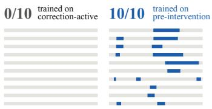  
gate open (blue) on 10 untouched autonomous rollouts  
(a) WHEN: which label transfers to autonomous execution

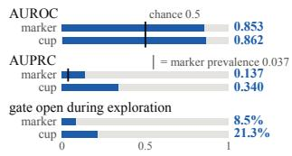  
(b) WHEN: gate quality and selectivity

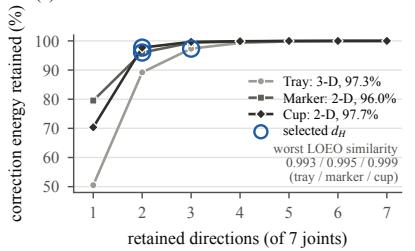  
(c) WHERE: 7-D corrections live in 2–3 direction

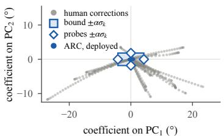  
(d) WHERE: learned BH and exploration (marker)  
Figure 3: WHEN and WHERE. (a) On 10 untouched autonomous base-policy rollouts, a gate trained on correction-active states never activates, while the pre-intervention gate activates on all 10 (gate activation, not task success). (b) Held-out gate discrimination and the fraction of autonomousexploration timesteps for which the gate is open. (c) The selected 3-, 2-, and 2-D subspaces retain 97.3%, 96.0%, and 97.7% of squared correction magnitude for tray, marker, and cup, respectively. (d) Marker corrections, exploration probes, and deployed ARC residuals in the learned corrective basis; PC denotes principal component.

## 4 Experimental Evaluation

We ask: Q1 whether ARC improves last-mile precision; Q2 what sparse corrections reveal about when and where to refine; and Q3 whether the observed correction itself should determine what the robot executes.

## 4.1 Experimental Setup

We evaluate ARC on the Miroki humanoid robot using its right arm and a custom 3D-printed claw gripper. Each task uses a frozen pretrained ACT policy. The three tasks are tray stacking, marker insertion into a narrow groove, and cup stacking into a fixed receiver (Fig. 2). The base policies are trained from approximately 55 demonstrations per task on average. For post-training, we collect approximately 8–10 base-policy rollouts per task in which the human intermittently adds residual corrections. These correction-containing rollouts provide the pre-intervention states used to train ARC’s gate and the human residuals used to construct its corrective basis; human-corrected transitions are not inserted into the RL replay buffer. ARC then performs two autonomous collect– reward–update rounds. We compare Base ACT, a supervised baseline trained on the same correction data to directly regress the observed seven-joint human residuals, and ARC over 12 real-robot trials per method and task. We report exact successes and 95% Wilson confidence intervals.

## 4.2 Q1: Can ARC Improve Last-Mile Precision?

As shown in Fig. 2, ARC improves the frozen base policy from 58.3% (7/12) to 100.0% (12/12) on tray stacking, from 25.0% (3/12) to 58.3% (7/12) on marker insertion, and from 16.7% (2/12) to 66.7% (8/12) on cup stacking. Across all three tasks, the base policy reaches the relevant manipulation phase, but small execution errors become consequential during tray alignment, near the marker groove, or while placing a cup without disturbing the receiver. ARC therefore acts as a selective correction layer rather than a replacement policy. Tray stacking is also the most precisiondemanding task in our setup and exhibits three corrective directions rather than two for the other tasks, consistent with the lower performance of direct supervised correction (Fig. 3(c)).

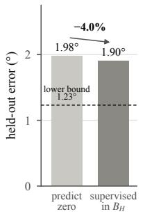

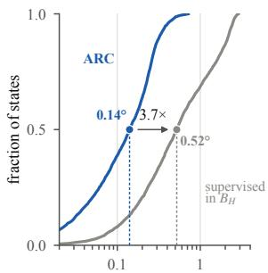  
max-joint |residual| per state (°)

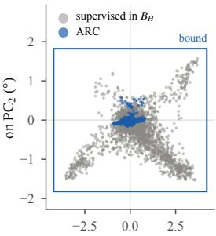  
coefficient on PC1 (°)  
(a) Predicting the human (b) Residual size, same 2,499 gate-open states (c) Same $B _ { H } ,$ , different correction

Figure 4: WHAT: same support, different corrections. (a) Within $B _ { H }$ , supervised prediction reduces held-out human-residual error only from $1 . 9 8 ^ { \circ }$ to 1.90◦ (4.0%), while oracle projection gives a 1.23◦ lower bound. (b) On the same 2,499 gate-open states, median max-joint residual magnitude is $0 . 5 2 ^ { \circ }$ for supervision and $0 . 1 4 ^ { \circ }$ for ARC (3.7×). (c) With the same $B _ { H }$ and residual bounds, $\mathrm { P C _ { 1 } }$ sign agreement is 38% on non-trivial states, while 22% of supervised versus 0% of ARC predictions reach at least half the allowed bound.

## 4.3 Q2: What Do Human Corrections Tell Us About WHEN and WHERE?

WHEN. As a baseline, we train a correction-active classifier using states from within human correction bouts as positives. In contrast, the pre-intervention gate is trained on the preceding robotcontrolled states, matching the condition encountered at autonomous deployment. This distinction matters: the former activates on none of 10 independently collected autonomous base-policy rollouts, while the latter activates on all 10 (Fig. 3(a)). For marker insertion, the pre-intervention gate achieves an area under the receiver operating characteristic curve (AUROC) of 0.853 and an area under the precision–recall curve (AUPRC) of 0.137, compared with a positive-class prevalence of 0.037, and identifies 17/36 held-out correction onsets. The cup gate achieves AUROC 0.862 and AUPRC 0.340. The learned gate remains selective during autonomous exploration: residual control is active for only 8.5% of marker and 21.3% of cup timesteps.

WHERE. Temporal localization still leaves a seven-joint residual space. Human corrections instead concentrate in compact and reproducible subspaces (Fig. 3(c–d)): tray stacking requires three directions, while marker insertion and cup stacking require two, retaining 97.3%, 96.0%, and 97.7% of squared correction magnitude. Worst leave-one-episode-out subspace similarities are 0.993, 0.995, and 0.999. For marker insertion, the same learned basis defines the bounded exploration probes and contains the residuals produced by deployed ARC

## 4.4 Q3: Should Human Corrections Define WHAT to Execute?

Our primary supervised baseline directly predicts the seven-joint human residual $r _ { t } ^ { H }$ from the same context $x _ { t }$ and applies it through the same learned gate. It achieves 3/12, 5/12, and 3/12 successes on tray, marker, and cup, compared with ARC’s 12/12, 7/12, and 8/12 (Fig. 2). This comparison differs in both WHAT—direct regression versus reward learning—and WHERE—the full seven-joint residual space versus span $( B _ { H } )$ . To isolate WHAT, we therefore train an additional WHERE-matched supervised policy using the same human corrections projected into $B _ { H }$ and the same residual bounds as ARC.

Even after matching WHERE, supervision does not recover ARC’s residual behavior. As Fig. 4 shows, supervised prediction only slightly improves held-out human-residual error and produces substantially larger residuals than ARC on the same gate-open states. Panel (c) further shows that the two policies select different coefficients within the same corrective support. Thus, human corrections provide useful structure for refinement, but directly imitating them does not reproduce the correction selected from autonomous task reward.

## 5 Conclusion and Discussion

ARC uses sparse human corrections to identify when residual control is needed and where in action space to refine, while autonomous task reward determines what residual is executed. Across three tasks on a real robot, this targeted post-training improves last-mile precision without updating the base policy or revisiting its original demonstrations.

Limitations. ARC currently relies on human correction timing to train the gate that switches residual control on and off. This requires collecting task- and operator-specific correction examples, and the resulting gate may vary with how different humans choose when to intervene. A promising direction is to replace or augment this learned gate with a continuously operating vision-languagemodel monitor that could recognize precision-critical states and determine when residual refinement is needed, reducing reliance on task-specific human correction timing.

## References

[1] T. Z. Zhao, V. Kumar, S. Levine, and C. Finn. Learning fine-grained bimanual manipulation with low-cost hardware, 2023. URL https://arxiv.org/abs/2304.13705.

[2] C. Chi, Z. Xu, S. Feng, E. Cousineau, Y. Du, B. Burchfiel, R. Tedrake, and S. Song. Diffusion policy: Visuomotor policy learning via action diffusion, 2024. URL https://arxiv.org/ abs/2303.04137.

[3] L. Ankile, A. Simeonov, I. Shenfeld, M. Torne, and P. Agrawal. From imitation to refinement – residual rl for precise assembly. In 2025 IEEE International Conference on Robotics and Automation (ICRA), pages 1–8, 2025. doi:10.1109/ICRA55743.2025.11127442.

[4] X. Yuan, T. Mu, S. Tao, Y. Fang, M. Zhang, and H. Su. Policy decorator: Model-agnostic online refinement for large policy model. In International Conference on Learning Representations (ICLR), 2025. URL https://openreview.net/forum?id=e5jGTEiJMT.

[5] L. Ankile, Z. Jiang, R. Duan, G. Shi, P. Abbeel, and A. Nagabandi. Residual off-policy rl for finetuning behavior cloning policies, 2025. URL https://arxiv.org/abs/2509.19301.

[6] S. Kowshik, S. Venkataraman, L. Wang, N. Pant, M. Simchowitz, and A. Kumar. Adaptation of generalist robot policies with minimal data. arXiv preprint arXiv:2608.11363, 2026. URL https://arxiv.org/abs/2608.11363.

[7] J. Luo, C. Xu, J. Wu, and S. Levine. Precise and dexterous robotic manipulation via humanin-the-loop reinforcement learning. Science Robotics, 10(105):eads5033, 2025. doi:10.1126/ scirobotics.ads5033.

[8] Y. Zhao, H. Jin, L. Jiang, X. Zhang, K. Wu, P. Ren, Z. Xu, Z. Che, L. Sun, D. Wu, C. H. Liu, and J. Tang. Real-world reinforcement learning from suboptimal interventions. arXiv preprint arXiv:2512.24288, 2025. URL https://arxiv.org/abs/2512.24288.

[9] A. Wang, S. Wang, and T. Fitzgerald. Enhancing goal inference via correction timing. In Proceedings ofthe 25th International Conference on Autonomous Agents and Multiagent Systems (AAMAS), pages 2744–2753, 2026. doi:10.65109/VZXJ8026.

[10] M. Murray, D. Chen, S. Bagaria, D. Fortier, T. Hellebrekers, G. Mullins, H. Gajarla, O. Mees, M. Cakmak, and A. Kolobov. FlowDAgger: Human-in-the-loop adaptation of generative robot policies in latent space. In Proceedings ofthe 10th Conference on Robot Learning, 2026.

[11] J. Lu, X. Qin, Y. Jiang, K. Wang, C. Zhang, B. Liang, J. Yang, M. Xu, and L. Zhao. UniSteer: Unified noise steering for efficient human-guided vla adaptation. arXiv preprint arXiv:2605.10821, 2026. URL https://arxiv.org/abs/2605.10821.

[12] P. Dong, A. M. Lessing, A. S. Chen, and C. Finn. Reinforcement learning via implicit imitation guidance. arXiv preprint arXiv:2506.07505, 2025. URL https://arxiv.org/abs/2506. 07505.

[13] H. Oh, M. Murooka, T. Motoda, R. Nakajo, and Y. Domae. Self-augmented robot trajectory: Efficient imitation learning via safe self-augmentation with demonstrator-annotated precision. arXiv preprint arXiv:2509.09893, 2025. URL https://arxiv.org/abs/2509.09893.

[14] A. Tang, W. Chen, A. Wagenmaker, C. Finn, and S. Levine. Improving robotic generalist policies via flow reversal steering. In Conference on Robot Learning (CoRL), 2026. URL https://arxiv.org/abs/2606.13675.

[15] S. Fujimoto, H. van Hoof, and D. Meger. Addressing function approximation error in actorcritic methods, 2018. URL https://arxiv.org/abs/1802.09477.