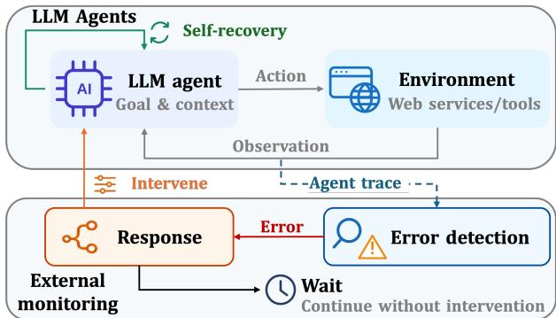
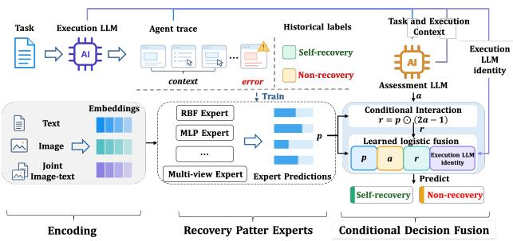
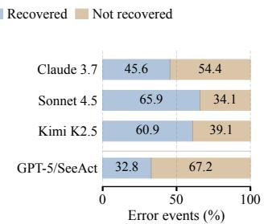
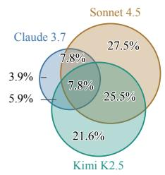
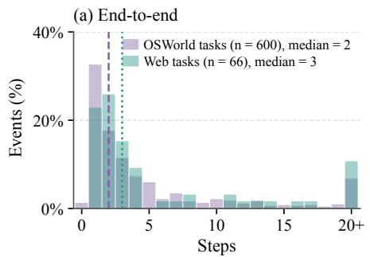
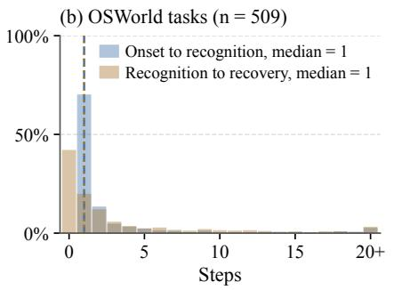
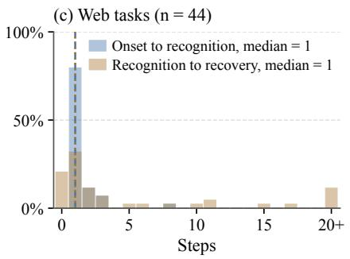
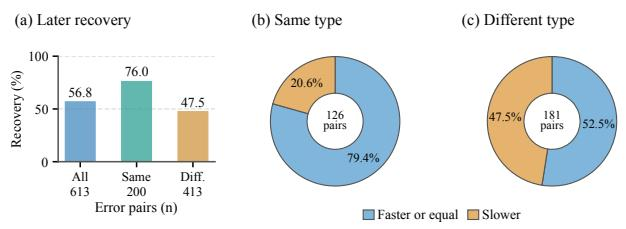
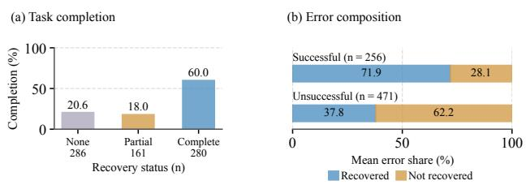
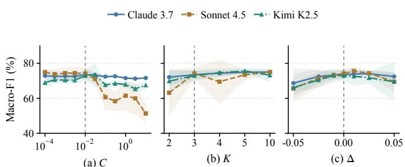

# When to Intervene? An Empirical Study of Errors and Self-Recovery in LLM Agents

Chiming Duan duanchiming@stu.pku.edu.cn Peking University Beijing, China

Minghua He   
hemh2120@stu.pku.edu.cn   
Peking University   
Beijing, China   
Tong Jia   
jia.tong@pku.edu.cn   
Peking University   
Beijing, China

Lingzhe Zhang zhang.lingzhe@stu.pku.edu.cn Peking University Beijing, China

Yingxi Chen   
chenyingxi@bupt.edu.cn   
Beijing University of Posts and   
Telecommunications   
Beijing, China   
Ying Li   
li.ying@pku.edu.cn   
Peking University   
Beijing, China

## Abstract

LLM agents interact with Web services to perform tasks on users’ behalf. Errors during these interactions can disrupt execution and prevent task completion, motivating external intervention. How- ever, agents may self-recover through continued execution, raising the question of when to intervene and when to wait for self- recovery. We present an empirical study of errors and self-recovery in LLM agents. We construct ReInBench, a dataset containing 1,259 agent traces and 1,403 error events across computer-use and Web tasks. Our study examines how often and how quickly agents self- recover, how self-recovery relates to subsequent execution and task completion, and whether self-recovery can be predicted when an error occurs. We find that 725 error events self-recover, often within a few steps, with self-recovery performance difering across Execution LLMs. Self-recovery can also help agents recover from subsequent errors of the same type and support overall task com- pletion. Intervention should therefore prioritize errors unlikely to self-recover, while allowing agents to continue when self-recovery is likely. Building on these empirical findings, we propose ReCoF, a method that predicts whether an error will self-recover to in- form whether additional intervention is needed. ReCoF achieves an average relative improvement of 9.02% in Macro-F1 over the strongest baseline on ReInBench. Our code and data can be found at https://method-notes.github.io/ReCoF/.

## 1 Introduction

LLM agents provide a means for users to delegate tasks to Web services through natural-language instructions [22]. They mediate users’ interactions with Web services by translating goals into actions and interpreting feedback [4]. For example, computer-use agents (CUAs) can operate websites through graphical browser interfaces. Because an agent determines the actions performed on a user’s behalf, its errors can result in incorrect requests to Web applications or incomplete task workflows [11]. Error detection is therefore important for enabling timely intervention so that agents’ Web interactions satisfy users’ goals.

Existing error detection methods inspect action validity and unfolding agent traces. These methods examine the agent’s execution context to identify errors or anticipate failures [2, 21]. When a problem is identified, they trigger an intervention, such as requesting a replacement action or injecting corrective guidance into the agent’s context [8, 10]. Such interventions aim to redirect execution and restore task progress. However, an agent may also self-recover through continued execution, raising the question of when external intervention is needed and when the agent should be allowed to self-recover.

Some studies examine when external intervention is beneficial by comparing execution with and without observation refresh [15]. These methods estimate when a specific recovery operation im-proves task outcomes, but do not explicitly characterize the agent’s self-recovery process or its role in subsequent execution. External intervention may interrupt this process before the agent has an opportunity to self-recover. Self-recovery may also influence how agents handle later errors within the same task. Reflective feedback from unsuccessful attempts can improve performance in later trials [12], whereas stored experiences can also propagate earlier errors [17]. However, how naturally occurring self-recovery relates to subsequent error handling and overall task completion remains insuficiently understood. Understanding when to intervene there- fore requires examining both the agent’s ability to self-recover and the consequences of its self-recovery process.

To investi ate these issues, we construct ReInBench, a dataset containing 1,259 agent traces and 1,403 error events, of which 725 self-recover within the observed execution. It includes computer- use and Web tasks covering browsing, document and spreadsheet editing, and workflows spanning multiple applications. ReInBench records error occurrence, recognition when observable, and re- covery outcomes, together with the corresponding execution context. These records support analysis of self-recovery frequency and speed, its relationship with subsequent error handling and task completion, and self-recovery prediction to inform intervention decisions. We address three research questions.

RQ1 How often and how quickly do agents self-recover from errors, and how does this vary across LLMs?

RQ2 Does self-recovery help agents recover from subsequent errors and complete their tasks?

RQ3 When an error occurs, should we intervene or wait for self-recovery?

Together, these questions examine how agents self-recover, how recovery relates to subsequent execution, and how these findings can inform intervention decisions. Building on the results of these RQs, we design ReCoF, a method that predicts whether an error will self-recover to inform whether additional intervention is needed. On the one hand, ReCoF trains Recovery Pattern Experts on historical execution contexts and recovery outcomes to capture patterns in how agents understand and handle errors. On the other hand, it uses Conditional Decision Fusion to adjust expert contributions according to diferences in recovery capability and the dificulty of the current error. Our study makes three contributions.

• We construct ReInBench, a dataset containing 1,259 agent traces and 1,403 error events across computer-use and Web tasks. It records error occurrence, observable recognition, recovery outcomes, and execution context, supporting the study of self-recovery and intervention decisions.

• We conduct an empirical study of errors and self-recovery in LLM agents, examining self-recovery frequency, speed, and variation across Execution LLMs. We further analyze how earlier self-recovery relates to subsequent recovery of same-type and diferent-type errors, and how local recovery relates to overall task completion.

• We propose ReCoF, a method that predicts whether an error will self-recover to inform whether additional inter- vention is needed. ReCoF achieves an average relative im-provement of 9.02% in Macro-F1 over the strongest baseline on ReInBench.

## 2 Background

  
Figure 1: Agent self-recovery and error detection.

## 2.1 LLM Agents

An LLM agent is a system that uses an LLM for reasoning and planning, with tools or interfaces that execute actions toward a user-specified goal. In Web applications, agents connect users’ instructions to operations on Web services [4]. These operations can be exposed through callable functions or graphical interfaces. Tool-using agents invoke functions with generated arguments [11], whereas computer-use agents interact through mouse and keyboard actions [16]. Both forms of interaction produce feedback that informs later decisions. ReAct describes this interaction as interleaved reasoning and acting, in which observations help the agent update its plans and handle exceptions [20].

  
Figure 2: A Web self-recovery example.

During this interaction, the agent produces reasoning outputs and actions and receives observations from the environment. The time-ordered record of these steps forms an agent trace, showing how the agent interprets feedback and acts toward the task goal. Figure 1 illustrates the execution loop. Let � denote the task goal, $a _ { t }$ the action at step �, $, o _ { t }$ the observation returned after that action, and $r _ { t }$ the agent’s recorded reasoning, if available. With $o _ { 0 }$ denoting the initial observation, the current trace contains the execution history available after step �.

$$
\tau _ { \leq t } = \big ( o _ { 0 } , ( r _ { i } , a _ { i } , o _ { i } ) _ { i = 1 } ^ { t } \big ) .\tag{1}
$$

For an execution of� steps, the full agent trace is $\tau = \tau _ { \leq T }$ . The agent selects its next action according to $a _ { t + 1 } \sim \pi ( \cdot \ | \ g , \tau _ { \leq t } )$ , where � denotes the agent’s policy. Observations include screenshots, page content, or tool responses, depending on the interaction interface.

## 2.2 Errors and Self-Recovery

Errors. An error is an incorrect system state that may lead to failure, a deviation from the required service [1]. In LLM agents, errors include misinterpreted task requirements, incorrect tool calls [11], and unsupported assumptions or repeated actions that stall progress [8]. An error detector � evaluates execution against the task goal � using the current trace $\tau _ { \leq t }$ (Eq. (1)) [21].

$$
\hat { e } _ { t } = D ( g , \tau _ { \le t } ) \in \{ 0 , 1 \} .\tag{2}
$$

Here, $\hat { e } _ { t } = 1$ flags an error at step �, and $\hat { e } _ { t } = 0$ indicates that no error is detected.

Figure 2 illustrates error onset, recognition, and self-recovery in a Web task trace from ReInBench [18]. At step 3, the agent selects the address bar instead of the departure field. It types “SEA” there at step 4. It recognizes the problem at step 5 and reopens Delta at step 8 to resume the query.

Self-recovery. Self-recovery is the process through which an agent resolves an error using its own subsequent reasoning and actions, without additional external assistance. It follows the original agent policy �, including its built-in retry and reflection mechanisms [14, 20], and concerns resolution of the local error rather than com-pletion of the entire task. We characterize this process through error onset, recognition, and recovery. Recognition is observable when the agent explicitly acknowledges an error or exhibits tar- geted corrective behavior. However, some errors reflect temporary deviations in reasoning or action selection and can be resolved as ordinary task execution restores progress. For illustration, suppose an agent has established that one product exceeds the budget and another meets all requirements, but continues switching between their pages without acquiring new information. It subsequently uses the available evidence to select the qualifying product, ending the unproductive loop. Here, continued task reasoning resolves the error without revealing a separate diagnosis ofthe redundant brows- ing. Recovery is therefore observable, while a distinct recognition point may not be identifiable. We therefore annotate self-recovery and observable recognition separately.

Intervention timing. Some existing methods respond to detected failures or misbehaviors with corrective guidance. For example, Sentry retrieves failure-specific lessons, while Wink provides tar-geted course corrections [8, 10]. When self-recovery is possible, the timing of this assistance becomes a separate question. In this study, we represent the choice after an error flag $\hat { e } _ { t } = 1$ with a response policy �.

$$
d _ { t } = C ( g , \tau _ { \le t } ) \in \{ \mathrm { W A I T } , \mathrm { I N T E R V E N E } \} .\tag{3}
$$

Intervening supplies external corrective guidance. Waiting allows � to continue, with the decision revisited as $\tau _ { \leq t }$ grows. This timing choice weighs the opportunity for self-recovery against the delay and cost of further execution.

## 3 ReInBench

ReInBench contains 1,259 agent traces and 1,403 error events from agents performing Web browsing, document and spreadsheet editing, and cross-application workflows. Among these events, 725 self-recover: 553 have an observable recognition point and 172 re- cover without one. It records error onset, observable recognition, and self-recovery outcomes to support the study of intervention timing. We describe data collection in Section 3.1, annotation in Section 3.2, and experimental settings in Section 3.3.

## 3.1 Data Collection

We study LLM agents performing Web browsing, desktop application tasks, and cross-application workflows. The tasks include inter- acting with Web services, editing documents and spreadsheets, and coordinating actions across applications. We construct ReInBench from agent traces collected from two source datasets. OSWorld- Verified [16, 18] contains agent traces generated by computer-use agents (CUAs) built on Claude 3.7 Sonnet, Claude Sonnet 4.5, and Kimi K2.5. These agents perform tasks in browser and desktop ap- plications. For Online-Mind2Web [5, 19], we use the HAL dataset of agent traces generated by SeeAct with GPT-5-2025-08-07 at medium reasoning efort [6]. We refer to the corresponding task groups in ReInBench as OSWorld tasks and Web tasks, respectively. Table 1 summarizes the source datasets and Execution LLMs represented in ReInBench.

Table 1: ReInBench overview.
<table><tr><td>Execution LLM</td><td>Traces</td><td>Errors</td><td>Recovered</td></tr><tr><td>OSWorld-Verified</td><td>1 358 tasks</td><td></td><td></td></tr><tr><td>Claude 3.7 Sonnet</td><td>304</td><td>588</td><td>268</td></tr><tr><td>Claude Sonnet 4.5</td><td>339</td><td>343</td><td>226</td></tr><tr><td>Kimi K2.5</td><td>343</td><td>271</td><td>165</td></tr><tr><td>Online-Mind2Web</td><td>273 tasks</td><td></td><td></td></tr><tr><td>GPT-5 (2025-08-07)</td><td>273</td><td>201</td><td>66</td></tr><tr><td>Total</td><td>1,259</td><td>1,403</td><td>725</td></tr></table>

OSWorld-Verified. We select 1,076 agent traces covering 360 tasks for annotation. The sample includes 360 from CUAs using Claude 3.7 Sonnet, 360 using Claude Sonnet 4.5, and 356 using Kimi K2.5. After checking annotation completeness and event consistency, we retain 986 agent traces covering 358 tasks. These agents operate through graphical computer-use interfaces. Each agent trace pairs agent outputs and actions with screenshots, enabling inspection of the environment before and after corrective actions.

Online-Mind2Web. We check 300 agent traces for field completeness and unique step alignment and select 291 agent traces covering 291 tasks for annotation. Annotation completes for 273 agent traces covering 273 tasks. These agent traces were generated by SeeAct with GPT-5-2025-08-07 at medium reasoning efort on August 13, 2025. Each agent trace records the task instruction, agent outputs, action feedback, and selected-element metadata. The dataset does not include original screenshots or complete DOM snapshots.

## 3.2 Annotation

Annotation unit and labels. We annotate error events in ReIn-Bench traces, with multiple events allowed per trace. Each event records its onset, the agent’s recognition point, and self-recovery point when observable. We also specify a self-recovery criterion that describes the observable state establishing that the error or its task-relevant obstruction has been removed. Onset is the first recorded occurrence of the error. Recognition is the earliest step showin that the a ent itself identifies the error throu h an ex licit acknowledgment or targeted corrective behavior. Self-recovery is recorded at the earliest step whose observed state satisfies the cri- terion. An efective rollback or valid alternative path can establish self-recovery. Self-recovery does not require an observable recogni- tion point: an error may be resolved during the agent’s continued execution without an explicit acknowledgment or identifiable tar- geted correction. Each error event is labeled as recovered or not recovered within the observed trace. A recurrence after verified lo- cal self-recovery starts a new event. Repeated failed attempts before self-recovery remain in the same event. For errors involving failed action execution in Web tasks, subsequent action feedback can establish self-recovery when it confirms that the intended action succeeds. A criterion concerning a page or field state requires later feedback or element metadata supporting that state. We establish self-recovery from observable execution evidence that satisfies the event’s recovery criterion.

Annotation procedure. We use LLM-assisted annotation followed by expert verification, drawing on prior work on human–LLM collaborative annotation and uncertainty-guided allocation of annota- tion efort [9, 13]. GPT-6.1-sol and GLM-5.3-Flash independently identify and annotate error events under shared guidelines with out access to each other’s annotations. Each annotation records the event boundaries, self-recovery outcome and criterion, and references to supporting agent trace records. A verification stage combines rule-based checks with LLM-based evidence review. The two annotations are com ared to identif unmatched events and conflicting labels or boundaries. Rule-based checks validate anno- tation structure, step ranges, temporal consistency, and references to source records. LLM-based review examines the supporting evidence and identifies judgments requiring closer inspection. Disagreements between the annotation LLMs and verifier flags guide the order and depth of expert review. Three researchers studying LLM agents form the expert panel, comprising two doctoral students and one master’s student. All three participate in developing the annotation uidelines. Ever model- enerated annotation un- dergoes manual verification. Each panel member independently checks whether the error occurs, its onset, the a ent’s reco nition point, the self-recovery outcome and boundary when observable, and the self-recovery criterion and supporting evidence. Review-ers can see the model labels and explanations but not the other members’ judgments. When the two annotation LLMs disagree, the panel re-examines the entire agent trace and jointly re-annotates the events through discussion until consensus is reached. This re- annotation reassesses event identification, labels, and temporal boundaries. Ambiguities found during manual verification receive the same full-trace re-annotation. Final decisions follow the anno- tation guidelines and observable execution evidence. Initial model outputs, verification results, and adjudication records are preserved to make label chan es traceable.

## 3.3 Experimental Settings

For RQ1, we examine self-recovery frequency, recognition and self-recovery timing, and diferences across Execution LLMs in ReInBench. First, we investigate how often agents resolve errors through self-recovery. For each LLM, we calculate the proportion of error events that self-recover within the observed agent trace. Second, we investigate how quickly agents self-recover and where delays arise in this process. We measure onset-to-recovery intervals for 600 recovered events in OSWorld tasks and 66 in Web tasks, with identifiable onset and recovery boundaries. As discussed in Section 2.2, self-recovery can occur without a separately observable recognition point. To examine potential bottlenecks in recognition and correction, we therefore use the 509 events in OSWorld tasks and 44 in Web tasks with an observable recognition point between onset and recovery, and compare onset-to-recognition and recognition-to-recovery intervals. Events without an identifiable recognition point contribute only to the end-to-end timing analysis. Third, we investigate how self-recovery varies across Execution LLMs performing the same tasks. We compare self-recovery pro-portions and timing across the three LLMs on shared tasks. For tasks in which all three LLMs encounter errors, we further compare whether each LLM resolves all of its errors within the observed trace.

For RQ2, we investigate whether prior self-recovery helps agents recover from subsequent errors and complete their tasks. First, to investigate whether agents benefit from earlier self-recovery, we construct ordered error-event pairs $( e _ { i } , e _ { j } )$ within each trace � in ReInBench, where $e _ { i }$ has self-recovered before $e _ { j }$ begins. Each recovered event is paired with every subsequent event satisfying this condition. This procedure yields 613 error-event pairs, including 200 same-type pairs and 413 diferent-type pairs. We annotate each pair as containing either same-type or diferent-type errors. For example, two errors in which the agent types into the wrong input field form a same-type pair. A wrong-field input error paired with an incorrect file-path error forms a diferent-type pair. Within these pairs, we examine whether $e _ { j }$ self-recovers to assess whether the recovery experience from $e _ { i }$ may help the agent resolve the later error. When both events recover and their temporal boundaries are identifiable, we compare the number of steps from error onset to recovery to assess whether the later error is resolved faster. We first analyze these patterns across all pairs and then group them according to whether $e _ { i }$ and $e _ { j }$ are the same type of error, to investigate whether subsequent recovery outcomes and speed vary with error similarity. Second, to investigate whether self-recovery supports overall task completion, we analyze recovery at the trace level. For each error-bearing trace, we calculate the proportion of annotated errors that self-recover. Using the recorded task evalua- tion outcomes, we divide traces into successful and unsuccessful groups and compare their mean self-recovery proportions. We further group traces into those with no recovery, partial recovery, or complete recovery, and compare task completion rates across these groups to examine how the extent of local self-recovery relates to overall task completion.

For RQ3, we investigate when to intervene after an error occurs. An agent may self-recover through continued execution, allow- ing the task to proceed without external assistance. Immediate intervention may therefore be unnecessary, whereas waiting for an error that remains unresolved can delay task progress. To assess whether intervention is needed, we predict, at the time an error occurs, whether the agent will subsequently self-recover, formulat- ing this prediction as a binary classification task. A predicted selfrecovery supports allowing execution to continue, while predicted non-recovery indicates a potential need for assistance. We use the recovery outcomes recorded in ReInBench as target labels, with non-recovery indicating that the error remains unresolved within the observed trace. Inputs include the task goal and up to five recent execution steps ending at the error occurrence, covering recorded reasoning, actions, feedback, and available screenshots. Future exe- cution and recovery annotations are excluded. We propose ReCoF, a method that predicts whether an error will self-recover to inform whether additional intervention is needed. Figure 3 illustrates its workflow. On the one hand, ReCoF trains Recovery Pattern Experts on historical execution contexts and their self-recovery outcomes, learning predictive recovery patterns from text, visual, and joint image–text representations. On the other hand, ReCoF uses an As- sessment LLM to examine the task requirements and the Execution LLM’s observed reasoning and actions, assessing how dificult the current error may be for the agent to recover from and providing a contextual verdict. The Conditional Decision Fusion module then uses this verdict to adaptively weight the expert predictions and produce the final self-recovery prediction. Appendix A provides the formal definitions and training procedure. We conduct this eval uation on CUA tasks in ReInBench, using task-disjoint training, validation, and test partitions. We compare methods that can be used to predict self-recovery, including Direct LLM, AgentForesight, Sentry, PrefixGuard, and Wink [7, 8, 10, 21]. These comparisons assess whether the execution context available when an error oc- curs can support self-recovery prediction and inform the choice between waiting and intervention.

  
Figure 3: ReCoF overview.

Evaluation metrics. For RQ1, we measure self-recovery frequency as $\rho ~ = ~ R / ( R + N )$ , where � and � denote recovered and unre- covered error events. Self-recovery speed is measured by onset- to-recovery, onset-to-recognition, and recognition-to-recovery in tervals, summarized through their distributions and medians. For RQ2, we report the proportion of later errors that self-recover and compare recovery durations within event pairs. A later recovery is faster or equal when $\Delta _ { j } \ \leq \ \Delta _ { i } ,$ where $\Delta _ { i }$ and $\Delta _ { j }$ denote the earlier and later recovery durations. At the trace level, we com- pare mean self-recovery proportions and task completion rates, defined as the proportion of traces that successfully complete their tasks. For RQ3, we report precision, recall, F1, Macro-F1, and accuracy, treating non-recovery as the positive class. Precision and recall are Prec = ��/(�� + ��) and Rec = ��/(�� + ��), with �1 = 2 Prec Rec/(Prec + Rec). Macro-F1 gives equal weight to both classes, calculated as Macro- $\cdot F _ { 1 } = ( F _ { \mathrm { 1 , r e c o v e r y } } + F _ { \mathrm { 1 , n o n - r e c o v e r y } } ) / 2 .$

Comparison methods. For RQ3, we compare ReCoF with the following methods, adapting existing monitoring approaches to self recovery prediction.

• Direct LLM directly predicts whether an error will self-recover from the task goal and available execution context.

• AgentForesight [21] identifies decisive errors from the execution context. We adapt its forecasting procedure to distinguish errors that will self-recover from those that will remain unresolved.

• Sentry [8] monitors execution using knowledge learned from previous failures. We adapt its failure taxonomy to guide self-recovery prediction from the task goal and exe- cution context.

• PrefixGuard [7] learns event representations and uses a recurrent predictor to estimate failure risk from the execu- tion context. We adapt its prediction target to whether the current error will self-recover.

• Wink [10] identifies specification drift, reasoning problems, and tool call failures to guide corrective intervention. We adapt its misbehavior analysis to predict self-recovery without executing the intervention.

To examine the contributions of ReCoF’s components, we evaluate two ablation variants.

• w/o Recovery Pattern Experts removes the expert predictions and their conditional interactions, retaining the Assessment LLM’s contextual verdict and Execution LLM identity.

• w/o Conditional Interaction removes only the interaction terms, retaining both the expert predictions and contextual verdict, together with Execution LLM identity.

Each variant is refitted and calibrated using the validation set. We further examine parameter sensitivity by separately varying the fusion regularization parameter �, the number of task-grouped folds �, and the ofset Δ from the calibrated decision threshold, while holding the remaining configuration fixed.

Implementation details. For RQ3, we use GLM-5.3-Flash as Re-CoF’s Assessment LLM and for the LLM-based baselines, with tem- perature set to zero. These methods receive the task goal and up to five steps of execution context ending at the error occurrence, including execution text and available screenshots. We use task- disjoint partitions containing 559 training, 228 validation, and 238 test events. ReCoF uses frozen text, visual, and joint image–text encoders to train its Recovery Pattern Experts. Its logistic fusion uses � = 0.01 and three task-grouped folds on the validation set. We retain the three fold models, average their test probabilities, and calibrate a separate decision threshold for each Execution LLM using validation predictions. PrefixGuard uses 4,096-dimensional TF-IDF features and a GRU predictor, trained for 24 epochs with AdamW at a learning rate of $1 0 ^ { - 3 }$ . Its checkpoint and thresholds are selected using validation Macro-F1. We report results over five seeds for PrefixGuard, ReCoF, and its ablations, keeping ReCoF’s Recovery Pattern Experts and Assessment LLM outputs fixed across fusion runs.

## 4 Results

## 4.1 Self-Recovery Performance (RQ1)

Figure 4 compares self-recovery proportions and task-level overlap in ReInBench. Figure 5 shows the timing of error recognition and self-recovery. We make the following observations.

Agents self-recover from a substantial share of errors. In ReInBench, 659 of 1,202 errors in OSWorld tasks self-recover within the observed agent trace, yielding a proportion of 54.8%. For Web tasks, 66 of 201 errors self-recover, yielding 32.8%. These results show that agents can resolve many local errors through continued execution without additional external assistance. Self-recovery is therefore an important consideration when deciding whether to intervene after an error occurs.

  
(a) Recovery proportions

  
(b) Task overlap  
Figure 4: Self-recovery across Execution LLMs.

Self-recovery is generally fast, but correction can require prolonged execution. Figure 5a shows that end-to-end recov-ery durations concentrate within the first few steps, with medi- ans of two steps for OSWorld tasks and three steps for Web tasks. Figures 5b,c further show that onset-to-recognition intervals are concentrated around one step, whereas recognition-to-recovery intervals are more dispersed. For OSWorld tasks, 73.3% of events with observable recognition recover within two subsequent steps. However, the correction distributions extend beyond the initial peak, particularly for Web tasks, indicating that recognizing an error does not always lead to an immediate resolution. The end-to- end distributions also exhibit long tails, with recovery durations reaching 78 steps for OSWorld tasks and 48 steps for Web tasks. These results suggest that a short continuation allows many errors to resolve, while some require substantially more execution before recovery.

Execution LLMs difer in both self-recovery frequency and task coverage. Figure 4a shows self-recovery proportions on ReInBench’s OSWorld tasks of 45.6% for Claude 3.7 Sonnet, 65.9% for Claude Sonnet 4.5, and 60.9% for Kimi K2.5. On shared tasks with errors in all three LLMs, the proportions are 43.8%, 64.4%, and 52.7%, respectively. Sonnet 4.5 exceeds Claude 3.7 by 20.6 percentage points on these shared tasks, so its higher self-recovery proportion within the Claude family persists on the same task set. Figure 4b further compares task-level recovery across these LLMs. A task belongs to an LLM’s set when all of its annotated errors recover. We normalize percentages over shared tasks meeting this condition for at least one LLM. Within this pool, 7.8% satisfy the condition for all three LLMs, whereas 52.9% do so for only one. Claude Sonnet 4.5 and Kimi K2.5 share a pair-only region of 25.5%. The overlap shows that the tasks on which all annotated errors self-recover difer across Execution LLMs. Across the broader shared-task set, each LLM has a median observed recovery duration of two steps, indicating similar typical recovery speed despite diferences in recovery frequency and task coverage.

## 4.2 Subsequent Execution (RQ2)

Figure 6 examines whether self-recovery from earlier errors in ReIn-Bench helps agents recover from subsequent errors and do so more quickly. Figure 7 investigates whether self-recovery helps agents complete the overall task. We make the following observations.

Self-recovery experience helps agents recover from subsequent errors of the same type. Across all 613 error-event pairs,

56.8% of later errors self-recover, while this proportion reaches 76.0% for same-type pairs (Figure 6a). Recovering from an earlier error may provide useful feedback and corrective actions that the agent can reuse when encountering a similar error within the same task. The recovery-duration comparisons further support this inter-pretation. We compare recovery speed using the number of steps taken to recover from the earlier and later errors within each pair. For same-type pairs, 79.4% of later recoveries take no more steps than the earlier recovery, compared with 63.5% overall (Figure 6b,c). However, evidence that earlier recovery experience helps agents recover from diferent-type errors remains limited. For these pairs, 47.5% of later errors self-recover, and 52.5% of later recoveries are faster or equal in duration. Earlier recovery strategies may be less directly applicable because diferent-type errors can require difer-ent information or corrective actions. Diferent error types may also vary in dificulty and the number of steps needed for recovery, which can contribute to the observed duration diferences.

Self-recovery can support overall task completion. Self-recovery addresses local errors, so we further examine whether its benefits extend to overall task completion. Figure 7b shows that successful traces have a higher mean proportion of recovered errors than unsuccessful traces, at 71.9% versus 37.8%. Figure 7a further shows how task completion varies with the extent of recovery. Among 727 error-bearing traces, the completion rate reaches 60.0% when all annotated errors recover, com ared with 20.6% when none recover and 18.0% when only some recover. Complete recovery is accompanied by a higher task completion rate, whereas partial recovery has a rate similar to no recovery. Although recovering from individual errors can restore progress, other unresolved errors may continue to obstruct execution and prevent task completion.

## 4.3 Intervention Timing (RQ3)

RQ3 asks when to intervene after an error occurs and when to allow the agent to self-recover. RQ1 shows that agents often self-recover within a few steps, so an error may already be resolved by the time external intervention takes efect. RQ2 further indicates that self-recovery can support subsequent error handling and overall task success. Together, these findings suggest that choosing between intervention and waiting requires predicting whether the current error will self-recover. We therefore investigate whether the ex- ecution context available when an error occurs can support this prediction and inform the intervention decision.

To investigate this question, we propose ReCoF, a method that predicts whether an error will self-recover to inform whether addi- tional intervention is needed. Its design draws on two insights from RQ1 and RQ2. RQ1 shows that self-recovery performance difers across Execution LLMs, motivating predictions that account for the Execution LLM and its task context. RQ2 further suggests that agents’ self-recovery processes reflect how they understand and handle errors, providing information useful for predicting recoverability. Accordingly, ReCoF incorporates two core components. Recovery Pattern Experts use text, visual, and joint image–text representations of historical execution contexts, together with their recovery outcomes, to learn patterns that reflect how agents un- derstand and handle errors. Conditional Decision Fusion uses the Assessment LLM to assess the current error in relation to the task requirements and the Execution LLM’s observed reasoning and actions. It combines this contextual verdict with the Execution LLM’s identity and adaptively weights the expert predictions, accounting for diferences in recovery capability across models and the dificulty of the current error.

Figure 5: Self-recovery timing.  
Table 2: Self-recovery prediction and core ablations on ReInBench.
<table><tr><td>Method / variant</td><td colspan="5"> Claude 3.7 Sonnet</td><td colspan="5"> Claude Sonnet 4.5</td><td colspan="5">K Kimi K2.5</td></tr><tr><td></td><td>M-F1</td><td>F1</td><td>Prec.</td><td>Rec.</td><td>Acc.</td><td>M-F1</td><td>F1</td><td>Prec.</td><td>Rec.</td><td>Acc.</td><td>M-F1</td><td>F1</td><td>Prec.</td><td>Rec.</td><td>Acc.</td></tr><tr><td>Direct LLM</td><td>68.75</td><td>62.50</td><td>69.77</td><td>56.60</td><td>70.00</td><td>72.88</td><td>63.41</td><td>72.22</td><td>56.52</td><td>76.19</td><td>61.69</td><td>47.06</td><td>50.00</td><td>44.44</td><td>67.27</td></tr><tr><td>AgentForesight</td><td>61.49</td><td>47.37</td><td>78.26</td><td>33.96</td><td>66.67</td><td>68.89</td><td>55.56</td><td>76.92</td><td>43.48</td><td>74.60</td><td>47.78</td><td>17.39</td><td>40.00</td><td>11.11</td><td>65.45</td></tr><tr><td>Sentry</td><td>61.10</td><td>48.78</td><td>68.97</td><td>37.74</td><td>65.00</td><td>72.88</td><td>63.41</td><td>72.22</td><td>56.52</td><td>76.19</td><td>50.82</td><td>24.00</td><td>42.86</td><td>16.67</td><td>65.45</td></tr><tr><td>PrefixGuard</td><td>58.59</td><td>59.40</td><td>52.96</td><td>68.30</td><td>58.83</td><td>47.50</td><td>22.34</td><td>41.19</td><td>15.65</td><td>59.68</td><td>55.43</td><td>43.85</td><td>42.90</td><td>50.00</td><td>59.64</td></tr><tr><td>Wink</td><td>±3.19 66.26</td><td>±1.77 59.79</td><td>±3.40 65.91</td><td>±6.86</td><td>±3.15 67.50</td><td>±6.74 66.09</td><td>±8.39</td><td>±17.81 66.67</td><td>±5.83 43.48</td><td>±7.24 71.43</td><td>±5.72 41.56</td><td>±8.22 18.18</td><td>±8.71 20.00</td><td>±17.12 16.67</td><td>±8.47 50.91</td></tr><tr><td></td><td></td><td></td><td></td><td>54.72</td><td></td><td></td><td>52.63</td><td></td><td></td><td></td><td></td><td></td><td></td><td></td><td></td></tr><tr><td>w/o Recovery Pattern Experts</td><td>68.75 71.14</td><td>62.50 68.01</td><td>69.77 69.32</td><td>56.60 68.30</td><td>70.00 71.83</td><td>72.88 61.50</td><td>63.41 45.28</td><td>72.22 60.07</td><td>56.52 38.26</td><td>76.19 68.57</td><td>61.69 69.74</td><td>47.06 53.76</td><td>50.00 87.42</td><td>44.44 38.89</td><td>67.27 78.18</td></tr><tr><td>w/o Conditional Interaction</td><td>±2.34</td><td>±1.95</td><td>±5.98</td><td>±10.87</td><td>±2.53</td><td>±7.72</td><td>±14.25</td><td>±3.62</td><td>±17.77</td><td>±3.79</td><td>±2.35</td><td>±3.98</td><td>±1.13</td><td>±3.93</td><td>±1.29</td></tr><tr><td>ReCoF</td><td>73.53 ±2.33</td><td>71.61 ±0.31</td><td>69.56 ±5.62</td><td>74.72 ±7.01</td><td>73.83 ±2.54</td><td>74.18 ±3.44</td><td>66.83 ±2.04</td><td>72.19 ±13.27</td><td>64.35 ±8.36</td><td>76.51 ±4.55</td><td>72.99 ±2.93</td><td>62.74 ±2.93</td><td>71.05 ±14.67</td><td>58.89 ±9.30</td><td>77.09 ±4.19</td></tr></table>

Values are percentages. M-F1: Macro-F1. F1, precision and recall treat observed non-recovery as positive. Bold red values mark the highest mean in each Execution LLM–metric group. Smaller values give ± sample standard deviation over five seeds: classifier-training seeds for PrefixGuard and fusion-layer seeds for ReCoF and its ablations. ReCoF’s Recovery Pattern Experts and Assessment LLM outputs are held fixed. API baselines use cached predictions. Ablations are refitted and calibrated on validation data. SDs are omitted for w/o Recovery Pattern Experts because its predictions are identical across seeds.

Figure 6: Subsequent error recovery.  
  
Figure 7: Task completion and self-recovery.

  
Figure 8: Parameter sensitivity.

We compare ReCoF with five baselines that can be used to pre- dict self-recovery, including Direct LLM, AgentForesight, Sentry, PrefixGuard, and Wink. We further examine the contributions of its core components through ablation experiments and assess its sensitivity to parameter choices. Table 2 and Figure 8 present the results. We make the following observations.

Execution context available when an error occurs can help distinguish self-recovery from non-recovery. ReCoF achieves mean Macro-F1 scores of 73.53%, 74.18%, and 72.99% for Claude 3.7 Sonnet, Claude Sonnet 4.5, and Kimi K2.5, respectively, exceeding the strongest baseline for each Execution LLM by 4.78, 1.30, and 11.30 percentage points. Its non-recovery recall also increases from 56.60% to 74.72%, from 56.52% to 64.35%, and from 44.44% to 58.89%, respectively. The improvement is smallest for Sonnet 4.5, where Direct LLM and Sentry already provide competitive predictions. These results show that information available at error occurrence supports self-recovery prediction, and combining learned recovery patterns with contextual assessment helps identify more errors that remain unresolved.

Historical recovery patterns and contextual assessment provide complementary evidence of recoverability. Removing the Recovery Pattern Experts reduces Macro-F1 to 68.75%, 72.88%, and 61.69% across the three Execution LLMs. This variant pro- duces the same binary predictions as Direct LLM, showing that historical recovery patterns provide useful information beyond the Assessment LLM’s contextual verdict. Removing the conditional interaction while retaining both prediction sources reduces Macro F1 to 71.14%, 61.50%, and 69.74%. The benefit therefore comes from both the available prediction sources and how their contributions are combined. For Kimi, removing the interaction increases non-recovery precision to 87.42% but lowers recall to 38.89%, compared with 71.05% precision and 58.89% recall for ReCoF. Conditioning expert contributions on the contextual verdict improves the balance between precision and recall, helping identify unresolved errors while limiting incorrect non-recovery predictions.

ReCoF maintains stable prediction performance around the chosen configuration. Figure 8 shows that small threshold ofsets of ±0.01 change mean Macro-F1 by at most approximately 1.43 percentage points. Using five or ten task folds also yields competitive results across the three Execution LLMs. These results indicate that ReCoF’s performance does not depend on a single precise parameter setting. Performance declines under weaker regularization, particularly for Sonnet 4.5, suggesting that constraining the fusion weights helps limit overfitting. Larger threshold ofsets also reduce performance, highlighting the value of validation-based calibration.

Deciding when to intervene requires considering whether the agent can self-recover. Our results show that this distinction can be assessed from the execution context available when an error occurs. By improving self-recovery prediction across Execution LLMs, ReCoF provides a basis for allowing agents likely to selfrecover to continue and directing external assistance toward errors likely to remain unresolved.

## 4.4 Threats to Validity

Dataset coverage. ReInBench covers a limited set of Execution LLMs, task environments, and error types. Self-recovery behavior may difer across applications, task complexity, and model capa bilities, so the observed patterns may not generalize to all agent settings. Broader coverage of models, tasks, and error scenarios is needed to assess the generality of our findings. When and how to intervene. Our study focuses on when to intervene by predicting whether an error will self-recover. However, the efectiveness of intervention also depends on how assistance is provided, including its content and compatibility with the agent’s current execution. RQ3 evaluates self-recovery prediction without executing interventions. Further experiments are needed to examine how intervention timing and intervention methods jointly afect task completion.

## 5 Related Work

## 5.1 Self-Recovery in LLM Agents

Prior work studies recovery through model training and controlled evaluation. GUI-Reflection trains GUI agents for self-reflection and error correction [14]. GUI-RobustEval and RoTS provide executable recovery test cases and synthesized trajectories to evaluate and improve recovery capabilities [3]. Our study examines naturally occurring self-recovery during agents’ original execution. ReInBench records error occurrence, observable recognition, and recovery, en- abling analysis of how often and how quickly agents self-recover and how recovery performance varies across Execution LLMs.

Experience-based methods investigate how earlier execution influences later behavior. Reflexion uses stored reflections to guide subsequent trials [12], while Xiong et al. examine how memory management afects experience reuse [17]. Our analysis examines recovery experience arising during the agent’s continued execution within the same trace. We compare subsequent recovery outcomes and durations for same-type and diferent-type errors and examine how local self-recovery relates to overall task completion.

## 5.2 Errors and Intervention

Existing monitoring methods identify problematic execution or anticipate failure. AgentForesight identifies decisive errors associated with eventual failure [21], while PrefixGuard learns execution rep- resentations for failure prediction and diagnosis [7]. Their original targets concern decisive errors or task failure. Our target is whether a particular local error will subsequently self-recover.

Recovery systems additionally study how to assist agents. Wink monitors coding-agent misbehaviors and supplies corrective guidance [10]. Sentry diagnoses failures and retrieves verified recovery lessons to guide intervention [8]. These systems also acknowledge self-recovery through observations of redundant guidance or com- parisons with unaided continuations. Xiao et al. compare execution with and without observation refresh and learn when this inter- vention improves task outcomes [15]. Their decision concerns the expected benefit of a specific recovery operation.

Our study focuses on when to intervene by examining whether an error will self-recover through continued execution. Self-recovery is relevant to this choice because an observed error may be resolved without additional assistance. We systematically analyze this behavior and adapt existing monitoring and diagnosis methods to self-recovery prediction. We further propose ReCoF to combine learned recovery patterns with contextual assessment, providing a basis for deciding whether to allow continued execution or consider external intervention.

## 6 Conclusion

In this paper, we presented an empirical study of errors and selfrecovery in LLM agents to investigate when external intervention is needed. We constructed ReInBench to analyze self-recovery across computer-use and Web tasks. Our results show that agents self- recover from a substantial share of errors, often within a few steps, with recovery performance difering across Execution LLMs. Self-recovery can also help agents handle subsequent errors of the same type and support overall task completion. These findings motivate allowing opportunities for self-recovery and prioritizing interven tion for errors likely to remain unresolved. Building on the empirical findings, we proposed ReCoF, a method that predicts whether an error will self-recover to inform whether additional intervention is needed. ReCoF achieves an average relative improvement of 9.02% in Macro-F1 over the strongest baseline on ReInBench. Our study establishes self-recovery as an important consideration in intervention decisions. Future work will broaden the coverage of ReInBench and examine how intervention timing and intervention methods jointly afect task completion.

## References

[1] Algirdas Avižienis, Jean-Claude Laprie, Brian Randell, and Carl Landwehr. 2004. Basic Concepts and Taxonomy of Dependable and Secure Computing. IEEE Transactions on Dependable and Secure Computing 1, 1 (2004), 11–33. doi:10.1109/ TDSC.2004.2

[2] Ohav Barbi, Ori Yoran, and Mor Geva. 2025. Preventing Rogue Agents Improves Multi-Agent Collaboration. In Proceedings of the 1st Workshop for Research on Agent Language Models (REALM 2025). Association for Computational Linguistics, Vienna, Austria, 486–511. https://aclanthology.org/2025.realm-1.34

[3] Tianpeng Bu, Xin Liu, Qihua Chen, Hao Jiang, Shurui Li, Hongtao Duan, Lu Jiang, Lulu Hu, Bin Yang, and Minying Zhang. 2026. Recovering Policy-Induced Errors: Benchmarking and Trajectory Synthesis for Robust GUI Agents. In Proceedings ofthe 43rd International Conference on Machine Learning (Proceedings ofMachine Learning Research, Vol. 306). PMLR, 10111–10146. https://proceedings.mlr.press v306/bu26b.html

[4] Hongru Cai, Yongqi Li, Wenjie Wang, Fengbin Zhu, Xiaoyu Shen, Wenjie Li, and Tat-Seng Chua. 2025. Large Language Models Empowered Personalized Web Agents. In Proceedings ofthe ACM on Web Conference 2025. Association for Computing Machinery, New York, NY, USA, 198–215. doi:10.1145/3696410. 3714842

[5] Xiang Deng, Yu Gu, Boyuan Zheng, Shijie Chen, Samuel Stevens, Boshi Wang, Huan Sun, and Yu Su. 2023. Mind2Web: Towards a Generalist Agent for the Web. In Advances in Neural Information Processing Systems, Vol. 36. Curran Associates, Inc., 28091–28114. https://proceedings.neurips.cc/paper\_files/paper/2023/file/ 5950bf290a1570ea401bf98882128160-Paper-Datasets\_and\_Benchmarks.pdf

[6] HAL. 2025. SeeAct: Online-Mind2Web Agent Performance and Archived Traces. Holistic A ent Leaderboard. htt s://hal.cs. rinceton.edu/a ent/SeeAct GPT-5 medium run dated August 13, 2025; accessed October 18, 2026.

[7] Xinmiao Huang, Jinwei Hu, Qisong He, Rajarshi Roy, Changshun Wu, Yi Dong, and Xiaowei Huang. 2026. PrefixGuard: Online Failure Warning and Trace Grounded Diagnosis for LLM Agents. arXiv preprint arXiv:2605.06455 (2026). https://arxiv.org/abs/2605.06455v2 Version 2, September 27, 2026.

[8] Changxiu Ji, Amy Lu, Qizheng Zhang, and Kunle Olukotun. 2026. Sentry: Learning to Recover from LLM Agent Failures at Test Time. arXiv preprint arXiv:2610.02994 (2026). https://arxiv.org/abs/2610.02994v1 Version 1, October 2, 2026.

[9] Minzhi Li, Taiwei Shi, Caleb Ziems, Min-Yen Kan, Nancy F. Chen, Zhengyuan Liu, and Diyi Yang. 2023. CoAnnotating: Uncertainty-Guided Work Allocation between Human and Large Language Models for Data Annotation. In Proceedings of the 2023 Conference on Empirical Methods in Natural Language Processing. Association for Computational Linguistics, Singapore, 1487–1505. doi:10.18653 1/2023 l i 92

[10] Rahul Nanda, Chandra Maddila, Smriti Jha, Euna Mehnaz Khan, Satish Chandra, and Matteo Paltenghi. 2026. Wink: Recovering from Misbehaviors in Coding Agents. In Proceedings of the 3rd ACM International Conference on AI-powered Software (AIware ’26). Association for Computing Machinery, New York, NY, USA. doi:10.1145/3805760.3814911

[11] Zhengliang Shi, Shen Gao, Lingyong Yan, Yue Feng, Xiuyi Chen, Zhumin Chen, Dawei Yin, Suzan Verberne, and Zhaochun Ren. 2025. Tool Learning in the Wild: Empowering Language Models as Automatic Tool Agents. In Proceedings of the ACM on Web Conference 2025. Association for Computing Machinery, New York, NY, USA, 2222–2237. doi:10.1145/3696410.3714825

[12] Noah Shinn, Federico Cassano, Ashwin Gopinath, Karthik Narasimhan, and Shunyu Yao. 2023. Reflexion: Language Agents with Verbal Reinforcement Learning. In Advances in Neural Information Processing Systems, Vol. 36. https://proceedings.neurips.cc/paper\_files/paper/2023/file/ 1b44b878bb782e6954cd888628510e90-Paper-Conference.pdf

[13] Xinru Wang, Hannah Kim, Sajjadur Rahman, Kushan Mitra, and Zhengjie Miao. 2024. Human-LLM Collaborative Annotation Through Efective Verification of LLM Labels. In Proceedings of the CHI Conference on Human Factors in Computing Systems. Association for Computing Machinery, New York, NY, USA, Article 303, 21 pages. doi:10.1145/3613904.3641960

[14] Penghao Wu, Shengnan Ma, Bo Wang, Jiaheng Yu, Lewei Lu, and Zi-wei Liu. 2025. GUI-Reflection: Empowering Multimodal GUI Models with Self-Reflection Behavior. In Advances in Neural Information Processing Systems, Vol. 38. https://papers.nips.cc/paper\_files/paper/2025/hash/ 937ae0e83eb08d2cb8627fe1def8c751-Abstract-Conference.html

[15] Shuyao Xiao, Shengling Wang, Xuan Chen, Ke Chao, Ming Cui, Feifei Qian, Chaoyang Mei, Fanlin Meng, Ziming Yu, and Junxi Yin. 2026. When Harnesses Lose the Signal: Causal Evaluation of Recovery in LLM Agents. arXiv preprint arXiv:2610.00372 (2026). https://arxiv.org/abs/2610.00372v1 Version 1.

[16] Tianbao Xie, Danyang Zhang, Jixuan Chen, Xiaochuan Li, Siheng Zhao, Ruisheng Cao, Toh Jing Hua, Zhoujun Cheng, Dongchan Shin, Fangyu Lei, Yitao Liu, Yiheng Xu, Shuyan Zhou, Silvio Savarese, Caiming Xiong, Victor Zhong, and Tao Yu. 2024. OSWorld: Benchmarking Multimodal Agents for Open-Ended Tasks in Real Computer Environments. In Advances in Neural Information Processing Systems, Vol. 37. https://proceedings.neurips.cc/ paper\_files/paper/2024/hash/5d413e48f84dc61244b6be550f1cd8f5-Abstract- Datasets\_and\_Benchmarks\_Track.html

[17] Zidi Xiong, Yuping Lin, Wenya Xie, Pengfei He, Zirui Liu, Jiliang Tang, Himabindu Lakkaraju, and Zhen Xian . 2026. How Memor Mana ement Im-pacts LLM Agents: An Empirical Study of Experience-Following Behavior. In Proceedings of the 64th Annual Meeting of the Association for Computational Linguistics (Volume 1: Long Papers). Association for Computational Linguistics, 623–645. doi:10.18653/v1/2026.acl-long.27

[18] xlangai. n.d.. OSWorld-Verified Model Trajectories. Hugging Face dataset. https: //huggingface.co/datasets/xlangai/ubuntu\_osworld\_verified\_trajs Accessed October 15 2026.

[19] Tianci Xue, Weijian Qi, Tianneng Shi, Chan Hee Song, Boyu Gou, Dawn Song, Huan Sun, and Yu Su. 2025. An Illusion of Progress? Assessing the Current State of Web Agents. In Second Conference on Language Modeling. https://openreview. net/forum?id=6jZi4HSs6o

[20] Shunyu Yao, Jefrey Zhao, Dian Yu, Nan Du, Izhak Shafran, Karthik Narasimhan, and Yuan Cao. 2023. ReAct: Synergizing Reasoning and Acting in Language Models. In International Conference on Learning Representations. https://arxiv. org/abs/2210.03629

[21] Boxuan Zhang, Jianing Zhu, Zeru Shi, Dongfang Liu, and Ruixiang Tang. 2026. AgentForesight: Online Auditing for Early Failure Prediction in Multi-Agent Systems. arXiv preprint arXiv:2605.08715 (2026). https://arxiv.org/abs/2605. 08715v1 Version 1, May 9, 2026.

[22] Shuyan Zhou, Frank F. Xu, Hao Zhu, Xuhui Zhou, Robert Lo, Abishek Sridhar, Xianyi Cheng, Tianyue Ou, Yonatan Bisk, Daniel Fried, Uri Alon, and Graham Neubig. 2024. WebArena: A Realistic Web Environment for Build ing Autonomous Agents. In International Conference on Learning Representations. https://openreview.net/forum?id=oKn9c6ytLx

## A Detailed Description of ReCoF

ReCoF predicts whether an error will self-recover to inform whether additional intervention is needed. Recovery Pattern Experts learn the relationship between historical execution contexts and recovery outcomes. Conditional Decision Fusion relates these predictions to the Assessment LLM’s contextual verdict and the Execution LLM’s identity. This appendix formalizes both components and their training procedure.

## A.1 Prediction Task and Available Context

Let � denote an error occurring at step � in trace �, and let $m _ { e }$ denote its Execution LLM. Following the notation in Section 2.1, ${ \mathit { g } } ,$ $r _ { t } , a _ { t } .$ , and $o _ { t }$ denote the task goal, recorded reasoning, action, and resulting observation. ReCoF receives the recent execution context

$$
C _ { e } = { \big ( } g , ( r _ { s } , a _ { s } , o _ { s } ) _ { s = \ell _ { e } } ^ { t _ { e } } { \big ) } , \qquad \ell _ { e } = \operatorname* { m a x } ( 1 , t _ { e } - H + 1 ) ,\tag{4}
$$

where $H = 5 .$ Observations include available feedback and screen- shots. The final step includes the recorded observation after the action at error occurrence. The target error step is supplied. Retrospective error descriptions and execution after $t _ { e }$ are excluded. The prediction target is

$$
y _ { e } = { \left\{ \begin{array} { l l } { 0 , } & { { \mathrm { i f ~ } } e { \mathrm { ~ s e l f - r e c o v e r s ~ w i t h i n ~ t h e ~ o b s e r v e d ~ t r a c e } } , } \\ { 1 , } & { { \mathrm { o t h e r w i s e . } } } \end{array} \right. }\tag{5}
$$

Thus, non-recovery is the positive class. This target concerns the lo-cal error rather than final task completion. A common observation boundary makes historical training examples and prediction-time inputs comparable. Historical recovery outcomes supply the super-vision. The predictor must infer each outcome from information available at error occurrence.

## A.2 Recovery Pattern Experts

The agent’s interpretation of the task, the visible application state, and recent changes in execution provide evidence about recoverability. Recovery Pattern Experts use multiple feature views and classifiers to learn how this evidence relates to recovery outcomes.

Execution representations. Frozen encoders provide text, visual, and joint image–text features. Text features represent the task, the ordered execution text, the error-occurrence step, and recorded reasoning. Visual features represent screenshot content and coarse spatial regions. Joint image–text features encode the task, Exe-cution LLM identity, and the interleaved reasoning, actions, and available screenshots in the five-step context. The encoders are Qwen3-Embedding-0.6B, SigLIP2, and Qwen3-VL-Embedding-2B, respectively. Screenshots enter the visual and joint encoders directly. SigLIP2 patch features are spatially reduced and cached. Applying its pretrained pooling head to these cached features provides an additional visual view.

Recent changes complement the context as a whole. Let ${ \bf h } _ { s }$ denote a reasoning embedding and ${ \bf v } _ { s }$ a pooled screenshot feature. The corresponding summary features include

$$
\begin{array} { r l } & { z _ { e } ^ { \mathrm { r e a s o n } } = \left[ \mathbf { h } _ { t _ { e } } , \overline { { \mathbf { h } } } _ { e } , \mathbf { h } _ { t _ { e } } - \mathbf { h } _ { \ell _ { e } } \right] , } \\ & { } \\ & { z _ { e } ^ { \mathrm { v i s u a l } } = \left[ \mathbf { v } _ { t _ { e } } , \overline { { \mathbf { v } } } _ { e } , \mathbf { v } _ { t _ { e } } - \mathbf { v } _ { t _ { e } - 1 } \right] , } \end{array}\tag{6}
$$

where the bars denote window means and brackets with commas denote vector concatenation. Missing features are represented by zero vectors with availability indicators in the auxiliary descriptors. A one-step context has a zero temporal diference. Additional de- scriptors summarize action types and parameters, repeated actions, and textual cues. These features characterize the current execution state and recent changes.

Expert predictions. An expert selects a feature view $\mathbf { z } _ { e } ^ { ( j ) }$ and pro-duces a non-recovery score $p _ { e , j } = E _ { j } ( \mathbf { z } _ { e } ^ { ( j ) } , m _ { e } )$ . The expert bank includes multi-view, pretrained-visual, joint image–text, joint MLP, partially pooled, and robust RBF predictors, together with an en-semble derived from validation-subset voting. For the multi-view, pretrained-visual, and joint image–text predictors, we fit candidate classifiers on the corresponding feature representations and select each predictor using validation performance. The joint MLP uses a compact nonlinear head, whereas RBF predictors compare nonlinear neighborhoods in the encoded feature space. Classifier parameters are fitted on training events, and configurations are selected using validation events. Outputs are mapped to [0, 1]. For an SVM, this mapping applies a sigmoid to its decision score.

Most expert families use model-specific predictors. The partially pooled family also shares information across Execution LLMs through the kernel

$$
k \big ( ( \mathbf { z } , m ) , ( \mathbf { z } ^ { \prime } , m ^ { \prime } ) \big ) = \exp \big ( - \gamma \| \mathbf { z } - \mathbf { z } ^ { \prime } \| ^ { 2 } \big ) \ \frac { 1 + \eta \mathbb { I } \big [ m = m ^ { \prime } \big ] } { 1 + \eta } ,\tag{7}
$$

where $\eta \geq 0$ controls the relative contribution of examples from the same Execution LLM. When $\eta = 0$ , the kernel depends only on feature similarity. Increasing � reduces the weight assigned to examples from other Execution LLMs. Prediction scores are collected in the vector

$$
\mathbf { p } _ { e } = \left[ \boldsymbol { p } _ { e , 1 } , \ldots , \boldsymbol { p } _ { e , D } \right] ^ { \intercal } \in \left[ 0 , 1 \right] ^ { D } ,\tag{8}
$$

where � denotes the number of prediction score channels. The robust RBF predictor is selected by the lower decile of bootstrap validation AUC. The ensemble entry uses the first five selected predictor families. In each of 200 label-stratified validation subsets containing 70% of each class, it selects a predictor and threshold by Macro-F1. Its test score is the fraction of non-recovery votes. For a validation event, only votes from subsets excluding that event contribute to its ensemble score.

This design connects historical recovery outcomes to observable execution patterns. Separate text and visual views retain evidence about the agent’s interpretation and the application state. The joint view captures their relationship. Temporal summaries indicate how that evidence changes near the error. Diferent classifier families provide alternative decision boundaries over these representations. Model-specific predictors preserve diferences in recovery capability, while partial pooling permits shared patterns across Execution LLMs. Freezing the encoders concentrates supervised learning on the prediction layers, limiting the number of parameters learned from the annotated events.

## A.3 Conditional Decision Fusion

Similar execution patterns can have diferent recovery outcomes under diferent task requirements. Conditional Decision Fusion uses contextual assessment to adjust expert contributions to the current error context.

Contextual verdict. The Assessment LLM receives the task goal and five-step execution text. It also receives the screenshot at error occurrence, when recorded, and the most recent earlier screenshot in the same window. Its instruction distinguishes correcting the target error from completing the task and asks whether the error will self-recover. The Assessment LLM returns a binary verdict $a _ { e } ,$ with $a _ { e } = 1$ for predicted non-recovery and $a _ { e } = 0$ for predicted self-recovery. ReCoF uses this verdict to condition the contribution of the expert predictions.

Conditional interaction. Let $\mathbf { u } _ { m _ { e } } \in \{ 0 , 1 \} ^ { M }$ be the one-hot iden- tity of the Execution LLM, with $M = 3$ in our experiments. We construct

$$
\begin{array} { r l } & { \mathbf { r } _ { e } = \mathbf { p } _ { e } \odot \left( 2 a _ { e } - 1 \right) , } \\ & { } \\ & { \mathbf { x } _ { e } = \left[ \mathbf { p } _ { e } , a _ { e } , \mathbf { r } _ { e } , \mathbf { u } _ { m _ { e } } \right] , } \end{array}\tag{9}
$$

where $\odot$ denotes element-wise multiplication by the broadcast scalar. The fusion vector $\mathbf { X } _ { e }$ has $2 D + M + 1$ dimensions. For fusion fold �, the non-recovery probability is

$$
\begin{array} { r } { q _ { e } ^ { ( k ) } = \sigma \Big ( b _ { k } + \mathbf { w } _ { k } ^ { \mathsf { T } } S _ { k } ( \mathbf { x } _ { e } ) \Big ) , } \\ { S _ { k } ( \mathbf { x } ) = \mathrm { c l i p } \bigg ( \displaystyle \frac { \mathbf { x } - \boldsymbol { \mu } _ { k } } { \mathbf { d } _ { k } } , - 8 , 8 \bigg ) , } \end{array}\tag{10}
$$

where $\sigma$ is the sigmoid, and $\pmb { \mu } _ { k }$ and ${ \bf d } _ { k }$ are the feature means and standard deviations fitted on that fold’s training rows. Zero- variance coordinates use a scale of one.

The interaction changes how the verdict afects expert evidence. In the unclipped region, after absorbing afine scaling into the coeficients, the contribution of expert � has the efective coeficient

$$
\begin{array} { r } { \widetilde { w } _ { j } ( a _ { e } ) = w _ { j } ^ { ( p ) } + ( 2 a _ { e } - 1 ) w _ { j } ^ { ( r ) } . } \end{array}\tag{11}
$$

Consequently, the same expert score can receive diferent contributions under predicted self-recovery and predicted non-recovery. Without the interaction, the verdict changes only an additive term in the logit. Execution LLM identity contributes a model-specific additive adjustment. Model-specific experts and decision thresholds provide the remaining adaptation to the Execution LLM.

This design lets the fusion learn when to reinforce or discount historical predictions according to the contextual verdict. The direct contribution of the Assessment LLM and its interaction with each expert are learned from recovery outcomes. By conditioning expert contributions on the contextual verdict and incorporating the Execution LLM’s identity, ReCoF accounts for both the current error context and diferences in recovery capability.

## A.4 Fusion Training and Decision Calibration

The base experts are fixed before fusion training. We divide valida- tion tasks into $K = 3$ folds, assigning every event from the same task to the same fold. Each fusion model is fitted on the other $K - 1$ folds. For its training set $\mathbf { \mathcal { V } } _ { - k } ,$ , let $N _ { k } = | \mathcal { V } _ { - k } |$ and let $n _ { k , m , y }$ count examples from Execution LLM � with label �. We use weights $\omega _ { e } = N _ { k } / ( 2 M n _ { k , m _ { e } , y _ { e } } )$ , giving equal total weight to each model– class group. The regularized logistic objective is

$$
\begin{array} { l } { \displaystyle \operatorname* { m i n } _ { \mathbf { w } _ { k } , b _ { k } } \quad \frac { \| \mathbf { w } _ { k } \| _ { 2 } ^ { 2 } + b _ { k } ^ { 2 } } { 2 } + C \displaystyle \sum _ { e \in \mathcal { N } _ { - k } } \omega _ { e } \ell \big ( y _ { e } , q _ { e } ^ { ( k ) } \big ) , } \\ { \ell ( y , q ) = \displaystyle - y \log q - ( 1 - y ) \log ( 1 - q ) , } \end{array}\tag{12}
$$

with $C = 0 . 0 1$ . Grouping by task prevents related events from appearing in both sides of a fusion fold. Balancing model–class groups prevents the largest execution-model or outcome group from dominating the objective. Regularization limits the complexity of the conditional score combinations.

Each validation event receives an out-of-fold probability from the fusion model that excludes its task. For each Execution LLM �, we draw $B = 2 0 0$ label-stratified bootstrap samples from these validation predictions. If $\theta _ { m } ^ { ( b ) }$ maximizes Macro-F1 in draw $^ { b , }$ the final threshold is $\theta _ { m } =$ media $\boldsymbol { 1 } _ { b = 1 } ^ { B } \boldsymbol { \theta } _ { m } ^ { ( b ) }$ . Candidate thresholds are the midpoints between consecutive distinct validation scores, two boundary candidates, and 0.5. Ties favor the candidate closest to 0.5, then the smaller value. At prediction time,

$$
\overline { { q } } _ { e } = \frac { 1 } { K } \sum _ { k = 1 } ^ { K } q _ { e } ^ { ( k ) } , \qquad \widehat { y } _ { e } = \mathbb { I } [ \overline { { q } } _ { e } \geq \theta _ { m _ { e } } ] .\tag{13}
$$

The fold models are retained without a final refit. Averaging re- duces dependence on one validation partition, while model-specific thresholds accommodate diferences in decision calibration. The median of bootstrap optima reduces dependence on a single small validation sample. The validation partition is used for expert selection and fusion calibration. The task-grouped folds provide out- of-fold predictions for the fusion layer, and final performance is evaluated on the task-disjoint test partition.

ReCoF uses the execution context available at error occurrence to distinguish errors likely to self-recover from those likely to re- main unresolved. These predictions provide a basis for deciding when to allow continued execution and when to prioritize external intervention.