# Where Should the Evaluation Budget Go in LLM-Driven Agent Scafold Evolution?

Sichun Luo1, Yi Huang2, Mukai Li1, Haochen Luo1, Guanzhi Deng3, Haibo Wang4 Jian Xu5, Zefa Hu2, Junlan Feng2, Qi Liu1

1The University of Hong Kong 2JIUTIAN Research, China Mobile

3City University of Hong Kong 4Carnegie Mellon University 5Tsinghua University

## Abstract

Large language model (LLM)-driven agent scafold evolution im-proves agent workflows through iterative candidate generation and evaluation. Evaluation both guides subsequent search and deter- mines the final scafold, but evaluating every candidate on the full task set incurs substantial execution costs. We investigate how eval uation budgets can be allocated across these two roles. Our experi ments show that sparse feedback can sustain productive evolution, while additional targeted evaluation improves final selection. Re- play analyses further show that shared informative items and a com- mon scoring reference support comparisons among closely matched candidates. Motivated by these findings, we propose EvalAlloc, an evaluation allocation framework that combines sparse search- time feedback with targeted final confirmation. A short fully evalu- ated warm-up establishes a shared informative core and calibrates a response model whose item parameters remain fixed during search. After search, EvalAlloc refits the model and applies paired succes- sive halving, reusing accumulated observations and executing only missing evaluations. Across four benchmarks and two evolution frameworks, EvalAlloc achieves higher mean performance than full evaluation in most settings while using approximately half as many evaluation cells.

## 1 Introduction

A scafold for a large language model (LLM) agent is an executable program that defines how an agent coordinates LLM calls, maintains intermediate state, and interacts with tools and external informa- tion sources [13, 26, 31]. For Web-facing agents, scafolds govern how agents acquire and use information through Web searches, document retrieval, and interactions with online services [22, 36]. While these scafolds have traditionally been designed and refined manually, recent advances have enabled their automated optimiza- tion [2, 13, 34]. For example, ShinkaEvolve [17] iteratively proposes scafold modifications and uses evaluation feedback to guide subse- quent evolution.

However, evaluating candidate scafolds can incur substantial execution costs. A single task instance may involve multiple LLM calls, retrieval steps, and tool interactions [21, 32], making full evaluation across many candidates expensive. Although parallel evaluation and asynchronous program generation can overlap com putation [28], feedback-dependent search decisions still require evaluation results. Existing approaches reduce evaluation costs through sparse score estimation and evaluation cascades [8, 9], treating evaluation primarily as a fitness-estimation problem. In scafold evolution, however, evaluation supports two distinct de- cisions: it provides fitness feedback that shapes archive updates and subsequent proposals [33], and it determines which scafold is ultimately returned. These decisions impose diferent requirements: search benefits from inexpensive yet comparable feedback, whereas final selection requires reliable discrimination among competitive candidates. This raises a central question: How should a limited evaluation budget be allocated across these two decisions to improve the quality ofthe ultimately selected scafold?

To answer this question, we investigate how evaluation allocation afects evolutionary search and final scafold selection. Our investigation yields three findings. First, sparse evaluation feedback can sustain productive evolution, whereas removing feedback sub- stantially degrades search quality. Second, shared informative items improve comparisons between closely matched candidates, while maintaining a common scoring reference helps preserve comparability across evolutionary iterations. Third, search improvements are concentrated in early iterations, whereas final selection remains sensitive to uncertainty among top candidates. These findings sug- gest that evaluation should provide inexpensive yet comparable feedback during search, while reserving additional observations for final selection.

Motivated by these findings, we propose EvalAlloc, an evalu-ation allocation framework that separates sparse search-time feed- back from targeted final selection. During search, a short fully evaluated warm-up identifies a shared informative core and cali- brates a response model. Subsequent candidates are evaluated on sparse item sets centered on this core, while the model’s item pa- rameters remain fixed to maintain a common scoring reference for archive updates and parent selection. After search, EvalAlloc applies warm-started paired successive halving (SH), reusing accumulated observations and performing only missing evaluations. A refitted response model further supports comparisons during later selection rounds. We evaluate EvalAlloc on four benchmarks and two evolution frameworks, with three independent runs per setting. Compared with full evaluation, EvalAlloc uses approximately half as many evaluation cells while achieving competitive or higher mean performance across the evaluated settings. Ablation studies further show that informative item allocation and final selection are the main contributors to its efectiveness. These results demon- strate the benefits of separating sparse search-time feedback from targeted final evaluation.

Our main contributions are summarized as follows:

• We investigate evaluation allocation as a decision-dependent problem in LLM-driven scafold evolution, demonstrating that search-time feedback and final scafold selection impose distinct requirements on evaluation resources.

• We propose EvalAlloc, an evaluation allocation framework that combines a shared informative core, a fixed search-time response model, and warm-started paired successive halving to allocate evaluation efort across evolutionary search and final selection.

• We evaluate EvalAlloc across four benchmarks and two evolution frameworks, complemented by controlled replay analyses, demonstrating competitive final performance with substantially fewer evaluation cells.

## 2 Related Work

LLM-Driven Agent and Program Evolution. Recent work has explored the automated design and optimization of agent scafolds and executable workflows using LLMs [23]. ADAS [13] uses a metaagent to generate agent programs based on previous discoveries, while AFlow [34] employs Monte Carlo Tree Search to optimize code-represented workflows. Other approaches, including ShinkaE- volve [17] and AdaEvolve [4], iteratively generate, evaluate, and refine programs using evaluation feedback to guide subsequent search. These approaches primarily focus on improving candidate generation and evolutionary optimization. Our work instead examines the evaluation process underlying this feedback-driven search, studying how limited evaluation resources can support both evolu- tionary decisions and final scafold selection.

Eficient LLM Evaluation. Reducing the cost of evaluating LLMs has received growing attention. Methods such as tinyBenchmarks [24] use carefully selected examples and statistical estimation to approximate full-benchmark performance, while SparseEval [35] optimizes representative items for eficient score estimation and ranking. CollabEval [8] exploits shared information across evaluations through matrix completion to improve statistical eficiency. Growing Pains [12] uses fixed item-response calibration and anchor items to maintain score comparability across evaluation periods. These studies demonstrate the efectiveness of sparse observations and response modeling. However, in scafold evolution, evaluation estimates also influence archive updates and subsequent candidate generation. Therefore, we examine not only estimation accuracy, but also how shared informative observations and stable scoring references support reliable evolutionary decisions.

Evaluation Allocation and Candidate Selection. Evaluation allocation is closely related to sequential resource allocation and best-arm identification. Successive halving [14] and Hyperband [18] progressively concentrate evaluation resources on promising candidates, while racing-based methods such as irace [20] eliminate weaker configurations through sequential comparisons. Common random numbers [10] provide a classical motivation for evaluating alternatives under shared conditions to reduce the variance of pairwise comparisons. Recent analyses of code evolution [9] also highlight the importance of reliable candidate evaluation and selec- tion. Building on these ideas, our work studies evaluation allocation across two distinct stages: providing inexpensive yet comparable feedback during evolution and reusing accumulated observations for reliable final scafold selection.

## 3 Problem Formulation

Agent Scafold Evaluation. Let � denote an executable agent scaf fold and $\mathcal { D } _ { s } = \{ x _ { i } \} _ { i = 1 } ^ { N }$ a set of evaluation tasks. Executing � on �� produces a score $Y _ { c i } ^ { ( r ) } \in [ 0 , 1 ]$ , where � indexes repeated execu- tions. Each scafold–item execution constitutes an evaluation cell. The expected fitness of a scafold is $\begin{array} { r } { F ( c ) = \frac { 1 } { N } \sum _ { i = 1 } ^ { N } \mathbb { E } [ Y _ { c i } ^ { ( r ) } ] } \end{array}$ . Eval- uating each item once yields the full-set reference score $F _ { \mathrm { r e f } } ( c ) =$ $\begin{array} { r } { \frac { 1 } { N } \sum _ { i = 1 } ^ { \bar { N } } Y _ { c i } ^ { ( 1 ) } } \end{array}$

Table 1: Benchmark splits. SEARCH is used by the evaluators during evolution and selection, DEV only for the audit, and TEST only to score the selected programs.
<table><tr><td>Benchmark</td><td>SEARCH</td><td>DEV</td><td>TEST</td></tr><tr><td>HotpotQA</td><td>300</td><td>150</td><td>300</td></tr><tr><td>HoVer</td><td>300</td><td>150</td><td>300</td></tr><tr><td>DROP</td><td>300</td><td>150</td><td>300</td></tr><tr><td>IFBench</td><td>300</td><td>150</td><td>294</td></tr></table>

LLM-Driven Agent Scafold Evolution. At iteration �, an evo- lution framework proposes a candidate scafold $c _ { t }$ based on its cur- rent archive ${ \mathcal { A } } _ { t }$ . An evaluator selects an item subset $S _ { t } \subseteq \{ 1 , \ldots , N \}$ and returns an estimated fitness $\widehat { F } _ { t } ( c _ { t } )$ using the available obser- vations. This feedback informs archive updates and subsequent candidate generation. Evaluation allocation therefore influences the search trajectory and the resulting candidate pool. After search, a final selector returns a scafold $c _ { \mathrm { p i c k } }$ from the generated candidates, potentially collecting additional observations. We distinguish two evaluation stages: search-time evaluation, which provides fitness feedback for continued evolution, and final selection, which identifies the scafold to return. Observations collected during search can be reused during final selection.

Cost–Performance Objective. Let � denote an evaluation allocation policy governing observations collected during both stages and the final scafold selection. The total cost $C _ { \mathrm { e v a l } } ^ { \pi }$ counts executed evaluation cells during search and final selection. Given an evalua- tion budget �, our objective is

$$
\operatorname* { m a x } _ { \pi } \mathbb { E } \left[ F ( c _ { \mathrm { p i c k } } ^ { \pi } ) \right] \quad \mathrm { s . t . } \quad \mathbb { E } [ C _ { \mathrm { e v a l } } ^ { \pi } ] \leq B ,\tag{1}
$$

where $c _ { \mathrm { p i c k } } ^ { \pi }$ is the scafold returned under policy �, and the expecta- tion accounts for randomness in candidate generation, evaluation, and allocation.

## 4 Investigation

## 4.1 Setup

We study four benchmarks: HotpotQA [30], HoVer [15], DROP [7], and IFBench [25]. Each benchmark is divided into SEARCH (300 items), DEV (150 items), and TEST (300 items, except 294 for IF-Bench), as shown in Table 1. SEARCH is used for evolution and final selection, DEV for auxiliary audits, and TEST exclusively for evaluating the selected scafolds. We use two evolution frameworks: ShinkaEvolve [17] and AdaEvolve [4], the latter implemented using SkyDiscover [19]. Each run makes 80 proposals from the same initial program, with three seeds per setting. We use Qwen3.5-9B [27] as the executor, with temperature zero, thinking disabled, and at most 16,384 output tokens, and DeepSeek-V4-Flash-0731 [29] as the proposer. Both models are served locally with vLLM [16] on a single node with eight NVIDIA H20 GPUs.

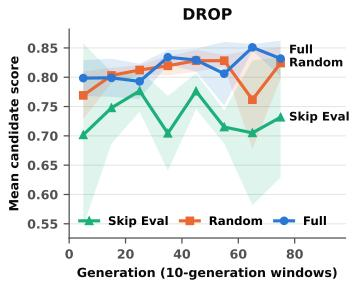

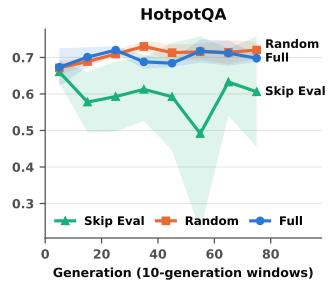  
Figure 1: Evolution trajectories under diferent evaluation strategies on DROP and HotpotQA. Curves show mean candidate scores on a shared audit set over successive 10- generation windows.

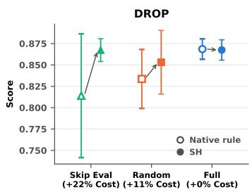

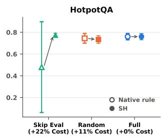  
Figure 2: Efect of search-time feedback and final selection on DROP and HotpotQA. We compare the native selection rule with successive halving (SH) across three search strategies. Percentages indicate the additional evaluation cost of SH relative to the full-evaluation bud et.

Most analyses in this section replay evaluators on the 24 Full runs (four benchmarks, two frameworks, three seeds), in which every candidate is evaluated on all SEARCH items, so the full-SEARCH mean of each candidate is known. A replay keeps the candidate sequence fixed and varies only which cells the evaluator observes. We measure two search-time quantities. Close-pair agreement is the share of candidate pairs whose full-SEARCH means difer by at most .03 that the evaluator orders correctly; these are the com- parisons that archive updates face. Archive regret is, averaged over the run, the gap between the mean full-SEARCH score of the ten best candidates generated so far and that of the ten candidates the evaluator ranks highest.

## 4.2 Search Needs Feedback, but Not Full Evaluation

Evaluation feedback plays an important role in guiding evolutionary search. Figure 1 compares the evolution trajectories under three evaluation strategies on DROP and HotpotQA, using a shared audit set. Without evaluation feedback, candidate quality remains rela- tively low and shows limited improvement. In contrast, random partial evaluation maintains candidate quality close to Full, sug- gesting that efective evolution does not require evaluating every candidate on the entire SEARCH set.

Search improvements are also concentrated in early iterations. Although this does not establish the optimal temporal allocation, it motivates investing in early calibration and using sparse feedback for subsequent candidates.

Takeaway 1. Evolutionary search requires evaluation feedback, but sparse evaluation can sustain candidate improvement without the cost of full evaluation.

## 4.3 Comparability Depends on Shared Informative Observations

We conduct ofline replays on 24 Full evolution trajectories (four benchmarks, two frameworks, and three seeds), with three replays per trajectory. Each replay fixes the generated candidate sequence and varies only the evaluation cells observed by the evaluator. The first � = 10 candidates are fully evaluated, while subsequent candidates are evaluated on 60 ofthe 300 SEARCH items. All policies use the same evaluation budget, with full-SEARCH scores serving as the reference.

We assess three metrics: Spearman correlation with full-SEARCH scores, close-pair agreement for candidates whose reference scores difer by at most .03, and archive regret, defined as the average fitness gap between the true and estimated top-10 archives. These metrics capture both score estimation quality and the evolutionary decisions supported by limited feedback.

Informativeness and sharing. Table 2 shows that shared infor- mative items yield more reliable close-candidate comparisons than random or unshared items. For the unshared informative policy, each candidate samples 60 items from the 120 most informative ones, rather than using a common item set. Despite drawing from informative items, this policy produces lower close-pair agreement and higher archive regret.

Pairing provides an explanation for the benefit of sharing. For � items drawn independently from the task distribution, the vari- ance of the score diference between two candidates evaluated on shared items is $\begin{array} { r } { \mathrm { V a r } ( \widehat { \Delta } _ { c c ^ { \prime } } ) = \frac { \sigma _ { c } ^ { 2 } + \sigma _ { c ^ { \prime } } ^ { 2 } - 2 \sigma _ { c c ^ { \prime } } } { k } } \end{array}$ , where $\sigma _ { c c ^ { \prime } }$ denotes their response covariance. With independently sampled item sets, the covariance term vanishes. Because evolved candidates often ex- hibit correlated responses, shared items can reduce the variance of pairwise comparisons.

Score comparability. Accurate individual rankings do not nec- essarily translate into reliable archive decisions. Although raw means achieve similar Spearman correlation to model-completed scores, they produce substantially higher archive regret. This is be-cause sparse candidates are evaluated on informative items, whereas warm-up candidates are evaluated on the full SEARCH set. The fixed response model places both on a common full-SEARCH scale, avoiding inconsistent archive comparisons and repeated rescoring during evolution.

Takeaway 2. Reliable evolutionary decisions require informative, shared observations and comparable fitness scores, rather than accu- rate individual estimates alone.

Table 2: Ofline comparison of item policies and fitness esti-mators under matched evaluation budgets. Results are aver- aged over 24 Full trajectories, with three replays per trajec-tory.
<table><tr><td>Item policy</td><td>Estimator</td><td>Spearman</td><td>Close-pair agreement</td><td>Archive regret</td></tr><tr><td>Shared informative</td><td>Model</td><td>.862</td><td>.732</td><td>.0043</td></tr><tr><td>Shared informative</td><td>Raw</td><td>.865</td><td>.698</td><td>.0102</td></tr><tr><td>Unshared informative</td><td>Model</td><td>.795</td><td>.674</td><td>.0056</td></tr><tr><td>Shared random</td><td>Model</td><td>.750</td><td>.649</td><td>.0071</td></tr><tr><td>Independent random</td><td>Model</td><td>.717</td><td>.626</td><td>.0078</td></tr></table>

## 4.4 Final Selection Needs Confirmation

Final scafold selection requires more reliable comparisons than those needed to guide evolutionary search. Figure 2 compares the native selection rule with successive halving (SH) on the same candidate pools under diferent search-time evaluation strategies. SH substantially improves final performance when search feedback is absent, recovering strong candidates that the native selection rule may overlook. With random partial evaluation, the gains are smaller and less consistent, while full evaluation leaves little room for further improvement. These results highlight the importance of final confirmation when search-time evaluation is limited.

Takeaway 3. Final selection requires reliable comparisons beyond search-time fitness estimates, particularly when evaluation feedback is sparse or absent.

## 5 Method

Figure 3 illustrates EvalAlloc, an evaluation allocation framework that distributes evaluation efort across three sta es: Core Calibration, Shared-Core Evolution, and Warm-Started Selection. EvalAl-loc decouples the two roles of evaluation: search-time feedback only needs to be cheap and comparable enough to guide evolu- tion, whereas the final choice needs precise comparisons among the strongest candidates. It therefore splits one evaluation bud- get into a sparse search stage and a separate selection stage that reuses every observation collected during search. The key idea is to invest a small evaluation budget upfront to establish a reusable reference, use shared informative items to provide comparable feedback throughout evolution, and concentrate additional evalua- tions on final scafold selection. EvalAlloc operates as a drop-in evaluator, leaving the native framework’s proposal, archive, and parent-selection policies unchanged.

## 5.1 Core Calibration

EvalAlloc begins by fully evaluating the first � valid candidates on all � SEARCH items. This upfront investment serves two pur-poses: identifying informative items for subsequent evaluation and calibrating a response model for estimating full-set fitness from sparse observations. The warm-up candidates receive their directly observed full-set scores, while their item-level outcomes form a dense response matrix for calibration.

Identifying informative items. We estimate item informa- tiveness from accumulated evaluation outcomes. Let $a _ { i }$ denote the number of full-credit outcomes and $n _ { i }$ the number of observed outcomes for item �. Using a Beta posterior for its full-credit probability,

$$
p _ { i } \sim \mathrm { B e t a } ( a _ { i } + 1 , n _ { i } - a _ { i } + 1 ) ,\tag{2}
$$

we define a conservative informativeness estimate:

$$
I _ { i } = 4 \left( \mathbb { E } [ X _ { i } ] - z { \sqrt { \mathrm { V a r } ( X _ { i } ) } } \right) , \qquad X _ { i } = p _ { i } ( 1 - p _ { i } ) .\tag{3}
$$

The variance term favors items whose outcomes vary across candidates, while the uncertainty penalty discourages selecting items with insuficient evidence. Fractional outcomes below full credit count as failures for these acquisition statistics. The posterior mo- ments are available in closed form.

Response model. We fit a low-rank logistic response model following a multidimensional item response theory (MIRT) formulation:

$$
q _ { c i } = \sigma \big ( \mu + \eta _ { i } + b _ { c } + u _ { i } ^ { \top } v _ { c } \big ) , \qquad u _ { i } , v _ { c } \in \mathbb { R } ^ { d } ,\tag{4}
$$

where $\mu$ is a global intercept, $( \eta _ { i } , u _ { i } )$ represent item-specific param-eters, and $( b _ { c } , v _ { c } )$ capture candidate-specific response characteristics. The model is fitted on the fully evaluated warm-up candidates by minimizing regularized fractional cross-entropy. Their fitted candidate parameters also define a Gaussian prior for subsequent candidates.

During evolution, the global intercept, item parameters, and candidate prior remain fixed. For each new candidate, only $( b _ { c } , v _ { c } )$ are inferred from its sparse observations by MAP estimation under this prior. This maintains a common scoring reference across candidates without repeatedly refitting the model or rescoring archived candidates.

## 5.2 Shared-Core Evolution

After calibration, each new candidate is evaluated on a small subset of� SEARCH items $( k = 6 0 , \mathrm { i . e . } ,$ , 20% of $N = 3 0 0 )$ . Rather than inde- pendently selecting items for each candidate, EvalAlloc combines a fixed informative core with a small adaptive component.

Shared informative core. Using the warm-up informativeness estimates, we select the top �0 items to form a fixed core $S _ { 0 }$ . Every subsequent candidate is evaluated on this same core, creating a common basis for cross-candidate comparisons. This design fol- lows the intuition of common random numbers (CRN): exposing candidates to shared evaluation conditions helps reduce variation arising from diferences in the evaluated item sets.

To retain limited adaptability, the remaining $k - k _ { 0 }$ items are candidate-specific. For each candidate �, we sample a set $A _ { c }$ from outside the core, using Gumbel-top-� sampling with logits $I _ { i } / \tau$ computed from the current informativeness scores. With a small temperature, this amounts to taking the currently most informative items with random tie-breaking. The resulting evaluation set is

$$
S _ { c } = S _ { 0 } \cup A _ { c } , \qquad | S _ { 0 } | = k _ { 0 } , \quad | S _ { c } | = k .\tag{5}
$$

The shared core remains unchanged, whereas the acquisition sta- tistics are updated after each candidate using newly observed out- comes. This allows the adaptive component to respond to changes in the evolving candidate population without sacrificing the common comparison basis.

Concretely, for two candidates scored on the same $k _ { 0 }$ items, the variance of their score diference is Var $( \bar { Y } _ { a } - \bar { Y } _ { b } ) \ = \ ( \sigma _ { a } ^ { 2 } + \frac { } { }$ $\sigma _ { b } ^ { 2 } - 2 \cos ( Y _ { a } , Y _ { b } ) \big ) / k _ { 0 }$ , whereas independently drawn item sets remove the covariance term. Because evolved scafolds are strongly correlated—competitive candidates agree on most items—a shared core makes pairwise comparisons less noisy at the same budget.

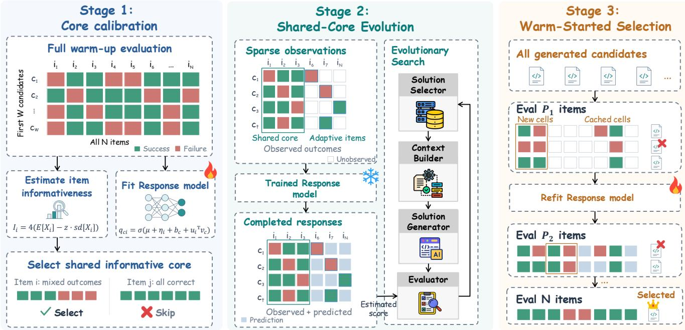  
Figure 3: Overview of EvalAlloc. The framework consists of three stages: (1) core calibration using fully evaluated warm-up candidates, (2) sparse search-time evaluation with a shared informative core and fixed response model, and (3) warm-started successive halving that reuses accumulated observations for final scafold selection.

Comparable fitness feedback. After evaluating candidate � on $S _ { c } ,$ , we infer its candidate-specific response parameters under the fixed warm-up model. The fitted model then predicts responses on unobserved items, producing a completed estimate of full-set fitness:

$$
\widehat { F } ( c ) = \frac { 1 } { N } \left( \sum _ { i \in S _ { c } } Y _ { c i } + \sum _ { i \notin S _ { c } } q _ { c i } \right) .\tag{6}
$$

Here, $Y _ { c i }$ denotes the observed outcome and $q _ { c i }$ the model prediction using the inferred parameters of candidate �.

Combining observed and predicted outcomes places sparse eval- uations on the full-SEARCH fitness scale expected by the native evolution framework, which also contains the fully evaluated warm- up candidates. Keeping the response model fixed also avoids retro- spectively changing the scoring reference for archived candidates. The resulting fitness estimates are returned directly to the frame- work for its existing archive updates and subsequent proposals. All observed outcomes are cached for reuse during final selection.

## 5.3 Warm-Started Selection

Search-time evaluation aims to provide inexpensive feedback for continued evolution, whereas final selection requires distinguishing the strongest candidates. After search, EvalAlloc therefore runs successive halving (SH) over all valid candidates, using additional observed outcomes rather than relying on search-time fitness es- timates. Candidates with identical code (the same abstract syntax tree after removing docstrings) are merged first.

We construct a shared random permutation of the SEARCH items and define increasingly large cumulative prefixes $P _ { 1 } \subset P _ { 2 } \subset$ $\cdots \subset P _ { R }$ with $P _ { R } = \mathcal { D } _ { \mathrm { s } }$ .

In each round, surviving candidates are evaluated on the cur- rent prefix, and the top candidates are retained according to their round scores. The evaluation budget thus becomes increasingly concentrated on competitive candidates.

Warm-starting from search observations. Rather than dis- carding evaluations collected during evolution, we reuse all avail- able outcomes. Let $O _ { c }$ denote the items already observed for can- didate � during search, and let $U _ { c } ^ { r } = O _ { c } \cup P _ { r }$ . Only the missing observations in $U _ { c } ^ { r }$ are executed; cached outcomes are reused with- out additional cost. In the first round, the score is the observed mean over this union:

$$
\widetilde { F } _ { 1 } ( c ) = \frac { 1 } { | U _ { c } ^ { 1 } | } \sum _ { i \in U _ { c } ^ { 1 } } Y _ { c i } .\tag{7}
$$

Regression-adjusted scores. Because $O _ { c }$ contains informative and partly candidate-specific items, union means of diferent can- didates are computed on item sets of diferent dificulty. From the second round on, EvalAlloc corrects this with a regression (diference) estimator [3, 6]:

$$
\widetilde { F } _ { r } ( \boldsymbol { c } ) = \frac { 1 } { | U _ { c } ^ { r } | } \sum _ { i \in U _ { c } ^ { r } } Y _ { c i } + \lambda _ { r } \left( \frac { 1 } { N } \sum _ { i = 1 } ^ { N } \widetilde { q } _ { c i } - \frac { 1 } { | U _ { c } ^ { r } | } \sum _ { i \in U _ { c } ^ { r } } \widetilde { q } _ { c i } \right) ,\tag{8}
$$

Table 3: Test performance of the program selected under each evaluation strategy. For each benchmark, Score reports the TEST mean over three seeds, with standard deviation shown as a subscript. Cost (%) is the evaluation spent during search and final selection, as a share of evaluating every proposal on all 300 search items (80 × 300 cells for ShinkaEvolve, 81 × 300 for AdaEvolve); programs that fail to load or error on every evaluated item cost nothing. Average reports the unweighted mean over the four benchmarks. The highest Score per benchmark and on average within each framework is bold.
<table><tr><td rowspan="2">Framework</td><td rowspan="2">Method</td><td colspan="2">DROP</td><td colspan="2">HotpotQA</td><td colspan="2">HoVer</td><td colspan="2">IFBench</td><td colspan="2">Average</td></tr><tr><td>Score ↑</td><td>Cost↓</td><td>Score ↑</td><td>Cost ↓</td><td>Score ↑</td><td>Cost ↓</td><td>Score ↑</td><td>Cost ↓</td><td>Score ↑</td><td>Cost↓</td></tr><tr><td rowspan="6">ShinkaEvolve</td><td>Skip Eval</td><td> $0 . 7 6 7 4 _ { \pm 0 . 1 0 4 6 }$ </td><td>0.0</td><td> $0 . 4 6 3 3 _ { \pm 0 . 4 0 1 4 }$ </td><td>0.0</td><td> $0 . 3 9 3 3 _ { \pm 0 . 0 9 6 1 }$ </td><td>0.0</td><td> $0 . 3 9 1 7 _ { \pm 0 . 0 7 4 1 }$ </td><td>0.0</td><td>0.5039</td><td>0.0</td></tr><tr><td>Successive Halving</td><td> $0 . 8 7 3 8 _ { \pm 0 . 0 2 4 8 }$ </td><td>22.1</td><td> $0 . 7 0 8 9 _ { \pm 0 . 0 1 3 9 }$ </td><td>22.0</td><td> $0 . 6 8 4 4 _ { \pm 0 . 0 9 4 8 }$ </td><td>22.5</td><td> $0 . 4 4 3 3 _ { \pm 0 . 0 0 9 8 }$ </td><td>21.2</td><td>0.6776</td><td>22.0</td></tr><tr><td>Random</td><td> $0 . 8 6 2 9 _ { \pm 0 . 0 0 8 3 }$ </td><td>42.5</td><td> $0 . 7 2 4 4 { \scriptstyle \pm 0 . 0 1 5 8 }$ </td><td>45.6</td><td> $0 . 7 1 5 6 _ { \pm 0 . 0 4 4 3 }$ </td><td>43.8</td><td> $0 . 4 6 0 3 _ { \pm 0 . 0 3 3 2 }$ </td><td>37.7</td><td>0.6908</td><td>42.4</td></tr><tr><td>Cascade</td><td> $0 . 8 6 4 3 _ { \pm 0 . 0 1 3 9 }$ </td><td>39.6</td><td> $0 . 7 1 7 8 _ { \pm 0 . 0 1 3 5 }$ </td><td>53.3</td><td> $\mathbf { 0 . 7 2 8 9 _ { \pm 0 . 0 3 7 5 } }$ </td><td>54.8</td><td> $0 . 4 6 8 3 _ { \pm 0 . 0 2 1 4 }$ </td><td>38.5</td><td>0.6948</td><td>46.6</td></tr><tr><td>Full</td><td> $0 . 8 8 3 2 _ { \pm 0 . 0 1 5 5 }$ </td><td>77.1</td><td> $0 . 7 1 3 3 _ { \pm 0 . 0 0 6 7 }$ </td><td>92.5</td><td> $0 . 7 2 6 7 _ { \pm 0 . 0 1 7 6 }$ </td><td>92.5</td><td> $0 . 4 6 6 0 _ { \pm 0 . 0 2 9 0 }$ </td><td>75.4</td><td>0.6973</td><td>84.4</td></tr><tr><td>EVALALLOC</td><td> $\mathbf { 0 . 8 9 0 7 { \scriptstyle \pm 0 . 0 1 6 4 } }$ </td><td>43.3</td><td> $\mathbf { 0 . 7 4 1 1 { \scriptstyle \pm 0 . 0 2 3 4 } }$ </td><td>46.0</td><td> $0 . 7 2 7 8 _ { \pm 0 . 0 8 4 7 }$ </td><td>46.9</td><td> $\mathbf { 0 . 4 7 3 9 _ { \pm 0 . 0 2 4 6 } }$ </td><td>39.2</td><td>0.7084</td><td>43.8</td></tr><tr><td rowspan="6">AdaEvolve</td><td>Skip Eval</td><td> $0 . 7 7 2 0 { \scriptstyle \pm 0 . 0 8 3 3 }$ </td><td>0.0</td><td> $0 . 6 6 7 8 _ { \pm 0 . 0 2 8 7 }$ </td><td>0.0</td><td> $0 . 4 9 3 3 _ { \pm 0 . 1 3 8 9 }$ </td><td>0.0</td><td> $0 . 4 3 0 3 _ { \pm 0 . 0 3 9 8 }$ </td><td>0.0</td><td>0.5908</td><td>0.0</td></tr><tr><td>Successive Halving</td><td> $0 . 8 5 5 9 _ { \pm 0 . 0 4 8 0 }$ </td><td>22.8</td><td> $0 . 6 9 2 2 _ { \pm 0 . 0 4 0 2 }$ </td><td>23.2</td><td> $0 . 5 6 2 2 _ { \pm 0 . 1 1 5 5 }$ </td><td>23.1</td><td> $0 . 4 4 7 8 _ { \pm 0 . 0 3 5 4 }$ </td><td>23.1</td><td>0.6395</td><td>23.1</td></tr><tr><td>Random</td><td> $0 . 8 7 5 9 _ { \pm 0 . 0 0 9 8 }$ </td><td>49.2</td><td> $0 . 7 1 6 7 _ { \pm 0 . 0 3 8 4 }$ </td><td>49.8</td><td> $0 . 7 1 7 8 _ { \pm 0 . 0 8 7 7 }$ </td><td>49.6</td><td> $0 . 4 4 7 3 _ { \pm 0 . 0 1 7 3 }$ </td><td>48.6</td><td>0.6894</td><td>49.3</td></tr><tr><td>Cascade</td><td> $0 . 8 2 0 4 { \scriptstyle \pm 0 . 0 3 9 8 }$ </td><td>58.6</td><td> $0 . 7 3 7 8 _ { \pm 0 . 0 3 5 6 }$ </td><td>53.8</td><td> $\mathbf { 0 . 7 9 2 2 _ { \pm 0 . 1 0 9 1 } }$ </td><td>60.3</td><td> $0 . 4 5 1 8 _ { \pm 0 . 0 2 2 1 }$ </td><td>51.4</td><td>0.7006</td><td>56.0</td></tr><tr><td>Full</td><td> $0 . 8 8 4 0 _ { \pm 0 . 0 1 5 5 }$ </td><td>100.0</td><td> $0 . 7 2 6 7 _ { \pm 0 . 0 2 9 6 }$ </td><td>98.8</td><td> $0 . 7 7 3 3 _ { \pm 0 . 0 8 9 9 }$ </td><td>100.0</td><td> $0 . 4 5 2 4 _ { \pm 0 . 0 1 2 3 }$ </td><td>97.9</td><td>0.7091</td><td>99.2</td></tr><tr><td>EVALALLOC</td><td> $\mathbf { 0 . 8 8 8 1 { \scriptstyle \pm 0 . 0 0 8 7 } }$ </td><td>46.3</td><td> $\mathbf { 0 . 7 4 5 6 { \scriptstyle \pm 0 . 0 3 1 0 } }$ </td><td>46.9</td><td> $0 . 7 8 4 4 _ { \pm 0 . 0 6 1 9 }$ </td><td>47.3</td><td> $\mathbf { 0 . 4 7 2 2 _ { \pm 0 . 0 5 1 3 } }$ </td><td>45.3</td><td>0.7226</td><td>46.4</td></tr></table>

where $\tilde { q } _ { c i }$ is the prediction of a refitted response model. The second term adds the redicted diference between the full SEARCH set and the observed items, so $\lambda _ { r } = 0$ recovers the union mean and $\lambda _ { r } = 1$ the classical diference estimator. We estimate $\lambda _ { r }$ from the data as the pooled within-candidate regression slope of observed outcomes on predictions over the surviving candidates $C _ { r }$

$$
\lambda _ { r } = \frac { \sum _ { c \in C _ { r } } \sum _ { i \in U _ { c } ^ { r } } \big ( Y _ { c i } - \bar { Y } _ { c } \big ) ( \tilde { q } _ { c i } - \bar { \tilde { q } } _ { c } ) } { \sum _ { c \in C _ { r } } \sum _ { i \in U _ { c } ^ { r } } ( \tilde { q } _ { c i } - \bar { \tilde { q } } _ { c } ) ^ { 2 } } ,\tag{9}
$$

with means taken over $U _ { c } ^ { r }$ and the result clipped to [0, 1.5]. This slope approximates the variance-minimizing coeficient of the difference estimator and automatically shrinks the correction when predictions track the observed outcomes poorly.

Cross-fitted refit. After the first round, we refit the response model on all search-time and round-1 observations. To avoid fitting the item parameters that correct a candidate on that candidate’s own observations, we use two-fold cross-fitting [5]: the sparse (nonwarm-up) candidates are randomly split into two folds, and each fold is scored by a model fitted on the warm-up candidates and the other fold. Warm-up candidates are fully observed, so their correction term is zero. Likewise, once the last round observes all � items, $U _ { c } ^ { R } = \mathcal { D } _ { \mathfrak { s } }$ and Eq. (8) reduces to the observed full-SEARCH mean, so the final pick is always decided by observed outcomes.

Evaluation cost. For � valid candidates, the total evaluator cost in executed cells is

$$
C _ { \mathrm { e v a l } } = W N + ( M - W ) k + C _ { \mathrm { S H , n e w } } ,\tag{10}
$$

where the first two terms account for calibration and sparse search, and $C _ { \mathrm { S H , n e w } }$ counts only additional executions required by successive halving. With 80 valid proposals, the search stage costs $( W N + 7 0 k ) / ( 8 0 N ) = 3 0 \%$ of full evaluation. Thus, EvalAlloc reuses evaluation efort across stages: dense observations establish the scoring reference, shared sparse observations guide evolution, and cached evaluations reduce the incremental cost of final confir- mation.

## 6 Experiments

## 6.1 Setup

Baselines. We compare EvalAlloc against five evaluation strate- gies with diferent budget allocations. Skip Eval performs no eval- uation during either search or final selection, and select the last valid evolved program. Successive Halving (SH) [14] provides no evaluation feedback during search and applies successive halving to the generated candidate pool for final selection. Random evalu- ates each candidate on a randomly sampled 50% subset of SEARCH items. Cascade [2, 23] first evaluates candidates on 20% of SEARCH items and promotes candidates meeting a top-25% threshold to full evaluation, while allocating no additional evaluations to the re- maining candidates. Full evaluates every candidate on all SEARCH items.

Implementation Details. We use the same benchmarks, evolu- tion frameworks, and model configurations as in Section 4.1. Unless otherwise specified, EvalAlloc allocates 30% of the full-evaluation budget to search, with the first $W = 1 0$ valid candidates fully eval- uated and each subsequent candidate evaluated on $k = 6 0$ items (20% of SEARCH). The shared informative core contains $k _ { 0 } = 5 4$ items (90% of $k ) ,$ and the Gumbel sampling temperature is $\tau = 0 . 0 0 1$ For final selection, we use � = 4 successive-halving rounds with cumulative item prefixes of 30, 60, 120, and 300, retaining 30, 15, 8, and 1 candidates, respectively. For the response model, we set the latent dimension to � = 2, the regularization coeficient to $\rho = 1$ and the informativeness uncertainty penalty to � = 2.

## 6.2 Main Results

Table 3 compares the TEST performance and evaluation cost of diferent strategies. Across both evolution frameworks and all four benchmarks, EvalAlloc matches or slightly exceeds the mean

Table 4: Ablation of EvalAlloc on ShinkaEvolve. For each benchmark, we report the score over three runs, with standard deviation shown as a subscript. Each variant removes one component and keeps the rest unchanged. Δ is the change in the four-benchmark average relative to EvalAlloc. Cost (%) is the evaluation spent during search and final selection. Best value per column is bold.
<table><tr><td>Variant</td><td>DROP</td><td> $_ \mathrm { H o t p o t Q A }$ </td><td>HoVer</td><td>IFBench</td><td> $\operatorname { A v g } .$ </td><td>Δ</td><td>Cost</td></tr><tr><td>EVALALLOC</td><td> $0 . 8 9 0 7 _ { \pm 0 . 0 1 6 4 }$ </td><td> $\mathbf { 0 . 7 4 1 1 { \scriptstyle \pm 0 . 0 2 3 4 } }$ </td><td> $\mathbf { 0 . 7 2 7 8 _ { \pm 0 . 0 8 4 7 } }$ </td><td> $0 . 4 7 3 9 _ { \pm 0 . 0 2 4 6 }$ </td><td>0.7084</td><td></td><td>43.8%</td></tr><tr><td>w/o selection</td><td> $0 . 8 7 5 5 { \scriptstyle \pm 0 . 0 1 5 7 }$ </td><td> $0 . 7 2 7 8 _ { \pm 0 . 0 1 3 9 }$ </td><td> $0 . 6 9 2 2 _ { \pm 0 . 0 6 8 3 }$ </td><td> $0 . 4 6 8 8 _ { \pm 0 . 0 3 6 3 }$ </td><td>0.6911</td><td>-0.0173 27.4%</td><td></td></tr><tr><td>w/o response model</td><td> $\pm 0 . 8 9 4 6 _ { \pm 0 . 0 1 1 3 }$ </td><td> $0 . 7 2 2 2 _ { \pm 0 . 0 1 3 9 }$ </td><td> $0 . 6 8 0 0 _ { \pm 0 . 0 3 6 1 }$ </td><td> $\mathbf { 0 . 4 8 9 2 _ { \pm 0 . 0 5 1 3 } }$ </td><td>0.6965</td><td>-0.0119</td><td>44.2%</td></tr><tr><td>w/o informative items</td><td> $0 . 8 8 6 6 _ { \pm 0 . 0 0 2 8 }$ </td><td> $0 . 6 9 6 7 _ { \pm 0 . 0 2 6 0 }$ </td><td> $0 . 6 6 8 9 _ { \pm 0 . 0 3 6 9 }$ </td><td> $0 . 4 6 4 9 _ { \pm 0 . 0 3 2 6 }$ </td><td></td><td> $\begin{array} { r l } { 0 . 6 7 9 3 } & { { } - 0 . 0 2 9 1 } \end{array}$ </td><td>43.4%</td></tr></table>

TEST score of Full while using approximately half as many eval-uation cells. It also outperforms Random and Cascade in cross- benchmark average performance at comparable or lower evalu- ation cost. These results demonstrate that allocating evaluations selectively can provide a better cost–performance tradeof than uniformly evaluating candidates. The evaluation costs difer be- tween the two frameworks partly due to their handling of invalid proposals. AdaEvolve retries program generation when a proposal is invalid, whereas ShinkaEvolve discards invalid proposals with- out replacement. Since invalid programs incur no evaluation cost, ShinkaEvolve evaluates fewer valid candidates, resulting in lower realized evaluation costs, particularly under Full evaluation.

The no-evaluation baselines further highlight the complemen- tary roles of search feedback and final selection. Applying SH to candidates generated without evaluation feedback substantially improves final performance, but still falls short of EvalAlloc. This suggests that final selection can recover promising candidates even from unguided search, while informative feedback during evolu- tion provides additional benefits. These findings support combining sparse search-time evaluation with targeted final confirmation.

## 6.3 Ablation Study

We ablate three components of EvalAlloc on ShinkaEvolve across all four benchmarks. W/o selection skips final confirmation and selects the candidate with the highest refitted response-model es timate from the same search runs. W/o response model uses raw observed means for search feedback and raw union means for final selection. W/o informative items replaces informative item selection with random sampling while preserving the shared core and evaluation budget. The latter two variants require new evolution runs because they change the search-time feedback.

Table 4 shows that removing final confirmation consistently re- duces TEST performance, highlighting the importance of additional evaluation for selecting among competitive candidates. Replacing informative items with random ones produces the largest aver age degradation, suggesting that sharing evaluation items alone is insuficient without considering their informativeness. Removing the response model has a smaller and less consistent efect, as the shared core already provides substantial comparability among can- didates. The response model therefore primarily serves to calibrate sparse feedback onto a common scoring scale. Overall, these results identify informative item selection and final confirmation as the main contributors to EvalAlloc.

## 6.4 Analysis

Budget Allocation in Warm-up Stage. Figure 4 examines the efect of warm-up length � on DROP with ShinkaEvolve under a fixed search-stage budget. A longer warm-up provides more ob- servations for calibration but leaves fewer evaluation items for subsequent candidates. The default $W = 1 0$ achieves the highest mean performance, although the diferences are within seed-to- seed variation. All three configurations outperform Random at comparable evaluation cost. Ofline replays further show that an excessively long warm-up reduces search-time ranking accuracy as later evaluations become too sparse. These results highlight the trade-of between upfront calibration and informative feedback during subsequent evolution.

Budget Allocation in Search Stage. Figure 5 examines the efect ofsearch-time evaluation budget on DROP with ShinkaEvolve. We fix the warm-up at ten fully evaluated candidates and vary the target search budget from 20% to 40%. The default 30% allocation achieves the highest observed mean TEST performance, while the 20% configuration ofers comparable performance at lower cost. Increasing the search-time budget does not consistently improve final performance in this setting, suggesting that sparse feedback can be suficient to guide productive evolution.

Budget Allocation in Selection Stage. Figure 6 examines the efect of final confirmation budget while reusing the same search runs. Compared with direct selection based on search-stage esti- mates, successive halving (SH) improves TEST performance across all four benchmarks. Applying SH to the top 30 candidates captures most of the improvement at lower cost, while considering all can- didates provides a modest additional gain. These results highlight the value of targeted final confirmation and the trade-of between selection cost and final scafold quality.

Evaluation cost. Table 5 compares evaluation-cell and executor- token costs relative to Full. EvalAlloc reduces token consumption across all benchmark–framework settings, although token savings are not always proportional to cell savings. On ShinkaEvolve, it uses 52.13% of Full’s cells but 64.76% of its tokens, whereas its token share on AdaEvolve is 45.47%. The latter average is influenced by an unusually token-intensive HoVer Full run.

To examine this discrepancy without confounding diferences in search trajectories, we analyze the fully evaluated candidate pools from the Full runs. Higher-scoring candidates tend to consume more tokens per item, with average within-run Spearman correlations of 0.25 and 0.36 for ShinkaEvolve and AdaEvolve, respectively. Like- wise, the 60 items with the highest response variability consume

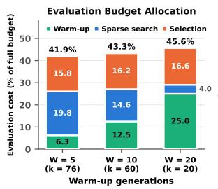

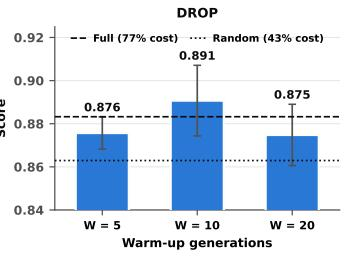

Figure 4: Efect of warm-up length on DROP with ShinkaE-volve under a fixed search-stage budget. Left: evaluation cost breakdown for diferent numbers of fully evaluated warm- up candidates. Right: corresponding performance, with Full and Random shown as references.  
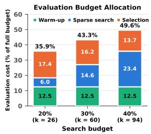

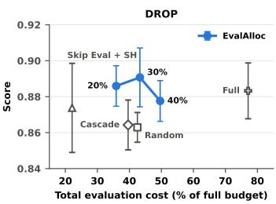

Figure 5: Efect of search-time evaluation budget on DROP with ShinkaEvolve. Left: evaluation cost breakdown across warm-up, sparse search, and final selection. Right: Perfor- mance versus total evaluation cost under diferent search budgets.  
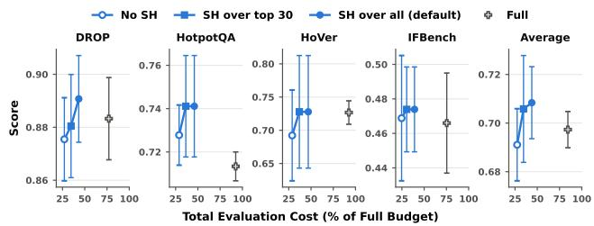  
Figure 6: Efect of final selection strategies on TEST perfor-mance and evaluation cost across four benchmarks and their average. We compare selection without SH, SH over the top 30 candidates, and SH over all candidates, using the same search runs. Full evaluation is shown as a reference.

1.08 and 1.13 times the average tokens per item. These patterns suggest that concentrating evaluations on informative items and competitive candidates can favor more expensive execution cells. Thus, evaluation-cell counts measure the number of executions, while token counts additionally reflect heterogeneity in execution cost.

Other Proposers and Executor. We further evaluate alterna- tive model configurations on ShinkaEvolve in Figure 7. We replace the proposer with gpt-oss-120b [1] on IFBench, or the executor with

Table 5: Evaluation-cell and executor-token (prompt and completion) costs of search and final selection, relative to Full (100%). Each entry averages the per-benchmark shares over the four benchmarks; programs that fail to load or error on every evaluated item cost nothing.
<table><tr><td rowspan="2">Method</td><td colspan="2">ShinkaEvolve</td><td colspan="2">AdaEvolve</td></tr><tr><td>Cells</td><td>Tokens</td><td>Cells</td><td>Tokens</td></tr><tr><td>Full</td><td>100.00%</td><td>100.00%</td><td>100.00%</td><td>100.00%</td></tr><tr><td>Successive Halving</td><td>26.26%</td><td>27.50%</td><td>23.26%</td><td>15.10%</td></tr><tr><td>Random</td><td>50.44%</td><td>55.18%</td><td>49.69%</td><td>43.66%</td></tr><tr><td>Cascade</td><td>54.83%</td><td>66.32%</td><td>56.47%</td><td>54.50%</td></tr><tr><td>EVALALLOC</td><td>52.13%</td><td>64.76%</td><td>46.83%</td><td>45.47%</td></tr></table>

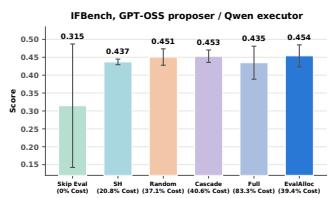

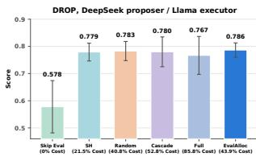  
Figure 7: Performance with alternative proposer and executor models on ShinkaEvolve. Left: IFBench with a gpt-oss- 120b proposer. Right: DROP with a Llama-3.1-8B-Instruct executor. Bars show the mean over three seeds, with stan- dard deviation as error bars. Percentages indicate evaluation cost relative to the nominal full budget.

Llama-3.1-8B-Instruct [11] on DROP. In both settings, EvalAlloc achieves competitive TEST performance with substantially fewer evaluation cells than Full. The relative performance of evaluation strategies varies across model configurations, suggesting that the benefits of evaluation allocation can depend on the underlying models.

## 7 Conclusion

Evaluation influences both evolutionary search and final scafold selection. Our investigation shows that sparse informative feedback can guide evolution, while shared evaluation items and a stable scor- ing reference support comparable decisions across candidates. Motivated by these findings, we propose EvalAlloc, which combines sparse search-time feedback with warm-started final confirmation. Across four benchmarks and two evolution frameworks, EvalAl- loc achieves competitive performance while using approximately half as many evaluation cells as Full. These results highlight the importance of allocating evaluation efort according to its distinct roles in search and final selection.

## References

[1] Sandhini Agarwal, Lama Ahmad, Jason Ai, Sam Altman, Andy Applebaum, Edwin Arbus, Rahul K Arora, Yu Bai, Bowen Baker, Haiming Bao, et al. gpt-oss-120b & gpt-oss-20b model card. arXiv preprint arXiv:2508.10925, 2025.

[2] Lakshya A Agrawal, Shangyin Tan, Dilara Soylu, Noah Ziems, Rishi Khare, Krista Opsahl-Ong, Arnav Singhvi, Herumb Shandilya, Michael J Ryan, Meng Jiang, et al. Gepa: Reflective prompt evolution can outperform reinforcement learning. In International Conference on Learning Representations, volume 2026, pages 8479– 8565, 2026.

[3] Anastasios N Angelopoulos, John C Duchi, and Tijana Zrnic. Ppi++: Eficient prediction-powered inference. The Annals ofApplied Statistics, 20(3):2235–2252, 2026.

[4] Mert Cemri, Shubham Agrawal, Akshat Gupta, Shu Liu, Audrey Cheng, Qi uyang Mang, Ashwin Naren, Lutfi Eren Erdogan, Koushik Sen, Matei Zaharia, et al. Adaevolve: Adaptive llm driven zeroth-order optimization. arXiv preprint arXiv:2602.20133, 2026.

[5] Victor Chernozhukov, Denis Chetverikov, Mert Demirer, Esther Duflo, Christian Hansen, Whitney Newey, and James Robins. Double/debiased machine learning for treatment and structural parameters, 2018.

[6] William Gemmell Cochran and William G Cochran. Sampling techniques, vol ume 3. wiley, New York, 1977.

[7] Dheeru Dua, Yizhong Wang, Pradeep Dasigi, Gabriel Stanovsky, Sameer Singh, and Matt Gardner. Drop: A reading comprehension benchmark requiring dis crete reasoning over paragraphs. In Proceedings of the 2019 Conference of the North American Chapter ofthe Association for Computational Linguistics: Human Language Technologies, Volume 1 (Long and Short Papers), pages 2368–2378, 2019.

[8] Adam Fisch, Daniel Deutsch, Joshua Maynez, Alekh Agarwal, Jonathan Berant, William Cohen, Amir Globerson, and Jacob Eisenstein. Collabeval: Statistically eficient collaborative model evaluation via matrix completion. arXiv preprint arXiv:2607.05046, 2026.

[9] Yonatan Gideoni, Sebastian Risi, and Yarin Gal. Simple baselines are competitive with code evolution. arXiv preprint arXiv:2602.16805, 2026.

[10] Paul Glasserman and David D Yao. Some guidelines and guarantees for common random numbers. Management Science, 38(6):884–908, 1992.

[11] Aaron Grattafiori, Abhimanyu Dubey, AbhinavJauhri, Abhinav Pandey, Abhishek Kadian, Ahmad Al-Dahle, Aiesha Letman, Akhil Mathur, Alan Schelten, Alex Vaughan, et al. The llama 3 herd of models. arXiv preprint arXiv:2407.21783, 2024.

[12] Eliya Habba, Itay Itzhak, Asaf Yehudai, Yotam Perlitz, Elron Bandel, Michal Shmueli-Scheuer, Leshem Choshen, and Gabriel Stanovsky. Growing pains: Extensible and eficient llm benchmarking via fixed arameter calibration. arXiv preprint arXiv:2604.12843, 2026.

[13] Shengran Hu, Cong Lu, and Jef Clune. Automated design of agentic systems. In International Conference on Learning Representations, volume 2025, pages 21344– 21377, 2025.

[14] Kevin Jamieson and Ameet Talwalkar. Non-stochastic best arm identification and hyperparameter optimization. In Artificial intelligence and statistics, pages 240–248. PMLR 2016.

[15] Yichen Jiang, Shikha Bordia, Zheng Zhong, Charles Dognin, Maneesh Singh, and Mohit Bansal. Hover: A dataset for many-hop fact extraction and claim verification. In Findings of the Association for Computational Linguistics: EMNLP 2020, pages 3441–3460, 2020.

[16] Woosuk Kwon, Zhuohan Li, Siyuan Zhuang, Ying Sheng, Lianmin Zheng, Cody Hao Yu, Joseph Gonzalez, Hao Zhang, and Ion Stoica. Eficient mem ory management for large language model serving with pagedattention. In Proceedings of the 29th symposium on operating systems principles, pages 611–626, 2023.

[17] Robert Lange, Yuki Imajuku, and Edoardo Cetin. Shinkaevolve: Towards openended and sample-eficient program evolution. In International Conference on Learning Representations, volume 2026, pages 74026–74078, 2026.

[18] Lisha Li, Kevin Jamieson, Giulia DeSalvo, Afshin Rostamizadeh, and Ameet Talwalkar. Hyperband: A novel bandit-based approach to hyperparameter optimization. Journal ofmachine learning research, 18(185):1–52, 2018.

[19] Shu Liu, Mert Cemri, Shubham Agarwal, Alexander Krentsel, Ashwin Naren, Qiuyang Mang, Zhifei Li, Akshat Gupta, Monishwaran Maheswaran, Audrey Cheng, et al. Skydiscover: A flexible, adaptive framework for ai-driven scientific and algorithmic discovery. In Proceedings of the ACM Conference on AI and Agentic Systems, pages 1223–1227, 2026.

[20] Manuel López-Ibáñez, Jérémie Dubois-Lacoste, Leslie Pérez Cáceres, Mauro Birattari, and Thomas Stützle. The irace acka e: Iterated racin for automatic algorithm configuration. Operations Research Perspectives, 3:43–58, 2016.

[21] Grégoire Mialon, Clémentine Fourrier, Thomas Wolf, Yann LeCun, and Thomas Scialom. Gaia: a benchmark for general ai assistants. In International Conference on Learning Representations, volume 2024, pages 9025–9049, 2024.

[22] Reiichiro Nakano, Jacob Hilton, Suchir Balaji, Jef Wu, Long Ouyang, Christina Kim, Christopher Hesse, Shantanu Jain, Vineet Kosaraju, William Saunders, et al. Webgpt: Browser-assisted question-answering with human feedback. arXiv preprint arXiv:2112.09332, 2021.

[23] Alexander Novikov, Ngân Vu, Marvin Eisenberger, Emilien Dupont, Po-Sen ˜ Huang, Adam Zsolt Wagner, Sergey Shirobokov, Borislav Kozlovskii, Francisco JR Ruiz, Abbas Mehrabian, et al. Alphaevolve: A coding agent for scientific and algorithmic discovery. arXiv preprint arXiv:2506.13131, 2025.

[24] Felipe Maia Polo, Lucas Weber, Leshem Choshen, Yuekai Sun, Gongjun Xu, and Mikhail Yurochkin. tinybenchmarks: evaluating LLMs with fewer examples. In Forty-first International Conference on Machine Learning, 2024. URL https: //openreview.net/forum?id=qAml3FpfhG

[25] Valentina Pyatkin, Saumya Malik, Victoria Graf, Hamish Ivison, Shengyi Huang, Pradeep Dasigi, Nathan Lambert, and Hanna Hajishirzi. Generalizing verifiable

instruction following. Advances in Neural Information Processing Systems, 38, 2026.

[26] Yujia Qin, Shihao Liang, Yining Ye, Kunlun Zhu, Lan Yan, Yaxi Lu, Yankai Lin, Xin Cong, Xiangru Tang, Bill Qian, et al. Toolllm: Facilitating large language models to master 16000+ real-world apis. In International Conference on Learning Representations, volume 2024, pages 9695–9717, 2024.

[27] Qwen Team. Qwen3.5: Towards native multimodal agents, February 2026. URL https://qwen.ai/blog?id=qwen3.5.

[28] Bernardino Romera-Paredes, Mohammadamin Barekatain, Alexander Novikov, Matej Balog, M Pawan Kumar, Emilien Dupont, Francisco JR Ruiz, Jordan S Ellenberg, Pengming Wang, Omar Fawzi, et al. Mathematical discoveries from program search with large language models. Nature, 625(7995):468–475, 2024.

[29] Anyi Xu, Bangcai Lin, Bing Xue, Bingxuan Wang, Bingzheng Xu, Bochao Wu, Bowei Zhang, Chaofan Lin, Chen Dong, Chenchen Ling, et al. Deepseek-v4: Towards highly eficient million-token context intelligence. arXiv preprint arXiv:2606.19348, 2026

[30] Zhilin Yang, Peng Qi, Saizheng Zhang, Yoshua Bengio, William Cohen, Ruslan Salakhutdinov, and Christopher D Manning. Hotpotqa: A dataset for diverse, explainable multi-hop question answering. In Proceedings ofthe 2018 conference on empirical methods in natural language processing, pages 2369–2380, 2018.

[31] Shunyu Yao, Jefrey Zhao, Dian Yu, Nan Du, Izhak Shafran, Karthik R Narasimhan, and Yuan Cao. React: Synergizing reasoning and acting in language models. In The Eleventh International Conference on Learning Representations, 2023. URL htt s://o enreview.net/forum?id=WE\_vluYUL-X.

[32] Shunyu Yao, Noah Shinn, Pedram Razavi, and Karthik Narasimhan. \$\tau\$- bench: A benchmark for tool-agent-user interaction in real-world domains. In International Conference on Learning Representations, volume 2025, pages 9965– 10017, 2025.

[33] Jenny Zhang, Shengran Hu, Cong Lu, Robert Lange, and Jef Clune. Darwin ödel machine: O en-ended evolution of self-im rovin a ents. In International Conference on Learning Representations, volume 2026, pages 104223–104294, 2026.

[34] Jiayi Zhang, Jinyu Xiang, Zhaoyang Yu, Fengwei Teng, Xionghui Chen, Jiaqi Chen, Mingchen Zhuge, Xin Cheng, Sirui Hong, Jinlin Wang, et al. Aflow: Automating agentic workflow generation. In International Conference on Learning Representations, volume 2025, pages 34040–34077, 2025.

[35] Taolin Zhang, Hang Guo, Wang Lu, Tao Dai, Shu-Tao Xia, and Jindong Wang. Sparseeval: Eficient evaluation of large language models by sparse optimization. In The Fourteenth International Conference on Learning Representations, 2026. URL https://openreview.net/forum?id=CZAzAedGSV.

[36] Shuyan Zhou, Frank F Xu, Hao Zhu, Xuhui Zhou, Robert Lo, Abishek Sridhar, Xianyi Cheng, Tianyue Ou, Yonatan Bisk, Daniel Fried, et al. Webarena: A realistic web environment for building autonomous agents. In International Conference on Learning Representations, volume 2024, pages 15585–15606, 2024.