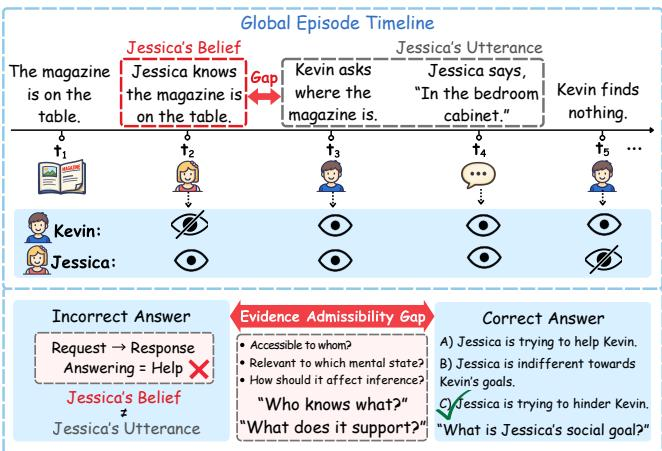
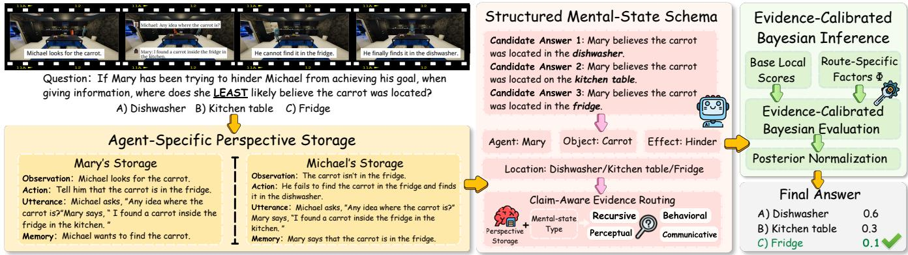
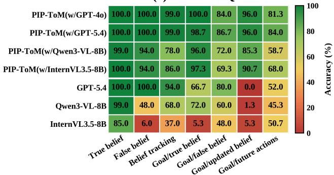
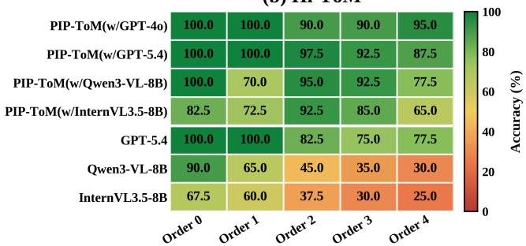
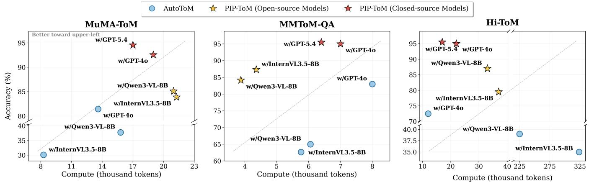
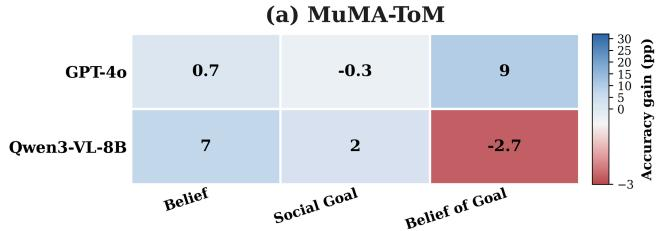
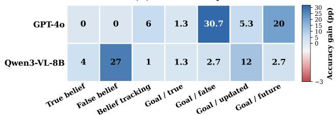
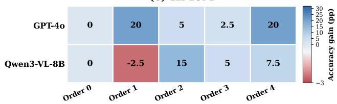
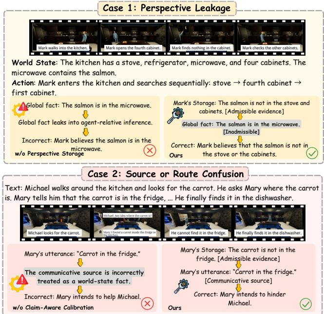

# Who Knows What—and What Does It Support? Perspective-Bounded Evidence Calibration for Multimodal Theory of Mind

Ziqi Liao1, Jiaqi Shen1, Yiming Na1, Kedi Lyu1, Shao-Yuan Lo2, Hongxia Xie1

1Jilin University 2National Taiwan University

## Abstract

Theory of Mind (ToM), the ability to infer others’ beliefs, goals, and intentions, is a cornerstone of social intelligence. Multimodal ToM requires inferring an agent’s mental state from evidence that is available to that agent, rather than from the complete episode observed by the solver. Existing LLM-based and Bayesian model-based approaches reconstruct global event traces, yet they do not explicitly distinguish objective events from agent-admissible evidence during hypothesis evaluation. Consequently, agent-inaccessible events or semantically misaligned actions and utterances may influence the inferred belief, goal, or social intention, leading to perspective leakage and source or route confusion. We formulate this limitation as an evidence-admissibility problem: evidence should contribute to a mental-state hypothesis only when it is accessible to the relevant agent, preserves its information source, and is diagnostic of the queried mentalstate variable. To operationalize this principle, we propose PIP-ToM, an evidence-admissibility interface that constructs agent-specific evidence stores, aligns them with structured mental-state claims, and calibrates model-based hypothesis scores while preserving the underlying Bayesian inference process. PIP-ToM with GPT-4o outperforms existing ToM methods across MuMA-ToM, MMToM-QA, and Hi-ToM, achieving average accuracies of92.56%, 95.00%, and 95.00%, respectively.

## Introduction

Multimodal Theory of Mind (ToM) asks a globally informed solver to infer the beliefs, goals, intentions, and communicative motives of an agent who has observed only part of an unfolding episode. This ability is a central component of social intelligence (Wellman 2018; Beaudoin et al. 2020; Zhang et al. 2026a,b, 2025a; Chen et al. 2025; Zhong et al. 2026).

In interactive environments, relevant evidence is distributed across visual observations, object interactions, actions, communication, and memory, while diferent agents have access to diferent subsets of the same event history. The central challenge is therefore not merely to reconstruct what happened in the objective world, but to determine which evidence was available to the queried agent and which mentalstate hypotheses that evidence can legitimately support.

Figure 1 provides a motivating example of why interpreting an agent’s utterance without considering the agent’s belief is insuficient for ToM inference. A model may interpret Jessica’s act of providing a location as an attempt to help without considering what she knows. Jessica knows that the magazine is on the table, yet tells Kevin that it is in the bedroom cabinet; Kevin subsequently searches the cabinet and finds nothing. Inferring Jessica’s social goal therefore requires moving beyond what happened to determine who knows what and what that belief supports. Specifically, the solver must recover Jessica’s belief at the time of speaking, preserve her utterance as a source-tagged communicative act, and infer how the utterance was intended to afect Kevin’s search.

  
Figure 1: An example showing that an agent’s utterance must be interpreted together with the agent’s belief to support correct mental-state inference.

Existing approaches address important components of this problem through explicit state tracking, perspective reconstruction, and model-based hypothesis scoring (Wilf et al. 2024; Jung et al. 2024; Huang et al. 2024; Xu et al. 2025; Zhu et al. 2026; Zhang et al. 2025b). However, the interface between agent-relative evidence reconstruction and candidate hypothesis scoring remains under-specified. Models must determine whether evidence is accessible to the relevant perspective holder and whether that evidence can legitimately support the queried mental-state variable. Insuficient control over evidence accessibility may allow globally reconstructed but agent-inaccessible events to influence hypothesis evaluation, resulting in perspective leakage. Insuficient control over evidential relevance may cause accessible evidence to support the wrong belief, goal, communicative efect, or recursive mental state, leading to source or route confusion. We collectively refer to these failures as evidence inadmissibility. The central issue is therefore not only whether events are reconstructed correctly, but also whether each piece of evidence is assigned to the appropriate epistemic owner and evidential role. This motivates an explicit constraint on when evidence may legitimately influence a mental-state hypothesis.

Figure 1 illustrates a concrete manifestation of this missing constraint: reconstructing the global episode does not itself determine which evidence may legitimately influence Jessica’s social-goal hypothesis. We formulate this constraint as an Evidence Admissibility Principle. Evidence may directly support or contradict a mental-state hypothesis only when it is accessible to the relevant perspective holder, is represented with its source preserved, and is diagnostic of the queried mental-state variable. Accordingly, inaccessible information should be treated as missing evidence, while accessible but claim-irrelevant information should not directly alter the corresponding hypothesis score.

Based on this principle, we introduce PIP-ToM, an evidence-admissibility interface for Bayesian and modelbased multimodal ToM inference. Given a fused episode trace, PIP-ToM constructs agent-specific perspective stores, parses candidates into structured mental-state claims, and routes accessible evidence according to claim type. It then maps claim–evidence compatibility to a bounded calibration factor that adjusts the corresponding hypothesis likelihood, making evidence ownership and evidential relevance explicit during mental-state inference.

Our contributions are threefold:

• We identify an under-specified interface between agentrelative evidence reconstruction and mental-state hypothesis evaluation, and formulate an Evidence Admissibility Principle that constrains evidence by accessibility, source preservation, and claim-specific relevance.

• We introduce PIP-ToM, a perspective-bounded evidencecalibration framework that operationalizes this principle by jointly constraining evidence accessibility and its relevance to the queried mental-state hypothesis.

• Experiments across three benchmarks and multiple backbones demonstrate consistent improvements. Ablation analyses show that evidence accessibility and claimspecific relevance address complementary failure modes, while direct-posterior diagnostics reveal the limits of structured evidence matching for latent and recursive mental-state reasoning.

## Related Work

## Explicit State Tracking

Explicit state reconstruction provides a factual foundation for subsequent ToM reasoning. Discrete World Models (Huang et al. 2024) represent narratives as event-driven transitions over compact world states. EnigmaToM (Xu et al. 2025) augments these representations with entity-state knowledge and spatial scene graphs. This design connects global scene reconstruction with perspective masking and higher-order belief tracking. PDDL-Mind (Zhu et al. 2026) instead maps narratives to a predefined PDDL domain, verifying action preconditions and efects while recording agents’ event access through predicates such as seen and heard.

These methods transform unstructured narratives into structured global state trajectories, thereby providing a basis for moving from global event reconstruction to agent-specific knowledge inference.

## Perspective Reconstruction

After reconstructing the global event sequence, perspective reconstruction extracts the information available to a specific agent. SimToM (Wilf et al. 2024) and PercepToM (Jung et al. 2024) isolate information observable to a target agent, with PercepToM further separating perception extraction from belief inference. Other work moves beyond static information filtering by maintaining structured mental-state representations over time. TimeToM (Hou et al. 2024) organizes temporally evolving belief states, while SymbolicToM (Sclar et al. 2023) tracks multiple characters and their higher-order beliefs in graph-based representations, and ThoughtTracing (Kim et al. 2025) propagates and reweights naturallanguage hypotheses about an agent’s evolving mental state.

This line of work converts global event trajectories into agent-relative representations, reducing objective-state leakage into belief inference while supporting candidate comparison.

## Bayesian and Model-Based Mental-State Inference

Given an agent-relative representation, Bayesian and modelbased approaches infer latent mental states that explain observed behavior. Classical Bayesian ToM (Baker, Saxe, and Tenenbaum 2009; Baker et al. 2017; Jara-Ettinger 2019) frames this process as inverse planning over beliefs, desires, percepts, goals, and actions. Recent systems (Jin et al. 2024; Shi et al. 2025; Zhang et al. 2025a) extend this framework to multimodal settings, social interaction, and longer reasoning chains, while AutoToM (Zhang et al. 2025b) discovers task-specific mental variables and dependencies and MindZero (Zhang et al. 2026c) learns online mental-state reasoning without explicit annotation.

Prior work thus reconstructs global states, derives agentspecific perspectives, and infers candidate mental states. However, it leaves a key interface under-specified: which agent-accessible evidence may legitimately afect the likelihood of a given mental-state hypothesis? This gap motivates treating evidence admissibility as an explicit modeling problem between perspective reconstruction and model-based inference.

## Methodology

## Overview of PIP-ToM

Multimodal ToM requires reasoning over evolving multimodal evidence to infer agents’ mental states under partial observability. Among existing approaches, Bayesian inverse planning (Baker, Saxe, and Tenenbaum 2009; Baker et al. 2017; Jara-Ettinger 2019) provides a principled model-based framework that reasons backward from observed behavior to the beliefs, goals, and intentions that could have generated it. However, when inference is performed over a globally reconstructed episode, it remains unclear which observations, actions, or utterances should be admissible for evaluating a particular agent’s mental state.

  
Figure 2: Overview of PIP-ToM. It transforms a fused episode trace and candidate answers into perspective-bounded evidence, route-specific factors, and a final answer posterior.

Figure 2 illustrates the overall framework of PIP-ToM. The framework first constructs an Agent-Specific Perspective Storage, then parses candidate answers through a Structured Mental-State Schema, and finally applies route-specific evidence calibration to the local scores used for hypothesis evaluation. By operating at the evidence-to-score interface, PIP-ToM separates evidence ownership from evidential role without requiring a solver-specific redesign of the latent-state model.

## Agent-Specific Perspective Storage

The Agent-Specific Perspective Storage provides the primary epistemic interface for organizing reconstructed events into agent-centered evidence views. This is illustrated by the Mary–Michael example in Figure 2. Mary’s request-related observations and her own utterance are retained in her storage, whereas Michael’s failed search in the fridge and later discovery in the dishwasher belong to Michael’s storage.

For every agent i and timestep t, we maintain

$$
\mathcal { P } _ { i } ^ { t } = \{ O _ { i } ^ { 1 : t } , A _ { i } ^ { 1 : t } , U _ { i } ^ { 1 : t } , M _ { i } ^ { t } \} ,\tag{1}
$$

where $O _ { i } ^ { 1 : t }$ contains observations accessible to agent $i , A _ { i } ^ { 1 : t }$ contains actions performed by or observed by $i , U _ { i } ^ { \dag : t }$ contains utterances produced or heard by i, and $M _ { i } ^ { t }$ is a source-aware memory constructed from previously admitted evidence.

For each incoming event $e _ { t } ,$ , we express the evidenceadmission contract as

$$
g _ { i } ^ { t } = { \bf 1 } \left[ v _ { i } ( e _ { t } ) \lor h _ { i } ( e _ { t } ) \lor a _ { i } ( e _ { t } ) \right] ,\tag{2}
$$

where $v _ { i } , h _ { i }$ , and $a _ { i }$ denote visibility, audibility, and selfaction cues recovered from the reconstructed event representation. The storage is updated as

$$
\mathcal { P } _ { i } ^ { t } = \mathrm { U p d } \left( \mathcal { P } _ { i } ^ { t - 1 } , g _ { i } ^ { t } , e _ { t } \right) .\tag{3}
$$

Equations 2–3 define the interface-level semantics of perspective construction rather than assuming a single perception oracle. In practice, the admission cues are instantiated from reconstructed timeline fields and source tags, and the resulting store renders an agent-scoped evidence view for downstream scoring. The interface distinguishes episodelevel grounding context from the agent-scoped evidential view used for structured evidence calibration.

The memory component carries forward admitted evidence and its source tags across timesteps. This organization reduces direct reliance on objective world-state facts when forming agent-centered scores and prevents intermediate belief estimates from being treated as observations. Perspective stores therefore organize evidence rather than assert oracle mental states.

## Structured Mental-State Schema

Perspective reconstruction determines which evidence is accessible to an agent, but not how that evidence should be interpreted for a particular mental-state claim. The same event may play diferent evidential roles depending on the queried variable. For the running example in Figure 2, Mary’s utterance is a communicative act rather than an objective update to the world state. Its role is evaluated with evidence supporting the speaker’s belief and evidence about its expected efect on the listener. PIP-ToM therefore represents each candidate as a typed mental-state claim rather than evaluating its surface text directly.

Given a question q and its candidate set $C _ { 1 : K }$ , PIP-ToM jointly extracts a shared query frame and one schema per candidate:

$$
\left( R _ { q } , Z _ { 1 : K } \right) = \mathrm { P a r s e } \left( q , C _ { 1 : K } \right) ,\tag{4}
$$

where Parse denotes a lightweight hybrid interface executed once per problem as preprocessing. Under fixed prompts, the backbone normalizes the choices and identifies the shared query fields, after which task-specific fields are extracted by deterministic rules. Detailed parsing prompts and taskspecific extraction rules are provided in Supplementary Sec. A.1.

The shared query frame and each candidate schema are represented as

$$
R _ { q } = \left. \tau , i , j , x , \rho \right. , \quad Z _ { k } = \left. R _ { q } , \chi _ { k } , \epsilon _ { k } \right. ,\tag{5}
$$

Here, $\tau , i , j , x .$ , and $\rho$ denote the mental-state type, perspective holder, target agent when applicable, queried entity, and query relation or polarity, respectively. $\chi _ { k }$ is the candidatespecific value of the queried variable, while $\epsilon _ { k }$ is an optional behavioral or social efect.

Based on the semantics of $Z _ { k }$ , PIP-ToM selects a set of complementary evidence routes:

$$
\mathcal { M } _ { k } \subseteq \left\{ \begin{array} { l l } { \mathrm { P e r c e p t u a l , B e h a v i o r a l , } } \\ { \mathrm { C o m m u n i c a t i v e , R e c u r s i v e } } \end{array} \right\} ,\tag{6}
$$

where multiple routes may be composed when a claim depends on diferent evidence sources. For example, socialgoal inference may combine perceptual evidence supporting the speaker’s belief, a source-tagged utterance, and evidence about its expected efect on the listener.

The four routes provide compositional interfaces between evidence and mental-state variables:

• Perceptual evidence captures perceived states and changes relevant to physical beliefs.

• Behavioral evidence captures actions relevant to hypothesized beliefs, goals, or efects.

• Communicative evidence captures source-tagged utterances and their efects on a listener’s beliefs or actions.

• Recursive evidence supports nested attribution based on observed information access and behavior.

Conditioned on the shared frame $R _ { q }$ and candidate schema $Z _ { k } .$ , PIP-ToM activates one or more routes in $\mathcal { M } _ { k } .$ . For each local likelihood term n in the underlying model, let $\mathcal { M } _ { k , n } \subseteq$ $\mathcal { M } _ { k }$ denote the active routes for candidate k and term $n .$ Each active route extracts source-preserving evidence and maps evidence–claim compatibility to a positive, bounded, route-specific factor:

$$
\begin{array} { r l } & { E _ { k } ^ { ( m ) } = \mathrm { E x t r a c t } _ { m } \left( Z _ { k } , \mathcal { P } _ { i } ^ { T } \right) , } \\ & { \Phi _ { k , n } ^ { ( m ) } = G _ { m , n } \Big ( E _ { k } ^ { ( m ) } , Z _ { k } , R _ { q } \Big ) , \quad m \in \mathcal { M } _ { k , n } , } \end{array}\tag{7}
$$

where $G _ { m , n }$ is fixed and deterministic, with no instance-level tuning. Each factor uses 1 as the neutral value: values below 1 downweight the corresponding hypothesis, while values above 1 strengthen it before clipping. Only active routes contribute; route-specific aggregation, activation conditions, and factor tables are provided in Supplementary Sec. A.2.

## Evidence-Calibrated Bayesian Inverse Planning

Model-based mental-state inference represents candidate plausibility through local surrogate scores in a latent-variable graph. As shown in Figure 2, PIP-ToM combines the calibration factors associated with the active routes for each local term n:

$$
\Phi _ { k , n } = \prod _ { m \in \mathcal { M } _ { k , n } } \Phi _ { k , n } ^ { ( m ) } ,\tag{8}
$$

and applies the resulting factor to the corresponding base local term:

$$
L _ { k , n } ^ { \mathrm { P I P } } ( { \bf h } ) = \operatorname* { m i n } \left( c , L _ { k , n } ^ { \mathrm { b a s e } } ( { \bf h } ) \Phi _ { k , n } \right) ,\tag{9}
$$

Here, $L _ { k , n } ^ { \mathrm { b a s e } } ( \mathbf { h } )$ denotes the local surrogate score supplied by the underlying model; for consistency with the backbone, we retain its likelihood notation. In our implementation, this score is obtained from a binary-response probability and lies in [0, 1]. We set $c = 1$ to preserve this range and stabilize the subsequent computation. When $\mathcal { M } _ { k , n } = \emptyset$ , the empty product gives $\Phi _ { k , n } = 1$ , so the base term remains unchanged.

The reweighted terms retain the underlying model’s latentvariable marginalization and candidate normalization:

$$
\widetilde { P } _ { k } = \frac { \sum _ { \mathbf { h } } P ( \mathbf { h } ) \prod _ { n } L _ { k , n } ^ { \mathrm { P I P } } ( \mathbf { h } ) } { \sum _ { j } \sum _ { \mathbf { h } } P ( \mathbf { h } ) \prod _ { n } L _ { j , n } ^ { \mathrm { P I P } } ( \mathbf { h } ) } .\tag{10}
$$

Here, k indexes the current candidate, $j$ indexes candidates in the normalization denominator, and h denotes a complete latent-variable assignment; $\hat { k } = \arg \operatorname* { m a x } _ { k } \widetilde { P } _ { k }$ for ρ = Most and $\begin{array} { r } { { \hat { k } } = \arg \operatorname* { m i n } _ { k } \widetilde { P } _ { k } } \end{array}$ for $\rho = \mathrm { L e a s t }$

Accordingly, PIP-ToM provides a modular evidencecalibration interface that adjusts route-relevant local terms while preserving the underlying marginalization and normalization. Further route definitions, task-specific instantiations, and decision rules are deferred to in Supplementary Sec. A.3.

## Experiments

## Benchmarks

We evaluate PIP-ToM on three ToM benchmarks: MuMA-ToM (Shi et al. 2025), MMToM-QA (Jin et al. 2024), and Hi-ToM (Wu et al. 2023). Detailed descriptions of the task settings, dataset sizes, and model configurations are provided in Supplementary Sec. B.

## Baselines

We compare PIP-ToM against state-of-the-art baselines:

• General-purpose MLLMs: GPT-4o (OpenAI 2024), GPT-5.4 (OpenAI 2026), Qwen3-VL-8B (Bai et al. 2025), and InternVL3.5-8B (Wang et al. 2025).

• ToM-specific Reasoning Prompting Methods: Sim-ToM (Wilf et al. 2024) and ThoughtTracing (Kim et al. 2025).

• State Tracking Methods: DWM (Huang et al. 2024) and PDDL-Mind (Zhu et al. 2026).

• Model-based Inference: BIP-ALM (Jin et al. 2024), LIMP (Shi et al. 2025), and AutoToM (Zhang et al. 2025b).

To ensure a fair comparison, PIP-ToM uses the same fused video-text event traces as AutoToM (Zhang et al. 2025b).

<table><tr><td>Method</td><td>Setting/Backbone</td><td colspan="4">MuMA-ToM</td><td colspan="3">MMToM-QA</td><td>Hi-ToM</td></tr><tr><td></td><td></td><td>Belief</td><td>Social</td><td>BoG</td><td>Avg.</td><td>Belief</td><td>Goal</td><td>Avg.</td><td>Avg.</td></tr><tr><td colspan="10">Human Performance</td></tr><tr><td>Human</td><td></td><td>98.90</td><td>94.40</td><td>87.10</td><td>93.50</td><td>97.50</td><td>88.50</td><td>93.00</td><td></td></tr><tr><td colspan="10">General-purpose MLLMs</td></tr><tr><td>GPT-40</td><td></td><td>85.33</td><td>57.00</td><td>48.33</td><td>63.55</td><td>55.67</td><td>32.33</td><td>44.00</td><td>50.00</td></tr><tr><td>GPT-5.4</td><td>Baseline</td><td>89.67</td><td>84.67</td><td>82.00</td><td>85.45</td><td>98.00</td><td>49.67</td><td>73.84</td><td>87.00</td></tr><tr><td>Qwen3-VL-8B</td><td></td><td>65.33</td><td>53.33</td><td>26.33</td><td>48.33</td><td>71.67</td><td>44.67</td><td>58.17</td><td>53.00</td></tr><tr><td>InternVL3.5-8B</td><td></td><td>51.00</td><td>46.33</td><td>46.00</td><td>47.78</td><td>42.67</td><td>27.33</td><td>35.00</td><td>44.00</td></tr><tr><td colspan="10">ToM-Specific Reasoning Prompting Methods</td></tr><tr><td>SimToM (ACL&#x27;24)</td><td>GPT-4o</td><td>54.60</td><td>46.50</td><td>44.80</td><td>47.63</td><td>75.67</td><td>26.33</td><td>51.00</td><td>71.00</td></tr><tr><td>ThoughtTracing (COLM&#x27;25)</td><td>GPT-4o (Text-Only)</td><td></td><td></td><td></td><td></td><td>78.40</td><td>37.80</td><td>60.00</td><td></td></tr><tr><td colspan="10">State-Tracking Methods</td></tr><tr><td>DWM (EMNLP&#x27;24)</td><td>GPT-4o (Text-Only)</td><td>76.70</td><td></td><td></td><td></td><td></td><td></td><td></td><td></td></tr><tr><td>PDDL-Mind</td><td>GPT-40 (Text-Only)</td><td>88.70</td><td>53.30 92.00</td><td>60.00 83.30</td><td>63.20 88.80</td><td>46.00 91.00</td><td>28.50 85.70</td><td>36.00 88.30</td><td>58.00</td></tr><tr><td colspan="10">Model-Based Mental-State Inference</td></tr><tr><td colspan="10">BIP-ALM (ACL&#x27;24)</td></tr><tr><td>LIMP (AAAI&#x27;25)</td><td>GPT-40 GPT-40</td><td>41.20 93.40</td><td>34.10 67.70</td><td>30.60</td><td>33.90</td><td>81.70</td><td>73.30</td><td>77.50</td><td>14.50</td></tr><tr><td></td><td>GPT-40</td><td>88.33</td><td>77.00</td><td>68.70 79.00</td><td>76.60 81.44</td><td>60.00 96.67</td><td>50.67 69.33</td><td>55.33 83.00</td><td>6.50 72.50</td></tr><tr><td>AutoToM (NeurIPS&#x27;25)</td><td>Qwen3-VL-8B</td><td>41.67</td><td>41.67</td><td>30.00</td><td>37.78</td><td>79.33</td><td>50.67</td><td>65.00</td><td>39.00</td></tr><tr><td></td><td>InternVL3.5-8B</td><td>25.66</td><td>34.00</td><td>30.66</td><td>30.11</td><td>76.33</td><td>49.00</td><td>62.67</td><td>35.00</td></tr><tr><td colspan="10">Our Method</td></tr><tr><td>PIP-ToM</td><td>Qwen3-VL-8B</td><td>91.33</td><td>82.00</td><td>82.00</td><td>85.11</td><td>90.33</td><td>78.00</td><td>84.17</td><td>87.00</td></tr><tr><td>(Open-source Models)</td><td>InternVL3.5-8B</td><td>93.67</td><td>83.67</td><td>74.33</td><td>83.89</td><td>93.33</td><td>81.33</td><td>87.33</td><td>79.50</td></tr><tr><td>PIP-ToM (Closed-source Models)</td><td>GPT-40 GPT-5.4</td><td>96.67 98.00</td><td>84.33 89.00</td><td>96.67 96.67</td><td>92.56 94.56</td><td>99.67 99.67</td><td>90.33 91.33</td><td>95.00 95.50</td><td>95.00 95.50</td></tr></table>

Table 1: Accuracy (%) on MuMA-ToM, MMToM-QA, and Hi-ToM. BoG denotes Belief of Goal; “–” indicates that the result is unavailable, not reported, or not applicable to the benchmark. Bold and underlined values mark the best and second-best non-human results, respectively.

(a) MMToM-QA  

(b) Hi-ToM  
  
Figure 3: Fine-grained accuracy across MMToM-QA belief and goal subtasks and Hi-ToM reasoning orders 0–4.

## Overall Performance

Performance across Tasks and Reasoning Complexity Table 1 presents the main results. With GPT-4o, PIP-ToM outperforms AutoToM on MuMA-ToM (92.56% vs. 81.44%), with the largest gain on belief-of-goal reasoning (96.67% vs. 79.00%). It also raises average accuracy from 83.00% to 95.00% on MMToM-QA and from 72.50% to 95.00% on Hi-ToM. The improvements also persist across both open-source backbones, indicating that the gains arise from the proposed reasoning scafold rather than from a particular proprietary model. Figure 3 further breaks down performance across task types and reasoning orders.

Accuracy-Compute Trade-of Figure 4 compares accuracy and average inference-token consumption across the three benchmarks. Under matched backbones, PIP-ToM generally achieves higher accuracy at comparable or lower token costs. These diferences may partly reflect variations in task structure and reasoning depth: MMToM-QA primarily involves single-agent reasoning, whereas MuMA-ToM and Hi-ToM require richer social and recursive mental-state reasoning. Overall, PIP-ToM maintains a favorable balance between accuracy and inference cost across diverse reasoning settings.

(b) MMToM-QA  
  
Figure 4: Averaged accuracy and inference-token consumption of PIP-ToM (stars) and AutoToM (circles) on three benchmarks.

(c) Hi-ToM  
  
Figure 5: Accuracy diferences between the Full model and w/o Perspective Storage at the subtask level.

## Analysis by Research Questions

We further analyze the efectiveness of PIP-ToM through three research questions: whether agent-specific evidence boundaries reduce interference from global information (RQ1), whether claim-aware evidence routing and calibration align admissible evidence with the mental-state variables it can support (RQ2), and whether perspective-conditioned evidence matching alone is suficient across diferent mentalstate reasoning tasks (RQ3).

RQ1: Perspective-Bounded Evidence To test whether agent-specific boundaries limit interference from inaccessible global events, we compare the Full model with the w/o Perspective Storage variant in Table 2. Removing the perspective boundary lowers average accuracy, particularly on MMToM-QA. Figure 5 further shows that this efect is selective rather than uniform. The largest gains from Perspective Storage occur on tasks in which the agent’s information state may diverge from the objective episode state, including false-belief goal inference, belief updating, future-action prediction, cross-agent goal attribution, and higher-order belief reasoning. By contrast, performance changes little on truebelief and order-0 tasks, where agent-relative and global information largely align. Moreover, using predefined criteria, we manually audited 121 cases solved only by the GPT-4o Full model and found that the ablated predictions relied on inaccessible or global evidence in 62.8% of them; audit details are provided in Supplementary Sec. C.

<table><tr><td>Benchmark</td><td>Task</td><td>Full</td><td>Storage</td><td>w/o Perspective w/o Claim-Aware Calibration</td></tr><tr><td rowspan="4">MuMA-ToM</td><td>Belief</td><td>96.67</td><td>96.00</td><td>86.83</td></tr><tr><td>Social</td><td>84.33</td><td>84.67</td><td>67.67</td></tr><tr><td>BoG</td><td>96.67</td><td>87.67</td><td>86.34</td></tr><tr><td>Avg.</td><td>92.56</td><td>89.45</td><td>80.28</td></tr><tr><td rowspan="3">MMToM-QA</td><td>Belief</td><td>99.67</td><td>97.67</td><td>96.67</td></tr><tr><td>Goal</td><td>90.33</td><td>76.00</td><td>70.50</td></tr><tr><td>Avg.</td><td>95.00</td><td>86.84</td><td>83.59</td></tr></table>

Table 2: Component ablations with GPT-4o. w/o Perspective Storage uses the complete episode trace during calibration, while w/o Claim-Aware Calibration removes structured mental-state schema and route-specific calibration.

## Takeaway 1: Perspective-bounded evidence reduces global-information interference in perspectivesensitive ToM reasoning.

RQ2: Claim-Aware Evidence Calibration To examine the role of claim-aware evidence calibration, we compare the Full model with the w/o Claim-Aware Calibration variant. As shown in Table 2, this ablation causes the largest overall decline. Accuracy drops from 84.33% to 67.67% on

<table><tr><td>Benchmark</td><td>Task</td><td>Overall</td><td>Coverage</td><td>Direct</td><td>Fallback</td></tr><tr><td rowspan="3">MuMA-ToM</td><td>Belief</td><td>92.67</td><td>66.33 (199/300)</td><td>100.00</td><td>78.22</td></tr><tr><td>Social</td><td>78.00</td><td>11.33 (34/300)</td><td>85.29</td><td>77.07</td></tr><tr><td>BoG</td><td>76.00</td><td>100.00 (300/300)</td><td>76.00</td><td>一</td></tr><tr><td rowspan="2">MMToM-QA</td><td>Belief</td><td>99.67</td><td>96.67 (290/300)</td><td>100.00</td><td>90.00</td></tr><tr><td>Goal</td><td>73.00</td><td>61.67 (185/300)</td><td>65.95</td><td>84.35</td></tr></table>

Table 3: Direct-posterior diagnostic with GPT-4o. Overall reports the accuracy of the hybrid direct-posterior variant. Coverage denotes the fraction handled by direct posterior construction; Direct and Fallback report accuracy on their respective subsets.

MuMA-ToM Social Goal and from 90.33% to 70.50% on MMToM-QA Goal, with smaller reductions on explicit belief questions.

Because claim-aware routing introduces bounded calibration factors, we additionally test whether these gains depend on the exact scale ofthe calibration factors. We further rescale all active factors using $\alpha \in \{ 0 . 7 5 , 1 . 0 , 1 . 2 5 \}$ with GPT-5.4. Across the weak and strong settings, the mean absolute deviations from the reference configuration are only 1.06 percentage points on MuMA-ToM and 1.09 percentage points on MMToM-QA.

Takeaway 2: Evidence accessibility alone is insufficient; claim-aware routing is critical for goal and social reasoning.

RQ3: Matching–Inference Complementarity To assess when perspective-conditioned evidence matching is suficient and when model-based inference remains necessary, we evaluate a direct-posterior variant. It directly normalizes structured matching scores when available and otherwise falls back to uncalibrated Bayesian inference.

As shown in Table 3, Direct matching achieves 100.00% accuracy on the covered subsets of both belief tasks, showing that many explicit belief questions can be solved by matching candidates to accessible observations or memories. However, it is less reliable for latent mental states: on MMToM-QA Goal, direct accuracy is 65.95%, compared with 84.35% for the Bayesian fallback. Similarly, direct construction covers all MuMA-ToM Belief-of-Goal examples but reaches only 76.00%, well below the 96.67% of full PIP-ToM.

Takeaway 3: Direct matching is highly efective on covered explicit-belief cases, but latent and nested mental states require model-based inference.

## Qualitative Case Studies

Figure 6 explains why the two components provide complementary gains. The central issue is not whether the episode contains suficient context, but whether each piece of evidence is used under the correct epistemic and semantic constraints. Perspective boundaries determine what evidence is accessible to the target agent, while claim-aware routing determines which mental-state variable that evidence can legitimately support.

  
Figure 6: Qualitative efects of the two components. Case 1 shows that perspective storage prevents inaccessible global facts from influencing inference. Case 2 shows that claimaware routing prevents accessible evidence from being misused.

Together, these constraints ensure that posterior updates are calibrated using agent-accessible evidence that is relevant to the queried mental state. The gains therefore arise from a principled interface between global episode reconstruction and model-based latent-state inference, rather than from additional context.

## Conclusion

In this paper, we introduce PIP-ToM, a perspective-bounded evidence calibration framework for multimodal ToM. Given a globally reconstructed episode, PIP-ToM determines which evidence was accessible to the queried agent, identifies how that evidence may legitimately support a particular mentalstate hypothesis, and calibrates the corresponding likelihoods while preserving the underlying model-based inference process. Experiments on MuMA-ToM, MMToM-QA, and Hi-ToM demonstrate consistent improvements across both closed- and open-source backbones. Our analyses further show that evidence accessibility and claim-specific relevance address complementary sources of error, while structured evidence matching alone remains insuficient for goal and recursive mental-state inference. These findings suggest that reliable ToM reasoning requires not only reconstructing what happened, but also tracking which agents had access to that information and how it should influence the inferred mental state.

## References

Bai, S.; Cai, Y.; Chen, R.; Chen, K.; Chen, X.; Cheng, Z.; Deng, L.; Ding, W.; Gao, C.; Ge, C.; Ge, W.; Guo, Z.; Huang, Q.; Huang, J.; Huang, F.; Hui, B.; Jiang, S.; Li, Z.; Li, M.; Li, M.; Li, K.; Lin, Z.; Lin, J.; Liu, X.; Liu, J.; Liu, C.; Liu, Y.; Liu, D.; Liu, S.; Lu, D.; Luo, R.; Lv, C.; Men, R.; Meng, L.; Ren, X.; Ren, X.; Song, S.; Sun, Y.; Tang, J.; Tu, J.; Wan, J.; Wang, P.; Wang, P.; Wang, Q.; Wang, Y.; Xie, T.; Xu, Y.; Xu, H.; Xu, J.; Yang, Z.; Yang, M.; Yang, J.; Yang, A.; Yu, B.; Zhang, F.; Zhang, H.; Zhang, X.; Zheng, B.; Zhong, H.; Zhou, J.; Zhou, F.; Zhou, J.; Zhu, Y.; and Zhu, K. 2025. Qwen3-VL Technical Report. arXiv:2511.21631.

Baker, C. L.; Jara-Ettinger, J.; Saxe, R.; and Tenenbaum, J. B. 2017. Rational Quantitative Attribution of Beliefs, Desires and Percepts in Human Mentalizing. Nature Human Behaviour, 1(4): 0064.

Baker, C. L.; Saxe, R.; and Tenenbaum, J. B. 2009. Action Understanding as Inverse Planning. Cognition, 113(3): 329– 349.

Beaudoin, C.; Leblanc, É.; Gagner, C.; and Beauchamp, M. H. 2020. Systematic Review and Inventory of Theory of Mind Measures for Young Children. Frontiers in Psychology, 10: 2905.

Chen, R.; Jiang, W.; Qin, C.; and Tan, C. 2025. Theory of Mind in Large Language Models: Assessment and Enhancement. In Che, W.; Nabende, J.; Shutova, E.; and Pilehvar, M. T., eds., Proceedings of the 63rd Annual Meeting ofthe Associationfor Computational Linguistics (Volume 1: Long Papers), 31539–31558. Vienna, Austria: Association for Computational Linguistics. ISBN 979-8-89176-251-0.

Hou, G.; Zhang, W.; Shen, Y.; Wu, L.; and Lu, W. 2024. TimeToM: Temporal Space is the Key to Unlocking the Door of Large Language Models’ Theory-of-Mind. In Findings of the Association for Computational Linguistics: ACL 2024, 11532–11547. Association for Computational Linguistics.

Huang, X. A.; Malfa, E. L.; Marro, S.; Asperti, A.; Cohn, A. G.; and Wooldridge, M. 2024. A Notion of Complexity for Theory of Mind via Discrete World Models. In Findings of the Association for Computational Linguistics: EMNLP 2024, 2964–2983. Association for Computational Linguistics.

Jara-Ettinger, J. 2019. Theory of Mind as Inverse Reinforcement Learning. Current Opinion in Behavioral Sciences, 29: 105–110.

Jin, C.; Wu, Y.; Cao, J.; Xiang, J.; Kuo, Y.-L.; Hu, Z.; Ullman, T.; Torralba, A.; Tenenbaum, J.; and Shu, T. 2024. MMToM-QA: Multimodal Theory of Mind Question Answering. In Ku, L.-W.; Martins, A.; and Srikumar, V., eds., Proceedings ofthe 62nd Annual Meeting ofthe Associationfor Computational Linguistics (Volume 1: Long Papers), 16077–16102. Bangkok, Thailand: Association for Computational Linguistics.

Jung, C.; Kim, D.; Jin, J.; Kim, J.; Seonwoo, Y.; Choi, Y.; Oh, A.; and Kim, H. 2024. Perceptions to Beliefs: Exploring Precursory Inferences for Theory of Mind in Large Language Models. In Proceedings of the 2024 Conference on Empiri-

cal Methods in Natural Language Processing, 19794–19809. Association for Computational Linguistics.

Kim, H.; Sclar, M.; Tan, Z.-X.; Ying, L.; Levine, S.; Liu, Y.; Tenenbaum, J. B.; and Choi, Y. 2025. Hypothesis-Driven Theory-of-Mind Reasoning for Large Language Models. In Proceedings ofthe Conference on Language Modeling.

OpenAI. 2024. GPT-4o System Card. https://openai.com/ index/gpt-4o-system-card/. Accessed: 2026-06-10.

OpenAI. 2026. GPT-5.4 Thinking System Card. https: //openai.com/index/gpt-5-4-thinking-system-card/. Accessed: 2026-07-29.

Sclar, M.; Kumar, S.; West, P.; Suhr, A.; Choi, Y.; and Tsvetkov, Y. 2023. Minding Language Models’ (Lack of) Theory of Mind: A Plug-and-Play Multi-Character Belief Tracker. In Rogers, A.; Boyd-Graber, J.; and Okazaki, N., eds., Proceedings ofthe 61st Annual Meeting ofthe Association for Computational Linguistics (Volume 1: Long Papers), 13960–13980. Toronto, Canada: Association for Computational Linguistics.

Shi, H.; Ye, S.; Fang, X.; Jin, C.; Isik, L.; Kuo, Y.; and Shu, T. 2025. MuMA-ToM: Multi-modal Multi-Agent Theory of Mind. In Walsh, T.; Shah, J.; and Kolter, Z., eds., Thirty-Ninth AAAI Conference on Artificial Intelligence, Thirty-Seventh Conference on Innovative Applications of Artificial Intelligence, Fifteenth Symposium on Educational Advances in Artificial Intelligence, AAAI 2025, Philadelphia, PA, USA, February 25 - March 4, 2025, 1510–1519. AAAI Press.

Wang, W.; Gao, Z.; Gu, L.; Pu, H.; Cui, L.; Wei, X.; Liu, Z.; Jing, L.; Ye, S.; Shao, J.; Wang, Z.; Chen, Z.; Zhang, H.; Yang, G.; Wang, H.; Wei, Q.; Yin, J.; Li, W.; Cui, E.; Chen, G.; Ding, Z.; Tian, C.; Wu, Z.; Xie, J.; Li, Z.; Yang, B.; Duan, Y.; Wang, X.; Hou, Z.; Hao, H.; Zhang, T.; Li, S.; Zhao, X.; Duan, H.; Deng, N.; Fu, B.; He, Y.; Wang, Y.; He, C.; Shi, B.; He, J.; Xiong, Y.; Lv, H.; Wu, L.; Shao, W.; Zhang, K.; Deng, H.; Qi, B.; Ge, J.; Guo, Q.; Zhang, W.; Zhang, S.; Cao, M.; Lin, J.; Tang, K.; Gao, J.; Huang, H.; Gu, Y.; Lyu, C.; Tang, H.; Wang, R.; Lv, H.; Ouyang, W.; Wang, L.; Dou, M.; Zhu, X.; Lu, T.; Lin, D.; Dai, J.; Su, W.; Zhou, B.; Chen, K.; Qiao, Y.; Wang, W.; and Luo, G. 2025. InternVL3.5: Advancing Open-Source Multimodal Models in Versatility, Reasoning, and Eficiency. arXiv:2508.18265.

Wellman, H. M. 2018. Theory of Mind: The State of the Art. European Journal of Developmental Psychology, 15(6): 728–755.

Wilf, A.; Lee, S.; Liang, P. P.; and Morency, L.-P. 2024. Think Twice: Perspective-Taking Improves Large Language Models’ Theory-of-Mind Capabilities. In Proceedings ofthe 62nd Annual Meeting of the Association for Computational Linguistics (Volume 1: Long Papers), 8292–8308. Association for Computational Linguistics.

Wu, Y.; He, Y.; Jia, Y.; Mihalcea, R.; Chen, Y.; and Deng, N. 2023. Hi-ToM: A Benchmark for Evaluating Higher-Order Theory of Mind Reasoning in Large Language Models. In Bouamor, H.; Pino, J.; and Bali, K., eds., Findings of the Association for Computational Linguistics: EMNLP 2023, 10691–10706. Singapore: Association for Computational Linguistics.

Xu, H.; Qi, S.; Li, J.; Zhou, Y.; Du, J.; Catmur, C.; and He, Y. 2025. EnigmaToM: Improve LLMs’ Theory-of-Mind Reasoning Capabilities with Neural Knowledge Base of Entity States. In Findings of the Association for Computational Linguistics: ACL 2025, 13598–13622. Association for Computational Linguistics.

Zhang, C.; Ouyang, Z.; Lee, K.; Agarwal, N.; Houlihan, S. D.; Vosoughi, S.; and Lo, S.-Y. 2025a. Overcoming Multi-step Complexity in Multimodal Theory-of-Mind Reasoning: A Scalable Bayesian Planner. In Singh, A.; Fazel, M.; Hsu, D.; Lacoste-Julien, S.; Berkenkamp, F.; Maharaj, T.; Wagstaf, K.; and Zhu, J., eds., Proceedings of the 42nd International Conference on Machine Learning, volume 267 of Proceedings ofMachine Learning Research, 75878–75900. PMLR.

Zhang, R.; Liao, Z.; Zhou, Z.; Jiang-Lin, J.-Y.; Wu, S.; Mao, Y.; Wen, B.; Xie, H.; Fu, J.; Yao, M.; Lo, S.-Y.; and Cheng, W.-H. 2026a. Social World Models: A Comprehensive Survey of Theory of Mind and Social Coordination.

Zhang, R.; Zheng, Q.; Zhou, Z.; Liao, Z.; Wu, S.; Jiang-Lin, J.-Y.; Wen, B.; Xie, H.; Fu, J.; and Cheng, W.-H. 2026b. MindPower: Enabling Theory-of-Mind Reasoning in VLMbased Embodied Agents. In Proceedings of the IEEE/CVF Conference on Computer Vision and Pattern Recognition (CVPR), 29631–29641.

Zhang, S.; Lu, J.; Jin, C.; Zhou, Y.; Zhang, Z.; and Shu, T. 2026c. MindZero: Learning Online Mental Reasoning With Zero Annotations. arXiv:2606.00240.

Zhang, Z.; Jin, C.; Jia, M. Y.; Zhang, S.; and Shu, T. 2025b. AutoToM: Scaling Model-based Mental Inference via Automated Agent Modeling. In Belgrave, D.; Zhang, C.; Lin, H.; Pascanu, R.; Koniusz, P.; Ghassemi, M.; and Chen, N., eds., Advances in Neural Information Processing Systems, volume 38, 129659–129699. Curran Associates, Inc.

Zhong, J.; Lai, Y.; Li, M.; Li, Y.; Liu, W.; Dariush, B.; Psounis, K.; and Lo, S.-Y. 2026. From Shortcuts to Reasoning: Robust Post-Training of Theory of Mind with Reinforcement Learning. arXiv:2606.09092.

Zhu, W. B.; Yi, Q. T.; Jia, R.; and Thomason, J. 2026. PDDL-Mind: Large Language Models are Capable on Belief Reasoning with Reliable State Tracking. arXiv:2604.17819.