# WorkFactory: Turning Professional Intents into Executable Work for Scalable Agent Training

Ziyang Zeng1,\*, Tingyang Chen2,\*, Jia Deng3,\*, Qiyao Wang4,\*,   
Shuo Tang5,\*, Yike Yang3,\*, Tao Ren6,\*, Wayne Xin Zhao3†,   
Feng Chang1 † ‡, Jujie He1, Chuan Hao1, Ran Tao1, Bryan Dai1   
1IQuest Research 2Zhejiang University   
3Gaoling School of Artificial Intelligence, Renmin University of China   
4Shenzhen Institutes of Advanced Technology   
5Shanghai Jiao Tong University 6Peking University   
\*Equal contributors †Corresponding Authors ‡Project Leader   
Email: yling@iquestlab.com, chenty@zju.edu.cn,   
batmanfly@gmail.com, fchang@iquestlab.com

## Abstract

Scaling supervised training for working agents requires diverse professional tasks that yield reliable expert demonstrations. However, missing or inconsistent task information can obstruct teacher execution and weaken the resulting supervision. We propose WorkFactory, a scalable framework for constructing coherent and executable professional tasks. Starting from professional intents, information-level planning builds an information support graph to guide task instantiation, explicitly representing the dependencies and locations of information required for the intended outputs. Probe executions then identify support failures and guide repairs while preserving the intended work. We construct 112,686 tasks spanning 612 occupations and use the collected teacher trajectories to fine-tune Qwen models at 4B, 27B, and 35B-A3B scales, yielding the WorkPilot family. All three models improve over their respective base models across four professional-work benchmarks, with WorkPilot-35B-A3B improving from 879 to 1565 Elo on GDPval-AA v2.1. Scaling analyses reveal model-dependent diminishing returns, with execution length first increasing and then decreasing. Controlled component analyses show that planning and repair reduce probe-diagnosed task environment defects and improve downstream performance. The data and models are available at https://github.com/IQuestLab/WorkFactory.

## 1. Introduction

Language agents interleave reasoning and actions to interact with external environments [36]. Working agents extend this paradigm to professional work in digital environments, executing workflows, coordinating tools, and producing deliverables across diverse occupations [17, 23]. This shift creates opportunities for agents to improve productivity and generate real economic value [18]. A common approach to agent post-training is supervised fine-tuning on expert demonstrations of task execution [10, 30]. Scaling this approach to working agents requires diverse executable professional tasks spanning a wide range of occupational competencies.

Recent frameworks automate professional task construction by retrieving, reusing, adapting, or synthesizing task-relevant materials [12], and then collect teacher trajectories for supervision [40]. The value of scaling task construction, however, depends on whether the resulting teacher trajectories reliably demonstrate the target occupational competencies. To produce effective demonstrations, a teacher agent needs access to sufficient and consistent information for carrying out the intended work. Establishing this support is challenging because the information required for an intended output may be distributed across multiple artifacts and connected through intermediate calculations and judgments. For example, a supplier-selection task may provide demand forecasts and vendor quotations in separate files but omit whether one vendor’s price includes freight. Without this pricing condition, lifecycle costs cannot be computed and compared consistently; yet providing the computed costs directly would remove a substantive part of the work the teacher is expected to perform. Constructing such an environment therefore requires a careful boundary: all necessary premises must be available, while intermediate and final results must remain for the teacher to derive. Otherwise, the teacher may introduce unsupported assumptions or leave essential work incomplete, weakening the resulting trajectory as training supervision.

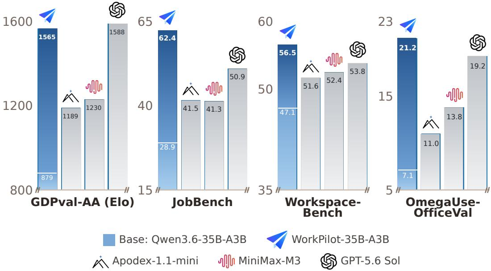  
Figure 1. WorkPilot-35B-A3B consistently outperforms its Qwen3.6-35B-A3B base model across four professional-work benchmarks, with representative models shown for context.

In this paper, we introduce WorkFactory, a scalable framework for constructing executable tasks that support reliable demonstrations of professional work. We derive diverse professional intents by combining occupational knowledge, skill documentation, and professional artifacts, broadening the range of work that can be instantiated. For each intent, WorkFactory plans backward from the intended output using an information support graph. Rather than connecting artifacts alone, the graph captures what each output depends on and where the supporting information should be available across reused and synthesized materials, while leaving derived results to the solver. To catch violations introduced during materialization, an isolated probe attempts the task from solver-visible inputs; its diagnoses drive repairs that must restore support without changing the intended work. Only environments that pass this process are then assigned to an independent teacher, whose execution provides the training trajectory.

Using WorkFactory, we construct 112,686 tasks spanning 612 occupations and collect teacher trajectories for supervised fine-tuning. Training Qwen3.5-4B [24], Qwen3.6-27B [25], and Qwen3.6-35B-A3B [26] on these trajectories yields the WorkPilot family. All three WorkPilot models substantially improve over their respective base models across four professional-work benchmarks, including GDPval-AA [4, 23] and JobBench [17], demonstrating the training utility of WorkFactory data across the tested model scales. Figure 1 illustrates the gains of WorkPilot-35B-A3B as a representative example. Notably, WorkPilot-27B reaches a locally estimated 1612 Elo on GDPval-AA v2.1, placing it within the range of the compared frontier models.

Beyond aggregate performance, we study how working-agent performance and execution behavior evolve with training-data scale, observing model-dependent diminishing returns, an initial increase followed by a decrease in execution length, and changes in tool-use reliability. Controlled component analyses show complementary benefits of information-level planning and execution-based repair in reducing probe-diagnosed environment defects and improving downstream performance, supporting the value of coherent task environments for effective expert supervision.

Our main contributions are as follows:

• We propose WorkFactory, a framework that works backward from intended outputs to organize dependencies across reused and synthesized materials in an information support graph, then uses execution-based repair to preserve task executability after materialization.

• We conduct a systematic empirical study of working-agent data scaling up to 110K tasks, characterizing diminishing performance returns across model scales and changes in execution length and tool-use reliability.

• We train the WorkPilot family at 4B, 27B, and 35B-A3B scales, with WorkPilot-27B achieving frontier-level performance on GDPval-AA. We publicly release a subset of the task data and the model weights to support further research.

## 2. Related Work

Agent Task and Environment Synthesis. Synthetic task and environment construction has become an important approach to scaling agent training. Software engineering provides a favorable setting, where repositories offer realistic contexts and executable tests provide concrete supervision; representative systems include SWE-Gym [22], SWE-smith [35], and R2E-Gym [14]. Beyond coding, recent work synthesizes longer-horizon, multi-tool tasks through compositional expansion [29, 34], environment exploration and execution feedback [7, 28], and stateful interaction environments [11]. These advances motivate synthesis for working agents, whose tasks require coherent workspaces that integrate heterogeneous information and domain-specific deliverables.

Professional Task Construction for Working Agents. NexForge [40] translates capability requirements into task directives and instantiates them through workspace blueprints, while Synthetic Computers [12] plans dependencies among artifacts to guide workspace synthesis. In concurrent work, GraphForge [31] constructs evidence graphs over real files to derive task statements and evidence-anchored rubrics, then revises these specifications using execution feedback. WorkGenesis [42] synthesizes companion materials around retrieved files and uses rubric-based failure attribution to guide revisions to the request, synthesized materials, and rubric. Whereas GraphForge compiles tasks and rubrics from an evidence graph over an assembled real-file workspace, WorkFactory works backward from intended outputs, using its graph to coordinate information dependencies and locations across reused and synthesized materials while leaving derived results to the solver. Unlike WorkGenesis’s rubric-based audit, WorkFactory directly probes the solver-visible environment and constrains repair to preserve the intended work.

## 3. WorkFactory

## 3.1. Overview

WorkFactory constructs executable professional tasks for training working agents. It first builds a diverse intent library from occupational knowledge, skill documentation, and professional artifacts, allowing task construction to cover both established workflows and realistic deliverables (§3.2). For each intent, WorkFactory plans backward from the intended output using an information support graph, which coordinates dependencies and information locations across reused and synthesized materials while reserving derived results for the solver (§3.3). Because these dependencies may be lost or contradicted when the environment is materialized, execution-based repair probes the task from solver-visible inputs and repairs blocking support failures without changing the intended work (§3.4). Tasks that pass this process are assigned to an independent teacher for trajectory collection (§3.5). Figure 2 illustrates the process through a supplier-selection example.

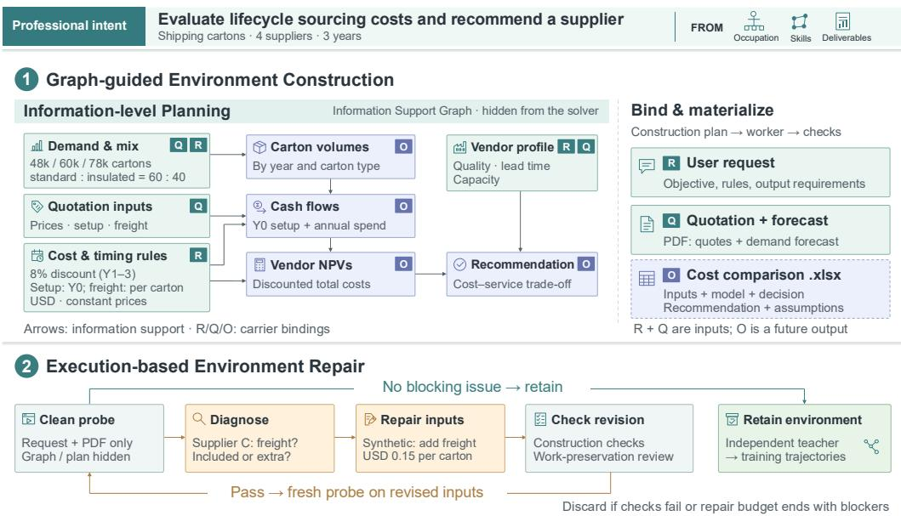  
Figure 2. Overview of WorkFactory through a synthetic shipping-carton sourcing example. (1) An information support graph guides environment construction while leaving derived outputs to the solver. (2) Clean probe executions expose blocking issues and guide checked repairs before retained environments are used for independent teacher trajectory collection. Appendix C.4 provides the complete end-to-end walkthrough.

## 3.2. Multi-source Professional Intent Synthesis

Professional intents specify meaningful work before its instance-specific materials are fixed. To cover varied occupational competencies, WorkFactory draws on three different sources: (1) occupational hierarchies, which ground the work in roles and situations; (2) documented skills, which identify operations that can be composed into workflows; and (3) real professional deliverables, which provide cues about intended outputs and audiences. The three synthesis routes reflect these roles: we expand occupations into roles situated in professional contexts, compose skills when one operation supplies inputs for another, and infer plausible objectives from deliverables through instruction backtranslation [16]. An LLM-based review evaluates candidate intents from all three routes for internal coherence and feasibility, professional appropriateness, and plausibility as real workplace activities before adding them to the shared intent library L. This offline library supplies intents for environment construction; Appendix A details the synthesis routes.

## 3.3. Graph-guided Environment Construction

Constructing an executable task environment requires more than assembling individually plausible artifacts. Each requested output must be supported by a complete chain of solver-visible premises, while the calculations and judgments that constitute the intended work must remain for the solver to perform. This boundary is difficult to preserve when supporting information is distributed across the user request, reused artifacts, and synthesized files. WorkFactory makes the boundary explicit before materialization

  
Figure 3. Selected high-coverage occupations from four of the 23 major occupational groups represented in the WorkFactory corpus.

through an information support graph

$$
\begin{array} { r } { \mathcal { G } _ { \mathrm { i n f o } } = ( \mathcal { V } _ { \mathrm { i n f o } } , \mathcal { V } _ { \mathrm { c a r r i e r } } , \mathcal { E } _ { \mathrm { i n f o } } , \mathcal { E } _ { \mathrm { l o c } } ) , } \end{array}\tag{1}
$$

where $\mathcal { N } _ { \mathrm { i n f o } }$ contains information units, $\mathcal { V } _ { \mathrm { c a r r i e r } }$ identifies their carriers, ${ \mathcal { E } } _ { \mathrm { i n f o } }$ represents support relations among information units, and $\mathcal { E } _ { \mathrm { l o c } }$ binds them to locations.

Planning information support. For each intent in L, the planner starts from the intended output and works backward. It identifies the calculations and judgments behind that output, then traces each of them to the information it requires. The resulting information units form $\mathcal { N } _ { \mathrm { i n f o } }$ , while ${ \mathcal { E } } _ { \mathrm { i n f o } }$ records association, transformation, evidence, and constraint relations, including cases where several sources jointly support one result. In the supplier-selection example in Figure 2, vendor NPVs rely on demand and pricing information distributed across the request and reference files; together with the vendor profiles, they support the final recommendation. Each node records its content, entity and scope, and whether it is supplied, externally acquired, solver-derived, or internal to construction. The source data and commercial terms are therefore made available, while the downstream calculations and recommendation remain unspecified for the solver to complete.

Grounding information in carriers. Location bindings in $\mathcal { E } _ { \mathrm { l o c } }$ assign information to carriers in $\mathcal { N } _ { \mathrm { c a r r i e r } } \mathrm { : }$ the user request, reference artifacts, external resources, future deliverables, or internal construction requirements. They specify where information is supplied, acquired, or produced, and whether it is accessible to the solver. Internal requirements remain hidden; any task-specific premise or obligation needed for completion must be expressed in or obtainable through solver-visible inputs. In the supplierselection example, input bindings locate demand forecasts and supplier quotations in a reference PDF and cost-timing rules in the request. Output bindings associate the requested vendor NPV analysis and sourcing recommendation with a future cost-comparison workbook. Appendix B provides detailed definitions.

Materializing the environment. The planner translates the graph into an artifact-level construction plan $\boldsymbol { \mathcal { P } } = ( u , \mathcal { A } , \mathcal { D } )$ , comprising the concrete user request �, artifact specifications A, and acyclic construction dependencies D. An environment worker follows this plan to reuse, adapt, or synthesize artifacts. Carrier bindings guide content placement, while information relations and shared identities and scopes guide consistency across files. Programmatic and LLM-based checks assess whether the realized request and materials conform to the plan; tasks that still fail after bounded retries are discarded. Appendix B.3 details the construction procedure, checks, and retry budget.

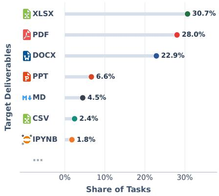

Figure 4. Distribution of target deliverable file types in the WorkFactory training corpus.  
Table 1. Statistics of the WorkFactory training corpus across tasks, workspaces, and teacher trajectories. †Counts include only file extensions occurring at least 10 times. ‡Some tasks provide no reference files and instead require the agent to obtain the necessary information through web search.
<table><tr><td>Corpus statistic</td><td>Value</td></tr><tr><td>Tasks</td><td></td></tr><tr><td># Tasks / Environments</td><td>112,686</td></tr><tr><td># Occupations</td><td>612</td></tr><tr><td># Deliverable File Extensions</td><td>53†</td></tr><tr><td>Workspaces</td><td></td></tr><tr><td>Avg. Provided Reference Files / Task</td><td>4.15</td></tr><tr><td>Avg. Reference File Size</td><td>1.56 MiB</td></tr><tr><td># Reference File Extensions</td><td>317†</td></tr><tr><td>Teacher Trajectories</td><td></td></tr><tr><td>Avg. Assistant Turns / Trajectory</td><td>57.36</td></tr><tr><td>Avg. Tool Calls / Trajectory</td><td>62.95</td></tr><tr><td>Avg. Total Tokens / Trajectory</td><td>136.18K</td></tr></table>

## 3.4. Execution-based Environment Repair

Execution-based repair tests the realized environment for missing or inconsistent support that remains after construction. The loop consists of probe diagnosis, revision, and revalidation.

Diagnosing the realized environment. A probe solver attempts the task using only the solver-visible request and resources, without access to the graph, construction plan, or prior execution outputs and diagnoses. It grounds reported environmental issues in inspected sources and tool observations, identifies the affected operations and deliverables, and distinguishes them from solver mistakes and legitimate open choices. Only issues judged to block task completion trigger repair; tasks without such blockers proceed to trajectory collection. Appendix C.1 details the reporting criteria.

Repairing and revalidating the environment. A refiner uses the diagnoses to edit the request and existing reference files while preserving the files’ number, types, and dependency structure; the information support graph remains the initial construction specification. For example, adding a missing USD 0.15- per-carton freight term for Supplier C restores the support needed for an NPV comparison without performing the comparison for the solver. Each revision must pass construction checks and an LLM-based work-preservation review against the original intent and initial plan, assessing whether the core objective, essential operations, and substantive deliverable requirements remain intact. Revised tasks that fail either check are discarded; those that pass undergo a fresh probe execution. The loop stops when no blocker remains or the repair budget is exhausted, with unresolved tasks discarded. Retained tasks form the candidate pool T for trajectory collection. Appendix C.2 specifies the repair constraints and budget, and Appendix D.3 provides model and execution settings.

## 3.5. Task Corpus and Training Data

Teacher trajectory collection and supervision. For every task in T, GLM-5.3 [37] independently attempts the task in a clean sandbox with the same task-information access boundary as the probe in §3.4. The teacher receives the current request and accessible resources, without the information support graph, construction plan, or prior probe outputs and diagnoses. The resulting interaction trace and produced deliverables form an initial teacher rollout. We retain rollouts that pass lightweight filters screening for repeated reasoning, repeated tool calls, and missing or insufficiently substantive deliverables. For the 5% of tasks with the longest initial rollouts, measured by total interaction turns, we additionally apply selective rejection sampling based on pairwise deliverable comparisons; all other tasks retain their filtered initial rollouts. Each retained rollout is then converted into one or more training sequences for masked autoregressive supervision.1 Appendix D.3 details the execution settings, rejection-sampling procedure, and training configuration.

Final training corpus. The final corpus contains 112,686 tasks spanning 612 fine-grained occupations and 23 major occupational groups; Figure 3 shows the occupations with the highest task shares. We collect teacher trajectories using the Stirrup [5] and the Claude Code harness [3]. Figure 4 shows the distribution of target deliverable file types, while Table 1 reports additional aggregate corpus statistics. We screen the final corpus against the evaluation tasks using request-overlap checks, manual review of flagged pairs, and file hashes; these checks identify no evaluation-task reuse or byte-identical files shared with the training corpus. Appendix D provides additional details, while Appendix D.2 reports construction-time token usage.

## 4. Experiments

## 4.1. Experimental Setup

Baselines. We compare the three WorkPilot models with their corresponding base models: Qwen3.5- 4B [24], Qwen3.6-27B [25], and Qwen3.6-35B-A3B [26]. These matched base-model comparisons serve as the primary controls for measuring the effect of WorkFactory supervision across model scales. For broader system-level context, we also include three groups of representative models: frontier models, including GLM-5.3 [37], DeepSeek-V4.1-Flash [8], Qwen3.8-Max [27], GPT-5.6 Sol [21], and Kimi-K3 [15]; open-weight models (≥300B), including DeepSeek-V4-Pro-0813 [9], DeepSeek-V4- Flash-0731 [9], GLM-5.2 [38], and MiniMax-M3 [19]; and open-weight models (≈30B), including Qwen3.8-27B [27], Nex-N2.5-mini [20], and Apodex-1.1-mini [1].

Benchmarks. We evaluate the training utility of WorkFactory teacher trajectories on GDPval [23], JobBench [17], Workspace-Bench [32]2, and OmegaUse-OfficeVal [41]. For each locally evaluated model–task pair, we run three independent rollouts. For GDPval, we follow the GDPval-AA protocol [4] with the Stirrup harness [5]. We report official v2.1 Elo ratings where available; otherwise, using Gemini 3.1 Pro Preview [13] as the judge, we report local Bradley–Terry estimates [6] calibrated to the same v2.1 scale (see Appendix E.1). For the remaining benchmarks, we use the Claude Code harness [3] with Claude Sonnet 4.6 [2] as the judge when needed and report the official metrics.3

Training. All fine-tuned models, including those used in the controlled studies, use the shared supervised fine-tuning configuration reported in Appendix D.3 (Table 9).

## 4.2. Effectiveness of WorkFactory Data

Table 2 presents the main results. Fine-tuning on the same WorkFactory corpus improves the 4B, 27B, and 35B-A3B base models across all four professional-work benchmarks. For example, WorkPilot-35B-A3B improves from 879 to 1565 on GDPval-AA, from 28.91 to 62.35 on JobBench, from 47.12 to 56.53 on Workspace-Bench, and from 7.14 to 21.18 on OmegaUse-OfficeVal. On GDPval-AA, WorkPilot-27B reaches a locally estimated 1612 Elo; its point estimate is 12 Elo above DeepSeek-V4.1-Flash and 34 points below GLM-5.3, placing it within the range of the frontier models shown. WorkPilot-4B also exceeds Apodex-1.1-mini on GDPval and OmegaUse-OfficeVal, demonstrating competitive performance at the 4B scale. Together, the matched base-model gains demonstrate the training utility of WorkFactory teacher trajectories across the three model scales tested.

Table 2. Results on professional-task benchmarks. For GDPval-AA, ∗ marks an official v2.1 Elo rating; unmarked values are local two-anchor estimates, with task-bootstrap 95% confidence intervals reported in Appendix Table 11.
<table><tr><td>Model</td><td></td><td></td><td>GDPval-AA JobBench Workspace-Bench</td><td>1 OmegaUse-OfficeVal</td></tr><tr><td colspan="5">Frontier Models</td></tr><tr><td>GLM-5.3</td><td>1646*</td><td>66.35</td><td>61.80</td><td>31.09</td></tr><tr><td>DeepSeek-V4.1-Flash</td><td>1600*</td><td>67.69</td><td>63.06</td><td>31.43</td></tr><tr><td>Qwen3.8-Max</td><td>1596*</td><td>59.83</td><td>61.51</td><td>28.23</td></tr><tr><td>GPT-5.6 Sol</td><td>1588*</td><td>50.91</td><td>53.77</td><td>19.25</td></tr><tr><td>Kimi-K3</td><td>1524*</td><td>55.83</td><td>54.05</td><td>23.09</td></tr><tr><td colspan="5">Open-weight Models (≥ 300B)</td></tr><tr><td>DeepSeek-V4-Pro-0813</td><td>1441*</td><td>62.98</td><td>59.08</td><td>21.26</td></tr><tr><td>DeepSeek-V4-Flash-0731</td><td>1427*</td><td>52.88</td><td>56.57</td><td>24.01</td></tr><tr><td>GLM-5.2</td><td>1358*</td><td>48.08</td><td>54.00</td><td>20.72</td></tr><tr><td>MiniMax-M3</td><td>1230*</td><td>41.32</td><td>52.43</td><td>13.81</td></tr><tr><td colspan="5">Open-weight Models (≈ 30B)</td></tr><tr><td>Qwen3.8-27B</td><td>1409*</td><td>62.12</td><td>59.26</td><td>23.47</td></tr><tr><td>Apodex-1.1-mini</td><td>1189*</td><td>41.53</td><td>51.60</td><td>10.98</td></tr><tr><td>Nex-N2.5-mini</td><td>1127</td><td>20.92</td><td>44.81</td><td>10.91</td></tr><tr><td colspan="5">Our Models</td></tr><tr><td>Qwen3.5-4B + WorkPilot-4B</td><td>661 1375</td><td>4.67 39.87</td><td>26.92</td><td>1.71</td></tr><tr><td>Qwen3.6-35B-A3B</td><td>(+714)</td><td>(+35.20)</td><td>51.30 (+24.38)</td><td>11.77 (+10.06)</td></tr><tr><td>+ WorkPilot-35B-A3B</td><td>879* 1565</td><td>28.91 62.35</td><td>47.12 56.53</td><td>7.14</td></tr><tr><td></td><td>(+686)</td><td>(+33.44)</td><td>(+9.41)</td><td>21.18 (+14.04)</td></tr><tr><td>Qwen3.6-27B + WorkPilot-27B</td><td>975</td><td>37.81</td><td>49.41</td><td>10.18</td></tr><tr><td></td><td>1612 (+637)</td><td>63.05 (+25.24)</td><td>59.18 (+9.77)</td><td>26.61 (+16.43)</td></tr></table>

## 4.3. Scaling Properties

We study how model performance and execution behavior scale with the number of distinct WorkFactory training tasks on GDPval under the GDPval-AA evaluation protocol. Our primary sweep trains Qwen3.6- 35B-A3B on nested subsets of 2K–110K tasks; we additionally evaluate Qwen3.6-27B and Qwen3.5-4B at 30K and 110K.

Performance improves with model-dependent diminishing returns. Figure 5(a) shows that GDPval-AA Elo increases with additional training data across all three models. For Qwen3.6-35B-A3B, Elo rises from 879 to 1565: the first 5K tasks contribute 447 points, whereas scaling from 75K to 110K adds only 13. By 30K tasks, the 35B-A3B and 27B models have captured 88% and 94% of their respective gains from the base model to the 110K-task checkpoint, showing different patterns of diminishing returns across the sampled model scales. The 4B model also gains 546 Elo by 30K tasks, showing strong early data efficiency at the smallest tested scale. A two-checkpoint comparison on JobBench shows the same direction: Qwen3.6-35B-A3B improves from 58.80 at 50K tasks to 62.35 at 110K.

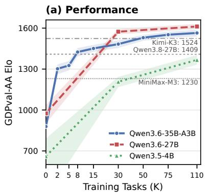

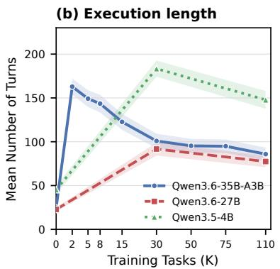

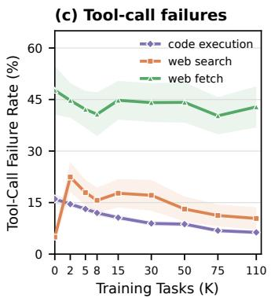  
Figure 5. Scaling on GDPval with the number of WorkFactory training tasks. (a) GDPval-AA Elo across model scales. (b) Task-level mean execution length. (c) Tool-call failure rates for Qwen3.6-35B-A3B. Shading denotes 95% confidence intervals; the �-axis uses a square-root scale.

Execution length first expands and then contracts. As shown in Figure 5(b), the mean execution length of Qwen3.6-35B-A3B first rises from 24.87 turns at baseline to 162.88 at 2K tasks, then falls to 85.90 at 110K while Elo continues to improve. The fraction of its GDPval-AA trajectories reaching the 250-turn limit also falls from 21.9% at 2K to 2.7% at 110K. Across the sampled checkpoints, the 27B and 4B models also show an increase from their bases to 30K tasks followed by a decrease at 110K; the 4B model uses longer trajectories than the other two models at both data scales. Figure 5(c) further shows that, for Qwen3.6-35B-A3B, code-execution failures decline from 16.0% at baseline to 6.3% at 110K. After rising to 22.4% at 2K, web-search failures decrease to 10.4% at 110K, whereas web-fetch failures remain at approximately 40%–48%.

Together, these observations show that performance and execution length evolve differently as training data increases: longer attempts emerge at small data scales, followed by shorter executions and lower failure rates for some tool types at larger scales.

## 4.4. Component Analysis

We compare three 5K-task synthesis conditions: direct artifact-level planning, information-level planning, and information-level planning followed by execution-based repair. The analysis asks whether explicitly planning and repairing task information improves both the conditions for teacher execution and the training utility of the resulting trajectories. We assess task-environment quality using blocker- and correctness-level findings from a common probe solver (see §3.4) and downstream utility by fine-tuning the same Qwen3.6-35B-A3B base model under the shared training configuration. For each defect category, incidence is the fraction of tasks whose report contains at least one hard defect in that category; categories may overlap. We use the initial probe report for the first two conditions and the final report for the repair condition, including tasks later discarded for unresolved blockers. Table 3 summarizes both analyses.

Task-environment quality. Replacing direct artifact-level planning with information-level planning reduces probe-diagnosed hard-defect incidence in six of the eight categories. The largest reduction is in broken derivations, from 24.86% to 6.86%, while underspecified requests fall from 7.22% to 0.62%. These changes are consistent with the graph’s role in making required information and its locations explicit. However, the incidence of leakage or shortcuts and self-inconsistency increases by 1.44 and 1.18 percentage points, respectively. We hypothesize that the former may arise when explicit dependencies lead the materializer to expose solver-derived information in the request, and the latter when denser constraints make it harder to maintain consistency across synthesized statements and values. These regressions show that making information requirements explicit does not by itself ensure that materialization preserves them. Adding execution-based repair reduces the reported incidence in all eight categories relative to information-level planning alone. In particular, cross-file inconsistency falls from 25.74% to 4.84%, execution-feasibility defects from 6.64% to 0.48%, and leakage or shortcuts from 3.36% to 0.84%. Taken together, these reductions show that execution-based repair complements information-level planning by addressing defects that remain in the materialized environments. Appendix C.3 provides additional repair statistics.

Table 3. Component analysis across three 5K-task synthesis conditions. Defect entries report task counts (percentages), with categories allowed to overlap. Deltas compare adjacent conditions in percentage points for defects and GDPval-AA Elo points for downstream utility.
<table><tr><td></td><td>Artifact-level planning</td><td>+ Information support graph</td><td>Δ vs. left</td><td>+ Execution-based repair</td><td>Δ vs. left</td></tr><tr><td colspan="6">Probe-diagnosed hard-defect incidence</td></tr><tr><td>Missing evidence</td><td>481 (9.62%)</td><td>182 (3.64%)</td><td>-5.98 pp</td><td>101 (2.02%)</td><td>-1.62 pp</td></tr><tr><td>Cross-file inconsistency</td><td>1,641 (32.82%)</td><td>1,287 (25.74%)</td><td>-7.08 pp</td><td>242 (4.84%)</td><td>-20.90 pp</td></tr><tr><td>Broken derivation</td><td>1,243 (24.86%)</td><td>343 (6.86%)</td><td>-18.00 pp</td><td>163 (3.26%)</td><td>-3.60 pp</td></tr><tr><td>Underspecified request</td><td>361 (7.22%)</td><td>31 (0.62%)</td><td>-6.60 pp</td><td>14 (0.28%)</td><td>-0.34 pp</td></tr><tr><td>Leakage or shortcut</td><td>96 (1.92%)</td><td>168 (3.36%)</td><td>+1.44 pp</td><td>42 (0.84%)</td><td>-2.52 pp</td></tr><tr><td>Execution feasibility</td><td>540 (10.80%)</td><td>332 (6.64%)</td><td>-4.16 pp</td><td>24 (0.48%)</td><td>-6.16 pp</td></tr><tr><td>Self-inconsistency</td><td>164 (3.28%)</td><td>223 (4.46%)</td><td>+1.18 pp</td><td>87 (1.74%)</td><td>-2.72 pp</td></tr><tr><td>Factual truth error</td><td>226 (4.52%)</td><td>128 (2.56%)</td><td>-1.96 pp</td><td>65 (1.30%)</td><td>-1.26 pp</td></tr><tr><td colspan="6">Post-training downstream utility</td></tr><tr><td>GDPval-AA Elo</td><td>1245</td><td>1293</td><td>+48</td><td>1326</td><td>+33</td></tr></table>

Downstream utility. We train the same model separately on teacher trajectories from each synthesis condition. Information-level planning raises GDPval-AA Elo from 1245 to 1293, while adding executionbased repair further raises it to 1326. The cumulative 81-point gain over direct artifact-level planning accompanies reductions in probe-diagnosed defects, linking improvements in task construction to the downstream utility of the collected teacher trajectories.

## 4.5. Effect of Teacher Choice

We compare two teacher supervision on the 30K-task subset from the scaling study (§4.3). The GLM-5.3 condition reuses the Qwen3.6-35B-A3B checkpoint trained on that subset; the DeepSeek condition regenerates trajectories for the same tasks with DeepSeek-V4-Flash-0731 and fine-tunes the same base model with the shared configuration. The student trained on GLM-5.3 trajectories reaches 1483 Elo ([1455, 1510]), whereas the student trained on DeepSeek-V4-Flash-0731 trajectories reaches 1248 Elo ([1220, 1274]); both outperform the 879-Elo base model. Both teacher conditions improve over the base model, supporting the utility of WorkFactory tasks beyond a single teacher. The difference between students also shows that trajectory-generation choices affect how much training benefit is obtained from the same task set. Appendix D.4 analyzes the corresponding teacher and student behaviors.

## 4.6. Cost–Performance Trade-off

We estimate model-inference cost per GDPval-AA task from recorded input and output tokens using a common accounting formula and explicit mappings to provider prices. The estimates use a shared cache-hit assumption and explicit price proxies where needed, and cover task-solving model inference only. Under this standardized accounting, all three WorkPilot models lie on the non-dominated frontier among the models shown in Figure 6; the estimated costs of WorkPilot-4B, WorkPilot-35B-A3B, and WorkPilot-27B are approximately \$0.012, \$0.031, and \$0.396 per task, respectively. Appendix E.3 details the accounting method and price mappings.

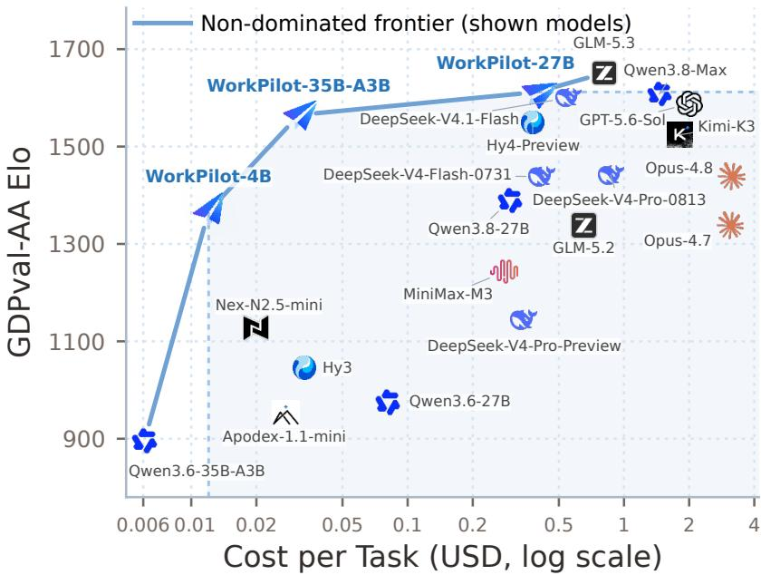  
Figure 6. GDPval-AA Elo versus standardized estimates of model-inference cost per task. The line marks the non-dominated frontier among the models shown.

## 5. Conclusion

We introduced WorkFactory, a framework for constructing executable professional tasks to support teacher demonstrations of occupational competencies. Information-level planning specifies the dependencies and locations of required information, while execution-based repair addresses support failures exposed during task execution. Using teacher trajectories from 112,686 tasks, we trained the WorkPilot family, whose three models improve over their corresponding bases across four professional-work benchmarks. Data-scaling analyses reveal model-dependent diminishing returns and changes in execution length and tool-use reliability. Controlled component studies connect reductions in probe-diagnosed environment defects to improved downstream training utility, supporting the value of coherent task construction for scaling working-agent supervision.

## Limitations

First, GLM-5.3, our teacher model, accepts only text input. Consequently, although the Qwen backbones include native vision and alignment components, we train and evaluate them only through a text-only tasksolving interface. This work therefore does not examine learning from visual evidence directly. Future work will extend trajectory collection and student training to multimodal professional tasks. Second, our training study focuses on supervised fine-tuning over teacher trajectories. Future work will leverage high-quality professional tasks and their execution feedback to train working agents with reinforcement learning.

## Ethical Considerations

WorkFactory trains agents to perform professional workflows and produce realistic workplace artifacts. Such outputs may be incorrect, biased, or misused in consequential settings, and should therefore receive appropriate human review rather than replace qualified professionals. Dataset and model release should also respect privacy, copyright, and licensing requirements.

## References

1 B. An, B. Li, B. Wang, B. Zhang, B. L. Wang, C. Feng, C. Wei, C. Xue, C. Zhang, D. Ng, D. Ye, E. Min, F. Chen, F. Liu, F. Yang, F. Ye, G. Sun, H. Ji, H. Xu, H. Yang, H. Ye, H. Zhang, H. Zhao, J. Li, J. Lin, J. Xia, K. Jin, K. Wang, K. Yang, L. Bing, L. Lei, L. Su, Le. Wang, Lu. Wang, N. Wang, Q. Ren, Q. Yang, R. Li, S. Bai, S. Du, S. Li, S. Lin, S. Nie, S. Wang, S. Zhang, S. Z. Wang, T. Ge, Ta. Q. Fang, Ti. Q. Fang, W. Fang, W. Li, W. Zhang, X. Chen, X. Li, X. Tang, X. Wang, X. Xu, X. Zhang, X. Q. Wang, X. Y. Wang, Y. Deng, Y. Gao, Y. Hu, Y. Li, Y. Sui, Y. Wang, Y. Xiao, Y. Zhang, Y. Zhou, Z. Chen, Z. Cheng, Z. Feng, Z. Liang, Z. Liu, and Z. Zhang. Apodex 1.1: Scaling agentic intelligence for complex work, 2026. URL https://arxiv.org/abs/2608.23283.

2 Anthropic. Introducing claude sonnet 4.6, February 2026. URL https://www.anthropic.co m/news/claude-sonnet-4-6.

3 Anthropic. Claude Code: Overview, 2026. URL https://code.claude.com/docs/en/ov erview.

4 Artificial Analysis. GDPval-AA v2.1 Leaderboard, 2026. URL https://artificialanal ysis.ai/evaluations/gdpval-aa. Official evaluation protocol and leaderboard. Accessed September 26, 2026.

5 Artificial Analysis. Stirrup: The lightweight foundation for building agents, 2026. URL https: //github.com/ArtificialAnalysis/Stirrup.

6 Ralph Allan Bradley and Milton E. Terry. Rank analysis of incomplete block designs: I. the method of paired comparisons. Biometrika, 39(3–4):324–345, 1952. doi: 10.1093/biomet/39.3-4.324. URL https://doi.org/10.1093/biomet/39.3-4.324.

7 Aili Chen, Chi Zhang, Junteng Liu, Jiangjie Chen, Chengyu Du, Yunji Li, Ming Zhong, Qin Wang, Zhengmao Zhu, Jiayuan Song, Ke Ji, Junxian He, Pengyu Zhao, and Yanghua Xiao. DIVE: Scaling diversity in agentic task synthesis for generalizable tool use. In Forty-third International Conference on Machine Learning, 2026. URL https://openreview.net/forum?id=4uM4P5NaLU.

8 DeepSeek-AI. DeepSeek-V4.1-Flash: Pushing the limits of KV cache compression, 2026. URL https://arxiv.org/abs/2609.19969.

9 DeepSeek-AI, Anyi Xu, Bangcai Lin, Bing Xue, Bingxuan Wang, Bingzheng Xu, Bochao Wu, Bowei Zhang, Chaofan Lin, Chen Dong, Chenchen Ling, Chengda Lu, Chenggang Zhao, Chengqi Deng, Chengyu Hou, Chenhao Xu, Chenze Shao, Chong Ruan, Conner Sun, Damai Dai, Daya Guo, Dejian Yang, Deli Chen, Donghao Li, Dongjie Ji, Erhang Li, Fang Wei, Fangyun Lin, Fangzhou Yuan, Feiyu Xia, Fucong Dai, Guangbo Hao, Guanting Chen, Guoai Cao, Guolai Meng, Guowei Li, Han Yu, Han Zhang, Hanwei Xu, Hao Li, Haofen Liang, Haoling Zhang, Haoming Luo, Haoran Wei, Haotian Yuan, Haowei Zhang, Haowen Luo, Haoyu Chen, Haozhe Ji, Hengqing Zhang, Honghui Ding, Hongxuan Tang, Huanqi Cao, Huazuo Gao, Hui Qu, Hui Zeng, J Yang, JQ Zhu, Jia Luo, Jia Song, Jia Yu, Jialiang Huang, Jialu Cai, Jian Liang, Jiangting Zhou, Jiasheng Ye, Jiashi Li, Jiaxin Xu, Jiewen Hu, Jieyu Yang, Jin Chen, Jin Yan, Jingchang Chen, Jingli Zhou, Jingting Xiang, Jingyang

Yuan, Jingyuan Cheng, Jingzi Zhou, Jinhua Zhu, Jiping Yu, Joseph Sun, Jun Ran, Junguang Jiang, Junjie Qiu, Junlong Li, Junmin Zheng, Junxiao Song, Kai Dong, Kaige Gao, Kang Guan, Kexing Zhou, Kezhao Huang, Kuai Yu, Lean Wang, Lecong Zhang, Lei Wang, Leyi Xia, Li Zhang, Liang Zhao, Lihua Guo, Lingxiao Luo, Linwang Ma, Linyan Zhu, Litong Wang, Liyu Cai, Liyue Zhang, Longhao Chen, MS Di, MY Xu, Max Mei, Miaojun Wang, Mingchuan Zhang, Minghua Zhang, Minghui Tang, Mingming Li, Mingxu Zhou, Minmin Han, Ning Wang, Panpan Huang, Panpan Wang, Peixin Cong, Peiyi Wang, Peng Zhang, Qiancheng Wang, Qihao Zhu, Qingyang Li, Qinyu Chen, Qiushi Du, Qiwei Jiang, Rui Tian, Ruifan Xu, Ruijie Lu, Ruiling Xu, Ruiqi Ge, Ruisong Zhang, Ruizhe Pan, Runji Wang, Runqian Chen, Runqiu Yin, Runxin Xu, Ruomeng Shen, Ruoyu Zhang, Ruyi Chen, SH Liu, Shanghao Lu, Shangmian Sun, Shangyan Zhou, Shanhuang Chen, Shaofei Cai, Shaoheng Nie, Shaoqing Wu, Shaoyuan Chen, Shengding Hu, Shengyu Liu, Shiqiang Hu, Shirong Ma, Shiyu Wang, Shuiping Yu, Shunfeng Zhou, Shuting Pan, Shuying Yu, Songyang Zhou, Tao Ni, Tao Yun, Tian Jin, Tian Pei, Tian Ye, Tianle Lin, Tianran Ji, Tianyi Cui, Tianyuan Yue, Tingting Yu, Tun Wang, W Zhang, WL Xiao, Wangding Zeng, Wei An, Weilin Zhao, Wen Liu, Wenfeng Liang, Wenjie Pang, Wenjing Luo, Wenjing Yao, Wenjun Gao, Wenkai Yang, Wenlve Huang, Wenqing Hou, Wentao Zhang, Wenting Ma, Xi Gao, Xiang He, Xiangwen Wang, Xianzu Wang, Xiao Bi, Xiaodong Liu, Xiaohan Wang, Xiaokang Chen, Xiaokang Zhang, Xiaotao Nie, Xiaowen Sun, Xiaoxiang Wang, Xin Cheng, Xin Liu, Xin Xie, Xingchao Liu, Xingchen Liu, Xingkai Yu, Xingyou Li, Xinyu Yang, Xinyu Zhang, Xu Chen, Xuanyu Wang, Xuecheng Su, Xueyin Chen, Xuheng Lin, Xuwei Fu, YC Yan, YQ Wang, YW Ma, Yanfeng Luo, Yang Zhang, Yanhong Xu, Yanru Ma, Yanwen Huang, Yao Li, Yao Li, Yao Xu, Yao Zhao, Yaofeng Sun, Yaohui Wang, Yi Qian, Yi Shao, Yi Yu, Yichao Zhang, Yifan Ding, Yifan Shi, Yijia Wu, Yiliang Xiong, Yiling Ma, Ying He, Ying Tang, Ying Zhou, Yingjia Luo, Yinmin Zhong, Yishi Piao, Yisong Wang, Yixiang Zhang, Yixiao Chen, Yixuan Tan, Yixuan Wei, Yiyang Ma, Yiyuan Liu, Yonglun Yang, Yongqiang Guo, Yongtong Wu, Yu Wu, YuKun Li, Yuan Cheng, Yuan Ou, Yuanfan Xu, Yuanhao Li, Yuduan Wang, Yuehan Yang, Yuer Xu, Yuhan Wu, Yuhao Meng, Yuheng Zou, Yukun Zha, Yunfan Xiong, Yupeng Chen, Yuping Lin, Yuqian Cao, Yuqian Wang, Yushun Zhang, Yuting Yan, Yutong Lin, Yuxian Gu, Yuxiang Luo, Yuxiang You, Yuxuan Liu, Yuxuan Zhou, Yuyang Zhou, Yuzhen Huang, ZF Wu, Zehao Wang, Zehua Zhao, Zehui Ren, Zekai Zhang, Zhangli Sha, Zhe Fu, Zhe Ju, Zhean Xu, Zhenda Xie, Zhengyan Zhang, Zheren Gao, Zhewen Hao, Zhibin Gou, Zhicheng Ma, Zhigang Yan, Zhihong Shao, Zhixian Huang, Zhixuan Chen, Zhiyu Wu, Zhizhou Ren, Zhongyu Wu, Zhuoshu Li, Zhuping Zhang, Zian Xu, Zihao Wang, Zihua Qu, Zihui Gu, Zijia Zhu, Zilin Li, Zipeng Zhang, Ziwei Xie, Ziyi Gao, Ziyi Wan, Zizheng Pan, and Zongqing Yao. DeepSeek-V4: Towards highly efficient million-token context intelligence, 2026. URL https://arxiv.org/abs/2606.19348.

10 Jia Deng, Yimeng Chen, Xiaoqing Xiang, Ziyang Zeng, Shuo Tang, Zhengbo Zhang, Wayne Xin Zhao, Feng Chang, Chuan Hao, Yuan Wei, Ran Tao, Bryan Dai, and Ji-Rong Wen. Fort-searcher: Synthesizing shortcut-resistant search tasks for training deep search agents, 2026. URL https: //arxiv.org/abs/2606.12087.

11 Guanting Dong, Junting Lu, Junjie Huang, Wanjun Zhong, Longxiang Liu, Shijue Huang, Zhenyu Li, Yang Zhao, Xiaoshuai Song, Xiaoxi Li, Jiajie Jin, Yutao Zhu, Hanbin Wang, Fangyu Lei, Qinyu Luo, Mingyang Chen, Zehui Chen, Jiazhan Feng, Ji-Rong Wen, and Zhicheng Dou. Agent-World: Scaling real-world environment synthesis for evolving general agent intelligence, 2026. URL https: //arxiv.org/abs/2604.18292.

12 Tao Ge, Baolin Peng, Hao Cheng, and Jianfeng Gao. Synthetic computers at scale for long-horizon productivity simulation, 2026. URL https://arxiv.org/abs/2604.28181.

13 Google. Gemini 3.1 pro preview, February 2026. URL https://ai.google.dev/gemini-a pi/docs/models/gemini-3.1-pro-preview.

14 Naman Jain, Jaskirat Singh, Manish Shetty, Liang Zheng, Koushik Sen, and Ion Stoica. R2E-Gym: Procedural environments and hybrid verifiers for scaling open-weights SWE agents, 2025. URL https://arxiv.org/abs/2504.07164.

15 Kimi Team. Kimi K3: Open frontier intelligence, July 2026. URL https://www.kimi.com/e n/blog/kimi-k3.

16 Xian Li, Ping Yu, Chunting Zhou, Timo Schick, Omer Levy, Luke Zettlemoyer, Jason E Weston, and Mike Lewis. Self-alignment with instruction backtranslation. In The Twelfth International Conference on Learning Representations, 2024. URL https://openreview.net/forum?id=1oijHJ BRsT.

17 Yuetai Li, Yichen Feng, Zhangchen Xu, Zixian Ma, Kaiyuan Zheng, Fengqing Jiang, Xinghua Sun, Rulin Shao, Zichen Chen, Yue Huang, Xinyang Han, Brian Lee, Kayla Xu, Shenglai Zeng, Hang Hua, Xiangliang Zhang, Basel Alomair, Ranjay Krishna, Luke Zettlemoyer, Pang Wei Koh, Bhaskar Ramasubramanian, Luyao Niu, Xiang Yue, and Radha Poovendran. JobBench: Aligning agent work with human will, 2026. URL https://arxiv.org/abs/2605.26329.

18 Mantas Mazeika, Alice Gatti, Cristina Menghini, Udari Madhushani Sehwag, Shivam Singhal, Yury Orlovskiy, Steven Basart, Manasi Sharma, Denis Peskoff, Elaine Lau, Jaehyuk Lim, Lachlan Carroll, Alice Blair, Vinaya Sivakumar, Sumana Basu, Brad Kenstler, Yuntao Ma, Julian Michael, Xiaoke Li, Oliver Ingebretsen, Aditya Mehta, Jean Mottola, John Teichmann, Kevin Yu, Zaina Shaik, Adam Khoja, Richard Ren, Jason Hausenloy, Long Phan, Ye Htet, Ankit Aich, Tahseen Rabbani, Vivswan Shah, Andriy Novykov, Felix Binder, Kirill Chugunov, Luis Ramirez, Matias Geralnik, Hernán Mesura, Dean Lee, Ed-Yeremai Hernandez Cardona, Annette Diamond, Summer Yue, Alexandr Wang, Bing Liu, Ernesto Hernandez, and Dan Hendrycks. Remote labor index: Measuring ai automation of remote work, 2025. URL https://arxiv.org/abs/2510.26787.

19 MiniMax. MiniMax-M3, 2026. URL https://huggingface.co/MiniMaxAI/MiniMax -M3.

20 Nex-AGI. Nex-N2.5-mini, Sep 2026. URL https://huggingface.co/nex-agi/Nex-N2. 5-mini.

21 OpenAI. GPT-5.6: Frontier intelligence that scales with your ambition, July 2026. URL https: //openai.com/index/gpt-5-6/.

22 Jiayi Pan, Xingyao Wang, Graham Neubig, Navdeep Jaitly, Heng Ji, Alane Suhr, and Yizhe Zhang. Training software engineering agents and verifiers with SWE-Gym. In Forty-second International Conference on Machine Learning, 2025. URL https://openreview.net/forum?id=Cq1B NvHx74.

23 Tejal Patwardhan, Rachel Dias, Elizabeth Proehl, Grace Kim, Michele Wang, Olivia Watkins, Simon Posada Fishman, Marwan Aljubeh, Phoebe Thacker, Laurance Fauconnet, Natalie S. Kim, Samuel Miserendino, Gildas Chabot, David Li, Patrick Chao, Michael Sharman, Alexandra Barr, Amelia Glaese, and Jerry Tworek. GDPval: Evaluating AI model performance on real-world economically valuable tasks. In The Fourteenth International Conference on Learning Representations, 2026. URL https://openreview.net/forum?id=hcuEdq6eKD.

24 Qwen Team. Qwen3.5: Towards native multimodal agents, February 2026. URL https://qwen .ai/blog?id=qwen3.5.

25 Qwen Team. Qwen3.6-27B: Flagship-level coding in a 27B dense model, April 2026. URL https: //qwen.ai/blog?id=qwen3.6-27b.

26 Qwen Team. Qwen3.6-35B-A3B: Agentic Coding Power, Now Open to All, April 2026. URL https://qwen.ai/blog?id=qwen3.6-35b-a3b.

27 Qwen Team. Qwen3.8-Max: A New Bar for Coding and Cowork, August 2026. URL https: //qwen.ai/blog?id=qwen3.8.

28 Ram Ramrakhya, Andrew Szot, Omar Attia, Bogdan Mazoure, Anh Tuan Nguyen, Yuhao Yang, Zhe Gan, Harsh Agrawal, and Alexander T Toshev. Scaling synthetic task generation for agents via exploration. In The Fourteenth International Conference on Learning Representations, 2026. URL https://openreview.net/forum?id=ng4KgSRAW8.

29 Dingfeng Shi, Jingyi Cao, Qianben Chen, Weichen Sun, Weizhen Li, Hongxuan Lu, Fangchen Dong, Tianrui Qin, King Zhu, Minghao Liu, Yuchen Eleanor Jiang, Jian Yang, Ge Zhang, Jiaheng Liu, Changwang Zhang, Jun Wang, and Wangchunshu Zhou. TaskCraft: Automated generation of agentic tasks. In The Fourteenth International Conference on Learning Representations, 2026. URL https://openreview.net/forum?id=UJFCyrYM1V.

30 Yueqi Song, Ketan Ramaneti, Zaid Sheikh, Ziru Chen, Boyu Gou, Tianbao Xie, Yiheng Xu, Danyang Zhang, Apurva Gandhi, Fan Yang, Joseph Liu, Tianyue Ou, Zhihao Yuan, Frank F. Xu, Shuyan Zhou, Xingyao Wang, Xiang Yue, Tao Yu, Huan Sun, Yu Su, and Graham Neubig. Agent data protocol: Unifying datasets for diverse, effective fine-tuning of LLM agents. In The Fourteenth International Conference on Learning Representations, 2026. URL https://openreview.net/forum?i d=tG6301ORHd.

31 Qisheng Su, Hanchen Wang, Guanru Zhu, Huicheng Jiang, Qiuyinzhe Zhang, Kou Shi, Zhen Fang, Ziao Zhang, Qingnan Ren, Honglin Guo, Zehui Chen, Tao Gui, and Feng Zhao. GraphForge: Training working agents with graph-anchored workspace synthesis, 2026. URL https://arxiv.org/ab s/2609.38923.

32 Zirui Tang, Xuanhe Zhou, Yumou Liu, Linchun Li, Yukai Wu, Weizheng Wang, Hongzhang Huang, Wei Zhou, Jun Zhou, Jiachen Song, Shaoli Yu, Jinqi Wang, Zihang Zhou, Hongyi Zhou, Yuting Lv, Jinyang Li, Jiashuo Liu, Ruoyu Chen, Chunwei Liu, GuoLiang Li, Jihua Kang, and Fan Wu. Workspace-Bench 1.0: Benchmarking AI agents on workspace tasks with large-scale file dependencies, 2026. URL https://arxiv.org/abs/2605.03596.

33 U.S. Bureau of Labor Statistics. 2018 Standard Occupational Classification System. https: //www.bls.gov/soc/2018/major\_groups.htm, 2018. Accessed September 26, 2026.

34 Jingxu Xie, Dylan Xu, Xuandong Zhao, and Dawn Song. AgentSynth: Scalable task generation for generalist computer-use agents. In The Fourteenth International Conference on Learning Representations, 2026. URL https://openreview.net/forum?id=CoBxmXThM6.

35 John Yang, Kilian Lieret, Carlos E. Jimenez, Alexander Wettig, Kabir Khandpur, Yanzhe Zhang, Binyuan Hui, Ofir Press, Ludwig Schmidt, and Diyi Yang. SWE-smith: Scaling data for software engineering agents. In Danielle Belgrave, Cheng Zhang, Laura N. Montoya, Hsuan-Tien Lin, Razvan Pascanu, Piotr Koniusz, Marzyeh Ghassemi, Nancy Chen, Iván Vladimir Meza Ruíz, and Arturo Loaiza-Bonilla, editors, Advances in Neural Information Processing Systems 38: Annual Conference on Neural Information Processing Systems 2025, NeurIPS 2025, San Diego, CA, USA, December 2-7, 2025 / Mexico City, Mexico, November 30 - December 5, 2025, 2025. URL http://papers.n ips.cc/paper\_files/paper/2025/hash/8b86cf5ace600c48fd188efbb8dedec 8-Abstract-Datasets\_and\_Benchmarks\_Track.html.

36 Shunyu Yao, Jeffrey Zhao, Dian Yu, Nan Du, Izhak Shafran, Karthik R Narasimhan, and Yuan Cao. ReAct: Synergizing reasoning and acting in language models. In The Eleventh International Conference on Learning Representations, 2023. URL https://openreview.net/forum?i d=WE\_vluYUL-X.

37 Z.ai. GLM-5.3: Frontier Coding with Emergent Cyber Capabilities, August 2026. URL https: //z.ai/blog/glm-5.3.

38 Z.ai. GLM-5.2: Built for long-horizon tasks, June 2026. URL https://z.ai/blog/glm-5.2.

39 Yanzhao Zhang, Mingxin Li, Dingkun Long, Xin Zhang, Huan Lin, Baosong Yang, Pengjun Xie, An Yang, Dayiheng Liu, Junyang Lin, Fei Huang, and Jingren Zhou. Qwen3 Embedding: Advancing Text Embedding and Reranking Through Foundation Models, 2025. URL https://arxiv.org/ abs/2506.05176.

40 Jiarong Zhao, Zhikai Lei, Zhiheng Xi, Rui Zheng, Hang Yan, Jie Zhou, Qin Chen, and Liang He. NexForge: Scaling agent capabilities through requirement-driven task synthesis for LLMs, 2026. URL https://arxiv.org/abs/2607.14186.

41 Jingbo Zhou, Yusai Zhao, Qi Bao, Jingjia Cao, Zhenghai Chen, Chang Gao, Kaiqi Guo, Muxin Guo, Mingxuan Li, Xinjiang Lu, Yanru Ma, Yixiong Xiao, Zenghui Zhang, Le Zhang, and Hua Wu. OmegaUse-OfficeVal: Benchmarking LLM agents on long-horizon office-suite tasks with economic grounding, 2026. URL https://arxiv.org/abs/2607.27155.

42 Xinyu Zhu, Fenyi Liu, Yuzhu Cai, Shuo Tang, Rui Ye, Linfeng Zhang, and Siheng Chen. WorkGenesis: Building the worlds that teach agents to work, 2026. URL https://arxiv.org/abs/2609.3 9325.

## A. Professional Intent Synthesis

Occupation-driven synthesis. Starting from a public occupational hierarchy derived from the Standard Occupational Classification [33], we expand broad occupations into fine-grained roles. These roles seed a search agent that retrieves professional context from the web as needed and generates work situations and objectives grounded in role responsibilities, business settings, and motivating events.

Skill-driven synthesis. We collect documented skills from a public skill directory4 and analyze each skill’s purpose, applicability conditions, prerequisites, and operations to derive work situations and objectives. We combine skills into candidate multi-step workflows when one skill’s output can supply inputs required by another and the operations jointly serve a coherent professional objective. For example, quotation extraction supplies supplier cost inputs for annual cash-flow modeling, whose results feed NPV comparison and sourcing recommendation.

Deliverable-driven synthesis. Instruction backtranslation generates candidate instructions for existing text [16]. Inspired by this, we use real professional deliverables collected from the web as cues for plausible work intents. We analyze their likely use, audience, content, and implied production process to derive intents for producing, updating, reviewing, or comparing such artifacts.

Intent review. An LLM reviewer evaluates whether each candidate intent is coherent and feasible, professionally appropriate, and plausible as a real workplace activity. Candidates that fail this review are excluded from the shared intent library.

## B. Information-level Planning and Task Instantiation

WorkFactory represents the information required by a task together with the artifacts that provide or receive it. The representation distinguishes a planned output or internal construction requirement from information already available to the solver. Internal construction requirements serve only as an intermediate specification during synthesis, connecting the intended work to the request and supporting materials. They contain no instance-specific facts and add no obligations unavailable to the solver. All goals, constraints, and instance-specific information needed for completion must be expressed in or obtainable through solver-accessible inputs.

## B.1. Information Nodes and Relations

An information node records semantic content, entity and scope, and provision status: supplied, externally acquired, solver-derived, or internal to construction. It also records carrier bindings specifying where the content is supplied, acquired, or produced. Solver-derived nodes describe quantities or outputs to be derived and their supporting relations; their values remain to be determined by the solver. Table 4 summarizes the principal roles. A relation is $\boldsymbol { r } = ( S _ { r } , \nu _ { r } , \rho _ { r } )$ , where source nodes $S _ { r }$ jointly support target node $\upsilon _ { r }$ under relation $\rho _ { r }$ . Relations capture reference and consistency, entity association, scope and applicability, calculation, evidence support, constraints, and requirement fulfillment. They may connect content within one file, across files, or between the request, evidence, deliverable, and internal construction requirements. Table 5 instantiates these nodes and relations for the supplier-selection example.

## B.2. Carriers and Access

Carrier nodes identify where information occurs: the user request, reference artifacts, external resources, future deliverables, or internal construction requirements. A location binding records the carrier, provision status, and access conditions. Before materialization it specifies a planned location; after construction it can resolve to a file, sheet, cell range, page, or paragraph. The same information may occur in several carriers. A shared identity and scope link these occurrences and guide the worker in maintaining consistency across files. Access metadata distinguishes solver-visible content from internal construction requirements. Task-specific premises needed by the solver must be supplied in accessible materials or obtainable from external resources. Future deliverables are specified through their required content and supporting relations, leaving their production to the solver.

Table 4. Information-node roles.
<table><tr><td>Node role</td><td>Meaning</td><td>Example</td></tr><tr><td>Facts / evidence</td><td>Records and observations</td><td>Demand forecasts and supplier quota- tions</td></tr><tr><td>Rules / definitions</td><td>Policies and conventions</td><td>Setup, freight, and discount rules</td></tr><tr><td>Intermediate</td><td>Values to derive</td><td>Carton volumes, annual spend, and vendor NPVs</td></tr><tr><td>Deliverable</td><td>Requested work product</td><td>Cost-comparison workbook and recom- mendation</td></tr><tr><td>Requirements</td><td>Goals and constraints</td><td>Compare lifecycle cost and vendor ser- vice</td></tr></table>

## B.3. Artifact Construction and Checks

The artifact-level construction plan $\boldsymbol { \mathcal { P } } = ( u , \mathcal { A } , \mathcal { D } )$ contains the concrete user request and deliverable requirements �, artifact specifications A, and acyclic construction dependencies D. Each artifact specification records its role, format, required content, provenance, and materialization route: reuse, adaptation, or synthesis. The environment worker receives both the information support graph and this plan as text in its planning context, and materializes all required artifacts within a single agent session. The worker reuses suitable real artifacts, modifies them when adaptation is needed, and synthesizes components when usable sources lack required information or the task requires a controlled condition such as a resolvable conflict. Artifact construction dependencies specify when one file needs content from another. The worker follows these dependencies as prerequisite constraints in its prompt when deciding the construction order. Other information relations remain constraints in the shared planning context and may be mutual. Programmatic checks compare planned and generated file counts and types. LLM-based review assesses content coverage and the coherence of the user request, including its references to all provided reference files. During initial materialization, failed checks trigger up to three automatic construction retries after the initial attempt, stopping when the checks pass; tasks that still fail at the limit are discarded. Passing the construction checks does not establish that every semantic dependency is satisfied; execution feedback supplies an additional check on the realized environment.

## C. Execution-based Environment Repair

## C.1. Probe Reporting and Defect Taxonomy

Runtime quality assessment reports describe issues and assign severity labels. A probe solver is informed that the task is synthetic and instructed to produce the best feasible deliverable. It grounds each diagnosis in inspected sources and tool observations, identifies affected operations and deliverable requirements, and distinguishes environmental defects from solver mistakes and legitimate open choices. Severity labels distinguish blocker findings that prevent completion of the minimum required deliverable, correctness findings that identify concrete task errors, efficiency findings that suggest better processes, and open observations that record non-binding risks or suggestions. Only blocker findings trigger repair, although a triggered repair may also address correctness-level and other reported issues. Tasks with only non-blocking findings skip repair; efficiency and open findings are advisory. Non-blocking errors may therefore remain in retained tasks, and unclassified findings do not enter the eight-category table.

Table 5. Information support for the synthetic shipping-carton sourcing example. Inputs are supplied in the request and reference PDF; carton volumes, spending, NPVs, and the recommendation remain solver work.
<table><tr><td>Information unit</td><td>Carrier / status</td><td>Support relation</td></tr><tr><td>Lifecycle-cost analysis and recommendation requirements</td><td>User request; input</td><td>Specify the analysis and workbook to produce.</td></tr><tr><td>Annual carton demand and standard/insulated mix</td><td>Quotation and forecast PDF; input</td><td>Determine annual carton volumes by type.</td></tr><tr><td>Supplier unit prices, setup fees, Quotation and forecast and freight terms</td><td>PDF; input</td><td>Supply vendor-specific cost inputs.</td></tr><tr><td>Discount and cost-timing rules User request; input</td><td></td><td>Place setup fees in year 0 and discount years 1–3 at 8%.</td></tr><tr><td>Vendor quality, lead time, and capacity</td><td>Request and quotation; input</td><td>Constrain and contextualize the sourcing decision.</td></tr><tr><td>Carton volumes, year-0 setup, annual spend, and vendor NPVs workbook; to be derived</td><td>Cost-comparison</td><td>Transform demand, quotations, and rules into comparable lifecycle costs.</td></tr><tr><td>Recommendation and assumptions</td><td>Cost-comparison workbook; to be produced</td><td>Combine vendor NPVs with the vendor profiles.</td></tr><tr><td>Construction requirements</td><td>Internal specification; hidden</td><td>Organize the request, reference PDF, and future workbook without supplying derived values.</td></tr></table>

For the component analysis, we retrospectively categorize the issues described in these reports by their content and supporting evidence. The eight categories in Table 6 are therefore analysis labels, separate from the severity labels used to trigger repair. In particular, the category Executionfeasibility describes execution-related obstacles; blocker-severity issues can also concern missing evidence, inconsistent materials, or other categories. Blocker and correctness findings are treated as hard defects in the incidence analysis. Task-level incidence counts a task once per category if its selected report contains at least one finding labeled blocker or correctness in that category; a task may appear in multiple categories. Classification uses the report’s stated evidence, not solver failure alone. Table 3 uses the initial report (round 0) for the artifact-level and information-level planning conditions and the final report for the execution-based repair condition, including tasks subsequently discarded for unresolved blockers.

## C.2. Work-Preservation and Repair Constraints

The original professional intent and the initial construction plan are the references for reviewing whether a repaired task retains its core objective, essential operations, and substantive deliverable requirements. Minor changes to the work’s scope or details are permitted when restoring the conditions needed for completion; the initial plan is a reference for the intended work, rather than a requirement to preserve every instance detail. The refiner directly edits the request � and the contents of existing reference files specified by A, without updating the information support graph. Its prompt requires the number, dependency relations, and types of reference files to remain unchanged. For example, adding the missing Supplier C freight term of USD 0.15 per carton preserves the lifecycle-sourcing objective, whereas dropping the vendor NPV comparison or supplying a completed recommendation removes essential work. This separate LLM-based review is applied after each repair, rather than during initial materialization; tasks that require no repair do not undergo it.

Each revision also undergoes the construction checks in Appendix B.3. Revised tasks that fail construction or work-preservation checks are discarded. Revisions that pass are re-executed by the probe in a clean sandbox without access to earlier outputs or reports. Up to three repair rounds are allowed; tasks with unresolved blockers after the final round are discarded. The same material can play different roles under different intents: a precomputed comparison may be a valid input to an audit but would remove required work from a task asking the solver to perform that comparison. Likewise, conflicting records can be legitimate inputs when resolving the conflict is part of the intended work. Information repeated across carriers should otherwise agree in identity, scope, and value. The representation specifies supporting evidence and constraints without prescribing a unique judgment or execution strategy.

Table 6. Defect categories assigned retrospectively to issues in execution-based quality reports.
<table><tr><td>Category</td><td>Definition</td></tr><tr><td>Missing evidence</td><td>Required information is absent from all solver-accessible sources.</td></tr><tr><td>Cross-file inconsistency</td><td>Independent sources disagree on entities, values, periods, units, or definitions.</td></tr><tr><td>Broken derivation</td><td>A requested result cannot be derived from the supplied premises or rules.</td></tr><tr><td>Underspecified request</td><td>The request omits a decision needed to determine a valid deliverable.</td></tr><tr><td>Leakage or shortcut</td><td>Inputs reveal an answer or internal evaluation signal that should require work.</td></tr><tr><td>Execution feasibility</td><td>A hard constraint, corrupt artifact, or unavailable tool makes completion impossi- ble.</td></tr><tr><td>Self-inconsistency</td><td>Statements or records within one artifact or request contradict each other.</td></tr><tr><td>Factual truth error</td><td>A supplied fact, mapping, standard, or dated value conflicts with an identified authoritative source.</td></tr></table>

Table 7. Repair depth and paired probe-execution statistics for the execution-based repair condition on the 5K-task analysis set.
<table><tr><td>Repair depth Rounds</td><td>Tasks</td></tr><tr><td>0</td><td>3,479</td></tr><tr><td>1</td><td>1,012</td></tr><tr><td>2</td><td>385</td></tr><tr><td>3 (limit)</td><td>124</td></tr><tr><td>Paired probe execution statistics</td><td></td></tr><tr><td>Metric</td><td>Before After / change</td></tr><tr><td>Assistant turns</td><td>57.67</td></tr><tr><td>Assistant output tokens</td><td>84,732.75</td></tr><tr><td>Total trajectory tokens</td><td>136,638.74</td></tr></table>

## C.3. Repair Dynamics on the 5K Analysis Set

The component analysis in §4.4 compares three 5K-task synthesis conditions: direct artifact-level planning, information-level planning, and information-level planning followed by execution-based repair. It evaluates pre-training environment quality using hard defects identified by a common probe solver and downstream utility by training the same student model under each condition. This subsection further characterizes the repair condition by reporting repair depth and paired probe execution statistics on the same 5K-task analysis set. Table 7 summarizes both views.

Tasks without a blocker-level finding skip refinement; 20.24% undergo one repair, 7.70% undergo two, and 2.48% reach the three-round limit. Of the latter group, 24 tasks (0.48% of the full set) remain blocked and are excluded from training. After repair, mean reasoning tokens decrease by 1,738.58, tool-call argument tokens increase by 5,265.34, and body-text tokens decrease by 88.70, for a net increase of approximately 3,438 assistant-output tokens. These length statistics describe a shift toward tool interaction.

## C.4. End-to-End Supplier-Selection Example

The following synthetic instance traces the running example from planning to training. The intent is to evaluate lifecycle sourcing costs and recommend a supplier for shipping cartons across four anonymous candidate vendors and a three-year program. During instantiation, the planner specifies annual demand of 48K, 60K, and 78K cartons and a 60:40 standard-to-insulated mix. Supplier quotations provide unit prices, setup fees, and freight terms, while visible rules specify an 8% discount rate for years 1–3, one-time setup costs in year 0, per-carton freight, USD-denominated constant prices, and no discounting of the year-0 setup fees.

The graph marks the demand forecast, quotations, cost-timing rules, and vendor profiles as supplied information. Transformation relations connect demand and carton mix to annual carton volumes, then combine those volumes with each vendor’s quotation to derive year-0 setup, annual spend, and vendor NPVs. The NPVs and vendor profiles jointly support a cost–service recommendation. Carrier bindings place the objective and rules in the user request, the quotations and demand forecast in a reference PDF, and the inputs, model, decision, recommendation, and assumptions in a future cost-comparison workbook. The carton volumes, spending, NPVs, and recommendation remain solver-derived.

In the realized environment, Supplier C’s quotation does not state whether freight is included or charged separately. A clean probe can diagnose that the visible inputs do not support a comparable lifecycle-cost calculation. The refiner adds a synthetic term specifying an additional freight charge of USD 0.15 per carton to the quotation PDF, after which construction checks and work-preservation review are repeated. A fresh probe then attempts the revised task without seeing the earlier diagnosis. Neither initial construction nor repair supplies the spending calculations, vendor NPVs, or final recommendation.

Finally, an independent teacher completes the cost-comparison workbook across all four vendors and produces a justified sourcing recommendation from the solver-visible inputs. The resulting rollout is processed for training as described in Appendix D.3.

## D. Corpus and Training Details

## D.1. Corpus Statistics

The final corpus represents 112,686 distinct tasks, each with at least one training sequence. Before sequence construction, teacher rollouts undergo lightweight validity filtering and, for selected long rollouts, rejection sampling; overlength sequences are then removed during preprocessing. For teacher execution, GLM-5.3 completes 94,077 of these tasks using GDPval Stirrup and the remaining 18,609 using Claude Code. The corpus spans 612 fine-grained occupations and contains 4.15 provided reference files per task on average. Among file extensions occurring at least 10 times, it covers 317 referencefile extensions and 53 deliverable-file extensions. Figure 7 shows that teacher trajectory lengths are concentrated around 41–80 assistant turns, with a mean of 57.4, a median of 56, and a 90th percentile of 91 turns.

Benchmark decontamination. Evaluation tasks are not exposed to WorkFactory during intent synthesis or task-environment construction. As a post-hoc safeguard, we encode the user request of every retained training task and every evaluation task with Qwen3-Embedding-8B [39] and flag pairs with cosine similarity of at least 0.85. Separately, we flag pairs when shared 10-grams cover at least 20% of the tokens in the shorter request. We also compare hashes of the solver-visible files in the training and evaluation environments to detect byte-identical artifacts. All request pairs flagged by either text-overlap criterion are manually reviewed to distinguish reuse of an evaluation task from benign similarity in domain, occupation, or deliverable type. No reviewed pair constitutes task reuse, and no file hash is shared between the training and evaluation environments.

## D.2. Construction Cost

We measure construction cost in model-token usage. Across the three primary environment-construction stages, recorded model usage averages 11.656M tokens per attempted task: 11.448M input tokens and 0.208M output tokens. Table 8 reports the per-stage breakdown. Information-level planning is the largest component at 4.737M tokens per task, followed by execution and repair at 3.644M and material synthesis at 3.275M.

Table 8. Mean model-token usage per task by construction stage. Token counts are in millions.
<table><tr><td>Synthesis stage</td><td>Input</td><td>Output</td><td>Total</td></tr><tr><td>Information-level planning</td><td>4.658</td><td>0.079</td><td>4.737</td></tr><tr><td>Material synthesis</td><td>3.219</td><td>0.056</td><td>3.275</td></tr><tr><td>Execution and repair</td><td>3.571</td><td>0.073</td><td>3.644</td></tr><tr><td>Total</td><td>11.448</td><td>0.208</td><td>11.656</td></tr></table>

## D.3. Trajectory Generation and Training

Model backends. All agents used for intent synthesis, information-level planning, environment construction, and execution-based repair use DeepSeek-V4-Flash-0731 [9]. GLM-5.3 [37] serves as the independent teacher model for trajectory collection.

Training configuration. We initialize WorkPilot-4B, WorkPilot-27B, and WorkPilot-35B-A3B from Qwen3.5-4B [24], Qwen3.6-27B [25], and Qwen3.6-35B-A3B [26], respectively. All three models are trained on the selected GLM-5.3 [37] task-solving trajectories using the same configuration. Table 9 summarizes the probe, teacher-generation, and supervised fine-tuning settings. All three Qwen base checkpoints are distributed under the Apache License 2.0, which permits modification and redistribution of derivative works subject to its notice and attribution requirements. We will release the corresponding WorkPilot checkpoints with the applicable license and attribution notices retained and clearly identify them as fine-tuned derivatives.

Probe and teacher execution settings. Every probe execution, including re-diagnosis after repair, starts in a clean sandbox with the current visible request and resources. The probe runs in the Claude Code harness with a 1M-token context window and no context compaction. It cannot access internal construction requirements, the information support graph, the construction plan, or outputs and reports from previous executions. Teacher executions share this task-information access boundary and use a 256K-token context window. We collect trajectories for 94,077 tasks with the GDPval-AA Stirrup harness [5] and for the remaining 18,609 with Claude Code [3]. Stirrup runs use the GDPval-AA tools and official contextcompaction mechanism5, whereas Claude Code runs use its native tools and a compaction threshold of 0.7. Their prompts differ: the teacher attempts the task, while the probe also reports environmental issues encountered while solving.

Lightweight rollout filtering. Every initial teacher rollout undergoes programmatic validity checks. We exclude rollouts that contain repeated reasoning spans or repeated tool calls, fail to produce a deliverable, or produce deliverables below a minimum content threshold. These corpus-wide checks target degenerate or incomplete executions; they do not provide task-specific judgments of deliverable correctness.

Selective trajectory rejection sampling. In addition to the corpus-wide filters, we select the longest 5% of initial teacher rollouts for rejection sampling using the 95th percentile of total interaction-turn counts. Length is measured over the complete rollout rather than individual training sequences, before pairwise deliverable comparison. Initial rollout length serves as a heuristic for allocating additional deliverable-quality checks.

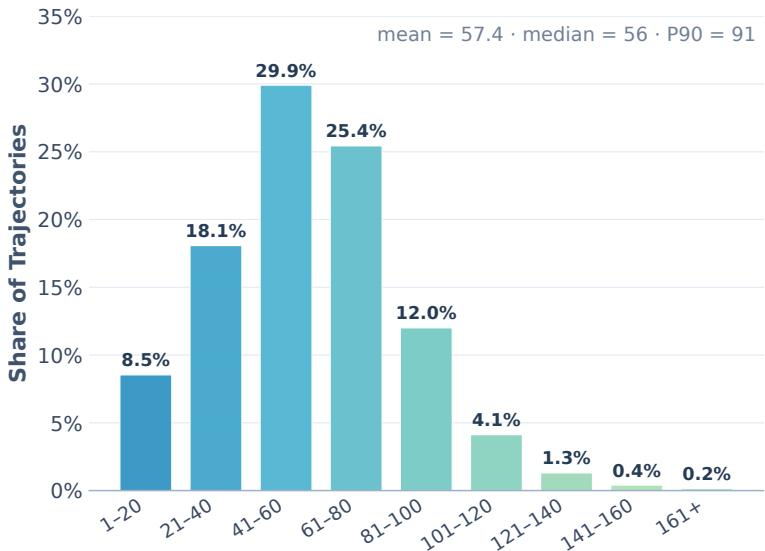  
Interaction Turns per Teacher Trajectory  
Figure 7. Distribution of assistant turns per teacher trajectory in the WorkFactory corpus.

For each selected task, the pairwise judge reads the user request, reference artifacts, and both agents deliverables, without access to the internal construction requirements. A DeepSeek-V4-Flash-0731 baseline deliverable is generated once per task and held fixed across comparisons. A teacher win retains the corresponding rollout. If the initial teacher attempt loses or ties, we allow up to three additional attempts (four teacher attempts in total), stopping at the first win. Each retry starts in a clean sandbox with the same task inputs and generation settings, without access to previous attempts or judge feedback. A task contributes no training episode if none of its attempts wins; that task and its workspace are excluded from the final corpus. Tasks outside the selected subset retain their initial teacher episodes after lightweight filtering.

Sequence preprocessing and supervision. Selected teacher rollouts are converted into training sequences. A task can contribute multiple sequences when its rollout is compacted. Sequences exceeding 262,144 tokens are removed before packing; the remaining sequences form S. The reported corpus and subset sizes count distinct tasks represented by at least one retained sequence rather than the sequences themselves. We use masked autoregressive supervision:

$$
\begin{array} { r l } & { \mathcal { T } _ { \mathrm { S F T } } ( \theta ) = - \frac { 1 } { \displaystyle \sum _ { s \in \cal S } \vert M _ { s } \vert } } \\ & { \quad \cdot \displaystyle \sum _ { s \in \cal S } \displaystyle \sum _ { \ell \in { \cal M } _ { s } } \log \pi _ { \theta } ( a _ { s , \ell } \mid H _ { s , < \ell } ) , } \end{array}\tag{2}
$$

where $M _ { s }$ denotes supervised assistant-token positions in sequence �, $a _ { s , \ell }$ the target token, and $H _ { s , < \ell }$ the preceding context within that sequence, including actions and observations. We identify unsuccessful tool calls from execution-failure indicators in their tool results, such as a traceback or a nonzero exit code. Only the token span of each failed tool call is removed from $M _ { s } ;$ reasoning and ordinary text in the same assistant turn remain supervised. The failed call and its tool result remain in the history so that subsequent recovery actions retain their execution context.

Table 9. Probe execution, teacher trajectory generation, and shared WorkPilot training settings.
<table><tr><td>Setting</td><td>Value</td></tr><tr><td colspan="2">Probe execution</td></tr><tr><td>Probe model</td><td>DeepSeek-V4-Flash-0731</td></tr><tr><td>Tool interface</td><td>Claude Code tools</td></tr><tr><td>Context window</td><td>1M tokens</td></tr><tr><td>Context compaction</td><td>Disabled</td></tr><tr><td colspan="2">Teacher trajectory generation</td></tr><tr><td>Teacher model</td><td>GLM-5.3</td></tr><tr><td>Execution harness (tasks)</td><td>GDPval-AA Stirrup (94,077); Claude Code (18,609)</td></tr><tr><td>Tool interface</td><td>GDPval-AA tools (Stirrup); native tools (Claude Code)</td></tr><tr><td>Context window</td><td>256K tokens</td></tr><tr><td>Context compaction</td><td>GDPval-AA mechanism (Stirrup); threshold 0.7 (Claude Code)</td></tr><tr><td>Sampling</td><td>Temperature 1.0; top-p 1.0</td></tr><tr><td colspan="2">Maximum output / turns</td></tr><tr><td>Supervised fine-tuning Base models</td><td>Qwen3.5-4B; Qwen3.6-27B; Qwen3.6-35B-A3B</td></tr><tr><td>Full-corpus training tasks</td><td>112,686</td></tr><tr><td>Parameter updates</td><td>Language model unfrozen; vision and aligner frozen</td></tr><tr><td>Epochs</td><td>4</td></tr><tr><td>Sequence length</td><td>256K tokens</td></tr><tr><td>Global batch size</td><td>32 packed sequences</td></tr><tr><td>Peak learning rate</td><td>3×10−5</td></tr><tr><td>Optimizer</td><td>Distributed;  $\beta _ { 1 } = 0 . 9 , \beta _ { 2 } = 0 . 9 5$ </td></tr><tr><td>Schedule / warmup</td><td>Cosine to  $2 \times 1 0 ^ { - 6 } \ : ,$  10 iterations</td></tr><tr><td>Weight decay / clipping</td><td>0.01 / 1.0</td></tr><tr><td>Precision</td><td>BF16</td></tr><tr><td>Packing</td><td>262,144 tokens; padding-free; overlength rows removed</td></tr></table>

## D.4. Teacher-to-Student Behavior Analysis

For the GLM-5.3 condition, we reuse the Qwen3.6-35B-A3B checkpoint trained on the 30K subset in the scaling study (Figure 5). To construct a task-matched DeepSeek condition, we regenerate trajectories for the same WorkFactory tasks with DeepSeek-V4-Flash-0731 using the Stirrup harness, then train the same base model with the shared supervised fine-tuning configuration. Figure 8 visualizes the teacher-to-student behavior comparison, and Table 10 summarizes the mean trajectory statistics and student Elo estimates with bootstrap 95% confidence intervals.

Students trained on trajectories from either teacher substantially outperform the 879-Elo base model, showing that the gains from WorkFactory training are not exclusive to GLM-5.3 supervision. On the matched training tasks, GLM-5.3 uses more assistant turns and tool calls than DeepSeek-V4-Flash-0731 despite comparable reasoning-token counts. On the shared evaluation tasks, the GLM-trained student likewise uses more assistant turns and tool calls than the DeepSeek-trained student. Figure 8 shows the interaction-length distributions, tool-call composition, and tool-failure rates for both teachers and their students.

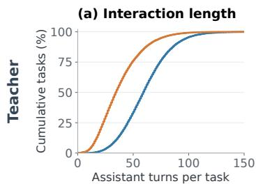

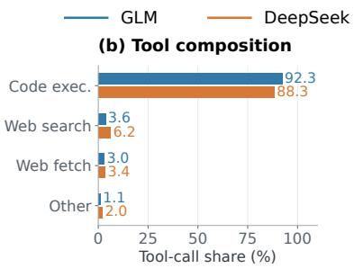

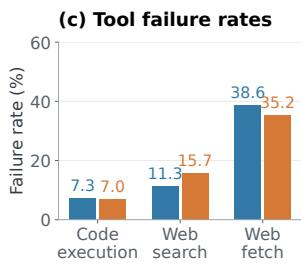

(d) Interaction length  
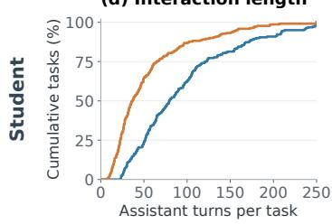

(e) Tool composition  
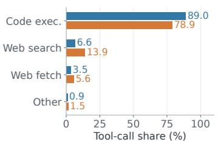

(f) Tool failure rates  
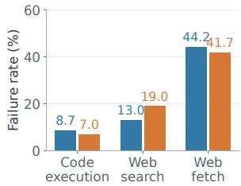  
Figure 8. Teacher and student tool-use behavior. The top row uses teacher trajectories on the matched 30Ktask training subset; the bottom row uses student rollouts on the same 220 GDPval evaluation tasks. $^ { ( \mathbf { a } , \mathbf { d } ) }$ Empirical cumulative distributions of task-level mean assistant turns. ${ ( \mathbf { b } , \mathbf { e } ) }$ Tool-call composition, obtained by summing per-task mean call counts and normalizing across tool types; Other includes remaining tools. $\mathbf { \Gamma } ( \mathbf { c , f } )$ Task-macro failure rates. For student results, the three evaluation rollouts are averaged within each task for turns and call composition; for failure rates, failures and calls from the three rollouts are pooled within a task before averaging rates over tasks invoking that tool. GLM denotes GLM-5.3 in the teacher row and its trained student in the student row; DeepSeek analogously denotes DeepSeek-V4-Flash-0731 and its student.

## E. Evaluation Details

Unless otherwise noted, all locally run evaluations use three independent rollouts for each model–task pair.

Text-only agent evaluation. GLM-5.3, the teacher model, supports text input only. WorkPilot training therefore uses text-only teacher trajectories and updates only the language model, leaving the native vision and alignment components of the Qwen backbones frozen. We evaluate WorkPilot and its matched Qwen base models under the same text-only setting: the harnesses do not pass visual inputs to the task-solving models. This restriction does not apply to evaluation judges, which may inspect rendered documents and native media when assessing the resulting deliverables.

Cross-benchmark interaction lengths. Figure 9 compares the distributions of interaction length for Qwen3.6-35B-A3B and WorkPilot-35B-A3B across the four evaluation benchmarks. WorkPilot executes longer trajectories on all four benchmarks, suggesting that WorkFactory training enables the model to sustain more extended workflows rather than terminating early. This cross-sectional comparison complements Figure 5(b): along the WorkPilot scaling trajectory, interaction length rises sharply at small data scales and then declines with additional training, although the final model still uses more turns than the untrained base model.

## E.1. Two-Anchor Elo Estimation

We estimate a target checkpoint against two fixed anchors, GLM-5.3 (�) and DeepSeek-V4-Flash-0731 (�), and map its fitted Bradley–Terry (BT) utility [6] to the official GDPval-AA v2.1 scale. The official

Table 10. Trajectory and student-behavior statistics for the 30K-task teacher comparison. Student behavioral statistics are task-level means over the same 220 GDPval tasks after averaging three independent evaluation rollouts within each task. All token counts use the Qwen3.6-35B-A3B tokenizer. GLM denotes GLM-5.3; DeepSeek denotes DeepSeek-V4-Flash-0731.
<table><tr><td>Metric GLM source DeepSeek source</td></tr><tr><td>Teacher behavior on the 30K subset</td></tr><tr><td>Mean assistant turns 60.69 37.97</td></tr><tr><td>Mean tool calls 65.76 44.92</td></tr><tr><td>Mean reasoning tokens 48,127 48,368</td></tr><tr><td>Student evaluation on 220 shared tasks</td></tr><tr><td>GDPval-AA Elo 1483 1248</td></tr><tr><td>Bootstrap 95% CI [1455,1510] [1220,1274]</td></tr><tr><td>Mean assistant turns 99.81 53.81</td></tr><tr><td>Mean tool calls 110.40 65.95</td></tr><tr><td>Mean reasoning tokens 79,076 61,723</td></tr></table>

GDPval-AA v2.1 ratings were retrieved on September 26, 2026, using the configuration shown on the leaderboard on that date [4]. The evaluation covers all 220 tasks, spanning nine sectors and 44 occupations. A Gemini 3.1 Pro Preview judge [13] receives the original task instruction and associated reference materials, together with two anonymized submissions for the same task. Artifact evidence includes extracted file text, rendered document images, and native media where applicable. No task-specific rubrics or rubric-derived scores are provided. Instead, the judge assesses each submission against the original task requirements using a shared pairwise evaluation prompt that emphasizes correctness, completeness, usability, professional quality, and faithfulness to the requested deliverables. It returns a preference (A, B, or tie) together with concise, evidence-grounded reasons; Appendix E.2 provides the prompt. The presentation order is balanced, and outcomes are converted to the target model’s perspective: wins, ties, and losses receive credit $y \in \{ 1 , 0 . 5 , 0 \}$

Let $\beta _ { i }$ denote model �’s BT utility. Pairwise win probability is

$$
p _ { i j } = \sigma ( \beta _ { i } - \beta _ { j } ) , \qquad \sigma ( x ) = ( 1 + e ^ { - x } ) ^ { - 1 } .\tag{3}
$$

We freeze $\beta _ { A } = 0$ and $\beta _ { B } = - 1 . 4 6 4 5 3 4 5 5 5 2$ . For target �, let $n _ { a }$ denote the number of valid comparisons against anchor �, and let $w _ { a }$ be the accumulated half-win credit. Writing $q _ { a } ( \beta ) = \sigma ( \beta - \beta _ { a } )$ , we maximize

$$
\begin{array} { l } { \displaystyle \ell _ { m } ( \boldsymbol { \beta } ) = \sum _ { a \in \{ A , B \} } w _ { a } \log q _ { a } ( \boldsymbol { \beta } ) } \\ { \displaystyle + \sum _ { a \in \{ A , B \} } ( n _ { a } - w _ { a } ) \log ( 1 - q _ { a } ( \boldsymbol { \beta } ) ) . } \end{array}\tag{4}
$$

Equivalently, we solve the first-order score equation

$$
\sum _ { a \in \{ A , B \} } n _ { a } \sigma ( \beta - \beta _ { a } ) = \sum _ { a \in \{ A , B \} } w _ { a }\tag{5}
$$

with a bracketed one-dimensional root finder on [−20, 20]. Comparisons with unresolved judge errors are excluded rather than imputed. Retry-successful deliverables are retained; under the strict policy, a completed comparison is replaced by a target-side loss if the target rollout previously exceeded the maximum-turn limit. The permissive sensitivity estimate instead retains the judge’s observed verdict. This override is applied only to the target, not to the fixed anchors.

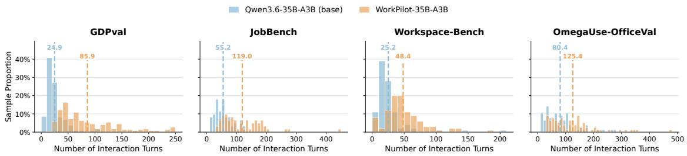  
Figure 9. Distribution of interaction turns for Qwen3.6-35B-A3B and WorkPilot-35B-A3B across four professional-work benchmarks. Histograms show within-model sample proportions; dashed lines and numeric labels denote mean interaction lengths.

We map the fitted utility to v2.1 Elo through three frozen calibration nodes: Qwen3.6-35B-A3B (−4.4666181420, 879), Qwen3.8-27B (−1.4179100010, 1409), and GLM-5.3 (0, 1646). We use linear interpolation between adjacent nodes and nearest-segment extrapolation outside their range. The transformation is monotone and therefore preserves the ordering of fitted utilities.

For WorkPilot-35B-A3B, we obtain $\widehat { \beta } = - 0 . 4 8 6 7 3 7$ , which maps to 1564.64 Elo and is reported as 1565. Strict and permissive estimates coincide because no comparison receives a maximum-turn override. To quantify task-sampling uncertainty, we resample tasks with replacement and retain all comparisons associated with each sampled task. For each of 1,000 bootstrap draws, we refit $\beta$ and apply the frozen calibration. The resulting 95% percentile interval is [1539.20, 1588.65], reported as [1539, 1589]. This interval is conditional on the task population, anchors, judge, and calibration and does not include method-form error.

Table 11 reports the same task-bootstrap uncertainty for all local Elo estimates in Table 2. Point estimates and interval endpoints are rounded to the nearest Elo point.

The wider interval for Qwen3.5-4B reflects weak identification in the lower tail: because both judging anchors are substantially stronger, few target-side wins are available to locate its utility precisely.

Empirical validation. We use seven previously evaluated models that are not calibration knots as a validation set to determine the estimator design and calibration. On this set, the frozen estimator has an MAE of 24.11 Elo, an RMSE of 27.86 Elo, a bias of −4.71 Elo, and a maximum absolute residual of 54.96 Elo. After fixing the complete estimation procedure, we evaluate it on three subsequently available models that were not used to determine the calibration. On this test set, the method achieves an MAE of 19.00 Elo, an RMSE of 22.77 Elo, a bias of +3.89 Elo, and a maximum absolute error of 32.20 Elo. Across both sets, predicted and official Elo are strongly aligned (Pearson $r = 0 . 9 9 4 ;$ Spearman $\rho = 0 . 9 6 4 )$ and nine of ten models lie within ±40 Elo of their official ratings (Figure 10). Removing eight tasks requiring multimodal evidence leaves model ordering unchanged and changes the combined-panel RMSE only from 26.43 to 27.56 Elo. These empirical errors are reported separately from the task-bootstrap interval because they measure different sources of uncertainty.

## E.2. Pairwise Judge Prompt

You are the pairwise evaluator for GDPVal-AA. Determine which blinded submission better   
fulfills the original professional task.   
Evaluate both submissions using all available evidence from the initial task, reference   
files, extracted file text, rendered document images, native media, and submission files.   
Consider correctness, completeness, usability, professional quality, and faithfulness to   
requested deliverables.   
Rules:

Table 11. Task-bootstrap 95% confidence intervals for the locally estimated GDPval-AA v2.1 Elo ratings in Table 2.
<table><tr><td>Model</td><td>Local Elo</td><td>Bootstrap 95% CI</td></tr><tr><td>Nex-N2.5-mini</td><td>1127</td><td>[1085,1163]</td></tr><tr><td>Qwen3.5-4B</td><td>661</td><td>[363,792]</td></tr><tr><td>WorkPilot-4B</td><td>1375</td><td>[1344,1405]</td></tr><tr><td>Qwen3.6-27B</td><td>975</td><td>[900,1038]</td></tr><tr><td>WorkPilot-35B-A3B</td><td>1565</td><td>[1539,1589]</td></tr><tr><td>WorkPilot-27B</td><td>1612</td><td>[1594,1631]</td></tr></table>

1. The identities of the systems are intentionally hidden. Never infer model identity from   
style, filenames, metadata, or self-description, and never favor Submission A or B because of   
its position.   
2. Inspect both submissions independently before comparing them. Missing, empty, corrupt, or   
unusable deliverables are substantive failures.   
3. For factual or pointable claims, rely on evidence actually present in the submitted   
artifacts. A submission's claim that it is correct is not proof.   
4. For visual deliverables, use rendered images as well as extracted text. When visible   
rendering conflicts with extraction, trust the visible artifact.   
5. Use tie only when the submissions are genuinely equivalent overall or the available   
evidence cannot support a defensible preference. Do not use a tie merely because each   
submission has different strengths.   
6. Check all material requirements in the original task, but keep the response concise.   
Return only the most decision-relevant comparisons.   
Return exactly one JSON object containing (i) a winner in {A, B, tie}, (ii) a concise   
evidence-grounded overall explanation, and (iii) at most ten decisive comparisons. Each   
decisive comparison contains the relevant criterion, which submission is better, and a short   
specific evidence pointer for each submission. Return valid JSON without Markdown or   
surrounding text, and do not include model names, guessed identities, Elo ratings, pointwise   
scores, or hidden metadata.

## E.3. GDPval-AA Inference-Cost Accounting

Table 12. Complete pricing assignment for the GDPval-AA cost–performance analysis. Input, cache-read, and output prices are USD per one million tokens, using the October 12, 2026 snapshot.

<table><tr><td>Pricing basis</td><td>OpenRouter endpoint / provider</td><td>Input</td><td>Cache</td><td>Output Models assigned to this basis and mapping rule</td><td></td></tr><tr><td colspan="6">WorkPilot-4B (scaledNex- nex-agi/nex-n2.5-mini;Nex</td></tr><tr><td>N2.5-mini) Nex-N2.5-mini</td><td>AGI nex-agi/nex-n2.5-mini;Nex</td><td>0.025</td><td>0.0025</td><td></td><td>0.10 WorkPilot-35B-A3B, Nex-N2.5-mini, Qwen3.6-35B-A3B, and Apodex-1.1-</td></tr><tr><td></td><td>AGI</td><td></td><td></td><td></td><td>mini; same-size alignment.</td></tr><tr><td>Qwen3.8-27B Qwen3.8-Max-0902</td><td>qwen/qwen3.8-27b;Wafer qwen/qwen3.8-max-0902;Al-</td><td>0.04 2.00</td><td>0.0198 0.25</td><td>2.30</td><td>WorkPilot-27B, Qwen3.8-27B, and Qwen3.6-27B; same-size alignment. 6.00 Qwen3.8-Max; current endpoint used as a version proxy.</td></tr><tr><td></td><td>ibaba Cloud Int.</td><td></td><td></td><td></td><td></td></tr><tr><td>GLM-5.3</td><td>z-ai/glm-5.3;Wafer</td><td>0.07</td><td>0.05</td><td></td><td>4.80 GLM-5.3; direct endpoint. 7.00 GLM-5.2; direct endpoint.</td></tr><tr><td>GLM-5.2 MiniMax-M3</td><td>z-ai/glm-5.2;Wafer minimax/minimax-m3;MiniMax</td><td>0.06 0.30</td><td>0.059 0.06</td><td></td><td>1.20 MiniMax-M3; direct endpoint.</td></tr><tr><td>Claude Opus 4.7</td><td>anthropic/claude-opus-4.7;</td><td>5.00</td><td>0.50</td><td></td><td>25.00 Claude Opus 4.7; direct Ânthropic endpoint.</td></tr><tr><td></td><td>Anthropic</td><td></td><td></td><td></td><td></td></tr><tr><td>Claude Opus 4.8</td><td>anthropic/claude-opus-4.8; Anthropic</td><td>5.00</td><td>0.50</td><td></td><td>25.00 Claude Opus 4.8; direct Anthropic endpoint.</td></tr><tr><td>Kimi-K3 DeepSeek-V4.1-Flash</td><td>moonshotai/kimi-k3;Wafer deepseek/deepseek-v4.1-f</td><td>1.95 0.035</td><td>0.30 0.034</td><td></td><td>30.00 Kimi-K3; direct endpoint. 1.60 DeepSeek-V4.1-Flash; direct endpoint.</td></tr><tr><td></td><td>lash; Wafer deepseek/deepseek-v4-fla</td><td>0.13</td><td></td><td></td><td>0.23 DeepSeek-V4-Flash-0731; direct endpoint.</td></tr><tr><td>DeepSeek-V4-Flash-0731</td><td>sh-0731; Wafer deepseek/deepseek-v4-pro</td><td></td><td>0.12</td><td></td><td></td></tr><tr><td>DeepSeek-V4-Pro-0813</td><td>-0813; Wafer</td><td>0.36</td><td>0.219</td><td></td><td>5.00 DeepSeek-V4-Pro-0813 and DeepSeek-V4-Pro; Preview version aligned to 0813.</td></tr><tr><td>GPT-5.6 Sol Hy3</td><td>openai/gpt-5.6-sol;OpenAI tencent /hy3; Tencent Cloud</td><td>4.00 0.132</td><td>0.40 0.033</td><td></td><td>20.00 GPT-5.6 Sol; direct endpoint.</td></tr><tr><td>Hy4 Preview</td><td>tencent/hy4-preview;Tencent</td><td>0.834</td><td>0.042</td><td></td><td>0.528 HY3; direct endpoint.</td></tr><tr><td></td><td>Cloud</td><td></td><td></td><td></td><td>2.501 HY4 Preview; direct endpoint.</td></tr></table>

We estimate model-inference cost per GDPval-AA task from the input and output tokens recorded in local evaluation logs. For trial � of task �, with input-token count $T _ { \mathrm { i n } } ^ { ( j , r ) }$ , output-token count $T _ { \mathrm { o u t } } ^ { ( j , r ) }$ , cache-hit rate

Two-anchor Elo: validation and test performance  
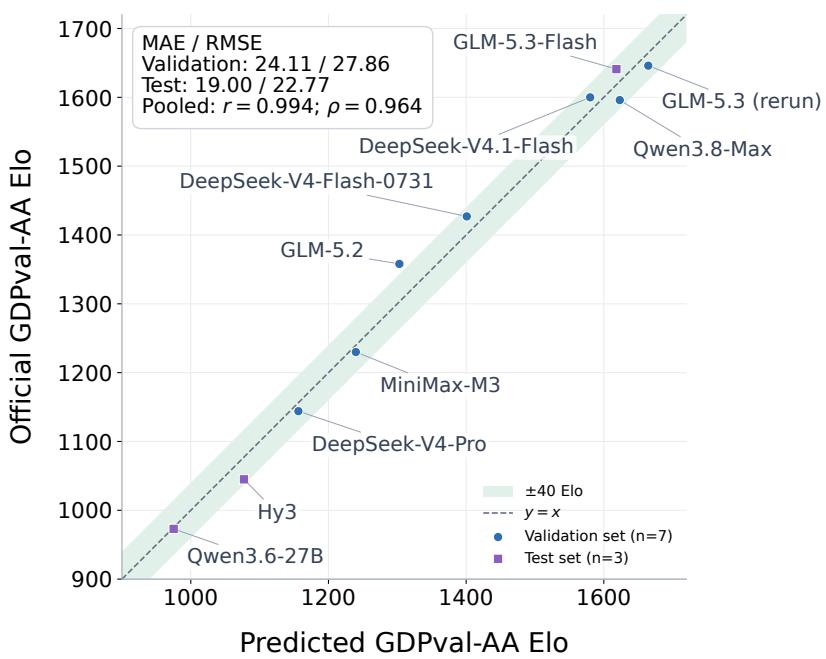  
Figure 10. Predicted versus official GDPval-AA Elo. Blue circles show the seven-model validation set used to determine the estimator design and calibration; purple squares show the three-model test set evaluated after the procedure was frozen. Predicted Elo is on the horizontal axis and official Elo is on the vertical axis. The dashed line denotes equality and the shaded region denotes ±40 Elo. The independently evaluated GLM-5.3 rerun is distinct from the GLM-5.3 calibration node.

ℎ, and prices $P _ { \mathrm { i n } } , P _ { \mathrm { c a c h e } }$ , and $P _ { \mathrm { o u t } }$ in USD per million tokens, we compute

$$
c _ { j , r } = \frac { T _ { \mathrm { i n } } ^ { ( j , r ) } } { 1 0 ^ { 6 } } \big ( ( 1 - h ) P _ { \mathrm { i n } } + h P _ { \mathrm { c a c h e } } \big ) + \frac { T _ { \mathrm { o u t } } ^ { ( j , r ) } } { 1 0 ^ { 6 } } P _ { \mathrm { o u t } } .\tag{6}
$$

For each task, we first average over its completed trials $R _ { j } .$ , and then average equally over the included tasks �:

$$
C _ { \mathrm { t a s k } } = \frac { 1 } { | J | } \sum _ { j \in J } \left( \frac { 1 } { | R _ { j } | } \sum _ { r \in R _ { j } } c _ { j , r } \right) .\tag{7}
$$

We set $h = 0 . 9 9 2$ for all models. Reasoning tokens are already included in output-token totals and are not counted again. Only trials without recorded execution exceptions are included, and tasks with no completed trial are excluded. This two-stage averaging gives each included task equal weight even when the number of completed trials differs. Because cache-write usage is not consistently exposed in the logs, we do not add a separate cache-write charge.

We use provider-specific OpenRouter6 prices recorded on October 12, 2026. Where an evaluated checkpoint lacks a directly matching endpoint, we use an explicit version proxy or a common price for the corresponding model-size class. Table 12 records the complete mapping used for every model in Figure 6; prices are in USD per one million tokens. These values are standardized estimates rather than provider invoices. They exclude judges, verifiers, tool and web-search fees, sandbox compute, storage, and orchestration overhead. Provider prices may also vary by endpoint and over time; same-size alignments intentionally replace model-specific commercial prices so that differences within a class primarily reflect observed token usage.