ArUco detection

In-the-wild Bimanual Collection

# UMI-Live for In-The-Wild Bimanual Robotics Data Collection

Govind Velamoor1,∗ Adrian Lin2,∗ Sam Jung3 Spencer Mateega3 Brandon Y. Yang4,† Amish Sethi5,†,‡

1Yale University 2Carnegie Mellon University 3AfterQuery 4University of Pennsylvania 5Harvard University

Abstract: Universal Manipulation Interface (UMI) devices allow human experts to demonstrate tasks for robot learning without teleoperating physical robots. Using these demonstrations as training data still requires a consistent hardware setup, calibration, and data processing. We present UMI-Live, a full-stack open-source bimanual UMI system for in-the-wild data collection. We design our custom UMI-Live hardware to integrate camera and LiDAR–inertial sensing, onboard compute, and power, without external tracking equipment or calibration within the collection environment. We implement a simple user interface for recording data while an asynchronous pipeline performs parallel SLAM reconstruction and publishes training-ready datasets. We also release software that supports dual-YAM teleoperation and VLA policy training and inference. We validate UMI-Live data quality by fine-tuning $\pi _ { 0 . 5 }$ and MolmoAct2, achieving success rates of 10/10 and 8/10, respectively on a bimanual pick-and-place task. Furthermore, we release 40 hours of UMI-Live data across three tasks, and complete hardware designs, software, and reproduction guides at our project website.

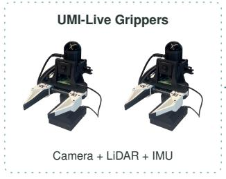

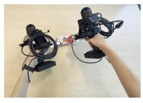

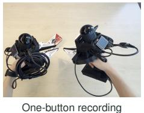

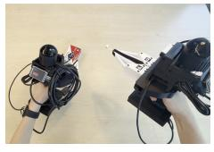

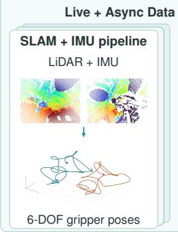

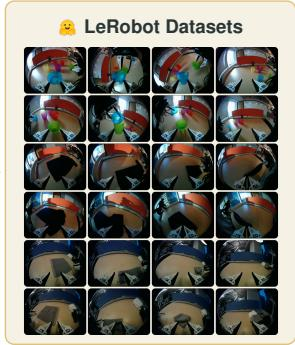

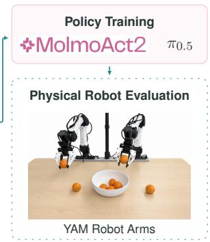  
Figure 1: UMI-Live connects in-the-wild bimanual collection and automated processing to LeRobot datasets, policy training, and physical evaluation on dual i2RT YAM arms.

(c) Rear view

(a) Front view  
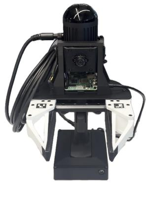

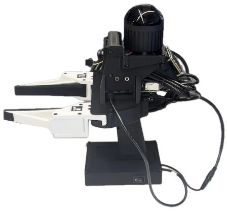  
(b) Side view

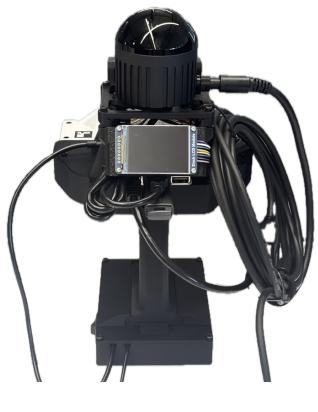  
Figure 2: Assembled UMI-Live hardware. (a) Front view showing the wrist camera and ArUco tags. (b) Side view showing the operator-facing buttons and battery module. (c) Rear view showing the LCD and cable routing.

## 1 Introduction

Much of the recent progress in robot manipulation has come from imitation learning, in which policies learn manipulation behaviors from human demonstrations, increasingly drawn from large and diverse datasets. Diffusion policies [1] and vision-language-action (VLA) models such as RT-2, OpenVLA, $\pi _ { 0 } , \ \pi _ { 0 . 5 } ,$ , and GR00T N1 [2, 3, 4, 5, 6] are all trained this way. More recently, world-action models (WAMs) jointly predict future visual observations and robot actions [7, 8, 9], which allows them to build on large-scale video pretraining. Video alone, however, carries no robot action labels, so WAMs still learn to act from action-labeled demonstrations. These methods allow robots to perform tasks ranging from pick-and-place to dexterous manipulation, including towel and shirt folding [4]. Learning these skills in new environments still depends on expert demonstrations covering the relevant objects and interactions. Collecting high-quality demonstrations across diverse environments therefore continues to be a key challenge in robot learning.

Action-labeled demonstrations are commonly collected by teleoperating physical robots. Large collection efforts such as DROID and ABC-130K show the value of collecting demonstrations across operators, tasks, and environments [10, 11]. Because each collection site must host the robot along with its control, perception, and safety infrastructure, expanding to new environments requires transporting this equipment or maintaining additional robot stations. The Universal Manipulation Interface (UMI) removes this requirement by letting experts demonstrate tasks with handheld grippers instead of robots [12]. UMI showed that policies trained on wrist observations and reconstructed gripper trajectories from in-the-wild demonstrations can perform challenging tasks, including bi manual ones.

Subsequent UMI systems have explored different sensing, tracking, and gripper designs. However, reproducing these systems requires clear instructions for building and calibrating the hardware, together with software for processing the recordings. Some UMI configurations use stationary tracking rigs or backpack-mounted computers, which add equipment to set up or carry [13, 14]. Bulky gripper designs can also make dexterous manipulation of small objects difficult [13]. Furthermore, each recording must be reconstructed and converted into a training-ready dataset. Manually managing these steps becomes tedious, and we believe that operators should be able to start the next demonstration while the software prepares completed recordings for training and physical robot evaluation.

We present UMI-Live, a complete hardware and software system for in-the-wild bimanual collection and robot learning. Each UMI-Live gripper integrates camera and LiDAR–inertial sensing, onboard compute and storage, and removable power. An operator can continue recording data with the press of a single button, while an asynchronous pipeline transfers completed recordings and performs parallel reconstruction, gripper position and jaw opening estimation, validation, and dataset preparation. We also provide software for dual-YAM teleoperation, policy training, and inference. We release approximately 40 hours of demonstrations across three tasks and evaluate policies fine-tuned on mixtures containing mostly UMI demonstrations. The handheld demonstrations are collected at a different location and under different lighting conditions from those used for robot evaluation, while the smaller teleoperation component provides demonstrations from the target robot and scene.

We make the following contributions.

1. Reproducible bimanual hardware for in-the-wild collection. We present self-contained handheld grippers with integrated sensing, compute, storage, power, and operator controls, together with hardware designs and construction and calibration guides for reproducing the system.

2. Complete software integration from recording to robot deployment. We provide software for coordinated recording, asynchronous transfer, parallel and batched processing, LeRobot dataset preparation, dual-YAM teleoperation, and policy training and inference. Operators can continue collecting while completed demonstrations are processed.

3. A public bimanual dataset and physical robot validation. We release approximately 40 hours of demonstrations across three manipulation tasks and evaluate two VLA policies through physical rollouts. Following mixed-data fine-tuning, π0.5 succeeds in up to 10/10 trials and MolmoAct2 succeeds in 8/10 trials compared with 0/10 for its released checkpoint.

## 2 Related Work

Robot demonstration collection. Teleoperation records observations and actions directly on the target embodiment. BridgeData V2, DROID, RoboMIND, ALOHA Unleashed, and ABC-130K illustrate the breadth of manipulation data that can be collected through physical robot operation [15, 10, 16, 17, 11]. These efforts cover different tasks, environments, and embodiments, but require a robot for demonstration capture. UMI-Live supports handheld collection independently of robot operation and provides a separate teleoperation configuration for obtaining complementary demonstrations on the target embodiment.

Handheld UMI systems. The original UMI combines a handheld gripper, wrist video, gripperstate sensing, and visual–inertial trajectory reconstruction to support robot learning from portable demonstrations [12]. FastUMI develops the hardware, tracking, and collection tools for broader deployment [18]. UMI-3D introduces LiDAR-centered reconstruction and an integrated acquisition, calibration, training, and deployment pipeline, with a reported single-arm configuration [19]. UMI-Live uses two independently instrumented LiDAR–inertial devices as one coordinated bimanua collection system.

Other systems make different choices about sensing and interaction. YUBI emphasizes fingeraligned operation and bimanual dexterity, with stationary and portable collection configurations [13]. ActiveUMI combines a VR headset with a backpack-mounted computer to record active egocentric perception [14]. HiFi-UMI uses head-mounted stereo–inertial sensing, hardware synchronization, and direct relative-pose estimation to improve bimanual trajectory fidelity [20]. UMI-Live place sensing, compute, storage, power, and recording controls on the handheld devices and connects their outputs to an automated processing system and a dual-YAM learning workflow.

Collection and robot-learning software. LeRobot provides shared dataset representations and tools for policy training, evaluation, and inference [21]. RoboPocket connects portable collection to remote policy feedback and asynchronous fine-tuning [22], and ABC provides open infrastructure spanning collection, training, and evaluation [11]. UMI-Live combines bimanual LiDAR–inertial recording, asynchronous reconstruction and LeRobot dataset publication, and dual-YAM teleopera tion, policy training, and inference in a reproducible setup.

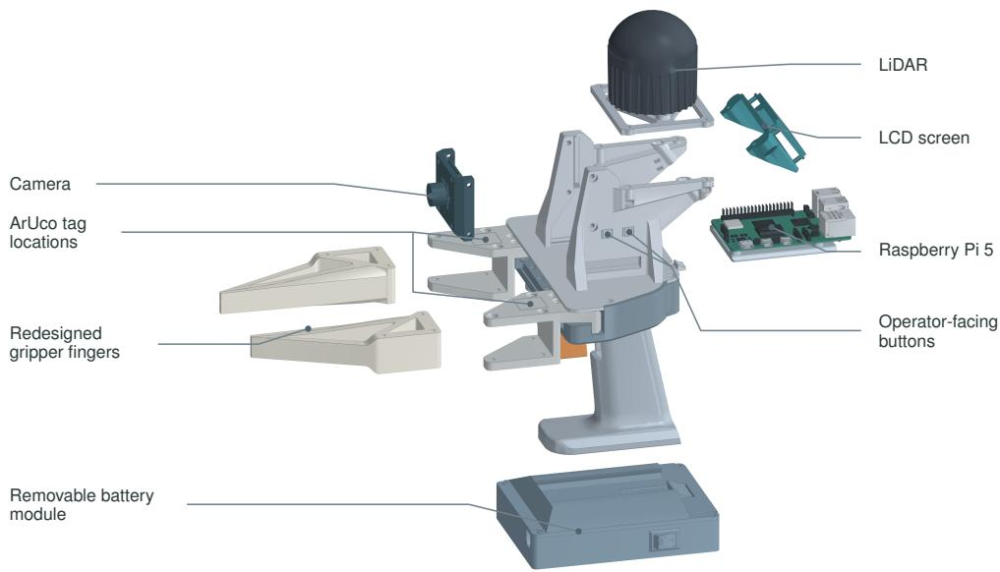  
Figure 3: Exploded CAD view of one UMI-Live unit with its main components labeled.

## 3 System Design

Figure 1 shows how UMI-Live connects in-the-wild bimanual collection to automated processing, LeRobot datasets, and physical robot learning. We first describe the handheld hardware, including the gripper mechanism, sensing, and power design (Section 3.1), followed by recording, trajectory reconstruction, dataset export, and parallel processing (Section 3.3). We then evaluate policies trained on the collected demonstrations (Section 4).

## 3.1 Hardware Design

Design objectives. UMI-Live hardware consists of two handheld grippers with onboard sensing, compute, and storage for bimanual data collection. Our design focuses on modularity, usability, and user-friendliness. Figure 2 shows the assembled unit from the front, side, and rear, and Figure 3 shows its main components. Appendix A provides additional hardware details.

Gripper mechanism. We improve the original UMI gripper mechanism [12] by using bearingsupported trigger and gear pivots for smoother actuation and reduced backlash. Squeezing the trigger rotates two sector gears that engage racks on the finger mounts (Figure 9a,b). The mounts travel along a linear guide to produce opposing parallel-jaw motion. To achieve smoother gripper motion, we apply adhesive tape as shown in Figure 9. We also place ArUco tags [23] on the moving finger mounts to measure the jaw opening.

Gripper finger design. We redesign the UMI gripper finger to adapt to more tasks that involve dexterous manipulation with smaller objects. We print the gripper fingers with a rigid PLA+ base and a thin TPU contact layer (Figure 4). The rigid base resists bending under grasping loads and it supports force application and precision contact with small objects such as screws. The TPU layer provides compliance at the contact surface, which helps the fingers conform to different object shapes. We demonstrate the capabilities of the redesigned grippers through human-operated

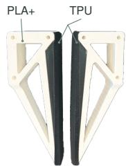  
(a) Gripper fingers

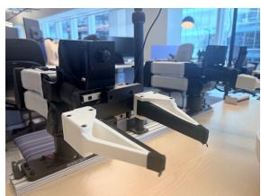  
(b) Mounted on YAM  
Figure 4: Redesigned gripper fingers and their installation on a YAM arm.  
tasks involving small-object grasping and insertion, match lighting, and shirt folding in Appendix B.

Sensing and electronics. Each gripper carries a RoboSense Airy LiDAR with an integrated $\mathrm { I M U ^ { 4 } }$ a global-shutter wide-angle USB camera5, and a Raspberry Pi 5 (Figures 3 and 9d). The camera records wrist views at 800 × 600 pixels and 30 fps. We choose to use an ultrawide camera to capture the workspace and relevant global context as we do not use an overhead top camera.

Power. We use a removable battery module that clips to the base of each handle (Figure 9c). The module houses the battery, power switch, and DC-DC converter, which supplies 5 V USB-C power to the Raspberry Pi and 12 V to the RoboSense Airy LiDAR.

<table><tr><td>Specification</td><td>Value</td></tr><tr><td>Mass per unit with battery</td><td>1.42 kg</td></tr><tr><td>Gripper width Runtime per charge</td><td>80 mm 1.5 h</td></tr><tr><td>Hardware cost per pair</td><td>$1,930</td></tr></table>

In-the-wild operation. Operators start and stop recording on both grippers with a single button, and the LCD shows recording and transfer status. Operators can collect in the wild without a robot, tripodmounted cameras, external tracking equipment, or en-

Table 1: Hardware specifications of the evaluated revision.

vironment specific calibration. Table 1 lists the main specifications.

## 3.2 Operator Interface and Recording

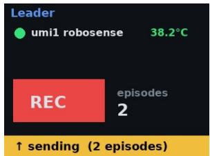  
Figure 5: LCD interface with example values.

The operator starts and stops recording on both grippers with a single button. The LCD shows recording status and transfer progress (Figure 5).

For episode e, each gripper $i \in \{ L , R \}$ stores timestamped wrist video and raw LiDAR and IMU packets locally on its Raspberry Pi as $\mathcal { R } _ { i } ^ { ( e ) }$ Together, the two recordings form $\mathcal { R } ^ { ( e ) } = ( \mathcal { R } _ { L } ^ { ( e ) } , \mathcal { R } _ { R } ^ { ( e ) } )$ . Completed recordings are transferred to the server and processed asynchronously, which allows the operator to continue collecting demonstrations.

## 3.3 Automated Data Processing

Once the completed recordings reach the server, they enter the processing pipeline shown in Figure 6. The server validates synchronization, estimates TCP trajectories and gripper openings, and combines these measurements with wrist images into episodes ready for training.

Synchronization and time correction. The server first checks the synchronization evidence saved during recording and excludes episodes with unacceptable sensor synchronization or an estimated cross-device offset above 5 ms. During recording, Chrony synchronizes the Raspberry Pi clocks, and $\mathrm { g P T P }$ synchronizes each Airy sensor with its connected Pi. Camera exposure timestamps are mapped from the Pi’s monotonic clock to host time. The server then derives an affine mapping between embedded LiDAR timestamps and Pi-side packet-arrival timestamps. The corrected timestamps are used when reconstructed poses are aligned with camera observations.

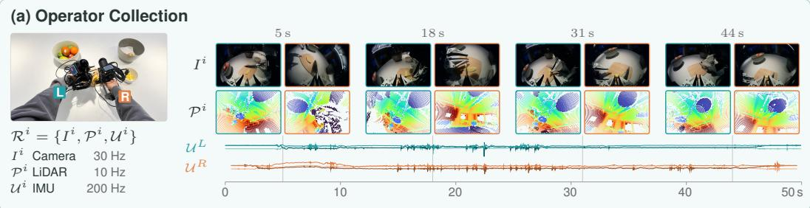

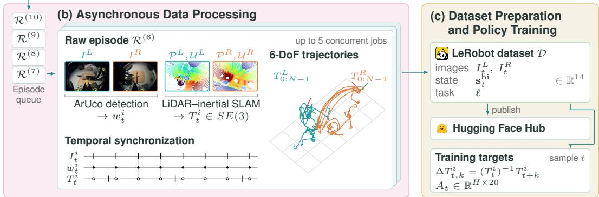  
Figure 6: Data collection and processing in UMI-Live. (a) Each gripper $i \in \{ L , R \}$ records wrist images $I ^ { i } ,$ LiDAR data ${ \mathcal { P } } ^ { i }$ , and IMU data $\mathcal { U } ^ { i }$ . (b) Raw episodes $\mathcal { R } ^ { ( e ) }$ are processed in parallel to estimate jaw widths $w _ { t } ^ { i } ,$ , reconstruct poses $T _ { t } ^ { i } .$ , and align the streams. (c) We assemble demonstration trajectories $\tau ^ { \left( e \right) }$ with wrist images, 14-dimensional bimanual states, and task instructions into dataset D. Training samples use observations $o _ { t } = ( I _ { t } ^ { L } , I _ { t } ^ { R } , g _ { t } ^ { L } , g _ { t } ^ { R } , \ell )$ and query-relative action chunks $A _ { t } \in \mathbb { R } ^ { H \times 2 \overline { { 0 } } }$ , as defined in Appendices E and F.

Pose and gripper estimation. The server decodes each device’s LiDAR and IMU packets and runs GLIM [24] independently for the two grippers. The tool center point (TCP) is defined at the center of the gripper tips. A fixed sensor-to-TCP offset converts the reconstructed LiDAR body motion into a TCP trajectory. Appendix G.2 specifies the corresponding TCP frame and flange-to-TCP transform used on the YAM arms.

Jaw opening is estimated from the two ArUco tags attached to each gripper’s moving finger mounts. The server unprojects tag centers through the calibrated fisheye model and combines their angular separation with the fixed camera-to-tag geometry to estimate physical width. Missing detections are interpolated between valid measurements. Calibrated closed and open endpoints map these widths to normalized gripper values.

Temporal alignment and dataset assembly. The leader camera defines the episode timeline. We interpolate reconstructed positions linearly and rotations through quaternion spherical interpolation at these frame times. The follower video contributes the latest available frame at or before each corresponding time, and gripper openings are interpolated onto the same timeline.

Each hand’s TCP pose is expressed relative to its own fixed episode-start pose. At timestep $t ,$ its state is

$$
\mathbf { s } _ { t } ^ { i } = [ \mathbf { p } _ { t } ^ { i } ; \boldsymbol { \phi } _ { t } ^ { i } ; g _ { t } ^ { i } ] \in \mathbb { R } ^ { 7 } ,
$$

where $\mathbf { p } _ { t } ^ { i }$ is position in meters, $\boldsymbol { \phi } _ { t } ^ { i }$ is a rotation vector in radians, and $g _ { t } ^ { i } \in [ 0 , 1 ]$ is normalized gripper opening. The bimanual state is

$$
\mathbf { s } _ { t } ^ { \mathrm { { b i } } } = [ \mathbf { s } _ { t } ^ { L } ; \mathbf { s } _ { t } ^ { R } ] \in \mathbb { R } ^ { 1 4 } .
$$

An episode with N frames and task instruction ℓ becomes

$$
\mathcal { T } = \left[ \left( I _ { t } ^ { L } , I _ { t } ^ { R } , \mathbf { s } _ { t } ^ { \mathrm { b i } } , \boldsymbol { \ell } \right) \right] _ { t = 0 } ^ { N - 1 } .
$$

We collect these trajectories into $\mathcal { D } = \{ \mathcal { T } ^ { ( e ) } \} _ { e = 1 } ^ { M }$ , where M is the number of episodes.

The software checks stream integrity, synchronization evidence, required pose and gripper measurements, frame counts, and dataset consistency before accepting an episode. Finalized episodes are stored in LeRobot format. For cloud publication, the software synchronizes the dataset and raw-episode archive with Hugging Face. The software retains the local dataset if publication fails.

Parallel execution. Processing follows a dependency graph across hands and episodes. LiDAR decoding, SLAM, and gripper estimation execute concurrently when their inputs are available. Dataset assembly waits for the required outputs and uses a serialized writer. The software tracks completed stages so interrupted processing can resume from available outputs.

## 3.4 Policy Training and Deployment

We fine-tune $\pi _ { 0 . 5 }$ and MolmoAct2 on UMI and robot teleoperation demonstrations using the same observation and action representation. The policies take two wrist images, gripper openings, and a task instruction as input. They predict action chunks containing query-relative TCP poses and absolute gripper openings. Appendix F describes the representation, training objective, and settings.

During deployment, a remote policy server returns action chunks to the local dual-YAM client, which converts them into joint and gripper commands and coordinates the two arms. Appendix G describes inference and the kinematic model.

## 4 Experimental Results

We evaluate whether demonstrations collected with UMI-Live support bimanual policy learning and physical robot execution. Our evaluation uses an orange-to-bowl task on dual YAM arms. We fine-tune $\pi _ { 0 . 5 }$ [5] and MolmoAct2 [25] using mixtures containing mostly UMI demonstrations and compare the fine-tuned MolmoAct2 policy with its released checkpoint.

## 4.1 Experimental Setup

In our task, the robot must pick up six oranges from a table and place them in a bowl (Figure 7b). Each trial starts from a fixed robot configuration, with randomized orange and bowl positions. A trial succeeds if all six oranges are placed in the bowl and fails if any remain outside the bowl when the trial ends. We allow grasp retries and recovery of dropped oranges. We conduct ten trials for each evaluated condition.

The UMI demonstrations were collected at a different location and under different lighting from the robot evaluation (Figure 7a). Robot teleoperation demonstrations were collected in the evaluation scene using the setup described in Appendix D. The experiments therefore evaluate learning from handheld demonstrations supplemented with robot data from the target environment.

During policy execution, the robot supplies two ultrawide wrist-camera images, the current gripper openings, and a task instruction. TCP poses and joint angles are omitted from the policy inputs. The policies predict bimanual action chunks containing relative TCP poses and absolute gripper openings. The execution controller maps these predictions to robot joint and gripper commands, as described in Appendix G.

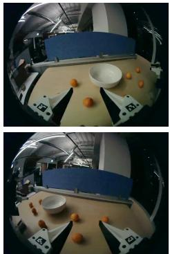

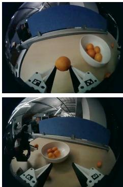  
(a) Handheld UMI collection

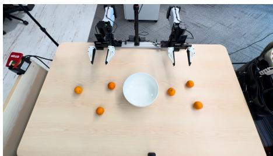  
(b) Robot evaluation setup

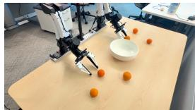

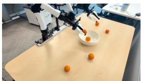

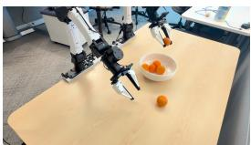  
(c) Autonomous $\pi _ { 0 . 5 }$ rollout

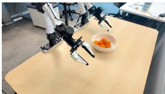  
Figure 7: Handheld collection and physical robot evaluation. (a) Wrist-camera views at two moments in a UMI demonstration collected at a different location and under different lighting from the robot evaluation, brightened for display. (b) Dual i2RT YAM arms with UMI-Live gripper fingers, six oranges, and a bowl. (c) Selected frames from one autonomous $\pi _ { 0 . 5 }$ rollout that ends with all six oranges in the bowl. Frames are ordered from left to right. Appendix C, Figure 13, shows the full sequence.

## 4.2 Training Conditions

The training sources contain 296 UMI demonstrations and 75 robot teleoperation demonstrations of the orange-to-bowl task. These counts describe the training pool for this task, while the full approximately 40-hour dataset release spans three manipulation tasks.

We evaluate $\pi _ { 0 . 5 }$ with UMI/teleoperation data splits of 95%/5% and 90%/10%, and MolmoAct2 with a split of 75%/25%. Each split specifies the UMI and robot teleoperation shares of the finetuning data, which sum to 100%. Both sources are converted to the common observation and queryrelative action representation described in Appendix F.2.

We initialize each $\pi _ { 0 . 5 }$ run independently from its released base checkpoint and MolmoAct2 from the released MolmoAct2-BimanualYAM checkpoint. We update all $\pi _ { 0 . 5 }$ parameters. For MolmoAct2, we train LoRA [26] adapters in the vision-language backbone and the full action expert and keep the remaining backbone parameters frozen. We evaluate the final checkpoint from each run and use one training seed per condition. Appendix F.3 and Tables 3 and 4 provide the remaining hyperparameters.

As a baseline, we evaluate the released MolmoAct2-BimanualYAM checkpoint without additional training on our demonstrations.

## 4.3 Results

Table 2 reports the results. $\pi _ { 0 . 5 }$ succeeds in nine of ten trials with the 95/5 mixture and all ten trials with the 90/10 mixture. MolmoAct2 succeeds in eight of ten trials after fine-tuning with the 75/25 mixture, compared with zero successful trials for its released checkpoint. Figure 7c shows selected frames from one autonomous $\pi _ { 0 . 5 }$ execution. The full sequence appears in Appendix C, Figure 13.

<table><tr><td>Policy</td><td>Training condition</td><td>UMI / teleoperation</td><td>Successful trials</td></tr><tr><td>MolmoAct2</td><td>Released checkpoint</td><td></td><td>0/10</td></tr><tr><td>π0.5</td><td>Fine-tuned</td><td>95% / 5%</td><td>9/10</td></tr><tr><td>π0.5</td><td>Fine-tuned</td><td>90% / 10%</td><td>10/10</td></tr><tr><td>MolmoAct2</td><td>Fine-tuned</td><td>75% / 25%</td><td>8/10</td></tr></table>

Table 2: Physical orange-to-bowl evaluation on dual i2RT YAM arms. Every fine-tuned condition starts from its released checkpoint and receives 12,000 updates with a global batch size of 32. Success requires placing all six oranges in the bowl.

These results demonstrate successful physical execution after fine-tuning on mixtures containing mostly UMI-Live demonstrations. The handheld demonstrations were collected outside the evaluation environment, while the smaller teleoperation component supplies observations and motions from the target robot and scene. The evaluation covers one task and one training seed per condition.

## 5 Released Dataset

We release 3,255 bimanual episodes comprising approximately 39.7 hours at 30 Hz. The release covers orange placement, water pouring, and towel folding, with synchronized wrist videos, bimanual pose and gripper states, and task instructions. The complete dataset is available on Hugging Face.

Each hand uses a fixed episode-start reference, and we provide source provenance in the release. The standardized action field stores the same-frame state. Training loaders select future frames and derive the query-relative targets described in Appendix F.

## 6 Discussion and Limitations

UMI-Live spans handheld collection, automatic data preparation, and robot execution, and enables operators to continue collecting while completed recordings are simultaneously processed. However, UMI-Live devices still require one-time camera and gripper calibration. Additionally, the quality of LiDAR–inertial reconstruction depends on scene geometry and motion. Integrating sensing, compute, storage, and power increases mass to 1.42 kg per unit. Our robot evaluation covers one task, ten trials per condition, and one training seed per condition, using mixtures of UMI and teleoperation data. Without UMI-only and teleoperation-only comparisons, we do not isolate the contribution of either source. Further evaluation should measure trajectory accuracy, processing latency and throughput, operator efficiency during extended collection, and policy performance across more tasks, training seeds, and data mixtures.

## 7 Conclusion

We present UMI-Live, a bimanual collection and robot-learning system that combines self-contained handheld hardware with automated data preparation and dual-YAM software integration. Operators control recording through a single interface while completed episodes undergo parallel processing. The resulting demonstrations connect to policy training and physical deployment through a common task-space representation.

We release approximately 40 hours of demonstrations across three tasks. Physical experiments show successful orange-to-bowl execution after fine-tuning $\pi _ { 0 . 5 }$ and MolmoAct2 on mixtures containing mostly UMI-Live demonstrations. Altogether, our hardware, software, dataset, and robot evaluation compose a reproducible system spanning from handheld demonstration to physical robot learning.

## Use of Generative AI

The authors used LLMs to help with coding implementation and as a writing and editing aid for this manuscript. The authors take full responsibility for its content.

## Acknowledgments

This material is based upon work supported by the U.S. National Science Foundation Graduate Research Fellowship Program under Grant No. DGE-2630152. Any opinions, findings, and conclusions or recommendations expressed in this material are those of the author(s) and do not necessarily reflect the views of the National Science Foundation. This work received no other third-party funding. The authors declare no competing interests.

## References

[1] C. Chi, S. Feng, Y. Du, Z. Xu, E. Cousineau, B. Burchfiel, and S. Song. Diffusion policy: Visuomotor policy learning via action diffusion. In Robotics: Science and Systems (RSS), 2023. doi:10.15607/RSS.2023.XIX.026.

[2] A. Brohan, N. Brown, J. Carbajal, Y. Chebotar, X. Chen, K. Choromanski, T. Ding, D. Driess, A. Dubey, C. Finn, P. Florence, C. Fu, M. G. Arenas, K. Gopalakrishnan, K. Han, K. Hausman, A. Herzog, J. Hsu, B. Ichter, A. Irpan, N. Joshi, R. Julian, D. Kalashnikov, Y. Kuang, I. Leal, L. Lee, T.-W. E. Lee, S. Levine, Y. Lu, H. Michalewski, I. Mordatch, K. Pertsch, K. Rao, K. Reymann, M. Ryoo, G. Salazar, P. Sanketi, P. Sermanet, J. Singh, A. Singh, R. Soricut, H. Tran, V. Vanhoucke, Q. Vuong, A. Wahid, S. Welker, P. Wohlhart, J. Wu, F. Xia, T. Xiao, P. Xu, S. Xu, T. Yu, and B. Zitkovich. RT-2: Vision-language-action models transfer web knowledge to robotic control, 2023. URL https://arxiv.org/abs/2307.15818.

[3] M. J. Kim, K. Pertsch, S. Karamcheti, T. Xiao, A. Balakrishna, S. Nair, R. Rafailov, E. Foster, G. Lam, P. Sanketi, Q. Vuong, T. Kollar, B. Burchfiel, R. Tedrake, D. Sadigh, S. Levine, P. Liang, and C. Finn. OpenVLA: An open-source vision-language-action model, 2024. URL https://arxiv.org/abs/2406.09246.

[4] K. Black, N. Brown, D. Driess, A. Esmail, M. R. Equi, C. Finn, N. Fusai, L. Groom, K. Hausman, B. Ichter, S. Jakubczak, T. Jones, L. Ke, S. Levine, A. Li-Bell, M. Mothukuri, S. Nair, K. Pertsch, L. X. Shi, L. Smith, J. Tanner, Q. Vuong, A. Walling, H. Wang, and U. Zhilinsky. π : A vision-language-action flow model for general robot control. In Robotics: Science and Systems (RSS), 2025. doi:10.15607/RSS.2025.XXI.010.

[5] K. Black, N. Brown, J. Darpinian, K. Dhabalia, D. Driess, A. Esmail, M. R. Equi, C. Finn, N. Fusai, M. Y. Galliker, et al. π0.5: A vision-language-action model with open-world generalization. In Conference on Robot Learning (CoRL), 2025. URL https://proceedings. mlr.press/v305/black25a.html.

[6] NVIDIA, J. Bjorck, F. Castaneda, N. Cherniadev, X. Da, R. Ding, L. J. Fan, Y. Fang, D. Fox,˜ F. Hu, S. Huang, J. Jang, Z. Jiang, J. Kautz, K. Kundalia, L. Lao, Z. Li, Z. Lin, K. Lin, G. Liu, E. Llontop, L. Magne, A. Mandlekar, A. Narayan, S. Nasiriany, S. Reed, Y. L. Tan, G. Wang, Z. Wang, J. Wang, Q. Wang, J. Xiang, Y. Xie, Y. Xu, Z. Xu, S. Ye, Z. Yu, A. Zhang, H. Zhang, Y. Zhao, R. Zheng, and Y. Zhu. GR00T N1: An open foundation model for generalist humanoid robots, 2025. URL https://arxiv.org/abs/2503.14734.

[7] C. Zhu, R. Yu, S. Feng, B. Burchfiel, P. Shah, and A. Gupta. Unified world models: Coupling video and action diffusion for pretraining on large robotic datasets. In Robotics: Science and Systems (RSS), 2025. doi:10.15607/RSS.2025.XXI.015.

[8] M. J. Kim, Y. Gao, T.-Y. Lin, Y.-C. Lin, Y. Ge, G. Lam, P. Liang, S. Song, M.-Y. Liu, C. Finn, and J. Gu. Cosmos policy: Fine-tuning video models for visuomotor control and planning, 2026. URL https://arxiv.org/abs/2601.16163.

[9] S. Ye, Y. Ge, K. Zheng, S. Gao, S. Yu, G. Kurian, S. Indupuru, Y. L. Tan, C. Zhu, J. Xiang, A. Malik, K. Lee, W. Liang, N. Ranawaka, J. Gu, Y. Xu, G. Wang, F. Hu, A. Narayan, J. Bjorck, J. Wang, G. Kim, D. Niu, R. Zheng, Y. Xie, J. Wu, Q. Wang, R. Julian, D. Xu, Y. Du, Y. Chebotar, S. Reed, J. Kautz, Y. Zhu, L. J. Fan, and J. Jang. World action models are zero-shot policies, 2026. URL https://arxiv.org/abs/2602.15922.

[10] A. Khazatsky, K. Pertsch, S. Nair, A. Balakrishna, S. Dasari, S. Karamcheti, S. Nasiriany, M. K. Srirama, L. Y. Chen, K. Ellis, P. D. Fagan, J. Hejna, M. Itkina, M. Lepert, Y. J. Ma, P. T. Miller, J. Wu, S. Belkhale, S. Dass, H. Ha, A. Jain, A. Lee, Y. Lee, M. Memmel, S. Park, I. Radosavovic, K. Wang, A. Zhan, K. Black, C. Chi, K. B. Hatch, S. Lin, J. Lu, J. Mercat, A. Rehman, P. R. Sanketi, A. Sharma, C. Simpson, Q. Vuong, H. R. Walke, B. Wulfe, T. Xiao, J. H. Yang, A. Yavary, T. Z. Zhao, C. Agia, R. Baijal, M. G. Castro, D. Chen, Q. Chen, T. Chung, J. Drake, E. P. Foster, J. Gao, V. Guizilini, D. A. Herrera, M. Heo, K. Hsu, J. Hu, M. Z. Irshad, D. Jackson, C. Le, Y. Li, K. Lin, R. Lin, Z. Ma, A. Maddukuri, S. Mirchandani, D. Morton, T. Nguyen, A. O’Neill, R. Scalise, D. Seale, V. Son, S. Tian, E. Tran, A. E. Wang, Y. Wu, A. Xie, J. Yang, P. Yin, Y. Zhang, O. Bastani, G. Berseth, J. Bohg, K. Goldberg, A. Gupta, A. Gupta, D. Jayaraman, J. J. Lim, J. Malik, R. Mart´ın-Mart´ın, S. Ramamoorthy, D. Sadigh, S. Song, J. Wu, M. C. Yip, Y. Zhu, T. Kollar, S. Levine, and C. Finn. DROID: A large-scale in-the-wild robot manipulation dataset, 2025. URL https://arxiv.org/abs/ 2403.12945.

[11] A. Allshire, H. G. Singh, R. Singh, A. Rashid, H. Choi, D. McAllister, J. Yu, Y. Chen, H. Huang, P. Abbeel, X. Chen, R. Duan, P. Isola, J. Malik, F. Shentu, G. Shi, P. Wu, and A. Kanazawa. Scalable behavior cloning with open data, training, and evaluation, 2026. URL https://arxiv.org/abs/2606.27375.

[12] C. Chi, Z. Xu, C. Pan, E. Cousineau, B. Burchfiel, S. Feng, R. Tedrake, and S. Song. Universal manipulation interface: In-the-wild robot teaching without in-the-wild robots. In Robotics: Science and Systems (RSS), 2024. doi:10.15607/RSS.2024.XX.045.

[13] T. Ohkawa, J. Arima, Y. Noguchi, M. Tateno, M. Sugiura, T. Okubo, K. Ikeuchi, Y. Shin, H. Nishizawa, N. Kanazawa, Y. Wakayama, D. Fukunaga, K. Makihara, T. Motoda, F. Erich, Y. Domae, T. Matsushima, Y. Okumatsu, and K. Ota. YUBI: Yielding universal bidigital interface for bimanual dexterous manipulation at scale, 2026. URL https://arxiv.org/ abs/2606.10244.

[14] Q. Zeng, C. Li, J. St. John, Z. Zhou, J. Wen, G. Feng, Y. Zhu, and Y. Xu. ActiveUMI: Robotic manipulation with active perception from robot-free human demonstrations, 2025. URL https://arxiv.org/abs/2510.01607.

[15] H. R. Walke, K. Black, T. Z. Zhao, Q. Vuong, C. Zheng, P. Hansen-Estruch, A. W. He, V. Myers, M. J. Kim, M. Du, A. Lee, K. Fang, C. Finn, and S. Levine. BridgeData V2: A dataset for robot learning at scale. In Conference on Robot Learning (CoRL), 2023. URL https://proceedings.mlr.press/v229/walke23a.html.

[16] K. Wu, C. Hou, J. Liu, Z. Che, X. Ju, Z. Yang, M. Li, Y. Zhao, Z. Xu, G. Yang, S. Fan, X. Wang, F. Liao, Z. Zhao, G. Li, Z. Jin, L. Wang, J. Mao, N. Liu, P. Ren, Q. Zhang, Y. Lyu, M. Liu, J. He, Y. Luo, Z. Gao, C. Li, C. Gu, Y. Fu, D. Wu, X. Wang, S. Chen, Z. Wang, P. An, S. Qian, S. Zhang, and J. Tang. RoboMIND: Benchmark on multi-embodiment intelligence normative data for robot manipulation. In Robotics: Science and Systems (RSS), 2025. doi: 10.15607/RSS.2025.XXI.152.

[17] T. Z. Zhao, J. Tompson, D. Driess, P. Florence, S. K. S. Ghasemipour, C. Finn, and A. Wahid. ALOHA unleashed: A simple recipe for robot dexterity. In Conference on Robot Learning (CoRL), 2024. URL https://proceedings.mlr.press/v270/zhao25b.html.

[18] Zhaxizhuoma, K. Liu, C. Guan, Z. Jia, Z. Wu, X. Liu, T. Wang, S. Liang, P. Chen, P. Zhang, H. Song, D. Qu, D. Wang, Z. Wang, N. Cao, Y. Ding, B. Zhao, and X. Li. FastUMI: A scalable and hardware-independent universal manipulation interface with dataset. In Conference on Robot Learning (CoRL), 2025. URL https://proceedings.mlr.press/v305/ zhaxizhuoma25a.html.

[19] Z. Wang. UMI-3D: Extending universal manipulation interface from vision-limited to 3D spatial perception, 2026. URL https://arxiv.org/abs/2604.14089.

[20] Simple AI, Y. Wei, J. Ma, J. Wang, W. Zhou, Y. Zuo, K. Rui, M. Li, J. Zhang, Z. Pan, X. Wang, H. Jia, H. Du, Z. Zeng, J. Ma, G. Qin, D. Zhang, and X. Li. HiFi-UMI: Learning deployable manipulation policies from high-fidelity UMI data alone, 2026. URL https://arxiv.org/ abs/2607.25895.

[21] R. Cadene, S. Alibert, F. Capuano, M. Aractingi, A. Zouitine, P. Kooijmans, J. Choghari, M. Russi, C. Pascal, S. Palma, D. Aubakirova, M. Shukor, J. Moss, A. Soare, Q. Lhoest, Q. Gallouedec, and T. Wolf. LeRobot: An open-source library for end-to-end robot learning. In´ International Conference on Learning Representations (ICLR), 2026. URL https://arxiv. org/abs/2602.22818.

[22] J. Fang, W. Chen, H. Xue, F. Zhou, T. Le, Y. Wang, Y. Zhang, J. Lv, C. Wen, and C. Lu. RoboPocket: Improve robot policies instantly with your phone, 2026. URL https://arxiv. org/abs/2603.05504.

[23] S. Garrido-Jurado, R. Munoz-Salinas, F. J. Madrid-Cuevas, and M. J. Mar˜ ´ın-Jimenez. Auto-´ matic generation and detection of highly reliable fiducial markers under occlusion. Pattern Recognition, 47(6):2280–2292, 2014. doi:10.1016/j.patcog.2014.01.005.

[24] K. Koide, M. Yokozuka, S. Oishi, and A. Banno. GLIM: 3D range-inertial localization and mapping with GPU-accelerated scan matching factors. Robotics and Autonomous Systems, 179:104750, 2024. doi:10.1016/j.robot.2024.104750.

[25] H. Fang, J. Duan, D. Clay, S. Wang, S. Liu, W. Huang, X. Fan, W.-C. Tsai, S. Chen, Y. R. Wang, et al. MolmoAct2: Action reasoning models for real-world deployment, 2026. URL https://arxiv.org/abs/2605.02881.

[26] E. J. Hu, Y. Shen, P. Wallis, Z. Allen-Zhu, Y. Li, S. Wang, L. Wang, and W. Chen. LoRA: Low-rank adaptation of large language models. In International Conference on Learning Representations (ICLR), 2022. URL https://arxiv.org/abs/2106.09685.

[27] Y. Zhou, C. Barnes, J. Lu, J. Yang, and H. Li. On the continuity of rotation representations in neural networks. In IEEE/CVF Conference on Computer Vision and Pattern Recognition (CVPR), 2019. doi:10.1109/CVPR.2019.00589.

[28] Y. Lipman, R. T. Q. Chen, H. Ben-Hamu, M. Nickel, and M. Le. Flow matching for generative modeling. In International Conference on Learning Representations (ICLR), 2023. URL https://arxiv.org/abs/2210.02747.

[29] I. Loshchilov and F. Hutter. Decoupled weight decay regularization. In International Conference on Learning Representations (ICLR), 2019. URL https://arxiv.org/abs/1711. 05101.

## A Hardware Details

Figure 2 shows the assembled device. Figure 8 shows the components used to assemble one unit.   
Figure 9 shows the gripper mechanism, power module, and onboard electronics.

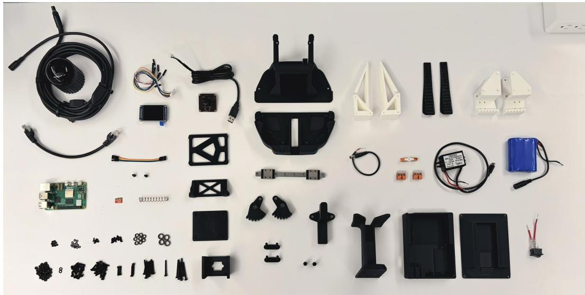  
Figure 8: Components used to assemble a UMI-Live gripper, including the LiDAR, camera, Raspberry Pi, LCD, printed parts, linear guide, gears, fasteners, and battery and power electronics.

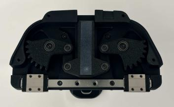  
(a) Gripper bearing mechanism

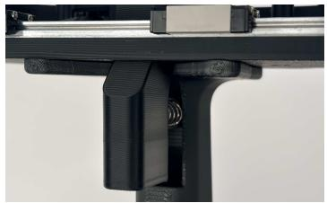  
(b) Trigger and spring

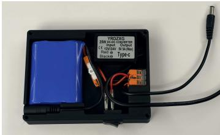  
(c) Power enclosure

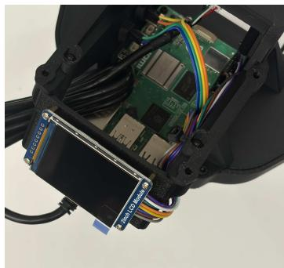

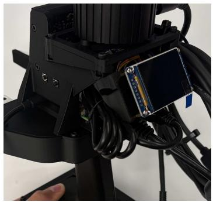

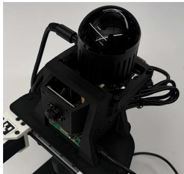  
(d) Onboard electronics: LCD, Raspberry Pi, buttons, camera, and LiDAR

Figure 9: Mechanical and electronic components of UMI-Live. (a) Gripper mechanism with sector gears, bearing-supported pivots, and a linear guide. (b) Trigger and return spring within the handle. (c) Removable power module with the battery, DC-DC converter, power switch, and wiring. (d) Onboard electronics, showing the Raspberry Pi and LCD before LiDAR installation (left), operatorfacing buttons and the rear-mounted LCD (center), and the front camera beneath the LiDAR (right).

## B UMI-Live Manipulation Demonstrations

We demonstrate the manipulation capabilities of UMI-Live through three human-operated tasks involving small-object grasping and insertion, match lighting, and shirt folding.

## B.1 Small-Object Grasping and Insertion

Figure 10 shows three manually operated sequences using UMI-Live to grasp small screwdriver bits and insert them into the tool case.

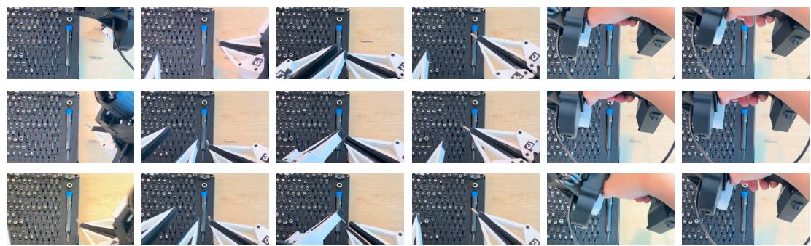  
Figure 10: Small-object grasping and insertion with UMI-Live. Each row begins at tool pickup and follows the handoff between the grippers, insertion into the tool case, and release. Six uncropped frames per row are selected at key moments and shown in chronological order from left to right.

## B.2 Match Lighting

Figure 11 shows a human operator using both UMI-Live grippers to open a matchbox, retrieve a match, and light it.

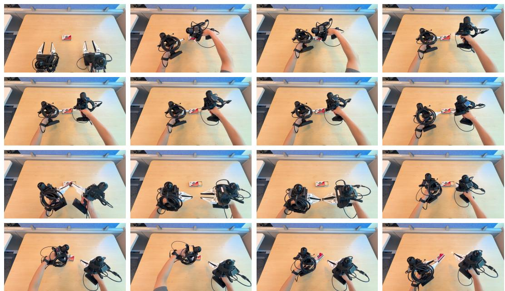  
Figure 11: Bimanual match lighting with UMI-Live. A human operator coordinates the two grippers to open the matchbox, retrieve a match, and strike it. The final frame shows the lit match. Frames are shown in chronological order from left to right and top to bottom.

## B.3 Shirt Folding

Figure 12 shows a human operator using both UMI-Live grippers to spread and fold a shirt.

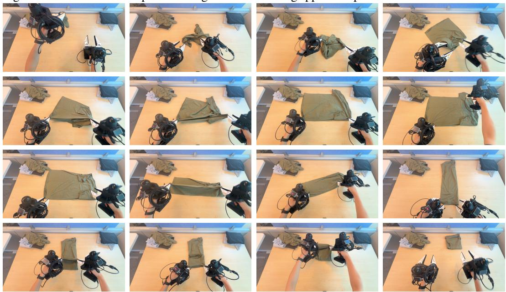  
Figure 12: Bimanual shirt folding with UMI-Live. A human operator coordinates both grippers to spread and align the shirt, fold it lengthwise, and complete the final folds. Frames are shown in chronological order from left to right and top to bottom.

## C Autonomous Rollout

Figure 13 shows a complete autonomous $\pi _ { 0 . 5 }$ rollout on the orange collection task.  
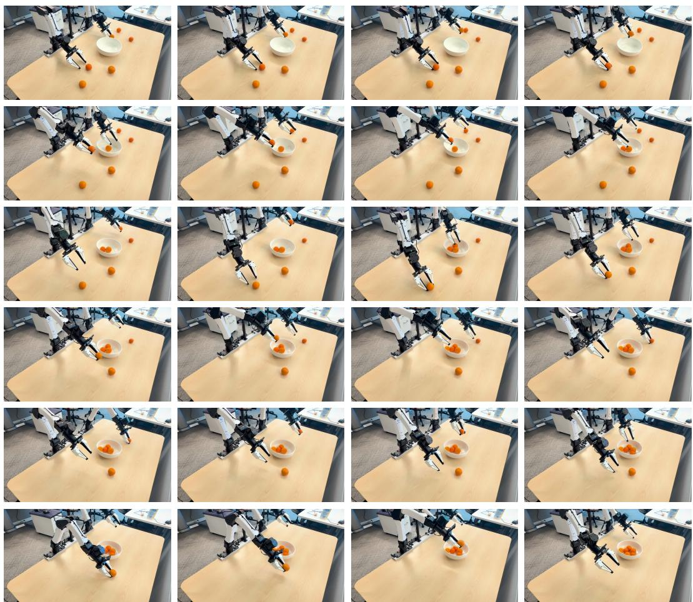  
Figure 13: One autonomous $\pi _ { 0 . 5 }$ rollout on dual i2RT YAM arms, transferring six oranges from the table into a bowl. Frames are shown in chronological order from left to right and top to bottom.

## D Teleoperation Setup

For teleoperation, we replace the LiDAR on each UMI-Live gripper with a VIVE tracker6 and use Lighthouse base stations7 for external tracking (Figure 14). We align the tracking frame with the robot base axes and capture reference poses when control is engaged. Subsequent changes in tracker position and orientation are mapped to Cartesian targets for the corresponding YAM arm and converted into joint commands through IK. Jaw opening is measured from ArUco tags in the wristcamera images and streamed from the Raspberry Pi to control the corresponding robot gripper, with opening changes scaled by the calibrated gripper span. We release the teleoperation software, setup and calibration instructions in UMI-Teleop.

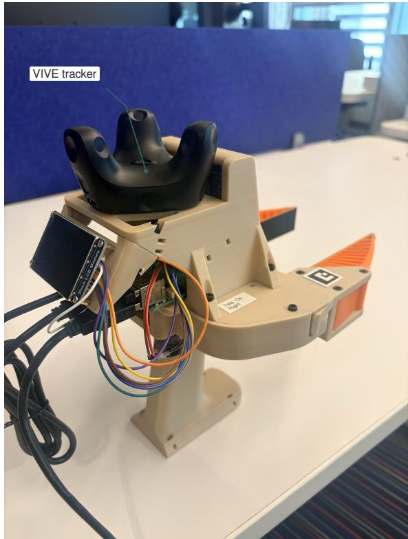  
(a) Tracker-equipped gripper

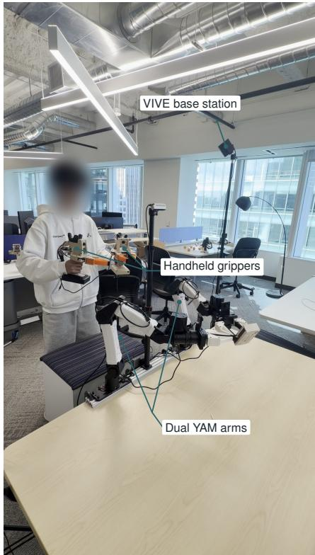  
(b) Teleoperation setup  
Figure 14: Teleoperation setup. (a) A VIVE tracker replaces the LiDAR on each handheld gripper. (b) External base-station tracking supports teleoperation of the dual YAM arms.

## E Dataset Representation

Each UMI-Live demonstration is recorded as an episode with a task instruction ℓ. For each gripper $i \in \{ L , R \}$ , we define its initial TCP pose as zero and express all subsequent TCP positions and orientations relative to this fixed reference. At frame t, we store a wrist image $I _ { t } ^ { i }$ and the state

$$
\mathbf { s } _ { t } ^ { i } = [ x _ { t } ^ { i } , y _ { t } ^ { i } , z _ { t } ^ { i } , \ \phi _ { x , t } ^ { i } , \phi _ { y , t } ^ { i } , \phi _ { z , t } ^ { i } , \ g _ { t } ^ { i } ] \in \mathbb { R } ^ { 7 } ,\tag{1}
$$

where $\mathbf { p } _ { t } ^ { i } = ( x _ { t } ^ { i } , y _ { t } ^ { i } , z _ { t } ^ { i } ) ^ { \top } \in \mathbb { R } ^ { 3 }$ is position in meters, $\phi _ { t } ^ { i } = ( \phi _ { x , t } ^ { i } , \phi _ { y , t } ^ { i } , \phi _ { z , t } ^ { i } ) ^ { \top } \in \mathbb { R } ^ { 3 }$ is a rotation vector in radians, and $g _ { t } ^ { i } \in [ 0 , 1 ]$ is the normalized gripper opening, such that

$$
g _ { t } ^ { i } = \mathrm { c l i p } \left( \frac { w _ { t } ^ { i } - w _ { \mathrm { c l o s e d } } ^ { i } } { w _ { \mathrm { o p e n } } ^ { i } - w _ { \mathrm { c l o s e d } } ^ { i } } , 0 , 1 \right) ,\tag{2}
$$

where $w _ { t } ^ { i }$ are the physical jaw widths and $w _ { \mathrm { o p e n } } , w _ { \mathrm { c l o s e d } }$ are the calibrated open and closed endpoints. The bimanual state concatenates both hands,

$$
\mathbf { s } _ { t } ^ { \mathrm { { b i } } } = [ \mathbf { s } _ { t } ^ { L } ; \mathbf { s } _ { t } ^ { R } ] \in \mathbb { R } ^ { 1 4 } .\tag{3}
$$

An episode with N frames is represented as the demonstration trajectory:

$$
\mathcal { T } = \left[ \left( I _ { t } ^ { L } , I _ { t } ^ { R } , \mathbf { s } _ { t } ^ { \mathrm { b i } } , \boldsymbol { \ell } \right) \right] _ { t = 0 } ^ { N - 1 } .\tag{4}
$$

We denote $\mathcal { D } = \{ \mathcal { T } ^ { ( e ) } \} _ { e = 1 } ^ { M }$ as a dataset of M demonstration trajectories, and $\mathcal { T } = ( \mathcal { T } _ { 0 } , \ldots , \mathcal { T } _ { N - 1 } )$ Figure 15 shows the left and right wrist views and corresponding TCP position trajectories during an episode.

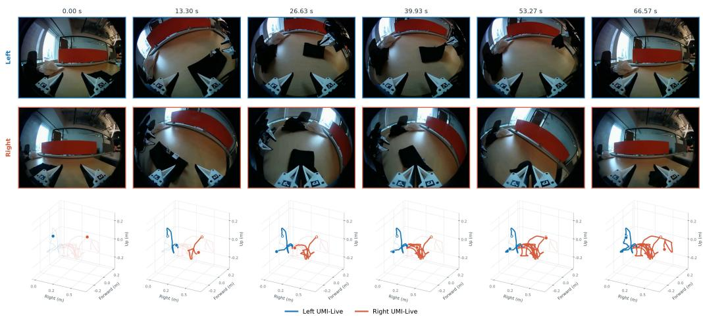  
Figure 15: Wrist images and reconstructed TCP position trajectories during bimanual folding. Each column shows the left wrist view (top), right wrist view (middle), and the two TCP position traces in a common plotting frame (bottom).

## F Policy Training

We fine-tune MolmoAct2 [25] and $\pi _ { 0 . 5 } \ [ 5 ]$ to predict bimanual TCP trajectories. We first define training on UMI demonstrations, then extend the same representation and losses to mixtures with robot teleoperation data.

## F.1 Training on UMI Demonstrations

We uniformly shuffle training frames across $\mathcal { D }$ and retrieve the corresponding trajectory $\tau$ for each frame t. The current entry $\mathcal { T } _ { t }$ provides the policy observation, while the next H entries provide the future states used to construct supervision,

$$
o _ { t } = ( I _ { t } ^ { L } , I _ { t } ^ { R } , g _ { t } ^ { L } , g _ { t } ^ { R } , \ell ) , \qquad Y _ { t } = ( { \bf s } _ { t + 1 } ^ { \mathrm { b i } } , \ldots , { \bf s } _ { t + H } ^ { \mathrm { b i } } ) ,
$$

where H is the action horizon. We omit TCP pose and joint information from the policy inputs. Both $\pi _ { 0 . 5 }$ and MolmoAct2 inherit visual representations from large-scale vision-language pretraining. Together with the broad workspace coverage of our ultra-wide wrist cameras, these representations provide visual context for learning bimanual coordination.

For each gripper $i \in \{ L , R \}$ , the stored state is

$$
\mathbf { s } _ { t } ^ { i } = [ \mathbf { p } _ { t } ^ { i } ; \boldsymbol { \phi } _ { t } ^ { i } ; g _ { t } ^ { i } ] \in \mathbb { R } ^ { 7 } .
$$

We reconstruct the TCP pose as

$$
R _ { t } ^ { i } = \exp ( [ \phi _ { t } ^ { i } ] _ { \times } ) \in \mathbb R ^ { 3 \times 3 } , \qquad T _ { t } ^ { i } = \left[ { \pmb { R } } _ { t } ^ { i } \quad { \bf p } _ { t } ^ { i } \right] \in S E ( 3 ) ,
$$

where $[ \cdot ] _ { \times }$ denotes the skew-symmetric matrix associated with a vector.

We express each future pose relative to the current pose,

$$
\Delta T _ { t , k } ^ { i } = ( T _ { t } ^ { i } ) ^ { - 1 } T _ { t + k } ^ { i } , \qquad k = 1 , \ldots , H .
$$

Its translation and rotation are

$$
\Delta \mathbf { p } _ { t , k } ^ { i } = ( R _ { t } ^ { i } ) ^ { \top } ( \mathbf { p } _ { t + k } ^ { i } - \mathbf { p } _ { t } ^ { i } ) , \qquad \Delta R _ { t , k } ^ { i } = ( R _ { t } ^ { i } ) ^ { \top } R _ { t + k } ^ { i } .
$$

We encode rotation using the first two rows of the rotation matrix to construct the 6D rotation vector [27],

$$
\mathbf { r } _ { 6 } ( R ) = [ R _ { 1 1 } , R _ { 1 2 } , R _ { 1 3 } , R _ { 2 1 } , R _ { 2 2 } , R _ { 2 3 } ] ^ { \top } .
$$

The resulting action target for each gripper is

$$
\mathbf { a } _ { t , k } ^ { i } = [ \Delta \mathbf { p } _ { t , k } ^ { i } ; \mathbf { r } _ { 6 } ( \Delta R _ { t , k } ^ { i } ) ; g _ { t + k } ^ { i } ] \in \mathbb { R } ^ { 1 0 } .
$$

Concatenating the two grippers produces the bimanual action chunk

$$
\begin{array} { r } { A _ { t } = \left[ \begin{array} { c } { [ \mathbf { a } _ { t , 1 } ^ { L } ; \mathbf { a } _ { t , 1 } ^ { R } ] ^ { \top } } \\ { \vdots } \\ { [ \mathbf { a } _ { t , H } ^ { L } ; \mathbf { a } _ { t , H } ^ { R } ] ^ { \top } } \end{array} \right] \in \mathbb { R } ^ { H \times 2 0 } . } \end{array}
$$

All future poses share the current frame t as their reference, while gripper openings remain absolute targets.

We train the conditional action model using flow matching [28]. Given Gaussian noise $\epsilon \sim \mathcal { N } ( 0 , I )$ and flow time τ, we construct

$$
X _ { t , \tau } = ( 1 - \tau ) A _ { t } + \tau \epsilon .
$$

The model $f _ { \theta } ( o _ { t } , X _ { t , \tau } , \tau )$ predicts a velocity field with the same dimensions as the action chunk. We minimize

$$
\mathcal { L } _ { \mathrm { f l o w } } = \mathbb { E } _ { \mathcal { T } , t , \epsilon , \tau } \left[ \frac { 1 } { 2 0 H } \left. f _ { \theta } ( o _ { t } , X _ { t , \tau } , \tau ) - ( \epsilon - A _ { t } ) \right. _ { F } ^ { 2 } \right] .
$$

## F.2 Training with Teleoperation Data

We supplement UMI demonstrations with robot teleoperation data to expose the policies to observations and motions collected on the target robot. Each teleoperation episode contains the two wrist images, measured arm joint angles $\mathbf { q } _ { t } ^ { i } ,$ , gripper openings, and a task instruction ℓ. For each arm $i \in \{ L , R \}$ , we recover the TCP pose through forward kinematics,

$$
T _ { t } ^ { i , \mathrm { r o b o t } } = \mathrm { F K } _ { i } ( { \bf q } _ { t } ^ { i } ) .
$$

We normalize gripper openings using the calibrated closed and open endpoints and construct future pose targets relative to the current robot pose,

$$
\Delta T _ { t , k } ^ { i } = ( T _ { t } ^ { i , \mathrm { r o b o t } } ) ^ { - 1 } T _ { t + k } ^ { i , \mathrm { r o b o t } } , \qquad k = 1 , \dots , H .
$$

The translation, six-dimensional rotation encoding, and future gripper opening are assembled into $A _ { t }$ using the same construction as for UMI demonstrations. Both sources therefore provide the same observation format $o _ { t }$ and action representation $A _ { t }$ . Joint angles are used to reconstruct robot trajectories and are omitted from the policy inputs. Let $\mathcal { D } _ { \mathrm { t e l e o p } }$ denote the teleoperation trajectories. We fine-tune on the combined dataset

$$
\mathcal { D } _ { \mathrm { m i x } } = \mathcal { D } \cup \mathcal { D } _ { \mathrm { t e l e o p } } ,
$$

using the training objective defined above. The UMI and robot teleoperation shares sum to 100% of the fine-tuning mixture. Section 4 reports the percentage splits used for each policy.

## F.3 Training Setup

We initialize $\pi _ { 0 . 5 }$ from the released base model and MolmoAct2 from MolmoAct2-BimanualYAM. Both models are fine-tuned for 12,000 optimizer updates using AdamW [29], 600 warmup updates, and cosine learning-rate decay to 0.1 of each parameter group’s peak rate. We use an action horizon of $H  { \mathrm { ~ = ~ } } 2 4$ at 30 Hz, gradient clipping at global norm 1. We update all $\pi _ { 0 . 5 }$ parameters. For MolmoAct2, we train LoRA adapters in the vision-language backbone and the full action expert, and we keep the remaining backbone weights and input embeddings fixed. MolmoAct2 combines flow matching with discrete action-token supervision. Tables 3 and 4 summarize the settings for these fresh-base runs.

<table><tr><td>Hyperparameter</td><td>Value</td></tr><tr><td>Global batch size</td><td>32</td></tr><tr><td>Parameters updated</td><td>Full model</td></tr><tr><td>Peak learning rate</td><td> $2 . 5 \times 1 0 ^ { - 5 }$ </td></tr><tr><td>AdamW  $\beta$ </td><td>(0.9,0.95)</td></tr><tr><td>AdamW €</td><td>10−8</td></tr><tr><td>Weight decay</td><td>0.01</td></tr><tr><td>Model precision</td><td>FP32</td></tr><tr><td>Flow samples per training query</td><td>1</td></tr></table>

Table 3: $\pi _ { 0 . 5 }$ fine-tuning hyperparameters for the fresh-base runs.

<table><tr><td>Hyperparameter</td><td>Value</td></tr><tr><td>Global batch size</td><td>32</td></tr><tr><td>Parameters updated</td><td>VLM LoRA adapters and full action expert</td></tr><tr><td>Peak adapter learning rate</td><td> $5 \times 1 0 ^ { - 5 }$ </td></tr><tr><td>Peak action expert learning rate</td><td> $1 0 ^ { - 4 }$ </td></tr><tr><td>AdamW  $\beta$ </td><td>(0.9,0.95)</td></tr><tr><td>AdamW ∈</td><td> $\mathrm { i 0 ^ { - 6 } }$ </td></tr><tr><td>Weight decay</td><td>0</td></tr><tr><td>LoRA rank / α / dropout</td><td>64 / 16 / 0.05</td></tr><tr><td>Language-model residual dropout</td><td>0.1</td></tr><tr><td>Model precision</td><td>BF16</td></tr><tr><td>Flow samples per training query</td><td>8</td></tr></table>

Table 4: MolmoAct2 fine-tuning hyperparameters for the fresh-base run.

## G Policy Inference

At each policy query t, the robot provides the observation

$$
o _ { t } = ( I _ { t } ^ { L } , I _ { t } ^ { R } , g _ { t } ^ { L } , g _ { t } ^ { R } , \ell ) .
$$

Conditioned on $o _ { t } ,$ we generate a bimanual action chunk by integrating the learned flow field. We express both policies using the flow-time convention defined during training, with Gaussian noise at $\tau = 1$ and actions at $\tau = 0$ . We initialize $X _ { t , 1 } = \epsilon ,$ , where $\epsilon \sim \mathcal { N } ( 0 , I )$ has shape $H \times 2 0$ , and solve

$$
\frac { d X _ { t , \tau } } { d \tau } = f _ { \theta } ( o _ { t } , X _ { t , \tau } , \tau )
$$

from $\tau = 1$ to $\tau = 0$ . Here, $\tau$ denotes flow time, distinct from the robot timestep t. The observation remains fixed while the entire action chunk is refined. Using K Euler steps with $\tau _ { j } = 1 - j / K$ , we compute

$$
X _ { t , \tau _ { j + 1 } } = X _ { t , \tau _ { j } } - { \frac { 1 } { K } } f _ { \theta } ( o _ { t } , X _ { t , \tau _ { j } } , \tau _ { j } ) , \qquad j = 0 , \dots , K - 1 .
$$

The final estimate gives the predicted action chunk

$$
\widehat { A } _ { t } = X _ { t , 0 } \in \mathbb { R } ^ { H \times 2 0 } .
$$

Each predicted action contains a relative translation, a six-dimensional rotation representation, and an absolute gripper opening for each arm. We recover the relative rotation through Gram-Schmidt orthonormalization and combine it with the predicted translation to form $\widehat { \Delta T } _ { t , k } ^ { i }$ . At the query timestep, the robot computer records the measured joint angles $\mathbf { q } _ { t } ^ { i }$ and computes the TCP pose

$$
T _ { t } ^ { i , \mathrm { r o b o t } } = \mathrm { F K } _ { i } ( { \bf q } _ { t } ^ { i } ) .
$$

These joint measurements are used by the execution controller and are omitted from the policy inputs. Each relative prediction is mapped to a robot target pose,

$$
\widehat { T } _ { t , k } ^ { i , \mathrm { t a r g e t } } = T _ { t } ^ { i , \mathrm { r o b o t } } \widehat { \Delta T } _ { t , k } ^ { i } , \qquad k = 1 , \ldots , H .
$$

Inverse kinematics converts this target into joint commands,

$$
\begin{array} { r } { \widehat { \mathbf { q } } _ { t , k } ^ { i } = \mathrm { I K } _ { i } \left( \widehat { T } _ { t , k } ^ { i , \mathrm { t a r g e t } } ; \mathbf { q } _ { t } ^ { i } \right) , } \end{array}
$$

using the measured query joints as the initial configuration. Predicted gripper openings are mapped to calibrated robot gripper commands. All targets within a chunk share the pose measured at its query. The robot executes actions while the server processes subsequent observations. Returned predictions are aligned with the robot’s execution timeline, and elapsed predictions are discarded. Each new query supplies updated observations and a fresh pose reference.

## G.1 Dual-YAM Hardware Integration

We extend LeRobot’s existing client–server inference architecture to support our dual-YAM setup. We run policy inference on a remote server and execute the returned action chunks through a local robot client. We run each arm in a separate worker process that reads joint and gripper feedback and dispatches commands through I2RT. We assign left and right commands a common scheduled execution time to coordinate bimanual motion. We use I2RT for forward and inverse kinematics, and we verify each inverse-kinematics solution against pose-error tolerances, joint limits, and a bound on joint displacement. We map predicted gripper openings to hardware commands using saved gripper calibrations. We also provide an action-probe mode that logs predicted commands without dispatching policy actions.

## G.2 Kinematic Model

We retain the six-joint kinematic structure and arm geometry of the default YAM configuration. We adapt the model to our replacement gripper by updating the TCP position and orientation through a fixed flange-to-TCP transform.

We denote a transformation from frame a to frame b by $T _ { a } ^ { b } .$ . We describe the arm using the classical Denavit–Hartenberg convention

$$
T _ { j } ^ { j - 1 } ( q _ { j } ) = R _ { z } ( q _ { j } + \theta _ { j } ^ { \mathrm { o f f s e t } } ) T _ { z } ( d _ { j } ) T _ { x } ( a _ { j } ) R _ { x } ( \alpha _ { j } ) ,
$$

where $q _ { j }$ is the angle of joint j. We use the parameters in Table 5 from the I2RT YAM model,8 with distances in meters and angles in radians.

<table><tr><td>Joint j</td><td> $\theta _ { j } ^ { \mathrm { o f f s e t } }$ </td><td> $d _ { j }$ </td><td> $a _ { j }$ </td><td> $\alpha _ { j }$ </td></tr><tr><td>1</td><td>0</td><td>0.1135</td><td>0.02</td><td> $- \pi / 2$ </td></tr><tr><td>2</td><td>一π</td><td>0</td><td>0.264</td><td> $- \pi$ </td></tr><tr><td>3</td><td> $- 2 . 9 0 1 4 1 8$ </td><td>0</td><td>0.252239</td><td>0</td></tr><tr><td>4</td><td> $- 0 . 2 4 0 1 7 3$ </td><td>0</td><td>0.073999</td><td> $\pi / 2$ </td></tr><tr><td>5</td><td> $\pi / 2$ </td><td>0</td><td>0</td><td> $\pi / 2$ </td></tr><tr><td>6</td><td> $\pi / 2$ </td><td>0.0356</td><td>0</td><td> $- \pi$ </td></tr></table>

Table 5: Classical Denavit–Hartenberg parameters for the YAM arm.

We denote the base, flange, and TCP frames by B, F, and G, with joint frames $0 = B$ and $6 = F$ We place the TCP frame origin at the center of the gripper tips, 220 mm along the negative z-axis of the flange frame, and orient its axes to match the UMI convention. We use the fixed transform

$$
T _ { G } ^ { F } = \left[ \begin{array} { c c c c } { - 1 } & { 0 } & { 0 } & { 0 } \\ { 0 } & { 1 } & { 0 } & { 0 } \\ { 0 } & { 0 } & { - 1 } & { - 0 . 2 2 0 } \\ { 0 } & { 0 } & { 0 } & { 1 } \end{array} \right] .
$$

For either arm, we obtain the TCP pose as

$$
T _ { G } ^ { B } ( \mathbf { q } ) = \left( \prod _ { j = 1 } ^ { 6 } T _ { j } ^ { j - 1 } ( q _ { j } ) \right) T _ { G } ^ { F } .
$$

We incorporate this TCP transform directly into the I2RT robot model and use its MJCF-based implementation for forward and inverse kinematics during execution.