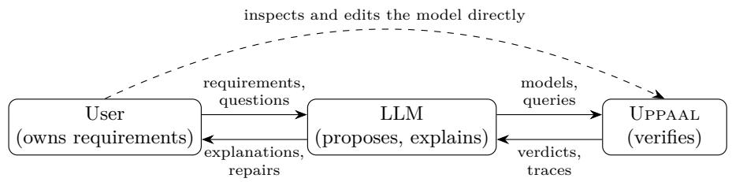
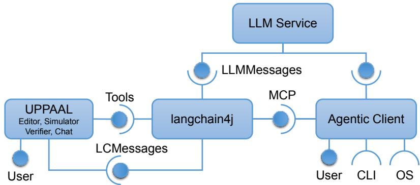
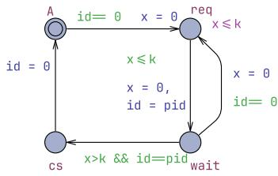
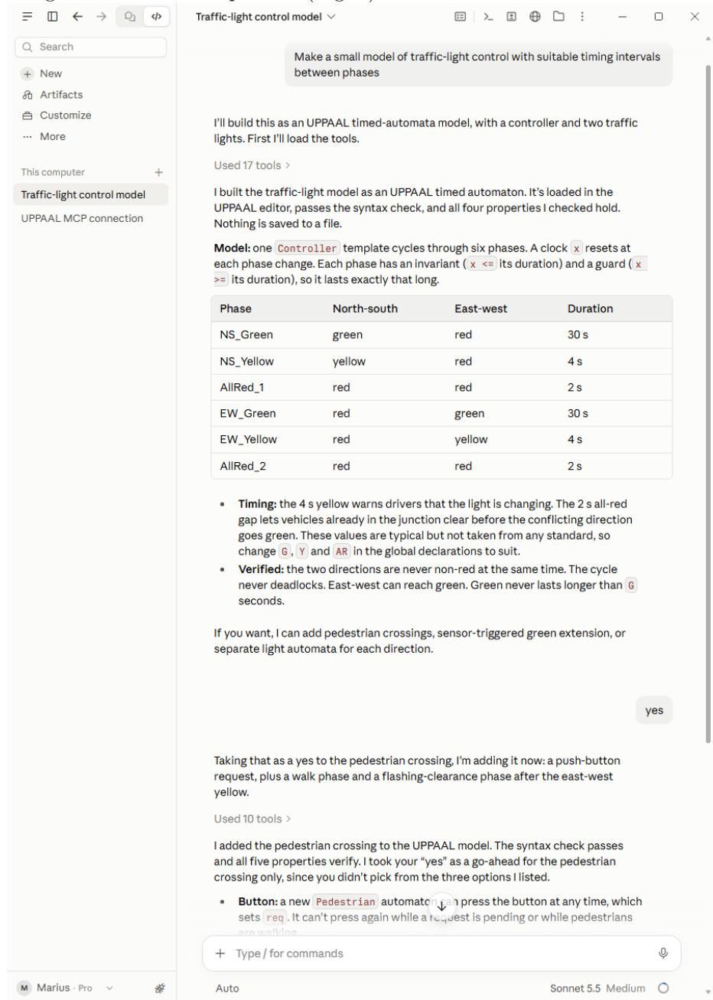
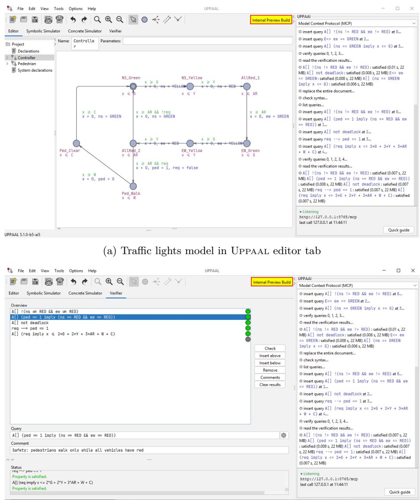
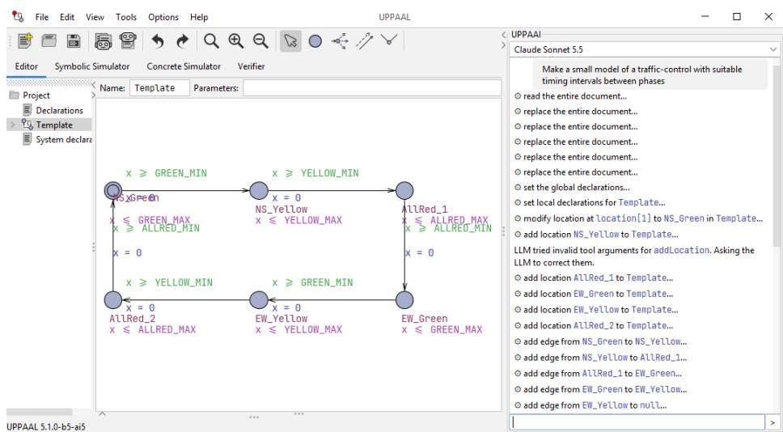
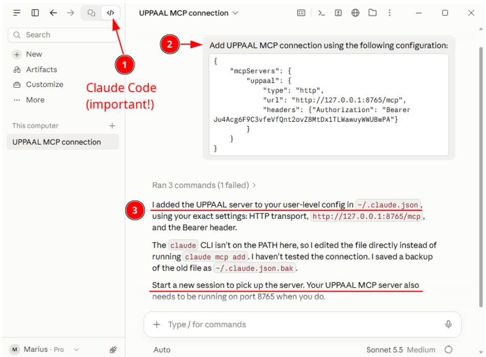
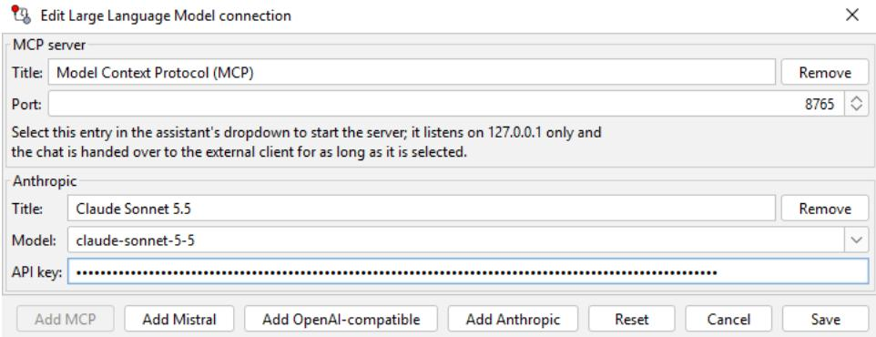
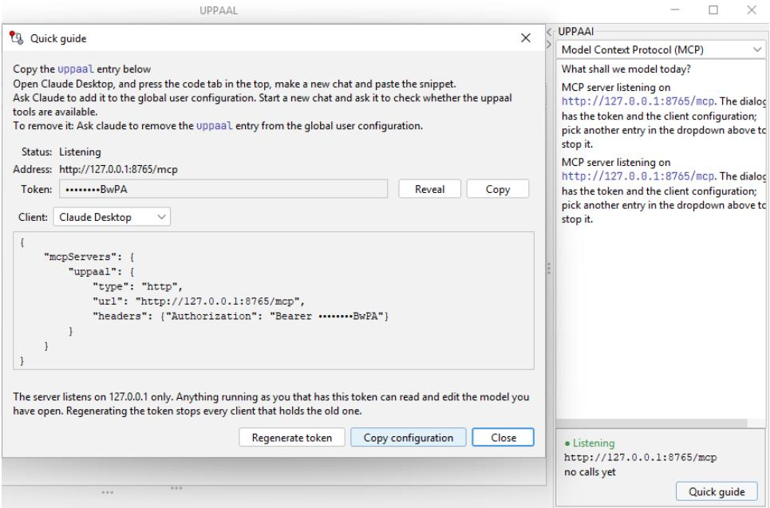

# UPPAAi: Towards LLM-Assisted Modeling, Verification, Analysis and Synthesis

Peter Dolog1 , Kim G. Larsen1 , Marius Mikučionis1 , and Frederik F. K. Rasmussen1

Aalborg University, Aalborg, Denmark {dolog,kgl,marius,ffkr}@cs.aau.dk

Abstract. For more than three decades, UPPAAL has supported the modelling and analysis of real-time and cyber-physical systems. Yet building a suitable model, formalising the intended properties, choosing analysis techniques and interpreting counterexamples remain iterative tasks that demand substantial expertise. Large language models (LLMs) can ofer plausible explanations and even solutions, but they are not necessarily correct. We present UPPAAI, an extension of UPPAAL in which users construct, explain, debug and specify models in dialogue with an LLM. The guiding principle is that the user requests, the LLM proposes, explains and orchestrates, and UPPAAL verifies. UPPAAI exposes the UPPAAL editor, queries and verifier through a Tools API. We report on seven case studies, from explaining to a newcomer to learning a controller, covering timed automata, stochastic hybrid automata and strategy learning. LLMs proved to be extremely helpful in not just generating solutions but also pro-actively suggesting relevant UPPAAL features it was not asked about.

Keywords: Model checking · Timed automata · Large language models · UPPAAL · AI-assisted formal methods

## 1 Introduction

Large language models (LLMs) have become capable generators of software, producing code, tests and documentation of often remarkable quality from informal descriptions. Their fundamental weakness is equally well known: plausibility is not correctness. LLMs excel at proposing artefacts that look right, but are far less reliable at establishing that those artefacts satisfy subtle concurrency, synchronisation and real-time requirements, which are precisely the properties that embedded and safety-critical systems depend on. A growing body of work therefore embeds LLMs in loops in which an external critic evaluates the generated artefacts and its feedback drives repair [16], a practice recently termed loop engineering [14]. A key lesson is that such a loop is only as strong as its critic [10]: self-evaluation by LLMs is unreliable [15], whereas sound external evaluators have enabled striking results [17,18,5,19].

In this paper we instantiate this loop for timed systems with a sound and exhaustive critic: the model checker UPPAAL [1]. We present UPPAAI, an extension of UPPAAL in which a user constructs, explains, debugs and specifies models in dialogue with an LLM (Fig. 1). The LLM proposes templates, clocks, invariants, synchronisations and queries; UPPAAL checks them; and the resulting verdicts and counterexamples are explained to the user and drive the next refinement. Beyond yes/no verification, the same loop covers quantitative questions through statistical model checking (UPPAAL SMC) and the learning of controllers through UPPAAL STRATEGO [4,12]. The design follows one principle: the LLM proposes, explains and orchestrates, but UPPAAL verifies. The LLM contributes language understanding, domain knowledge, abstraction and explanation; UPPAAL contributes formal semantics, exhaustive exploration, statistical estimates and counterexamples. Claims about correctness, performance or synthesised strategies are accepted only when an executable formal or statistical analysis supports them.

  
Fig. 1: The UPPAAI loop: the LLM generates, the model checker acts as the critic, and the user remains in control of the requirements and the model.

Why this matters. Each step from informal requirements to a verified model has traditionally required specialist expertise. With the LLM acting as a formalmethods mediator, an engineer can state a requirement in natural language, obtain a candidate model and query, and still ask why a clock was introduced or whether the query captures what was meant. Counterexamples, which traditionally demanded expertise to interpret, can be explained causally and lead to proposed repairs that the user can accept or reject. If building a model and checking a property becomes this cheap, model checking can support requirements engineering, architecture exploration and teaching, and not only the latestage validation of critical components. Finally, as code becomes cheap, trusted specifications become the scarce resource. A validated UPPAAL model can serve as a semantic anchor between intent and implementation: LLM-generated code can be tested for conformance against it [13], or replaced by controllers synthesised from it [4]. Autonomous software-engineering agents can adopt the same pattern of generation checked against executable formal semantics as part of their own reasoning [3].

What does not become automatic. Verifying a model is not verifying the real system, and an LLM can confidently construct the wrong abstraction, state a vacuous property, or weaken a query until it passes. The dificulty thus shifts partly from checking to model validity. UPPAAI addresses this in several ways. The user can observe, inspect, edit and undo changes in the familiar UPPAAL editor while the assistant can detect edits the user made in the meantime. A property can for example only be trusted after it had failed on a deliberately broken variant of the model. The intended benefit is therefore not only productivity. Beyond asking whether a property holds, the engineer can ask what the model should be, which properties matter, what a counterexample means, and what follows if a requirement changes.

Related approaches. LLMs have been coupled with proof assistants [5] and program verifiers [19] to generate proofs and verified programs. There the specification is given and the critic checks the generated artefact against it. In our setting the LLM also writes the model and the properties, so the critic checks a model whose fidelity is itself in question. This is why UPPAAI keeps the user in charge of the requirements, makes every change visible in an interactive modelling tool, and asks for the provenance of each claim to be stated.

## Contributions.

– A Tools API that exposes UPPAAL’s model editing, query management and verification to LLMs (Sect. 3).

– Two integration workflows, an external agentic client via MCP and an embedded chat via langchain4j, together with an analysis of their trade-ofs (Sect. 3).

Seven case studies with Claude connected via MCP, starting from existing models and from scratch, with users ranging from newcomers to experienced modellers, and covering timed automata, stochastic hybrid automata, continuous-time Markov chains, ODEs and strategy learning (Sect. 4).

– A cross-case discussion of the recurring patterns: where the verifier corrected the assistant, which claims rested on the assistant’s argument rather than on a tool result, and which limitations of the tool interface shaped the work (Sect. 5).

Outline. Section 2 summarises the features of UPPAAL for modelling and specification that the LLM must master. Section 3 presents the Tools API and the two integration workflows. Section 4 reports on the case studies, Section 5 evaluates and reflects upon the case studies and Section 6 concludes.

## 2 Main Features of UPPAAL

Modelling. UPPAAL 5.0 [12] unifies, within one modelling language and one tool, the classical symbolic model checker, UPPAAL SMC (statistical model checking), UPPAAL TIGA (timed games) and UPPAAL STRATEGO (timed Markov decision processes). A model is a network of timed automata, instantiated from parameterised templates and enriched with discrete data and C-like code (Table 13). The same syntactic model can be given four interpretations, which difer in how non-determinism is resolved. Each interpretation comes with its own queries and produces its own kind of result (Table 14).

  
Fig. 2: UML component diagram showing UPPAAL connecting to LLM Service through the langchain4j library via the LCMessages API, while a vendor-supplied Agentic Client connects via the LLMMessages API and reaches the UPPAAL tools through MCP.

Specifications. Symbolic verification uses a fragment of TCTL without nested temporal operators. It covers reachability (E<>), safety (A[], E[]), liveness (A<>, −−>) and deadlock freedom. Predicates may quantify over process and data ranges with forall/exists. The SMC queries add probabilistic and expectedvalue questions over time-, step- or cost-bounded runs. Strategy queries add synthesis, learning and analysis under a strategy (under S). Together these give one coherent language, from yes/no correctness to quantitative performance and controller synthesis.

## 3 Exposing Tools API

This section describes how UPPAAL exposes its functionality to an LLM. Figure 2 shows how the software components are connected to provide LLM assistance with UPPAAL tools. Two messaging APIs serve the same purpose of exchanging requests and replies with an LLM, but difer in implementation: LLMMessages is the vendor’s RESTful API accessed over an HTTPS connection, while LCMessages is the Java API of the langchain4j library.

## Components

– LLM Service exposes the LLMMessages API over HTTPS. Access usually requires a separate payment plan and authentication (outside the scope of the diagram).

– Agentic Client is a vendor-supplied program (e.g., Claude Code) that combines a chat interface with an agent loop and tool calling. Such clients are usually marketed as coding assistants, but can be used for any task that their tools support, including modeling. It talks to the LLM Service via LLMMessages, acts as an MCP client, and has access to all installed programs via the Command Line Interface (CLI) and the Operating System (OS).

– langchain4j reaches the LLM Service via LLMMessages (or an equivalent) and ofers two interfaces to its consumers: the LCMessages Java API and the Model Context Protocol (MCP), which UPPAAL makes available to external clients through a small local HTTP server. It does the heavy lifting of messaging and of encoding and decoding the function calls, and uses Java introspection to read the Tools API annotations when compiling the tool description.

UPPAAL exposes its Tools API as a set of Java functions and consumes the request-response functions of LCMessages. It has its own chat history and prompt GUI widgets.

Workflow A: external Agentic Client The user enters a prompt in the Agentic Client, which owns the chat history. The RESTful API is stateless, so the client resends the entire history with every request; most clients implement “history compacting” to fit the history into the context window and to reduce the input processing costs. When the LLM Service replies with a tool call, the client forwards it over MCP to langchain4j, which invokes the corresponding UPPAAL function and returns the result. In this workflow UPPAAL is passive: it only answers tool calls, and MCP ofers no standard way to push changes made to the document by the user (or another LLM) into the model’s context. The client may therefore need to call additional tools (e.g. getContext) to find out what the user is looking at and whether the document has been modified. The context is controlled by the client, not by UPPAAL: clients ofer their own mechanisms for injecting it, such as instruction files, skills, hooks that run on prompt submission, or user-referenced MCP resources. In exchange, the user can keep working in a familiar client, which may use additional tools beyond the Tools API, such as the file system, the CLI and the OS. The Tools API, in contrast, is strictly sandboxed to UPPAAL functions: it gives the LLM no access to anything outside the UPPAAL model, queries and verifier.

Workflow B: embedded UPPAAL chat The user enters a prompt in UPPAAL, which owns the chat history. UPPAAL uses the LCMessages API of langchain4j to compile a request consisting of the initial prompt instructions, the description of the Tools API, the chat history, additional context information (like what the user has selected or is looking at right now) and lastly the user prompt, which is then passed to the LLM Service. langchain4j handles the reply from the LLM Service containing instructions to use the tools (call the corresponding functions with certain arguments), marshals the results back to the LLM Service, repeats this as long as further tool calls are requested, and eventually provides the reply to the user, which is appended to the session history. In this workflow UPPAAL is the requesting party and may attach context to every request, so no extra tool calls are needed to learn what the user is looking at.

Comparison Both workflows end in the same Tools API. They difer in who owns the history and initiates requests, and thus in how context reaches the LLM: Workflow A reuses an existing, open-ended client but must pull context through tool calls or client-specific injection mechanisms, while Workflow B gives UPPAAL control over the prompt and context at the cost of a custom chat implementation.

Tools API Table 1 lists the tools grouped by purpose: editing the model and its templates, locations, edges and declarations, managing queries, and running and inspecting verification. Further tools are planned: exporting templates, exposing query descriptions and their customization, a simulation API, and version control integrated with the chat history. Table 2 shows the LLMs supported by UPPAAL.

Table 1: Tools API: functions exposed by UPPAAL to the LLM.
<table><tr><td>Function</td><td>Description</td></tr><tr><td>Model and templates</td><td></td></tr><tr><td>getContext</td><td>The state of UPPAAL GUI (changes and selection)</td></tr><tr><td>get/replaceModel</td><td>Read or replace the whole model</td></tr><tr><td>checkSyntax</td><td>Check the model for syntax errors</td></tr><tr><td>getTemplateList</td><td>List the templates in the model</td></tr><tr><td>get/replaceTemplate</td><td>Read or replace a template</td></tr><tr><td>add/deleteTemplate</td><td>Add or delete a template</td></tr><tr><td>Locations and edges</td><td></td></tr><tr><td>getLocations</td><td>List the locations of a template</td></tr><tr><td>add/modify/deleteLocation</td><td>Add, change, or delete a location</td></tr><tr><td>add/modify/deleteEdge</td><td>Add, change, or delete an edge</td></tr><tr><td>addBranchPoint</td><td>Add a branch point for probabilistic edges</td></tr><tr><td>deleteByXPath</td><td>Delete any element of a template</td></tr><tr><td>Declarations</td><td></td></tr><tr><td>get/setGlobalDeclarations</td><td>Read or replace the global declarations</td></tr><tr><td>get/setLocalDeclarations</td><td>Read or replace a template&#x27;s local declarations</td></tr><tr><td>get/setSystemDeclarations</td><td>Read or replace the system declarations</td></tr><tr><td>Queries</td><td></td></tr><tr><td>getQueries</td><td>List the queries</td></tr><tr><td>insert/removeQuery</td><td>Add or remove a query</td></tr><tr><td>Verification</td><td></td></tr><tr><td>verifyQueries, stop</td><td>Start or stop verifying queries</td></tr><tr><td>getResults</td><td>Read verification progress and results</td></tr><tr><td>getOptions, setQueryOption</td><td>List the engine options, or set one on a query</td></tr><tr><td></td><td>getQueryTrace, getQueryPlot Read the trace or plot of a verified query</td></tr></table>

## 4 Case Studies

To assess the capabilities of UPPAAI we used Claude connected to the UPPAAL via Model-Context Protocol (MCP) and applied it on seven case studies. The cases were chosen to cover problems that require diferent UPPAAL modelling formalisms (networks of timed automata, stochastic timed automata, continuoustime Markov chains, ODEs as hybrid clocks, and timed games for strategy synthesis and learning with UPPAAL STRATEGO) and diferent kinds of queries (safety and reachability, leads-to, deadlock, sup/inf bounds, probability and expectation estimates by statistical model checking, and strategy learning).

Table 2: Tested support for LLM vendors
<table><tr><td>API</td><td>Vendors &amp; Environments</td></tr><tr><td>MCP</td><td>Anthropic Claude Desktop/Code, Mistral Vibe</td></tr><tr><td>OpenAI</td><td>Vendor Specific OpenAI, Anthropic, Mistral AI OpenAI, DeepSeek, Gemini, Grok, Groq, Ollama</td></tr></table>

The cases also difer in where the model came from and in what the user wanted. In three cases an existing UPPAAL model was the starting point: Fischer’s protocol [11,1] was to be explained to a newcomer to model checking; the LEGO MINDSTORMS sorter [8] and the lane changes [6] were to be checked against an informal requirement and debugged. In the other four cases the assistant created the model from scratch: the COVID-19 epidemic and the ATM network from Claude’s general knowledge, the storm water detention pond from the user’s requirements, and the TSN gate schedules from a publication [2] on IEEE 802.1Qbv [7]. For COVID-19 the user deliberately asked for a model built from scratch; when analysing the results of the session, we consulted an existing UPPAAL COVID-19 model [9]. The users ranged from newcomers to timed automata to experienced modellers who prescribed modelling decisions. Table 3 summarises the cases.

Each case is reported in the same way: the case and model, the user and their goal, and the course of the interaction; a table of results per model variant; the key findings; the user’s perspective; lessons on the tools and the interface; a table of the UPPAAL tool calls made in the session; and metrics of the session. For lack of space we only present summary reports on 4 of the cases spanning Claude being presented with an existing UPPAAL model, Claude asked to propose model and query for known and unknown domains and a case where emphasis is on teaching.

## 4.1 Red/Black Box Sorting on a Conveyor Belt

Case & model. A belt controller in the style of the LEGO MINDSTORMS sorter [8]: boxes RedBox, BlackBox with clock pos, sensed at pos = 9, removable in [81,90], placed ≥ 10 apart; on blck, TaskMAIN resets one clock $\times ,$ and TaskPUSH ejects at $\times ~ = = ~ 7 5$

User & goal. The modeller asked the assistant (Claude, connected to UPPAAL via MCP) whether all black boxes end in off and all red boxes in end.

Table 3: Overview of the case studies
<table><tr><td>Case</td><td>Source</td><td>User&#x27;s task</td><td>Formalism; queries</td></tr><tr><td>Fischer&#x27;s mutual exclusion protocol</td><td>existing [11,1]</td><td>explore as newcomer; mutate &amp; see what breaks</td><td>timed automata; safety, deadlock, leads-to</td></tr><tr><td>Box sorting on a</td><td>existing [8]</td><td>check that boxes are</td><td>timed automata, scalar sets; safety, reachability</td></tr><tr><td>conveyor belt Car lane</td><td>existing [6]</td><td>sorted; debug; scale up fix a model in which</td><td>timed automata with</td></tr><tr><td>maneuvering Spread of</td><td>general</td><td>two cars collide model epidemic from scratch; convert</td><td>data; reachability, SMC stochastic TA → CTMC → ODE; SMC</td></tr><tr><td>COVID-19 Storm water</td><td>knowledge*</td><td>requirements synthesise a controller</td><td>stochastic hybrid game;</td></tr><tr><td>detention pond Timing constraints general</td><td></td><td>to maintain water level model as newcomer,</td><td>strategy learning, SmC timed automata; safety,</td></tr><tr><td>in ATM network</td><td>knowledge</td><td>verify deadlines</td><td>sup bounds</td></tr><tr><td>Robustness of TSN gate</td><td>publication [2,7]</td><td>analyse schedules against clock, timing</td><td>timed automata and an SmC variant; safety, sup,</td></tr></table>

∗When analysing the results of the session, we consulted an existing UPPAAL COVID-19 model [9].  
Full reports are available at https://deis-tools.github.io/uppaal-models/CaseStudies/AI-IFS2027

Table 4: Results: ✓holds; ×violated; states: stored by verifyta; – unchecked.
<table><tr><td>Model Variant</td><td>timers boxes no B at end no R off deadlock → sorted states</td></tr><tr><td>Original 1 2B/2R</td><td>V</td></tr><tr><td>X Per-box timers</td><td></td></tr><tr><td>3 3B/3R √ √</td><td>√</td></tr><tr><td>Mutation: one timer 1 3B/3R</td><td>X X X</td></tr><tr><td></td><td>√ √ √ 20160</td></tr><tr><td>Symmetric* 8 5B/3R Symmetric* 8 8B/3R</td><td>V V √ 69745</td></tr></table>

∗Boxes and timers over scalar types; free timer chosen by select. Intended final state reachable in all variants checked.

Interaction. Formalise → refute → diagnostic queries → per-box timers → mutation → scale up (time-out) → scalar sets → verifyta → re-verify in editor. Key findings.

F1. A single timer loses ejects. Instead of a trace, Claude asked separating reachability queries: E<> B1.end && B2.start is unreachable, E<> B1.end && B2.off reachable. A second black box resets x, and the first passes the piston (transit 75 ≫ spacing 10). The explanation is Claude’s; the verdicts are UPPAAL’s.

Table 5: UPPAAL MCP tool calls in the session.
<table><tr><td colspan="2">Purpose Tools (calls)</td><td>Total</td></tr><tr><td></td><td>Inspect getContext (5), getModel (2), getQueries (1), getTemplate (1)</td><td>9</td></tr><tr><td></td><td>Verify verifyQueries (7)</td><td>7</td></tr><tr><td></td><td>Queries insertQuery (18), removeQuery (12)</td><td>30</td></tr><tr><td>Edit</td><td>setGlobalDeclarations (4), checkSyntax (4), replaceTemplate (2),</td><td>13</td></tr><tr><td>All</td><td>setSystemDefinition (2), replaceModel (1) 12 distinct tools</td><td>59</td></tr></table>

F2. The checks were checked. With one timer, and with four timers for five boxes, UPPAAL reports the properties violated, so they are not vacuous. Unexplained side efect: a red box can then be removed too.

F3. Scaling needed remodelling. Five black boxes as named instances exceeded the time-out; scalar sets enabled symmetry reduction, after replacing an ordered firstFree() that broke symmetry (5 boxes: 3 s).

User’s perspective. The informal requirement became the safety property

A[] deadlock imply ((forall (i : bid\_t) BlackBox(i).off) &&

(forall (j : rid\_t) RedBox(j).end))

i.e. whenever the system is at rest, every box is sorted; “eventually sorted” fails only because the guard may idle. The user chose the scale and stopped the stuck verification.

Tool & interface lessons. (i) A timed-out verification kept running and blocked every request, even after a GUI stop. (ii) Fallback to verifyta of the same version; provenance had to be stated. (iii) Traces not requested; diagnosis by queries. (iv) “8 timers sufice” is an argument, not a proof.

Metrics. 4 prompts (+1 mid-turn note); 59 MCP tool calls, 9 failed (1 time-out, 8 “busy”); 6 verification runs in the editor (28 query checks) and 5 verifyta runs (25 checks, ≤ 14 s); 6 variants; 0 traces requested; 1 unexplained observation; 17 min wall clock, about 8 min assistant time.

## 4.2 Storm Water Detention Pond

Case & model. UPPAAL STRATEGO model built from scratch: Rain (CTMC over 5 rain classes, 4 scenarios, exponential durations), Pond (level w as hybrid clock: runof in, orifice outlet, weir spillway above 2.5 m, evaporation; 4 monitor clocks), Controller (every 30 min sets outlet $\mathsf { u } \in \{ 0 , \frac { 1 } { 3 } , \frac { 2 } { 3 } , 1 \} ,$ .

User & goal. A user asked the assistant (Claude, connected to UPPAAL via MCP) for a model with rain scenarios and a learned periodic controller keeping the level between min (1.0 m) and max (2.5 m): no overflow, average level as high as possible.

Interaction. Build → learn minE(dist + 104excess + 100deficit) → recalibrate outlet → relearn → save/load strategy → explain Rain, Pond → speed up learning with verifyta → write-ups.

Table 6: Results per model variant over 24 h, random scenario (1000 runs, 95 % CI; $Q _ { \mathrm { m a x } } \mathrm { : }$ fully open outlet flow in m3/min; severity in m·min; –: not checked).
<table><tr><td>Variant</td><td> $Q _ { \mathrm { m a x } }$ </td><td></td><td></td><td></td><td>avg level P(overflow) severity P(below min)</td></tr><tr><td>random</td><td>60</td><td>0.47m</td><td> $6 . 4 \pm 4 . 0 \%$ </td><td></td><td></td></tr><tr><td>0pt</td><td>60</td><td>1.08 m</td><td> $3 . 6 \pm 3 . 4 \%$ </td><td>0.30</td><td>94%</td></tr><tr><td>random</td><td>120</td><td>0.22 m</td><td> $\leq 5 \%$ </td><td></td><td></td></tr><tr><td>Opt</td><td>120</td><td>1.32 m</td><td> $5 . 5 \pm 3 . 9 \%$ </td><td>0.06</td><td>58%</td></tr><tr><td>Opt reloaded</td><td>120</td><td>1.31 m</td><td></td><td></td><td></td></tr></table>

Table 7: UPPAAL MCP tool calls in the session.
<table><tr><td colspan="2">Purpose Tools (calls)</td><td>Total</td></tr><tr><td></td><td>Inspect getModel (5), getQueries (4), getContext (1)</td><td>10</td></tr><tr><td></td><td>Verify verifyQueries (7)</td><td>7</td></tr><tr><td></td><td>Queries insertQuery (8), removeQuery (6)</td><td>14</td></tr><tr><td>Edit</td><td>replaceModel (2), setGlobalDeclarations (2), checkSyntax (3),</td><td>8</td></tr><tr><td>All</td><td>modifyLocation (1) 10 distinct tools</td><td>39</td></tr></table>

## Key findings.

F1. A timid controller pointed to the plant. With $Q _ { \mathrm { m a x } } = 6 0$ the strategy hugged the minimum: extreme rain $( 1 8 0 \mathrm { m ^ { 3 } / m i n } )$ exceeds the open outlet, so overflow was unavoidable. Doubling the outlet, not tuning the learner, raised the level by 0.24 m and cut overflow severity 5×.

F2. Safe by being empty. Random control overflows as rarely as Opt, but at 0.22 m; safety alone says little.

F3. The strategy lived outside the model. On re-running queries the user found Opt gone: strategies stay in engine memory, never in the model file. Two queries, saveStrategy and loadStrategy, fixed it.

F4. Time went into the ODE, not the learner. Discretisation step 0.01 → 0.5 min cut learning from ≈ 7 to < 2 min at equal quality; a smaller learning budget instead gave 28× the overflow severity.

User’s perspective. Questions concerned artefacts and cost, not syntax: “why was Opt not saved?”, “10 minutes is a long time to wait”, “which query gives the average level?”; explanations worked when grounded in numbers (rain shares, steady-state levels). The assistant flagged its own rain data as stress tests (34– 108 mm/day vs. ≈ 2 in Denmark).

Tool & interface lessons. (i) Synchronous calls time out on minute-long learning, and a busy engine blocks every call, even getModel. (ii) No access to engine options; verifyta was run directly. (iii) replaceModel loses undo history: the user’s unsaved model was backed up first. (iv) getModel returns stored simulation data (≈ 380 KB). (v) trans and under are reserved words.

Metrics. 12 prompts; 39 MCP tool calls, 8 without a usable result (2 time-outs, $4 \mathrm { \hbar ^ { 6 } b u s y ^ { 5 } }$ , 2 keyword errors); 3 GUI learnings (2 by the assistant, ≈ 7 min each; 1 by the user) + 4 learning and 4 simulation-timing runs with verifyta; 2 plant variants; 12 queries; 1 strategy file (34 KB).

## 4.3 Robustness of TSN Gate Schedules (IEEE 802.1Qbv)

Case & model. Gate schedules for time-sensitive networking (Craciunas et al. [2]), checked for robustness against worse clocks, late releases, frame loss and best-efort trafic. A small network (two talkers, a switch, a listener) with three schedules derived from the paper’s constraints; ten templates – clocks, sources, gates, schedulers, links, receiver, best-efort source, fault environment, passive observer – plus an SMC variant.

User & goal. A modeller asked the assistant (Claude, connected to UPPAAL via MCP and verifyta) to model and analyse this robustness, prescribing explicit transmission durations, stated trafic and fault assumptions, correlated clock uncertainty, packet identity and passive observers.

Interaction. Model → verify → sweep 29 configurations → counterexamples → SMC (three variant defects fixed) → template walk-through and counterexample timelines → SMC queries in the model → review of timing uncertainties.

Table 8: Results per model variant (✓: holds; ×: violated; WCRT: exact worstcase latency; Pr: SMC probability of a deadline miss within 10 cycles; cex: steps of the shortest counterexample; –: not checked).
<table><tr><td>Variant</td><td>deadline window overrun</td><td></td><td></td><td>WCRT</td><td>Pr</td><td>cex</td></tr><tr><td>CFG0 (shared window),  $\varDelta \leq 2$ </td><td></td><td></td><td></td><td>46+∆</td><td>0</td><td></td></tr><tr><td>CFG0, ∆ = 3 (drifting offsets)</td><td>×</td><td>*</td><td></td><td>133 (139)</td><td>0.032 (0.14)</td><td>51</td></tr><tr><td>CFG0, release jitter 11</td><td>×</td><td>*</td><td></td><td>148</td><td>0.85</td><td>34</td></tr><tr><td>CFG1 (no isolation),  $\varDelta = 0$ </td><td>×</td><td>×</td><td></td><td>46</td><td>0.508</td><td>54</td></tr><tr><td>CFG2 (time isolation),  $\Delta \leq 2 ; \leq 3$  losses</td><td></td><td></td><td></td><td>38</td><td></td><td></td></tr><tr><td>BE, length-aware gates, or guard band 8</td><td></td><td></td><td></td><td>48</td><td>0</td><td></td></tr><tr><td>BE, no length check, guard band  $0 / 4 / 7$ </td><td>×</td><td></td><td>×</td><td>56/52/49.72/.16/.002</td><td></td><td>51</td></tr><tr><td>naive per-event jitter,  $\varDelta = 0$ </td><td>X</td><td></td><td></td><td></td><td></td><td>32</td></tr></table>

∗Window indices only; the frame pushed into the next cycle is caught by the deadline. §Within one cycle.

## Key findings.

F1. The model checker corrected the assistant. Claude predicted a miss probability of 1/64 at $\varDelta = 3 ;$ SMC gave [0.027, 0.038], and the exhaustive engine, asked per ofset combination, found a second failing case (a late switch: latency $4 9 > 4 8 )$ , so 2/64.

F2. The two engines checked each other. Three SMC results contradicted verdicts or predictions, each caused by Claude’s SMC variant (a rate with a clock guard never fired; an equality-guarded choice was biased).

F3. The clock model decides the verdict. Correlated per-node ofsets are robust up to the synthesised δ = 2; independent per-event jitter reports violations even for perfect clocks.

F4. Isolation and guard bands are necessary. Without isolation the schedule fails with perfect clocks; without length checks only a guard band of one maximal BE frame helps, and guard band 7 leaves a rare event (3/2000 runs) found exhaustively in 0.5 s.

User’s perspective. Each prescribed modelling decision showed up in a result; the timing review exposed what remains exact (whole-tick ofsets, stepwise drift, fixed transmission and forwarding times).

Tool & interface lessons. (i) MCP verifies only the editor’s model, so sweeps ran through verifyta. (ii) An unsaved model in the editor was backed up before replaceModel. (iii) Traces are of by default. (iv) SMC needs broadcast channels and its rate and point-guard semantics must be cross-checked.

Table 9: UPPAAL MCP tool calls in the session.
<table><tr><td colspan="2">Purpose Tools (calls)</td><td>Total</td></tr><tr><td></td><td>Inspect getContext (2), getModel (2), getTemplateList (1), getQueries (1)</td><td>6</td></tr><tr><td>Verify</td><td>verifyQueries (2)</td><td>2</td></tr><tr><td>Edit</td><td>replaceModel (2), checkSyntax (3)</td><td>5</td></tr><tr><td>All</td><td>7 distinct tools</td><td>13</td></tr></table>

Metrics. 8 prompts; 13 MCP tool calls, 0 failed; about 115 verifyta runs (statistics sweep 48 min CPU, largest run 7 · 106 states, 1.3 GB); 6 counterexamples (32–54 steps); about 60 SMC estimates; 1 wrong prediction and 3 variant defects caught.

## 4.4 Fischer’s Mutual Exclusion Protocol

Case & model. Fischer’s protocol [11] (UPPAAL demo [1], Fig. 3): six instances of P, shared id , clock $\mathbf { \boldsymbol { x } } , \ \mathbf { \boldsymbol { k } } \ = \ 2 ;$ id is written with pid within x ⩽ k and checked when x>k.

User & goal. A user new to model checking asked the assistant (Claude, connected to UPPAAL via MCP) to explain the model open in the editor.

  
Fig. 3: Fischer process template P with parameter pid.

Interaction. Explain → verify → two mutations → fairness query → starvation refinement → restore → simulator walk-through.

## Key findings.

F1. The model checker corrected the assistant. It predicted that removing $\times \leqslant$ k on req would break mutual exclusion; it held (the edge guard remains), while deadlock freedom and req⇝wait failed (Table 10).

F2. Changing one comparison exposed a race at a single instant. With $\mathsf {  ~ \mathsf { X } ~ } \geqslant \mathsf { \boldsymbol { k } } ,$ a check at exactly x = k meets a still-permitted write (6 steps, 0.007 s), an instant random simulation rarely hits.

F3. The first liveness counterexample was not the intended one. req⇝cs failed because the winning P(1) may idle in wait; starvation needed a refinement.

Table 10: Results: ✓holds; ×violated, with counterexample length; – unchecked.
<table><tr><td>Model Variant</td><td>mutex no deadlock req~wait</td><td></td><td>req~→cs</td></tr><tr><td>Original</td><td></td><td>√</td><td> $\times ~ ( 4 , \mathrm { { \ : \ddot { \cdot } l a z y \cdot \vec { \cdot } } } )$ </td></tr><tr><td> $\textsf { x } > \textsf { k } \to \textsf { x } \ \geqslant \ \textsf { k }$ </td><td>×(6)</td><td></td><td></td></tr><tr><td>no invariant on req</td><td></td><td>×(6)</td><td>×(1)</td></tr><tr><td>eager variant*</td><td></td><td></td><td>× (15, lasso)</td></tr></table>

∗Invariants on wait, cs; a lost location; an urgent broadcast channel forcing retries.

User’s perspective. Guards allow, invariants force; a leads-to trace that stops means “may stay here forever”; breaking taught more than “satisfied”.

Tool & interface lessons. (i) No GUI or simulator access. (ii) getContext detected user edits before restoring. (iii) replaceModel loses undo history. (iv) Traces of by default.

Metrics. 11 prompts (4 picks from the assistant’s menu); 50 MCP tool calls, 0 failed; 11 verification runs (27 query checks, ≤ 2.1 s); 4 variants; 5 counterexamples (1–15 steps); 1 wrong prediction caught; 4 restores, all re-verified.

## 5 Evaluation & Reflection

The cases fall into four groups (Table 12): debugging existing models, modelling in domains known or new to the user, and teaching.

Debugging existing models. In the belt case Claude immediately suspected a bug, had UPPAAL confirm it, explained it from the trace and fixed it with one timer per black box. It argued correctly that at most eight boxes fit on the belt, and, when verification stalled, proposed scalar sets for symmetry reduction; the final model verifies in seconds. We never took this model this far ourselves. The lane-change model was a buggy left-over that we had repeatedly failed to fix in spare half-hours. Claude found two bugs, explained and fixed them, shortened the lanes (700 → 120) to tame the state space, and, at the user’s suggestion, swept the full model with SMC.

Known domains. For COVID-19, Claude’s first proposal was an agent-based model, the very model our earlier work [9] had aimed at. It was flawless and fully parameterised, and came with SMC queries in impeccable syntax. Claude then provided CTMC and ODE variants and showed that the three models are consistent. For the detention pond it built a STRATEGO model with randomised rain scenarios and a learned outlet controller. When learning became slow, Claude used STRATEGO itself to find a suitable ODE step size.

New domains. For TSN, the user knew real-time protocols but not TSN. Claude received only a paper [2] using diferent methods and an architecture suggested by the user. The resulting model appears to be of high quality; Claude explained each template’s role and proposed experiments and SMC queries. Where UPPAAL refuted its predictions, Claude explained why. For the ATM network, an engineer new to timed automata obtained a verified model from scratch.

Teaching. Claude recognised Fischer’s protocol, explained it in domain terms and ofered four numbered experiments. It mutated and restored the model, and accepted UPPAAL’s refutation of its own prediction. It produced a starvation loop and prepared the simulator for a counterexample, which was very educational with little efort from the learner.

Potential pitfalls/misunderstandings. Newcomers often ask brief and generic questions to which LLMs answer in generic terms with superficial tailoring to-

Table 11: UPPAAL MCP tool calls in the session.
<table><tr><td colspan="2">Purpose Tools (calls)</td><td>Total</td></tr><tr><td></td><td>Inspect getModel (3), getQueries (2), getContext (2), getVerificationOptions (1)</td><td>8</td></tr><tr><td></td><td>Verify verifyQueries (11), getQueryTrace (5)</td><td>16</td></tr><tr><td></td><td>Queries setQueryOption (9), insertQuery (1), removeQuery (1)</td><td>11</td></tr><tr><td>Edit</td><td>modifyEdge (5), modifyLocation (4), addEdge (2), addLocation (1), setGlobalDeclarations (1), replaceModel (1), checkSyntax (1)</td><td>15</td></tr><tr><td>All</td><td>16 distinct tools</td><td>50</td></tr></table>

Table 12: The sessions side by side, emphasising acceleration (Pr.: prompts; Calls: MCP tool calls; Beyond the request: contributions the user did not ask for; Reference: what had been achieved, or what the user knew, without the LLM).
<table><tr><td>Case</td><td>Pr.</td><td></td><td>Calls Obtained with UPPAAi</td><td>Beyond the request</td><td>Reference</td></tr><tr><td colspan="6">Debugging an existing model</td></tr><tr><td>Belt</td><td>4</td><td></td><td>59 bug suspected at once and confirmed by UPPAAL; explained from the trace; fixed with one timer per black box; final model verifies in seconds</td><td>bound of at most 8 boxes on the belt; state-space explosion diagnosed; scalar sets for symmetry reduction</td><td>model never taken this far by us; session of 17 min</td></tr><tr><td>Lanes</td><td>12</td><td>56</td><td>two bugs found with UPPAAL, explained and fixed; SMC guarantees for the full model with more lanes and cars, in a</td><td>lanes shortened (700 → 120) to fit the state space</td><td>buggy left-over; unresolved after repeated half-hour attempts</td></tr><tr><td colspan="6">Known domain</td></tr><tr><td>COVID</td><td>6</td><td>51</td><td>agent-based model (one automaton per individual), fully parameterised; SMC queries in correct syntax; CTMC and ODE variants</td><td>clean-up of previous session; extensions (age structure, threshold-triggered lockdown or vaccination, hospital capacity); consistency of the three</td><td>agent-based model was the end goal of our earlier work [9]</td></tr><tr><td>Pond</td><td>12</td><td></td><td>39 STRATEGO model with randomised rain scenarios and ODE pond dynamics; learned periodic outlet controller balancing overflow against average level</td><td>models shown previous model saved and cleared; step-size study with STRATEGO to shorten learning</td><td>complete model and controller in one session</td></tr><tr><td colspan="6">New domain</td></tr><tr><td>TSN</td><td>8</td><td>13</td><td>model of gate schedules from a paper using other methods, on a user-suggested architecture; experiments and SMC queries answered by</td><td>experiments proposed from protocol knowledge; roles of templates explained; refuted predictions explained</td><td>user knew real-time protocols, not TSN; only a paper given</td></tr><tr><td>ATM</td><td>10</td><td>70</td><td>UPPAAL network of timed automata with deadline queries from scratch; scaled from two to three ATMs</td><td></td><td>engineer new to timed automata</td></tr><tr><td colspan="6">Teaching Fischer</td></tr><tr><td></td><td>11</td><td>50 model recognised and</td><td>explained in domain terms; mutations with counterexamples; 15-step starvation loop; simulator prepared</td><td>numbered menu of four experiments; model restored after each; own omission noticed and repaired</td><td>learner new to model checking; little effort needed</td></tr></table>

wards their specific use-case. As a result such proposals contain unchecked speculative information (user did not ask to check so no checks are performed at a time) and then later it may come out as a surprise that generic predictions did not hold up in a particular case.

Potential information leaks. Local MCP server is accessible only by running AI agents locally and thus giving them access to all local resources. This instrumentation makes AI agents very powerful, but may pose a risk of information leak. For example, in TSN case Claude Code proactively searched the computer for verifyta and then used it to sweep model parameters outside UPPAAL workspace. Alternatively, UPPAAI supports a number of remote LLM APIs and thus limits the AI agent access to its Tools API, making it a safer alternative. However, many vendors require a separate API plan, which is more expensive than a regular subscription.

Overall. Models and queries were of the highest quality. They use types and named constants that ease parameter sweeps, sensible (Danish) parameter values, well-chosen names and documented declarations, good layout in UPPAAL GUI of automata with only few label overlaps. The increased productivity is substantial: long-standing bugs were fixed in one session, the end point of earlier work was Claude’s first proposal, and models were built in domains new to the user. Claude also proposed features and analyses it was not asked for. Trust rested on UPPAAL, which refuted Claude in the Fischer and TSN cases; fidelity to the real system remains for the domain expert to judge. Each case is a single session, so these are our judgements rather than measurements.

## 6 Conclusions

UPPAAI1 extends UPPAAL with a Tools API that lets an LLM construct, explain, debug and specify models, either from an external agentic client over MCP or from a chat embedded in UPPAAL. In the case studies, the assistant fixed longstanding bugs in a single session, made as its first proposal the model that had been the end point of our earlier work, built models in domains new to the user, and proposed features and analyses it had not been asked for.

The sessions also showed where the interface holds the assistant back, and this shapes our future work: verification calls that can be canceled and do not block the editor, so that minute-long checks and learning runs no longer stall the session; access to engine options, the simulator and traces by default; verification of model variants other than the one open in the editor; whole-model replacement that keeps the undo history; and learned strategies stored with the model. These come in addition to the tools already planned for exporting templates, describing queries, simulation, and version control integrated with the chat history.

Finally, since each case is a single session with one LLM, we plan to evaluate the embedded chat with the other supported providers, repeat sessions to assess their variability, and study the use of UPPAAI with a wider group of users, building on the session files we have made publicly available.

## References

1. Behrmann, G., David, A., Larsen, K.G.: A tutorial on Uppaal. In: Formal Methods for the Design of Real-Time Systems (SFM-RT). LNCS, vol. 3185, pp. 200–236. Springer (2004). https://doi.org/10.1007/978-3-540-30080-9\_7

2. Craciunas, S.S., Oliver, R.S., Chmelík, M., Steiner, W.: Scheduling real-time communication in IEEE 802.1Qbv time sensitive networks. In: Proc. 24th International Conference on Real-Time Networks and Systems (RTNS 2016). pp. 183–192. ACM (2016). https://doi.org/10.1145/2997465.2997470

3. Dalrymple, D., Skalse, J., Bengio, Y., Russell, S., Tegmark, M., et al.: Towards guaranteed safe AI: A framework for ensuring robust and reliable AI systems. CoRR abs/2405.06624 (2024). https://doi.org/10.48550/arXiv.2405.06624

4. David, A., Jensen, P.G., Larsen, K.G., Mikučionis, M., Taankvist, J.H.: Uppaal Stratego. In: Proc. TACAS 2015. LNCS, vol. 9035, pp. 206–211. Springer (2015). https://doi.org/10.1007/978-3-662-46681-0\_16

5. First, E., Rabe, M.N., Ringer, T., Brun, Y.: Baldur: Whole-proof generation and repair with large language models. In: Proc. ESEC/FSE 2023. ACM (2023). https: //doi.org/10.1145/3611643.3616243

6. Hilscher, M., Linker, S., Olderog, E., Ravn, A.P.: An abstract model for proving safety of multi-lane trafic manoeuvres. In: Formal Methods and Software Engineering (ICFEM 2011). LNCS, vol. 6991, pp. 404–419. Springer (2011). https://doi.org/10.1007/978-3-642-24559-6\_28

7. IEEE: IEEE standard for local and metropolitan area networks – bridges and bridged networks – amendment 25: Enhancements for scheduled trafic. IEEE Std 802.1Qbv-2015 pp. 1–57 (2016). https://doi.org/10.1109/IEEESTD.2016. 8613095

8. Iversen, T.K., Kristofersen, K.J., Larsen, K.G., Laursen, M., Madsen, R.G., Mortensen, S.K., Pettersson, P., Thomasen, C.B.: Model-checking real-time control programs: Verifying LEGO MINDSTORMS systems using Uppaal. In: Proc. 12th Euromicro Conference on Real-Time Systems (ECRTS 2000). pp. 147–155. IEEE Computer Society (2000). https://doi.org/10.1109/EMRTS.2000.854002

9. Jensen, P.G., Jørgensen, K.Y., Larsen, K.G., Mikučionis, M., Muñiz, M., Poulsen, D.B.: Fluid model-checking in Uppaal for Covid-19. In: Leveraging Applications of Formal Methods, Verification and Validation: Verification Principles (ISoLA 2020). LNCS, vol. 12476, pp. 385–403. Springer (2020). https://doi.org/10. 1007/978-3-030-61362-4\_22

10. Kambhampati, S., Valmeekam, K., Guan, L., Verma, M., Stechly, K., Bhambri, S., Saldyt, L., Murthy, A.: Position: LLMs can’t plan, but can help planning in LLM-modulo frameworks. In: Salakhutdinov, R., Kolter, Z., Heller, K., Weller, A., Oliver, N., Scarlett, J., Berkenkamp, F. (eds.) Proc. 41st International Conference on Machine Learning (ICML). Proceedings of Machine Learning Research, vol. 235, pp. 22895–22907. PMLR (21–27 Jul 2024), https://proceedings.mlr. press/v235/kambhampati24a.html

11. Lamport, L.: A fast mutual exclusion algorithm. ACM Transactions on Computer Systems 5(1), 1–11 (1987). https://doi.org/10.1145/7351.7352

12. Larsen, K.G., Mikučionis, M.: Model checking, performance analysis, synthesis and learning for cyber physical systems. In: Bowen, J.P., Turrini, A. (eds.) Engineering Trustworthy Software Systems (SETSS 2025). pp. 159– 210. Springer Nature Singapore, Singapore (2026). https://doi.org/10.1007/ 978-981-95-8617-2\_6

13. Larsen, K.G., Mikucionis, M., Nielsen, B.: Online testing of real-time systems using Uppaal. In: Grabowski, J., Nielsen, B. (eds.) Formal Approaches to Software Testing (FATES 2004). LNCS, vol. 3395, pp. 79–94. Springer (2004). https: //doi.org/10.1007/978-3-540-31848-4\_6

14. Lulla, J.L., Nersesyan, V., Mohsenimofidi, S., Treude, C., Baltes, S.: Loop engineering: Building blocks, adoption, and impact (2026), https://arxiv.org/abs/ 2608.21884, under review at JAWs@ASE 2026

15. Madaan, A., et al.: Self-refine: Iterative refinement with self-feedback. In: Advances in Neural Information Processing Systems (NeurIPS) (2023). https://doi.org/ 10.1038/s41586-023-06924-6

16. Osmani, A.: Beyond Vibe Coding: From Coder to AI-Era Developer. O’Reily Media, Inc. (August 2025), https://oreil.ly/BeyondVibeCoding

17. Romera-Paredes, B., Barekatain, M., Novikov, A., Balog, M., Kumar, M.P., Dupont, E., Ruiz, F.J.R., Ellenberg, J.S., Wang, P., Fawzi, O., Kohli, P., Fawzi, A.: Mathematical discoveries from program search with large language models. Nature 625, 468–475 (2024). https://doi.org/10.1038/s41586-023-06924-6

18. Trinh, T.H., Wu, Y., Le, Q.V., He, H., Luong, T.: Solving olympiad geometry without human demonstrations. Nature 625, 476–482 (2024). https://doi.org/ 10.1038/s41586-023-06747-5

19. Wu, H., Barrett, C., Narodytska, N.: Lemur: Integrating large language models in automated program verification. In: Kim, B., Yue, Y., Chaudhuri, S., Fragkiadaki, K., Khan, M., Sun, Y. (eds.) Proc. 12th International Conference on Learning Representations (ICLR). vol. 2024, pp. 2968– 2978 (2024), https://proceedings.iclr.cc/paper\_files/paper/2024/file/ 0c86142265c5e2c900613dd1d031cb90-Paper-Conference.pdf

## A Demo using Anthropic Claude Code with Sonnet 5.5

In Claude Desktop select Claude Code, configure UPPAAL MCP (Fig. 7, 8), start a new session and prompt: “make a small model of trafic control with suitable timing intervals between phases” (Fig. 4).

  
Fig. 4: Claude prompt, result and explanations

Observe the model being edited in UPPAAL editor tab as Claude works its way through UPPAAL Tools API. The history is shown in UPPAAI panel on the right (Fig. 5a). Select Declarations and admire the clean and well structured code with comments. Once Claude is done, switch to UPPAAL verifier tab and inspect the queries Claude wrote and UPPAAL checked (Fig 5b). Observe that Claude left comments explaining each query.

  
(b) Trafic lights queries in UPPAAL verifier tab  
Fig. 5: Claude created trafic lights model with queries through UPPAAL MCP

Alternatively, configure UPPAAL to use Anthropic API keys with the latest claude-sonnet-5-5 model (Fig. 8a), switch to “Claude Sonnet 5.5” on UPPAAI panel and enter the same prompt into the chat box (Fig. 6). The results may vary due to non-deterministic nature of LLMs.

  
Fig. 6: UPPAAL with direct connection to Anthropic API with Claude Sonnet 5.5

  
Fig. 7: Configuring UPPAAL MCP connection (Fig.8b) within Claude Desktop

  
(a) UPPAAL dialog for editing LLM connections: Edit ▷ Large Language Models

  
Fig. 8: LLM configuration dialogs in UPPAAL  
(b) UPPAAL MCP configuration: UPPAAI ▷ Quick guide ▷ Copy configuration

## B UPPAAL Modeling and Query Languages

Table 13: Ingredients of a UPPAAL modeling language.
<table><tr><td>Ingredient</td><td>Example syntax</td><td>Role</td></tr><tr><td>Locations</td><td>Idle, Busy</td><td>Control states. Initial, urgent (no de- lay) and committed (atomic, no inter-</td></tr><tr><td>Clocks</td><td>clock x, y;</td><td>leaving) variants Real-valued, advancing at rate 1. Stopwatches via rate constraints x ′==0</td></tr><tr><td>Hybrid / ODE dynamics T′ == -k*(T - Tenv) Continuous variables with arbitrary</td><td></td><td>rates or ODEs written as deriva- tive constraints in invariants, using double variables and maths func- tions. These give stochastic hybrid automata, analysed by simulation and SmC; the symbolic engines sup-</td></tr><tr><td>Invariants</td><td>x ≤ 5</td><td>port only stopwatches Location constraint bounding how long time may pass there</td></tr><tr><td>Edges</td><td>g / sync / upd</td><td>Guard, optional synchronisation and update (clock resets, assignments, function calls), with select for fami-</td></tr><tr><td>Clock constraints</td><td>x − y &lt; 3</td><td>lies of edges Bounds on clocks and clock differ- ences, in guards and invariants</td></tr><tr><td>Synchronisation</td><td>go! / go?</td><td>Binary handshake channels, broadcast(one-to-many, blocking) and urgent channels, and</td></tr><tr><td>Discrete data</td><td>int[0,N] len;</td><td>channel arrays Bounded integers, booleans, con- stants, arrays, structs and typedefs, with strong type and range checking</td></tr><tr><td>User functions</td><td></td><td>void enqueue(id_t e) C-like functions with local scope, loops and ranged forall/exists/sum</td></tr><tr><td>Templates</td><td></td><td>Train(const id_t id) Parameterised automata. Partial and automatic instantiation over bounded ranges in the system decla-</td></tr><tr><td>Stochastic annotations rate, weights</td><td></td><td>ration Exponential rates for unbounded de- lays (uniform delays otherwise) and</td></tr><tr><td>Game annotations</td><td>solid / dashed</td><td>probabilistic weights on branches Controllable vs. uncontrollable edges</td></tr></table>

Table 14: Formalisms, queries and results supported by UPPAAL 5.0.
<table><tr><td rowspan=1 colspan=10>Formalism  Non-              Typical queries             Results produceddeterminism</td></tr><tr><td rowspan=1 colspan=10>Timed         Non-              E&lt;&gt; p, A[] p, E[] p,      Boolean       verdict</td></tr><tr><td rowspan=4 colspan=10>automata      deterministic: all A&lt;&gt; p, p --&gt; q,            (“maybe&quot;         forbehaviours are    A[] not deadlock,          stopwatch       over-MC)           explored           sup/inf/bounds{p}: e       approximation).exhaustively                                        Symbolic diagnostictrace (witness orcounterexample). Up-per and lower boundsStochastic     Probabilistic:     Pr[ ≤T](&lt;&gt; p),              Probability estimates(hybrid) TA  uniform or        Pr[≤T](&lt;&gt; p) ≥ 0.9,</td></tr><tr><td rowspan=1 colspan=4>(symbolic</td></tr><tr><td rowspan=1 colspan=2>e</td></tr><tr><td rowspan=1 colspan=1>with confidence inter-</td></tr><tr><td rowspan=1 colspan=5>(SMC)</td><td rowspan=1 colspan=4>exponential       Pr[..](..) ≥ Pr[..](..), vals</td><td rowspan=1 colspan=1>. Hypothesis-test</td></tr><tr><td rowspan=1 colspan=5></td><td rowspan=1 colspan=4>delays, weighted  E[≤T;n](max: e),</td><td rowspan=1 colspan=1>and comparison ver-</td></tr><tr><td rowspan=1 colspan=5></td><td rowspan=1 colspan=4>branches, race    simulate[≤T;n]{e1,e2}</td><td rowspan=1 colspan=1>dicts. Expected values</td></tr><tr><td rowspan=5 colspan=9>components</td><td rowspan=1 colspan=1>between</td></tr><tr><td rowspan=1 colspan=1></td><td rowspan=1 colspan=1>tervals. Sampled tra-</td></tr><tr><td rowspan=1 colspan=1>jectories, histograms</td></tr><tr><td rowspan=1 colspan=1></td><td rowspan=1 colspan=1>and concrete witness</td></tr><tr><td rowspan=1 colspan=1></td><td rowspan=1 colspan=1></td><td rowspan=2 colspan=1>tracesVerdict, plus a syn-</td></tr><tr><td rowspan=1 colspan=5>Timed games An</td><td rowspan=1 colspan=3>tagonistic</td><td rowspan=1 colspan=1>control: A[] p,</td></tr><tr><td rowspan=1 colspan=5>(TIGA)</td><td rowspan=1 colspan=3>environment</td><td rowspan=1 colspan=1>control: A&lt;&gt; p</td><td rowspan=1 colspan=1>thesised most permis-</td></tr><tr><td rowspan=1 colspan=3></td><td rowspan=1 colspan=2></td><td rowspan=1 colspan=3>controls the</td><td rowspan=1 colspan=1></td><td rowspan=1 colspan=1>sive winning strategy</td></tr><tr><td rowspan=1 colspan=2></td><td rowspan=1 colspan=4></td><td rowspan=1 colspan=2>uncontrollable</td><td rowspan=1 colspan=1></td><td rowspan=1 colspan=1>that is correct by con-</td></tr><tr><td rowspan=6 colspan=10>Timed MDPs(Stratego)     environment,      minE(e)[≤T]: &lt;&gt; p under gies learned by rein-controller chooses Safe,Pr[..](&lt;&gt; p) under S,E[..](max: e) under S,simulate[..]{..} under Scompared and modelchecked</td></tr><tr><td rowspan=1 colspan=3>Stochastic</td><td rowspan=1 colspan=1>strategy S =</td><td rowspan=1 colspan=1>Near-optimal strate-</td></tr><tr><td rowspan=1 colspan=1>gies learned by rein-</td></tr><tr><td rowspan=1 colspan=1>forcementlearning</td></tr><tr><td rowspan=1 colspan=1>optionallyshielded</td></tr><tr><td rowspan=1 colspan=1></td></tr></table>