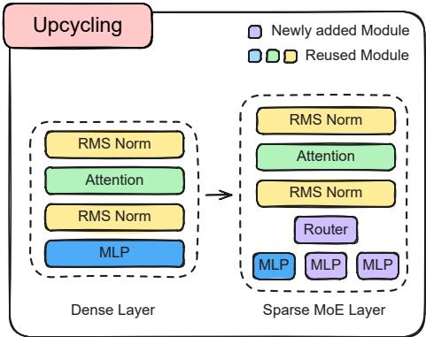
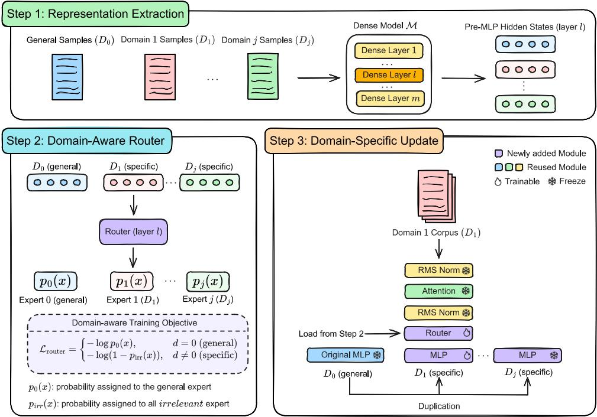

# Upcycling Language Models for Multiple Specialized Domains

Mingzi Cao Xi Wang Nikolaos Aletras School of Computer Science, University of Sheffield, United Kingdom {mcao20,xi.wang,n.aletras}@sheffield.ac.uk

## Abstract

Effective multi-domain adaptation of large language models requires prioritizing relevant do main knowledge while minimizing interference from irrelevant domains. Existing approaches commonly use Low-Rank Adaptation (LoRA) to train a separate adapter for each domain and combine these adapters within one model. However, they either weight adapters equally regardless of the input domain or dynamically weight adapters while still activating all of them including irrelevant ones. Additionally, while efficient, their low-rank structure limits performance. In contrast, upcycling is a model expansion method that adds experts and a router to a dense Transformer layer offering larger capacity than LoRA approaches. In this paper, we propose Domain-Specialized Upcycling (DS-UPCYCLING) for multi-domain adaptation. We introduce a new domain-aware supervision that allows the router to effectively learn to distinguish domains by selecting the appropriate experts. During fine-tuning on each new domain, we update only the corresponding expert and router while freezing all other parameters. Experiments show that our method achieves the highest average performance across the adapted domains compared to baselines while retaining general performance. With just 256 examples per domain for router supervision, DS-Upcycling achieves 90–98% routing accuracy after adaptation compared with 43–70% for routers trained without our approach.

## 1 Introduction

Large language models (LLMs) have demonstrated strong capabilities across a wide range of general tasks (Grattafiori et al., 2024; Yang et al., 2025a). However, domains involving consequential decisions such as biomedicine (Luo et al., 2022; Singhal et al., 2023) and law (Niklaus et al., 2024, 2025) require specialized knowledge beyond general capabilities that is induced via fine-tuning on domain specific data. Multi-domain adaptation extends this specialization to multiple domains, aiming to integrate their specialized knowledge within a single model (Chen et al., 2023; Sukhbaatar et al., 2024).

  
Figure 1: Illustration of Upcycling. Upcycling converts a pre-trained dense transformer layer into a sparse Mixture-of-Experts (MoE) layer.

Multi-domain adaptation methods suffer from catastrophic forgetting of general-domain capabilities (Li et al., 2024; Luo et al., 2025) and crossdomain interference (Chen et al., 2023; Sukhbaatar et al., 2024). Low-Rank Adaptation (LoRA) has been applied to address these challenges by freezing pre-trained weights and learning parameter updates through pairs of low-rank matrices (Hu et al., 2022). Additionally, separate adapters are trained for each domain and then combined within one model for adaptation. However, these approaches either weight adapters equally regardless of the input domain (Chitale et al., 2023; Wang et al., 2023; Asadi et al., 2024) or dynamically weight adapters while still activating all of them including irrelevant ones (Dou et al., 2024). Beyond these limitations, LoRA’s adaptation performance is further constrained by its low-rank structure (Biderman et al., 2024; Pletenev et al., 2025).

Upcycling is a model expansion method that adds full multi-layer perceptron (MLP) experts and a router to a dense Transformer layer resulting in sparse Mixture-of-Experts (MoE) architecture (Figure 1). The new experts learn domainspecific knowledge without low-rank constraints. The router activates a subset of experts for each input and assigns weights to the selected experts. This offers a natural way to prioritize relevant domain knowledge and exclude irrelevant domain knowledge through selective expert activation (Fedus et al., 2022; Komatsuzaki et al., 2023). Despite these advantages, upcycling for multiple domain adaptation remains largely underexplored. A few recent studies have explored multilingual adaptation (Zhou et al., 2025; Zhang et al., 2025), but they rely on language-specific signals for router guidance that are not transferable to domains within a specific language (e.g., law or biomedical).

In this work, we propose Domain-Specialized Upcycling (DS-Upcycling) for multi-domain adaptation (Figure 2). We first train the router with a domain-aware objective using only a small number of examples from each domain. This encourages general inputs to use the original MLP and discourages specialized inputs from using irrelevant experts. During adaptation to each domain, we update only its corresponding expert and the router while freezing all other parameters. These domainspecific expert updates promote specialization by concentrating learning within the corresponding expert and limiting cross-domain interference. Our main contributions are as follows:

• We propose DS-Upcycling for multi-domain adaptation. It outperforms existing baselines across specialized and general domains in two different model families.

• Our domain-aware router supervision uses just 256 examples per domain, requiring to only instantiating the routers.

• Our ablation study validates the contribution of each DS-Upcycling component. DS-Upcycling achieves 90–98% routing accuracy on specialized domains compared with 43– 70% for routers trained without it.

## 2 Related Work

## 2.1 Multi-domain Adaptation

LLM adaptation faces catastrophic forgetting of general-domain capabilities (Li et al., 2024; Luo et al., 2025) and cross-domain interference (Chen et al., 2023; Sukhbaatar et al., 2024). To address these challenges, LoRA-based methods freeze pretrained weights and learn updates through pairs of low-rank matrices (Hu et al., 2022). A common strategy trains one adapter per domain and combines their outputs with equal weights (Chitale et al., 2023; Wang et al., 2023; Asadi et al., 2024). However, equal weighting prevents the model from prioritizing the adapter most relevant to the input domain. LoRAMoE addresses this limitation through a router that dynamically weights adapters (Dou et al., 2024). Yet it activates all adapters for every input and therefore cannot exclude irrelevant ones. Despite their efficiency, LoRA-based methods remain constrained by their low-rank architecture (Biderman et al., 2024; Pletenev et al., 2025). LLaMA-Pro instead inserts and trains additional transformer layers while freezing pre-trained parameters (Wu et al., 2024). Although it outperforms LoRA in specialized domains, its added layers are shared across domains and remain vulnerable to cross-domain interference. In contrast, our method trains full MLP experts for individual domains and selectively activates them.

## 2.2 Model Upcycling

Pre-training. Most upcycling work focuses on expert initialization for pre-training on large-scale general data. Komatsuzaki et al. (2023) find that duplicating the dense MLP performs best. However, identical initialization can hinder subsequent expert specialization (Wei et al., 2024; Nakamura et al., 2025). To address this issue, Muennighoff et al. (2025) randomly replace some weights in each copied expert. Nakamura et al. (2025) instead partially re-initialize experts using Gaussian distributions matched to pre-trained weight statistics. These methods use >200B tokens to train randomly initialized routers. However, they face two limitations in multi-domain adaptation. First, domain-specific datasets are much smaller than pre-training corpora and may be insufficient for randomly initialized routers to learn to distinguish domains from data alone. Second, making experts different at initialization does not ensure that they specialize in distinct domains unless subsequent training explicitly guides this specialization. Our method uses domain-aware router supervision to guide expert selection and domain-specific expert updates to promote specialization despite identical initialization.

  
Figure 2: Illustration of DS-Upcycling. Step 1: Extract domain-specific hidden states. Step 2: Domain-aware router supervision favors the general expert for inputs from the general domain and suppresses irrelevant experts for inputs from specialized domains. Step 3: During adaptation to each specialized domain, update only its corresponding expert and the router while freezing all other parameters.

Domain Adaptation. Upcycling methods outperform other methods on multilingual adaptation (Zhou et al., 2025). Zhou et al. (2025) refine the router with language priors, and Zhang et al. (2025) add a language classifier to guide routing, with the latter requiring architectural changes beyond a standard MoE layer. Therefore, both methods are not transferable to domain adaptation within the same language. They depend on the language of an input being identifiable, so that routing can be tied to language identity. Specialized domains such as legal and biomedical in English, share the same script and much of the same vocabulary and offer no comparable surface-level signals. In contrast, our method requires neither domain-specific priors nor architectural changes beyond a standard MoE layer and applies to arbitrary domains.

## 3 Domain-Specialized Upcycling

We propose Domain-Specialized Upcycling (DS-Upcycling), a new upcycling framework designed for multi-domain adaptation (Figure 2). It consists of three main steps: (1) domain-specific representation extraction, (2) domain-aware router supervision, and (3) domain-specific experts updates.

## 3.1 Preliminaries

MoE. A sparse MoE layer contains n MLP experts and a router with projection matrix Wrouter. For input x, the router assigns expert weights:

$$
p _ { i } ( \boldsymbol { x } ) = \left[ \mathrm { S o f t m a x } \left( \mathrm { T o p } { - } k ( \boldsymbol { x } ^ { \top } \mathbf { W } _ { \mathrm { r o u t e r } } ) \right) \right] _ { i }
$$

Top-k retains the $k < n$ largest logits and sets the rest to −∞ (Fedus et al., 2022). The output is the weighted sum of selected experts.

$$
\mathbf { M o E } ( x ) = \sum _ { i = 1 } ^ { n } p _ { i } ( x ) \mathbf { M L P } _ { i } ( x )
$$

Upcycling. Given a dense Transformer M, upcycling retains the original MLP in each selected layer l and adds $n - 1$ new MLP experts and a router. All other modules remain unchanged:

$$
\mathbf { M L P } ^ { ( l ) } ( x ) \ \to \ \mathbf { M o E } ^ { ( l ) } ( x )
$$

## 3.2 Representation Extraction

To extend upcycling to multi-domain adaptation, we extract hidden states from each domain for domain-aware router supervision before adaptation. Given j specialized-domain datasets $\{ D _ { 1 } , \ldots , D _ { j } \}$ and a general-domain dataset $D _ { 0 }$ we sample a small set of examples from each and pass them through the dense model M.

Let L denote the set of layers to be upcycled. For each layer $l \in L .$ let $\mathcal { X } _ { d } ^ { ( \bar { l } ) }$ denote the hidden states extracted immediately before the MLP from examples in $D _ { d } .$ . We pair each hidden state with its domain label to construct the router training set:

$$
{ \mathcal { X } } _ { \mathrm { r o u t e r } } ^ { ( l ) } = \Big \{ ( x , d ) \ | \ x \in { \mathcal { X } } _ { d } ^ { ( l ) } , \ d \in \{ 0 , \dots , j \} \Big \}
$$

## 3.3 Domain-aware Router Supervision

Each upcycled layer contains the original dense MLP as its general expert and j specialized experts corresponding to the target domains. For each layer $l \in L$ , we train a separate router $\mathbf { W } _ { \mathrm { r o u t e r } } ^ { ( l ) }$ on $\mathcal { X } _ { \mathrm { r o u t e r } } ^ { ( l ) }$ . This supervision requires only instantiating the routers, without involving the dense model. For a hidden state $x$ from domain $D _ { d } ,$ we define the domain-aware objective as:

$$
\mathcal { L } _ { \mathrm { r o u t e r } } = \left\{ \begin{array} { l l } { - \log p _ { 0 } ( x ) , } & { d = 0 , } \\ { - \log ( 1 - p _ { \mathrm { i r r } } ( x ) ) , } & { d \in \{ 1 , \ldots , j \} } \end{array} \right.
$$

where $p _ { 0 } ( x )$ is the routing probability assigned to the general expert and $p _ { \mathrm { i r r } } ( x )$ is the total routing probability assigned to specialized experts for domains other than $D _ { d } .$ For general-domain inputs, the objective encourages selection of the general expert. For specialized-domain inputs, it suppresses irrelevant experts while allowing both the corresponding specialized expert and the general expert to contribute.

## 3.4 Expert Initialization

We initialize each specialized expert by copying the dense MLP following Komatsuzaki et al. (2023). This is motivated by findings from prior work on expanding pre-trained models showing that initializing the expanded model to produce the same outputs as the original model benefits subsequent adaptation (Wu et al., 2024; Cao et al., 2026b). For each upcycled layer $l \in L ,$ , the original MLP is copied to each specialized expert $\mathrm { M L P } _ { d } ^ { ( l ) } \gets \mathrm { M L P } ^ { ( l ) } , \forall l \in$ $L , d \in \{ 1 , \dotsc , j \}$

All experts initially produce identical outputs and the selected experts’ routing weights sum to one. Their weighted output therefore matches the original MLP regardless of router selection.

## 3.5 Domain-specific Expert Updates

DS-Upcycling has two training stages. First, each router is trained independently on the extracted hidden states using the domain-aware objective (§3.3).

Second, the upcycled model is adapted to each target domain. Inspired by prior work (Wang et al., 2024; Li et al., 2025), we update only the router and expert d in each upcycled layer during adaptation to $D _ { d }$ while freezing all other parameters. Restricting each expert’s updates to its corresponding domain promotes expert specialization. This mitigates cross-domain interference while preserving the general expert’s pre-trained knowledge.

## 4 Experimental Setup

## 4.1 Base Models

We use the pre-trained versions of Llama-3.1-8B (Grattafiori et al., 2024) and Qwen-3-8B (Yang et al., 2025a) as base models.

## 4.2 Baselines

We compare DS-Upcycling with a broad range of methods grouped into two categories: (1) dense baselines and (2) upcycling baselines. Implementation and hyper-parameter details are provided in Appendices A and B.

Dense Baselines. These methods retain the dense Transformer layer architecture. (1) Simple FT updates all model parameters without architectural changes. (2) LoRA trains a separate adapter for each domain and combines their outputs with equal weights (Chitale et al., 2023; Wang et al., 2023; Asadi et al., 2024). (3) LoRAMoE uses a router to dynamically weight all adapter outputs (Dou et al., 2024). (4) LLaMA-Pro inserts new dense Transformer layers after each group of pre-trained layers and trains only the new layers (Wu et al., 2024).

Upcycling Baselines. These methods use upcycling to convert dense Transformer layers into sparse MoE layers. They randomly initialize routers and update all parameters during adaptation but differ in expert initialization. (1) Random Init randomly initializes all weights of each new expert (Fedus et al., 2022). (2) Duplication initializes each new expert by copying the dense MLP (Komatsuzaki et al., 2023). (3) Random Perturb copies the dense MLP and randomly re-initializes a subset of its weights (Muennighoff et al., 2025). (4) Partial Init copies the dense MLP and re-initializes a subset of its weights using Gaussians matched to their original distribution (Nakamura et al., 2025).

<table><tr><td colspan="2"></td><td colspan="5">Biomedical</td><td colspan="4">Legal</td></tr><tr><td colspan="2">Methods</td><td></td><td></td><td></td><td>MedMCQA MedQA Bio-MMLU PubMedQA Average</td><td></td><td>Law-MMLU CaseHOLD</td><td></td><td>ECtHR</td><td>Average</td></tr><tr><td rowspan="5">|Simple FT Dense LoRA</td><td>Llama-3.1-8B</td><td> $5 6 . 3 4 _ { 0 . 1 9 }$ </td><td> $6 0 . 3 6 _ { 0 . 1 2 }$ </td><td> $\underline { { 7 2 . 3 7 _ { 0 . 2 8 } } }$ </td><td> $7 5 . 6 7 _ { 0 . 1 2 }$ </td><td> $6 6 . 1 8 _ { 0 . 0 5 }$ </td><td> $\underline { { 6 7 . 9 8 _ { 0 . 2 7 } } }$ </td><td> $5 2 . 3 1 _ { 0 . 2 2 }$ </td><td> $6 0 . 6 0 _ { 0 . 1 4 }$ </td><td> $6 0 . 3 0 _ { 0 . 0 7 }$ </td></tr><tr><td></td><td> $4 0 . 1 1 _ { 0 . 1 0 }$ </td><td> $4 3 . 2 3 _ { 0 . 3 0 }$ </td><td> $4 8 . 7 5 _ { 0 . 1 2 }$ </td><td> $7 0 . 6 7 _ { 0 . 1 2 }$ </td><td> $5 0 . 6 9 _ { 0 . 0 5 }$ </td><td> $4 5 . 9 8 _ { 3 . 9 0 }$ </td><td> $7 6 . 1 4 _ { 0 . 0 5 }$ </td><td> $3 9 . 5 2 _ { 0 . 0 7 }$ </td><td> $5 3 . 8 8 _ { 1 . 3 1 }$ </td></tr><tr><td></td><td> $5 6 . 0 4 _ { 0 . 0 5 }$ </td><td> $5 6 . 6 4 _ { 0 . 3 4 }$ </td><td> $6 6 . 9 8 _ { 0 . 1 0 }$ </td><td> $\underline { { 7 8 . 3 3 _ { 0 . 1 2 } } }$ </td><td> $6 4 . 5 0 _ { 0 . 0 7 }$ </td><td> $6 5 . 3 3 _ { 0 . 0 5 }$ </td><td> $7 0 . 3 9 _ { 0 . 1 4 }$ </td><td> $\underline { { 6 2 . 7 1 _ { 0 . 1 4 } } }$ </td><td> $\underline { { 6 6 . 1 4 _ { 0 . 0 2 } } }$ </td></tr><tr><td>LoRAMoE LLaMA-Pro</td><td> ${ \bf 6 0 . 2 0 _ { 0 . 1 1 } }$ </td><td> $5 7 . 2 7 _ { 0 . 1 6 }$ </td><td> $7 1 . 1 0 _ { 0 . 0 8 }$ </td><td> ${ \bf 7 8 . 5 3 _ { 0 . 1 2 } }$ </td><td> $\underline { { 6 6 . 7 7 _ { 0 . 0 2 } } }$ </td><td> $6 7 . 4 9 _ { 0 . 0 2 }$ </td><td> $7 1 . 6 5 _ { 0 . 0 7 }$ </td><td> $5 8 . 9 5 _ { 0 . 0 7 }$ </td><td> $6 6 . 0 3 _ { 0 . 0 4 }$ </td></tr><tr><td></td><td> $5 7 . 3 4 _ { 0 . 0 3 }$ </td><td> $5 8 . 2 9 _ { 0 . 2 7 }$ </td><td> $6 7 . 4 9 _ { 0 . 4 5 }$ </td><td> $7 8 . 0 7 _ { 0 . 1 2 }$ </td><td> $6 5 . 3 0 _ { 0 . 1 5 }$ </td><td> $6 3 . 9 2 _ { 0 . 0 9 }$ </td><td> $5 3 . 7 6 _ { 0 . 0 8 }$ </td><td> ${ \bf 6 2 . 9 1 _ { 0 . 0 7 } }$ </td><td> $6 0 . 2 0 _ { 0 . 0 3 }$ </td></tr><tr><td rowspan="5">UPliing</td><td>Random Init.</td><td> $4 0 . 7 4 _ { 0 . 1 0 }$ </td><td> $4 1 . 2 9 _ { 0 . 2 3 }$ </td><td> $4 9 . 6 8 _ { 0 . 1 6 }$ </td><td> $6 9 . 9 3 _ { 0 . 2 3 }$ </td><td> $5 0 . 4 1 _ { 0 . 0 2 }$ </td><td> $4 4 . 3 9 _ { 5 . 5 7 }$ </td><td> $7 6 . 4 1 _ { 0 . 0 2 }$ </td><td> $4 9 . 0 5 _ { 0 . 2 6 }$ </td><td> $5 6 . 6 2 _ { 1 . 8 7 }$ </td></tr><tr><td>Duplication</td><td> $4 0 . 2 5 _ { 0 . 0 5 }$ </td><td> $4 3 . 0 5 _ { 0 . 3 4 }$ </td><td> $4 7 . 9 0 _ { 0 . 2 5 }$ </td><td> $7 2 . 6 7 _ { 0 . 3 1 }$ </td><td> $5 0 . 9 7 _ { 0 . 0 2 }$ </td><td> $4 6 . 2 4 _ { 4 . 1 2 }$ </td><td> $\underline { { 7 6 . 6 7 _ { 0 . 0 3 } } }$ </td><td> $4 4 . 2 7 _ { 0 . 2 9 }$ </td><td> $5 5 . 7 3 _ { 1 . 4 2 }$ </td></tr><tr><td>Random Perturb.</td><td> $3 7 . 6 0 _ { 0 . 1 4 }$ </td><td> $4 0 . 4 6 _ { 0 . 0 8 }$ </td><td> $4 6 . 2 8 _ { 0 . 1 1 }$ </td><td> $7 3 . 4 0 _ { 0 . 0 0 }$ </td><td> $4 9 . 4 3 _ { 0 . 0 7 }$ </td><td> $4 1 . 9 6 _ { 6 . 4 3 }$ </td><td> ${ \bf 7 6 . 8 5 _ { 0 . 0 4 } }$ </td><td> $4 0 . 3 5 _ { 0 . 2 1 }$ </td><td> $5 3 . 0 5 _ { 2 . 1 2 }$ </td></tr><tr><td>Partial Init.</td><td> $3 9 . 2 4 _ { 0 . 1 4 }$ </td><td> $3 9 . 4 3 _ { 0 . 2 8 }$ </td><td> $4 7 . 1 4 _ { 0 . 0 7 }$ </td><td> $7 4 . 4 7 _ { 0 . 1 2 }$ </td><td> $5 0 . 0 7 _ { 0 . 0 6 }$ </td><td> $4 5 . 1 0 _ { 4 . 7 0 }$ </td><td> $7 6 . 5 2 _ { 0 . 0 8 }$ </td><td> $4 3 . 7 7 _ { 0 . 1 4 }$ </td><td> $5 5 . 1 3 _ { 1 . 6 4 }$ </td></tr><tr><td>DS-Upcycling (Ours)</td><td> $5 9 . 7 6 _ { 0 . 1 1 }$ </td><td> $\mathbf { 6 1 . 5 1 _ { 0 . 3 4 } } ^ { \ast }$ </td><td> ${ \bf 7 5 . 0 8 _ { 0 . 0 5 } } ^ { * }$ </td><td> $7 7 . 3 3 _ { 0 . 1 2 }$ </td><td> $\mathbf { 6 8 . 4 2 _ { 0 . 0 8 } } ^ { * }$ </td><td> $\mathbf { 6 8 . 7 9 _ { 0 . 3 1 } }$ </td><td> $7 5 . 5 2 _ { 0 . 1 0 }$ </td><td> $6 2 . 5 8 _ { 0 . 2 6 }$ </td><td> ${ \bf 6 8 . 9 6 _ { 0 . 1 4 } } ^ { \ast }$ </td></tr><tr><td colspan="2">Qwen-3-8B</td><td> $6 2 . 4 9 _ { 0 . 0 8 }$ </td><td> $\underline { { 6 5 . 5 4 _ { 0 . 0 9 } } }$ </td><td> $8 0 . 1 1 _ { 0 . 1 7 }$ </td><td> $7 6 . 5 3 _ { 0 . 2 3 }$ </td><td> $7 1 . 1 7 _ { 0 . 0 9 }$ </td><td> $\underline { { 7 4 . 7 7 _ { 0 . 1 6 } } }$ </td><td> $6 3 . 5 9 _ { 0 . 0 8 }$ </td><td> $6 0 . 8 1 _ { 0 . 3 6 }$ </td><td> $6 6 . 3 9 _ { 0 . 2 0 }$ </td></tr><tr><td rowspan="4">Dense LoRA</td><td>|Simple FT</td><td> $6 0 . 4 2 _ { 0 . 1 1 }$ </td><td> $6 1 . 4 6 _ { 0 . 2 3 }$ </td><td> $7 8 . 0 0 _ { 0 . 2 8 }$ </td><td> $7 8 . 3 3 _ { 0 . 2 3 }$ </td><td> $6 9 . 5 5 _ { 0 . 0 6 }$ </td><td> $6 2 . 1 3 \mathrm { _ { 0 . 3 6 } }$ </td><td> $\underline { { 8 3 . 3 1 _ { 0 . 0 2 } } }$ </td><td> $6 1 . 8 8 _ { 0 . 0 0 }$ </td><td> $6 9 . 1 1 _ { 0 . 1 3 }$ </td></tr><tr><td></td><td> $5 9 . 7 3 _ { 0 . 1 4 }$ </td><td> $5 0 . 6 4 _ { 0 . 2 3 }$ </td><td> $7 8 . 7 1 _ { 0 . 1 4 }$ </td><td> $\underline { { 7 9 . 2 7 _ { 0 . 1 2 } } }$ </td><td> $6 7 . 0 9 _ { 0 . 1 5 }$ </td><td> $7 0 . 5 0 _ { 0 . 4 2 }$ </td><td> $7 2 . 4 4 _ { 0 . 1 1 }$ </td><td> $\underline { { 6 4 . 5 2 _ { 0 . 0 7 } } }$ </td><td> $6 9 . 1 5 _ { 0 . 1 3 }$ </td></tr><tr><td>LoRAMoE</td><td> $6 1 . 7 4 _ { 0 . 0 7 }$ </td><td> $6 2 . 3 2 _ { 0 . 0 5 }$ </td><td> $\mathbf { 8 2 . 7 4 _ { 0 . 2 7 } }$ </td><td> $\mathbf { 7 9 . 6 0 _ { 0 . 2 0 } }$ </td><td> $\underline { { 7 1 . 6 0 _ { 0 . 0 9 } } }$ </td><td> $7 1 . 7 9 _ { 0 . 1 9 }$ </td><td> $7 5 . 6 0 _ { 0 . 0 6 }$ </td><td> $6 3 . 7 0 _ { 0 . 2 6 }$ </td><td> $7 0 . 3 6 _ { 0 . 1 3 }$ </td></tr><tr><td> $\mathrm { L L a M A – P r o }$ </td><td> $\underline { { 6 3 . 4 2 _ { 0 . 0 6 } } }$ </td><td> $6 4 . 4 4 _ { 0 . 3 6 }$ </td><td> $7 8 . 3 9 _ { 0 . 1 7 }$ </td><td> $7 5 . 4 0 _ { 0 . 0 0 }$ </td><td> $7 0 . 4 1 _ { 0 . 1 5 }$ </td><td> $7 1 . 3 4 _ { 0 . 1 3 }$ </td><td> $7 4 . 3 1 _ { 0 . 0 5 }$ </td><td> $6 3 . 8 2 _ { 0 . 1 4 }$ </td><td> $6 9 . 8 2 _ { 0 . 0 1 }$ </td></tr><tr><td rowspan="5">UPucling</td><td>Random Init.</td><td> $5 9 . 3 8 _ { 0 . 0 9 }$ </td><td> $6 1 . 1 2 _ { 0 . 2 1 }$ </td><td> $7 8 . 2 9 _ { 0 . 2 5 }$ </td><td> $7 6 . 8 0 _ { 0 . 0 0 }$ </td><td> $6 8 . 9 0 _ { 0 . 1 2 }$ </td><td> $6 6 . 2 2 _ { 0 . 2 4 }$ </td><td> $8 2 . 5 1 _ { 0 . 0 9 }$ </td><td> $6 1 . 8 4 _ { 0 . 0 7 }$ </td><td> $7 0 . 1 9 _ { 0 . 1 2 }$ </td></tr><tr><td>Duplication</td><td> $6 0 . 2 7 _ { 0 . 1 1 }$ </td><td> $6 3 . 3 4 _ { 0 . 1 2 }$ </td><td> $7 7 . 4 5 _ { 0 . 0 7 }$ </td><td> $7 8 . 2 0 _ { 0 . 5 3 }$ </td><td> $6 9 . 8 1 _ { 0 . 1 5 }$ </td><td> $6 2 . 3 4 _ { 0 . 4 7 }$ </td><td> $8 2 . 8 0 _ { 0 . 0 9 }$ </td><td> $6 0 . 5 2 _ { 0 . 1 2 }$ </td><td> $6 8 . 5 5 \mathrm { _ { 0 . 1 4 } }$ </td></tr><tr><td>Random Perturb.</td><td> $6 0 . 5 2 _ { 0 . 0 3 }$ </td><td> $6 2 . 5 8 _ { 0 . 1 2 }$ </td><td> $7 8 . 0 5 _ { 0 . 3 7 }$ </td><td> $7 6 . 4 7 _ { 0 . 1 2 }$ </td><td> $6 9 . 4 0 _ { 0 . 1 3 }$ </td><td> $6 4 . 2 0 \mathrm { _ { 0 . 0 9 } }$ </td><td> $8 1 . 3 9 _ { 0 . 0 5 }$ </td><td> $6 3 . 7 4 _ { 0 . 0 0 }$ </td><td> $6 9 . 7 7 _ { 0 . 0 1 }$ </td></tr><tr><td>Partial Init.</td><td> $5 9 . 5 7 _ { 0 . 0 3 }$ </td><td> $6 2 . 7 9 _ { 0 . 5 0 }$ </td><td> $7 9 . 6 5 _ { 0 . 3 4 }$ </td><td> $7 7 . 5 3 \mathrm { _ 0 . 1 2 }$ </td><td> $6 9 . 8 9 _ { 0 . 1 9 }$ </td><td> $6 3 . 8 6 _ { 0 . 4 2 }$ </td><td> $\mathbf { 8 3 . 4 9 _ { 0 . 1 1 } }$ </td><td> ${ \bf 6 6 . 3 8 _ { 0 . 0 7 } }$ </td><td> $\underline { { 7 1 . 2 4 0 . 1 4 } }$ </td></tr><tr><td>DS-Upcycling (Ours)</td><td> $\mathbf { 6 6 . 6 2 _ { 0 . 0 5 } } ^ { * }$ </td><td> $\mathbf { 6 9 . 0 5 _ { 0 . 2 7 } } ^ { \ast }$ </td><td> $\underline { { 8 0 . 4 1 _ { 0 . 2 2 } } }$ </td><td> $7 7 . 2 7 _ { 0 . 3 1 }$ </td><td> ${ \bf 7 3 . 3 4 _ { 0 . 0 9 } } ^ { * }$ </td><td> ${ \bf 7 5 . 7 6 _ { 0 . 1 6 } } ^ { * }$ </td><td> $7 8 . 1 2 _ { 0 . 1 1 }$ </td><td> $6 2 . 5 8 _ { 0 . 1 4 }$ </td><td> $\mathbf { 7 2 . 1 5 _ { 0 . 0 9 } } ^ { \ast }$ </td></tr></table>

Table 1: Performance on specialized domains. Bold/underlined denote best/second-best results per task. Green / Red indicates scores above/below the untrained base model. When our method ranks first, ∗ marks significant improvements over the second-best method (paired t-test, $p < 0 . 0 5 )$

## 4.3 Training Data

We evaluate DS-Upcycling and all baselines in legal and biomedical domains as they are widely explored in prior NLP research (Gu et al., 2021; Luo et al., 2022; Singhal et al., 2023; Chalkidis et al., 2019; Zheng et al., 2021; Henderson et al., 2022; Niklaus et al., 2024). Both domains require specialized knowledge beyond general capabilities. We sample uniformly across task subsets within each dataset to obtain balanced training sets of 393K examples per domain.

eral benchmarks assess catastrophic forgetting. For all datasets, we report the mean and standard deviation across three random seeds.

Legal. We use the English subset of LawInstruct that covers diverse legal tasks (Niklaus et al., 2025).

Biomedical. We use PubMedQA (Jin et al., 2019), MedQA (Jin et al., 2021), MedMCQA (Pal et al., 2022) tasks, and relevant subsets from MMLU (Hendrycks et al., 2021) such as anatomy, clinical knowledge, college medicine, medical genetics, professional medicine, and college biology.

Biomedical. We train on MedINST (Han et al., 2024) using the task subsets included in MultiMedQA (Singhal et al., 2022).

Legal. We use CaseHOLD (Zheng et al., 2021) and ECtHR (Task A) (Chalkidis et al., 2019) from LexGLUE (Chalkidis et al., 2022) and Legal-MMLU, covering jurisprudence, professional law, and international law (Hendrycks et al., 2021).

For domain-aware router supervision, we extract hidden states from 256 randomly selected examples per domain (§3.2). Legal and biomedical examples come from their respective training datasets. General-domain examples come from Alpaca-GPT4 (Peng et al., 2023).

General. We use ARC (Clark et al., 2018), BoolQ (Clark et al., 2019), HellaSwag (Zellers et al., 2019), LAMBADA (Paperno et al., 2016), OpenBookQA (Banerjee et al., 2019), PIQA (Bisk et al., 2020), RTE (Dagan et al., 2005), StoryCloze (Mostafazadeh et al., 2016) and WinoGrande (Sakaguchi et al., 2021).

## 5 Results

## 4.4 Evaluation Tasks

We use the legal, biomedical and general-domain benchmarks from Williams et al. (2026). The gen-

## 5.1 Domain-specific Performance

Table 1 presents the results in the biomedical and legal domains.

<table><tr><td colspan="2">Methods</td><td>ARC-C</td><td>ARC-E</td><td>BoolQ</td><td colspan="3">HellaSwag LAMBADA OpenBookQA</td><td>PIQA</td><td>RTE</td><td colspan="3">WinoGrande StoryCloze</td></tr><tr><td colspan="2">Llama-3.1-8B</td><td> $5 1 . 3 7 _ { 0 . 0 0 }$ </td><td> $8 1 . 5 0 _ { 0 . 1 4 }$ </td><td> $8 2 . 0 8 _ { 0 . 0 5 }$ </td><td> ${ \bf 6 0 . 0 2 _ { 0 . 0 4 } }$ </td><td> $6 7 . 2 4 _ { 0 . 0 3 }$ </td><td> $3 3 . 2 0 _ { 0 . 0 0 }$ </td><td> $\mathbf { 8 0 . 0 9 _ { 0 . 1 1 } }$ </td><td> $\underline { { 7 0 . 5 2 0 . 4 2 } }$ </td><td> $\underline { { 7 3 . 7 2 _ { 0 . 2 8 } } }$ </td><td> $7 8 . 1 4 _ { 0 . 1 0 }$ </td><td> $6 7 . 7 9 _ { 0 . 0 8 }$ </td></tr><tr><td rowspan="4">Dense</td><td>Simple FT</td><td> $3 2 . 9 1 _ { 0 . 2 6 }$ </td><td> $6 1 . 5 0 _ { 0 . 1 0 }$ </td><td> $6 8 . 6 3 _ { 0 . 2 6 }$ </td><td> $4 2 . 5 5 _ { 0 . 0 2 }$ </td><td> $3 4 . 1 7 _ { 0 . 1 1 }$ </td><td> $2 4 . 2 0 \phantom { . 0 0 } 2 4 . 2 0 \phantom { . 0 0 }$ </td><td> $6 9 . 0 6 _ { 0 . 2 5 }$ </td><td> $5 6 . 2 0 _ { 0 . 2 1 }$ </td><td> $6 1 . 1 4 _ { 0 . 2 3 }$ </td><td> $6 5 . 6 5 _ { 0 . 1 1 }$ </td><td> $5 1 . 6 0 _ { 0 . 0 4 }$ </td></tr><tr><td>LoRA</td><td> $5 2 . 1 0 _ { 0 . 2 1 }$ </td><td> $8 0 . 6 4 _ { 0 . 1 1 }$ </td><td> $8 0 . 3 7 _ { 0 . 0 8 }$ </td><td> $5 7 . 4 0 _ { 0 . 0 4 }$ </td><td> $6 5 . 0 8 _ { 0 . 0 6 }$ </td><td> $\mathbf { 3 7 . 6 0 _ { 0 . 2 0 } }$ </td><td> $7 7 . 7 7 _ { 0 . 0 8 }$ </td><td> $6 1 . 1 3 _ { 0 . 2 1 }$ </td><td> $7 1 . 9 5 _ { 0 . 0 9 }$ </td><td> $\mathbf { 7 9 . 2 4 _ { 0 . 0 8 } }$ </td><td> $6 6 . 3 3 _ { 0 . 0 0 }$ </td></tr><tr><td>LoRAMoE</td><td> $\mathbf { 5 3 . 7 3 _ { 0 . 1 8 } }$ </td><td> $\underline { { 8 2 . 4 4 _ { 0 . 1 3 } } }$ </td><td> $\underline { { 8 2 . 6 8 _ { 0 . 1 2 } } }$ </td><td> $5 8 . 8 4 _ { 0 . 0 4 }$ </td><td> ${ \bf 7 1 . 3 2 _ { 0 . 0 4 } }$ </td><td> $\underline { { 3 5 . 7 3 _ { 0 . 1 2 } } }$ </td><td> $7 7 . 7 8 _ { 0 . 0 3 }$ </td><td> $6 5 . 8 2 _ { 0 . 2 1 }$ </td><td> $7 3 . 5 9 _ { 0 . 1 2 }$ </td><td> $7 7 . 2 8 _ { 0 . 0 8 }$ </td><td> $\underline { { 6 7 . 9 2 _ { 0 . 0 3 } } }$ </td></tr><tr><td>LLaMA-Pro</td><td> ${ \underline { { 5 3 . 1 9 } } } _ { 0 . 2 0 }$ </td><td> $7 9 . 6 9 _ { 0 . 1 4 }$ </td><td> $8 1 . 8 3 _ { 0 . 0 5 }$ </td><td> $5 5 . 7 4 _ { 0 . 0 1 }$ </td><td> $\underline { { 7 0 . 8 8 _ { 0 . 1 0 } } }$ </td><td> $3 5 . 6 7 _ { 0 . 1 2 }$ </td><td> $7 8 . 6 2 _ { 0 . 0 0 }$ </td><td> $6 6 . 4 3 _ { 0 . 3 6 }$ </td><td> $7 1 . 0 6 _ { 0 . 1 2 }$ </td><td> $7 6 . 0 9 _ { 0 . 1 7 }$ </td><td> $6 6 . 9 2 _ { 0 . 0 6 }$ </td></tr><tr><td rowspan="5">UPcing</td><td>Random Init.</td><td> $3 3 . 7 9 _ { 0 . 1 5 }$ </td><td> $6 4 . 7 2 _ { 0 . 1 1 }$ </td><td> $7 0 . 3 7 _ { 0 . 0 3 }$ </td><td> $4 1 . 8 4 _ { 0 . 0 1 }$ </td><td> $3 1 . 7 4 _ { 0 . 0 7 }$ </td><td> $2 3 . 5 3 _ { 0 . 1 2 }$ </td><td> $6 9 . 9 1 _ { 0 . 2 2 }$ </td><td> $5 4 . 9 9 _ { 0 . 4 2 }$ </td><td> $6 0 . 4 3 _ { 0 . 0 9 }$ </td><td> $6 7 . 5 0 _ { 0 . 0 0 }$ </td><td> $5 1 . 8 8 _ { 0 . 0 7 }$ </td></tr><tr><td>Duplication</td><td> $3 5 . 5 5 _ { 0 . 1 0 }$ </td><td> $6 1 . 9 5 _ { 0 . 0 0 }$ </td><td> $7 4 . 0 3 _ { 0 . 1 1 }$ </td><td> $4 2 . 7 5 _ { 0 . 0 6 }$ </td><td> $3 8 . 5 5 _ { 0 . 0 7 }$ </td><td> $2 3 . 7 3 _ { 0 . 1 2 }$ </td><td> $6 8 . 9 9 _ { 0 . 0 9 }$ </td><td> $5 2 . 5 9 _ { 0 . 2 1 }$ </td><td> $6 1 . 2 5 _ { 0 . 2 1 }$ </td><td> $6 8 . 2 8 _ { 0 . 1 4 }$ </td><td> $5 2 . 7 7 _ { 0 . 0 1 }$ </td></tr><tr><td>Random Perturb.</td><td> $3 3 . 3 9 _ { 0 . 0 5 }$ </td><td> $6 3 . 4 4 _ { 0 . 0 2 }$ </td><td> $7 4 . 8 6 _ { 0 . 0 5 }$ </td><td> $4 2 . 1 6 \phantom { 0 } _ { 0 . 0 2 }$ </td><td> $3 5 . 0 2 _ { 0 . 0 7 }$ </td><td> $2 5 . 3 3 \phantom { 0 } _ { 0 . 2 3 }$ </td><td> $6 8 . 5 9 0 . 0 8 $ </td><td> $5 4 . 1 5 _ { 0 . 0 0 }$ </td><td> $6 0 . 8 3 _ { 0 . 2 0 }$ </td><td> $6 6 . 4 9 \mathrm { 0 . 1 0 }$ </td><td> $5 2 . 4 3 _ { 0 . 0 4 }$ </td></tr><tr><td>Partial Init.</td><td> $3 4 . 3 0 _ { 0 . 1 7 }$ </td><td> $6 4 . 1 7 _ { 0 . 1 5 }$ </td><td> $7 0 . 1 7 _ { 0 . 0 2 }$ </td><td> $4 2 . 5 7 _ { 0 . 0 3 }$ </td><td> $3 3 . 6 4 _ { 0 . 0 9 }$ </td><td> $2 4 . 0 0 _ { 0 . 0 0 }$ </td><td> $6 8 . 4 8 _ { 0 . 2 3 }$ </td><td> $5 8 . 6 0 _ { 0 . 2 1 }$ </td><td> $6 2 . 4 6 \mathrm { _ 0 . 0 9 }$ </td><td> $6 6 . 9 8 _ { 0 . 1 8 }$ </td><td> $5 2 . 5 4 0 . 0 3 $ </td></tr><tr><td>DS-Upcycling (Ours)</td><td> $5 2 . 2 8 _ { 0 . 1 0 }$ </td><td> $\mathbf { 8 3 . 0 1 _ { 0 . 1 1 } }$ </td><td> $\mathbf { 8 3 . 3 0 _ { 0 . 0 3 } } ^ { * }$ </td><td> $\underline { { 5 9 . 9 2 _ { 0 . 0 1 } } }$ </td><td> $6 9 . 1 9 _ { 0 . 0 3 }$ </td><td> $3 4 . 4 0 _ { 0 . 2 0 }$ </td><td> $\underline { { 7 9 . 5 2 _ { 0 . 1 3 } } }$ </td><td> ${ \bf 7 3 . 5 3 0 . 4 2 } ^ { \ast }$ </td><td> $\mathbf { 7 4 . 4 0 _ { 0 . 1 2 } }$ </td><td> $\underline { { 7 8 . 6 7 _ { 0 . 2 0 } } }$ </td><td> ${ \bf 6 8 . 8 2 _ { 0 . 0 4 } } ^ { * }$ </td></tr><tr><td colspan="2">Qwen-3-8B</td><td> $5 2 . 7 0 \phantom { } _ { 0 . 2 5 }$ </td><td> $8 1 . 8 2 _ { 0 . 0 0 }$ </td><td> $8 3 . 0 8 _ { 0 . 0 7 }$ </td><td> $5 8 . 8 5 \mathrm { 0 . 0 1 }$ </td><td> $6 6 . 0 9 _ { 0 . 0 7 }$ </td><td> $3 2 . 4 0 \phantom { 0 } _ { 0 . 5 3 }$ </td><td> $7 9 . 1 8 _ { 0 . 1 4 }$ </td><td> $\mathbf { 7 4 . 9 7 _ { 0 . 2 1 } }$ </td><td> $7 2 . 4 0 _ { 0 . 1 2 }$ </td><td> $7 8 . 4 0 _ { 0 . 1 0 }$ </td><td> $6 7 . 9 9 0 . 0 3 $ </td></tr><tr><td rowspan="5">Dense</td><td>Simple FT</td><td> $5 5 . 0 3 _ { 0 . 2 3 }$ </td><td> $8 2 . 2 5 _ { 0 . 0 6 }$ </td><td> $8 4 . 1 3 _ { 0 . 1 6 }$ </td><td> $5 3 . 8 4 _ { 0 . 0 6 }$ </td><td> $5 9 . 1 6 _ { 0 . 0 4 }$ </td><td> $2 9 . 7 3 _ { 0 . 1 2 }$ </td><td> $7 6 . 6 8 _ { 0 . 0 3 }$ </td><td> $6 6 . 3 1 _ { 0 . 2 1 }$ </td><td> $6 8 . 8 5 _ { 0 . 3 3 }$ </td><td> $7 3 . 7 5 _ { 0 . 2 1 }$ </td><td> $6 4 . 9 7 _ { 0 . 0 6 }$ </td></tr><tr><td>LoRA</td><td> $\mathbf { 6 3 . 9 6 _ { 0 . 3 4 } }$ </td><td> $\mathbf { 8 8 . 1 2 _ { 0 . 1 1 } }$ </td><td> $\underline { { 8 6 . 7 7 0 . 0 5 } }$ </td><td> $5 7 . 8 7 _ { 0 . 0 2 }$ </td><td> ${ \bf 6 8 . 6 2 _ { 0 . 0 7 } }$ </td><td> $3 2 . 9 3 _ { 0 . 4 2 }$ </td><td> $\underline { { 7 9 . 6 3 0 . 1 3 } }$ </td><td> $6 7 . 7 5 \mathrm { 0 . 2 1 }$ </td><td> $7 1 . 6 1 _ { 0 . 2 5 }$ </td><td> $\underline { { 7 9 . 0 9 0 . 0 7 } }$ </td><td> $\underline { { 6 9 . 6 3 0 . 0 6 } }$ </td></tr><tr><td>LoRAMoE</td><td> $\underline { { 6 2 . 6 8 0 . 0 5 } }$ </td><td> $\underline { { 8 7 . 3 5 0 . 0 9 } }$ </td><td> $8 6 . 4 8 \phantom { 0 } 0 . 0 8$ </td><td> $5 8 . 4 5 _ { 0 . 0 8 }$ </td><td> $\underline { { 6 7 . 4 9 0 . 1 2 } }$ </td><td> $\mathbf { 3 3 . 8 7 _ { 0 . 1 2 } }$ </td><td> $\mathbf { 7 9 . 8 7 _ { 0 . 1 1 } }$ </td><td> $6 4 . 9 8 _ { 0 . 0 0 }$ </td><td> $\mathbf { 7 3 . 9 0 _ { 0 . 5 1 } }$ </td><td> $7 7 . 9 2 _ { 0 . 2 5 }$ </td><td> $6 9 . 3 0 _ { 0 . 1 0 }$ </td></tr><tr><td>LLaMA-Pro</td><td> $5 9 . 9 5 _ { 0 . 2 6 }$ </td><td> $8 5 . 5 4 _ { 0 . 0 5 }$ </td><td> $8 5 . 3 3 _ { 0 . 1 4 }$ </td><td> $5 6 . 1 8 _ { 0 . 0 6 }$ </td><td> $5 8 . 4 8 _ { 0 . 0 3 }$ </td><td> $3 2 . 8 7 _ { 0 . 4 2 }$ </td><td> $7 7 . 7 1 _ { 0 . 0 3 }$ </td><td> $\underline { { 7 3 . 1 6 _ { 0 . 2 1 } } }$ </td><td> $7 3 . 2 2 _ { 0 . 3 3 }$ </td><td> $7 6 . 0 9 _ { 0 . 2 7 }$ </td><td> $6 7 . 8 5 _ { 0 . 0 8 }$ </td></tr><tr><td>Random Init.</td><td> $5 6 . 4 8 _ { 0 . 2 3 }$ </td><td> $8 3 . 6 6 _ { 0 . 1 0 }$ </td><td> $8 6 . 2 7 _ { 0 . 0 3 }$ </td><td> $5 3 . 9 5 _ { 0 . 0 3 }$ </td><td> $5 8 . 7 9 \mathrm { _ { 0 . 0 8 } }$ </td><td> $3 3 . 4 7 _ { 0 . 3 1 }$ </td><td> $7 6 . 8 4 _ { 0 . 2 8 }$ </td><td> $6 9 . 5 5 0 . 2 1 $ </td><td> $6 9 . 6 9 _ { 0 . 2 8 }$ </td><td> $7 3 . 5 3 \mathrm { _ 0 . 1 1 }$ </td><td> $6 6 . 2 2 _ { 0 . 0 6 }$ </td></tr><tr><td rowspan="5">UPcling</td><td>Duplication</td><td> $5 4 . 4 1 _ { 0 . 0 5 }$ </td><td> $8 2 . 7 0 _ { 0 . 0 4 }$ </td><td></td><td> $5 4 . 1 1 _ { 0 . 0 5 }$ </td><td> $5 9 . 5 6 _ { 0 . 1 0 }$ </td><td> $3 0 . 6 0 _ { 0 . 0 0 }$ </td><td> $7 6 . 4 1 _ { 0 . 0 6 }$ </td><td> $7 0 . 4 0 _ { 0 . 0 0 }$ </td><td> $7 1 . 4 0 _ { 0 . 1 2 }$ </td><td> $7 4 . 2 3 _ { 0 . 1 0 }$ </td><td> $6 5 . 8 9 _ { 0 . 0 2 }$ </td></tr><tr><td>Random Perturb.</td><td> $5 6 . 1 4 _ { 0 . 3 7 }$ </td><td> $8 3 . 3 2 _ { 0 . 1 2 }$ </td><td> $8 5 . 1 2 _ { 0 . 0 7 }$   $8 5 . 7 3 _ { 0 . 1 2 }$ </td><td> $5 3 . 8 3 _ { 0 . 0 2 }$ </td><td> $5 6 . 2 1 _ { 0 . 1 4 }$ </td><td> $3 0 . 8 0 _ { 0 . 2 0 }$ </td><td> $7 5 . 9 9 _ { 0 . 1 4 }$ </td><td> $6 8 . 9 5 _ { 0 . 3 6 }$ </td><td> $6 9 . 5 9 _ { 0 . 0 9 }$ </td><td> $7 3 . 9 7 _ { 0 . 2 3 }$ </td><td> $6 5 . 4 5 _ { 0 . 0 9 }$ </td></tr><tr><td>Partial Init.</td><td> $5 6 . 6 8 _ { 0 . 1 3 }$ </td><td> $8 3 . 4 2 _ { 0 . 0 4 }$ </td><td> $8 6 . 0 0 _ { 0 . 0 2 }$ </td><td>53.450.05</td><td> $5 5 . 4 3 _ { 0 . 0 2 }$ </td><td> $3 1 . 8 0 _ { 0 . 2 0 }$ </td><td> $7 6 . 5 5 _ { 0 . 0 5 }$ </td><td> $6 9 . 5 5 _ { 0 . 2 1 }$ </td><td> $6 9 . 1 4 _ { 0 . 2 1 }$ </td><td> $7 3 . 2 0 _ { 0 . 1 8 }$ </td><td> $6 5 . 5 2 _ { 0 . 0 3 }$ </td></tr><tr><td>DS-Upcycling (Ours)</td><td> $6 2 . 3 7 _ { 0 . 2 3 }$ </td><td> $8 7 . 0 9 _ { 0 . 0 9 }$ </td><td> $\mathbf { 8 7 . 0 6 _ { 0 . 0 3 } } ^ { * }$ </td><td> $\mathbf { 5 8 . 9 2 _ { 0 . 0 5 } }$ </td><td> $6 6 . 6 3 _ { 0 . 0 7 }$ </td><td> $\underline { { 3 3 . 7 3 } } _ { 0 . 3 1 }$ </td><td> $7 9 . 6 2 _ { 0 . 1 9 }$ </td><td> $7 2 . 8 0 _ { 0 . 2 1 }$ </td><td> $\underline { { 7 3 . 3 2 _ { 0 . 0 8 } } }$ </td><td> ${ \bf 7 9 . 2 6 _ { 0 . 1 4 } } ^ { \ast }$ </td><td> $\mathbf { 7 0 . 0 8 _ { 0 . 1 0 } } ^ { \ast }$ </td></tr><tr><td></td><td></td><td></td><td></td><td></td><td></td><td></td><td></td><td></td><td></td><td></td><td></td></tr></table>

Table 2: Performance on general domain. Bold/underlined denote best/second-best results per task. Green / Red indicates scores above/below the untrained base model. When our method ranks first, ∗ marks significant improvements over the second-best method (paired t-test, $p < 0 . 0 5 )$ .

Dense Baselines. LoRAMoE performs best among these approaches and improves average performance in both domains. However, these improvements are accompanied by declines on MedQA (Llama: 60.36 → 57.27; Qwen: 65.54 → 62.32) and Law-MMLU (Llama: $6 7 . 9 8 \to 6 7 . 4 9 ;$ Qwen: 74.77 → 71.79). Its domain-level gains do not consistently extend to individual tasks. One possible explanation is interference among tasks within each domain. Prior work has found that adapting low-rank adapters to multiple tasks can improve performance on some tasks while degrading others (Yang et al., 2025b). DS-Upcycling instead allows full MLP experts to learn domainspecific updates without low-rank constraints. This greater capacity may help accommodate the different requirements of tasks within each domain. Our method achieves the highest biomedical (Llama: 68.42; Qwen: 73.34) and legal (Llama: 68.96; Qwen: 72.15) averages across all methods, significantly outperforming the respective second-best baselines (paired t-test, $p < 0 . 0 5 )$ . These domainlevel gains are accompanied by improvements over the corresponding base model on every specializeddomain task.

cialized domains. For Llama-3.1-8B, even their highest biomedical (Duplication: $6 6 . 1 8  5 0 . 9 7 )$ and legal (Random Init.: $6 0 . 3 0  5 6 . 6 2 )$ averages fall below those of the base model. For Qwen-3-8B, all upcycling baselines improve the legal average but reduce the biomedical average. These results show that expert initialization alone may not ensure the reliable expert selection and specialization needed for multi-domain adaptation. For expert selection, prior multilingual upcycling studies have found that explicit routing guidance improves adaptation performance (Zhou et al., 2025; Zhang et al., 2025). For expert specialization, prior MoE research has shown that concentrating task-specific updates within relevant experts supports effective adaptation (Wang et al., 2024; Li et al., 2025). DS-Upcycling combines domain-aware router supervision to guide expert selection with domain-specific expert updates to concentrate each domain’s learning within its corresponding expert. We further examine their contributions through routing analysis (§6.1), expert specialization analysis (§6.2), and ablations of both components (§6.3).

## 5.2 General Performance

Upcycling Baselines. Upcycling baselines fail to consistently improve performance across spe-

Table 2 presents the results on general-domain tasks. Overall, existing baselines struggle to consistently preserve general-domain capabilities.

Dense Baselines. LoRAMoE is the only dense method that improves average performance in both model families (Llama: 67.92; Qwen: 69.30). However, it still degrades five out of ten tasks on Llama-3.1-8B and three out of ten on Qwen-3-8B. RTE performance declines substantially in both cases (Llama: $7 0 . 5 2  6 5 . 8 2 ;$ Qwen: $7 4 . 9 7 $ 64.98). One possible explanation is that freezing pre-trained parameters does not prevent domainspecific adapter updates from affecting generaldomain performance. Although LoRAMoE freezes pre-trained weights, it still combines all adapter outputs for general-domain inputs. DS-Upcycling uses domain-aware router supervision to favor the general expert for these inputs, thereby reducing interference from specialized domains. Our ablation study supports this interpretation, showing that removing domain-aware router supervision reduces general-domain performance on both model families (§6.3). DS-Upcycling achieves the highest general-domain averages (Llama: 68.82; Qwen: 70.08) across all methods, significantly outperforming the respective second-best baselines (paired ttest, $p < 0 . 0 5 )$ . Only two tasks decline slightly on Llama-3.1-8B (HellaSwag: 60.02 → 59.92; PIQA: 80.09 → 79.52). For Qwen-3-8B, only RTE declines $( 7 4 . 9 7  7 2 . 8 0 )$ . These results indicate that DS-Upcycling preserves general-domain capabilities more effectively.

Upcycling Baselines. All upcycling baselines reduce average general-domain performance on both model families. Even their highest averages fall below those of the base models (Llama-3.1-8B, Duplication: $6 7 . 7 9  5 2 . 7 7 ;$ Qwen-3-8B, Random Init.: $6 7 . 9 9  6 6 . 2 2 )$ . Updating all parameters during specialized-domain adaptation may alter pre-trained knowledge. Duplication falls to 52.77 for Llama and 65.89 for Qwen despite initially matching the dense model’s outputs. Preserving initial outputs alone might be insufficient to retain general-domain capabilities after adaptation. DS-Upcycling instead freezes pre-trained parameters and updates only the corresponding expert and router during adaptation to each domain. Our ablation further supports the contribution of domain-specific expert updates to retaining generaldomain performance (§6.3). Even with the general expert frozen, updating all specialized experts lowers general-domain averages on both model families. In general, we observe that freezing pretrained parameters and restricting expert updates to their corresponding domains help mitigate generaldomain catastrophic forgetting.

## 6 Analysis

## 6.1 Routing Quality

To evaluate whether domain-aware router supervision (§3.3) helps routers distinguish input domains, we compare DS-Upcycling with upcycling baselines that randomly initialize their routers. We sample 128 additional examples per domain (general, legal and biomedical) with no overlap with those used for router supervision. We measure routing accuracy in the upcycled models before and after adaptation by checking if the expert corresponding to the input domain is among the selected experts.

Table 3 reports routing accuracy across domains. For Duplication, routing accuracy remains largely unchanged across all three domains after adaptation (Llama general: 63.75 → 62.62, legal: 69.31 → 69.56, and biomedical: $6 3 . 0 0  6 3 . 5 6 )$ . The other upcycling baselines become strongly biased toward the general domain while routing accuracy on legal and biomedical inputs declines substantially (Random Init. on Llama general: $6 8 . 3 1  9 9 . 6 2 $ , legal: $6 2 . 9 4  5 1 . 0 0$ , and biomedical: $6 1 . 0 6  4 2 . 6 9 )$ This pattern shows that training on domain-specific data alone does not enable randomly initialized routers to reliably select the corresponding specialized experts. This routing failure contributes to the specialized-domain performance degradation observed in §5.1.

<table><tr><td colspan="2"></td><td colspan="2">General</td><td colspan="2">Legal</td><td colspan="2">Biomedical</td></tr><tr><td>Methods</td><td>Before</td><td>After</td><td></td><td>Before</td><td>After</td><td>Before</td><td>After</td></tr><tr><td rowspan="5">IImma</td><td>Random Init.</td><td>68.31</td><td>99.62</td><td>62.94</td><td>51.00</td><td>61.06</td><td>42.69</td></tr><tr><td>Duplication</td><td>63.75</td><td>62.62</td><td>69.31</td><td>69.56</td><td>63.00</td><td>63.56</td></tr><tr><td>Random Perturb.</td><td>63.56</td><td>99.94</td><td>69.44</td><td>48.25</td><td>73.88</td><td>57.56</td></tr><tr><td>Partial Init.</td><td>63.75</td><td>99.81</td><td>69.31</td><td>53.75</td><td>63.00</td><td>45.62</td></tr><tr><td>DS-Upcycling (Ours)</td><td>100.00</td><td>100.00</td><td>99.06</td><td>98.12</td><td>97.62</td><td>95.37</td></tr><tr><td rowspan="5">en</td><td>Random Init.</td><td>55.28</td><td>99.33</td><td>75.83</td><td>46.50</td><td>72.39</td><td>54.56</td></tr><tr><td>Duplication</td><td>69.89</td><td>68.94</td><td>73.44</td><td>69.89</td><td>62.06</td><td>64.44</td></tr><tr><td>Random Perturb.</td><td>65.72</td><td>99.61</td><td>69.78</td><td>49.83</td><td>74.28</td><td>55.22</td></tr><tr><td>Partial Init.</td><td>64.61</td><td>99.72</td><td>70.61</td><td>45.39</td><td>71.00</td><td>55.22</td></tr><tr><td>DS-Upcycling (Ours)</td><td>100.00</td><td>100.00</td><td>89.78</td><td>91.44</td><td>97.72</td><td>89.94</td></tr></table>

Table 3: Routing accuracy before and after adaptation across general, legal, and biomedical domains.

In contrast, DS-Upcycling achieves high routing accuracy across all three domains and maintains it after adaptation. This routing stability indicates that domain-aware router supervision enables consistent selection of appropriate experts across domains. This explains the consistent specialized-domain performance gains achieved by our method.

## 6.2 Expert Specialization

We next evaluate whether restricting each expert’s updates to its corresponding domain (§3.5) promotes specialization despite identical initialization. Following prior work (Li et al., 2017), we compute the cosine similarity between the biomedical and legal experts’ parameter updates as: Cos $\left( W _ { \mathrm { B i o } } ^ { \mathrm { t r a i n e d } } - W _ { \mathrm { B i o } } ^ { \mathrm { i n i t } } , W _ { \mathrm { L e g a l } } ^ { \mathrm { t r a i n e d } } - W _ { \mathrm { L e g a l } } ^ { \mathrm { i n i t } } \right)$

Table 4 shows the results. Lower similarity indicates less aligned update directions and serves as an indicator of expert specialization. Duplication yields high update similarity across both model families. This suggests that its experts have similar parameter updates despite being intended for different domains. Other upcycling baselines achieve lower similarity but alter the pre-trained model’s outputs at initialization. This can hinder subsequent adaptation (Wu et al., 2024; Cao et al., 2026b) and contribute to the general-domain degradation observed in §5.2. In contrast, DS-Upcycling starts from the same copied weights as Duplication yet achieves low update similarity comparable to the other upcycling baselines. Restricting each expert’s updates to its corresponding domain therefore enables identically initialized experts to specialize in distinct domains.

<table><tr><td></td><td>Methods</td><td>Similarity ↓</td></tr><tr><td rowspan="3">LIama</td><td>Random Init.</td><td>0.03%</td></tr><tr><td>Duplication Random Perturb.</td><td>36.83%</td></tr><tr><td>Partial Init.</td><td>0.21% 0.38%</td></tr><tr><td colspan="2">DS-Upcycling (Ours) Random Init. en Duplication Random Perturb. Partial Init. DS-Upcycling (Ours)</td><td>0.59% 0.01%</td></tr></table>

Table 4: Cosine similarity between biomedical and legal expert parameter updates after adaptation.

## 6.3 Ablation Study

Domain-Aware Router Supervision (§3.3). We compare DS-Upcycling with a variant that randomly initializes routers without domain-aware supervision while keeping all other components unchanged. Table 5 shows that domain-aware router supervision improves average performance in five of the six settings spanning two model families and three domains. The only exception is the biomedical domain on Qwen-3-8B where the average decreases slightly from 73.46 to 73.34. These results validate the contribution of domain-aware router supervision to effective multi-domain adaptation.

<table><tr><td colspan="2">Methods</td><td>Bio</td><td> $\mathbf { L e g }$ </td><td>Gen</td></tr><tr><td>Imma</td><td>DS-Upcycling w/o DA Router Superv. w/o DS Expert Upd.</td><td> $\mathbf { 6 8 . 4 2 _ { 0 . 0 8 } } ^ { * }$   $\underline { { 6 7 . 1 5 _ { 0 . 1 7 } } }$   $6 2 . 3 1 _ { 0 . 0 2 }$ </td><td> ${ \bf 6 8 . 9 6 _ { 0 . 1 4 } } ^ { * }$   $6 6 . 5 7 _ { 0 . 1 0 }$   $\underline { { 6 7 . 9 8 _ { 0 . 1 8 } } }$ </td><td> ${ \bf 6 8 . 8 2 _ { 0 . 0 4 } } ^ { * }$   $\underline { { 6 7 . 8 7 _ { 0 . 0 3 } } }$   $6 4 . 3 3 _ { 0 . 0 3 }$ </td></tr><tr><td>en</td><td>DS-Upcycling w/o DA Router Superv. w/o DS Expert Upd.</td><td> $\underline { { 7 3 . 3 4 0 . 0 9 } }$   ${ \bf 7 3 . 4 6 _ { 0 . 0 9 } }$   $7 0 . 9 6 _ { 0 . 0 6 }$ </td><td> $\mathbf { 7 2 . 1 5 _ { 0 . 0 9 } } ^ { * }$   $6 9 . 8 3 _ { 0 . 0 8 }$   $\underline { { 7 1 . 2 5 _ { 0 . 0 6 } } }$ </td><td> $\mathbf { 7 0 . 0 8 _ { 0 . 1 0 } } ^ { \mathbf { 7 0 . 0 } } \mathbf { ^ { * } }$   $\underline { { 6 8 . 8 9 0 . 0 3 } }$   $6 8 . 6 3 _ { 0 . 0 3 }$ </td></tr></table>

Table 5: Ablation results. “w/o DA Router Superv.” and “w/o DS Expert Upd.” evaluate the contributions of domain-aware router supervision (§ 3.3) and domainspecific expert updates (§ 3.5), respectively. Detailed results are presented in Tables 6 and 7 in Appendix C.

Domain-Specific Expert Updates (§3.5). We evaluate our strategy of restricting each expert’s updates to its corresponding domain by comparing DS-Upcycling with a variant that updates all specialized experts during adaptation to each domain. Table 5 shows that restricting updates to the corresponding expert improves average performance across all six settings. These results validate the effectiveness of promoting expert specialization through domain-specific expert updates.

## 7 Conclusion

In this work, we proposed DS-Upcycling for adapting pre-trained language models to multiple specialized domains. It adds full MLP experts to learn domain-specific knowledge without low-rank constraints and a router to selectively activate relevant experts. Domain-aware router supervision encourages the selection of the general expert for generaldomain inputs and suppresses irrelevant experts for specialized-domain inputs. Domain-specific expert updates promote specialization by updating only the corresponding expert and router during adaptation to each domain while freezing all other parameters. Our experiments show that DS-Upcycling offers the highest average performance across specialized and general domains. After adaptation, it achieves 90–98% routing accuracy on specialized domains compared with 43–70% for existing upcycling baselines. Our analysis suggest that domainaware router supervision and domain-specific expert updates help prioritize relevant domain knowledge while minimizing interference from irrelevant domains. These findings highlight the potential of upcycling for effective multi-domain adaptation.

## Limitations

DS-Upcycling demonstrates strong multi-domain adaptation performance and mitigates forgetting. Unlike low-rank adaptation methods, DS-UPCYCLING allocates full MLP experts to prevent the expressivity bottlenecks common in multi-task LoRA. Consequently, while inference computation and latency remain bounded by sparse Top-2 activation, the total static parameter footprint stored in GPU memory scales linearly with the number of instantiated domains. An intersting avenue for future work is to integrate our approach with postadaptation expert quantization or pruning. This would optimize the storage footprint in memoryconstrained serving environments supporting multiple domains.

## References

Nader Asadi, Mahdi Beitollahi, Yasser H. Khalil, Yinchuan Li, Guojun Zhang, and Xi Chen. 2024. Combining pre-trained loRA modules improves fewshot adaptation of foundation models to new tasks. In ICML 2024 Workshop on Foundation Models in the Wild.

Pratyay Banerjee, Kuntal Kumar Pal, Arindam Mitra, and Chitta Baral. 2019. Careful selection of knowledge to solve open book question answering. In Proceedings ofthe 57th Annual Meeting ofthe Associationfor Computational Linguistics, pages 6120– 6129, Florence, Italy. Association for Computational Linguistics.

Dan Biderman, Jacob Portes, Jose Javier Gonzalez Ortiz, Mansheej Paul, Philip Greengard, Connor Jennings, Daniel King, Sam Havens, Vitaliy Chiley, Jonathan Frankle, Cody Blakeney, and John Patrick Cunningham. 2024. LoRA learns less and forgets less. Transactions on Machine Learning Research. Featured Certification.

Yonatan Bisk, Rowan Zellers, Ronan Le Bras, Jianfeng Gao, and Yejin Choi. 2020. PIQA: Reasoning about Physical Commonsense in Natural Language. In Thirty-Fourth AAAI Conference on Artificial Intelligence.

Mingzi Cao, Xingwei Tan, Mahmud Elahi Akhter, Marco Valentino, Maria Liakata, Xi Wang, and Nikolaos Aletras. 2026a. Fundamental reasoning paradigms induce out-of-domain generalization in language models. In Findings of the Association for Computational Linguistics: ACL 2026, pages 33025–33046, San Diego, California, United States. Association for Computational Linguistics.

Mingzi Cao, Xi Wang, and Nikolaos Aletras. 2026b. Optimal transport depth up-scaling. Preprint, arXiv:2508.08011.

Ilias Chalkidis, Ion Androutsopoulos, and Nikolaos Aletras. 2019. Neural legal judgment prediction in English. In Proceedings of the 57th Annual Meeting of the Association for Computational Linguistics, pages 4317–4323, Florence, Italy. Association for Computational Linguistics.

Ilias Chalkidis, Abhik Jana, Dirk Hartung, Michael Bommarito, Ion Androutsopoulos, Daniel Katz, and Nikolaos Aletras. 2022. LexGLUE: A benchmark dataset for legal language understanding in English. In Proceedings of the 60th Annual Meeting of the Associationfor Computational Linguistics (Volume 1: Long Papers), pages 4310–4330, Dublin, Ireland. Association for Computational Linguistics.

Wuyang Chen, Yanqi Zhou, Nan Du, Yanping Huang, James Laudon, Zhifeng Chen, and Claire Cui. 2023. Lifelong language pretraining with distributionspecialized experts. In Proceedings ofthe 40th International Conference on Machine Learning, volume 202 of Proceedings of Machine Learning Research, pages 5383–5395. PMLR.

Rajas Chitale, Ankit Vaidya, Aditya Kane, and Archana Santosh Ghotkar. 2023. Task arithmetic with loRA for continual learning. In Workshop on Advancing Neural Network Training: Computational Efficiency, Scalability, and Resource Optimization (WANT@NeurIPS 2023).

Christopher Clark, Kenton Lee, Ming-Wei Chang, Tom Kwiatkowski, Michael Collins, and Kristina Toutanova. 2019. BoolQ: Exploring the surprising difficulty of natural yes/no questions. In Proceedings ofthe 2019 Conference ofthe North American Chapter of the Association for Computational Linguistics: Human Language Technologies, Volume 1 (Long and Short Papers), pages 2924–2936, Minneapolis, Minnesota. Association for Computational Linguistics.

Peter Clark, Isaac Cowhey, Oren Etzioni, Tushar Khot, Ashish Sabharwal, Carissa Schoenick, and Oyvind Tafjord. 2018. Think you have solved question answering? try arc, the ai2 reasoning challenge. Preprint, arXiv:1803.05457.

Ido Dagan, Oren Glickman, and Bernardo Magnini. 2005. The pascal recognising textual entailment challenge. In Proceedings of the First International Conference on Machine Learning Challenges: Evaluating Predictive Uncertainty Visual Object Classification, and Recognizing Textual Entailment, MLCW’05, page 177–190, Berlin, Heidelberg. Springer-Verlag.

Tri Dao. 2024. FlashAttention-2: Faster attention with better parallelism and work partitioning. In The Twelfth International Conference on Learning Representations.

Shihan Dou, Enyu Zhou, Yan Liu, Songyang Gao, Wei Shen, Limao Xiong, Yuhao Zhou, Xiao Wang, Zhiheng Xi, Xiaoran Fan, Shiliang Pu, Jiang Zhu, Rui Zheng, Tao Gui, Qi Zhang, and Xuanjing Huang.

2024. LoRAMoE: Alleviating world knowledge forgetting in large language models via MoE-style plugin. In Proceedings of the 62nd Annual Meeting of the Association for Computational Linguistics (Volume 1: Long Papers), pages 1932–1945, Bangkok, Thailand. Association for Computational Linguistics.

William Fedus, Barret Zoph, and Noam Shazeer. 2022. Switch transformers: Scaling to trillion parameter models with simple and efficient sparsity. Journal of Machine Learning Research, 23(120):1–39.

Leo Gao, Jonathan Tow, Baber Abbasi, Stella Biderman, Sid Black, Anthony DiPofi, Charles Foster, Laurence Golding, Jeffrey Hsu, Alain Le Noac’h, Haonan Li, Kyle McDonell, Niklas Muennighoff, Chris Ociepa, Jason Phang, Laria Reynolds, Hailey Schoelkopf, Aviya Skowron, Lintang Sutawika, and 5 others. 2024. A framework for few-shot language model evaluation.

Aaron Grattafiori, Abhimanyu Dubey, Abhinav Jauhri, Abhinav Pandey, Abhishek Kadian, Ahmad Al-Dahle, Aiesha Letman, Akhil Mathur, Alan Schelten, Alex Vaughan, and et al. 2024. The Llama 3 Herd of Models. Preprint, arXiv:2407.21783.

Yu Gu, Robert Tinn, Hao Cheng, Michael Lucas, Naoto Usuyama, Xiaodong Liu, Tristan Naumann, Jianfeng Gao, and Hoifung Poon. 2021. Domain-specific language model pretraining for biomedical natural language processing. ACM Trans. Comput. Healthcare, 3(1).

Wenhan Han, Meng Fang, Zihan Zhang, Yu Yin, Zirui Song, Ling Chen, Mykola Pechenizkiy, and Qingyu Chen. 2024. MedINST: Meta dataset of biomedical instructions. In Findings ofthe Associationfor Computational Linguistics: EMNLP 2024, pages 8221– 8240, Miami, Florida, USA. Association for Computational Linguistics.

Peter Henderson, Mark Krass, Lucia Zheng, Neel Guha, Christopher D Manning, Dan Jurafsky, and Daniel Ho. 2022. Pile of law: Learning responsible data filtering from the law and a 256gb open-source legal dataset. In Advances in Neural Information Processing Systems, volume 35, pages 29217–29234. Curran Associates, Inc.

Dan Hendrycks, Collin Burns, Steven Basart, Andy Zou, Mantas Mazeika, Dawn Song, and Jacob Steinhardt. 2021. Measuring Massive Multitask Language Understanding. In International Conference on Learning Representations.

Edward J Hu, yelong shen, Phillip Wallis, Zeyuan Allen-Zhu, Yuanzhi Li, Shean Wang, Lu Wang, and Weizhu Chen. 2022. LoRA: Low-rank adaptation of large language models. In International Conference on Learning Representations.

Di Jin, Eileen Pan, Nassim Oufattole, Wei-Hung Weng, Hanyi Fang, and Peter Szolovits. 2021. What disease does this patient have? a large-scale open domain question answering dataset from medical exams. Applied Sciences, 11(14).

Qiao Jin, Bhuwan Dhingra, Zhengping Liu, William Cohen, and Xinghua Lu. 2019. PubMedQA: A dataset for biomedical research question answering. In Proceedings of the 2019 Conference on Empirical Methods in Natural Language Processing and the 9th International Joint Conference on Natural Language Processing (EMNLP-IJCNLP), pages 2567– 2577, Hong Kong, China. Association for Computational Linguistics.

Aran Komatsuzaki, Joan Puigcerver, James Lee-Thorp, Carlos Riquelme Ruiz, Basil Mustafa, Joshua Ainslie, Yi Tay, Mostafa Dehghani, and Neil Houlsby. 2023. Sparse upcycling: Training mixture-of-experts from dense checkpoints. In The Eleventh International Conference on Learning Representations.

Hongyu Li, Liang Ding, Meng Fang, and Dacheng Tao. 2024. Revisiting catastrophic forgetting in large language model tuning. In Findings ofthe Association for Computational Linguistics: EMNLP 2024, pages 4297–4308, Miami, Florida, USA. Association for Computational Linguistics.

Jiwei Li, Will Monroe, and Dan Jurafsky. 2017. Understanding neural networks through representation erasure. Preprint, arXiv:1612.08220.

Junzhuo Li, Bo Wang, Xiuze Zhou, and Xuming Hu. 2025. Dynamic expert specialization: Towards catastrophic forgetting-free multi-domain MoE adaptation. In Proceedings of the 2025 Conference on Empirical Methods in Natural Language Processing, pages 18478–18493, Suzhou, China. Association for Computational Linguistics.

Renqian Luo, Liai Sun, Yingce Xia, Tao Qin, Sheng Zhang, Hoifung Poon, and Tie-Yan Liu. 2022. Biogpt: generative pre-trained transformer for biomedical text generation and mining. Briefings in Bioinformatics, 23(6):bbac409.

Yun Luo, Zhen Yang, Fandong Meng, Yafu Li, Jie Zhou, and Yue Zhang. 2025. An empirical study of catastrophic forgetting in large language models during continual fine-tuning. IEEE Transactions on Audio, Speech and Language Processing, 33:3776–3786.

Nasrin Mostafazadeh, Nathanael Chambers, Xiaodong He, Devi Parikh, Dhruv Batra, Lucy Vanderwende, Pushmeet Kohli, and James Allen. 2016. A corpus and cloze evaluation for deeper understanding of commonsense stories. In Proceedings of the 2016 Conference of the North American Chapter of the Associationfor Computational Linguistics: Human Language Technologies, pages 839–849, San Diego, California. Association for Computational Linguistics.

Niklas Muennighoff, Luca Soldaini, Dirk Groeneveld, Kyle Lo, Jacob Morrison, Sewon Min, Weijia Shi, Evan Pete Walsh, Oyvind Tafjord, Nathan Lambert, Yuling Gu, Shane Arora, Akshita Bhagia, Dustin Schwenk, David Wadden, Alexander Wettig, Binyuan Hui, Tim Dettmers, Douwe Kiela, and

5 others. 2025. OLMoe: Open mixture-of-experts language models. In The Thirteenth International Conference on Learning Representations.

Taishi Nakamura, Takuya Akiba, Kazuki Fujii, Yusuke Oda, Rio Yokota, and Jun Suzuki. 2025. Dropupcycling: Training sparse mixture of experts with partial re-initialization. In International Conference on Learning Representations, volume 2025, pages 84370–84397.

Joel Niklaus, Veton Matoshi, Matthias Stürmer, Ilias Chalkidis, and Daniel Ho. 2024. MultiLegalPile: A 689GB multilingual legal corpus. In Proceedings of the 62nd Annual Meeting of the Association for Computational Linguistics (Volume 1: Long Papers), pages 15077–15094, Bangkok, Thailand. Association for Computational Linguistics.

Joel Niklaus, Lucia Zheng, Arya D. McCarthy, Christopher Hahn, Brian M Rosen, Peter Henderson, Daniel E. Ho, Garrett Honke, Percy Liang, and Christopher D Manning. 2025. LawInstruct: A resource for studying language model adaptation to the legal domain. In Findings of the Association for Computational Linguistics: NAACL 2025, pages 127–152, Albuquerque, New Mexico. Association for Computational Linguistics.

Ankit Pal, Logesh Kumar Umapathi, and Malaikannan Sankarasubbu. 2022. Medmcqa: A large-scale multisubject multi-choice dataset for medical domain question answering. In Proceedings of the Conference on Health, Inference, and Learning, volume 174 of Proceedings ofMachine Learning Research, pages 248–260. PMLR.

Denis Paperno, Germán Kruszewski, Angeliki Lazaridou, Ngoc Quan Pham, Raffaella Bernardi, Sandro Pezzelle, Marco Baroni, Gemma Boleda, and Raquel Fernández. 2016. The LAMBADA dataset: Word prediction requiring a broad discourse context. In Proceedings of the 54th Annual Meeting of the Associationfor Computational Linguistics (Volume 1: Long Papers), pages 1525–1534, Berlin, Germany. Association for Computational Linguistics.

Baolin Peng, Chunyuan Li, Pengcheng He, Michel Galley, and Jianfeng Gao. 2023. Instruction tuning with gpt-4. Preprint, arXiv:2304.03277.

Sergey Pletenev, Maria Marina, Daniil Moskovskiy, Vasily Konovalov, Pavel Braslavski, Alexander Panchenko, and Mikhail Salnikov. 2025. How much knowledge can you pack into a LoRA adapter without harming LLM? In Findings of the Association for Computational Linguistics: NAACL 2025, pages 4309–4322, Albuquerque, New Mexico. Association for Computational Linguistics.

Keisuke Sakaguchi, Ronan Le Bras, Chandra Bhagavatula, and Yejin Choi. 2021. Winogrande: an adversarial winograd schema challenge at scale. Commun. ACM, 64(9):99–106.

Karan Singhal, Shekoofeh Azizi, Tao Tu, S. Sara Mahdavi, Jason Wei, Hyung Won Chung, Nathan Scales, Ajay Tanwani, Heather Cole-Lewis, Stephen Pfohl, Perry Payne, Martin Seneviratne, Paul Gamble, Chris Kelly, Nathaneal Scharli, Aakanksha Chowdhery, Philip Mansfield, Blaise Aguera y Arcas, Dale Webster, and 11 others. 2022. Large language models encode clinical knowledge. Preprint, arXiv:2212.13138.

Karan Singhal, Tao Tu, Juraj Gottweis, Rory Sayres, Ellery Wulczyn, Le Hou, Kevin Clark, Stephen Pfohl, Heather Cole-Lewis, Darlene Neal, Mike Schaekermann, Amy Wang, Mohamed Amin, Sami Lachgar, Philip Mansfield, Sushant Prakash, Bradley Green, Ewa Dominowska, Blaise Aguera y Arcas, and 12 others. 2023. Towards expert-level medical question answering with large language models. Preprint, arXiv:2305.09617.

Sainbayar Sukhbaatar, Olga Golovneva, Vasu Sharma, Hu Xu, Xi Victoria Lin, Baptiste Roziere, Jacob Kahn, Shang-Wen Li, Wen tau Yih, Jason E Weston, and Xian Li. 2024. Branch-train-mix: Mixing expert LLMs into a mixture-of-experts LLM. In First Conference on Language Modeling.

Xiao Wang, Tianze Chen, Qiming Ge, Han Xia, Rong Bao, Rui Zheng, Qi Zhang, Tao Gui, and Xuanjing Huang. 2023. Orthogonal subspace learning for language model continual learning. In Findings of the Association for Computational Linguistics: EMNLP 2023, pages 10658–10671, Singapore. Association for Computational Linguistics.

Zihan Wang, Deli Chen, Damai Dai, Runxin Xu, Zhuoshu Li, and Yu Wu. 2024. Let the expert stick to his last: Expert-specialized fine-tuning for sparse architectural large language models. In Proceedings of the 2024 Conference on Empirical Methods in Natural Language Processing, pages 784–801, Miami, Florida, USA. Association for Computational Linguistics.

Tianwen Wei, Bo Zhu, Liang Zhao, Cheng Cheng, Biye Li, Weiwei Lü, Peng Cheng, Jianhao Zhang, Xiaoyu Zhang, Liang Zeng, Xiaokun Wang, Yutuan Ma, Rui Hu, Shuicheng Yan, Han Fang, and Yahui Zhou. 2024. Skywork-moe: A deep dive into training techniques for mixture-of-experts language models. Preprint, arXiv:2406.06563.

Miles Williams, George Chrysostomou, Vitor Amancio Jeronymo, and Nikolaos Aletras. 2026. Compressing language models for specialized domains. In Proceedings of the 19th Conference of the European Chapter of the Association for Computational Linguistics (Volume 1: Long Papers), pages 7393–7415, Rabat, Morocco. Association for Computational Linguistics.

Chengyue Wu, Yukang Gan, Yixiao Ge, Zeyu Lu, Jiahao Wang, Ye Feng, Ying Shan, and Ping Luo. 2024. LLaMA pro: Progressive LLaMA with block expansion. In Proceedings of the 62nd Annual Meeting of

the Associationfor Computational Linguistics (Volume 1: Long Papers), pages 6518–6537, Bangkok, Thailand. Association for Computational Linguistics.

An Yang, Anfeng Li, Baosong Yang, Beichen Zhang, Binyuan Hui, Bo Zheng, Bowen Yu, Chang Gao, Chengen Huang, Chenxu Lv, Chujie Zheng, Dayiheng Liu, Fan Zhou, Fei Huang, Feng Hu, Hao Ge, Haoran Wei, Huan Lin, Jialong Tang, and 41 others. 2025a. Qwen3 technical report. Preprint, arXiv:2505.09388.

Yaming Yang, Dilxat Muhtar, Yelong Shen, Yuefeng Zhan, Jianfeng Liu, Yujing Wang, Hao Sun, Weiwei Deng, Feng Sun, Qi Zhang, Weizhu Chen, and Yunhai Tong. 2025b. Mtl-lora: low-rank adaptation for multi-task learning. In Proceedings of the Thirty-Ninth AAAI Conference on Artificial Intelligence and Thirty-Seventh Conference on Innovative Applications of Artificial Intelligence and Fifteenth Symposium on Educational Advances in Artificial Intelligence, AAAI’25/IAAI’25/EAAI’25. AAAI Press.

Rowan Zellers, Ari Holtzman, Yonatan Bisk, Ali Farhadi, and Yejin Choi. 2019. HellaSwag: Can a machine really finish your sentence? In Proceedings of the 57th Annual Meeting ofthe Associationfor Computational Linguistics, pages 4791–4800, Florence, Italy. Association for Computational Linguistics.

Xue Zhang, Yunlong Liang, Fandong Meng, Songming Zhang, Yufeng Chen, Jinan Xu, and Jie Zhou. 2025. Less, but better: Efficient multilingual expansion for LLMs via layer-wise mixture-of-experts. In Proceedings ofthe 63rd Annual Meeting ofthe Association for Computational Linguistics (Volume 1: Long Papers), pages 17948–17963, Vienna, Austria. Association for Computational Linguistics.

Lucia Zheng, Neel Guha, Brandon R. Anderson, Peter Henderson, and Daniel E. Ho. 2021. When does pretraining help? assessing self-supervised learning for law and the casehold dataset of 53,000+ legal holdings. In Proceedings ofthe Eighteenth International Conference on Artificial Intelligence and Law, ICAIL ’21, page 159–168, New York, NY, USA. Association for Computing Machinery.

Hao Zhou, Zhijun Wang, Shujian Huang, Xin Huang, Xue Han, Junlan Feng, Chao Deng, Weihua Luo, and Jiajun Chen. 2025. Moe-lpr: multilingual extension of large language models through mixture-ofexperts with language priors routing. In Proceedings of the Thirty-Ninth AAAI Conference on Artificial Intelligence and Thirty-Seventh Conference on Innovative Applications ofArtificial Intelligence and Fifteenth Symposium on Educational Advances in Artificial Intelligence, AAAI’25/IAAI’25/EAAI’25. AAAI Press.

## A Implementation details

Following Fedus et al. (2022) and Cao et al. (2026a), we upcycle the base model’s oddnumbered layers so that half become sparse MoE layers. Each upcycled layer retains the original MLP as the general expert and adds two specialized experts for the legal and biomedical domains. We use Top-2 routing to activate the two experts with the highest routing probabilities (Fedus et al., 2022).

For Random Initialization, we initialize new expert weights from $\mathcal { N } ( 0 , 0 . 0 2 ^ { 2 } )$ following Yang et al. (2025a). For Random Perturbation, we replace 50% of each new expert’s weights with values sampled from $\mathcal { N } ( 0 , 0 . 0 2 ^ { 2 } )$ following Muennighoff et al. (2025). For Partial Initialization, we re-initialize 50% of each new expert’s weights using Gaussian distributions matched to their original mean and variance following Nakamura et al. (2025).

We use similar parameter counts across the multidomain adaptation baselines for a fair comparison. All these baselines update only newly added parameters except Simple FT. Each LoRA adapter has rank 1024 for LoRA and 1536 for LoRAMoE. For LLaMA-Pro, we divide the base model into four layer groups and insert seven new transformer layers per group.

## B Hyper-parameter Details

We use a global batch size of 64 and a sequence length of 4096. For both domains, we use a cosine learning rate schedule with warm-up and decay from $5 \times 1 0 ^ { - 5 } { \mathrm { ~ t o ~ } } 5 \times 1 0 ^ { - 6 }$ . During biomedical adaptation, we lower this range to $5 \times 1 0 ^ { - 6 } – 5 \times 1 0 ^ { - 7 }$ for the upcycling baselines and Simple FT because the original range yielded poor performance in our preliminary experiments. We fine-tune all models on a single NVIDIA GH200 (96GB) using Flash-Attention 2 (Dao, 2024) and bf16 mixed precision. We evaluate all models zero-shot using the Language Model Evaluation Harness (Gao et al., 2024).

## C Ablation Results

Tables 6 and 7 present the full ablation results on specialized and general domains, respectively.

## D Use of Generative AI Tools

The authors acknowledge the use of GPT-6 Astra during the preparation of this manuscript. Its use is limited to improving the grammar and clarity of the original draft.

<table><tr><td colspan="2"></td><td colspan="5">Biomedical</td><td colspan="4">Legal</td></tr><tr><td></td><td>Methods</td><td>MedMCQA MedQA</td><td></td><td></td><td>Bio-MMLU PubMedQA</td><td>Avg</td><td>Law-MMLU CaseHOLD</td><td></td><td> ECtHR</td><td> $\mathbf { A v } \mathbf { g }$ </td></tr><tr><td rowspan="3">1I1a---8B</td><td>DS-Upcycling</td><td> $\mathbf { 5 9 . 7 6 _ { 0 . 1 1 } } ^ { * }$ </td><td> $\mathbf { 6 1 . 5 1 _ { 0 . 3 4 } } ^ { * }$ </td><td> $\mathbf { 7 5 . 0 8 _ { 0 . 0 5 } } ^ { \ast }$ </td><td> $\mathbf { 7 7 . 3 3 _ { 0 . 1 2 } }$ </td><td> $\mathbf { 6 8 . 4 2 _ { 0 . 0 8 } } ^ { * }$ </td><td> $\mathbf { 6 8 . 7 9 _ { 0 . 3 1 } }$ </td><td> $\underline { { 7 5 . 5 2 0 . 1 0 } }$ </td><td> $\underline { { 6 2 . 5 8 _ { 0 . 2 6 } } }$ </td><td> ${ \bf 6 8 . 9 6 _ { 0 . 1 4 } } ^ { * }$ </td></tr><tr><td>w/o DA Router Superv.</td><td> $\underline { { 5 8 . 9 2 _ { 0 . 1 8 } } }$ </td><td> $\underline { { 5 9 . 9 1 _ { 0 . 1 2 } } }$ </td><td> $\underline { { 7 2 . 6 4 _ { 0 . 1 4 } } }$ </td><td> $\underline { { 7 7 . 1 3 _ { 0 . 3 1 } } }$ </td><td> $\underline { { 6 7 . 1 5 _ { 0 . 1 7 } } }$ </td><td> $\underline { { 6 8 . 6 2 _ { 0 . 3 7 } } }$ </td><td> $7 2 . 3 0 _ { 0 . 1 4 }$ </td><td> $5 8 . 7 9 _ { 0 . 1 2 }$ </td><td> $6 6 . 5 7 _ { 0 . 1 0 }$ </td></tr><tr><td>w/o DS Expert Upd</td><td> $5 3 . 8 3 _ { 0 . 1 2 }$ </td><td> $5 2 . 0 0 _ { 0 . 2 1 }$ </td><td> $6 6 . 8 6 _ { 0 . 1 6 }$ </td><td> $7 6 . 5 3 \mathrm { _ { 0 . 4 2 } }$ </td><td> $6 2 . 3 1 _ { 0 . 0 2 }$ </td><td> $5 7 . 3 9 _ { 0 . 4 7 }$ </td><td> $\mathbf { 8 3 . 2 3 _ { 0 . 0 7 } }$ </td><td> $\mathbf { 6 3 . 3 3 _ { 0 . 1 4 } }$ </td><td> $\underline { { 6 7 . 9 8 _ { 0 . 1 8 } } }$ </td></tr><tr><td rowspan="3">Ow---8B</td><td>DS-Upcycling</td><td> $\underline { { 6 6 . 6 2 _ { 0 . 0 5 } } }$ </td><td> $\mathbf { 6 9 . 0 5 _ { 0 . 2 7 } }$ </td><td> $\underline { { 8 0 . 4 1 _ { 0 . 2 2 } } }$ </td><td> $\underline { { 7 7 . 2 7 _ { 0 . 3 1 } } }$ </td><td> $\underline { { 7 3 . 3 4 0 . 0 9 } }$ </td><td> ${ \bf 7 5 . 7 6 _ { 0 . 1 6 } } ^ { * }$ </td><td> $\underline { { 7 8 . 1 2 0 . 1 1 } }$ </td><td> $\underline { { 6 2 . 5 8 _ { 0 . 1 4 } } }$ </td><td> $\mathbf { 7 2 . 1 5 _ { 0 . 0 9 } } ^ { * }$ </td></tr><tr><td>w/o DA Router Superv.</td><td> $\mathbf { 6 7 . 1 8 _ { 0 . 2 2 } }$ </td><td> $\underline { { 6 8 . 5 3 _ { 0 . 2 3 } } }$ </td><td> $\mathbf { 8 1 . 1 3 _ { 0 . 1 7 } }$ </td><td> $7 7 . 0 0 \phantom { 0 } _ { 0 . 2 0 }$ </td><td> $\mathbf { 7 3 . 4 6 _ { 0 . 0 9 } }$ </td><td> $\underline { { 7 5 . 1 2 _ { 0 . 1 0 } } }$ </td><td> $7 1 . 9 3 \mathrm { _ 0 . 1 5 }$ </td><td> $6 2 . 4 6 _ { 0 . 1 9 }$ </td><td> $6 9 . 8 3 _ { 0 . 0 8 }$ </td></tr><tr><td>w/o DS Expert Upd.</td><td> $6 0 . 8 9 _ { 0 . 0 9 }$ </td><td> $6 5 . 7 2 _ { 0 . 0 5 }$ </td><td> $7 9 . 2 3 _ { 0 . 0 9 }$ </td><td> $\mathbf { 7 8 . 0 0 _ { 0 . 2 0 } }$ </td><td> $7 0 . 9 6 _ { 0 . 0 6 }$ </td><td> $6 9 . 7 0 _ { 0 . 0 8 }$ </td><td> $\mathbf { 8 1 . 2 1 _ { 0 . 0 4 } }$ </td><td> $\mathbf { 6 2 . 8 3 _ { 0 . 1 9 } }$ </td><td> $\underline { { 7 1 . 2 5 _ { 0 . 0 6 } } }$ </td></tr></table>

Table 6: Ablation performance on specialized domains.

<table><tr><td colspan="2">Methods</td><td>ARC-C</td><td>ARC-E</td><td>BoolQ</td><td></td><td>HellaSwag LAMBADA OpenBookQA</td><td></td><td>PIQA</td><td>RTE</td><td>WinoGrande StoryCloze</td><td></td><td> $\mathbf { A v } \mathbf { g }$ </td></tr><tr><td rowspan="3">Iam--8B</td><td>DS-Upcycling</td><td> $5 2 . 2 8 \phantom { 0 } 0 . 1 0 \phantom { 0 }$ </td><td> $\underline { { 8 3 . 0 1 0 . 1 1 } }$ </td><td> $\mathbf { 8 3 . 3 0 _ { 0 . 0 3 } }$ </td><td> $\mathbf { 5 9 . 9 2 _ { 0 . 0 1 } } ^ { \ast }$ </td><td> $\mathbf { 6 9 . 1 9 0 . 0 3 } ^ { \ast }$ </td><td> $3 4 . 4 0 \phantom { 0 } 0 . 2 0 $ </td><td> $\mathbf { 7 9 . 5 2 0 . 1 3 } ^ { \ast }$ </td><td> ${ \bf 7 3 . 5 3 0 . 4 2 } ^ { \ast }$ </td><td> $\underline { { 7 4 . 4 0 _ { 0 . 1 2 } } }$ </td><td> $7 8 . 6 7 _ { 0 . 2 0 }$ </td><td> ${ \bf 6 8 . 8 2 0 . 0 4 } ^ { \ast }$ </td></tr><tr><td>w/o DA Router Superv.</td><td> $\mathbf { 5 3 . 7 5 _ { 0 . 0 9 } }$ </td><td> $\mathbf { 8 3 . 4 9 _ { 0 . 1 0 } }$ </td><td> $8 3 . 2 3 _ { 0 . 2 1 }$ </td><td> $5 9 . 3 8 _ { 0 . 0 4 }$ </td><td> $6 8 . 2 2 _ { 0 . 0 9 }$ </td><td> $\mathbf { 3 6 . 8 0 _ { 0 . 2 0 } }$ </td><td> $\underline { { 7 9 . 0 5 _ { 0 . 0 9 } } }$ </td><td> $6 0 . 6 5 _ { 0 . 3 6 }$ </td><td> $\mathbf { 7 4 . 9 3 _ { 0 . 2 0 } }$ </td><td> $\mathbf { 7 9 . 2 2 _ { 0 . 1 8 } }$ </td><td> $\underline { { 6 7 . 8 7 _ { 0 . 0 3 } } }$ </td></tr><tr><td>w/o DS Expert Upd.</td><td> $4 6 . 1 3 _ { 0 . 1 3 }$ </td><td> $7 6 . 6 7 _ { 0 . 1 3 }$ </td><td> $7 9 . 5 7 _ { 0 . 1 1 }$ </td><td> $5 6 . 0 0 _ { 0 . 0 3 }$ </td><td> $6 1 . 4 6 _ { 0 . 0 9 }$ </td><td> $3 2 . 2 7 _ { 0 . 1 2 }$ </td><td> $7 6 . 9 7 _ { 0 . 0 3 }$ </td><td> $6 9 . 5 5 _ { 0 . 4 2 }$ </td><td> $7 0 . 3 5 _ { 0 . 1 6 }$ </td><td> $7 4 . 3 7 _ { 0 . 0 4 }$ </td><td> $6 4 . 3 3 _ { 0 . 0 3 }$ </td></tr><tr><td rowspan="3">we--8B</td><td>DS-Upcycling</td><td> $\mathbf { 6 2 . 3 7 _ { 0 . 2 3 } } ^ { * }$ </td><td> $\mathbf { 8 7 . 0 9 _ { 0 . 0 9 } } ^ { \ast }$ </td><td> $\mathbf { 8 7 . 0 6 _ { 0 . 0 3 } } ^ { * }$ </td><td> $\mathbf { 5 8 . 9 2 _ { 0 . 0 5 } } ^ { * }$ </td><td> $6 6 . 6 3 _ { 0 . 0 7 }$ </td><td> $\mathbf { 3 3 . 7 3 _ { 0 . 3 1 } } ^ { \ast }$ </td><td> $\mathbf { 7 9 . 6 2 _ { 0 . 1 9 } }$ </td><td> $\underline { { 7 2 . 8 0 _ { 0 . 2 1 } } }$ </td><td> $\mathbf { 7 3 . 3 2 _ { 0 . 0 8 } } ^ { \ast }$ </td><td> $\mathbf { 7 9 . 2 6 _ { 0 . 1 4 } }$ </td><td> $\mathbf { 7 0 . 0 8 _ { 0 . 1 0 } } ^ { \ast }$ </td></tr><tr><td>w/o DA Router Superv.</td><td> $5 8 . 9 3 _ { 0 . 1 3 }$ </td><td> $8 4 . 8 9 _ { 0 . 1 3 }$ </td><td> $8 5 . 5 6 _ { 0 . 0 6 }$ </td><td> $5 8 . 8 2 _ { 0 . 0 8 }$ </td><td> $\mathbf { 6 6 . 6 6 _ { 0 . 1 4 } }$ </td><td> $3 2 . 6 0 _ { 0 . 0 0 }$ </td><td> $\underline { { 7 9 . 3 1 _ { 0 . 0 3 } } }$ </td><td> $7 1 . 0 0 _ { 0 . 4 2 }$ </td><td> $7 2 . 4 5 _ { 0 . 2 1 }$ </td><td> $\underline { { 7 8 . 6 7 _ { 0 . 1 4 } } }$ </td><td> $\underline { { 6 8 . 8 9 _ { 0 . 0 3 } } }$ </td></tr><tr><td>w/o DS Expert Upd.</td><td> $\underline { { 6 0 . 3 5 _ { 0 . 1 3 } } }$ </td><td> $\underline { { 8 6 . 5 5 _ { 0 . 0 5 } } }$ </td><td> $\underline { { 8 6 . 5 2 _ { 0 . 0 8 } } }$ </td><td> $5 7 . 3 4 _ { 0 . 0 6 }$ </td><td> $6 4 . 0 2 _ { 0 . 0 5 }$ </td><td> $3 1 . 0 7 _ { 0 . 3 1 }$ </td><td> $7 8 . 7 5 _ { 0 . 2 3 }$ </td><td> $\mathbf { 7 3 . 0 4 _ { 0 . 4 2 } }$ </td><td>71.690.05</td><td> $7 6 . 9 9 _ { 0 . 1 7 }$ </td><td> $6 8 . 6 3 _ { 0 . 0 3 }$ </td></tr></table>

Table 7: Ablation performance on general domain.