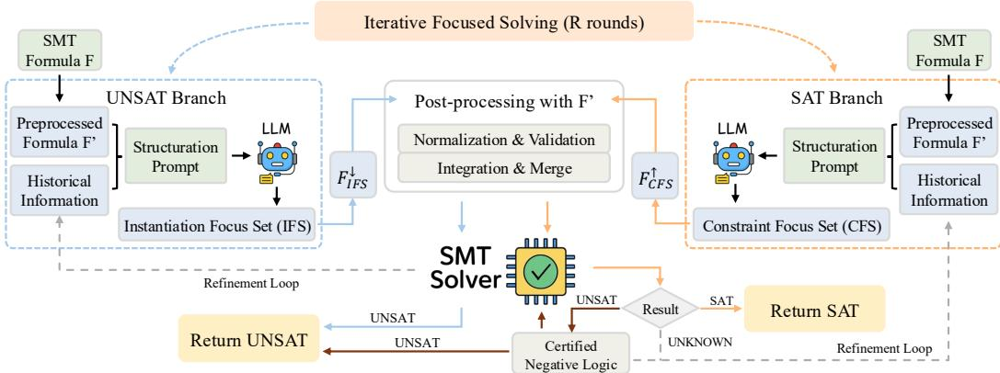
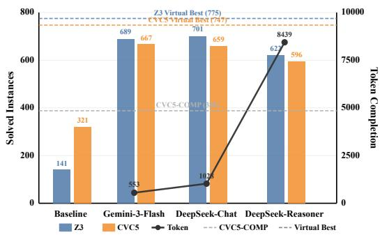
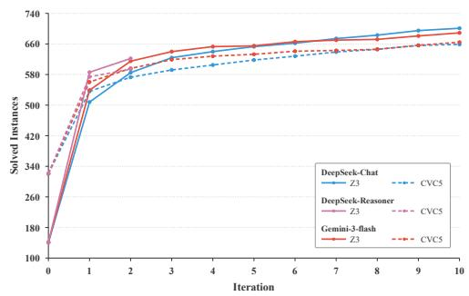

# Verifiable LLM-Guided Focal SMT Solving for Quantified Arrays

Kunhang Lv<sup>1,3</sup> Rui Han<sup>2,3</sup> Fuqi Jia<sup>2,3∗</sup> Yuhang Dong<sup>1,3</sup> Feifei Ma<sup>1,3∗</sup> Jian Zhang<sup>2,3</sup> <sup>1</sup>Laboratory of Parallel Software and Computational Science, ISCAS, Beijing, China <sup>2</sup>SKLCS and Key Laboratory of System Software, ISCAS, Beijing, China <sup>3</sup>University of Chinese Academy of Sciences, Beijing, China {lvkh, jiafq, maff}@ios.ac.cn

## Abstract

Large language models can often identify useful semantic structure in formal artifacts, but their outputs cannot be trusted as proofs or solver decisions. We study whether LLMs can instead guide formal reasoning systems through a narrow, solver-verifiable interface. We instantiate this idea in quantified array SMT solving, where modern instantiation-based techniques can fail when key ground terms and equalities are hidden by auxiliary variables, axiom guards, and nested array terms. We observe that many instances are largely driven by a small set of focal ground terms or constraints, similar to the backdoor sets in SAT solving. Building on this, we present LINGUAARRAY, a framework where an LLM proposes a small Semantic Focus Set (ground terms/constraints), while a conventional SMT solver remains the sole proof engine and certifies all results. LINGUAARRAY uses these LLM-suggested, solver-validated finite sets to significantly enhance solver capability, solving additional satisfiable and unsatisfiable instances that the backend alone fails to solve. It interacts within a finite time and then falls back to the backend solver to mitigate potential regressions. Evaluation on 1015 SMT-LIB instances across five logics under 1200s timeout (including LLM latency) shows that LINGUAARRAY solves up to 69.1% of instances and increases solved-instance counts by 105%–397% over the corresponding backends.

## 1 Introduction

Large language models have shown promise in reasoning over structured symbolic inputs, but formal reasoning tasks require correctness guarantees beyond what unverified LLM outputs provide. This motivates a restricted form of LLM assistance: using LLMs to propose semantic guidance while leaving all correctness-critical decisions to a trusted symbolic solver. We study this question in the context of Satisfiability Modulo Theories (SMT) [17, 2], a key computational foundation for software verification, program analysis, model checking, and automated test generation [4, 12, 9, 25]. Among them, quantified arrays are widely used to express loop invariants, memory safety conditions, and relational specifications over data structures, but remain challenging for modern solvers. The combination of arrays and quantifiers is generally complex and undecidable [7], which is particularly challenging for SMT solvers.

Modern SMT solvers primarily handle quantified formulas through quantifier instantiation, such as trigger-based E-matching [10, 11] and model-based quantifier instantiation (MBQI) [13]. Selecting effective triggers and diagnosing missing instantiations remain major bottlenecks [3], and even recent refinements [27, 23, 28] still depend on identifying a small set of proof-relevant ground terms early. For array theory, solvers typically use the read-over-write and extensional axiom for simplification and reasoning [31, 8]. However, when quantifiers are present and combined with complex operations such as these, key indexes and relationships are often obscured, which can lead to insufficient instantiation [26, 3].

Consider a simple quantified formula over arrays:

$$
\forall i . ( 0 \leq i < n \Rightarrow A [ t \mapsto x ] [ i ] \geq 0 ) .
$$

This uses the write operation on A and verifies under the universal quantifier. It’s obvious we need to locate the assignment x at position t to determine satisfiability; the solver must ultimately instantiate the universal quantifier at the witness index i = t. In realistic benchmarks, such witness terms are rarely presented as simple variables: they are buried under auxiliary definitions, and can even be array-valued terms when quantifiers range over arrays (cf. Example 2). As a result, it’s hard for the solvers to find the exact instantiation candidates, leading to timeouts or abandonment.

Therefore, the difficulty of quantified array solving does not lie in the inference rules of arrays themselves. Instead, a few decisive semantic focusing choices are often sufficient to render the problem readily tractable for the solver. However, traditional solvers rely solely on fixed syntactic triggers. This prevents them from exploiting the diverse and deep semantic information in real-world formulas. Our insight is that this missing capability cannot be systematically recovered through trigger engineering or hard-coded rules; instead, it can be supplied by a large language model (LLM) and the solving process can be safely accelerated by limiting it to a focus object that is verifiable by the solver.

To surface such focal points, we propose LINGUAARRAY, a framework that leverages LLMs to provide semantic guidance for quantified array solving. The key idea is that LLM identifies and proposes relevant focal points, which we call the semantic focus set, while using an SMT solver as the backend engine to validate all candidates and prove the final result. We realize this idea with a two-branch architecture. The UNSAT branch uses LLM-proposed Instantiation Focus Sets, i.e., a small collection of candidate ground instantiation tuples for universally quantified variables, to steer quantifier instantiation. The SAT branch uses Constraint Focus Sets, i.e., salient ground constraints, to guide model construction. Each branch constructs a derived formula, and once its satisfiability state is determined by the backend solver, yields a certified answer to the original problem. Since all conclusions are verified by the solver, soundness is preserved regardless of suggestion quality. To preserve baseline coverage, the LLM-guided interaction runs under a bounded budget and the framework falls back to the backend solver on the original formula under the remaining timeout.

We evaluate LINGUAARRAY on 1015 quantified array instances from SMT-LIB across five logics (ALIA, ABV, ABVFP, ABVFPLRA, ANIA) with a 1200-second end-to-end timeout per instance (including LLM latency). With Z3 as the backend solver, LINGUAARRAY solves 701 instances (69.1%) versus 141 instances (13.9%) for Z3 alone; with CVC5 it solves 659 instances (64.9%) versus 321 instances (31.6%) for CVC5 alone. Overall, LINGUAARRAY substantially improves solver effectiveness, raising the overall solve rate from 32% to roughly 70%.

Contributions. This paper makes three contributions:

• We introduce Semantic Focus Sets as a principled interface between LLMs and SMT solvers for quantified array reasoning, and implement this idea in the LINGUAARRAY framework with formal soundness guarantees and graceful degradation.

• We design a two-branch strategy, focused instantiation for UNSAT reasoning and focused strengthening for SAT reasoning, that exploits LLM-proposed focal points while preserving solver-certified correctness.

• We conduct extensive experiments on SMT benchmarks, demonstrating 105%-397% improvements over SOTA solvers, with evaluations confirming the effectiveness of our approach across different LLMs and configurations.

## 2 Preliminaries

## 2.1 Quantified Arrays in SMT

SMT. Satisfiability Modulo Theories extends propositional satisfiability (SAT) by deciding the satisfiability of first-order formulas with respect to background theories T. A formula $\varphi$ is $\tau .$

satisfiable if there exists a T-model M such that $\mathcal { M } \Vdash \varphi$ . Common theories include arithmetic, bit-vectors, and arrays. Modern SMT solvers such as $Z 3 [ 1 1 ]$ and $\mathrm { C V C } 5 \ [ 1 ]$ are typically based on the DPLL(T) framework [24]. Our work focuses on the challenging combination of quantifiers and arrays theories.

Arrays. Arrays are a fundamental data structure in SMT for modeling memory and mappings [8]. The SMT-LIB theory ArraysEx is parameterized by two sorts: index sort I and element sort $\bar { V }$ . We denote the array sort as $A r \dot { r } a y ( I , \dot { V } )$ . The theory provides two operations:

$$
s e l e c t : A r r a y ( I , V ) \times I  V ,\tag{1}
$$

$$
s t o r e : A r r a y ( I , V ) \times I \times V \to A r r a y ( I , V ) ,\tag{2}
$$

where select reads an element at an index and store produces an updated array. Their semantics are defined by the following universally quantified axioms $( \forall a , i , j , v )$

$$
( \mathrm { R W 1 } ) \quad s e l e c t ( s t o r e ( a , i , v ) , i ) = v\tag{3}
$$

$$
( \mathbf { R } \mathbf { W } 2 ) \quad i \neq j \Rightarrow s e l e c t ( s t o r e ( a , i , v ) , j ) = s e l e c t ( a , j )\tag{4}
$$

and the extensionality axiom stating that arrays are equal if they agree at all indices:

$$
\begin{array} { r l } { \operatorname { ( E x ) } } & { { } \left( \forall i \colon I . s e l e c t ( a , i ) = s e l e c t ( b , i ) \right) \Rightarrow a = b } \end{array}\tag{5}
$$

Quantified arrays. Quantifiers are often needed to express array-wide invariants, such as properties that range over indices. We denote the extension of theory $\tau$ with arrays as $\tau _ { A }$ , and its quantified extension as $\mathrm { Q } ( \mathcal { T } _ { A } )$

Definition 1 (Quantified Array Theory). The logic $\mathrm { Q } ( \mathcal { T } _ { A } )$ extends quantifier-free array formulas with quantifiers over index and element variables. Formulas in $\mathrm { Q } ( \mathcal { T } _ { A } )$ are defined inductively:

$$
\varphi : = Q F \mathrm { { - } } f o r m u l a \mid ( \forall \vec { x } : \vec { S } . \varphi ) \mid ( \exists \vec { x } : \vec { S } . \varphi )\tag{6}
$$

where ${ \vec { x } } = ( x _ { 1 } , \ldots , x _ { n } )$ are distinct variables with sorts $\vec { S } = ( S _ { 1 } , \ldots , S _ { n } )$ from $\mathcal { T } _ { A }$ , and QF-formula denotes quantifier-freeformulas over $\mathcal { T } _ { A }$

Example 1. Consider the SMT-LIB style constraint mentioned in the introduction:

$$
( 0 \leq t < n ) \land ( x < 0 ) \land \forall i : I . \big ( 0 \leq i < n \Rightarrow s e l e c t ( s t o r e ( a , t , x ) , i ) \geq 0 \big ) .
$$

It is UNSAT, but the contradiction is exposed only after instantiating the quantifier at the witness index $i = t$ and then (RW1) gives select $( s t o r e ( a , t , x ) , t ) = x$

## 2.2 Solving Quantified Array Formulas

Quantified array SMT formulas combine array reasoning with quantifier instantiation. For the quantifier-free array theory, axioms $( 3 ) - ( 4 )$ are typically applied as local rewrite rules to simplify $s e l e c t ( s t o r e ( \cdot \cdot \cdot ) )$ ) terms. For array disequalities $a \neq b ,$ , solvers instantiate the extensionality axiom (5) by introducing a witness index k with the lemma selec $\langle a , k \rangle \neq s e l e c t ( b , k )$

Quantified formulas are further challenging, and there is generally no complete decision procedure that works across theories. In practice, modern SMT solvers rely on quantifier instantiation to reduce quantified formulas to ground instances [26].

E-matching. Trigger-based pattern matching (E-matching) [11] is a quantifier-instantiation technique widely used in SMT solvers. Given a quantified formula ∀⃗x. ψ(⃗x), the solver selects one or more triggers from ψ. During search, it maintains an E-graph, which is a congruence-closure data structure over ground terms. When a term t matches a trigger p modulo the current equalities $E ( \mathrm { i } . { \mathrm { e } } .$ $E \models t \simeq \theta ( p )$ for some substitution θ), the solver adds the instance $\psi ( \theta ( \vec { x } ) )$ ) to the constraint set.

MBQI. Model-Based Quantifier Instantiation (MBQI) [13] constructs a candidate model M for the current ground constraints and checks each quantified clause against M. If model M violates a quantified clause, MBQI extracts a counterexample witness and generates a corresponding ground instance.

## 2.3 LLMs for Semantic Guidance

Large Language Models are neural networks based on the Transformer architecture [33], trained on vast text corpora to predict the next token in a sequence. Mainstream LLMs like Gemini [32] and DeepSeek [19] exhibit strong reasoning capabilities through scale and self-attention mechanisms that capture long-range dependencies, developing internal representations that encode semantic relationships and domain knowledge [18, 34].

Prompt Engineering. LLM performance critically depends on prompt design—the systematic construction of inputs to get desired behaviors [21, 29]. Advanced techniques include chain-ofthought prompting [35] for explicit reasoning steps and role-based prompting [16] to invoke domain expertise.

Integration with Formal Systems. The complementary nature of LLMs and formal systems enables hybrid architectures where LLMs provide semantic insights and hypothesis generation, while symbolic systems ensure logical correctness and verification.

## 3 Methodology

  
Figure 1: Overview of LinguaArray.

## 3.1 Motivating Example

Example 2. Let $a , b : \mathbb { Z } \to ( \mathbb { Z } \to \mathbb { Z } )$ be 2D arrays and let $i , j , k \in \mathbb { Z }$ . We write $a [ t ] [ u ] \triangleq$ select(select $( a , t ) , u )$ and $a [ i \mapsto x ] \triangleq { \mathsf { s t o r e } } ( a , i , x )$ . Consider the conjunction:

$$
F = \forall x : A r r a y ( \mathbb { Z } , \mathbb { Z } ) . ( a [ i \mapsto x ] ) [ j ] [ 0 ] = k \ \wedge \exists y : A r r a y ( \mathbb { Z } , \mathbb { Z } ) . ( b [ i \mapsto y ] ) [ j ] [ 0 ] \neq k .\tag{7}
$$

This constraint involves universal quantifiers for array-type variables, where the domain of Array(Z, Z) is infinite, and the solver cannot find the corresponding instantiation position efficiently. Therefore, traditional solvers cannot simplify and give up solving the instance. However, we can find the semantic cases from the reasoning level: if $\cdot _ { i } \neq j ,$ , then $( { \check { a } } [ i \mapsto x ] ) [ j ] [ 0 ]$ simplifies to $a [ j ] [ 0 ]$ ], which is independent of x; ${ \mathrm { i f ~ } } i = j$ , then the universal quantifier becomes $\forall { \dot { x } } . \ x [ 0 ] = k$ which is obviously unsatisfiable. Therefore, we find that when $i \neq j$ , it is easy to deduce that the original problem is satisfied.

This reflects our core principle: LLM proposes semantically motivated candidates $( \boldsymbol { \mathrm { e . g . } } , i \ne j )$ and the solver verifies them through its standard procedure. Next, we will introduce in detail the framework for implementing this workflow.

## 3.2 Framework Overview

Figure 1 presents LINGUAARRAY, a hybrid framework where an LLM provides semantic candidates and a standard SMT solver S serves as the proof engine.

Preprocessing. Before querying the LLM, we preprocess the input formula $F$ to facilitate robust generation: (1) Parse the input of the SMT-LIB file into negation normal form (NNF) to make quanti fier polarity explicit. (2) Simplification: constant propagation, elimination of trivial subformulas, and renaming verbose identifiers to short canonical forms via a reversible mapping $\Sigma .$ . The resulting $F ^ { \prime }$ is equisatisfiable with F while offering a concise representation for the LLM.

Semantic Focus Sets. We propose the concept of Semantic Focus Sets, intended as an interface between untrusted LLMs and trusted solvers, thereby accelerating the solver.

Definition 2 (Semantic Focus Sets). A Semantic Focus Set is afinite structured set proposed by the LLM that identifies where the solver shouldfocus its reasoning. We define two variants:

• Instantiation Focus Set (IFS): Afinite set ofground instantiation terms. Given a positive occurrence $o f \forall x . \varphi ( x )$ in NNF, each $t \in I F S$ generates the ground consequence $\varphi [ x \mapsto t ]$ . The IFS induces an over-approximation by restricting universal quantifiers to afinite domain.

• Constraint Focus Set (CFS): Afinite set $\{ \psi _ { 1 } , \ldots , \psi _ { n } \}$ where each $\psi _ { i }$ is a quantifier-free ground formula over the vocabulary of ${ \bf { \bar { \boldsymbol { F } } } } ^ { \prime }$ . The CFS induces an under-approximation of the search space by imposing auxiliary assumptions to guide model construction.

The IFS is generated from terms containing universal quantifiers in the NNF formula $F ^ { \prime }$ . LLM provides key insights; it may be a complex term $( \mathbf { e } . \mathbf { g } . , t = a _ { 1 } + a _ { 2 } )$ , but only accepts terms that satisfy the corresponding quantifier declaration and can be constructed from symbols in $F ^ { \prime }$

Each constraint in the CFS acts as an auxiliary assumption that helps guide solving $( \mathrm { e } . \mathrm { g } . \ i \ne j$ or array cell assignments) and it only accepts constraints that can be constructed from symbols defined in ${ \check { F } } ^ { \prime }$

This abstraction provides two key guarantees: (1) the LLM can affect the solver only by generating validated focus sets, and (2) every result is certified by the solver independently of the LLM.

## 3.3 Dual-Branch Reasoning

Building on semantic focus sets, we employ two complementary strategies to decide satisfiability.

UNSAT Branch. This branch attempts to prove formula unsatisfiability by extracting finitely many ground consequences of universal quantifiers using terms from the IFS.

Definition 3 (Focused Instantiation). Given an IFS, the focused instantiation $F _ { I F S } ^ { \downarrow }$ is obtained from $F ^ { \prime }$ by replacing positive occurrences ofuniversal subformulas $\forall \vec { x } . \varphi ( \vec { x } )$ in NNF with thefinite conjunction $\Lambda _ { \vec { t } \in I F S ^ { | \vec { x } | } } \varphi [ \vec { x } \mapsto \vec { t } ]$

For example, given the positive universal quantifier ∀x. $( a [ i \mapsto x ] ) [ j ] [ 0 ] = k$ and $I F S = \{ b [ j ] \}$ , this operation produces a single ground constraint: $( a [ i \mapsto b [ j ] ] ) [ j ] [ 0 ] \stackrel { \textstyle \cdot } { = } \dot { k }$ . The resulting check focuses the solver on ground consequences selected by the IFS, avoiding reliance on heuristic triggers for those instances.

Theorem 1 (UNSAT Branch Soundness). $F ^ { \prime } \Rightarrow F _ { I F S } ^ { \downarrow } .$ . Hence, $i f \ : S ( F _ { I F S } ^ { \downarrow } ) = \ : \mathsf { u n s a t } \ :$ , then $F$ is unsatisfiable.

Proof. For any ground ${ \vec { t } } , \forall { \vec { x } } . \varphi \Rightarrow \varphi [ { \vec { x } } \mapsto { \vec { t } } ]$ ; finite conjunction preserves implication. Since the replacement is applied only to positive NNF occurrences, monotonicity of the surrounding context preserves the implication. All remaining construction steps are required to be implication-preserving, so $F ^ { \prime } \Rightarrow F _ { I F S } ^ { \downarrow }$ , and unsatisfiability of the consequent implies unsatisfiability of the antecedent.

SAT Branch. This branch attempts to prove satisfiability by imposing CFS constraints as additional assumptions, restricting search to an LLM-suggested semantic region.

Definition 4 (Focused Strengthening). Given a CFS, the focused strengthening is $F _ { C F S } ^ { \uparrow } = F ^ { \prime } \wedge$ $\textstyle \bigwedge _ { c \in C F S } c .$

For instance, suggesting a constraint like $i \neq j$ or $k = 5$ prunes the vast model search space, guiding the solver toward a specific semantic region.

Theorem 2 (SAT Branch Soundness). $F _ { C F S } ^ { \uparrow } \Rightarrow F ^ { \prime }$ . Hence, $i f { \cal S } ( F _ { C F S } ^ { \uparrow } ) = { \sf s a t } ,$ , then F is satisfiable.

Proof. Since $\begin{array} { r } { F _ { C F S } ^ { \uparrow } = F ^ { \prime } \wedge \bigwedge _ { c \in C F S } c , } \end{array}$ , any model satisfying $F _ { C F S } ^ { \uparrow }$ must satisfy $F ^ { \prime }$ , and therefore satisfies the original formula $F$ □

Certifying UNSAT under strengthening. If $F _ { C F S } ^ { \uparrow }$ is unsat, the result may be spurious since CFS constraints might exclude valid models. We certify this result using implication checking: for each $c \in C F S$ , we verify if $F ^ { \prime } \Rightarrow$ c by checking $S ( F ^ { \prime } \dot { \wedge } \neg c ) = \mathsf { u n s a t }$ . If all checks pass, then $\ ` ^ { \prime } \Rightarrow ($ c for all $c ,$ hence $F ^ { \prime } \equiv F _ { C F S } ^ { \uparrow }$ and UNSAT transfers. Notably, if any check yields SAT, we immediately obtain a satisfying model of $F ^ { \prime }$

## 3.4 Feedback-Driven Refinement

LINGUAARRAY iterates for a bounded budget R, in each round executing both the UNSAT and SAT branches and refining their under- and over-approximations based on fresh solver feedback.

Execution cycle. At iteration $r ,$ the system explores both branches, and the LLM generates a proposal conditioned on the cumulative feedback state $f b$

In the UNSAT branch, the LLM proposes an IFS. When $\mathcal { S } ( F _ { I F S } ^ { \downarrow } ) = \mathsf { s a t }$ , the current instantiation is insufficient to derive a contradiction. We extract feedback from the model, specifically array indices that received arbitrary assignments and guards that remained unconstrained, and query the LLM for additional instantiation terms in subsequent rounds.

In the SAT branch, the LLM proposes a CFS. When ${ \cal S } ( F _ { C F S } ^ { \uparrow } )$ times out or certification fails, the current CFS is ineffective. We record the failed constraints as feedback and query the LLM for alternative constraint proposals in subsequent rounds.

Termination and fallback. The interaction proceeds until a certified result is found or the budget R is exhausted. Individual rounds are not guaranteed to make progress, as LLM proposals may be invalid or repeated. In the latter case, the system invokes the baseline solver $S ( F )$ with the remaining time. This provides a fallback to the baseline solver, intended to mitigate coverage regressions, subject to the end-to-end time budget.

## 3.5 LLM Interaction

Each LLM query includes: (1) task specification (IFS or CFS generation); (2) the preprocessed formula with signature information; (3) current focus set for refinement; (4) feedback from prior solver calls.

The LLM returns JSON with $\{ " \mathrm { T F S " } : [ \{ t _ { 1 } \} , . . . ] \} \ \mathrm { o r } \ \{ " \mathrm { C F S " } : [ \{ c _ { 1 } \} , . . . ] \}$ . We parse each item and reject proposals that (1) use symbols outside the signature of $F ^ { \prime } , ( 2 )$ fail sort checking, or (3) violate size/format limits; the remaining items are canonicalized and deduplicated. Invalid outputs are dropped. Proposal validity and repetition statistics are reported in Appendix F.5. Full prompts are available in the code repository, with output schemas detailed in Appendix F.

## 3.6 Correctness Summary

LINGUAARRAY maintains soundness through certification: the UNSAT branch exploits $F ^ { \prime } \Rightarrow F _ { I F S } ^ { \downarrow }$ (Theorem 1), the SAT branch exploits $F _ { C F S } ^ { \uparrow } \Rightarrow F ^ { \prime }$ (Theorem 2). When strengthening yields UNSAT, we avoid spurious UNSAT by explicit implication checking. The LLM does not determine satisfiability and only guides Focus Set construction; all returned results are validated by the solver. To preserve baseline coverage, if guided attempts exhaust their budgets, we invoke S(F) directly.

## 4 Experimental Evaluation

We conduct a comprehensive empirical evaluation to assess the effectiveness of LINGUAARRAY for LLM-guided quantified array SMT solving. To facilitate reproducibility, the source code, prompt

templates, and benchmark file lists are publicly available at https://github.com/kylelv2000/ LinguaArray under the MIT license.

Our evaluation addresses the following research questions:

• RQ1: How effective is LINGUAARRAY compared to state-of-the-art SMT solvers on quantified array formulas?

• RQ2: How do different LLMs, including reasoning-enhanced models, affect solving performance?

• RQ3: How does the iteration budget impact the overall solving performance?

## 4.1 Benchmarks

We evaluate LINGUAARRAY on quantified array formulas from SMT-COMP 2025 [30], using benchmarks from SMT-LIB, the standard benchmark repository for SMT solvers. We target logics centered on quantified array theories, covering five representative logics: ALIA, ABV, ABVFP, ABVFPLRA, and ANIA. To ensure tractable experimental scale while maintaining representativeness, we apply a sampling strategy: for logics with fewer than 400 instances, we include all available instances; otherwise, we uniformly sample 400 instances (without replacement) using a fixed random seed (42). This yields a total of 1015 instances (ABV: 400, ABVFP: 60, ABVFPLRA: 77, ALIA: 400, ANIA: 78).

## 4.2 Experimental Setup

Hardware and Environment All experiments were conducted on a dedicated server equipped with 8 × Intel(R) Xeon(R) Platinum 8153 CPUs (16 cores per socket, 2 threads per core; 128 cores / 256 hardware threads in total, 2.00 GHz) and 2,048 GB RAM. All experimental runs used identical hardware and software configurations to ensure reproducible and fair comparison.

SMT Solvers We employ two state-of-the-art SMT solvers as backend reasoning engines: Z3 (v4.15.0) [11] and CVC5 (v1.3.2) [1]. Z3 uses its default configuration. For CVC5, we use a tuned baseline selected from commonly used theory options to ensure robust solver performance, and additionally report results for its portfolio-based SMT-COMP 2025 configuration. We provide the full command lines and tuning details in the Appendix for reproducibility.

Large Language Models. We evaluate two state-of-the-art LLMs: DeepSeek-V3.2 [20], an opensource frontier model, and Gemini-3-Flash-Preview from Google DeepMind [32]. Both models are configured with temperature 0.0 for deterministic responses.

Timeout and Iteration Configuration. We use a 1200-second end-to-end timeout per instance, including LLM latency. Unless otherwise specified, we perform 10 iterations, where each iteration executes both the UNSAT and SAT branch.

## 4.3 RQ1: Overall Effectiveness

Table 1: Results on five logics with a 1200s timeout (including LLM latency). LINGUAARRAY uses DeepSeek-V3.2-chat. For each logic, we report #SAT / #UNSAT and success rate (SR).
<table><tr><td></td><td colspan="3">ABV (400)</td><td colspan="3">ABVFP (60)</td><td colspan="3">ABVFPLRA (77)</td><td colspan="3">ALIA (400)</td><td colspan="2">ANIA (78)</td><td colspan="3">Overall (1015)</td></tr><tr><td>Method</td><td>SATUNSAT</td><td></td><td>SR</td><td>SATUNSAT</td><td></td><td>SR</td><td></td><td>SATUNSAT</td><td>SR</td><td></td><td>SATUNSAT</td><td>SR</td><td>SATUNSAT</td><td></td><td>SR</td><td>|Solved</td><td>SR</td></tr><tr><td>Z3 (Baseline)</td><td>34</td><td>11</td><td>11.25%</td><td>0</td><td>0</td><td>0.00%</td><td>0</td><td>0</td><td>0.00%</td><td>51</td><td>8</td><td>14.75%</td><td>28</td><td>9</td><td>47.44%|</td><td>141</td><td>13.89%</td></tr><tr><td>CVC5 (Baseline)</td><td>93</td><td>15</td><td>27.00%</td><td>31</td><td>3</td><td>56.67%</td><td>45</td><td>1</td><td>59.74%</td><td>84</td><td>15</td><td>24.75%</td><td>27</td><td>7</td><td>43.59%</td><td>321</td><td>31.63%</td></tr><tr><td>CVC5-COMP</td><td>130</td><td>82</td><td>53.00% 37</td><td></td><td>3</td><td>66.67% 47</td><td></td><td>2</td><td>63.64%</td><td>15</td><td>66</td><td>20.25%</td><td>4</td><td>2</td><td>7.69% |</td><td>388</td><td>38.23%</td></tr><tr><td>Harness-only (Z3)</td><td>34</td><td>10</td><td>11.00%</td><td>0</td><td>0</td><td>0.00%</td><td>0</td><td>0</td><td>0.00%</td><td>52</td><td>8</td><td>15.00%</td><td>28</td><td>11</td><td>50.00%|</td><td>143</td><td>14.09%</td></tr><tr><td>Randomized (Z3)</td><td>160</td><td>19</td><td>44.75%</td><td>0</td><td>0</td><td>0.00%</td><td>0</td><td>0</td><td>0.00%</td><td>181</td><td>17</td><td>49.50%</td><td>45</td><td>14</td><td>75.64%</td><td>436</td><td>42.96%</td></tr><tr><td>LINGUAARRAY(Z3)</td><td>270</td><td>74</td><td>86.00%</td><td>0</td><td>0</td><td>0.00%</td><td>0</td><td>0</td><td>0.00%</td><td>219</td><td>76</td><td>73.75%</td><td>48</td><td>14</td><td>79.49%</td><td>701</td><td>69.06%</td></tr><tr><td>Harness-only (CVC5)</td><td>93</td><td>15</td><td>27.00%</td><td>31</td><td></td><td>56.67%</td><td>45</td><td>1</td><td>59.74%</td><td>85</td><td>15</td><td>25.00%</td><td>27</td><td>7</td><td>43.59%|</td><td>322</td><td>31.72%</td></tr><tr><td>Randomized (CVC5)</td><td>128</td><td>23</td><td>37.75%</td><td>33</td><td>33</td><td>60.00%</td><td>45</td><td>1</td><td></td><td>59.74% 149</td><td>23</td><td>43.00%</td><td>32</td><td>8</td><td>51.28%</td><td>445</td><td>43.84%</td></tr><tr><td>LINGUAARRAY(CVC5) 175</td><td></td><td>72</td><td>61.75%</td><td>40</td><td>3</td><td>71.67%53</td><td></td><td>1</td><td></td><td>70.13% 186</td><td>80</td><td>66.50%</td><td>40</td><td>9</td><td>62.82%</td><td>659</td><td>64.93%</td></tr></table>

Table 1 presents the overall performance comparison across five SMT-LIB logics using DeepSeek as the underlying LLM for LINGUAARRAY. Under the same 1200-second end-to-end timeout, we observed a significant improvement compared to the backend solver. Furthermore, the solved counts increase substantially for both SAT and UNSAT instances, indicating the consistent effectiveness of our two branches. LINGUAARRAY(Z3) achieves the best overall success rate at 69.06%, solving 701 instances, including 537 SAT instances and 164 UNSAT instances, representing a 397% improvement over the base Z3 solver. Similarly, LINGUAARRAY(CVC5) reaches 64.93%, improving 105% over its base solver.

To isolate the contribution of LLM guidance, we evaluate harness-only and structure-aware randomized proposers under the same budget. The harness-only variant uses empty focus sets, while the randomized proposer samples well-typed ground terms for IFS and generates atomic constraints for CFS (see Appendix E). The harness-only variants solve 143 and 322 instances, nearly identical to the original backends, while randomized proposers solve 436 and 445 instances. LINGUAARRAY achieves substantially higher coverage, demonstrating the benefit of semantic guidance beyond the search framework itself.

These results significantly surpass the portfolio-based CVC5-COMP at 38.23%. We further consider virtual-best portfolios, defined as the union of instances solved by different solver configurations. The virtual-best combination of Z3 and CVC5 solves 390 instances (38.4%), while the union of Z3, CVC5-COMP, and 20 CVC5 configurations reaches 623 (61.4%). Even compared to this idealized portfolio, LINGUAARRAY(Z3) solves 256 instances outside its coverage.

For ABVFP and ABVFPLRA, Z3 produces internal errors when handling the combination of quanti fiers, arrays, and floating-point theories, preventing it from solving any instances. The performance of LINGUAARRAY(CVC5) still shows significant improvement compared to its base solver.

## 4.4 RQ2: Impact of Different LLMs

  
(a) Different LLMs

  
(b) Iteration budget  
Figure 2: Comparison of solved instances across settings: (a) different LLMs; (b) iteration budget under a 1200s timeout. Each point in (b) reports cumulative instances solved within the given budget.

Figure 2a compares the performance of three LLMs across both base solvers. All three models substantially improve over the baselines, demonstrating that our approach generalizes across different LLMs. However, the results reveal a clear trade-off between reasoning capability and generation efficiency. DeepSeek-V3.2-reasoner produces significantly longer outputs with an average of 8439 tokens per completion due to its explicit reasoning process, resulting in query latencies often approaching 600 seconds. This severely limits the number of iterations possible within the timeout, restricting it to at most two rounds and ultimately leading to lower success rates despite its stronger reasoning capabilities. In contrast, Gemini-3-Flash generates the most concise responses at 553 tokens on average, enabling faster response times and more iterative refinements within the timeout.

The virtual best results demonstrate notable complementarity across LLMs, solving 775 instances for Z3 and 747 for CVC5. This represents an additional 74 and 80 instances beyond the best single LLM, respectively, illustrating that different LLMs may use different strategies, thus resulting in different effects on different instances. This complementarity suggests potential for ensemble approaches that combine multiple LLMs.

## 4.5 RQ3: Effect of Iteration Budget

Figure 2b illustrates the relationship between iteration budget and solving capability under the 1200- second timeout constraint. A single iteration already brings substantial improvements, increasing success rates from baseline 13.9% to 50.1% for Z3 using DeepSeek-Chat. This shows that our approach provides immediate value even without further interaction.

The curves reveal clear diminishing returns. The first iteration contributes the majority of improvements, and each subsequent round progressively adds fewer instances. Most of the gains are achieved within 3 iterations, after which performance generally stabilizes. This pattern indicates that LLMs quickly identify effective strategies in early rounds, with later iterations primarily exploring marginal refinements.

Comparing across LLMs, Gemini-3-Flash achieves stronger first-round performance but slower subsequent growth, while DeepSeek-Chat shows more sustained improvements across iterations. DeepSeek Reasoner (Z3) solved as many as 586 instances in the first round, despite its long processing time, which demonstrates that deeper reasoning can partially compensate for fewer iterations. These observations suggest that the optimal iteration budget depends on the specific LLM’s characteristics and the trade-off between response quality and generation efficiency.

## 4.6 Discussion

Our results demonstrate that LLM-guided focal solving substantially improves solving capability across diverse theory combinations. The complementarity observed across different LLMs reveals that diverse reasoning approaches lead to different focal guidance patterns, with different models succeeding on different problem subsets. This suggests potential for ensemble methods to further expand coverage. The diminishing returns pattern indicates that most effective guidance emerges within early iterations, making our approach practical despite LLM query overhead. We further evaluate run-to-run stability using DeepSeek-V4-Flash, the successor to DeepSeek-V3.2. Three independent runs with Z3 solve 689.7 ± 4.0 instances (mean ± std), with 602 instances solved in all three runs, indicating stable overall performance despite instance-level variability (Appendix D.1).

While our method significantly advances performance on complex theory combinations, challenges remain for the deepest theory interactions where formula complexity itself becomes the primary bottleneck, requiring further advances in solving techniques beyond focal guidance. Meanwhile, effectiveness depends on the quality of LLM inference, which may return ineffective proposals and incur unnecessary overhead.

## 5 Related Work

Advanced Quantifier Instantiation. Counterexample-guided quantifier instantiation (CEGQI) [27] and its syntax-guided variant SyQI [23] select instantiation terms by enumerating candidates (optionally from a grammar) and refining them against counterexample models, providing theory-agnostic alternatives to hand-crafted trigger heuristics. QSMA [6] instead computes model-based under- and over-approximations in an abstraction–refinement loop, resembling a lazy approach to quantifier elimination. For arrays, the Array Property Fragment [7] yields decidability by restricting quantifiers to arithmetic index guards and value constraints, enabling completeness via finite instantiation; formulas outside this fragment typically require heuristic guidance.

Learning for SMT Solving. Jakub˚uv et al. use fast gradient-boosted decision tree models over formula features to guide quantifier selection in CVC5, reducing wasted instantiations [14]. Beyond quantifier selection, learning has also been applied to instantiation-level decisions: Janota et al. learn to rank candidate ground terms for enumerative instantiation and integrate LightGBM into CVC5 to steer instantiation and reduce the number of instantiations [15]. Similarly, learning-based instance selection inside SMT solvers has been explored by invoking a fast predictor after each instantiation round to decide whether generated instances should be passed to the ground solver, delayed, or discarded [5]. More recently, LLMs have also been initially explored for guiding SMT solving in restricted theories. AquaForte targets quantified formulas over uninterpreted functions by using LLMs to synthesize complete function definitions for solver verification [22]. This generate-andtest approach primarily targets SAT, with limited improvements on UNSAT instances. In contrast,

LINGUAARRAY proposes local focus sets rather than complete candidate solutions. Its dual-branch framework uses IFS-based over-approximations for UNSAT reasoning and CFS-based strengthening for SAT reasoning, with additional implication checks to certify UNSAT under strengthening. This enables solver-certified reasoning in both directions.

## 6 Conclusion

We presented LINGUAARRAY, a framework that introduces Semantic Focus Sets as a principled interface between LLM reasoning and SMT solver certification for quantified array formulas. Our two-branch architecture uses Instantiation Focus Sets to guide quantifier instantiation for proving unsatisfiability and Constraint Focus Sets to guide model construction for proving satisfiability, with all results verified by the underlying solver to maintain formal soundness guarantees.

Experimental evaluation on SMT-LIB benchmarks demonstrates substantial improvements, with solve rates advancing from less than 32% to approximately 70%, representing 397% improvement over Z3 and 105% over CVC5. These gains confirm that semantic guidance can effectively identify proof-relevant focal points that conventional heuristics miss. However, this framework can still be further improved because it has limited adaptability to broader and more complex theories, requiring further design. Furthermore, its effectiveness depends on the quality of LLM inference; performance varies depending on the model and problem characteristics.

Future work includes several promising directions. Extending the framework to broader quantified SMT theories beyond arrays, incorporating uninterpreted functions, and developing more unified specifications for focus set generation could expand applicability. Deeper LLM integration, such as using learned refinement strategies or tighter coupling with solver internals, may further improve guidance quality. More broadly, this work demonstrates that semantic reasoning from LLMs can aug ment symbolic systems while preserving formal guarantees, opening pathways for hybrid approaches in SMT solving.

## Acknowledgments and Disclosure of Funding

We are grateful to the anonymous reviewers for their comments and suggestions. This work was supported by the Strategic Priority Research Program of the Chinese Academy of Sciences, Grant No. XDB1770302 and XDB1770300. The authors declare no competing interests.

## References

[1] Haniel Barbosa, Clark W. Barrett, Martin Brain, Gereon Kremer, Hanna Lachnitt, Makai Mann, Abdalrhman Mohamed, Mudathir Mohamed, Aina Niemetz, Andres Nötzli, Alex Ozdemir, Mathias Preiner, Andrew Reynolds, Ying Sheng, Cesare Tinelli, and Yoni Zohar. cvc5: A versatile and industrial-strength SMT solver. In Dana Fisman and Grigore Rosu, editors, TACAS 2022, volume 13243, pages 415–442, 2022.

[2] Clark W. Barrett, Roberto Sebastiani, Sanjit A. Seshia, and Cesare Tinelli. Satisfiability modulo theories. In Handbook ofSatisfiability - Second Edition, volume 336 of Frontiers in Artificial Intelligence and Applications, pages 1267–1329. IOS Press, 2021. doi: 10.3233/FAIA201017. URL https://doi.org/10.3233/FAIA201017.

[3] Nils Becker, Peter Müller, and Alexander J Summers. The axiom profiler: Understanding and debugging smt quantifier instantiations. In International Conference on Tools and Algorithms for the Construction and Analysis ofSystems, pages 99–116. Springer, 2019.

[4] Dirk Beyer, Matthias Dangl, and Philipp Wendler. A unifying view on smt-based software verification. J. Autom. Reason., 60(3):299–335, 2018. doi: 10.1007/s10817-017-9432-6. URL https://doi.org/10.1007/s10817-017-9432-6.

[5] Jasmin Christian Blanchette, Daniel El Ouraoui, Pascal Fontaine, and Cezary Kaliszyk. Machine learning for instance selection in smt solving. In AITP 2019-4th Conference on Artificial Intelligence and Theorem Proving, 2019.

[6] Maria Paola Bonacina, Stéphane Graham-Lengrand, and Christophe Vauthier. Qsma: a new algorithm for quantified satisfiability modulo theory and assignment. In International Conference on Automated Deduction, pages 78–95. Springer, 2023.

[7] Aaron R Bradley, Zohar Manna, and Henny B Sipma. What’s decidable about arrays? In International Workshop on Verification, Model Checking, and Abstract Interpretation, pages 427–442. Springer, 2006.

[8] Robert Brummayer and Armin Biere. Lemmas on demand for the extensional theory of arrays. In Proceedings of the Joint Workshops of the 6th International Workshop on Satisfiability Modulo Theories and 1st International Workshop on Bit-Precise Reasoning, pages 6–11, 2008.

[9] Lucas C. Cordeiro, Bernd Fischer, and João Marques-Silva. Smt-based bounded model checking for embedded ANSI-C software. In ASE 2009, 24th IEEE/ACM International Conference on Automated Software Engineering, Auckland, New Zealand, November 16-20, 2009, pages 137– 148. IEEE Computer Society, 2009. doi: 10.1109/ASE.2009.63. URL https://doi.org/10. 1109/ASE.2009.63.

[10] Leonardo De Moura and Nikolaj Bjørner. Efficient e-matching for smt solvers. In International Conference on Automated Deduction, pages 183–198. Springer, 2007.

[11] Leonardo Mendonça de Moura and Nikolaj Bjørner. Z3: an efficient SMT solver. In C. R. Ramakrishnan and Jakob Rehof, editors, TACAS 2008, volume 4963, pages 337–340, 2008.

[12] Natalia Gavrilenko, Hernán Ponce de León, Florian Furbach, Keijo Heljanko, and Roland Meyer. BMC for weak memory models: Relation analysis for compact SMT encodings. In Isil Dillig and Serdar Tasiran, editors, Computer Aided Verification - 31st International Conference, CAV 2019, New York City, NY, USA, July 15-18, 2019, Proceedings, Part I, volume 11561 of Lecture Notes in Computer Science, pages 355–365. Springer, 2019. doi: 10.1007/978-3-030-25540-4\_19. URL https://doi.org/10.1007/978-3-030-25540-4\_19.

[13] Yeting Ge and Leonardo De Moura. Complete instantiation for quantified formulas in satisfiability modulo theories. In International Conference on Computer Aided Verification, pages 306–320. Springer, 2009.

[14] Jan Jakub˚uv, Mikoláš Janota, Jelle Piepenbrock, and Josef Urban. Machine learning for quantifier selection in cvc5. International Journal ofApproximate Reasoning, page 109602, 2025.

[15] Mikoláš Janota, Jelle Piepenbrock, and Bartosz Piotrowski. Towards learning quantifier instantiation in smt. In 25th International Conference on Theory and Applications of Satisfiability Testing (SAT 2022), pages 7–1. Schloss Dagstuhl–Leibniz-Zentrum für Informatik, 2022.

[16] Aobo Kong, Shiwan Zhao, Hao Chen, Qicheng Li, Yong Qin, Ruiqi Sun, Xin Zhou, Enzhi Wang, and Xiaohang Dong. Better zero-shot reasoning with role-play prompting. In Proceedings ofthe 2024 Conference ofthe North American Chapter ofthe Associationfor Computational Linguistics: Human Language Technologies (Volume 1: Long Papers), pages 4099–4113, 2024.

[17] Daniel Kroening and Ofer Strichman. Decision Procedures - An Algorithmic Point of View, Second Edition. Texts in Theoretical Computer Science. An EATCS Series. Springer, 2016. ISBN 978-3-662-50496-3. doi: 10.1007/978-3-662-50497-0. URL https://doi.org/10. 1007/978-3-662-50497-0.

[18] Aitor Lewkowycz, Anders Andreassen, David Dohan, Ethan Dyer, Henryk Michalewski, Vinay Ramasesh, Ambrose Slone, Cem Anil, Imanol Schlag, Theo Gutman-Solo, et al. Solving quantitative reasoning problems with language models. Advances in neural information processing systems, 35:3843–3857, 2022.

[19] Aixin Liu, Bei Feng, Bing Xue, Bingxuan Wang, Bochao Wu, Chengda Lu, Chenggang Zhao, Chengqi Deng, Chenyu Zhang, Chong Ruan, et al. Deepseek-v3 technical report. arXiv preprint arXiv:2412.19437, 2024.

[20] Aixin Liu, Aoxue Mei, Bangcai Lin, Bing Xue, Bingxuan Wang, Bingzheng Xu, Bochao Wu, Bowei Zhang, Chaofan Lin, Chen Dong, et al. Deepseek-v3.2: Pushing the frontier of open large language models. arXiv preprint arXiv:2512.02556, 2025.

[21] Pengfei Liu, Weizhe Yuan, Jinlan Fu, Zhengbao Jiang, Hiroaki Hayashi, and Graham Neubig. Pre-train, prompt, and predict: A systematic survey of prompting methods in natural language processing. ACM computing surveys, 55(9):1–35, 2023.

[22] Kunhang Lv, Yuhang Dong, Rui Han, Fuqi Jia, Feifei Ma, and Jian Zhang. Llm-guided quantified smt solving over uninterpreted functions. In Proceedings ofthe AAAI Conference on Artificial Intelligence, volume 40, pages 14304–14312, 2026.

[23] Aina Niemetz, Mathias Preiner, Andrew Reynolds, Clark Barrett, and Cesare Tinelli. Syntaxguided quantifier instantiation. In International Conference on Tools and Algorithms for the Construction and Analysis ofSystems, pages 145–163. Springer, 2021.

[24] Robert Nieuwenhuis, Albert Oliveras, and Cesare Tinelli. Solving sat and sat modulo theories: From an abstract davis–putnam–logemann–loveland procedure to dpll (t). Journal of the ACM (JACM), 53(6):937–977, 2006.

[25] Jan Peleska, Elena Vorobev, and Florian Lapschies. Automated test case generation with smtsolving and abstract interpretation. In Mihaela Gheorghiu Bobaru, Klaus Havelund, Gerard J. Holzmann, and Rajeev Joshi, editors, NASA Formal Methods - Third International Symposium, NFM 2011, Pasadena, CA, USA, April 18-20, 2011. Proceedings, volume 6617 of Lecture Notes in Computer Science, pages 298–312. Springer, 2011. doi: 10.1007/978-3-642-20398-5\_22. URL https://doi.org/10.1007/978-3-642-20398-5\_22.

[26] Andrew Reynolds, Cesare Tinelli, Amit Goel, Sava Krstic, Morgan Deters, and Clark Barrett.´ Quantifier instantiation techniques for finite model finding in smt. In International Conference on Automated Deduction, pages 377–391. Springer, 2013.

[27] Andrew Reynolds, Morgan Deters, Viktor Kuncak, Cesare Tinelli, and Clark Barrett. Counterexample-guided quantifier instantiation for synthesis in smt. In International Conference on Computer Aided Verification, pages 198–216. Springer, 2015.

[28] Andrew Reynolds, Haniel Barbosa, and Pascal Fontaine. Revisiting enumerative instantiation. In International Conference on Tools and Algorithms for the Construction and Analysis of Systems, pages 112–131. Springer, 2018.

[29] Pranab Sahoo, Ayush Kumar Singh, Sriparna Saha, Vinija Jain, Samrat Mondal, and Aman Chadha. A systematic survey of prompt engineering in large language models: Techniques and applications. arXiv preprint arXiv:2402.07927, 2024.

[30] SMT-COMP Organizers. SMT-COMP 2025. https://smt-comp.github.io/2025, 2025.

[31] Aaron Stump, Clark W. Barrett, David L. Dill, and Jeremy R. Levitt. A decision procedure for an extensional theory of arrays. In 16th Annual IEEE Symposium on Logic in Computer Science, Boston, Massachusetts, USA, June 16-19, 2001, Proceedings, pages 29–37. IEEE Computer Society, 2001. doi: 10.1109/LICS.2001.932480. URL https://doi.org/10.1109/LICS. 2001.932480.

[32] Gemini Team, Rohan Anil, Sebastian Borgeaud, Jean-Baptiste Alayrac, Jiahui Yu, Radu Soricut, Johan Schalkwyk, Andrew M Dai, Anja Hauth, Katie Millican, et al. Gemini: a family of highly capable multimodal models. arXiv preprint arXiv:2312.11805, 2023.

[33] Ashish Vaswani, Noam Shazeer, Niki Parmar, Jakob Uszkoreit, Llion Jones, Aidan N Gomez, Łukasz Kaiser, and Illia Polosukhin. Attention is all you need. Advances in neural information processing systems, 30, 2017.

[34] Jason Wei, Yi Tay, Rishi Bommasani, Colin Raffel, Barret Zoph, Sebastian Borgeaud, Dani Yogatama, Maarten Bosma, Denny Zhou, Donald Metzler, et al. Emergent abilities of large language models. arXiv preprint arXiv:2206.07682, 2022.

[35] Jason Wei, Xuezhi Wang, Dale Schuurmans, Maarten Bosma, Fei Xia, Ed Chi, Quoc V Le, Denny Zhou, et al. Chain-of-thought prompting elicits reasoning in large language models. Advances in neural information processing systems, 35:24824–24837, 2022.

## A Detailed Algorithm

Algorithm 1 gives the full procedure of LINGUAARRAY. The algorithm follows the dual-branch reasoning strategy described in Section 3.3: the UNSAT branch constructs an Instantiation Focus Set (IFS) to obtain a finite instantiation-based approximation, while the SAT branch constructs a Constraint Focus Set (CFS) to guide model search through focused strengthening. The feedback state fb records information from unsuccessful solver calls and is used to refine subsequent LLM proposals.

Algorithm 1 LINGUAARRAY: Semantic Focus Set Guided Solving   
Require: Formula F, solver S, budget R   
Ensure: sat, unsat, or unknown   
1: (F<sup>′</sup>, Σ) ← PREPROCESS(F); fb ← ∅   
2: for r = 1 to R do   
3: {UNSAT Branch: Instantiation Focus Set}   
4: IFS ← PROPOSEIFS(F<sup>′</sup>, fb)   
5: $r e s _ { 1 } \gets S ( F _ { I F S } ^ { \downarrow } )$   
6: if res = unsat then   
7: return unsat   
8: end if   
9: if res = sat then   
10: fb ← fb ∪ EXTRACTFEEDBACK(res )   
11: end if   
12: {SAT Branch: Constraint Focus Set}   
13: CFS ← PROPOSECFS(F<sup>′</sup>, fb)   
14: res<sub>2</sub> ← S(F<sup>↑</sup><sub>CFS</sub> )   
15: if res<sub>2</sub> = sat then   
16: return sat   
17: end if   
18: if res = unsat AND CERTIFY(F<sup>′</sup>, CFS) then   
19: return unsat   
20: end if   
21: if res = unsat then   
22: fb ← fb ∪ EXTRACTFEEDBACK(res )   
23: end if   
24: end for   
25: return S(F) {Fallback with remaining timeout}

## B SMT Solver Backends and Configurations

We provide the complete solver configurations used in our experiments. We use two state-of-the-art SMT solvers as backend reasoning engines: Z3 (v4.15.0) <sup>2</sup> and CVC5 (v1.3.2) <sup>3</sup>. Both solvers represent the current state of the art in SMT solving and have demonstrated strong performance across diverse logics.

Z3 Configuration. For Z3, we use the default configuration, which has been tuned for generalpurpose SMT solving across various theories. The command line is:

z3 input.smt2

CVC5 Baseline Configuration. CVC5’s performance can depend substantially on theory-specific option choices, especially for benchmarks involving quantified formulas and rich theory reasoning. To ensure a robust baseline solver, we select a tuned baseline configuration from commonly used options for quantified formulas and theory reasoning. The command line is:

cvc5 –finite-model-find –arrays-exp –fp-exp –mbqi –enum-inst –no-cegqi –no-  
sygus-inst input.smt2

These options enable model-based quantifier instantiation, finite model finding, enumerative instanti ation, and experimental support for array and floating-point theories. The complete results covering all combinations can be found in Appendix C.

CVC5 SMT-COMP Configuration. For comparison, we also evaluate the portfolio-based configuration used in SMT-COMP2025 <sup>4</sup>. This configuration represents CVC5’s competition-winning setup and CVC5’s best competitive performance and is included as a strong reference point for comparison. The command line is:

cvc5 -L smt2.6 –no-incremental –no-type-checking –no-interactive –fp-exp –useportfolio input.smt2

The –use-portfolio option enables CVC5’s portfolio mode, which sequentially runs multiple internal solving strategies with assigned time budgets. This allows CVC5 to benefit from different configurations within a single solver invocation and often improves robustness across heterogeneous SMT instances.

## C CVC5 Parameter Study

We report an auxiliary parameter study for CVC5 on our evaluation set. All runs use a uniform timeout of 1200 seconds per instance. We counted the total number of solutions and the number of SATs and UNSATs for each parameter combination.

## C.1 Flag glossary

Table 2: Glossary of components and the corresponding CVC5 flags.
<table><tr><td>Term</td><td>CVC5 parameters</td></tr><tr><td>fmf</td><td>-finite-model-find</td></tr><tr><td>arr</td><td>-arrays-exp</td></tr><tr><td>fp</td><td>-fp-exp</td></tr><tr><td>mbqi</td><td>-mbqi</td></tr><tr><td>enum</td><td>-enum-inst</td></tr><tr><td>cegqi</td><td>-cegqi</td></tr><tr><td>sygus</td><td>-sygus-inst</td></tr></table>

## C.2 Base setting (fmf/arr/fp)

We first evaluate the effect of enabling the three base parameters fmf, arr and fp. Table 3 shows that enabling all three achieves the best overall solved count. Hence, we use the fmf\_arr\_fp backbone as the default setting for subsequent experiments.

Table 3: Effect of base parameters.
<table><tr><td>Configuration</td><td>SAT</td><td>UNSAT</td><td>Total</td></tr><tr><td>baseline</td><td>36</td><td>24</td><td>60</td></tr><tr><td>fmf</td><td>50</td><td>15</td><td>65</td></tr><tr><td>fmf_arr</td><td>51</td><td>15</td><td>66</td></tr><tr><td>fmf_arr_fp</td><td>51</td><td>15</td><td>66</td></tr></table>

## C.3 Component ablation

Next, we ablate four components: mbqi, enum, cegqi, and sygus instantiation. Configuration names list enabled components; disabled components are turned off using the corresponding –no-... flags as specified in Table 2. Table 4 summarizes all 16 combinations. The best-performing configuration is fmf\_arr\_fp\_mbqi\_enum, which attains the largest solved count.

Table 4: Ablation results.
<table><tr><td>Configuration</td><td>SAT</td><td>UNSAT</td><td>Total</td></tr><tr><td>fmf_arr_fp_mbqi_enum</td><td>280</td><td>41</td><td>321</td></tr><tr><td>fmf_arr_fp_mbqi</td><td>271</td><td>32</td><td>303</td></tr><tr><td>fmf_arr_fp_mbqi_enum_cegqi</td><td>260</td><td>39</td><td>299</td></tr><tr><td>fmf_arr_fp_mbqi_cegqi</td><td>249</td><td>33</td><td>282</td></tr><tr><td>fmf_arr_fp_enum_cegqi</td><td>53</td><td>136</td><td>189</td></tr><tr><td>fmf_arr_fp_enum_cegqi_sygus</td><td>137</td><td>49</td><td>186</td></tr><tr><td>fmf_arr_fp_cegqi_sygus</td><td>137</td><td>49</td><td>186</td></tr><tr><td>fmf_arr_fp_enum_sygus</td><td>131</td><td>50</td><td>181</td></tr><tr><td>fmf_arr_fp_sygus</td><td>131</td><td>50</td><td>181</td></tr><tr><td>fmf_arr_fp_enum</td><td>45</td><td>134</td><td>179</td></tr><tr><td>fmf_arr_fp_mbqi_cegqi_sygus</td><td>118</td><td>50</td><td>168</td></tr><tr><td>fmf_arr_fp_mbqi_enum_cegqi_sygus</td><td>118</td><td>49</td><td>167</td></tr><tr><td>fmf_arr_fp_mbqi_enum_sygus</td><td>112</td><td>48</td><td>160</td></tr><tr><td>fmf_arr_fp_mbqi_sygus</td><td>112</td><td>48</td><td>160</td></tr><tr><td>fmf_arr_fp_cegqi</td><td>51</td><td>15</td><td>66</td></tr><tr><td>fmf_arr_fp</td><td>43</td><td>15</td><td>58</td></tr></table>

## D Runtime Analysis

In addition to the solved-instance counts reported in Table 1, we also report the corresponding runtime statistics in Table 5. For unsolved instances, we count the runtime as the timeout value of 1200 seconds.

Table 5: Runtime statistics corresponding to the results in Table 1. Unsolved instances are counted as 1200 seconds.
<table><tr><td>Method</td><td>Avg. total time</td><td>#Solved</td><td>Avg. time (solved only)</td></tr><tr><td>Z3 (Baseline)</td><td>1033.41s</td><td>141</td><td>0.79s</td></tr><tr><td>CVC5 (Baseline)</td><td>820.75s</td><td>321</td><td>0.80s</td></tr><tr><td>LINGUAARRAY(Z3)</td><td>424.15s</td><td>701</td><td>76.63s</td></tr><tr><td>LINGUAARRAY(CVC5)</td><td>469.91s</td><td>659</td><td>75.51s</td></tr></table>

Most baseline-solved instances finish within only a few seconds; otherwise they often run until the 1200s timeout. LINGUAARRAY adds extra cost from LLM calls and repeated solver checks. This is why its average time on solved instances is higher than that of the baseline solvers. However, LINGUAARRAY substantially increases the number of instances solved within the same end-to-end budget. This shows that the extra LLM-guided reasoning cost is very useful when it helps the solver avoid long unsuccessful searches.

## D.1 Run-to-Run Stability

Since the original DeepSeek-V3.2 model is no longer available through its official API, we conduct three independent runs using its successor, DeepSeek-V4-Flash, with Z3 as the backend. All runs use non-reasoning mode, temperature 0, 10 refinement rounds, and a 1200-second timeout on the same 1015 instances.

The three runs solve 685, 692, and 692 instances, respectively, yielding a mean of 689.7 and a sample standard deviation of 4.0 (67.95% success rate). Among them, 602 instances are solved in all three runs, while 762 are solved in at least one run.

For the 602 consistently solved instances, the average end-to-end runtime is 44.6 seconds. The median per-instance runtime standard deviation is 18.2 seconds, with a median coefficient of variation of 61%. These results indicate stable overall solved counts, although individual instances exhibit variability in both outcomes and runtime.

## E Non-LLM Proposer Baselines

We evaluate two non-LLM baselines to isolate the contribution of LLM guidance. The harness-only baseline uses empty focus sets while retaining preprocessing, dual-branch execution, validation, and fallback.

The randomized heuristic proposer first extracts all well-typed ground subterms from F<sup>′</sup>, including nested select/store terms. These terms are grouped by sort, deduplicated, ordered by term size, and supplemented with basic theory-specific constants. For IFS, witness terms are uniformly sampled from the corresponding sort-specific pools for each bound variable. For CFS, well-typed atomic constraints, including equalities, disequalities, and order relations, are randomly constructed, with trivial or invalid constraints filtered out.

Each round independently resamples proposals, while the validation, certification, refinement, and fallback mechanisms remain identical to LINGUAARRAY. All experiments use the same 1200-second budget.

## F LLM Details

This appendix provides the implementation details needed to reproduce the LLM interface used by LINGUAARRAY: prompt templates, output schemas, response parsing, proposal validation, and cross-round feedback.

## F.1 Prompt Format

Each LLM request contains a short shared system instruction and one branch-specific user message. The system instruction asks the model to act as an SMT and formal verification assistant and to return only a JSON object. The user message contains the preprocessed formula $F ^ { \prime }$ , the branch objective, and the required output schema.

We use different JSON keys for the two branches. The SAT branch returns CFS; the UNSAT branch returns IFS.

SAT branch. The SAT branch asks for a small set of ground Boolean constraints over the signature of $F ^ { \prime }$ . Each constraint must be directly usable inside an SMT-LIB assert. The expected response format is:

```jsonl
{
"satisfiability": "sat" | "unsat" | "unknown",
"chain_of_thought": "<brief explanation>",
"constraints": [
{
"name": "<short label>",
"constraint": "<SMT-LIB Boolean expression>",
"type": "assignment" | "disequality" | "...",
"confidence": <float in [0, 1]>
}
]
}
```

The prompt forbids new symbols, bound variables, and wrapping the constraint with assert. It also asks the model to prefer small and concrete constraints, such as equalities, disequalities, bounds, and array-cell constraints.

UNSAT branch. The UNSAT branch asks for witness terms for eligible quantified variables. The prompt lists the extracted quantifiers and the top-level declared symbols that may be used to build witness terms. The expected response format is:

```json
{
"chain_of_thought": "<brief explanation>",
"instantiations": [
{
"quantifier_id": <id from prompt>,
"witness_map": {
"<bound variable>": "<SMT term>"
},
"confidence": <float in [0,1]>
}
],
"unsat_prediction": "high" | "medium" | "low"
}
```

Witness terms may use constants, declared symbols, arithmetic or bit-vector operators, and array operations such as select and store. They are not accepted unless they pass the validation checks in Section F.3.

The complete prompt templates are available in the code repository. The implementation uses only the parsed JSON fields above. Although the prompt asks for a short explanation field and satisfiability, these fields are used only for debugging and auditability. The solver never treats the explanation as a proof. Only parsed, well-typed SMT terms and constraints are passed to the backend solver.

## F.2 Response Parsing

The parser expects a single JSON object. If direct parsing fails, it applies the following recovery steps in order:

1. remove text enclosed by <think>...</think> or <thinking>...</thinking> tags;

2. extract the first JSON fenced block, or otherwise the first unannotated fenced block;

3. remove simple trailing commas and repair unambiguous single-quoted keys;

4. if the output appears truncated, search for the longest parseable JSON prefix.

If all recovery steps fail, the response is treated as empty for that round. We do not issue an additional LLM call only to repair formatting errors.

## F.3 Proposal Validation

Parsed proposals are checked before they are used. Invalid items are discarded rather than rewritten.

Constraint proposals. A CFS item is accepted only if its constraint field parses as a Boolean SMT-LIB expression, uses only symbols declared in F<sup>′</sup>, and does not refer to bound variables. Accepted constraints are canonicalized, deduplicated, and mapped back through Σ<sup>−1</sup> before being passed to the solver.

Instantiation proposals. An IFS item is accepted only if the referenced quantifier id exists and the witness\_map assigns one well-typed SMT term to every bound variable of that quantifier. The witness terms are parsed in the same context as F<sup>′</sup> and checked against the declared variable sorts.

## F.4 Cross-Round Feedback

If a round does not produce a certified answer, the failed proposals are added to the feedback state for later rounds. The two branches keep separate feedback records: SAT rounds receive previous constraints, while UNSAT rounds receive previous instantiations.

The feedback block has the following form:

```markdown
## Previous Attempts
```

Previous constraints: (SAT branch only)   
- <constraint string 1>   
- <constraint string 2>   
Previous instantiations: (UNSAT branch only)   
- <witness map 1>   
- <witness map 2>

Consider: refining these, adding more constraints, or trying different approaches.

The feedback is used only as prompt context. It is not interpreted as evidence for either satisfiability or unsatisfiability.

## F.5 Proposal Statistics

We analyze the validity and cross-round repetition of LLM proposals. For DeepSeek-V3.2, 1.65% of CFS constraints are invalid due to parsing, type, or symbol errors. For IFS, 13.2% are invalid, including 12.5% with parsing or type errors and 0.7% with missing bound variables. The corresponding invalid rates for Gemini are 3.7% for CFS and 10.2% for IFS.

In later rounds, 59.5% of CFS items and 65.1% of IFS items have appeared in previous rounds. Such repetitions may still be useful, as solving can require combinations of multiple constraints or instantiations.

## NeurIPS Paper Checklist

## 1. Claims

Question: Do the main claims made in the abstract and introduction accurately reflect the paper’s contributions and scope?

Answer: [Yes]

Justification: The abstract and introduction mentioned three core contributions.

Guidelines:

• The answer [N/A] means that the abstract and introduction do not include the claims made in the paper.

• The abstract and/or introduction should clearly state the claims made, including the contributions made in the paper and important assumptions and limitations. A [No] or [N/A] answer to this question will not be perceived well by the reviewers.

• The claims made should match theoretical and experimental results, and reflect how much the results can be expected to generalize to other settings.

• It is fine to include aspirational goals as motivation as long as it is clear that these goals are not attained by the paper.

## 2. Limitations

Question: Does the paper discuss the limitations of the work performed by the authors?

Answer: [Yes]

Justification: The limitations are written in the Discussion and Conclusion section.

Guidelines:

• The answer [N/A] means that the paper has no limitation while the answer [No] means that the paper has limitations, but those are not discussed in the paper.

• The authors are encouraged to create a separate “Limitations” section in their paper.

• The paper should point out any strong assumptions and how robust the results are to violations of these assumptions (e.g., independence assumptions, noiseless settings, model well-specification, asymptotic approximations only holding locally). The authors should reflect on how these assumptions might be violated in practice and what the implications would be.

• The authors should reflect on the scope of the claims made, e.g., if the approach was only tested on a few datasets or with a few runs. In general, empirical results often depend on implicit assumptions, which should be articulated.

• The authors should reflect on the factors that influence the performance of the approach. For example, a facial recognition algorithm may perform poorly when image resolution is low or images are taken in low lighting. Or a speech-to-text system might not be used reliably to provide closed captions for online lectures because it fails to handle technical jargon.

• The authors should discuss the computational efficiency of the proposed algorithms and how they scale with dataset size.

• If applicable, the authors should discuss possible limitations of their approach to address problems of privacy and fairness.

• While the authors might fear that complete honesty about limitations might be used by reviewers as grounds for rejection, a worse outcome might be that reviewers discover limitations that aren’t acknowledged in the paper. The authors should use their best judgment and recognize that individual actions in favor of transparency play an important role in developing norms that preserve the integrity of the community. Reviewers will be specifically instructed to not penalize honesty concerning limitations.

## 3. Theory assumptions and proofs

Question: For each theoretical result, does the paper provide the full set of assumptions and a complete (and correct) proof?

Answer: [Yes]

Justification: Both Theorem 1 and Theorem 2 have proof.

## Guidelines:

• The answer [N/A] means that the paper does not include theoretical results.

• All the theorems, formulas, and proofs in the paper should be numbered and crossreferenced.

• All assumptions should be clearly stated or referenced in the statement of any theorems.

• The proofs can either appear in the main paper or the supplemental material, but if they appear in the supplemental material, the authors are encouraged to provide a short proof sketch to provide intuition.

• Inversely, any informal proof provided in the core of the paper should be complemented by formal proofs provided in appendix or supplemental material.

• Theorems and Lemmas that the proof relies upon should be properly referenced.

## 4. Experimental result reproducibility

Question: Does the paper fully disclose all the information needed to reproduce the main experimental results of the paper to the extent that it affects the main claims and/or conclusions of the paper (regardless of whether the code and data are provided or not)?

Answer: [Yes]

Justification: The detailed configuration has been provided, and the complete code is available in the supplement.

Guidelines:

• The answer [N/A] means that the paper does not include experiments.

• If the paper includes experiments, a [No] answer to this question will not be perceived well by the reviewers: Making the paper reproducible is important, regardless of whether the code and data are provided or not.

• If the contribution is a dataset and/or model, the authors should describe the steps taken to make their results reproducible or verifiable.

• Depending on the contribution, reproducibility can be accomplished in various ways. For example, if the contribution is a novel architecture, describing the architecture fully might suffice, or if the contribution is a specific model and empirical evaluation, it may be necessary to either make it possible for others to replicate the model with the same dataset, or provide access to the model. In general. releasing code and data is often one good way to accomplish this, but reproducibility can also be provided via detailed instructions for how to replicate the results, access to a hosted model (e.g., in the case of a large language model), releasing of a model checkpoint, or other means that are appropriate to the research performed.

• While NeurIPS does not require releasing code, the conference does require all submissions to provide some reasonable avenue for reproducibility, which may depend on the nature of the contribution. For example

(a) If the contribution is primarily a new algorithm, the paper should make it clear how to reproduce that algorithm.

(b) If the contribution is primarily a new model architecture, the paper should describe the architecture clearly and fully.

(c) If the contribution is a new model (e.g., a large language model), then there should either be a way to access this model for reproducing the results or a way to reproduce the model (e.g., with an open-source dataset or instructions for how to construct the dataset).

(d) We recognize that reproducibility may be tricky in some cases, in which case authors are welcome to describe the particular way they provide for reproducibility. In the case of closed-source models, it may be that access to the model is limited in some way (e.g., to registered users), but it should be possible for other researchers to have some path to reproducing or verifying the results.

## 5. Open access to data and code

Question: Does the paper provide open access to the data and code, with sufficient instructions to faithfully reproduce the main experimental results, as described in supplemental material?

## Answer: [Yes]

Justification: The complete code is available in the supplement.

## Guidelines:

• The answer [N/A] means that paper does not include experiments requiring code.

• Please see the NeurIPS code and data submission guidelines (https://neurips.cc/ public/guides/CodeSubmissionPolicy) for more details.

• While we encourage the release of code and data, we understand that this might not be possible, so [No] is an acceptable answer. Papers cannot be rejected simply for not including code, unless this is central to the contribution (e.g., for a new open-source benchmark).

• The instructions should contain the exact command and environment needed to run to reproduce the results. See the NeurIPS code and data submission guidelines (https: //neurips.cc/public/guides/CodeSubmissionPolicy) for more details.

• The authors should provide instructions on data access and preparation, including how to access the raw data, preprocessed data, intermediate data, and generated data, etc.

• The authors should provide scripts to reproduce all experimental results for the new proposed method and baselines. If only a subset of experiments are reproducible, they should state which ones are omitted from the script and why.

• At submission time, to preserve anonymity, the authors should release anonymized versions (if applicable).

• Providing as much information as possible in supplemental material (appended to the paper) is recommended, but including URLs to data and code is permitted.

## 6. Experimental setting/details

Question: Does the paper specify all the training and test details (e.g., data splits, hyperparameters, how they were chosen, type of optimizer) necessary to understand the results?

Answer: [Yes]

Justification: Section 4 provides a detailed explanation of these. And no model training is performed; the LLMs are used as fixed black-box proposal generators.

Guidelines:

• The answer [N/A] means that the paper does not include experiments.

• The experimental setting should be presented in the core of the paper to a level of detail that is necessary to appreciate the results and make sense of them.

• The full details can be provided either with the code, in appendix, or as supplemental material.

## 7. Experiment statistical significance

Question: Does the paper report error bars suitably and correctly defined or other appropriate information about the statistical significance of the experiments?

Answer: [No]

Justification: We acknowledge that LLM-based evaluation may introduce some variability. To minimize this effect and improve reproducibility, we use deterministic decoding by setting the temperature to 0 for all LLM calls. In our experiments, the observed gains are large and consistent enough that small fluctuations caused by evaluation variability are unlikely to change the main conclusions. Although we do not provide error bars, confidence intervals, or formal statistical significance tests, a detailed statistical uncertainty analysis is not the primary focus of this work and could be further explored in future work.

Guidelines:

• The answer [N/A] means that the paper does not include experiments.

• The authors should answer [Yes] if the results are accompanied by error bars, confidence intervals, or statistical significance tests, at least for the experiments that support the main claims of the paper.

• The factors of variability that the error bars are capturing should be clearly stated (for example, train/test split, initialization, random drawing of some parameter, or overall run with given experimental conditions).

• The method for calculating the error bars should be explained (closed form formula, call to a library function, bootstrap, etc.)

• The assumptions made should be given (e.g., Normally distributed errors).

• It should be clear whether the error bar is the standard deviation or the standard error of the mean.

• It is OK to report 1-sigma error bars, but one should state it. The authors should preferably report a 2-sigma error bar than state that they have a 96% CI, if the hypothesis of Normality of errors is not verified.

• For asymmetric distributions, the authors should be careful not to show in tables or figures symmetric error bars that would yield results that are out of range (e.g., negative error rates).

• If error bars are reported in tables or plots, the authors should explain in the text how they were calculated and reference the corresponding figures or tables in the text.

## 8. Experiments compute resources

Question: For each experiment, does the paper provide sufficient information on the computer resources (type of compute workers, memory, time of execution) needed to reproduce the experiments?

Answer: [Yes]

Justification: Section 4 provides a detailed description of these.

Guidelines:

• The answer [N/A] means that the paper does not include experiments.

• The paper should indicate the type of compute workers CPU or GPU, internal cluster, or cloud provider, including relevant memory and storage.

• The paper should provide the amount of compute required for each of the individual experimental runs as well as estimate the total compute.

• The paper should disclose whether the full research project required more compute than the experiments reported in the paper (e.g., preliminary or failed experiments that didn’t make it into the paper).

## 9. Code of ethics

Question: Does the research conducted in the paper conform, in every respect, with the NeurIPS Code of Ethics https://neurips.cc/public/EthicsGuidelines?

Answer: [Yes]

Justification: The research conforms to the NeurIPS Code of Ethics.

Guidelines:

• The answer [N/A] means that the authors have not reviewed the NeurIPS Code of Ethics.

• If the authors answer [No], they should explain the special circumstances that require a deviation from the Code of Ethics.

• The authors should make sure to preserve anonymity (e.g., if there is a special consideration due to laws or regulations in their jurisdiction).

## 10. Broader impacts

Question: Does the paper discuss both potential positive societal impacts and negative societal impacts of the work performed?

Answer: [No]

Justification: The paper discusses positive application domains of improved SMT solving, such as software verification, program analysis, model checking, and automated test genera tion, but it does not include a dedicated discussion of negative societal impacts. We believe the work is primarily foundational and does not introduce a direct human-facing decision system, personal-data model, or generative content system; potential negative impacts are indirect and mainly relate to possible use of stronger verification or program-analysis tools in dual-use software contexts.

Guidelines:

• The answer [N/A] means that there is no societal impact of the work performed.

• If the authors answer [N/A] or [No], they should explain why their work has no societal impact or why the paper does not address societal impact.

• Examples of negative societal impacts include potential malicious or unintended uses (e.g., disinformation, generating fake profiles, surveillance), fairness considerations (e.g., deployment of technologies that could make decisions that unfairly impact specific groups), privacy considerations, and security considerations.

• The conference expects that many papers will be foundational research and not tied to particular applications, let alone deployments. However, if there is a direct path to any negative applications, the authors should point it out. For example, it is legitimate to point out that an improvement in the quality of generative models could be used to generate Deepfakes for disinformation. On the other hand, it is not needed to point out that a generic algorithm for optimizing neural networks could enable people to train models that generate Deepfakes faster.

• The authors should consider possible harms that could arise when the technology is being used as intended and functioning correctly, harms that could arise when the technology is being used as intended but gives incorrect results, and harms following from (intentional or unintentional) misuse of the technology.

• If there are negative societal impacts, the authors could also discuss possible mitigation strategies (e.g., gated release of models, providing defenses in addition to attacks, mechanisms for monitoring misuse, mechanisms to monitor how a system learns from feedback over time, improving the efficiency and accessibility of ML).

## 11. Safeguards

Question: Does the paper describe safeguards that have been put in place for responsible release of data or models that have a high risk for misuse (e.g., pre-trained language models, image generators, or scraped datasets)?

Answer: [N/A]

Justification: This paper poses no such risks.

Guidelines:

• The answer [N/A] means that the paper poses no such risks.

• Released models that have a high risk for misuse or dual-use should be released with necessary safeguards to allow for controlled use of the model, for example by requiring that users adhere to usage guidelines or restrictions to access the model or implementing safety filters.

• Datasets that have been scraped from the Internet could pose safety risks. The authors should describe how they avoided releasing unsafe images.

• We recognize that providing effective safeguards is challenging, and many papers do not require this, but we encourage authors to take this into account and make a best faith effort.

## 12. Licenses for existing assets

Question: Are the creators or original owners of assets (e.g., code, data, models), used in the paper, properly credited and are the license and terms of use explicitly mentioned and properly respected?

Answer: [Yes]

Justification: The paper credits the existing assets used in the experiments, including SMT-LIB / SMT-COMP benchmarks, Z3, CVC5, and the LLMs used for proposal generation.

Guidelines:

• The answer [N/A] means that the paper does not use existing assets.

• The authors should cite the original paper that produced the code package or dataset.

• The authors should state which version of the asset is used and, if possible, include a URL.

• The name of the license (e.g., CC-BY 4.0) should be included for each asset.

• For scraped data from a particular source (e.g., website), the copyright and terms of service of that source should be provided.

• If assets are released, the license, copyright information, and terms of use in the package should be provided. For popular datasets, paperswithcode.com/datasets has curated licenses for some datasets. Their licensing guide can help determine the license of a dataset.

• For existing datasets that are re-packaged, both the original license and the license of the derived asset (if it has changed) should be provided.

• If this information is not available online, the authors are encouraged to reach out to the asset’s creators.

## 13. New assets

Question: Are new assets introduced in the paper well documented and is the documentation provided alongside the assets?

Answer: [Yes]

Justification: The complete code is available in the supplement.

Guidelines:

• The answer [N/A] means that the paper does not release new assets.

• Researchers should communicate the details of the dataset/code/model as part of their submissions via structured templates. This includes details about training, license, limitations, etc.

• The paper should discuss whether and how consent was obtained from people whose asset is used.

• At submission time, remember to anonymize your assets (if applicable). You can either create an anonymized URL or include an anonymized zip file.

## 14. Crowdsourcing and research with human subjects

Question: For crowdsourcing experiments and research with human subjects, does the paper include the full text of instructions given to participants and screenshots, if applicable, as well as details about compensation (if any)?

Answer: [N/A]

Justification: This paper does not involve crowdsourcing nor research with human subjects. Guidelines:

• The answer [N/A] means that the paper does not involve crowdsourcing nor research with human subjects.

• Including this information in the supplemental material is fine, but if the main contribution of the paper involves human subjects, then as much detail as possible should be included in the main paper.

• According to the NeurIPS Code of Ethics, workers involved in data collection, curation, or other labor should be paid at least the minimum wage in the country of the data collector.

## 15. Institutional review board (IRB) approvals or equivalent for research with human subjects

Question: Does the paper describe potential risks incurred by study participants, whether such risks were disclosed to the subjects, and whether Institutional Review Board (IRB) approvals (or an equivalent approval/review based on the requirements of your country or institution) were obtained?

Answer: [N/A]

Justification: This paper does not involve crowdsourcing nor research with human subjects. Guidelines:

• The answer [N/A] means that the paper does not involve crowdsourcing nor research with human subjects.

• Depending on the country in which research is conducted, IRB approval (or equivalent) may be required for any human subjects research. If you obtained IRB approval, you should clearly state this in the paper.

• We recognize that the procedures for this may vary significantly between institutions and locations, and we expect authors to adhere to the NeurIPS Code of Ethics and the guidelines for their institution.

• For initial submissions, do not include any information that would break anonymity (if applicable), such as the institution conducting the review.

## 16. Declaration of LLM usage

Question: Does the paper describe the usage of LLMs if it is an important, original, or non-standard component of the core methods in this research? Note that if the LLM is used only for writing, editing, or formatting purposes and does not impact the core methodology, scientific rigor, or originality of the research, declaration is not required.

Answer: [Yes]

Justification: LLMs are a core component of LINGUAARRAY: they generate Instantiation Focus Sets and Constraint Focus Sets used to guide SMT solving. The paper describes this usage in the methodology and evaluates different LLMs experimentally.

Guidelines:

• The answer [N/A] means that the core method development in this research does not involve LLMs as any important, original, or non-standard components.

• Please refer to our LLM policy in the NeurIPS handbook for what should or should not be described.