# WHERE TO LEARN AND HOW FAR TO ROLL OUT: EF-FICIENT ADAPTIVE TRAINING FOR GUI AGENTS

Yuxiang Chai12\* Quyu Kong1\* Panrong Tong1\* Steven Hoi1 Yue Wang1† 1 Alibaba Token Hub, Alibaba Group 2 MMLab, The Chinese University of Hong Kong Equal Contribution † Corresponding Author

## ABSTRACT

Trajectory-level GRPO is a common approach for training multi-step GUI agents, but repeatedly rolling out complete trajectories from the task root can be inefficient: task-level rewards provide coarse supervision over which intermediate decisions require improvement, while already-mastered prefixes are repeatedly re-executed before reaching difficult states. We introduce a two-stage adaptive training framework that jointly addresses where to learn and how far to roll out. We first construct reusable intermediate checkpoints from successful expert trajectories and select informative pivots using action disagreement, which measures uncertainty directly from sampled GUI actions. Stage I performs one-step RL at these pivots to improve uncertain local decisions. Stage II then progressively expands policy responsibility through adaptive Local, Suffix, and Root training according to task progress. Recoverable checkpoints enable repeated training from intermediate states without replaying the preceding trajectory. Across Mobile-Gym and CUA-Gym-Hub, our method reduces environment interaction by 56– 61% relative to Vanilla GRPO while improving task performance, demonstrating that jointly allocating training across states and rollout ranges can substantially improve GUI-agent RL efficiency.

## 1 INTRODUCTION

Reinforcement learning has become an effective paradigm for improving agents on multi-step interactive tasks. A common training setup starts the agent from the task root, rolls out a complete trajectory, and uses the final task outcome to construct policy updates over the decisions made along that trajectory. While simple and effective, this trajectory-level training can be inefficient for GUI agents, where every rollout requires repeated interaction with an external environment and successful completion depends on a sequence of interdependent decisions. We identify two main sources of inefficiency. First, task-level outcomes provide only coarse supervision over which intermediate decisions actually require improvement, making credit assignment difficult across a multi-step trajectory. Second, repeatedly starting from the task root re-executes prefixes that the policy may already handle reliably before reaching the states that still need learning. As illustrated in Figure 1, efficient GUI-agent training therefore requires deciding both where to learn and how far to roll out.

Recent work has explored intermediate-state learning through local pivot optimization, uncertaintyguided branching, and rollback-based correction (Yi et al., 2026; He et al., 2026; Guo et al., 2026; Hao et al., 2026). These approaches show that intermediate states can provide a more targeted unit for agent improvement, but several challenges remain in GUI environments. Weak policies may rarely reach useful downstream states on their own, existing selection signals may overlook states where the policy is uncertain but reward variation has not yet appeared, and recovering an intermediate GUI state through action replay can be both costly and unreliable under dynamic interfaces. More importantly, existing methods typically decide either which intermediate states should receive training or where additional rollouts should branch. We instead study these two choices jointly: where optimization should begin and how much of the remaining trajectory the policy should be responsiblefor.

To address these issues, we introduce a two-stage adaptive training framework for GUI agents. We first construct reusable intermediate checkpoints from successful expert trajectories, which provide reliable downstream states and local next-action references even when the current policy cannot yet reach those states consistently. In Stage I, we identify informative states using action disagreement, which measures uncertainty directly from the GUI actions produced by repeated policy samples, and perform one-step RL at the selected pivots. This concentrates early optimization on uncertain local decisions without requiring successful completion of the remaining task. Stage II then progressively expands these local improvements into multi-step task-solving ability through adaptive hybrid train ing. Tasks with low success continue to receive local updates, partially mastered tasks are trained from intermediate pivots using suffix rollouts whose starting frontier moves progressively earlier as the policy improves, and reliably solved tasks use only lightweight root-level rollouts. In this way, the framework adapts both the training location and rollout extent to the policy’s evolving capability. Recoverable checkpoints support both stages by allowing repeated training and branching from intermediate GUI states without replaying the full preceding trajectory.

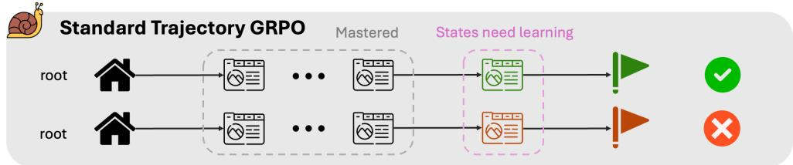

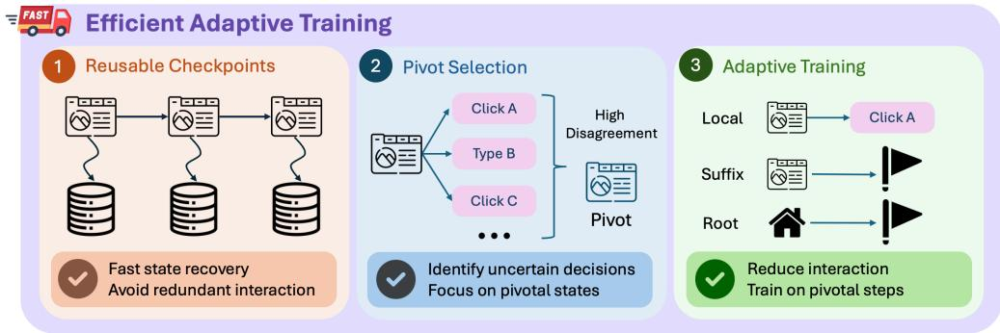  
Figure 1: Overview of standard trajectory-level GRPO and our efficient adaptive training framework. Vanilla GRPO repeatedly traverses mastered prefixes and provides sparse trajectory-level supervision. Our method instead combines reusable checkpoints, pivot selection, and adaptive training to reduce redundant interaction and focus learning on pivotal steps.

## Our contributions are threefold:

• We introduce an action-disagreement criterion that selects informative intermediate states by measuring uncertainty directly from sampled GUI actions.

• We propose a progress-aware two-stage training framework that jointly adapts where a rollout starts and how much of the task it covers, progressing from local pivot updates to suffix and root-level training as the policy improves.

• We develop a checkpoint-supported training pipeline for efficient intermediate-state learning without replaying full trajectory prefixes, improving both training efficiency and task performance across GUI environments.

## 2 RELATED WORK

## 2.1 TRAINING GUI AGENTS WITH MULTI-TURN REINFORCEMENT LEARNING

Early native GUI agents primarily rely on supervised learning from large-scale interaction traces. UI-TARS (Qin et al., 2025) unifies perception, reasoning, and action modeling over GUI trajectories, while ShowUI (Lin et al., 2024) learns a vision-language-action policy from curated GUI interaction data. More recent work increasingly introduces reinforcement learning to improve multi-step GUI execution. UI-R1 (Lu et al., 2025) and GUI-R1 (Luo et al., 2025) apply GRPO-style reinforcement fine-tuning to GUI action learning; MobileGUI-RL (Shi et al., 2025) develops online GUI RL with trajectory-aware advantages; and MobileRL (Xu et al., 2025) further adapts GRPO to task difficulty and online exploration. DART-GUI (Li et al., 2025) studies stabilized and efficient multi-turn GUI RL at larger scale, while CUA-Gym (Wang et al., 2026) provides large-scale verifiable environment for training computer-use agents with outcome-based RL. Qwen-UI-Agent (Zhou et al., 2026) further scales online RL to trajectories exceeding one hundred interaction steps across mobile, desktop, and web environments. These methods demonstrate the effectiveness of trajectory-level reinforcement learning for GUI agents. However, multi-turn training commonly relies on complete environment interaction trajectories and task-level outcomes, making both environment sampling and fine-grained credit assignment increasingly costly as task length grows. Our work studies a complementary question: rather than improving the underlying trajectory-level objective, how should training budget be allocated to the intermediate decisions that still require learning?

## 2.2 LEARNING AND RECOVERING INTERMEDIATE AGENT STATES

Recent work has explored intermediate states as a more targeted unit for agent learning. PivotRL (Yi et al., 2026) extracts candidate states from expert or SFT trajectories, selecting pivots according to local reward variance and applying one-step on-policy optimization. BPO (He et al., 2026) instead selects high-entropy decisions along policy-generated trajectories, snapshots the corresponding sandbox states, and branches multiple suffix rollouts from each state. PivoARL (Guo et al., 2026) uses self-reflection over failed trajectories to locate pivotal erroneous turns and retry from those decisions, while SRC (Hao et al., 2026) uses teacher review to identify the first harmful deviation of a speculative branch and performs rollback-based correction. Tree-GRPO (Ji et al., 2026) randomly branches from intermediate interaction steps to share common prefixes and obtain finergrained training signals. Intermediate-state methods also depend on how the underlying environment is recovered. BPO directly exploits snapshot-and-restore support in executable sandboxes, whereas other approaches rely on resettable environments or action-prefix replay. In GUI research, OSExpert (Liu et al., 2026) restores previous exploration nodes by replaying their stored action sequences. Although replay requires little environment-specific checkpointing support, it repeatedly incurs prefix interaction cost and can be fragile under dynamic GUI behavior. These methods primarily decide either which intermediate states to optimize or where to branch rollouts. In contrast, our focus is to jointly adapt the training location and the rollout extent as policy capability changes.

## 3 EFFICIENT ADAPTIVE TRAINING

Trajectory-level GRPO repeatedly rolls out complete trajectories from the task root, even when only a subset of intermediate decisions still require improvement. We therefore organize training around two questions: where to learn and how far to roll out. Our framework addresses both by reusing recoverable intermediate states, selecting informative pivots through action disagreement, and progressively expanding training from local updates to longer-horizon execution.

## 3.1 REUSABLE INTERMEDIATE STATES

Training from an intermediate GUI state requires recovering both the policy-visible context and the underlying executable environment. Restarting from the task root and replaying the preceding action sequence incurs the same prefix cost, and may drift in dynamic interfaces due to asynchronous loading, animations, or timing-dependent behavior. We therefore save reusable checkpoints along successful trajectories. For a trajectory $\tau = ( o _ { 0 } , a _ { 0 } , o _ { 1 } , a _ { 1 } , . . . , o _ { T } )$ , we define the checkpoint at step t as $c _ { t } = ( x , h _ { t } , o _ { t } , e _ { t } )$ , where $x$ denotes the task instance, $h _ { t }$ the policy-visible interaction history, $o _ { t }$ the current observation, and $e _ { t }$ a recoverable reference to the corresponding executable environment state.

Once created, a checkpoint can be restored repeatedly to generate independent rollout branches without re-executing the preceding trajectory, amortizing the cost of reaching deep intermediate states. As shown in Table 1, checkpoint restoration reduces the measured recovery latency of a 10-step pre-

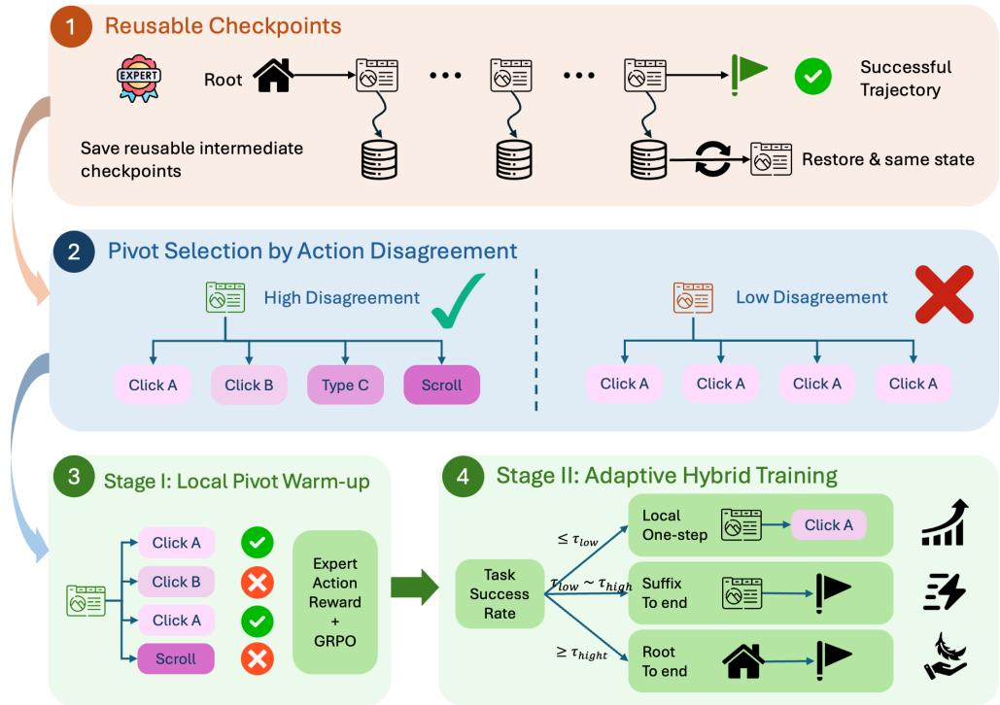

Figure 2: Training pipeline of our method. We construct reusable checkpoints from successful expert trajectories, select uncertain intermediate states using action disagreement, and perform a two-stage training procedure consisting of one-step local warm-up followed by adaptive hybrid training.

Table 1: Checkpoint restoration latency compared with replaying a 10-step trajectory prefix.
<table><tr><td>Environment</td><td>Checkpoint Restore</td><td>10-Step Replay</td><td>Time Reduction</td></tr><tr><td>MobileGym</td><td>2.97 s</td><td>15.7 s</td><td>81.1%</td></tr><tr><td>CUA-Gym-Hub</td><td>3.21 s</td><td>11.3 s</td><td>71.6%</td></tr></table>

fix by 81.1% on MobileGym and 71.6% on CUA-Gym-Hub. Environment-specific checkpointing and validation details are provided in the appendix.

## 3.2 WHERE TO LEARN: SELECTING PIVOTS BY ACTION DISAGREEMENT

Similar to PivotRL (Yi et al., 2026), we construct candidate training states from successful expert trajectories, which provide reliable next-action references and expose downstream states that the initial policy may rarely reach.

We select among these states based on the uncertainty of the current policy’s GUI decision. This follows the uncertainty-guided intuition of BPO (He et al., 2026), but instead of using first-token policy entropy, we measure uncertainty directly from the GUI actions produced by policy samples. This also differs from PivotRL’s reward-variance criterion: a state may produce diverse actions while all current samples receive the same reward, such as $0 / 8$ . In this case, the current group provides no reward variation, but the diverse actions indicate that the model is still uncertain about what to do at this state. As training changes the policy distribution, later iterations may produce mixed outcomes and thus useful learning signals from the same state.

Given N policy samples at state $c _ { t } .$ , let $n _ { j }$ denote the number of samples producing the j-th distinct GUI action. We define the empirical action disagreement as

$$
\hat { D } ( c _ { t } ) = 1 - \frac { \sum _ { j } n _ { j } ( n _ { j } - 1 ) } { N ( N - 1 ) } ,
$$

which measures the probability that two sampled responses produce different GUI actions. We select states with $\hat { D } ( c _ { t } ) > \tau _ { \mathrm { d i s } }$ as pivots. This directly captures uncertainty in the policy’s GUI actions without requiring reward variation to have already appeared. The selected pivots are subsequently used for local updates and suffix rollouts.

## 3.3 HOW FAR TO ROLL OUT: ADAPTIVE HYBRID TRAINING

After selecting where to train, we determine how much of the remaining task should be optimized from that state. Our routing follows two principles: use the shortest rollout that still provides a useful learning signal, and expand the policy’s responsibility only after the current segment becomes reliable. This yields a progression from local one-step updates, to suffix rollouts from intermediate pivots, and finally to lightweight root-level training.

For task $x ,$ let ${ \hat { p } } ( x )$ denote its root-level success rate:

$$
\hat { p } ( x ) = \frac { \# \mathrm { s u c c e s s f u l r o l l o u t s } } { \# \mathrm { r o l l o u t s } } .
$$

Given thresholds $\tau _ { \mathrm { l o w } }$ and $\tau _ { \mathrm { h i g h } }$ , we use ${ \hat { p } } ( x )$ to initialize the training regime:

$$
R ( x ) = \left\{ \begin{array} { l l } { \mathrm { L o c a l } , } & { \hat { p } ( x ) < \tau _ { \mathrm { l o w } } , } \\ { \mathrm { S u f f i x } , } & { \tau _ { \mathrm { l o w } } \leq \hat { p } ( x ) \leq \tau _ { \mathrm { h i g h } } , } \\ { \mathrm { R o o t } , } & { \hat { p } ( x ) > \tau _ { \mathrm { h i g h } } . } \end{array} \right.
$$

This routing determines the initial rollout extent. Training then follows a progressive schedule in which Local tasks may advance to Suffix or Root, Suffix tasks move their rollout frontier toward earlier pivots, and tasks that reach Root remain in the Root regime.

Local training. When root-level success is low, long rollout groups often collapse to the same failure outcome and provide weak relative learning signal despite substantial interaction cost. We therefore perform one-step RL at the selected pivots, using the expert next action to construct an immediate local reward. After local updates, the task is re-evaluated from the root and may remain in Local training or advance to Suffix or Root as its task success improves.

Suffix training. Once the policy has acquired partial task-solving ability, longer rollouts become more informative. We order the selected pivots along the expert trajectory and begin from the deepest pivot, avoiding the already-reliable prefix. From the current pivot, we generate suffix rollouts to task termination. If the suffix success rate exceeds $\tau _ { \mathrm { s u f f i x } }$ , the rollout frontier moves one pivot earlier in the next round; otherwise, it remains at the current pivot. Repeating this process progressively increases the portion of the trajectory completed by the policy until training reaches the earliest pivot and starts root rollout.

Root training. When the policy can reliably solve the task end-to-end, we use only a small number of root-level rollouts to probe whether additional optimization remains useful. If the rollout group exhibits outcome variation, it provides a valid training signal and is used for policy updates. If all probes succeed consistently, no update is performed. Once a task enters Root training, it remains in this regime.

## 3.4 TWO-STAGE TRAINING

Although Adaptive Hybrid Training can be applied directly to the base policy, we find it beneficial to first improve uncertain local decisions before introducing longer-horizon optimization. Our final method therefore consists of two stages.

Stage I: Local pivot warm-up. We use the Action-Disagreement pivots selected in Section 3.2 and perform only the one-step local updates described in Section 3.3. This stage concentrates optimization on uncertain GUI decisions without requiring the policy to complete the remaining task, providing a stronger initialization for subsequent multi-step training.

Stage II: Adaptive hybrid training. Starting from the Stage-I policy, we apply the Adaptive Hybrid procedure from Section 3.3. An initial set of root-level rollouts assigns each task to Local, Suffix, or Root training. Local tasks are periodically re-evaluated from the root, Suffix training progressively moves the rollout frontier toward earlier pivots as the current suffix becomes reliable, and tasks that reach Root remain in Root-level training.

## 4 EXPERIMENTS

## 4.1 EXPERIMENTAL SETUP

Environments and task splits. We evaluate our method on two GUI environments, Mobile-Gym (Wu et al., 2026) and CUA-Gym-Hub (Wang et al., 2026). For MobileGym, we construct our split from the official 256-task test set because the original training and test sets exhibit a substantial distribution gap. We divide these 256 tasks into two disjoint subsets of 128 tasks. After verifying task executability with the expert, 83 tasks from the first subset are retained for training, while the remaining 128 tasks are used exclusively for held-out evaluation. For CUA-Gym-Hub, we select 80 tasks from the official task pool for training and a disjoint set of 60 tasks for evaluation. In both environments, evaluation tasks are never used during RL training.

Policy and expert trajectories. All experiments start from a Qwen3.5-4B-based policy initialized from supervised fine-tuning. Importantly, the SFT data are collected from other environments and tasks and contain no trajectories from either MobileGym or CUA-Gym-Hub, ensuring that improvements on the two benchmarks come from the RL training studied in this work. To construct successful expert trajectories and intermediate training states, we use Qwen3.8-Max as the expert for MobileGym and GPT6-Astra for CUA-Gym-Hub. Only successfully completed and verified expert trajectories are used to construct reusable checkpoints and intermediate states.

Evaluation protocol. We evaluate policies from the task root without providing expert prefixes or intermediate checkpoints at test time. For each task, we perform four independent evaluation rollouts and report both $A \nu g @ 4 ,$ the average success rate across the four attempts, and $P a s s @ 4 .$ , the fraction of tasks solved at least once within four attempts. We report results separately on the training-task set (Train) and the held-out evaluation set (Held-Out), and also measure training efficiency using both the number of training optimization samples and the number of environment interaction steps.

Training details. For pivot selection, we sample $N = 8$ responses at each candidate state. Reward Variance retains states with non-zero local reward variance, whereas Action Disagreement uses $\tau _ { \mathrm { d i s } } = 0 . 4 5$ , filtering weak action dispersion while preserving states with substantial decision uncertainty. Hybrid training is initialized using four root rollouts per task, with $\tau _ { \mathrm { l o w } } = 0 . 2 5$ and $\tau _ { \mathrm { h i g h } } = 0 . 7 5$ to assign tasks to Local, Suffix, or Root regimes. Local tasks are re-evaluated from the root, while Suffix and Root tasks follow the progression defined in Section 3.3. Local tasks are re-evaluated with four root rollouts; Suffix training uses eight rollouts and moves the frontier one pivot earlier when the previous suffix success rate exceeds $\tau _ { \mathrm { s u f f i x } } = 0 . 7 5$ Root training uses only two lightweight root rollouts. For the two-stage method, Stage I performs one-step RL on Action-Disagreement pivots, and the checkpoint with the highest Train Avg@4 is used to initialize Stage II. We define training samples as policy samples that enter optimization and environment steps as GUI interaction steps executed during rollout generation.

## 4.2 WHERE TO LEARN: EVALUATING PIVOT SELECTION

We first isolate the effect of pivot selection using one-step local RL. All methods use the same expert trajectories, local reward, and GRPO training procedure; they differ only in which intermediate states are selected for training. We compare three strategies: All Pivots, which trains on all available intermediate states; Reward Variance, which retains states whose sampled actions produce non-zero local reward variance; and Action Disagreement, our method, which selects states where policy samples produce diverse GUI actions. Figure 3 shows the full learning curves as a function of cumulative rollout steps on MobileGym and CUA-Gym-Hub, while Table 2 summarizes the checkpoint with the highest Train Avg@4 for each method, together with its sample cost and corresponding Train/Held-Out performance. Since all methods use the same one-step training objective, differences primarily reflect the effectiveness of the state-selection strategy rather than longer-horizon exploration.

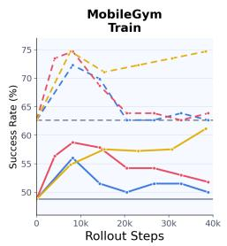

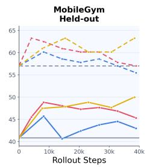

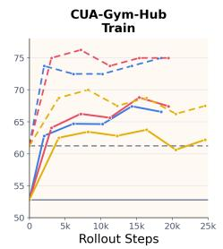  
Reward Variance  Action Disagreement  All Pivots  avg@4 -- pass@4 Base avg@4 --- Base pass@4

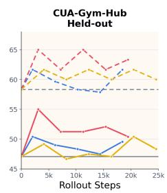  
Figure 3: One-step pivot training with different state-selection strategies on MobileGym and CUA-Gym-Hub. All methods use the same local RL procedure and differ only in the selected intermediate states. Solid and dashed curves denote Avg@4 and Pass@4, respectively; gray lines show the common base performance.

Table 2: Comparison of pivot-selection strategies on MobileGym and CUA-Gym-Hub. Each metric cell reports Avg@4 / Pass@4 at the checkpoint with the highest Train Avg@4.
<table><tr><td rowspan="2">Method</td><td colspan="3">MobileGym</td><td colspan="3">CUA-Gym-Hub</td></tr><tr><td>Samples</td><td>Train</td><td>Held-Out</td><td>Samples</td><td>Train</td><td>Held-Out</td></tr><tr><td>All Pivots</td><td>38.4K</td><td>61.14 / 74.70</td><td>50.00 / 63.28</td><td>16.4K</td><td>63.75 / 68.75</td><td>47.08 / 60.00</td></tr><tr><td>Reward Variance</td><td>8.2K</td><td>56.02 / 72.29</td><td>45.70 / 60.16</td><td>14.3K</td><td>67.44 / 73.75</td><td>47.50 / 57.87</td></tr><tr><td>Action Disagreement (Ours)</td><td>8.2K</td><td>58.73 / 74.70</td><td>48.83 / 62.50</td><td>15.4K</td><td>68.81 / 75.00</td><td>52.08 / 61.67</td></tr></table>

Across both benchmarks, Action Disagreement provides a stronger overall accuracy-efficiency trade-off than Reward Variance on both Train and Held-Out tasks. This supports our motivation that policy action uncertainty can identify useful training states beyond those that already exhibit reward variation. On MobileGym, All Pivots eventually obtains the highest Held-Out Avg@4, reaching 50.00% after 38.4k rollout samples. Action Disagreement reaches a comparable 48.83% with only 8.2k samples, approximately 21% of the rollout budget, while also outperforming Reward Variance at the same 8.2k-sample budget.

The advantage is more pronounced on CUA-Gym-Hub. Action Disagreement achieves the highest Held-Out performance, reaching 55.00% Avg@4 and 65.00% Pass@4 with 3.1k rollout samples, while both Reward Variance and All Pivots peak at 50.42% Held-Out Avg@4. Together, the learning curves and best-checkpoint summary show that Action Disagreement provides a strong balance between training cost and downstream performance. We therefore use Action-Disagreement pivots in the subsequent full-training experiments.

## 4.3 FULL TRAINING: EFFECTIVENESS AND EFFICIENCY

We next evaluate the complete training procedure in terms of both task performance and training efficiency. We compare four configurations: Base→Vanilla, which applies standard trajectory level GRPO directly to the base policy; Base→Hybrid, which applies Adaptive Hybrid Training without Stage-I warm-up; Action→Vanilla, which performs Action-Disagreement one-step training followed by Vanilla GRPO; and Action→Hybrid, our full two-stage method. Figure 4 reports performance against cumulative training samples and environment rollout steps on MobileGym and CUA-Gym-Hub.

Action→Hybrid Action→Vanilla  Base→Hybrid Base→Vanilla  avg@4 -- pass@4  Base avg@4 --- Base pass@4  
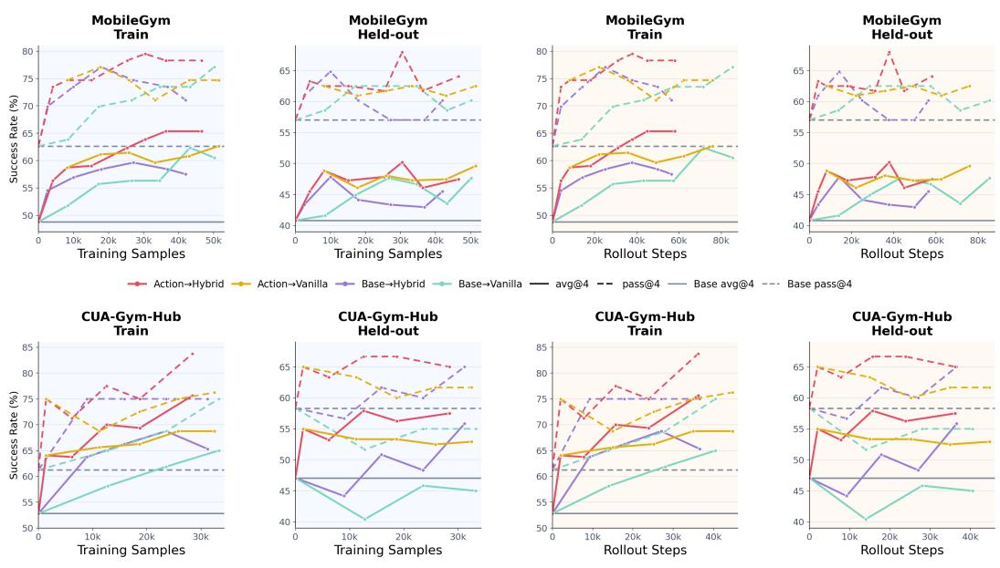  
Figure 4: Full-training effectiveness and efficiency on MobileGym (top) and CUA-Gym-Hub (bottom). For each benchmark, the left two panels report Train and Held-out performance against cumulative training samples, while the right two report performance against cumulative rollout steps. Solid and dashed curves denote Avg@4 and Pass@4, respectively, and horizontal gray lines indicate base-policy performance.

Adaptive Hybrid vs. Vanilla GRPO. We first isolate the effect of adaptive rollout allocation by comparing Base→Hybrid with Base→Vanilla. Across both benchmarks, Hybrid reaches comparable or better task performance with substantially less training and environment interaction. On MobileGym, Base→Hybrid reaches 58.43 Train Avg@4 using 17.9k training samples and 25.0k rollout steps, whereas Base→Vanilla requires 43.3k samples and 71.5k steps to surpass the same level, reducing the two costs by 58.6% and 65.0%, respectively. A similar trend appears on CUA-Gym-Hub, where Base→Hybrid reaches 63.75 Train Avg@4 with 9.0k samples and 9.2k rollout steps, compared with 33.3k samples and 40.5k steps for Vanilla.

The same efficiency advantage is also reflected on held-out tasks. On MobileGym, Base→Hybrid reaches 47.85 Held-out Avg@4 with 10.0k samples and 14.2k rollout steps, slightly above the 47.66 obtained by Vanilla after 26.6k samples and 43.2k steps. On CUA-Gym-Hub, Base→Hybrid reaches 55.83 Held-out Avg@4, whereas the best Base→Vanilla checkpoint reaches 45.83. These results indicate that adaptive rollout allocation reduces the cost of trajectory-level RL without sacrificing downstream task performance.

Two-Stage Training. We next examine whether the Action-Disagreement warm-up further improves multi-step training. Action→Hybrid consistently reaches strong performance earlier than Action→Vanilla. On MobileGym, the full method reaches 63.86 Train Avg@4 with 30.5k training samples and 37.8k rollout steps, exceeding the best Action→Vanilla result of 62.65 while using 40.8% fewer training samples and 50.2% fewer environment interactions. On CUA-Gym-Hub, Action→Hybrid reaches 70.00 Train Avg@4 with 12.6k samples and 15.7k rollout steps, while Action→Vanilla peaks at 68.75 despite substantially larger training cost.

The benefit also transfers to held-out evaluation. On MobileGym, Action→Hybrid reaches 50.20 Held-out Avg@4, compared with 49.61 for Action→Vanilla. On CUA-Gym-Hub, the full method reaches 57.92 Held-out Avg@4 after 12.6k samples and 15.7k rollout steps, whereas Action→Vanilla reaches 53.33 at a similar interaction budget and does not improve beyond this level with additional training. Together, these results suggest that the two stages are complementary: Stage I improves uncertain local decisions, while Stage II expands these improvements into multi-step task execution.

Table 3: Summary of full-training performance on MobileGym and CUA-Gym-Hub. For each method, we select the checkpoint with the highest Train Avg@4 and report its corresponding Train and Held-Out performance. Each cell reports Avg@4 / Pass@4.
<table><tr><td rowspan="2">Method</td><td colspan="2">MobileGym</td><td colspan="2">CUA-Gym-Hub</td></tr><tr><td>Train</td><td>Held-Out</td><td>Train</td><td>Held-Out</td></tr><tr><td>Base</td><td>48.80 / 62.65</td><td>40.82 / 57.03</td><td>52.81 / 61.25</td><td>47.08 / 58.33</td></tr><tr><td>SFT</td><td>81.93 / 90.36</td><td>48.24 / 65.63</td><td>70.00 / 73.75</td><td>50.83 / 58.33</td></tr><tr><td>Base→Vanilla</td><td>56.33 / 71.08</td><td>47.66 / 62.50</td><td>61.88 / 68.75</td><td>45.83 / 55.00</td></tr><tr><td>Base→Hybrid</td><td>56.93 / 73.49</td><td>47.85 / 64.84</td><td>65.31 / 75.00</td><td>55.83 / 65.00</td></tr><tr><td>Action→Vanilla</td><td>62.65 / 74.69</td><td>49.61 / 62.50</td><td>65.63 / 68.75</td><td>53.33 / 63.33</td></tr><tr><td>Action→Hybrid</td><td>63.86 / 79.52</td><td>50.20 / 67.97</td><td>70.00 / 77.50</td><td>57.92 / 66.67</td></tr></table>

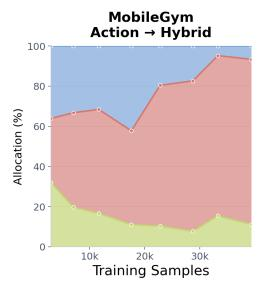

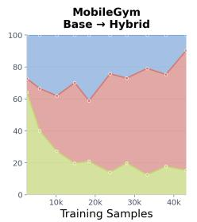

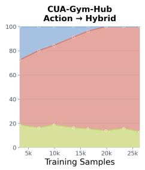

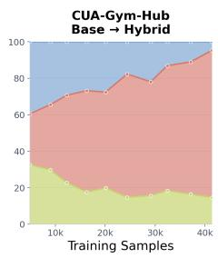  
Figure 5: Evolution of training allocation in adaptive hybrid training on MobileGym and CUA-Gym-Hub. The four panels show how the proportions of Local, Root, and Suffix training change over cumulative training samples for Action→Hybrid and Base→Hybrid.

Comparison with SFT. Because our framework also relies on successful expert trajectories, we compare against supervised fine-tuning on the same expert data. The SFT baseline uses all expert trajectory steps rather than only selected pivots. As shown in Table 3, SFT substantially improves Train performance on both benchmarks, but its gains transfer less consistently to held-out tasks. On MobileGym, SFT reaches 48.24 Held-out Avg@4, close to the 50.20 achieved by our method. On CUA-Gym-Hub, both methods reach 70.00 Train Avg@4, yet Action→Hybrid achieves 57.92 Held-out Avg@4 compared with 50.83 for SFT, with Pass@4 increasing from 58.33 to 66.67. This suggests that the RL procedure provides benefits beyond supervised imitation of the same expert trajectories, particularly on held-out CUA-Gym-Hub tasks.

Adaptive Training Allocation. Figure 5 shows how the training budget shifts across Local, Suffix, and Root regimes as training progresses. For Action→Hybrid, the fraction of Root training increases from 31.96% to 82.29% on MobileGym and from 53.78% to 86.97% on CUA-Gym-Hub, while Suffix training decreases from 36.12% to 6.65% and from 27.66% to 0%, respectively. This behavior is consistent with the intended progression of Adaptive Hybrid Training: optimization begins with local or partial trajectories and gradually shifts toward full-task execution as the policy improves. Moreover, Action→Hybrid begins Stage II with a larger fraction of Root training than Base→Hybrid on both benchmarks, consistent with the Stage-I warm-up allowing more tasks to enter longer horizon training earlier.

## 5 CONCLUSION

We presented an adaptive training framework for multi-step GUI agents that jointly addresses where to learn and how far to roll out. The framework combines action-disagreement pivot selection, reusable intermediate checkpoints, and adaptive Local, Suffix, and Root training. Across MobileGym and CUA-Gym-Hub, it improves training efficiency by reducing both optimization samples and environment interaction while maintaining or improving task performance. These results show that selectively allocating training across intermediate states and rollout ranges is an effective way to make GUI-agent RL more efficient.

## REFERENCES

Weiyang Guo, Zesheng Shi, Longhui Zhang, Zeen Zhu, Min Zhang, and Jing Li. Agent reinforcement learning via pivotal-aware self-feedback retry, 2026. URL https://arxiv.org/abs/ 2607.03702.

Longkun Hao, Hongyu Lin, Hao Li, Zhuowen Liu, Zhichao Yang, Haojie Hao, Dongshuo Huang, Haitao Yang, Hongyu Ge, Ming jie Xie, Yanjun Wu, Zi Hao Yin, Yan Bai, and Yihang Lou. Speculative rollback correction for quality-diverse web agent imitation, 2026. URL https: //arxiv.org/abs/2606.12485.

Bowei He, Yankai Chen, Xiaokun Zhang, and Xue Liu. Branching policy optimization: Sandboxnative language agent reinforcement learning, 2026. URL https://arxiv.org/abs/ 2607.14171.

Yuxiang Ji, Ziyu Ma, Yong Wang, Guanhua Chen, Xiangxiang Chu, and Liaoni Wu. Tree search for llm agent reinforcement learning, 2026. URL https://arxiv.org/abs/2509.21240.

Pengxiang Li, Zechen Hu, Zirui Shang, Jingrong Wu, Yang Liu, Hui Liu, Zhi Gao, Chenrui Shi, Bofei Zhang, Zihao Zhang, Xiaochuan Shi, Zedong YU, Yuwei Wu, Xinxiao Wu, Yunde Jia, Liuyu Xiang, Zhaofeng He, and Qing Li. Efficient multi-turn rl for gui agents via decoupled training and adaptive data curation, 2025. URL https://arxiv.org/abs/2509.23866.

Kevin Qinghong Lin, Linjie Li, Difei Gao, Zhengyuan Yang, Shiwei Wu, Zechen Bai, Weixian Lei, Lijuan Wang, and Mike Zheng Shou. Showui: One vision-language-action model for gui visual agent, 2024. URL https://arxiv.org/abs/2411.17465.

Jiateng Liu, Zhenhailong Wang, Rushi Wang, Bingxuan Li, Jeonghwan Kim, Aditi Tiwari, Pengfei Yu, Denghui Zhang, and Heng Ji. Osexpert: Computer-use agents learning professional skills via exploration, 2026. URL https://arxiv.org/abs/2603.07978.

Zhengxi Lu, Yuxiang Chai, Yaxuan Guo, Xi Yin, Liang Liu, Hao Wang, Han Xiao, Shuai Ren, Guanjing Xiong, and Hongsheng Li. Ui-r1: Enhancing efficient action prediction of gui agents by reinforcement learning, 2025. URL https://arxiv.org/abs/2503.21620.

Run Luo, Lu Wang, Wanwei He, Longze Chen, Jiaming Li, and Xiaobo Xia. Gui-r1 : A generalist r1-style vision-language action model for gui agents, 2025. URL https://arxiv.org/ abs/2504.10458.

Yujia Qin, Yining Ye, Junjie Fang, Haoming Wang, Shihao Liang, Shizuo Tian, Junda Zhang, Jiahao Li, Yunxin Li, Shijue Huang, Wanjun Zhong, Kuanye Li, Jiale Yang, Yu Miao, Woyu Lin, Longxiang Liu, Xu Jiang, Qianli Ma, Jingyu Li, Xiaojun Xiao, Kai Cai, Chuang Li, Yaowei Zheng, Chaolin Jin, Chen Li, Xiao Zhou, Minchao Wang, Haoli Chen, Zhaojian Li, Haihua Yang, Haifeng Liu, Feng Lin, Tao Peng, Xin Liu, and Guang Shi. Ui-tars: Pioneering automated gui interaction with native agents, 2025. URL https://arxiv.org/abs/2501.12326.

Yucheng Shi, Wenhao Yu, Zaitang Li, Yonglin Wang, Hongming Zhang, Ninghao Liu, Haitao Mi, and Dong Yu. Mobilegui-rl: Advancing mobile gui agent through reinforcement learning in online environment, 2025. URL https://arxiv.org/abs/2507.05720.

Bowen Wang, Dunjie Lu, Junli Wang, Tianyi Bai, Shixuan Liu, Zhipeng Zhang, Haiquan Wang, Hao Hu, Tianbao Xie, Shuai Bai, Dayiheng Liu, Que Shen, Junyang Lin, and Tao Yu. Cuagym: Scaling verifiable training environments and tasks for computer-use agents, 2026. URL https://arxiv.org/abs/2605.25624.

Dingbang Wu, Rui Hao, Haiyang Wang, Shuzhe Wu, Han Xiao, Zhenghong Li, Bojiang Zhou, Zheng Ju, Zichen Liu, Lue Fan, and Zhaoxiang Zhang. Mobilegym: A verifiable and highly parallel simulation platform for mobile gui agent research, 2026. URL https://arxiv. org/abs/2605.26114.

Yifan Xu, Xiao Liu, Xinghan Liu, Jiaqi Fu, Hanchen Zhang, Bohao Jing, Shudan Zhang, Yuting Wang, Wenyi Zhao, and Yuxiao Dong. Mobilerl: Online agentic reinforcement learning for mobile gui agents, 2025. URL https://arxiv.org/abs/2509.18119.

Junkeun Yi, Damon Mosk-Aoyama, Baihe Huang, Ritu Gala, Charles Wang, Sugam Dipak Devare, Khushi Bhardwaj, Abhibha Gupta, Oleksii Kuchaiev, Jiantao Jiao, Jian Zhang, and Venkat Srinivasan. Pivotrl: High accuracy agentic post-training at low compute cost, 2026. URL https://arxiv.org/abs/2603.21383.

Hanzhang Zhou, Panrong Tong, Xu Zhang, Quyu Kong, Chenglin Cai, Tianyu Xia, Gongjie Zhang, Jianan Zhang, Long Li, Long Chen, Lei Wang, Gaole Dai, Pengxiang Li, Liangyu Chen, Yue Wang, and Steven Hoi. Qwen-ui-agent technical report: Toward next-generation real-world centric foundation gui agents, 2026. URL https://arxiv.org/abs/2607.28227.

## A APPENDIX

## A.1 ENVIRONMENT CHECKPOINTING

We use Podman and CRIU to checkpoint and restore interactive environments at the container level. CRIU captures running process state, including browser memory and the JavaScript heap, while Podman packages the checkpoint with container filesystem changes. This preserves runtime information beyond what screenshots or browser storage alone can capture.

Checkpoints are created between agent actions, and the source container can continue running after capture. To resume execution, the saved checkpoint is restored into a target container, together with the corresponding execution metadata and agent context. A single checkpoint can initialize multiple independent rollout branches, allowing exploration from the same intermediate state without repeating earlier actions. Existing TCP connections are closed during restoration so that each branch can establish fresh connections.

We check restoration readiness through backend health checks and successful screenshot capture. Additional consistency tests compare observations and task-evaluation results before and after restoration. These checks help identify observable restoration failures, but do not constitute proof of complete state equivalence or guarantee identical future execution when asynchronous events or external services are involved.

## A.2 ACTION DISAGREEMENT AND LOCAL RL

Action matching. Both action-disagreement estimation and local one-step RL require determining whether two GUI actions should be treated as equivalent. For coordinate-based actions, including click, long-press, and double-click, two actions are considered equivalent if their coordinates differ by at most 5% of the screen width and height. Swipe actions are matched according to their discretized direction. For other actions, we compare the action type directly. In particular, textentry actions are treated as the same type action regardless of the generated text content. This rule removes minor coordinate or textual variation that does not correspond to a different GUI decision.

Action disagreement. Given N = 8 policy samples, we first group sampled responses according to the action-matching rule above and compute $\hat { D } ( c _ { t } )$ from the resulting action counts. We use $\tau _ { \mathrm { d i s } } = 0 . 4 5$ in our experiments. For example, a 6–2 split yields $\hat { D } = 0 . 4 2 9$ and is filtered out, whereas $6 – 1 – 1 ( \hat { D } = 0 . 4 6 4 )$ and $5 \mathrm { - 3 } ( \hat { D } = 0 . 5 3 6 )$ are retained. Detailed disagreements are listed in Table 4.

Local one-step reward. The same action-matching rule is used to construct the local reward. Let $a _ { t } ^ { E }$ denote the expert next action at pivot $c _ { t } .$ , and let $a _ { t } ^ { ( i ) }$ be a policy sample. We assign

$$
\boldsymbol { r } _ { t } ^ { ( i ) } = \mathbb { I } \left[ \mathcal { M } ( \boldsymbol { a } _ { t } ^ { ( i ) } , \boldsymbol { a } _ { t } ^ { E } ) \right] ,
$$

where M is the action-matching function defined above. The expert prefix is used only to condition the policy at the pivot; optimization is performed on the newly sampled response.

Table 4: Representative action-count patterns and their empirical disagreement scores for $N = 8$ policy samples. We use $\tau _ { \mathrm { d i s } } = 0 . 4 5$
<table><tr><td>Action Counts</td><td> $\hat { D } ( c _ { t } )$ </td><td>Action Counts</td><td> $\hat { D } ( c _ { t } )$ </td></tr><tr><td>8</td><td>0.000</td><td>5-3</td><td>0.536</td></tr><tr><td>7-1</td><td>0.250</td><td>4-4</td><td>0.571</td></tr><tr><td>6-2</td><td>0.429</td><td>5-2-1</td><td>0.607</td></tr><tr><td>6-1-1</td><td>0.464</td><td>4-3-1</td><td>0.679</td></tr><tr><td>4-2-2</td><td>0.714</td><td>3-3-2</td><td>0.750</td></tr><tr><td>2-2-2-2</td><td>0.857</td><td>1-1-1-1-1-1-1-1</td><td>1.000</td></tr></table>

## A.3 ADAPTIVE HYBRID TRAINING ALGORITHM

Pivots are ordered according to their positions in the expert trajectory, with $c _ { K }$ denoting the deepest pivot. Hybrid training is monotonic with respect to the rollout frontier: Suffix training starts from $c _ { K }$ and moves one pivot earlier whenever the current suffix success rate exceeds $\tau _ { \mathrm { s u f f i x } }$ . Once the frontier reaches the task root, the task remains in the Root regime and is not routed back to intermediate pivots. In our experiments, we set $\tau _ { \mathrm { l o w } } = 0 . 2 5 , \tau _ { \mathrm { h i g h } } = 0 . 7 5$ , and $\tau _ { \mathrm { s u f f i x } } = 0 . 5$ . Algorithm 1 shows the entire pipeline.

## A.4 AI ASSISTANCE STATEMENT

We used generative AI tools to assist with writing and language polishing, literature retrieval and discovery, and the generation of synthetic data used in our research workflow. AI-assisted text was reviewed and revised by the authors, and retrieved literature was manually verified against the original sources. Any AI-generated data used in experiments was inspected and validated before use. The authors take full responsibility for the final content, experimental results, and claims in this paper.

Algorithm 1 Adaptive Hybrid Training   
Require: Task x, ordered pivots $\mathcal { C } ( x ) = \{ c _ { 1 } , . . . , c _ { K } \}$ from earliest to deepest, policy π, thresholds   
τlow, τhigh, and $\tau _ { \mathrm { s u f f i x } }$   
Ensure: Updated policy π   
1: Run 4 root-level rollouts and compute success rate ${ \hat { p } } ( x )$   
2: $\mathbf { i f } \hat { p } ( x ) < \tau _ { \mathrm { l o w } }$ then   
3: R ← LOCAL   
4: else if $\hat { p } ( x ) \leq \tau _ { \mathrm { h i g h } }$ then   
5: $R \gets \dot { \operatorname { S U F F I X } } ; \breve { j } \gets K$   
6: else   
7: R ← ROOT   
8: end if   
9: while training continues do   
10: if $R = { \mathrm { L o } } { \bar { \mathrm { c } } } { \mathrm { A L } }$ then   
11: Perform one-step RL at selected pivots using 8 policy samples   
12: Run 4 root-level rollouts and recompute ${ \hat { p } } ( x )$   
13: $\mathbf { i f } \hat { p } ( x ) < \tau _ { \mathrm { l o w } }$ then   
14: R ← LOCAL   
15: else if $\hat { p } ( x ) \leq \tau _ { \mathrm { h i g h } }$ then   
16: $R \gets \mathrm { S U F F I X } ; \breve { j } \gets K$   
17: else   
18: R ← ROOT   
19: end if   
20: else if R = SUFFIX then   
21: Restore pivot $c _ { j }$ and generate 8 suffix rollouts   
22: Update π using the resulting rollout group   
23: Compute suffix success rate $\hat { p } _ { \mathrm { s u f } }$   
24: if $\hat { p } _ { \mathrm { s u f } } > \tau _ { \mathrm { s u f f i x } }$ then   
25: if j > 1 then   
26: $j  j - 1$   
27: else   
28: R ← ROOT   
29: end if   
30: end if   
31: else   
32: Generate 2 root-level rollouts   
33: if the rollout group exhibits outcome variation then   
34: Update π using the root rollout group   
35: end if   
36: Keep R ← ROOT   
37: end if   
38: end while