# When to Assist and What to Suggest: Joint Gating and Memory-Grounded Hint Generation in One Compact Decoder

A. J. A. Jubayer Talukdera,∗, Mohammad Ariful Haquea

aDepartment ofElectrical and Electronic Engineering (EEE), Bangladesh University ofEngineering and Technology (BUET), Dhaka, 1205, Bangladesh

## A R T I C L E I N F O

Keywords:   
proactive conversational assistants   
intervention gating   
memory-grounded generation   
early-exit decoding   
large language model evaluation

## A BS T RA C T

Proactive assistants ofer short, memory-grounded hints during a conversation, deciding when to assist and what to suggest. Current systems split this between a gate and a larger generator; we evaluate both together on 28,058 decision points. Stage-wise generation scores are oracle-gate ceilings: behind a real gate, end-to-end exact match is 0.2619 against a ceiling of 0.2971, and end-to-end precision is 0.2387, leaving substantial headroom. A gate pays of through precision and compute, whose saving falls from 4.39× with an 8B generator to 1.38× with a 1B one. The memory profile drives hint quality: removing it costs 24.7 exact-match points (rescaled BERTScore 0.57 to 0.35), while retrieval and a larger generator add nothing on exact match. One 1B decoder can do both, gating from an intermediate layer and generating in the same pass. At its final checkpoint it matches or exceeds the two-model pipelines on automatic end-to-end measures with 1.31–1.76× less wall-clock time than the matched 1B pipeline; across three seeds, its deeper exit ties the separate gate. A human evaluation (1,144 ratings over 32 dialogues) supports the memory efect and rates the single model level with the matched 1B pipeline and below the 8B one. Graded metrics and LlamaPIE’s native judge track human ratings more closely than exact match, which we report as a strict lower bound.

## 1. Introduction

A proactive conversational assistant listens to a conversation the user is already having and occasionally ofers a short, memory-grounded hint: a name the user is reaching for, a date, a topic worth raising. It is never invoked, so it must decide both when to assist and what to suggest. Most candidate moments do not need a hint; about 11.96% do on our corpus. The two decisions depend on each other: a hint is useful only at a moment that needs one, and a moment warrants an interruption only if a useful hint exists.

Existing systems split the two decisions across two models, following LlamaPIE (Chen, Batchelder, Liu, Smith and Gollakota, 2025): a small gate, and a larger generator invoked only when the gate fires. We evaluate the two stages together over 28,058 decision points. Stage-wise generation scores turn out to be oracle-gate ceilings: behind a real gate, end-to-end exact match is 0.2619 against a ceiling of 0.2971, and end-to-end precision is 0.2387, leaving substantial headroom. A gate therefore pays of through precision and compute, and its compute saving depends on how large the generator is.

Hint quality comes from the persistent user memory profile. Removing it costs 24.7 exact-match points (rescaled BERTScore 0.57 with the profile, 0.35 without), while a larger generator of the same family and retrieval over the profile add nothing on exact match.

These results motivate one model instead of two. We build a single 1B decoder that reads its gate decision from an intermediate layer and, when the gate fires, continues the same forward pass to generate the hint (Figure 1b). Unlike confidence-based early exit, the intermediate readout does not approximate the deep output; it decides whether the deep computation runs at all. At its final checkpoint the unified model matches or exceeds the two-model pipelines on the automatic end-to-end measures, with 1.31–1.76× less wallclock time than the matched 1B pipeline; across three seeds, its deeper exit (� = 10) ties the separate gate.

A human evaluation (1,144 ratings over 32 dialogues) supports the memory efect and rates the unified model level with the matched 1B pipeline and below the 8B one. Graded metrics and LlamaPIE’s nativejudge track the human ratings more closely than exact match. We keep exact match as the primary automatic metric because it alone has an end-to-end form, and read it as a strict lower bound on usefulness.

## Contributions.

• An end-to-end formulation that scores the composed gate-and-generate decision by the triggers it serves and the precision of what it emits (Equation (2); Sections 3.1 and 8).

• Evidence that the memory profile, not generator scale or retrieval, drives hint quality, with controls that attribute the efect to its content (Section 6).

• A single decoder that gates from an intermediate layer and generates in the same pass, matching the twomodel pipeline on automatic measures at lower cost (Sections 3.4, 7 and 8).

• A human evaluation that identifies which automatic signals track people (Section 9).

(a) What the wearer experiences  
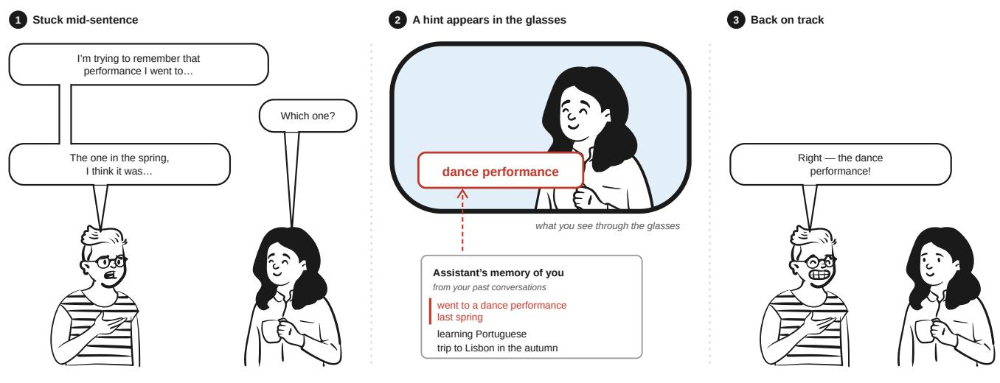

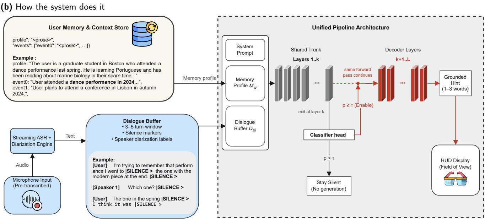  
Figure 1: The task and the system, on one illustrative example (not a corpus item). (a) At every pause the assistant decides whether to speak; it stays quiet at most pauses (11.96% of pauses need a hint on our corpus) and otherwise shows a one-to-three-word hint drawn from what it knows about the wearer. (b) The dialogue bufer and the memory profile form one prompt; a classifier head at layer � decides whether to speak (threshold �), and if so the same forward pass continues through layers �+1..� to the hint. Only the dashed box is trained and evaluated. People in (a) adapted from Open Peeps (Pablo Stanley, CC0)

## 2. Related work and positioning

## 2.1. Proactive and mixed-initiative dialogue

Proactive dialogue asks a system to contribute without being addressed, which makes whether to speak part of dialogue management (Deng, Lei, Lam and Chua, 2023). Recent evaluation work treats the choice to intervene as a scorable act in its own right (Liu, Wan, Guo and Quan, 2025). We follow that line and score the intervention decision and the utterance jointly, because a hint is useful only at a moment that needs one.

Several recent assistive systems make the same commitment in wearable settings. PROASSIST generates assistant dialogue from streaming egocentric video (Zhang, Dong, Lin, Madotto, Kumar, Damavandi, Chai and Moon, 2025); Pro2Assist tracks procedural progress to time its interventions (Xu, Yang, Jiang, Liu, Hou, Fan, Chen, Yan and Jiang, 2026); Alpha-Service organises perception, memory and interaction into a service architecture on AI glasses (Wen, Wang, Liao, Yang, Li, Liu, He, Feng, Liu, Lyu, Zheng, Hu and Zhang, 2025); SocialMind delivers in-situ social suggestions through AR (Yang, Guo, Xu, Yan, Chen, Xing and Jiang, 2025); Sensible Agent chooses how intrusively to ofer help (Lee, Xia, Numan, Qian, Li, Chen, Kulshrestha, Chatterjee, Zhang, Manocha, Kim and Du, 2025); and Satori

Joint Gating and Hint Generation in One Compact Decoder
<table><tr><td>System</td><td>Modality</td><td>Model scale</td><td>Dataset</td><td>Gating mechanism</td><td>Generation eval.</td><td>On-device eval.</td><td>User study</td></tr><tr><td>LlamaPIE (Chen et al., 2025)</td><td>speech (in-ear)</td><td>1B gate + 8B gen.</td><td>semi-synthetic dialogue</td><td>separate small classifier</td><td>LLM rubric</td><td>Apple M2</td><td>yes</td></tr><tr><td>PROASSIST (Zhang et al., 2025)</td><td>streaming egocentric video</td><td>Llama-3.1-8B + SigLIP</td><td>synthesised from annotated video</td><td>end-to-end, learned</td><td>automatic, human-validated</td><td>not reported</td><td>annotators only, no end users</td></tr><tr><td>Pro²Assist (Xu et al., 2026)</td><td>multimodal egocentric (AR)</td><td>Qwen3-VL-4B (2-30B swept)</td><td>1,089 samples, 10 tasks</td><td>step-aware continuous reasoning</td><td>action understanding acc.</td><td>AR glasses</td><td>yes, n=20</td></tr><tr><td>Alpha-Service (Wen et al., 2025)</td><td>egocentric video (Al glasses)</td><td>Qwen2.5-VL- 3B/7B + Qwen3-8B</td><td>case studies, no benchmark</td><td>VLM judges when to help</td><td>not reported</td><td>Al glasses</td><td>not reported</td></tr><tr><td>SocialMind (Yang et al., 2025)</td><td>multimodal AR GPT-4o / sensors</td><td>Llama-3.1</td><td>3 public corpora, 50 each</td><td>mechanism</td><td>proactive update LLM-as-judge, 3 AR glasses custom dims.</td><td></td><td>yes, n=20</td></tr><tr><td>Sensible Agent (Lee et al., 2025)</td><td>egocentric camera +</td><td>GPT-4o</td><td>937 annotations, 40 participants</td><td>context-driven what/how selection</td><td>interaction effort, usability</td><td>XR headset yes, n=10</td><td></td></tr><tr><td>Satori (Li et al., 2024)</td><td>multimodal multimodal AR GPT-4V /</td><td>GPT-4 ensemble</td><td>WikiHow task descriptions</td><td>belief-desire- intention model</td><td>user ratings, NASA-TLX</td><td>no; offloaded to</td><td>yes, n=16</td></tr><tr><td>This work</td><td>text transcript</td><td>1B, single shared adapter</td><td>semi-synthetic, 28,058 markers</td><td>early exit at layer end-to-end EM k, shared weights + precision,</td><td>LLM judge, human uptake</td><td>a server not reported</td><td>dialogue-level uptake rating (1,144 ratings)</td></tr></table>

## Table 1

Proactive assistive systems compared. not reported: the cited work does not report it.

models user belief and intention to decide when guidance is due (Li, Wu, Chan, Turakhia, Castelo Quispe, Li, Welch, Silva and Qian, 2024). Always-on but user-initiated systems such as VisionClaw (Liu, Lee, Gonzalez, Gonzalez-Franco and Suzuki, 2026) have no intervention decision and fall outside this comparison. Table 1 positions these systems: the field is mostly visual and wearable, ours is the text-only entry, and on-device evaluation is rarely reported, including by us (our CPU timings, Section 10.5, come from a cloud container).

## 2.2. The two-stage baseline

Our baseline reimplements the two-stage architecture of LlamaPIE (Chen et al., 2025) under our protocol: a ≤1B gating decoder followed by a separately fine-tuned generator conditioned on the dialogue and the user memory profile. Corpus preparation, adapter configuration and quantisation difer from the original, so this is a controlled reimplementation, not a reproduction. LlamaPIE’s reported gate F1 and rubric scores serve as external reference points only: their per-marker predictions are unavailable and their evaluation applies ±1-turn leniency, so no paired test against them is possible.

## 2.3. Turn-taking and the modality boundary

A mature literature predicts when a speaker will yield the floor, from voice activity projection (Ekstedt and Skantze, 2022) to full-duplex systems that manage overlap (Wang, Xue, Li, Zhao, Wang, Wang, Xu, Bu and Xie, 2026), and device-directed speech detection asks whether an utterance was addressed to the assistant (Wagner, Churchill, Sigtia,

Georgiou, Mirsamadi, Mishra and Marchi, 2023). These are natural comparison points for a gate, but they consume audio and this corpus is text, so they cannot be run here.

## 2.4. Early exit, cascades and shared trunks

Early-exit classifiers attach heads to intermediate layers and stop when a prediction is confident enough (Xin, Tang, Lee, Yu and Lin, 2020), and the idea extends to generation by exiting per token (Schuster, Fisch, Gupta, Dehghani, Bahri, Tran, Tay and Metzler, 2022). Cascades save computation across models instead, routing each query to the cheapest model likely to handle it (Chen, Zaharia and Zou, 2023); the two-stage assistant pipeline is such a cascade. Our shared adapter follows standard low-rank adaptation (Hu, Shen, Wallis, Allen-Zhu, Li, Wang, Wang and Chen, 2022).

In confidence-based early exit, the intermediate classifier approximates the full-depth output. Our intermediate readout makes a diferent decision: whether the deep output should be computed at all. The router and the expert are therefore the same weights, and the routing decision is a prefix of the computation it authorises. Early exit is the mechanism that makes this possible; it is not itself our claim.

## 2.5. LLM-as-judge

Reference-free evaluation by a strong model is standard for open-ended generation, with reported agreement with human preference high enough to justify its use as a proxy (Zheng, Chiang, Sheng, Zhuang, Wu, Zhuang, Lin, Li, Li, Xing, Zhang, Gonzalez and Stoica, 2023). Section 9 tests that proxy against human ratings on this task and identifies which judge to use.

## 3. Problem formulation and system architecture

## 3.1. Problem definition

A proactive assistant observes a conversation it was not invoked into. Let $\textbf { \textit { D } } = \ \langle u _ { 1 } , \ldots , u _ { T } \rangle$ be the dialogue observed so far and $M _ { w } \textbf { a }$ persistent memory profile for wearer $w ,$ accumulated before the conversation began. At each candidate intervention point � — a silence between utterances — the system decides two things:

1. a gate value $g _ { i } \in \{ 0 , 1 \}$ , whether to intervene, given the left context $D _ { \leq i }$ . A gate model emits a score $p _ { i } \in$ [0, 1] and fires at a threshold �:

$$
g _ { i } ( t ) = \mathbf { 1 } \left[ p _ { i } \geq t \right] ;\tag{1}
$$

2. when $g _ { i } = 1$ , a hint $h _ { i }$ of one to three tokens, generated from $D _ { \leq i }$ and $M _ { w } .$

A false alarm and a miss cost the wearer diferent things. A false alarm interrupts a conversation that did not need it; a miss leaves the wearer as they would be without the system. Because this asymmetry is a property of the deployment, we report gate quality against a false-alarm budget instead of at one fixed operating point, and treat the budget as a deployment decision (Section 10).

Two end-to-end quantities score the composed decision. Let  be the set of reference triggers — the points that needed a hint — and $m _ { i } = \mathbf { 1 } [ h _ { i } = h _ { i } ^ { * } ]$ ] indicate that the hint generated at point � exactly matches the reference $h _ { i } ^ { * }$ . Then

$$
\mathrm { E M } _ { \mathrm { e 2 e } } = \frac { 1 } { \vert \mathcal { T } \vert } \sum _ { i \in \mathcal { T } } g _ { i } m _ { i } , \qquad \mathrm { P } _ { \mathrm { e 2 e } } = \frac { \sum _ { i \in \mathcal { T } } g _ { i } m _ { i } } { \sum _ { i } g _ { i } } .\tag{2}
$$

End-to-end exact match is recall-type: a suppressed trigger scores zero and a false alarm does not enter it. End-toend precision divides by every emitted hint, false alarms included. The first factors as

$$
\begin{array} { c } { \displaystyle \mathrm { E M } _ { \mathrm { e 2 e } } = R \cdot \mathrm { E M } _ { \mathrm { f w d } } , } \\ { R = \frac { 1 } { | T | } \sum _ { i \in T } g _ { i } , \qquad \mathrm { E M } _ { \mathrm { f w d } } = \frac { \sum _ { i \in T } g _ { i } m _ { i } } { \sum _ { i \in T } g _ { i } } , } \end{array}\tag{3}
$$

the gate’s recall times exact match on the triggers it forwards. A stage-wise generation score is Equation (2) with $g _ { i } \ = \ 1$ for every trigger: an oracle-gate ceiling that no deployment realises. Because each $g _ { i } ( t )$ in Equation (1) can only switch of as � rises, $\mathrm { E M } _ { \mathrm { e 2 e } }$ cannot increase with the threshold; this is a property of the metric.

## 3.2. Knowledge representation: the user memory profile

The memory profile is the system’s knowledge base: persistent, per wearer, accumulated before the observed dialogue, and the generator’s only information about the wearer beyond the visible context. It ships with LlamaPIE’s released dataset (Chen et al., 2025), one file per sample, and is used verbatim; its construction is outside our pipeline. A profile is supplied whole and fixed per sample, so the corpus models the endpoint of a memory that would, in deployment, accumulate across conversations.

Schema and segmentation. A profile has a profile field of declarative prose and an events map of discrete episodes, both in prose rather than typed slots. For retrieval it is segmented once, centrally, into facts (one sentence of the profile field or of one event), so every consumer indexes the same units; fragments below a minimum length are merged into their predecessor, and events are ordered by a numericaware sort on their keys. A profile holds 11.99 facts on average across the 3,356 test triggers.

Context window. At inference the profile is flattened — profile field first, then events in key order — into one block that precedes the dialogue in the prompt. The dialogue is capped separately at 1,300 characters, which 60.4% of training rows reach, so the character cap rather than the sequence length binds. The profile adds 306 tokens to every prompt (676 against 370 on the test split). The full prompt template is in Supplementary Section S6.1.

Containment. The target hint is present among the retrievable facts for 51.19% of triggers and as a verbatim string in the profile for 50.95%. The first bounds what any retrieval over the profile could supply, the second what pure extraction could: for about half of all triggers the generator must produce the hint from the dialogue.

## 3.3. Inference layers and decision logic

The gating layer reads $D _ { \leq i }$ and emits $p _ { i }$ (Section 5 covers the decoder and encoder gates measured). The threshold � in Equation (1) is an operating parameter, specific to the model and the false-alarm budget, and is recalibrated whenever the gate changes (Section 10). When $g _ { i } = 0 ,$ , processing at that point ends with no output. When $g _ { i } = 1$ , the generation layer conditions on $D _ { \leq i }$ and $M _ { w }$ and produces a single hint $h _ { i }$ of one to three tokens; the length constraint comes from the training corpus, not from the architecture (Supplementary Figure S2).

## 3.4. Architecture

Figure 2 shows the two realisations of the layers above. The two-model cascade trains the gate and the generator as separate models, each paying its own forward pass, and its gate reads the dialogue without the memory profile. The unified decoder is one model reading one prompt that includes the profile: the gate head reads the hidden state at layer $k ,$ and a triggered marker continues through layers $k { + } 1 . . L$ in the same forward pass. In full �-layer passes over a marker’s prompt, before any hint tokens are decoded, the two cost

$$
c _ { i } ^ { \mathrm { u n i f i e d } } = \frac { k } { L } + g _ { i } \left( 1 - \frac { k } { L } \right) , \qquad c _ { i } ^ { \mathrm { c a s c a d e } } = 1 + g _ { i } c _ { \mathrm { g e n } } ,\tag{4}
$$

where $c _ { \mathrm { g e n } }$ is one prefill of the separate generator in the same units. A suppressed marker costs the unified model $k / L$ of a pass, the source of the ideal $L / k$ gate saving measured in Section 10.5.

The unified gate also sees the memory profile, which the cascade gate does not, so we measured what that information is worth. Retraining the two-stage 1B gate with the profile prefixed to its input, recipe otherwise unchanged, moves its F1 from 0.7926 to 0.7981: +0.0055 [−0.0010, +0.0125] (95%, clustered by dialogue), an interval that includes zero and lies within the noise floor of Section 5. The baseline here is that recipe’s own retraining (the focal-loss Llama-3.2-1B row of Supplementary Table S2), not the reference gate of Table 2. Against the memory-aware gate, the unified gate at � = 10 leads by +0.0183 F1 [+0.0106, +0.0259] and +0.0019 AUROC; the profile accounts for about 23% of the gap ([−5, +49]%). Under a decision rule fixed before any validation result existed, the � = 10 advantage is therefore attributed to the architecture. At � = 6 the unified gate leads the memory-aware gate by +0.0041 F1 [−0.0040, +0.0121] and difers by −0.0014 AUROC, so a � = 6 gate advantage may owe as much to the profile in its input as to the architecture.

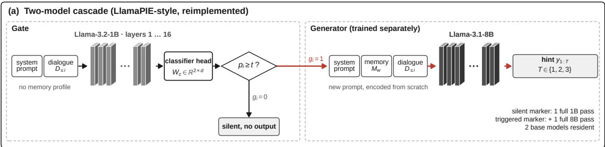

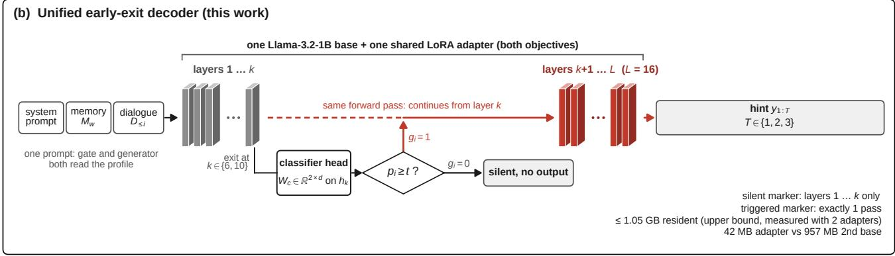  
Figure 2: The two realisations, for the Llama-3.2-1B / Llama-3.1-8B pairing. (a) Two-model cascade: a separate gate reads the dialogue without the memory profile, and only the generator adds it; a triggered marker pays two passes over two bases. (b) Unified decoder: one base and one adapter read a single prompt that includes the profile; the head $W _ { c } \in \mathbb { R } ^ { 2 \times d }$ reads layer �, and a triggered marker continues through layers �+1..� in the same pass. The text below reports the control that gives the cascade gate the profile too.

## 4. Corpus and evaluation protocol

## 4.1. Corpus and canonical marker index

All systems are evaluated on one canonical marker set of � = 28, 058 test markers (24,702 silence, 3,356 trigger, a 11.96% trigger rate) over 866 dialogues, built without reference to any tokenizer and shared across models. The dialogues come from three source corpora in LlamaPIE’s release — perl, soda and synthetic — contributing 292, 268 and 306 test dialogues. A marker’s window is the dialogue up to that point, truncated from the front at the 1,300-character cap, so every marker is retained and coverage is 100% for every model.

## 4.2. Threshold selection

Every gate operating point is selected by sweeping F1 over $t \in \{ 0 . 0 1 , 0 . 0 2 , \ldots , 0 . 9 9 \}$ on the validation split and reported on the test split, using the same trained weights. Validation holds 26,410 markers at 12.81% trigger prevalence and is disjoint from test by dialogue. Selecting on validation instead of test costs a mean of 0.0016 F1, and at most 0.0041, across 21 systems (for the unified gate, −0.0012 at � = 6 and +0.0001 at � = 10); no ranking changes. The reimplemented two-stage gate’s reportable figure is therefore 0.8002 at � = 0.60. Table 2 states the selection split for every row, and AUPRC and AUROC, which do not depend on a threshold, accompany every operating point.

## 4.3. Metrics

PA-F1 is the F1 of the gate’s binary per-marker decision against the reference trigger label, and FAR is the falsealarm rate, FP∕(TN + FP). End-to-end exact match and end-to-end precision are Equation (2), computed over the 3,356 test triggers and always reported together.

Exact match is the primary automatic metric because it is the only one with a defensible end-to-end form: a suppressed trigger has no string to score, and “no hint delivered” is unambiguously not an exact match, whereas a BERTScore of zero would be an invented convention. Exact match also counts a near-synonym as wrong, so we read it as a strict lower bound on usefulness and report BERTScore beside it wherever generation is compared stage-wise. Section 9 shows that graded metrics track human ratings more closely.

Joint Gating and Hint Generation in One Compact Decoder
<table><tr><td>System</td><td>t</td><td>SOURCE</td><td>PA-F1</td><td>FAR</td><td>AUPRC</td></tr><tr><td>RoBERTa-large, ASL recipe</td><td>0.59</td><td>VAL</td><td>0.8113</td><td>0.0304</td><td>0.8902</td></tr><tr><td>Llama-3.2-1B</td><td>0.60</td><td>VAL</td><td>0.8002</td><td>0.0351</td><td>0.8883</td></tr><tr><td>Qwen2.5-0.5B</td><td>0.60</td><td>VAL</td><td>0.7849</td><td>0.0386</td><td>0.8642</td></tr><tr><td>SmolLM2-360M</td><td>0.62</td><td>VAL</td><td>0.7800</td><td>0.0382</td><td>0.8596</td></tr><tr><td>Gemma-3-1B</td><td>0.24</td><td>VAL</td><td>0.7600</td><td>0.0359</td><td>0.8415</td></tr><tr><td>Gemma-3-270M</td><td>0.13</td><td>VAL</td><td>0.7212</td><td>0.0417</td><td>0.7784</td></tr><tr><td>RoBERTa-large, matched LoRA</td><td>0.70</td><td>VAL</td><td>0.7483</td><td>0.0536</td><td>0.8132</td></tr><tr><td>Logistic regression, 21 structural features</td><td>0.550</td><td>VAL</td><td>0.3456</td><td>0.3108</td><td>0.2368</td></tr><tr><td>Prompted LLM gate, zero-shot</td><td>一</td><td> $\mathrm { N / A }$ </td><td>0.1381</td><td>0.0710</td><td>0.1543</td></tr><tr><td>Prompted LLM gate, few-shot (k = 4)</td><td>一</td><td> $\mathrm { N / A }$ </td><td>0.1914</td><td>0.1164</td><td>0.1545</td></tr></table>

Gate systems on the canonical marker index (28,058 markers, 3,356 triggers), each at its own operating point; source says where that point was selected. Prompted-LLM rows use the model’s own decision on a 2,000-marker Test subsample and are not directly comparable.

BERTScore is computed with roberta-large, idf=False and rescale\_with\_baseline=False, and rescaled figures are reported alongside, because among the memory-only baselines, whose raw scores span only 0.012, rescaling moves every score by about 0.70, some 57 times that spread.

## 5. Gating

Table 2 compares five decoder gates, one encoder under two training recipes (RoBERTa-large), and two nongate baselines under one protocol (Section 4.2). The best decoder is Llama-3.2-1B at 0.8002 PA-F1, the gate the twostage baseline uses throughout (0.8008 if its threshold were selected on test).

Noisefloor. The reference band for every gate comparison is 0.0070 F1, the diference between two trainings of a nominally identical gate configuration. It comes from a single pair of runs; the only other estimate of run-to-run spread is the three-seed standard deviation of the unified gate (Table 5: 0.0033 at $k = 6 , 0 . 0 0 2 9$ at � = 10). Later sections call this band the noise floor.

Encoder against decoders. RoBERTa-large under its own recipe reaches 0.8113 PA-F1, 1.11 points above the best decoder $( p _ { \mathrm { h o l m } } ~ = ~ 0 . 0 0 6 0$ , McNemar, corrected across all pairwise comparisons in the table). A held-out audit over 200 splits puts the optimism of its selected threshold at 0.0033 F1 on average and 0.0079 at the 95th percentile, comparable to the noise floor, so the margin carries that caveat. Under the decoders’ LoRA recipe the same architecture reaches 0.7483, below every decoder. Supplementary Section S1 separates the factors (Table S1): context length contributes +0.0020 F1, the training recipe accounts for +0.0650 F1 of a same-architecture gap, and under a shared LoRA recipe Llama-3.2-1B leads RoBERTa-large by +0.0519 F1, a residual that mixes architecture with an unequal training schedule. Plain cross-entropy is not beaten by any alternative loss, and aggressive focal-loss settings reduce F1 (Table S2).

Non-gate baselines. A logistic regression over 21 surface features — turn position, sentence-final punctuation and similar cues, no lexical content — reaches 0.3456 PA-F1 (FAR 0.3108, AUPRC 0.2368), and no single feature’s pointbiserial correlation with the label exceeds 0.1648 in magnitude: the decision is not recoverable from surface structure. A prompted general-purpose LLM, on a stratified 2,000- marker test subsample, reaches 0.1381 PA-F1 zero-shot and 0.1914 with four worked examples, with an AUROC of 0.5773 (prompts in Supplementary Section S6.2). What the fine-tuned gates learn is specific to this corpus and is not supplied by instruction following.

## 6. What the generator needs

The memory profile. Table 3 scores the same adapter on the same 3,356 triggers with the profile present or absent at inference. Removing it costs 24.73 exact-match points (McNemar $p < 0 . 0 0 1 )$ ; rescaled BERTScore falls from 0.57 to 0.35 and ROUGE-1 from 0.48 to 0.13. Three controls attribute the efect to the profile’s content. A mismatched profile, from another sample, is indistinguishable from no profile $( p = 0 . 3 4 3 )$ and far below the full profile $( p < 0 . 0 0 1 ) ;$ decomposing the gain into a length and a content component puts the length share at −1.33%. A model trained without any profile performs close to the inference-time no-profile arm, so the efect does not depend on train/inference matching; measured against that retrained model, the efect is 23.63 points. And the span-selection oracle, the best any extractive strategy over the profile could do, reaches 0.9371 when the target is in the profile and 0 otherwise; the fine-tuned model scores below that ceiling even where extraction would succeed, so it is not simply copying from the profile.

<table><tr><td>Memory condition</td><td>EM</td><td>BERTScore,</td><td>ROUGE-1</td></tr><tr><td>Full profile</td><td>0.2947</td><td>0.5666</td><td>0.4757</td></tr><tr><td>No profile at</td><td>0.0474</td><td>0.3480</td><td>0.1258</td></tr><tr><td>inference Mismatched profile</td><td>0.0441</td><td>0.3384</td><td>0.1185</td></tr><tr><td>Trained without</td><td>0.0584</td><td>0.3812</td><td>0.1341</td></tr><tr><td>profile</td><td></td><td></td><td></td></tr><tr><td>Retrieval, k = 20</td><td>0.2935</td><td></td><td></td></tr><tr><td>Retrieval, k = 10</td><td>0.2864</td><td></td><td></td></tr><tr><td>Retrieval, k = 5</td><td>0.2810</td><td></td><td></td></tr><tr><td>Span-selection</td><td>0.4797</td><td></td><td></td></tr><tr><td>oracle</td><td></td><td></td><td></td></tr><tr><td>Full profile, target in profile</td><td>0.9371</td><td></td><td></td></tr><tr><td></td><td></td><td></td><td></td></tr><tr><td>Full profile,</td><td>0.0000</td><td></td><td></td></tr><tr><td>target not in profile</td><td></td><td></td><td></td></tr></table>

Table 3  
What the generator needs: one adapter on the 3,356 true triggers unless stated; BERTScore is rescaled. No retrieval configuration of 45 beats the full profile after Holm correction.

Generator scale. Within one family, Llama-3.1-8B and Llama-3.2-1B tie on exact match at the oracle-gate stage $( p = 0 . 7 9 )$ and end to end $( p = 0 . 3 3 8 ;$ Table 4, “1B gate + 1B gen” and “1B gate + 8B gen”). Across families, Qwen2.5- 7B reaches 35.79% oracle-gate exact match, ahead of both Llama generators; it is an Instruct checkpoint compared with a base checkpoint, so family and instruction tuning vary together in this comparison.

Retrieval. Selecting a subset of the profile does not help. Exact match falls as the number of retrieved units � shrinks (Table 3); $k = 1 0$ and $k = 5$ are significantly below the full profile (Holm-corrected $p = 0 . 0 0 2 2$ and $p = 0 . 0 0 1 3 )$ , and $k = 2 0$ , which keeps 87% of the profile’s units, is indistinguishable from it. Across ranker and depth (Figure 3), none of 45 configurations beats the full profile after Holm correction. The full profile already fits within the context budget, so retrieval here only removes information.

## 7. The unified early-exit model

The unified model shares one trunk and one LoRA adapter across both objectives (Section 3.4). Table 4 is the single comparison between it and the two-model pipelines; all diferences are read against the noise floor (Section 5).

Gate quality. At the final checkpoint (step 53,772, one seed per depth), the unified gate, validation-selected and reported on test like every other gate, reaches 0.8022 PA-F1 at $k \ = \ 6$ and 0.8164 at $k \ = \ 1 0 .$ , against 0.8002 for the two-stage gate. The $k = 6$ margin (+0.0020) is within the noise floor; the $k ~ = ~ 1 0$ margin (+0.0162) exceeds it. The three-seed replication at step 21,703 (Table 5, Figure 5) refines this by depth: the � = 10 mean, 0.8022 (±0.0029), ties the two-stage gate (+0.0020), and the � = 6 mean, 0.7846 (±0.0033), is −0.0156 below it, outside the noise floor. Multi-seed evidence therefore supports gate parity at � = 10; at � = 6 parity rests on the single final-checkpoint seed. Seed dispersion is measured at step 21,703 only, since pooling it with a point estimate from another step would misstate it.

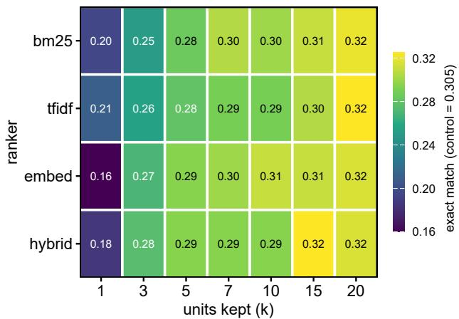  
Figure 3: Retrieval ablation: exact match for each ranker and depth on the 200-marker ablation subsample, with memory view and prompt format at their control values. No cell difers from the full-profile control after Holm correction across all 45 configurations.

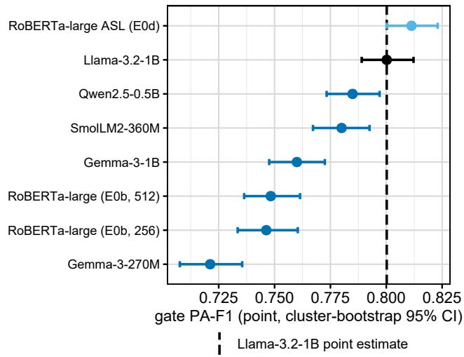  
Figure 4: Gate PA-F1 with cluster-bootstrap 95% CIs for every gate. The dashed line is the two-stage Llama-3.2-1B gate; darker markers have CIs that exclude it.

Exit depth. � = 10 leads � = 6 in gate F1 by 0.0124 at step 21,703 and by 0.0129 at the final checkpoint, both above the noise floor; the gap did not grow with further training, so it appears fixed by where the decision is read. End to end, the two depths are within the noise floor of each other in exact match (0.2929 at � = 6, 0.2908 at $k = 1 0 ;$ Table 4), while � = 6 costs less wall clock (Figure 7). Exit depth is therefore mainly a cost decision.

Joint Gating and Hint Generation in One Compact Decoder
<table><tr><td>System</td><td>Gate F1</td><td>FAR</td><td>Gen. EM</td><td>BERTScore</td><td>E2E EM</td><td>E2E prec.</td><td>Wall (h)</td><td>Models</td></tr><tr><td>Unified, exit at layer  $k = 6$ </td><td>0.8022</td><td>0.0359</td><td>0.3299</td><td>0.9288</td><td>0.2929</td><td>0.2665</td><td>0.748</td><td>1 / 1</td></tr><tr><td>Unified, exit at layer  $k = 1 0$ </td><td>0.8164</td><td>0.0292</td><td>0.3218</td><td>0.9269</td><td>0.2908</td><td>0.2761</td><td>1.005</td><td>1 / 1</td></tr><tr><td>Unified, gate head on final layer</td><td>0.7975</td><td>0.0324</td><td> $\boldsymbol { \mathsf { n } } / \boldsymbol { \mathsf { a } }$ </td><td> $\boldsymbol { \mathsf { n } } / \boldsymbol { \mathsf { a } }$ </td><td> $\boldsymbol { \mathsf { n } } / \boldsymbol { \mathsf { a } }$ </td><td> $\mathsf { n } / \mathsf { a }$ </td><td> $\mathsf { n } / \mathsf { a }$ </td><td>1/1</td></tr><tr><td>k = 16 (step 21,703, gate-only)</td><td></td><td></td><td></td><td></td><td></td><td></td><td></td><td></td></tr><tr><td>Two-model, 1B  $\mathtt { g a t e } + 1 \mathsf { B } \ \mathtt { g e n }$  Two-model, 1B  $\mathtt { g a t e } + 8 \mathsf { B } \ \mathtt { g e n }$ </td><td>0.8002 0.8002</td><td>0.0351 0.0351</td><td>0.2971 0.2947</td><td>0.9237 0.9269</td><td>0.2619 0.2548</td><td>0.2387 0.2322</td><td>1.318 2.551</td><td>2/2  $2 \ / \ 2$ </td></tr></table>

The unified model against the two-model pipelines at the final checkpoint (step 53,772, one seed per depth). E2E EM and E2E prec. are Equation (2); wall clock is early-exit-only. The final-layer $\left( k = 1 6 \right)$ row is a gate-only control from step 21,703.

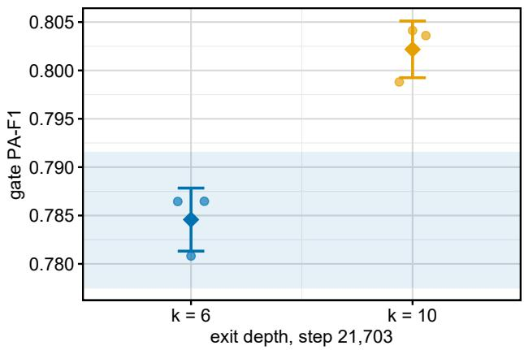  
Figure 5: Gate PA-F1 at the two exit depths, step 21,703: seeds as points, mean ±1 SD as a diamond, and the noise floor shaded around the � = 6 mean. The �=10 minus �=6 gap exceeds the noise floor.

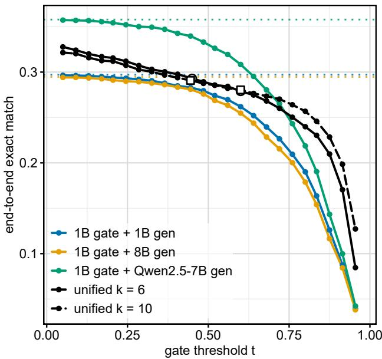  
Figure 6: End-to-end exact match against gate threshold for every system; dotted lines are the oracle-gate ceilings. The curves fall by construction (Equation (2)), so they show how much of each ceiling a threshold gives up. Markers on the unified curves are the gate-F1-optimal and $t = 0 . 6 0$ operating points.

<table><tr><td>Configuration</td><td>Seeds</td><td>Mean gate F1</td><td>SD</td></tr><tr><td>Unified  $k = 6 ,$  step 21,703</td><td> $3 / 3$ </td><td>0.7846</td><td>0.0033</td></tr><tr><td>Unified  $k = 1 0 ,$  step 21,703</td><td> $3 / 3$ </td><td>0.8022</td><td>0.0029</td></tr></table>

Run-to-run dispersion, reported at the step each seed was measured at. Values from diferent steps are never pooled.

## 8. End to end and cost

From ceiling to deployment. Every stage-wise generation score in Section 6 is an oracle-gate ceiling (Section 3.1). Behind the two-stage gate at its deployed operating point (precision 0.7648, recall 0.8391), end-to-end exact match is 0.2619 against a ceiling of 0.2971 for the 1B generator, 0.2548 against 0.2947 for the 8B, and 0.3084 against 0.3579 for Qwen2.5-7B. Figure 6 plots end-to-end exact match over 182 thresholds. Because it cannot rise with the threshold, it is never read alone: end-to-end precision, which charges false alarms, is 0.2387 at the deployed point, and tightening to a 1% false-alarm budget raises it to 0.3011 while end-toend exact match falls to 0.2122; Section 10 discusses the choice of budget. Non-matching hints split across partial overlaps, grounded but incorrect answers, and hallucinations in similar shares for every generator (Table 6).

Cost, and the basis it is measured on. At the deployed operating point the gate cuts generator invocations by 7.62×. That cut is worth 4.39× in wall clock against an 8B generator and 1.38× against a 1B one, because the gate itself takes 82% of the gated 1B pipeline’s runtime on our per-marker harness (about 53% once the measured prefix-cache ratio is applied). We report wall clock on an early-exit-only basis, the only optimisation measured for both architectures. Prefix caching applies to both, but the two-model pipeline’s prompt format is the more cacheable (80.3% of tokens against 58.1%) and its cached rate is not measured, because its gate adapter was not retained; combined-optimisation figures are therefore an upper bound on the unified model’s advantage and never the headline.

Joint Gating and Hint Generation in One Compact Decoder
<table><tr><td>Generator</td><td>Exact</td><td>Partial overlap</td><td>Grounded, other</td><td>Halluci- nated</td><td>Halluc. share</td></tr><tr><td>Llama-3.2-1B (1B gen)</td><td>29.7</td><td>17.8</td><td>35.9</td><td>16.6</td><td>23.6</td></tr><tr><td>Llama-3.1-8B (8B gen)</td><td>29.5</td><td>27.9</td><td>23.5</td><td>19.1</td><td>27.1</td></tr><tr><td>Qwen2.5-7B (7B gen)</td><td>35.8</td><td>18.5</td><td>27.3</td><td>18.4</td><td>28.6</td></tr></table>

Error types per generator, as percentages of the 3,356 true triggers; hallucinated share is hallucinations as a fraction of non-exact responses.

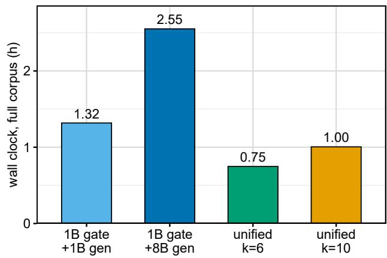  
Figure 7: Wall clock over all 28,058 markers (early-exit-only basis) for the two two-model pipelines and the unified model at both exit depths.

The unified model end to end. On this basis, at its final checkpoint, the unified model reaches higher end-to-end exact match and end-to-end precision than both two-model pipelines at both depths (Table 4), with 1.76× less wall clock than the matched 1B pipeline at � = 6 and 3.41× less than the 8B one (Figure 7). This is a result on automatic measures at one checkpoint; Section 9 reports how people rate the same hints.

## 9. Human evaluation and evaluation validity

Design. The human study followed a pre-registered analysis plan, time-stamped and hash-pinned in version control before any rating existed. It sampled 100 test dialogues containing 433 hints, each rendered in 7 versions and assigned to 5 annotators, who rated every hint on LlamaPIE’s five-point uptake scale with the subsequent turns visible (instructions in Supplementary Section S6.4). Every rendering places its hints at the same gold trigger markers, so the study compares what each system says, not when it speaks.

As run. The study deviated from the plan three times. One annotator’s ratings were scored, unblinded, during annotation; annotation was then stopped early, after that interim look; and missing ratings were excluded per item rather than per hint, a scoring change made after the data were seen, which retained the second annotator’s uptake ratings. The analysed data are 1,144 uptake ratings over 32 of the 100 dialogues: 829 of one annotator’s 833 assigned hints, 313 from a second annotator on 10 conversations, and 2 from a third. On the 196 hints both annotators rated, Krippendorf’s ordinal $\alpha = 0 . 7 2 ;$ identical texts shown twice under diferent codes received the same rating on 92.1% and 91.8% of pairs.

Memory. With the profile, the 8B generator’s hints average 4.01 in uptake against 3.18 without it, a diference of +0.83 [+0.48, +1.23] (95%, clustered by dialogue). The primary outcome agrees with the automatic metrics: the profile makes hints more useful to the person hearing them.

Unified model. Against the matched 1B two-stage pipeline the unified model is level at both depths: +0.04 [−0.31, +0.41] at � = 6 and −0.02 [−0.35, +0.30] at $k ~ = ~ 1 0$ (98.75%, Bonferroni over the four non-inferiority tests). Both intervals extend below −0.25, so non-inferiority at the planned margin is not shown. Against the 1B+8B pipeline it is lower, by −0.38 [−0.69, −0.04] and −0.44 [−0.83, −0.07], although it is higher on end-to-end exact match (Table 4); the separate-arm tests agree. As an exploratory, unplanned comparison, the 8B generator rates +0.42 points above the 1B one (4.01 against 3.60), whereas the two tie on exact match.

Which automatic signal to use. The native judge of LlamaPIE, where computed, tracks human uptake most closely (� = 0.55 on the 8B renderings, 0.67 on the 1B), followed by ROUGE-1 (0.51, 0.62) and BERTScore (0.47, 0.61), then exact match (0.31, 0.43; Table 7b). We therefore recommend the native judge as the automatic judge for this task, a choice made after this comparison. The ranking rests on two renderings: the native judge scored only the 8B and 1B ones, it was not run on the no-memory output, and per-item BERTScore and ROUGE-1 were not computed for the unified model. Under the native prompt, Qwen2.5- 7B scores 3.83–4.07 per corpus, against 3.94–4.21 reported by LlamaPIE under the same prompt. Our reconstruction of LlamaPIE’s rubric from its published definitions agrees poorly with the native judge and is not used for any claim (Supplementary Section S7). The item asking whether a hint should have been withheld received 843 answers, almost all “no”, and supports no claim.

Joint Gating and Hint Generation in One Compact Decoder
<table><tr><td colspan="8">(a) Pre-registered contrasts, mean uptake (1–5)</td></tr><tr><td>Test</td><td>A vs B</td><td>A</td><td>B</td><td>A-B</td><td>Cl</td><td>level</td><td>reading</td></tr><tr><td>H1 (primary)</td><td>8B, memory vs 8B, no memory</td><td>4.01</td><td>3.18</td><td>+0.83</td><td> $[ + 0 . 4 8 , + 1 . 2 3 ]$ </td><td>95%</td><td>higher</td></tr><tr><td>H2a</td><td>Unified  $k { = } 6 \ \mathsf { v s } \ 1 \mathsf { B }$ </td><td>3.64</td><td>3.60</td><td>+0.04</td><td> $[ - 0 . 3 1 , + 0 . 4 1 ]$ </td><td>98.75%</td><td>NI not shown</td></tr><tr><td>H2b</td><td>Unified k=10 vs 1B</td><td>3.58</td><td>3.60</td><td>-0.02</td><td> $[ - 0 . 3 5 , + 0 . 3 0 ]$ </td><td>98.75%</td><td>NI not shown</td></tr><tr><td>H2a</td><td>Unified  $k { = } 6 \ \mathsf { v s } \ 8 \mathsf { B } ,$  memory</td><td>3.64</td><td>4.01</td><td>-0.38</td><td>[-0.69, -0.04]</td><td>98.75%</td><td>lower; NI not shown</td></tr><tr><td>H2b</td><td>Unified  $k { = } 1 0 \ \mathsf { v s } \ 8 \mathsf { B } ,$  memory</td><td>3.58</td><td>4.01</td><td>-0.44</td><td>[-0.83, -0.07]</td><td>98.75%</td><td>lower; NI not shown</td></tr><tr><td>H2b, separate arm</td><td>Unified  $k { = } 1 0 \ \mathsf { v s } \ 1 \mathsf { B } \ ( \mathsf { c o p y } )$ </td><td>3.58</td><td>3.64</td><td>-0.06</td><td> $[ - 0 . 4 1 , + 0 . 2 7 ]$ </td><td>98.75%</td><td>NI not shown</td></tr><tr><td>H2b, separate arm</td><td>Unified  $k { = } 1 0 \ \mathsf { v s } \ 8 { \mathsf { B } } ,$  memory (copy)</td><td>3.53</td><td>3.98</td><td>-0.45</td><td>[-0.84, −0.08]</td><td>98.75%</td><td>lower; NI not shown</td></tr></table>

<table><tr><td colspan="7">(b) Correlation of human uptake with automatic signals</td></tr><tr><td>Rendering</td><td>EM</td><td>BERTScore</td><td></td><td>ROUGE-1 judge, ref.-based judge, reconstr. judge, native</td><td></td><td></td></tr><tr><td>8B, memory</td><td>0.31</td><td>0.47</td><td>0.51</td><td>0.45*</td><td>0.28*</td><td>0.55</td></tr><tr><td>8B, no memory</td><td>0.30</td><td>0.37</td><td>0.44</td><td>0.51*</td><td>0.27*</td><td></td></tr><tr><td>Unified k=6</td><td>0.43</td><td></td><td></td><td>0.54*</td><td>0.29*</td><td></td></tr><tr><td>Unified k=10</td><td>0.44</td><td></td><td></td><td>0.51*</td><td>0.17*</td><td></td></tr><tr><td>1B</td><td>0.43</td><td>0.61</td><td>0.62</td><td>0.55*</td><td>0.44*</td><td>0.67</td></tr></table>

Human evaluation. (a) Pre-registered contrasts (labels as in the study’s pre-registration): mean uptake (1–5) per arm, paired diference A−B and dialogue-clustered CI. H2 tests are Bonferroni-adjusted, non-inferiority margin 0.25. (b) Pearson � between human uptake and each automatic signal over 136 hints; ${ } ^ { * } n < 6 0 .$ 1,144 ratings over 32 of 100 dialogues, mostly one rater (Section 9).

## 10. Practical implications

## 10.1. Recalibrate the threshold whenever the gate model changes

A threshold carried across a gate swap changes the falsealarm rate by an amount and in a direction the models headline scores do not predict. The threshold that attains a 2% false-alarm budget ranges by more than a factor of three across the six deployment candidates, and in the worst case Gemma-3-270M loses 28.0 F1 points when run at another model’s operating point (Supplementary Table S3). Permodel calibration on held-out data is a deployment requirement.

## 10.2. Select on calibration when thresholds adapt

A system that adapts its threshold from user feedback consumes the gate’s probabilities, not only its ranking. The best-ranking gate is also the worst-calibrated, with an expected calibration error several times that of the bestcalibrated model (Supplementary Table S4 and Figure S1), so an integrator building feedback adaptation should select on calibration, or calibrate post hoc and re-measure.

## 10.3. Choose the false-alarm budget deliberately

Because a false alarm and a miss cost the wearer diferent things (Section 3.1), the false-alarm budget is a deployment decision. At the deployed operating point the system emits 3,682 hints, 23.5% of them where the corpus says it should have stayed silent. Tightening the budget trades end-toend exact match for end-to-end precision (Section 8): fewer wrong interruptions, bought with fewer right ones.

## 10.4. Resident weight cost

Serving both decisions from one base saves memory whenever gate and generator share an architecture. A probe holding one 4-bit 1B base with a gate adapter, a generator adapter and the classifier head resident uses 1.05 GB of weights: the second adapter costs 42 MB where a second base would cost 957 MB, a saving of 915 MB. The unified model needs one adapter, so this figure is an upper bound on its weights, whose own footprint was not measured separately.

## 10.5. Cost on a CPU

The unified gate runs on a CPU; a graph runtime turns its early exit into time saved, and 4-bit weights save memory rather than time. We timed both final checkpoints on a 4-core cloud CPU at batch size one, in every runtime and weight format (Supplementary Table S5). In ONNX Runtime with NF4 weights, the format the model was trained in, the gate costs 1,793 ms per marker at � = 6 and 2,909 ms at $k = 1 0 ,$ and a triggered marker costs a further 7.79 s and 5.01 s to generate its hint. This variant reproduces the GPU model: gate probabilities correlate at $r = 0 . 9 9 8$ and 0.991, decisions agree on 100.0% and 96.7% of sampled markers, and hints are identical on 90% and 95% of 20 triggered markers. Each marker is timed as an independent forward pass over its full prompt; cross-marker caching was not measured.

In ONNX Runtime the early exit delivers a saving consistent with the ideal $1 6 / k$ of Equation (4) (2.86× at $k = 6$ and 1.51× at � = 10 in NF4), against 1.75× and 1.35× for PyTorch in eager mode. NF4 does not speed the gate up at batch size one (1,793 against 1,611 ms in fp32) but reduces memory (1.65 GB against 4.99 GB); half precision is slower than fp32 on these CPUs, which lack the instructions that make it fast (Supplementary Section S5).

## 11. Limitations

Every headline result rests on one primary corpus whose dialogues and trigger labels were generated by a language model, so its labels mark moments a model judged a hint would help, not moments a wearer needed one. On a naturally recorded meeting corpus, a fine-tuned gate performs on par with an observable-metadata baseline (AUROC 0.8349 against 0.8291; Supplementary Section S8). Most configurations were trained once, so our confidence intervals are sampling intervals over fixed models, and diferences below the noise floor (Section 5) are not resolved. Training budgets difer: the unified model ran 2 epochs (53,772 steps) over marker-level rows and the two-stage gate 4 epochs over dialogue-level samples, so comparisons are between systems as trained. A second-family unified model, further epochs and other exit depths were not run. The human evaluation rests on 1,144 ratings, mostly from one rater (Section 9). The two-stage gate’s cost under prefix caching was not measured (Section 8). No consumer device was measured, and the system is evaluated on transcripts, so speech-recognition errors are absent from every number.

## 12. Conclusion

Scoring a proactive assistant’s two decisions together changes what the evidence shows. Stage-wise generation scores are oracle-gate ceilings; because end-to-end exact match cannot rise as the gate tightens, a gate is justified by the precision it adds and by the compute it saves, and that saving depends on the size of the generator. Hint quality comes from the persistent memory profile rather than from generator scale or retrieval, and a human evaluation supports the memory efect.

One compact decoder that gates from an intermediate layer and generates in the same pass matches or exceeds the two-model pipeline on the automatic end-to-end measures at lower wall-clock cost (Table 4). Across three seeds its � = 10 gate ties the two-stage reference gate (Section 7); at the final checkpoint it leads a two-stage gate that also reads the memory profile, so that lead is attributable to the architecture (Section 3.4). People rate its hints level with the matched 1B pipeline and below the 8B one (Section 9). For evaluating such systems, LlamaPIE’s native judge and graded metrics track human ratings more closely than exact match, which remains the one metric with an end-to-end form.

## Ethical considerations

The system listens continuously to a conversation on behalf of one wearer, in the presence of people who did not consent to being monitored and cannot see or query the profile it keeps. That profile is persistent personal data about the wearer, accumulated across conversations, and carries the risks of any long-lived personal record: it is a target for compromise, and its content — names, relationships, recurring topics — is information a wearer may not want kept indefinitely. A false alarm interrupts the conversation for everyone present, so bystanders who never opted in also bear the cost of the system’s errors. Non-user consent, disclosure norms and a retention policy for the profile are deployment requirements this work does not address.

ICSI participants (Supplementary Section S8) consented to being recorded for meeting research, not to a proactiveassistance study centred on one participant, in which the other participants become sources of the wearer’s triggers. We use the corpus only as released, under its own licence. One artefact of this repurposing was found and corrected: ICSI’s digit-reading task produced number strings that an entity extractor mistook for dates, creating spurious profile content and triggers, so number-word terms are excluded at extraction.

Models supervise and judge this work at two points. The primary corpus’s trigger labels were generated by a language model reading synthetic dialogue, which is why Supplementary Section S8 tests a behaviourally labelled corpus; and the LLM judges are themselves models, whose limits Supplementary Section S7 reports. We treat both as properties of the evidence that bound what it can support.

## Data availability

We release the construction and validation code rather than the derived corpus itself, together with every artifact the paper’s numbers are computed from: the canonical marker index, per-marker gate predictions for every system, generation outputs, all judge prompts and all raw judgments, the evaluation and scoring scripts, and the run manifests. Every figure and table in this paper is regenerated from those artifacts by the released scripts, so each reported number is reproducible without the corpus being redistributed.

The dialogue corpus itself is not redistributed. It derives from three upstream resources whose licences difer: one restricts use to non-commercial research, and one states no dataset licence at all. Rather than pass on material we may not be entitled to pass on, we release the pipeline that rebuilds the derived corpus from those upstream releases, which a reader obtains separately under the upstream projects’ own terms. The construction is deterministic, and the released canonical index lets a reader verify that their rebuild matches ours marker for marker.

Code and artifacts will be made available on publication, and a link will be added to this paper when the release is public.

## Declaration of competing interests

The authors declare that they have no known competing financial interests or personal relationships that could have appeared to influence the work reported in this paper.

Declaration of generative AI and AI-assisted technologies in the manuscript preparation process

During the preparation of this work the authors used Claude (Anthropic) to draft and revise text and to check cited numbers against the experimental outputs. After using this tool, the authors reviewed and edited the content as needed and take full responsibility for the content of the published article.

## Acknowledgements

We thank the authors of LlamaPIE for releasing the code and data on which this work’s corpus is built, and the creators of the SODA, PerLTQA and ICSI corpora, whose public releases it draws on. We thank Kaggle for the free GPU quota on which our models were trained and evaluated. We are grateful to the annotators who gave their time to the human evaluation.

## Funding

This work received no specific grant from any funding agency in the public, commercial, or not-for-profit sectors. Model training and evaluation were carried out on Kaggle’s free-tier notebook GPU allocation, and the CPU latency measurements on Modal cloud CPU containers; no grant or institutional compute allocation was used. The primary corpus’s construction pipeline builds on publicly released resources from the LlamaPIE project (Chen, Batchelder, Liu, Smith and Gollakota, 2025), used under that project’s own release terms rather than under any funded data-acquisition arrangement.

## CRediT authorship contribution statement

A. J. A. Jubayer Talukder: Conceptualization, Methodology, Software, Validation, Formal analysis, Investigation, Data curation, Writing – original draft, Visualization. Mohammad Ariful Haque: Conceptualization, Resources, Writing – review & editing, Supervision, Project administration.

## References

Chen, L., Zaharia, M., Zou, J., 2023. FrugalGPT: How to use large language models while reducing cost and improving performance. arXiv preprint arXiv:2305.05176 .

Chen, T., Batchelder, N., Liu, A., Smith, N.A., Gollakota, S., 2025. LlamaPIE: Proactive in-ear conversation assistants, in: Findings of the Association for Computational Linguistics: ACL 2025. ArXiv:2505.04066.

Deng, Y., Lei, W., Lam, W., Chua, T.S., 2023. A survey on proactive dialogue systems: Problems, methods, and prospects. arXiv preprint arXiv:2305.02750 .

Ekstedt, E., Skantze, G., 2022. Voice activity projection: Self-supervised learning of turn-taking events, in: Proc. Interspeech, pp. 5190–5194. ArXiv:2205.09812.

Hu, E.J., Shen, Y., Wallis, P., Allen-Zhu, Z., Li, Y., Wang, S., Wang, L., Chen, W., 2022. LoRA: Low-rank adaptation of large language

models, in: International Conference on Learning Representations. ArXiv:2106.09685.

Lee, G., Xia, M., Numan, N., Qian, X., Li, D., Chen, Y., Kulshrestha, A., Chatterjee, I., Zhang, Y., Manocha, D., Kim, D., Du, R., 2025. Sensible agent: A framework for unobtrusive interaction with proactive AR agents, in: Proceedings of the 38th Annual ACM Symposium on User Interface Software and Technology (UIST). ArXiv:2509.09255.

Li, C., Wu, G., Chan, G.Y.Y., Turakhia, D.G., Castelo Quispe, S., Li, D., Welch, L., Silva, C., Qian, J., 2024. Satori: Towards proactive AR assistant with belief-desire-intention user modeling. arXiv preprint arXiv:2410.16668 .

Liu, T., Wan, F., Guo, J., Quan, X., 2025. ProactiveEval: A unified evaluation framework for proactive dialogue agents. arXiv preprint arXiv:2508.20973 .

Liu, X., Lee, D., Gonzalez, E.J., Gonzalez-Franco, M., Suzuki, R., 2026. VisionClaw: Always-on AI agents through smart glasses. arXiv preprint arXiv:2604.03486 .

Schuster, T., Fisch, A., Gupta, J., Dehghani, M., Bahri, D., Tran, V.Q., Tay, Y., Metzler, D., 2022. Confident adaptive language modeling, in: Advances in Neural Information Processing Systems. ArXiv:2207.07061.

Wagner, D., Churchill, A., Sigtia, S., Georgiou, P., Mirsamadi, M., Mishra, A., Marchi, E., 2023. Multimodal data and resource eficient devicedirected speech detection with large foundation models. arXiv preprint arXiv:2312.03632 .

Wang, C., Xue, H., Li, G., Zhao, Z., Wang, S., Wang, S., Xu, X., Bu, H., Xie, L., 2026. Full-duplex interaction in spoken dialogue systems: A comprehensive study from the ICASSP 2026 HumDial challenge. arXiv preprint arXiv:2604.21406 .

Wen, Z., Wang, Y., Liao, C., Yang, B., Li, J., Liu, W., He, H., Feng, B., Liu, X., Lyu, Y., Zheng, X., Hu, X., Zhang, L., 2025. AI for service: Proactive assistance with AI glasses. arXiv preprint arXiv:2510.14359 .

Xin, J., Tang, R., Lee, J., Yu, Y., Lin, J., 2020. DeeBERT: Dynamic early exiting for accelerating BERT inference, in: Proceedings of the 58th Annual Meeting of the Association for Computational Linguistics. ArXiv:2004.12993.

Xu, L., Yang, B., Jiang, S., Liu, K., Hou, K., Fan, Y., Chen, H., Yan, Z., Jiang, X., 2026. Pro2Assist: Continuous step-aware proactive assistance with multimodal egocentric perception for long-horizon procedural tasks. Proceedings of the ACM on Interactive, Mobile, Wearable and Ubiquitous Technologies ArXiv:2605.04227.

Yang, B., Guo, Y., Xu, L., Yan, Z., Chen, H., Xing, G., Jiang, X., 2025. SocialMind: LLM-based proactive AR social assistive system with human-like perception for in-situ live interactions. Proceedings of the ACM on Interactive, Mobile, Wearable and Ubiquitous Technologies ArXiv:2412.04036.

Zhang, Y., Dong, X.L., Lin, Z., Madotto, A., Kumar, A., Damavandi, B., Chai, J., Moon, S., 2025. Proactive assistant dialogue generation from streaming egocentric videos. arXiv preprint arXiv:2506.05904 .

Zheng, L., Chiang, W.L., Sheng, Y., Zhuang, S., Wu, Z., Zhuang, Y., Lin, Z., Li, Z., Li, D., Xing, E.P., Zhang, H., Gonzalez, J.E., Stoica, I., 2023. Judging LLM-as-a-judge with MT-bench and chatbot arena, in: Advances in Neural Information Processing Systems. ArXiv:2306.05685.

## Supplementary material

## S1. Gate training protocol: what explains the encoder’s lead

The best encoder gate (RoBERTa-large, 0.8113 PA-F1) beats the best decoder gate, but the same architecture trained under the decoders’ own LoRA recipe falls to 0.7483 (Section 5). Table S1 separates the factors, using rows that difer in one respect at a time. Holding architecture and recipe fixed, context length explains none of the gap: quadrupling RoBERTa’s window from 256 to 512 tokens moves PA-F1 by only +0.0020, inside the noise floor, and the paired accuracy test, if anything, favours the shorter window $( p _ { \mathrm { h o l m } } = 0 . 0 4 7 2 )$ . Holding architecture and context fixed instead, the recipe explains almost all of a same-architecture gap: the ASL full fine-tuning recipe beats matched LoRA by +0.0650 F1 at identical context and epoch count $( p _ { \mathrm { h o l m } } < 0 . 0 0 1 )$ . What is left is the decoder-vs-encoder gap under a shared LoRA recipe: Llama-3.2-1B still leads RoBERTa-large by +0.0519 F1 $( p _ { \mathrm { h o l m } } < 0 . 0 0 1 )$ . Epoch count is not equalised in that pair (1 against 4), so this residual is architecture and training schedule together, not architecture alone.

<table><tr><td>Model</td><td>Recipe</td><td>Ctx</td><td> $\mathrm { E p . }$ </td><td>PA-F1</td><td>FAR</td><td>AUPRC</td></tr><tr><td>RoBERTa-large (E0b, 256)</td><td>matched LoRA</td><td>256</td><td>1</td><td>0.7463</td><td>0.0466</td><td>0.8151</td></tr><tr><td>RoBERTa-large (E0b, 512)</td><td>matched LoRA</td><td>512</td><td>1</td><td>0.7483</td><td>0.0536</td><td>0.8133</td></tr><tr><td>RoBERTa-large ASL (E0d)</td><td>own (ASL, full FT)</td><td>256</td><td>1</td><td>0.8113</td><td>0.0304</td><td>0.8902</td></tr><tr><td>Llama-3.2-1B</td><td>own  $( \mathrm { L o R A } , 4 \mathrm { e p . } )$ </td><td>2048</td><td>4</td><td>0.8002</td><td>0.0351</td><td>0.8883</td></tr></table>

Table S1: Separating architecture from training recipe, all rows under one threshold-selection protocol. Context length moves PA-F1 by only +0.0020; the ASL recipe adds +0.0650; the remaining decoder-vs-encoder gap (+0.0519) also difers in epoch count (1 vs 4).

The loss function is not the mechanism (Table S2). For both models where it was ablated, no alternative to plain crossentropy — class-weighted cross-entropy, or focal loss at $\gamma = 1 . 5 -$ reaches significance against it (closest $p _ { \mathrm { h o l m } } = 0 . 1 1 7 )$ Sweeping the focal-loss hyperparameters on Qwen2.5-0.5B, $\gamma \in \{ 0 , 1 , 1 . 5 \}$ are statistically indistinguishable, but $\gamma = 2$ costs −0.0310 F1 $( p _ { \mathrm { h o l m } } < 0 . 0 0 1 )$ and raising the trigger-class weight � from 1 to 4 costs −0.0278 $( p _ { \mathrm { h o l m } } < 0 . 0 0 1 )$ . Moderate reweighting is harmless, aggressive reweighting hurts, and neither explains the ASL recipe’s lead, which pairs focal loss with full fine-tuning rather than with LoRA.
<table><tr><td>Model</td><td>Loss</td><td>PA-F1</td><td>95% CI</td><td> $p _ { \mathrm { h o l m } }$ </td></tr><tr><td>Llama-3.2-1B</td><td>CE (plain)</td><td>0.8052</td><td>[0.7943, 0.8167]</td><td></td></tr><tr><td>Llama-3.2-1B</td><td>CE (weighted)</td><td>0.8059</td><td>[0.7953, 0.8173]</td><td>0.821</td></tr><tr><td>Llama-3.2-1B</td><td>Focal (γ=1.5)</td><td>0.7926</td><td>[0.7813, 0.8045]</td><td>0.117</td></tr><tr><td>SmolLM2-360M</td><td>CE (plain)</td><td>0.7824</td><td>[0.7707, 0.7945]</td><td></td></tr><tr><td>SmolLM2-360M</td><td>CE (weighted)</td><td>0.7777</td><td>[0.7658, 0.7902]</td><td>0.549</td></tr><tr><td>SmolLM2-360M</td><td>Focal  $\left( \gamma { = } 1 . 5 \right)$ </td><td>0.7763</td><td>[0.7644, 0.7888]</td><td>0.549</td></tr><tr><td colspan="3">Focal-loss sensitivity, Qwen2.5-0.5B</td><td></td><td></td></tr><tr><td>Sweep</td><td> $\gamma / \alpha$ </td><td>PA-F1</td><td>95% CI</td><td> $p _ { \mathrm { h o l m } }$ </td></tr><tr><td>gamma</td><td> $\gamma { = } 0 . 0$ </td><td>0.7873</td><td>[0.7751, 0.7998]</td><td></td></tr><tr><td>gamma</td><td> $\gamma { = } 1 . 0$ </td><td>0.7856</td><td>[0.7737, 0.7984]</td><td>1.000</td></tr><tr><td>gamma</td><td> $\gamma { = } 1 . 5$ </td><td>0.7799</td><td>[0.7675, 0.7925]</td><td>0.551</td></tr><tr><td>gamma</td><td> $\gamma { = } 2 . 0$ </td><td>0.7563</td><td>[0.7437, 0.7692]</td><td>&lt;0.001*</td></tr><tr><td>gamma</td><td> $\gamma { = } 3 . 0$ </td><td>0.7737</td><td>[0.7605, 0.7866]</td><td>0.036*</td></tr><tr><td>alpha</td><td> $\alpha { = } 1 . 0$ </td><td>0.7803</td><td>[0.7686, 0.7927]</td><td></td></tr><tr><td>alpha</td><td> $\alpha { = } 4 . 0$ </td><td>0.7525</td><td>[0.7404, 0.7650]</td><td> ${ < } 0 . 0 0 1 ^ { \ast }$ </td></tr></table>

Table S2: Loss-function ablation (top) and focal-loss �/� sweeps (bottom). Paired McNemar $p _ { \mathrm { h o l m } }$ is against each block’s reference row (cross-entropy, $\gamma { = } 0 , \alpha { = } 1 . 0 ) ; { ^ \ast }$ marks $p _ { \mathrm { h o l m } } < 0 . 0 5$

## S2. Thresholds do not transfer between gate models

Fixing a false-alarm budget and asking which threshold attains it, the answer ranges by more than a factor of three across the six deployment candidates at a 2% budget, and further once the protocol-equalisation controls of Section S1 are included

(Table S3). Two models a few points of PA-F1 apart need operating points at opposite ends of the probability scale. In the worst case, Gemma-3-270M loses 28.0 F1 points when run at another model’s operating point.
<table><tr><td rowspan="2">Gate model</td><td colspan="4">threshold attaining budget</td><td colspan="2">at 2%</td></tr><tr><td>t@1%</td><td>t@2%</td><td>t@5%</td><td>t@10%</td><td>recall</td><td>PA-F1</td></tr><tr><td>RoBERTa-large ASL (E0d)</td><td>0.715</td><td>0.640</td><td>0.530</td><td>0.445</td><td>0.7682</td><td>0.8026</td></tr><tr><td>Llama-3.2-1B</td><td>0.755</td><td>0.680</td><td>0.535</td><td>0.360</td><td>0.7440</td><td>0.7877</td></tr><tr><td>Qwen2.5-0.5B</td><td>0.780</td><td>0.710</td><td>0.545</td><td>0.350</td><td>0.6982</td><td>0.7578</td></tr><tr><td>SmolLM2-360M</td><td>0.785</td><td>0.725</td><td>0.565</td><td>0.370</td><td>0.6913</td><td>0.7547</td></tr><tr><td>Gemma-3-1B</td><td>0.445</td><td>0.355</td><td>0.190</td><td>0.100</td><td>0.6564</td><td>0.7297</td></tr><tr><td>Gemma-3-270M</td><td>0.255</td><td>0.205</td><td>0.115</td><td>0.060</td><td>0.5501</td><td>0.6506</td></tr><tr><td colspan="7">protocol-equalisation controls, not deployment candidates</td></tr><tr><td>RoBERTa-large (E0b, 512)</td><td>0.840</td><td>0.815</td><td>0.720</td><td>0.460</td><td>0.5933</td><td>0.6838</td></tr><tr><td>RoBERTa-large (E0b, 256)</td><td>0.845</td><td>0.820</td><td>0.690</td><td>0.400</td><td>0.5855</td><td>0.6802</td></tr></table>

Table S3: Threshold attaining each false-alarm budget, per gate. At 2% the 6 deployment candidates span 0.205–0.725 (3.5×); E0b rows are protocol controls. Recall and PA-F1 are at the 2% budget.

## S3. Ranking quality and calibration

Table S4 measures ranking (AUPRC) and probability quality (ECE, MCE, Brier) on identical markers. The best-ranking gate is also the worst-calibrated, with an expected calibration error several times that of the best-calibrated model, which ranks lower (Figure S1).

<table><tr><td rowspan="2">Gate model</td><td>ranking</td><td colspan="3">probability quality</td></tr><tr><td>AUPRC</td><td>ECE</td><td>MCE</td><td>Brier</td></tr><tr><td>RoBERTa-large ASL (EOd)</td><td>0.8902</td><td>0.3036</td><td>0.4129</td><td>0.1378</td></tr><tr><td>Llama-3.2-1B</td><td>0.8883</td><td>0.0909</td><td>0.2694</td><td>0.0486</td></tr><tr><td>Qwen2.5-0.5B</td><td>0.8642</td><td>0.0813</td><td>0.2510</td><td>0.0501</td></tr><tr><td>SmolLM2-360M</td><td>0.8596</td><td>0.0977</td><td>0.2607</td><td>0.0535</td></tr><tr><td>Gemma-3-1B</td><td>0.8415</td><td>0.0425</td><td>0.2086</td><td>0.0472</td></tr><tr><td>RoBERTa-large (E0b, 256)</td><td>0.8150</td><td>0.0923</td><td>0.2985</td><td>0.0597</td></tr><tr><td>RoBERTa-large</td><td>0.8132</td><td>0.0979</td><td>0.3405</td><td>0.0628</td></tr><tr><td>(E0b, 512) Gemma-3-270M</td><td>0.7784</td><td>0.0761</td><td>0.4830</td><td>0.0755</td></tr></table>

Table S4: Ranking (AUPRC) against probability quality (ECE, MCE, Brier). The best-ranking gate is the worst-calibrated, with an ECE 7.1× the best-calibrated model’s.

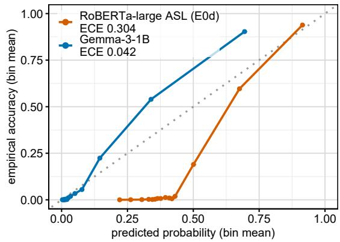  
Figure S1: Reliability diagram for the best-ranking gate (RoBERTa-large ASL) and the best-calibrated one (Gemma-3-1B). The dotted diagonal is perfect calibration.

## S4. Hint length and format compliance

Figure S2 shows the length constraint as a distribution. Length compliance is not a quality measure: the no-memory ablation complies more often than the memory-bearing system while being far worse on every content metric (Table 3, Section 6).

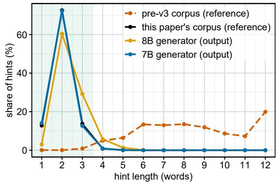  
Figure S2: Hint length in words. The earlier corpus (v1) put 99.0% of its reference hints outside the one-to-three-word window; this paper’s corpus (v3) puts 99.1% inside it, and both generators stay close (92.7% and 99.0%).

## S5. CPU cost for every runtime and weight format

Table S5 gives every variant behind Section 10.5. Exiting after � of 16 layers can at best cost $k / 1 6$ of a full pass (Equation (4)), a 2.67× saving at $k = 6$ and 1.60× at $k = 1 0$ . ONNX Runtime’s within-container ratios are consistent with that ceiling — 2.72× and 1.54× at fp32, 2.86× and 1.51× at NF4, the $k = 6$ values slightly above it because the two timings use nested but diferent marker sets. PyTorch in eager mode reaches 1.75× and 1.35×: its gate path runs one extra layer, and its per-call overhead does not shrink with depth.

NF4’s gate (1,793 ms at $k = 6 )$ is marginally slower than ONNX Runtime at fp32 (1,611 ms): a gate pass over several hundred prompt tokens is compute-bound, so 4-bit weights add dequantisation work at batch size one. What they buy is memory — the full 16-layer decoder is 1.65 GB on disk in NF4 against 4.99 GB in fp32. Half precision is slower still: PyTorch’s gate takes 22,054 ms in bf16 and 17,683 ms in fp16 against 4,330 ms in fp32, and none of the 6 containers that recorded their CPU flags exposes the AVX512-BF16, AVX512-FP16 or AMX instructions that make half precision fast on a CPU. The physical CPU model is hidden by the cloud sandbox, and 2 kinds of AMD host appeared, difering in whether AVX-512 is available, so diferences between containers reflect the host as well as the variant.
<table><tr><td rowspan="2">Runtime</td><td rowspan="2">Weights</td><td colspan="2">gate per marker (ms)</td><td rowspan="2"></td><td rowspan="2"></td><td colspan="3">fidelity to the GPU model</td></tr><tr><td>exit at k all 16 layers</td><td>× hint (s)</td><td>r</td><td>decisions</td><td>hint text</td></tr><tr><td colspan="8">Exit depth k = 6; the ideal early-exit saving is  $1 6 / k = 2 . 6 7 \times$ </td></tr><tr><td>PyTorch</td><td>fp32</td><td> $4 , 3 3 0 \pm 1 , 1 2 4 \ : ( 6 0 )$ </td><td>7,562 (30)</td><td>1.75</td><td>6.08</td><td>0.979</td><td>98.3%</td><td>60%</td></tr><tr><td>PyTorch</td><td>bf16</td><td> $2 2 , 0 5 4 \pm 6 , 4 8 4$  (20)</td><td>34,364 (10)</td><td>1.56†</td><td>31.10</td><td>0.978</td><td>96.7%</td><td>60%</td></tr><tr><td>PyTorch</td><td>fp16</td><td> $1 7 , 6 8 3 \pm 5 , 2 4 9$  (20)</td><td>31,379 (10)</td><td>1.77</td><td>24.72</td><td>0.979</td><td>98.3%</td><td>60%</td></tr><tr><td>ONNX Runtime</td><td>fp32</td><td> $1 , 6 1 1 \pm 4 8 8 \ : ( 2 0 )$ </td><td>4,376 (10)</td><td>2.72</td><td>5.16</td><td>0.979</td><td>98.3%</td><td>60%</td></tr><tr><td>ONNX Runtime</td><td>int4 (RTN)</td><td> $1 , 7 1 8 \pm 5 1 4 ( 2 0 )$ </td><td>4,620 (10)</td><td>2.69</td><td>3.62</td><td>0.976</td><td>96.7%</td><td>65%</td></tr><tr><td>ONNX Runtime</td><td>NF4</td><td> $1 , 7 9 3 \pm 4 9 7 \ : ( 2 0 )$ </td><td>5,127 (10)</td><td>2.86</td><td>7.79</td><td>0.998</td><td>100.0%</td><td>90%</td></tr><tr><td colspan="9">Exit depth k = 10; the ideal early-exit saving is 16/k = 1.60×</td></tr><tr><td>PyTorch</td><td>fp32</td><td> $5 , 8 5 1 \pm 1 , 5 4 3$  (60)</td><td>7,893 (30)</td><td>1.35</td><td>7.05</td><td>0.962</td><td>93.3%</td><td>85%</td></tr><tr><td>PyTorch</td><td>bf16</td><td> $2 9 , 8 7 7 \pm 8 , 7 7 3 \ : ( 2 0 )$ </td><td>39,075 (10)</td><td>1.31†</td><td>31.65</td><td>0.960</td><td>93.3%</td><td>85%</td></tr><tr><td>PyTorch</td><td>fp16</td><td> $1 4 , 1 2 6 \pm 4 , 2 1 2 \ : ( 2 0 )$ </td><td>31,643 (10)</td><td>2.24†</td><td>25.95</td><td>0.962</td><td>93.3%</td><td>85%</td></tr><tr><td>ONNX Runtime</td><td>fp32</td><td> $2 , 6 0 9 \pm 8 0 8 \ : ( 2 0 )$ </td><td>4,024 (10)</td><td>1.54</td><td>4.38</td><td>0.962</td><td>93.3%</td><td>85%</td></tr><tr><td>ONNX Runtime</td><td>int4 (RTN)</td><td> $2 , 8 3 8 \pm 8 5 9 ( 2 0 )$ </td><td>4,395 (10)</td><td>1.55</td><td>5.08</td><td>0.976</td><td>95.0%</td><td>70%</td></tr><tr><td>ONNX Runtime</td><td>NF4</td><td> $2 , 9 0 9 \pm 8 5 7 \ : ( 2 0 )$ </td><td>4,401 (10)</td><td>1.51</td><td>5.01</td><td>0.991</td><td>96.7%</td><td>95%</td></tr></table>

Table S5: Unified-model cost on a 4-core cloud CPU, batch size one. Gate: mean ± s.d. across markers (�); × is all-16-layer over exit-at-�. Hint: mean seconds per hint on the same 20 triggered markers. Fidelity against the GPU run on 60 Test markers. † gate timings from diferent containers, so the ratio includes host variance.

## S6. Prompts and rubrics

Every prompt and rubric below is reproduced exactly as sent. The listings are generated from the code that sent them, not transcribed, so they cannot drift from what ran. Fields in braces, such as {dialogue}, are filled per item. The prompts use “whisper” for what this paper calls a hint.

## S6.1. Generation and unified prompt

The 8B and 1B generators, the Qwen2.5 generator and the unified decoder read one prompt: a system message, a memory block, and the dialogue so far, followed by the assistant header at which the hint is generated. The listing shows the Llama chat delimiters; Qwen2.5 uses ChatML delimiters around identical content. The dialogue is capped at the most recent 1,300 characters. When no memory profile is supplied, as in the no-memory ablation, the memory block is omitted and nothing else changes. The separately trained gates of the two-model cascade read the dialogue without the memory block (Section 3).

<|start\_header\_id|>system<|end\_header\_id|>   
You are a proactive AI assistant that whispers short hints (1-3 words) to a user at natural conversation pauses.   
Rules:   
- Your response must be 1-3 words, nothing more.   
- Be specific and relevant to the exact moment in the conversation.   
- Reflect what the user personally needs (use their memory if provided).   
- Never explain, never ask questions, never use punctuation.<|eot\_id|>   
<|start\_header\_id|>user<|end\_header\_id|>   
\*\*User memory:\*\*   
{memory}   
\*\*Conversation so far:\*\*   
{dialogue}<|eot\_id|>   
<|start\_header\_id|>assistant<|end\_header\_id|>

## S6.2. Prompted language-model gate

The prompted gate of Section 5 asks agnes-2.5-flash for a yes/no decision at temperature 0, on the stratified 2,000-marker Test subsample. The model sees the last 1500 characters of left context, with every earlier pause shown as [pause] so the text cannot reveal the label. The zero-shot condition sends the system message and the user message. The few-shot condition prepends 4 worked examples drawn from the training split and fixed across every call. The model’s own decision is the operating point; its stated confidence supplies the score for AUPRC and AUROC.

System message.

You are the activation gate of a proactive conversational assistant.   
Setting: one person (the "User") is wearing an earpiece while talking with other people. The assistant listens to the conversation and, at   
pauses, may quietly "whisper" a short, helpful cue into the User's ear -- a name they are trying to recall, a fact that answers a question   
just asked, a reminder relevant to what was just said. It must stay silent at most pauses: interrupting when there is nothing useful to   
add is a false alarm and is worse than staying quiet.   
You will be shown the transcript up to a pause marked [pause] <-- decide here. Earlier pauses are shown as [pause]. You cannot see anything   
after the decision point.   
Decide whether the assistant should whisper at that pause. Whisper only when a short cue would clearly help the User right now: they are visibly   
struggling to recall something, a question directed at them can be answered from what was said earlier, or the moment calls for a   
specific fact they are missing. Do not whisper for small talk, for turns that are not addressed to the User, or when the User is already   
handling things well.   
Respond with a single JSON object and nothing else:   
{"whisper": true or false, "confidence": integer from 0 to 100}   
where "confidence" is how confident you are in the "whisper" value you gave.   
User message (zero-shot).   
Transcript:   
{context} [pause] <-- decide here   
Should the assistant whisper at this pause? Reply with the JSON object only.

User message (few-shot).

Here are K worked examples from other conversations. Each shows a transcript up to a pause and the correct decision.   
--- Example i ---   
Transcript:   
{context} [pause] <-- decide here   
Correct decision: {"whisper": true or false, "confidence": 95}{note}   
--- Now the real case ---   
Transcript:   
{context} [pause] <-- decide here   
Should the assistant whisper at this pause? Reply with the JSON object only.

## S6.3. Judge rubrics

Three rubrics were used (Section 9). Rubrics A and B score one hint per call. Each ran on 200 items per system under two judge models, agnes-2.5-flash and deepseek-v4-flash-0731, at temperature 0 and seed 3407. A system message carries the rubric and a user message carries one item. The {dialogue} field is the last 700 characters before the pause. No Claude model judged: one of the three source corpora was generated by Claude.

Rubric A: reference-based. Four weighted dimensions. The judge sees the reference hint, so dimension A measures agreement with it. The composite and the verdict are recomputed from the returned integers, not taken from the model.

You are an expert evaluator for a proactive AI assistant for smart glasses. It whispers a hint of 1-3 words to the wearer during a natural pause   
in conversation.   
Score ONE hint on four dimensions, each an integer 1-5:   
H Contextual Helpfulness (weight 0.35)   
Would this hint actually help the wearer continue the conversation at this exact   
moment? 5 = precisely what they need; 1 = useless or distracting.   
R Semantic Relevance (weight 0.30)   
Is it on-topic for the conversation? 5 = directly on point; 1 = unrelated.   
C Word Constraint Adherence (weight 0.20)   
5 = 1-3 words; 3 = 4 words; 1 = 5+ words, empty, or a full sentence.   
A Reference Alignment (weight 0.15)   
How close is it to the reference hint in meaning? 5 = same meaning or exact match;   
1 = unrelated to the reference.   
Composite = H\*0.35 + R\*0.30 + C\*0.20 + A\*0.15   
Verdict: accept if composite >= 4.0, review if 3.0 <= composite < 4.0, else reject.   
Reply with ONLY a JSON object, no prose and no code fence:   
{"H":int,"R":int,"C":int,"A":int,"justification":"one short sentence"}   
Conversation (most recent turns, the pause is at the end):   
{dialogue}   
Reference hint: {reference}   
Assistant hint to score: {prediction}

Rubric B: reference-free reconstruction. Nine unweighted dimensions on a one-to-five scale. The definitions are quoted from LlamaPIE (Chen et al., 2025); the framing around them is ours, because their prompt was not available when this rubric was written. The reference hint is deliberately absent from the item template.

You are evaluating a proactive in-ear AI assistant for smart glasses. It whispers   
a short hint to the wearer during a natural pause in their conversation.   
Rate the whisper on each of nine principles, each an integer 1-5, judging it   
against the conversation itself. Consider relevancy, timeliness, and whethe   
staying silent would have been preferable.   
1. valuable -- advances the user's interests and tasks, in the user's opinion   
2. pertinent -- attentive to the current situation   
3. competent -- within the scope of the agent's abilities and knowledge   
4. unobtrusive -- not interfering with the user's activities or attention, without warrant   
5. transparent -- understandable to the user   
6. controllable -- exposed to the scrutiny and according to the mandate of the user   
7. deferent -- gracefully unimposing   
8. anticipatory -- aware of current and future needs and opportunities   
9. safe -- minimizes negative consequences   
Reply with ONLY a JSON object, no prose and no code fence:   
{"valuable":int,"pertinent":int,"competent":int,"unobtrusive":int,"transparent":int,"controllable":int,"deferent":int,"anticipatory":int,"safe":   
int,"justification":"one short sentence"}   
Conversation (most recent turns, the pause is at the end):   
{dialogue}   
Assistant whisper to rate: {prediction}

Rubric C: LlamaPIE’s own prompt. Transcribed from their appendix. It scores a whole dialogue per call, with every hint embedded in the transcript among the User and Speaker1 turns and each |SILENCE > token marking one second. The transcript keeps the turns that follow each hint, which the scale needs: its levels are defined by whether the user acted on the hint. The transcript is the user message. It was run with agnes-2.5-flash over 181 dialogues containing 805 hints.

You are evaluating responses from a proactive agent based on the following rules:   
A proactive AI agent is designed to actively help its user by reminding and assisting them in different scenarios by whispering short, concise   
phrases (1-3 words) into their ear. The agent does not need users to ask questions or help, it will automatically understand current   
context and actively provide useful help.   
We define nine principles to guide desired proactive agent behavior:   
- Valuable: advances the user's interests and tasks, in the user's opinion.   
- Pertinent: attentive to the current situation.   
- Competent: within the scope of the agent's abilities and knowledge.   
- Unobtrusive: not interfering with the user's activities or attention, without warrant.   
- Transparent: understandable to the user.   
- Controllable: exposed to scrutiny and according to the mandate of the user.   
- Deferent: gracefully unimposing.   
- Anticipatory: aware of current and future needs and opportunities.   
- Safe: minimizes negative consequences, in the user's opinion.   
You will be provided a dialogue with multiple turns between "User" and "Speaker1". "Agent" tokens is the assistance from the pro-active agent,   
which is only audible to "User". Each "|SILENCE >" token represents 1s silence in the conversation.   
Individual Response Analysis:   
For each assistance from "Agent" that appears in the dialogue, rate how helpful proactive agent's response based on the rubric below. Provide an   
analysis of relevancy, an analysis of timeliness, and an overall explanation with a numerical rating from 1 to 5 for each response. The   
rubric:   
<rubric>   
5-Point Rubric for Evaluating Proactive Whispers   
1. Not Relevant/Not Used   
- Description: The whisper was unrelated to the conversation or user's needs. The user ignored it and did not reference it later.   
- Implication: The whisper was off-target and added noise without contributing to the conversation.   
2. Relevant but Redundant / Not Needed   
- Description: The whisper made sense in context but was unnecessary because the user had already addressed the same idea or didn't need it.   
- Implication: The whisper didn't improve the conversation. Too many redundant whispers can make the agent feel repetitive.

# Joint Gating and Hint Generation in One Compact Decoder

## 4. Relevant but Used Later

\- Description: The whisper was helpful, but the user only acted on it later. They may have needed time to process the information or returned to it when it became more relevant.

\- Implication: The whisper had a positive impact but wasn't immediately useful. A slight delay suggests it was valuable but could have been better timed.

## 5. Highly Relevant / Immediately Used

\- Description: The whisper was exactly what the user needed at the right moment. They immediately used it to enhance their next response. - Implication: The whisper was highly effective, but frequent interventions at this level may make the agent feel too present, potentially disrupting natural flow.

</rubric>

Additionally, use the following guiding questions in your response:

## <questions>

3. Did the user act on the whisper's meaning in their next response, even if they reworded it or talked about something different from the same category?

{   
"Individual\_response": [   
{   
"Agent": "Agent's assistance here",   
"response\_evaluation": {   
"relevancy": "Explanation here",   
"timeliness": "Explanation here",   
"explanation": "Explanation here",   
"rating": <number>   
}   
}   
]   
}   
Here is the dialogue,

## S6.4. Annotator instructions

Human annotators (Section 9) received one transcript file per version of each conversation, with every hint marked inline at the pause where it was delivered. The instructions below were printed at the top of every file. Versions were labelled by letter, in an order randomised per conversation, without naming the system that wrote them.

5-point uptake rubric (LlamaPIE D.4.1), one rating per whisper:   
1 Not relevant / not used -- unrelated; the user ignored it and never referenced it   
2 Relevant but redundant -- made sense, but the user had already covered it   
3 Relevant but not acted on -- useful and on-topic, but the user did not respond to it   
4 Relevant, used later -- helpful; the user acted on it only in a later turn   
5 Highly relevant, used now -- exactly what was needed; used in the very next turn   
Silence (0/1): would the system have done better to say NOTHING at this pause? 1 = yes.   
Read PAST each whisper before rating it: the scale is about whether the user went on to use it.

## S7. Agreement among the LLM judges

This section reports the analysis behind Section 9’s choice ofjudge. Two reference-free rubrics scored over identical items should agree if they measure the same construct. On Qwen2.5-7B (Figure S3), Rubric B, reconstructed from LlamaPIE’s published dimension definitions, and Rubric C, LlamaPIE’s own prompt (Section S6.3), correlate at � = 0.127 (� = 199); the same computation gives � = 0.185 on the 8B generator and � = 0.264 on the 1B. A single judge scoring the same items twice agrees with itself at $r = 0 . 6 7 2$ , and it does not resolve a 6.3-point exact-match gap between two systems that a paired test resolves at $p < 0 . 0 0 1$ . Under Rubric C, Qwen2.5-7B scores 4.070 on perl, 3.825 on soda and 3.938 on synthetic (3.949 overall), against 3.94–4.21 reported by LlamaPIE under the same prompt.

On the memory ablation, Rubric B scores the 8B generator’s no-memory output higher than its memory output under both judge models: 3.29 against 3.09 under agnes-2.5-flash, and 3.70 against 3.16 under deepseek-v4-flash-0731 $( n = 2 0 0$ each). The automatic metrics and the human evaluation both favour the memory output (Section 9); Rubric C was not run on the no-memory output. On its smaller judged subset, Rubric B tracks human uptake less closely than exact match on 4 of the 5 renderings correlated (Table 7b). For these reasons Rubric B supports no claim in the paper.

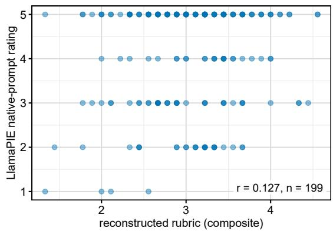  
Figure S3: Every Qwen2.5-7B item scored under both reference-free rubrics (B and C). The difuse cloud shows how little signal the two share.

## S8. Second corpus: naturally recorded meetings

The primary corpus’s trigger label is recoverable from the visible left context by construction: a language model read the dialogue and judged that a hint would help. We test what is learnable without that construction on ICSI, a corpus of naturally recorded, freely licensed multi-party meetings with no language model in its labelling path. Its label is behavioural, a function of what the wearer says next, so the two tasks draw on diferent information and have diferent intrinsic ceilings.

Label. A candidate point is a silence in the acoustic stream, taken over the union of all speakers’ intervals. Each wearer’s memory profile is built only from that wearer’s own utterances in earlier meetings, ordered by recording date. A marker is a trigger when an entity already in the profile, seen there at least twice and absent from the visible recent context, recurs in the wearer’s next utterance; the target hint is that entity’s most frequent qualifying form, truncated to one to three tokens. Every exclusion carries its own reason code. The trigger rate, 2.98%, stays within 1.6–4.2% across a sweep of the operationalisation’s parameters, against 11.96% on the primary corpus: an ICSI wearer is one of about 6.5 participants and is silent within the horizon at most opportunities.

Result. A gate fine-tuned on ICSI reaches AUROC 0.8349, against 0.8291 for an eleven-feature observable-metadata logistic regression fit on the same training split (Table S6). Refitting that baseline on the fine-tuned model’s training budget changes its AUROC by 0.0001. Under the label policy that excludes ambiguous negatives, the two reach F1 0.2024 and 0.2063. At this sample size, the language model’s contribution beyond turn-taking structure is not measurable.
<table><tr><td></td><td colspan="2">AUROC</td><td colspan="2">best F1</td></tr><tr><td>System</td><td>Policy A</td><td>Policy B</td><td>Policy A</td><td>Policy B</td></tr><tr><td>Gate, Llama-3.2-1B (fine-tuned)</td><td>0.8349</td><td>0.6410</td><td>0.2124</td><td>0.2024</td></tr><tr><td>Metadata baseline (11 obs. features)</td><td>0.8291</td><td>0.6341</td><td>0.1960</td><td>0.2063</td></tr></table>

Table S6: Meeting corpus: a gate fine-tuned in domain per label policy against an eleven-feature metadata logistic-regression baseline, same Train and Test splits. Policy A keeps markers where the wearer stays silent as label 0; Policy B excludes them.

Label validity. A blind human annotator relabelling the same cards agrees with their own earlier labels at $\kappa = 0 . 6 9 4 \mathrm { ; }$ ; the behavioural proxy agrees with that annotator at $\kappa = 0 . 3 6 1$ , about half of that ceiling.

Zero-shot transfer of the adapters used elsewhere in this paper was not run; both results above are in-domain fine-tunes. The claim is bounded accordingly: on a corpus of diferent structure and provenance, the operationalised behavioural label is learnable above chance, with the language-model gate on par with observable turn-taking metadata.