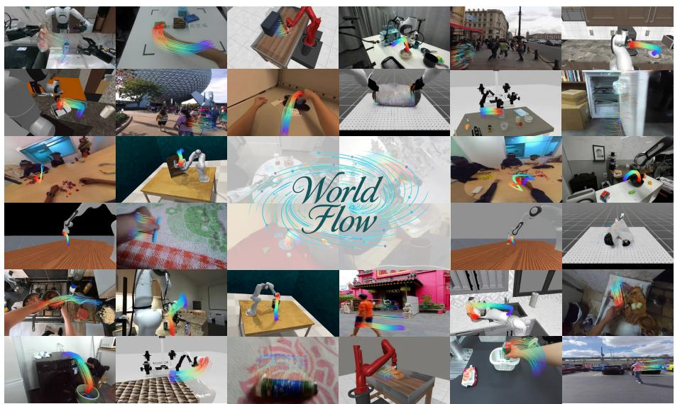
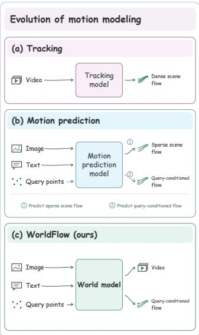
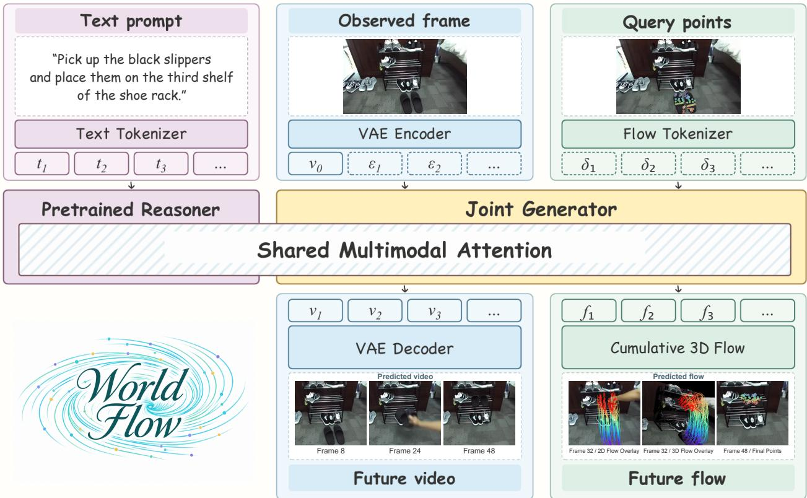
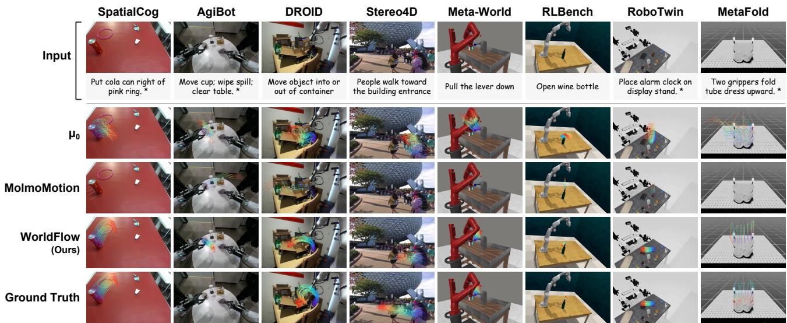
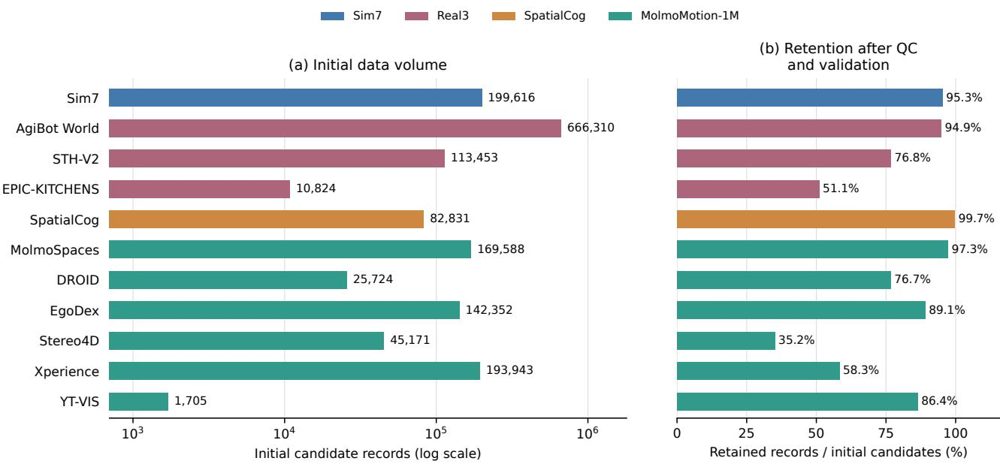
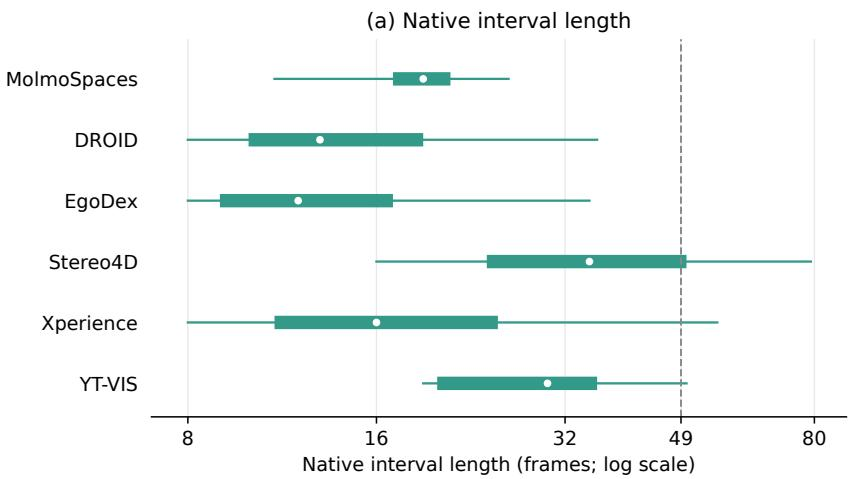
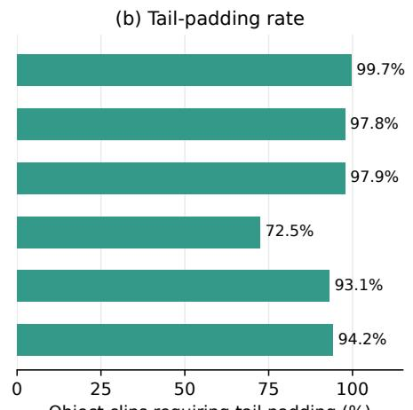
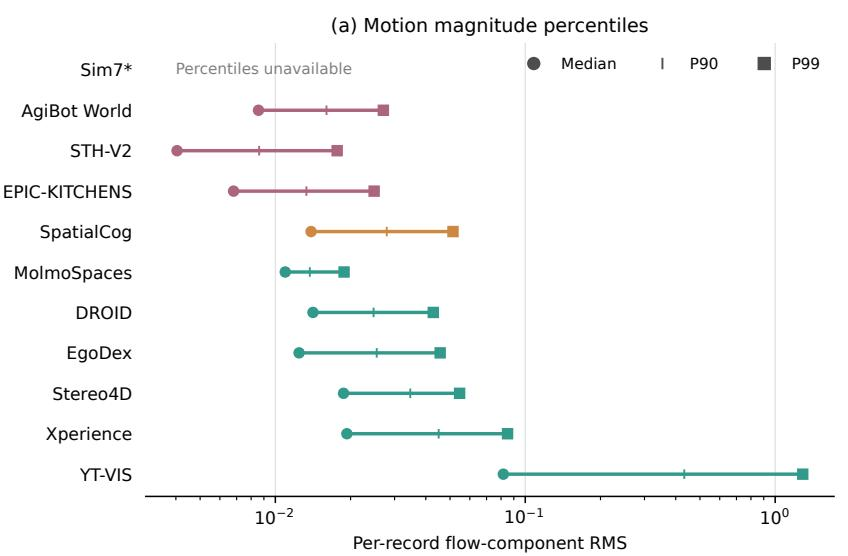
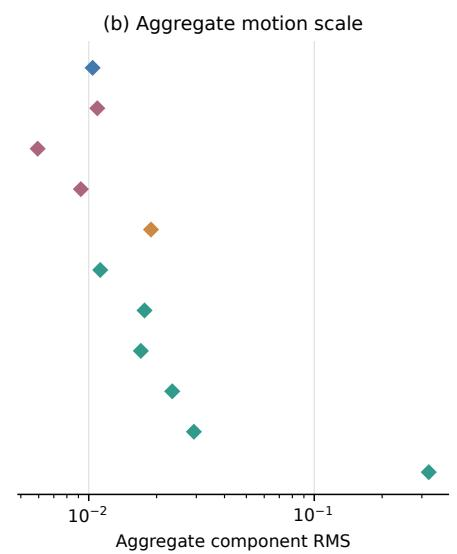
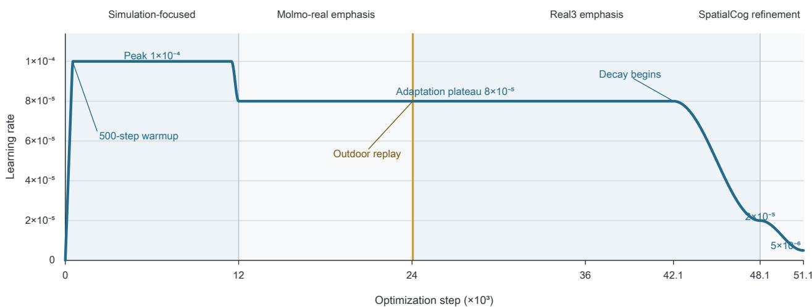

# WorldFlow: Joint Video and 3D Motion Prediction via Large-Scale Pretraining

Yuhao Lu1,\*, Jiongxu Chen1,\*, Hexiang Wei1, Jiajin Wu1, Juelin Li1, Mingjian Liang1 Fan Yang1, Zhuowei Liang1, Zihao Liu1, Zhennan Wang1, Sheng Wang1,†, Lin Shao1,2,‡ 1RoboScience 2National University of Singapore

## Abstract

Predicting future physical states stands as a central challenge in embodied intelligence. Existing video world models leave 3D dynamics implicit, action-based formulations remain tied to specific robot configurations, and 3D motion prediction models use flow-only supervision, providing a limited learning signal for physical dynamics. To circumvent these limitations, we introduce WorldFlow, a generative world model that jointly predicts future video and query-based 3D trajectories. By parameterizing 3D motion as continuous displacement tokens aligned with the video grid, a unified Mixture-of-Transformers (MoT) backbone jointly denoises both modalities under a rectified-flow objective. This formulation couples explicit geometric dynamics with visual evolution, efectively unlocking the physical commonsense embedded within pretrained video models. To empirically scale and validate this unified architecture, we train WorldFlow on a heterogeneous mixture of 1.44 million object-level samples spanning simulated and real-world domains. We further introduce WorldFlowBench, comprising 1,678 evaluation samples from 11 data sources across simulated and real-world interactions, including spatial reasoning tasks. Across all three evaluation sets, WorldFlow achieves the lowest average displacement error (ADE) and final displacement error (FDE) among the evaluated learning-based methods. Notably, on the challenging SpatialCog set, WorldFlow achieves an ADE of 0.060 m, a 54.2% reduction compared with the strongest external baseline. It also reduces ADE and FDE by 55.9% and 68.5%, respectively, compared with its flow-only variant. Project page: https://worldflow-rbs.github.io/.

  
Figure 1. 3D Flow Predictions and motion modeling paradigms. Left: 3D motion flow predicted by WorldFlow across simulated, robotic manipulation, human-object interaction, and in-the-wild environments. Right: (a) Tracking models recover dense scene flow from video. (b) Motion prediction models forecast future 3D flow from an image and text. Existing formulations can be broadly divided into sparse scene flow prediction and query-conditioned flow prediction. (c) WorldFlow is a world model conditioned on an image, text, and query points that jointly generates future video and query-conditioned 3D flow.

## 1 Introduction

The philosophy of Heraclitus is often distilled into the aphorism panta rhei—everything flows. In the physical world, appearances and spatial configurations continually change, while objects maintain continuity over time. An embodied world model should capture both aspects. Recent generative video models (Team Wan et al., 2025; Team Seedance et al., 2026) predict increasingly coherent visual futures, but express these predictions in pixels, leaving the underlying 3D dynamics implicit. World action models (Zhou et al., 2026; Yuan et al., 2026; NVIDIA, 2026; Ye et al., 2026) connect future prediction to robotic behavior by incorporating actions into world modeling. However, action supervision is costly to collect at scale, and action representations are often tied to particular robot embodiments, complicating cross-platform transfer. These limitations motivate extending world modeling into the space of explicit 3D motion flow: a geometric representation of physical change that can connect visual prediction to planning and control across embodiments.

A complementary line of research approaches this space through motion modeling, progressing from tracking motion in observed videos (Lu et al., 2026; Luo et al., 2026) to predicting future trajectories from current observations (Zhang et al., 2026; Lee et al., 2026b). For generative motion prediction, producing dense 3D scene flow is computationally expensive. Existing scene-level methods instead predict motion on coarse spatial grids (Lee et al., 2026a; Li et al., 2026a). However, sparse scene flow still allocates motion tokens to task-irrelevant regions, while its reduced spatial resolution limits the fidelity of fine motion boundaries. Query-conditioned prediction ofers a more targeted alternative, allocating motion tokens to specified 3D locations in task-critical regions while retaining global scene context as conditioning information. Yet learning generalizable dynamics at scale faces two challenges: high-quality 3D trajectory annotations are costly to acquire, while flow-only supervision provides a limited learning signal for physical dynamics, potentially limiting generalization across scenes and interactions. Jointly modeling visual evolution and explicit motion ofers a natural way to enrich this supervision, bringing motion prediction into a generative world model.

To this end, we introduce WorldFlow, a generative world model that jointly predicts future video and query-conditioned 3D object trajectories through a unified Mixture-of-Transformers (MoT) backbone. Given an observed image, a language instruction, and sparse 3D query points, WorldFlow forecasts motion at the queried locations while using the full scene as visual context. We represent trajectories as continuous tokens encoding normalized frame-to-frame 3D displacements, enriched with initial point geometry and spatiotemporally aligned with video tokens. A unified rectified-flow objective jointly denoises both modalities, coupling trajectory learning with dense visual supervision of the same future.

To support training at scale, we assemble a heterogeneous corpus spanning simulated and real-world domains, comprising approximately 1.44 million object-level samples—equivalent to 1,224 hours of standardized 49-frame sequences at 16 FPS. We combine existing motion annotations with automated trajectory extraction, unify their representations, and apply source-specific quality control and fixed domain-level normalization for mixed-data training. We further introduce WorldFlowBench, comprising three evaluation sets, including SpatialCog for spatial reasoning in future motion prediction. On WorldFlowBench, WorldFlow achieves the lowest ADE and FDE across all three evaluation sets among non-static methods. Compared with its flow-only variant, joint video-flow generation reduces ADE by 48.5% on Sim7 and 55.9% on SpatialCog, with a 68.5% reduction in FDE on SpatialCog. These results support the value of complementary visual supervision for accurate 3D motion forecasting.

Our contributions are:

• We introduce WorldFlow, a generative world model that jointly predicts video and queryconditioned 3D object motion through a unified MoT backbone, combining explicit trajectory supervision with dense visual supervision.

• We construct a heterogeneous corpus of approximately 1.44 million object-level samples from simulated and real-world data, using unified motion representations and source-specific quality control to support large-scale training.

• We introduce WorldFlowBench, comprising three evaluation sets including SpatialCog for spatial reasoning, and demonstrate improvements over existing motion prediction methods and videogeneration-then-tracking pipelines.

## 2 Related Work

## 2.1 Predictive World Models: From Pixels to Actions

A fundamental objective of visual world modeling is to predict future physical states from current observations. In the visual domain, large-scale video generators establish rich appearance and motion priors to enable coherent future synthesis (Team Wan et al., 2025; Team Seedance et al., 2026), driven by architectural and training eficiencies (Huang et al., 2025; Chen et al., 2025b), and extending toward physical-world prediction, interactive simulation, and semantic control (NVIDIA et al., 2025; Robbyant Team et al., 2026; Chen et al., 2026; Bian et al., 2025). To bridge visual futures with robotic behavior, World Action Models (WAMs) directly incorporate the robot’s action space into predictive modeling, jointly forecasting future observations and actions to support end-to-end policy learning and interactive closed-loop control (Ye et al., 2026; Li et al., 2026c), while expanding toward in-context task generalization (Zhou et al., 2026), fast inference (Yuan et al., 2026), and cross-embodiment transfer (Li et al., 2026a). Paralleling these eforts, unified multimodal models integrate visual understanding with multi-modal generation (Deng et al., 2025), paving the way for comprehensive frameworks that jointly process language, pixels, and actions for physical-world modeling (NVIDIA, 2026).

## 2.2 3D Motion Modeling: From Tracking to Forecasting

Point tracking stands as a classic paradigm focused on resolving dense, pixel-level correspondences and spatial linkages over observable video sequences (Lu et al., 2026; Karhade et al., 2026; Karaev et al., 2024; 2025; Xiao et al., 2025; Zhang et al., 2025; Luo et al., 2026). Although these trackers provide direct measurements of surface history, they operate strictly on immediate visual evidence and remain susceptible to severe error accumulation under complex occlusions or non-rigid deformations. Concurrently, predictive motion forecasting has recently emerged to ofer fresh research motivations tailored for downstream embodied and robotic applications. As a generative geometric interface, 3D motion flow bypasses immediate frame matching to predict future physical dynamics directly across objects and embodiments. Early work, General Flow (Yuan et al., 2024), learned languageconditioned 3D point trajectories from human RGB-D videos as transferable manipulation afordances. NovaFlow (Li et al., 2025) and Dream2Flow (Dharmarajan et al., 2025) leveraged video generation to obtain motion priors, recovering actionable 3D object flow through tracking and geometric reconstruction. Alongside these video-based pipelines, direct motion models predict future geometry without synthesizing videos. TraceGen (Lee et al., 2026a) models compact 3D traces, while PointWorld (Huang et al., 2026) predicts action-conditioned full-scene flow and ObjectForesight (Soraki et al., 2026) forecasts rigidobject pose trajectories. More recently, RoboFlow4D (Lin et al., 2026), $\mu _ { 0 }$ (Lee et al., 2026b), and MolmoMotion (Zhang et al., 2026) advanced flow-guided planning, interaction-trace generation, and language-conditioned object-point forecasting, respectively. Flow representations have also become integral to policy learning and visual world modeling: LaMP (Wang et al., 2026) introduces a latent 3D motion prior for action generation, EgoWAM (Li et al., 2026a) studies 3D flow as a world-prediction target for human-to-robot transfer, and Hydra-0 (Li et al., 2026b) uses image-plane action flow to condition video prediction and support robot control.

## 3 WorldFlow

## 3.1 Problem Formulation

Given a language instruction c, an observed RGB frame $I _ { 0 }$ , and 3D query points $\mathcal { Q } = \{ \mathbf { p } _ { 0 , i } \} _ { i = 1 } ^ { N }$ with corresponding image coordinates ${ \cal { S } } _ { 0 } = \{ { \bf { s } } _ { 0 , i } \} _ { i = 1 } ^ { N }$ , WorldFlow jointly predicts future RGB frames $I _ { 1 : T }$ and 3D flow $f _ { 1 : T }$ . All 3D positions are expressed in the initial camera coordinate system. We define flow as the frame-to-frame displacement of each query point:

$$
f _ { t , i } = \mathbf { p } _ { t , i } - \mathbf { p } _ { t - 1 , i } , \qquad t = 1 , \ldots , T .\tag{1}
$$

The corresponding trajectories are recovered by accumulation:

$$
\mathbf { p } _ { t , i } = \mathbf { p } _ { 0 , i } + \sum _ { \tau = 1 } ^ { t } f _ { \tau , i } .\tag{2}
$$

Our objective is to model the conditional joint distribution

$$
p _ { \theta } \left( I _ { 1 : T } , f _ { 1 : T } \mid I _ { 0 } , \mathcal { Q } , S _ { 0 } , c \right) .\tag{3}
$$

## 3.2 Architecture

Our central design introduces 3D flow tokens as an additional generative modality for joint video-motion prediction. Built on the Cosmos-Nano framework (NVIDIA, 2026), WorldFlow retains the pretrained reasoner and extends the generator to jointly synthesize future video and 3D flow (Figure 2). The reasoner processes the language instruction, while the video VAE encodes the observed frame into clean latents. The flow tokenizer embeds noisy displacements together with initial query-point geometry and aligns their spatiotemporal positional coordinates with the video token grid (Section 3.3).

Within the Mixture-of-Transformers (MoT) architecture, video and flow tokens interact through full attention and attend to the reasoner’s causal context. At inference, future video latents and flow are initialized from noise and jointly denoised, conditioned on the clean observed-frame latents, language context, and query geometry. The VAE decodes the generated video latents into RGB frames, while the predicted flow is rescaled and accumulated to recover 3D trajectories. This joint generation process produces explicit motion alongside video without a separate tracking stage.

## 3.3 3D Flow Tokenization

We represent each query point’s displacement at each future frame as a continuous-valued token, augmented with initial 3D geometry and spatiotemporal positional encoding.

Normalization and sequence construction. To balance motion scales across domains, we normalize displacements by a domain-specific scalar estimated from training data and fixed throughout training:

$$
\bar { f } _ { t , i } = \frac { f _ { t , i } } { a _ { d } } , \qquad a _ { d } > 0 .\tag{4}
$$

The normalized displacements are arranged in frame-major order, yielding TN three-dimensional vectors for token construction.

Query point geometry encoder. We encode each query point’s absolute initial position and its position relative to the query-set centroid using two parallel encoders. Each applies coordinate normalization, fixed Fourier features, and an MLP. Their outputs are concatenated and fused:

$$
\mathbf { e } _ { i } ^ { \mathrm { 3 D } } = \mathrm { M L P } \left( \left[ E _ { \mathrm { a b s } } ( \mathbf { p } _ { 0 , i } ) ; E _ { \mathrm { r e l } } ( \mathbf { p } _ { 0 , i } - \pmb { \mu } ) \right] \right) ,\tag{5}
$$

where $E _ { \mathrm { a b s } }$ and $E _ { \mathrm { r e l } }$ denote the two encoders, and $\pmb { \mu }$ is the query-set centroid. The geometry embedding is shared across all future tokens of the same query point.

  
Figure 2. Overview of WorldFlow. Conditioned on text tokens $t _ { j }$ through the pretrained reasoner, clean observed-frame latents $v _ { 0 }$ , and query-point geometry, the generator jointly denoises video and flow from noise $\epsilon _ { j }$ and $\delta _ { k }$ through shared multimodal attention. Generated video latents $v _ { j }$ are decoded by the VAE, while generated 3D flow $f _ { t }$ is rescaled and accumulated from the initial query positions to recover metric trajectories. The 2D flow overlay shows generated 3D trajectories projected onto generated video frames. The 3D flow overlay shows generated 3D trajectories overlaid on a scene point cloud reconstructed from the initial frame’s ground-truth depth.

Flow token construction. A linear projection maps noisy normalized displacements into the generator’s hidden space, where they are combined with geometry and conditioning embeddings:

$$
\mathbf { h } _ { t , i } ^ { ( \sigma ) } = \mathrm { L i n e a r } ( \bar { f } _ { t , i } ^ { ( \sigma ) } ) + \mathbf { e } _ { i } ^ { 3 \mathrm { D } } + \mathbf { e } _ { \mathrm { c o n d } } ( \sigma ) .\tag{6}
$$

Here, $\sigma$ denotes the denoising noise level, distinct from the physical frame index t. The conditioning embedding combines a learned flow-modality embedding with the noise-level embedding.

Spatiotemporal alignment. We assign flow tokens rotary positional coordinates using the same temporal and spatial conventions as video tokens. Each flow token is anchored to its future frame and the query point’s initial image patch:

$$
\mathbf { r } _ { t , i } = \left( \frac { t } { q _ { t } } , \left\lfloor \frac { v _ { 0 , i } } { q _ { s } p _ { s } } \right\rfloor , \left\lfloor \frac { u _ { 0 , i } } { q _ { s } p _ { s } } \right\rfloor \right) ,\tag{7}
$$

where $( u _ { 0 , i } , v _ { 0 , i } ) = \mathbf { s } _ { 0 , i }$ denotes the initial image coordinates, $q _ { t }$ and $q _ { s }$ are the temporal and spatial VAE compression factors, and $p _ { s }$ is the latent patch size. These coordinates determine the rotary transformations of attention queries and keys:

$$
\widetilde { \mathbf { q } } _ { t , i } = R ( \mathbf { r } _ { t , i } ) \mathbf { q } _ { t , i } , \qquad \widetilde { \mathbf { k } } _ { t , i } = R ( \mathbf { r } _ { t , i } ) \mathbf { k } _ { t , i } .\tag{8}
$$

The shared positional convention encodes relative spatiotemporal relationships between flow and video tokens within multimodal attention.

## 3.4 Training Objectives

## 3.4.1 Joint flow matching

We jointly train video and 3D flow generation using a weighted rectified-flow objective:

$$
\begin{array} { r } { \mathcal { L } _ { \mathrm { F M } } = \lambda _ { \mathrm { v i d e o } } \mathcal { L } _ { \mathrm { v i d e o } } + \lambda _ { \mathrm { f l o w } } \mathcal { L } _ { \mathrm { f l o w } } , } \end{array}\tag{9}
$$

where $\mathcal { L } _ { \mathrm { v i d e o } }$ and ${ \mathcal { L } } _ { \mathrm { { f l o w } } }$ supervise vector-field prediction for video latents and normalized 3D flow, respectively. Both modalities share a per-sample noise level and are jointly denoised. Losses are computed separately for each modality, excluding conditioning positions from supervision.

## 3.4.2 Auxiliary motion objectives

To complement vector-field supervision with explicit constraints on predicted motion, we apply auxiliary objectives to clean normalized flow reconstructed from the predicted vector field. These objectives penalize frame-to-frame displacement error, cumulative displacement direction error, and relative endpoint error, encouraging both local accuracy and trajectory-level consistency.

Direction errors are weighted by ground-truth displacement magnitude, while points with small net displacement are excluded from endpoint supervision. All auxiliary terms operate in normalized coordinates and use noise-dependent weighting to emphasize lower-noise samples. The complete objective is

$$
\mathcal { L } = \mathcal { L } _ { \mathrm { F M } } + \lambda _ { \mathrm { d i r } } \mathcal { L } _ { \mathrm { d i r } } + \lambda _ { \mathrm { v m a g } } \mathcal { L } _ { \mathrm { v m a g } } + \lambda _ { \mathrm { e n d } } \mathcal { L } _ { \mathrm { e n d } } ,\tag{10}
$$

where ${ \mathcal { L } } _ { \mathrm { d i r } } , \ { \mathcal { L } } _ { \mathrm { v m a g } } ,$ , and $\mathcal { L } _ { \mathrm { e n d } }$ denote the direction, displacement, and endpoint losses, respectively. Detailed formulations and derivations are provided in the supplementary material, and their contribution is evaluated through ablation experiments.

## 4 Experiments

## 4.1 Datasets

We assemble a heterogeneous corpus of paired videos and 3D point trajectories spanning simulated and real-world interactions. The training corpus contains approximately 1.44 million object-level samples, equivalent to 1,224 hours of standardized 49-frame sequences at 16 FPS. The data are organized into four collections:

• Sim7 combines seven simulation datasets: ManiSkill (Tao et al., 2024), MIKASA (Cherepanov et al., 2026), MetaWorld (Yu et al., 2020), MetaFold (Chen et al., 2025a), RLBench (James et al., 2020), RoboCasa (Nasiriany et al., 2024), and RoboTwin (Mu et al., 2025), covering diverse robotic interactions and manipulation tasks.

• Real3 comprises AgiBot World (Bu et al., 2025), EPIC-KITCHENS (Damen et al., 2018), and Something-Something V2 (Goyal et al., 2017), covering real-world robot and human interactions.

• SpatialCog is our self-collected dataset of tabletop and household interactions, with an emphasis on spatial relations in instruction-conditioned motion.

• MolmoMotion-1M (Zhang et al., 2026) contributes curated 3D motion annotations from six sources: EgoDex (Hoque et al., 2025), Xperience (Ropedia, 2026), YT-VIS (Yang et al., 2019), Stereo4D (Jin et al., 2025), DROID (Khazatsky et al., 2024), and MolmoSpaces (Kim et al., 2026).

Annotation and standardization. For Sim7 and Real3, we generate captions with Gemini-2.5 Pro (Comanici et al., 2025), obtain object masks with SAM 2 (Ravi et al., 2024), and extract 3D point trajectories using Track4World (Lu et al., 2026). SpatialCog pairs manually annotated captions with Track4World trajectories. For MolmoMotion-1M, we reuse the released motion annotations, apply source-specific geometry, scale, and trajectory-validity checks, and standardize the retained sequences into 49-frame clips. All collections use a shared representation consisting of video, a language instruction, initial 3D query points, and frame-to-frame 3D displacements. Additional processing details and per-source statistics are provided in the supplementary material.

Evaluation split. We introduce WorldFlowBench, a benchmark comprising 1,678 held-out evaluation samples: 396 from Sim7, 882 from Real3, and 400 from SpatialCog. The three subsets cover simulated interactions, real-world motion, and spatial-relation reasoning, respectively. All evaluation samples are excluded from training.

## 4.2 Training Configuration and Strategy

Implementation details. We train on 49-frame clips at $2 8 8 \times 4 8 0$ resolution with $N = 6 4$ query points. The video VAE uses temporal and spatial compression factors of $q _ { t } = 4$ and $q _ { s } = 1 6$ , followed by $2 \times 2$ latent patchification $( p _ { s } = 2 )$ . Each clip therefore contains a $1 3 \times 9 \times 1 5$ video-token grid and $4 8 \times 6 4$ flow tokens. Training uses 64 NVIDIA H800 GPUs across eight nodes, with a $\mathrm { p e r \mathrm { - } G P U }$ batch size of two and no gradient accumulation, yielding a global batch size of 128.

Training strategy. We adopt a two-stage training schedule. The first stage initializes the model from pretrained Cosmos-Nano checkpoints and trains on the SpatialCog training split for 32,000 steps. The learning rate follows linear warmup and cosine decay, with a peak of $1 0 ^ { - 4 }$ . The resulting exponential moving average (EMA) weights initialize the second stage.

The second stage trains on the heterogeneous data mixture for 51,100 steps across three curriculum phases: simulation-focused training, mixed real-world adaptation, and refinement on the SpatialCog training split. During real-world adaptation, sampling gradually shifts from MolmoMotion to Real3. Each phase prioritizes its target domain while retaining cross-domain replay, with smooth transitions between sampling distributions. After warmup, the learning rate reaches $1 0 ^ { - 4 }$ , transitions to an $8 \times 1 0 ^ { - 5 }$ plateau during real-world adaptation, and decays through late adaptation and final refinement.

We expand task prompts into structured instructions specifying data origin, camera motion, actor type, and environment. For classifier-free guidance, text conditioning is dropped with probability 0.1, while visual and geometric conditioning is retained. At inference, we use 40 rectified-flow sampling steps with a guidance scale of 2.

## 4.3 Flow Benchmark

## 4.3.1 Evaluation Metrics

We evaluate 3D point trajectories in metric coordinates. Average displacement error (ADE) measures the mean Euclidean position error across query points and future frames, while final displacement error (FDE) measures the mean position error at the final frame. Both are reported in meters. PWT measures the fraction of point–frame pairs whose position error falls within a given distance threshold. We report its average over thresholds of 1, 2, and 5 cm to assess trajectory accuracy at fine spatial scales.

## 4.3.2 Quantitative Evaluation on WorldFlowBench

We evaluate all learning-based methods under a single-frame protocol, where one RGB observation and a language instruction are provided to forecast a common future horizon without motion history. All predictions are converted into metric 3D point trajectories in the initial camera coordinate system. We additionally report a Static reference that predicts zero flow and therefore keeps every query point at its initial position throughout the prediction horizon.

  
Figure 3. Qualitative comparison on diverse real and simulated scenes. We visualize predicted 3D query-point trajectories from µ0, MolmoMotion, and WorldFlow across SpatialCog, AgiBot, DROID, Stereo4D, Meta-World, RLBench, RoboTwin, and MetaFold. The trajectories are projected onto the corresponding input frames for visualization.

We compare against two families of learned baselines. The video-generation-then-tracking family includes NovaFlow (Li et al., 2025), as well as pipelines built on Cosmos3-Nano (NVIDIA, 2026) or LingBot-Video-MoE (Robbyant Team et al., 2026), paired with Track4World (T4W) (Lu et al., 2026) or 4RC (Luo et al., 2026) for 3D tracking. The direct flow-generation family includes MolmoMotion-AR-H1 (Zhang et al., 2026), µ0 (Lee et al., 2026b), and EgoWAM (Li et al., 2026a).

As shown in Table 1, WorldFlow achieves the lowest ADE and FDE among all evaluated learningbased methods on all three subsets. Relative to the strongest external learned baseline on each subset, it reduces ADE by approximately 46.9% on Sim7, 4.7% on Real3, and 54.2% on SpatialCog. It also achieves the highest PWT among learning-based methods on Sim7 and SpatialCog. On Real3, WorldFlow obtains a PWT of 0.311, compared with the best value of 0.332, while still delivering the lowest ADE and FDE. These results demonstrate consistent improvements in trajectory accuracy across simulated interactions, real-world motion, and spatial-reasoning tasks.

## 4.3.3 Ablation Studies

Flow-only versus joint generation. To evaluate the benefit of jointly modeling 3D motion and visual evolution, we compare WorldFlow with a flow-only variant using the same backbone, training data, and optimization recipe. The variant predicts only 3D flow, whereas the full model jointly generates video and flow. The full model reduces ADE by 48.5%, 19.8%, and 55.9% on Sim7, Real3, and SpatialCog, respectively, with lower FDE on all three subsets. On SpatialCog, FDE decreases from 0.248 to 0.078 m, a 68.5% reduction. PWT also improves on Sim7 and SpatialCog, with a small decrease on Real3. These results support the value of complementary visual supervision for learning accurate 3D motion.

Direct flow generation versus post-hoc tracking. To evaluate flow as an explicit generative modality, we compare directly generated trajectories with those recovered by Track4World and 4RC from videos produced by the same WorldFlow checkpoint. This comparison holds the video generator and conditioning inputs fixed, contrasting explicit motion generation with motion recovery from generated pixels. Direct flow generation achieves lower ADE and FDE and higher PWT than both tracking pipelines on all three subsets. On SpatialCog, it achieves an ADE of 0.060 m, compared with 0.083 m for Track4World and 0.098 m for 4RC. These results support incorporating explicit 3D flow into the world model’s generative output rather than recovering motion through a separate tracking stage.

<table><tr><td rowspan="2">Paradigm</td><td rowspan="2">Model</td><td colspan="3">Sim7</td><td colspan="3">Real3</td><td colspan="3">SpatialCog</td></tr><tr><td>ADE↓</td><td>FDE↓</td><td>PWT↑</td><td>ADE↓</td><td>FDE↓</td><td>PWT↑</td><td>ADE↓</td><td>FDE↓</td><td>PWT↑</td></tr><tr><td>Non-parametric</td><td>Static</td><td>0.096</td><td>0.201</td><td>0.573</td><td>0.062</td><td>0.086</td><td>0.464</td><td>0.143</td><td>0.278</td><td>0.412</td></tr><tr><td rowspan="5">Video generation + 3D tracking</td><td>NovaFlow</td><td>0.196</td><td>0.318</td><td>0.289</td><td>0.095</td><td>0.129</td><td>0.293</td><td>0.165</td><td>0.295</td><td>0.320</td></tr><tr><td>Cosmos3-Nano + T4W</td><td>0.101</td><td>0.202</td><td>0.451</td><td>0.088</td><td>0.133</td><td>0.310</td><td>0.141</td><td>0.257</td><td>0.398</td></tr><tr><td>Cosmos3-Nano + 4RC</td><td>0.096</td><td>0.196</td><td>0.531</td><td>0.085</td><td>0.122</td><td>0.332</td><td>0.141</td><td>0.263</td><td>0.401</td></tr><tr><td>LingBot-Video-MoE + T4W</td><td>0.105</td><td>0.207</td><td>0.425</td><td>0.097</td><td>0.145</td><td>0.267</td><td>0.134</td><td>0.239</td><td>0.364</td></tr><tr><td>LingBot-Video-MoE + 4RC</td><td>0.104</td><td>0.207</td><td>0.492</td><td>0.092</td><td>0.134</td><td>0.295</td><td>0.131</td><td>0.232</td><td>0.376</td></tr><tr><td rowspan="3">Direct flow generation</td><td>MolmoMotion-AR-H1</td><td>0.176</td><td>0.323</td><td>0.280</td><td>0.185</td><td>0.335</td><td>0.222</td><td>0.282</td><td>0.533</td><td>0.173</td></tr><tr><td>µ0</td><td>0.186</td><td>0.307</td><td>0.069</td><td>0.116</td><td>0.156</td><td>0.148</td><td>0.213</td><td>0.270</td><td>0.055</td></tr><tr><td>EgoWAM</td><td>0.198</td><td>0.336</td><td>0.020</td><td>0.130</td><td>0.190</td><td>0.056</td><td>0.249</td><td>0.383</td><td>0.080</td></tr><tr><td rowspan="4">Ablations</td><td>WORLDFLOW (flow-only)</td><td>0.099</td><td>0.206</td><td>0.495</td><td>0.101</td><td>0.152</td><td>0.320</td><td>0.136</td><td>0.248</td><td>0.372</td></tr><tr><td>WORLDFLOW + T4W</td><td>0.088</td><td>0.174</td><td>0.424</td><td>0.100</td><td>0.154</td><td>0.263</td><td>0.083</td><td>0.138</td><td>0.403</td></tr><tr><td>WORLDFLOW + 4RC</td><td>0.088</td><td>0.170</td><td>0.483</td><td>0.092</td><td>0.132</td><td>0.291</td><td>0.098</td><td>0.175</td><td>0.411</td></tr><tr><td>WoRLDFLOW w/o auxiliary loss</td><td>0.063</td><td>0.116</td><td>0.527</td><td>0.083</td><td>0.115</td><td>0.299</td><td>0.062</td><td>0.084</td><td>0.436</td></tr><tr><td>Ours</td><td>WORLDFLOW</td><td>0.051</td><td>0.094</td><td>0.564</td><td>0.081</td><td>0.113</td><td>0.311</td><td>0.060</td><td>0.078</td><td>0.449</td></tr></table>

Table 1. 3D motion forecasting on WorldFlowBench. ADE and FDE measure average and final position errors in meters, respectively; lower is better. PWT is the mean point–frame hit rate over distance thresholds of 1, 2, and 5 cm; higher is better. Bold and underline mark the best and second-best results in each column among non-static methods, including ablations. Static is reported as a reference and excluded from ranking. T4W denotes Track4World. For WorldFlow + T4W/4RC, trajectories are extracted from the videos generated by WorldFlow using the corresponding tracker.

Auxiliary motion supervision. We compare the full model with a variant trained without auxiliary motion objectives. These objectives supervise displacement, cumulative motion direction, and trajectory endpoints through the reconstructed clean flow. Adding them improves ADE, FDE, and PWT on all three subsets, with the largest ADE reduction on Sim7, from 0.063 to 0.051 m (19.0%). PWT increases from 0.527 to 0.564 on Sim7, from 0.299 to 0.311 on Real3, and from 0.436 to 0.449 on SpatialCog. These consistent improvements indicate that explicit supervision of clean motion complements the primary flow-matching objective.

## 4.4 Flow-Guided Robotic Manipulation

Execution pipeline. We evaluate WorldFlow as an object-motion predictor within a modular manipulation pipeline using a 7-DoF xArm, an XHand dexterous hand, and a ZED Mini RGB-D camera. Given an RGB-D observation and a language instruction, we use Qwen3.8-27B (Qwen Team, 2026) to ground the target object and obtain its mask. The mask and depth image are then used to extract the target object’s 3D point cloud, which provides query points for WorldFlow to predict object trajectories. T(R,O) Grasp (Fei et al., 2025) generates the initial dexterous grasp pose. Following Dream2Flow (Dharmarajan et al., 2025), a local patch fitting optimizer fits a locally rigid region near the grasp to the predicted object trajectories, producing an arm trajectory that moves the grasped object toward its predicted final position. Thus, WorldFlow specifies object motion, while the grasp and control modules translate it into robot execution.

RoboScience
<table><tr><td rowspan="2">Group</td><td rowspan="2">Task Caption</td><td colspan="2">Flow Prediction</td><td colspan="2">Robot Execution</td></tr><tr><td>WORLDFLOW</td><td> $\mu _ { 0 }$ </td><td>WORLDFLOW</td><td>µ₀</td></tr><tr><td>Pick and Place</td><td>Place the watermelon doll into the small pink plate.</td><td>3/3</td><td>0/3</td><td>3/3</td><td>0/3</td></tr><tr><td></td><td>Place the oolong tea into the large blue tray.</td><td>3/3</td><td>1/3</td><td>2/3</td><td>0/3</td></tr><tr><td></td><td>Place the potato chips into the dusty pink basket.</td><td>3/3</td><td>1/3</td><td>2/3</td><td>0/3</td></tr><tr><td></td><td>Place the yellow toy inside the red circle.</td><td>3/3</td><td>1/3</td><td>2/3</td><td>1/3</td></tr><tr><td>Stacking</td><td>Place the green biscuit box on the translucent box.</td><td>3/3</td><td>1/3</td><td>3/3</td><td>0/3</td></tr><tr><td></td><td>Place the can of Red Bull on the translucent box.</td><td>3/3</td><td>1/3</td><td>2/3</td><td>1/3</td></tr><tr><td></td><td>Place the beef curry on the paper towel.</td><td>3/3</td><td>1/3</td><td>1/3</td><td>0/3</td></tr><tr><td></td><td>Place the yellow toy on the paper towel.</td><td>3/3</td><td>2/3</td><td>0/3</td><td>0/3</td></tr><tr><td>Relative Placement</td><td>Place the sunscreen in front of the tissue.</td><td>2/3</td><td>0/3</td><td>1/3</td><td>0/3</td></tr><tr><td></td><td>Place the potato chips behind the Oreo box.</td><td>3/3</td><td>0/3</td><td>2/3</td><td>1/3</td></tr><tr><td></td><td>Place the watermelon doll to the left of the cola.</td><td>3/3</td><td>1/3</td><td>3/3</td><td>1/3</td></tr><tr><td></td><td>Place the oolong tea to the right of the small blue</td><td>3/3</td><td>0/3</td><td>3/3</td><td>0/3</td></tr><tr><td></td><td>toy car.</td><td>97.2%</td><td>25.0%</td><td>66.7%</td><td>11.1%</td></tr></table>

Table 2. Real-world manipulation with diferent flow predictors. Each task is evaluated over three trials, yielding 36 trials per method. Flow prediction and robot execution are evaluated separately for each trial. Both methods use matched initial layouts, identical grasp results, and the same trajectory optimization and execution settings; only the flow predictor changes. Bold indicates the higher success rate.

Evaluation and results. We evaluate 12 tasks spanning pick and place, stacking, and relative placement, with three randomized trials per task and 36 executions per method. We evaluate flow prediction and robot execution independently. Flow prediction is considered successful if the predicted object motion is reasonable for the given instruction, while robot execution is considered successful if the full manipulation pipeline completes the task on the physical robot. We select $\mu _ { 0 }$ (Lee et al., 2026b) as the baseline based on its competitive ofline trajectory prediction performance among the reproducible direct flow prediction methods evaluated in our benchmark. For each paired trial, we replace only the flow predictor, keeping initial layouts, instructions, grasp results, and control settings identical.

As shown in Table 2, WorldFlow achieves a flow prediction success rate of 97.2% (35/36), compared with 25.0% (9/36) for $\mu _ { 0 }$ . Its robot execution success rate is 66.7% (24/36), compared with 11.1% (4/36) for $\mu _ { 0 }$ . The gap between flow prediction and execution success for WorldFlow reflects additional challenges in the manipulation pipeline, including grasp failures, trajectory optimization failures, and unstable placement during stacking. These results show that WorldFlow provides more reliable motion references and improves task completion within the shared manipulation pipeline.

## 5 Conclusion

We presented WorldFlow, a world model that jointly generates future video and metric 3D flow from a single observation, a language instruction, and 3D query points. Continuous flow tokens are grounded in video coordinates and initial point geometry, enabling both modalities to be jointly denoised by a shared rectified-flow generator. Experiments across diverse embodied domains demonstrate improved motion forecasting over direct flow predictors and video-generation-then-tracking pipelines.

The current formulation requires predefined query points and inherits noise from automatically generated trajectory supervision. Future work will explore automatic query selection, multimodal futures, and joint generation of 3D flow and actions to study the benefits of explicit motion representations for policy learning.

## AI Use Statement

We used generative AI tools to assist with translation, provide feedback on experimental methodology, and interpret experimental results. Gemini 2.5 Pro was used to generate captions for Sim7 and Real3, as described in the dataset section. We additionally used AI tools to assist with manuscript drafting, language editing, organization, and LaTeX formatting. The authors reviewed the AI-assisted content and checked technical descriptions, numerical comparisons, and conclusions against the methodology and experimental records. The authors take full responsibility for the final content of this work, including all AI-assisted text, claims, and artifacts.

## References

Yuxuan Bian, Xin Chen, Zenan Li, Tiancheng Zhi, Shen Sang, Linjie Luo, and Qiang Xu. Video-As-Prompt: Unified Semantic Control for Video Generation. arXiv preprint arXiv:2510.20888, 2025. URL https://arxiv.org/abs/2510.20888.

Qingwen Bu, Jisong Cai, Li Chen, Xiuqi Cui, Yan Ding, Siyuan Feng, Shenyuan Gao, Xindong He, Xuan Hu, Xu Huang, et al. Agibot world colosseo: A large-scale manipulation platform for scalable and intelligent embodied systems. arXiv preprint arXiv:2503.06669, 2025.

Danze Chen, Zeqing Wang, Ziyue Lin, Xingyi Yang, and Yeying Jin. H3-World: Turning Language Understanding into World Control. arXiv preprint arXiv:2609.01560, 2026. URL https://arxiv. org/abs/2609.01560.

Haonan Chen, Junxiao Li, Ruihai Wu, Yiwei Liu, Yiwen Hou, Zhixuan Xu, Jingxiang Guo, Chongkai Gao, Zhenyu Wei, Shensi Xu, et al. Metafold: Language-guided multi-category garment folding framework via trajectory generation and foundation model. In 2025 IEEE/RSJ International Conference on Intelligent Robots and Systems (IROS), pp. 4339–4346. IEEE, 2025a.

Junsong Chen, Yuyang Zhao, Jincheng Yu, Ruihang Chu, et al. SANA-Video: Eficient Video Generation with Block Linear Difusion Transformer. arXiv preprint arXiv:2509.24695, 2025b. URL https: //arxiv.org/abs/2509.24695.

Egor Cherepanov, Nikita Kachaev, Alexey Kovalev, and Aleksandr Panov. Memory, benchmark & robots: A benchmark for solving complex tasks with reinforcement learning. In International Conference on Learning Representations, volume 2026, pp. 9759–9815, 2026.

Gheorghe Comanici, Eric Bieber, Mike Schaekermann, Ice Pasupat, Noveen Sachdeva, Inderjit Dhillon, Marcel Blistein, Ori Ram, Dan Zhang, Evan Rosen, et al. Gemini 2.5: Pushing the frontier with advanced reasoning, multimodality, long context, and next generation agentic capabilities. arXiv preprint arXiv:2507.06261, 2025.

Dima Damen, Hazel Doughty, Giovanni Maria Farinella, Sanja Fidler, Antonino Furnari, Evangelos Kazakos, Davide Moltisanti, Jonathan Munro, Toby Perrett, Will Price, and Michael Wray. Scaling egocentric vision: The EPIC-KITCHENS dataset. In European Conference on Computer Vision, 2018. URL https://arxiv.org/abs/1804.02748.

Chaorui Deng, Deyao Zhu, Kunchang Li, Chenhui Gou, Feng Li, Zeyu Wang, Shu Zhong, Weihao Yu, Xiaonan Nie, Ziang Song, Guang Shi, and Haoqi Fan. Emerging Properties in Unified Multimodal Pretraining. arXiv preprint arXiv:2505.14683, 2025. URL https://arxiv.org/abs/2505.14683.

Karthik Dharmarajan, Wenlong Huang, Jiajun Wu, Li Fei-Fei, and Ruohan Zhang. Dream2flow: Bridging video generation and open-world manipulation with 3d object flow. arXiv preprint arXiv:2512.24766, 2025.

Xin Fei, Zhixuan Xu, Huaicong Fang, Tianrui Zhang, and Lin Shao. T (r, o) grasp: Eficient graph difusion of robot-object spatial transformation for cross-embodiment dexterous grasping. arXiv preprint arXiv:2510.12724, 2025.

Raghav Goyal, Samira Ebrahimi Kahou, Vincent Michalski, Joanna Materzynska, Susanne Westphal, Heuna Kim, Valentin Haenel, Ingo Fruend, Peter Yianilos, Moritz Mueller-Freitag, et al. The “something something” video database for learning and evaluating visual common sense. In 2017 IEEE international conference on computer vision (ICCV), pp. 5843–5851. IEEE, 2017.

Ryan Hoque, Peide Huang, David J. Yoon, Mouli Sivapurapu, and Jian Zhang. EgoDex: Learning dexterous manipulation from large-scale egocentric video, 2025. URL https://arxiv.org/abs/2505. 11709.

Wenlong Huang, Yu-Wei Chao, Arsalan Mousavian, Ming-Yu Liu, Dieter Fox, Kaichun Mo, and Li Fei-Fei. Pointworld: Scaling 3d world models for in-the-wild robotic manipulation. arXiv preprint arXiv:2601.03782, 2026.

Xun Huang, Zhengqi Li, Guande He, Mingyuan Zhou, and Eli Shechtman. Self Forcing: Bridging the Train-Test Gap in Autoregressive Video Difusion. arXiv preprint arXiv:2506.08009, 2025. URL https://arxiv.org/abs/2506.08009.

Stephen James, Zicong Ma, David Rovick Arrojo, and Andrew J Davison. Rlbench: The robot learning benchmark & learning environment. IEEE Robotics and Automation Letters, 5(2):3019–3026, 2020.

Linyi Jin, Richard Tucker, Zhengqi Li, David Fouhey, Noah Snavely, and Aleksander Holynski. Stereo4d: Learning how things move in 3d from internet stereo videos. In Proceedings of the IEEE/CVF Conference on Computer Vision and Pattern Recognition (CVPR), pp. 10497–10509, June 2025.

Nikita Karaev, Ignacio Rocco, Benjamin Graham, Natalia Neverova, Andrea Vedaldi, and Christian Rupprecht. Cotracker: It is better to track together. In Proc. ECCV, 2024.

Nikita Karaev, Yuri Makarov, Jianyuan Wang, Natalia Neverova, Andrea Vedaldi, and Christian Rupprecht. Cotracker3: Simpler and better point tracking by pseudo-labelling real videos. In Proceedings of the IEEE/CVF International Conference on Computer Vision (ICCV), pp. 6013–6022, October 2025.

Jay Karhade, Nikhil Keetha, Yuchen Zhang, Tanisha Gupta, Akash Sharma, Sebastian Scherer, and Deva Ramanan. Any4d: Unified feed-forward metric 4d reconstruction. In Proceedings of the IEEE/CVF Conference on Computer Vision and Pattern Recognition, pp. 14578–14589, 2026.

Alexander Khazatsky, Karl Pertsch, Suraj Nair, et al. DROID: A large-scale in-the-wild robot manipulation dataset, 2024. URL https://droid-dataset.github.io/.

Yejin Kim, Wilbert Pumacay, Omar Rayyan, Max Argus, Winson Han, Eli VanderBilt, Jordi Salvador, Abhay Deshpande, Rose Hendrix, Snehal Jauhri, et al. MolmoSpaces: A large-scale open ecosystem for robot navigation and manipulation. arXiv preprint arXiv:2602.11337, 2026. URL https://arxiv. org/abs/2602.11337.

Seungjae Lee, Yoonkyo Jung, Inkook Chun, Yao-Chih Lee, Zikui Cai, Hongjia Huang, Aayush Talreja, Tan Dao, Yongyuan Liang, Jia-Bin Huang, et al. Tracegen: World modeling in 3d trace space enables learning from cross-embodiment videos. In Proceedings of the IEEE/CVF Conference on Computer Vision and Pattern Recognition, pp. 20721–20731, 2026a.

Seungjae Lee, Yoonkyo Jung, Jusuk Lee, Jonghun Shin, Amir Hossein Shahidzadeh, Yao-Chih Lee, H Jin Kim, Jia-Bin Huang, and Furong Huang. µ0: A scalable 3d interaction-trace world model. arXiv preprint arXiv:2606.13769, 2026b.

Baoyu Li, Xinchen Yin, Mengying Lin, Yixin Zhang, and Danfei Xu. EgoWAM: World Action Models Beyond Pixels with In-the-Wild Egocentric Human Data. arXiv preprint arXiv:2607.08436, 2026a. URL https://arxiv.org/abs/2607.08436.

Hongyu Li, Lingfeng Sun, Yafei Hu, Duy Ta, Jennifer Barry, George Konidaris, and Jiahui Fu. Novaflow: Zero-shot manipulation via actionable flow from generated videos. arXiv preprint arXiv:2510.08568, 2025.

Hongyu Li, Bowen Wen, Xinghao Zhu, Yixuan Wang, Yilun Du, Yunzhu Li, George Konidaris, Stan Birchfield, Soha Pouya, Chenran Li, et al. Hydra-0: Action flow for generalist world modeling and control. arXiv preprint arXiv:2608.18077, 2026b.

Lin Li, Qihang Zhang, Yiming Luo, Shuai Yang, Ruilin Wang, Fei Han, Mingrui Yu, Zelin Gao, Nan Xue, Xing Zhu, Yujun Shen, and Yinghao Xu. Causal World Modeling for Robot Control. arXiv preprint arXiv:2601.21998, 2026c. URL https://arxiv.org/abs/2601.21998.

Sixu Lin, Junliang Chen, Huaiyuan Xu, Zhuohao Li, Guangming Wang, Yixiong Jing, Sheng Xu, Runyi Zhao, Brian Sheil, Lap-Pui Chau, et al. Roboflow4d: A lightweight flow world model toward real-time flow-guided robotic manipulation. arXiv preprint arXiv:2605.17522, 2026.

Jiahao Lu, Jiayi Xu, Wenbo Hu, Ruijie Zhu, Chengfeng Zhao, Sai-Kit Yeung, Ying Shan, and Yuan Liu. Track4world: Feedforward world-centric dense 3d tracking of all pixels. In European Conference on Computer Vision, pp. 184–204. Springer, 2026.

Yihang Luo, Shangchen Zhou, Yushi Lan, Xingang Pan, and Chen Change Loy. 4rc: 4d reconstruction via conditional querying anytime and anywhere. In ICML, 2026.

Yao Mu, Tianxing Chen, Zanxin Chen, Shijia Peng, Zhiqian Lan, Zeyu Gao, Zhixuan Liang, Qiaojun Yu, Yude Zou, Mingkun Xu, et al. Robotwin: Dual-arm robot benchmark with generative digital twins. In 2025 IEEE/CVF Conference on Computer Vision and Pattern Recognition (CVPR), pp. 27649–27660. IEEE, 2025.

Soroush Nasiriany, Abhiram Maddukuri, Lance Zhang, Adeet Parikh, Aaron Lo, Abhishek Joshi, Ajay Mandlekar, and Yuke Zhu. Robocasa: Large-scale simulation of everyday tasks for generalist robots. arXiv preprint arXiv:2406.02523, 2024.

NVIDIA. Cosmos 3: Omnimodal World Models for Physical AI. arXiv preprint arXiv:2606.02800, 2026. URL https://arxiv.org/abs/2606.02800.

NVIDIA, Niket Agarwal, Arslan Ali, Maciej Bala, et al. Cosmos World Foundation Model Platform for Physical AI. arXiv preprint arXiv:2501.03575, 2025. URL https://arxiv.org/abs/2501.03575.

Qwen Team. Qwen3.8-Max: A new bar for coding and cowork, August 2026. URL https://qwen.ai/ blog?id=qwen3.8.

Nikhila Ravi, Valentin Gabeur, Yuan-Ting Hu, Ronghang Hu, Chaitanya Ryali, Tengyu Ma, Haitham Khedr, Roman Rädle, Chloe Rolland, Laura Gustafson, Eric Mintun, Junting Pan, Kalyan Vasudev Alwala, Nicolas Carion, Chao-Yuan Wu, Ross Girshick, Piotr Dollár, and Christoph Feichtenhofer. SAM 2: Segment anything in images and videos. arXiv preprint arXiv:2408.00714, 2024.

Robbyant Team, Zelin Gao, Qiuyu Wang, Yanhong Zeng, et al. Advancing Open-source World Models. arXiv preprint arXiv:2601.20540, 2026. URL https://arxiv.org/abs/2601.20540.

Ropedia. Xperience-10M: A large-scale egocentric multimodal dataset with structured 3d/4d annotations. Hugging Face, 2026. URL https://huggingface.co/datasets/ropedia-ai/xperience-10m.

Rustin Soraki, Homanga Bharadhwaj, Ali Farhadi, and Roozbeh Mottaghi. Objectforesight: Predicting future 3d object trajectories from human videos. In European Conference on Computer Vision, pp. 437–453. Springer, 2026.

Stone Tao, Fanbo Xiang, Arth Shukla, Yuzhe Qin, Xander Hinrichsen, Xiaodi Yuan, Chen Bao, Xinsong Lin, Yulin Liu, Tse-kai Chan, et al. Maniskill3: Gpu parallelized robotics simulation and rendering for generalizable embodied ai. arXiv preprint arXiv:2410.00425, 2024.

Team Seedance, De Chen, Liyang Chen, Xin Chen, et al. Seedance 2.0: Advancing Video Generation for World Complexity. arXiv preprint arXiv:2604.14148, 2026. URL https://arxiv.org/abs/2604. 14148.

Team Wan, Ang Wang, Baole Ai, Bin Wen, et al. Wan: Open and Advanced Large-Scale Video Generative Models. arXiv preprint arXiv:2503.20314, 2025. URL https://arxiv.org/abs/2503.20314.

Xinkai Wang, Chenyi Wang, Yifu Xu, Mingzhe Ye, Fucheng Zhang, Jialin Tian, Xinyu Zhan, Lifeng Zhu, Cewu Lu, and Lixin Yang. Lamp: Learning vision-language-action policy with 3d scene flow as latent motion prior. In European Conference on Computer Vision (ECCV), 2026.

Yuxi Xiao, Jianyuan Wang, Nan Xue, Nikita Karaev, Yuri Makarov, Bingyi Kang, Xing Zhu, Hujun Bao, Yujun Shen, and Xiaowei Zhou. Spatialtrackerv2: Advancing 3d point tracking with explicit camera motion. In Proceedings of the IEEE/CVF International Conference on Computer Vision (ICCV), pp. 6726–6737, October 2025.

Linjie Yang, Yuchen Fan, and Ning Xu. Video instance segmentation. In Proceedings of the IEEE/CVF International Conference on Computer Vision (ICCV), October 2019.

Seonghyeon Ye, Yunhao Ge, Kaiyuan Zheng, Shenyuan Gao, et al. World Action Models are Zero-shot Policies. arXiv preprint arXiv:2602.15922, 2026. URL https://arxiv.org/abs/2602.15922.

Tianhe Yu, Deirdre Quillen, Zhanpeng He, Ryan Julian, Karol Hausman, Chelsea Finn, and Sergey Levine. Meta-world: A benchmark and evaluation for multi-task and meta reinforcement learning. In Conference on robot learning, pp. 1094–1100. PMLR, 2020.

Chengbo Yuan, Chuan Wen, Tong Zhang, and Yang Gao. General flow as foundation afordance for scalable robot learning. arXiv preprint arXiv:2401.11439, 2024.

Tianyuan Yuan, Zibin Dong, Yicheng Liu, and Hang Zhao. Fast-WAM: Do World Action Models Need Test-time Future Imagination? arXiv preprint arXiv:2603.16666, 2026. URL https://arxiv.org/ abs/2603.16666.

Bowei Zhang, Lei Ke, Adam W Harley, and Katerina Fragkiadaki. Tapip3d: Tracking any point in persistent 3d geometry. arXiv preprint arXiv:2504.14717, 2025.

Jianing Zhang, Chenhao Zheng, Yajun Yang, Max Argus, Rustin Soraki, Winson Han, Taira Anderson, Chun-Liang Li, Shuo Liu, Jiafei Duan, et al. Molmomotion: Forecasting point trajectories in 3d with language instruction. arXiv preprint arXiv:2606.18558, 2026.

Jiaming Zhou, Qihang Zhang, Gangwei Xu, Cunxin Fan, Yujie Zhao, Ruilin Wang, Yiming Luo, Shuai Yang, Xing Zhu, Yujun Shen, Junwei Liang, and Yinghao Xu. Zero-WAM: In-Context World-Action Modeling from Human Videos for Open-Ended Task Generalization. arXiv preprint arXiv:2608.26103, 2026. URL https://arxiv.org/abs/2608.26103.

Supplementary Material for “WorldFlow: Joint Video and 3D Motion Prediction via Large-Scale Pretraining”

## A Data Processing Details and Dataset Statistics

## A.1 Data Processing Details

The main paper provides an overview of the data pipeline; here, we describe the source-specific processing details. For Sim7, Real3, and SpatialCog, we extract trajectories directly from the original videos using a standardized configuration of 49 RGB frames and 64 query points per object record. Tracked pixels are back-projected using depth and camera intrinsics, and camera poses transform the resulting 3D points into the first-frame camera coordinate system. The object mask in the first frame defines the visible partial surface from which the query points are selected. RGB frames and point trajectories are generated at the same temporal indices and therefore require no subsequent temporal realignment.

For MolmoMotion-1M, we reuse the released trajectories and associated geometry rather than extracting trajectories from the source videos. We transform the trajectories into the same first-frame camera coordinate system and standardize their point counts and temporal lengths. Records with fewer than eight valid object-point candidates are discarded. When more than 64 candidates are available, we use deterministic voxel-uniform sampling to maintain spatial coverage; for records with 8–63 candidates, we sample 64 points with replacement using a fixed random seed. RGB frames and point trajectories are aligned using identical temporal indices. Intervals longer than 49 frames are uniformly subsampled, whereas intervals containing 8–48 frames are extended to 49 frames by repeating the final RGB frame and point positions. The resulting padded transitions have zero ground-truth displacement. The repeated RGB frames and their zero-displacement targets are included in training supervision.

Quality control. In addition to format standardization, we assess trajectory quality along four dimensions: geometric validity, temporal continuity, observation completeness, and motion plausibility. Geometric checks reject invalid camera parameters, non-finite 3D coordinates, and inconsistent depth–position changes. Temporal checks detect abrupt changes in point position, depth, or object extent. Observation checks limit the fractions of trajectories that leave the image or lack valid measurements. Motion checks identify implausible displacement, velocity, and spatial-scale changes.

The criteria depend on the reliability of each source’s geometry and scale. For motion magnitude, SpatialCog and Real3 retain peak displacements in [0.05, 3] m, while metric MolmoMotion-1M subsets impose an upper limit of 3 m. To detect temporal discontinuities, Real3 limits the 99.5th percentile of frame-rate-normalized step displacement to 0.5 m; metric MolmoMotion-1M subsets additionally cap individual steps at 1 m and speed at 15 m/s. DROID also rejects concurrent discontinuities in depth and 3D position. For spatial consistency, Real3 and metric MolmoMotion-1M subsets limit the increase in RMS spatial radius to 0.25 m. For observation completeness, these sources cap the out-of-frame fraction at 5%; metric MolmoMotion-1M subsets also cap the unobserved fraction at 5%.

For YT-VIS, which lacks a reliable metric scale, we instead use relative step-to-range, adjacent-depth, and spatial-radius statistics without absolute displacement or speed thresholds. Simulation records are screened for complete geometry and valid task annotations. All motion and continuity checks are evaluated before temporal padding.

Figure I summarizes the source-specific candidate counts and retention after formatting, quality control, and manifest validation, before the training/evaluation split. For SpatialCog, 82,831 post-prefilter candidate records yield 82,588 valid manifest records, corresponding to a retention rate of 99.7%. This pool includes all 400 SpatialCog evaluation samples in WorldFlowBench. These samples are excluded at training time, leaving 82,188 SpatialCog records for training.

  
Figure I. Initial data volume and retention across sources before the training/evaluation split. (a) Number of candidate object records entering the reported processing stage, shown on a logarithmic scale. (b) Fraction retained after formatting, quality control, and manifest validation, before benchmark exclusion. For SpatialCog, 82,831 candidate records yield 82,588 valid records, corresponding to a retention rate of 99.7%. Initial counts describe source-specific candidate pools rather than the full original datasets. Colors indicate the four collections defined in the main paper. All counts refer to object records rather than unique videos.

## A.2 Dataset Statistics

Table I summarizes the processed data inventory. Real3 and SpatialCog exclude WorldFlowBench records; Sim7 uses its QC inventory before runtime exclusion. The reported 1,438,379 standardized object clips comprise 70,480,571 frame instances, or approximately 1,223.6 hours at 16 FPS. With 64 query points and 48 displacement steps per clip, they contain 92,056,256 point trajectories and 4,418,700,288 3D displacement vectors. These totals precede Sim7 runtime exclusion and may include padded frames, repeated query points, and multiple object records sharing the same source video.

The MolmoMotion-1M sources exhibit substantial variation in their native temporal coverage. Figure II reports their interval lengths before conversion to the common 49-frame representation and the fraction of records requiring tail padding.

To characterize the scale of the motion targets, we define the component RMS of record r as

$$
m _ { r } = \left( \frac { 1 } { 4 8 \cdot 6 4 \cdot 3 } \sum _ { t = 1 } ^ { 4 8 } \sum _ { i = 1 } ^ { 6 4 } \| \mathbf { f } _ { r , i , t } \| _ { 2 } ^ { 2 } \right) ^ { 1 / 2 } .\tag{11}
$$

Figure III reports the distribution of $m _ { r }$ within each source together with the source-level aggregate RMS, $\sqrt { \mathbb { E } _ { r } [ m _ { r } ^ { 2 } ] }$ . These statistics are computed before flow normalization and include zero-motion transitions introduced by temporal padding. They characterize the numerical scale of the motion targets rather than physical speed or endpoint displacement.

## B Training Details

<table><tr><td>Source</td><td>Collection</td><td>Description</td><td>clips</td><td>Object Standardized duration (h)</td></tr><tr><td>Sim7</td><td>Sim7</td><td>Simulated robot manipulation drawn from seven simulation datasets.</td><td>190,267</td><td>161.9</td></tr><tr><td>AgiBot World</td><td>Real3</td><td>Real-world robot manipulation across diverse environments and tasks.</td><td>631,873</td><td>537.5</td></tr><tr><td>STH-V2</td><td>Real3</td><td>Human-object interactions covering a broad range of object motions.</td><td>86,811</td><td>73.8</td></tr><tr><td>EPIC-KITCHENS Real3</td><td></td><td>Egocentric human activities and object interactions in kitchens.</td><td>5,337</td><td>4.5</td></tr><tr><td>SpatialCog</td><td>SpatialCog</td><td>Tabletop and household interactions emphasizing spatial relations.</td><td>82,188</td><td>69.9</td></tr><tr><td>MolmoSpaces</td><td></td><td>MolmoMotion-1M Simulated interactive scenes with released 3D motion annotations.</td><td>164,970</td><td>140.3</td></tr><tr><td>DROID</td><td></td><td>MolmoMotion-1M Real-world robot manipulation collected across multiple environments and tasks.</td><td>19,739</td><td>16.8</td></tr><tr><td>EgoDex</td><td>MolmoMotion-1M</td><td>Egocentric dexterous human-object interactions.</td><td>126,850</td><td>107.9</td></tr><tr><td>Stereo4D</td><td></td><td>MolmoMotion-1M Dynamic real-world scenes reconstructed from stereo observations.</td><td>15,879</td><td>13.5</td></tr><tr><td>Xperience</td><td></td><td>MolmoMotion-1M Egocentric videos of human activities and object interactions.</td><td>112,992</td><td>96.1</td></tr><tr><td>YT-VIS</td><td></td><td>MolmoMotion-1M Diverse Internet videos with non-metric object trajectories.</td><td>1,473</td><td>1.3</td></tr><tr><td>Total</td><td></td><td></td><td>1,438,379</td><td>1,223.6</td></tr></table>

Table I. Composition of the processed data inventory. Real3 and SpatialCog counts exclude WorldFlowBench evaluation records; Sim7 uses its QC inventory before runtime benchmark exclusion. Each object clip contains 49 frames standardized to 16 FPS. Standardized duration in hours is computed as $N _ { \mathrm { c l i p s } } \times 4 9 / ( 1 6 \times 3 6 0 0 )$ , where $N _ { \mathrm { c l i p s } }$ denotes the reported number of object clips. This measures standardized data volume rather than deduplicated source-video duration, since diferent object records may share the same underlying video interval.

## B.1 Data Sampling and Curriculum

The second stage is initialized from the EMA weights of the SpatialCog warm-start checkpoint, with optimizer and scheduler states reset. We detail the source-sampling strategy, curriculum transitions, structured text conditioning, and learning-rate schedule used during its 51,100 optimization steps.

Hierarchical source sampling. We organize the training sources into five sampling domains. Simulation combines Sim7 and MolmoSpaces; Molmo-real comprises DROID, EgoDex, Stereo4D, and Xperience; Outdoor contains YT-VIS; and Real3 and SpatialCog retain their collection-level definitions. These groups determine curriculum sampling and difer from the four data collections described in the main paper.

At optimization step k, the probability of selecting source s in domain d is

$$
p _ { k } ( s ) = p _ { k } ( d ) \frac { N _ { s } ^ { \alpha _ { d } } } { \sum _ { s ^ { \prime } \in d } N _ { s ^ { \prime } } ^ { \alpha _ { d } } } , \qquad \alpha _ { d } = \left\{ \begin{array} { l l } { 0 . 8 , } & { d = \mathrm { R e a l 3 } , } \\ { 0 . 5 , } & { \mathrm { o t h e r w i s e } . } \end{array} \right.\tag{12}
$$

  
Figure II. Native temporal coverage of the six retained MolmoMotion-1M subsets before conversion to 49 frames. (a) Native interval-length distributions; thin lines indicate P5–P95, thick bars indicate the interquartile range, and circles indicate the median. The dashed line marks the target length of 49 frames. (b) Percentage of records requiring tail padding. Intervals longer than 49 frames are uniformly subsampled.

  
Figure III. Pre-normalization motion-scale statistics. Left: median, 90th percentile, and 99th percentile of the per-record component RMS. Right: source-level aggregate component RMS. Both horizontal axes use logarithmic scales. SpatialCog statistics use 82,188 records after excluding all 400 evaluation samples; Real3 statistics also exclude benchmark records. Sim7, marked with an asterisk, uses its QC inventory before runtime benchmark exclusion and provides aggregate moments but no per-record percentile summary. Statistics include zero-motion transitions introduced by temporal padding. YT-VIS values follow the non-metric scale of its annotations.

Here, $p _ { k } ( d )$ is the curriculum-dependent domain probability, and $N _ { s }$ is the source count used to compute the sampler’s within-domain probabilities. The sublinear exponent reduces the dominance of larger sources within each domain. Sim7 is treated as a single source and retains the natural proportions of its constituent datasets.

Curriculum intervals. Table II specifies five sampling intervals that implement the three phases described in the main paper: simulation-focused training, mixed real-world adaptation, and SpatialCog refinement.

<table><tr><td>Interval</td><td>Steps</td><td>Simulation</td><td>Molmo-real</td><td>Outdoor</td><td>Real3</td><td>SpatialCog</td></tr><tr><td>Simulation-focused</td><td>[0,12,000)</td><td>80%</td><td>5%</td><td>0%</td><td>10%</td><td>5%</td></tr><tr><td>Molmo-real adaptation</td><td>[12,000, 24,000)</td><td>10%</td><td>70%</td><td>0%</td><td>15%</td><td>5%</td></tr><tr><td>Outdoor adaptation</td><td>[24,000, 24,100)</td><td>5%</td><td>20%</td><td>50%</td><td>25%</td><td>0%</td></tr><tr><td>Real3 adaptation</td><td>[24,100, 48,100)</td><td>10%</td><td>10%</td><td>0%</td><td>75%</td><td>5%</td></tr><tr><td>SpatialCog refinement</td><td>[48,100, 51,100)</td><td>5%</td><td>10%</td><td>0%</td><td>35%</td><td>50%</td></tr></table>

Table II. Target domain-sampling probabilities for the second-stage curriculum. Adjacent distributions are linearly interpolated near interval boundaries using the windows specified in the text. Within each domain, sources are sampled according to Eq. equation 12.

  
Figure IV. Learning-rate schedule for second-stage training. Background bands indicate the curriculum intervals. The narrow gold band marks the 100-step Outdoor interval, during which the learning rate remains at $8 \times 1 0 ^ { - 5 }$

Real-world adaptation first emphasizes Molmo-real, briefly introduces Outdoor data, and then prioritizes Real3. Each interval retains cross-domain replay.

We linearly interpolate adjacent domain-probability vectors over windows centered at steps 12,000, 24,000, 24,100, and 48,100, with widths of 1,000, 50, 50, and 1,000 steps, respectively. Outside these transition windows, domain probabilities remain fixed at the values in Table II. With a global batch size of 128, the nominal second-stage budget is 6,540,800 sample draws, including repeated visits to the same clips.

Structured text conditioning. Each prompt consists of the original task instruction followed by a context block with four categorical fields. Data origin distinguishes simulated from real-world observations. Actor type is specified as robot, human, mixed, or none. Camera context distinguishes egocentric, fixed external, and moving external views. Environment is specified as indoor, outdoor, or mixed. These attributes provide explicit context for interpreting the requested motion across heterogeneous sources.

We use sample-level context metadata when available and predefined source-level defaults otherwise. The context fields follow a fixed order: origin, actor, view, and scene. Training and inference use the same prompt format, which excludes dataset identifiers and flow-normalization values.

Learning-rate schedule. Figure IV shows the second-stage learning-rate schedule. The learning rate increases linearly to $1 0 ^ { - 4 }$ over the first 500 steps and remains at this level during the main simulationfocused interval. Near the transition to real-world adaptation, it decreases to $8 \times 1 0 ^ { - 5 }$ and remains at this plateau until step 42,100, including the brief Outdoor interval. It then decays to $2 \times 1 0 ^ { - 5 }$ at step 48,100 and reaches $5 \times 1 0 ^ { - 6 }$ at the end of SpatialCog refinement.

## C Auxiliary Motion Objectives

The auxiliary objectives supervise frame-to-frame displacement, cumulative displacement direction, and final displacement, all in normalized coordinates.

## C.1 Clean-Flow Reconstruction

We reconstruct clean displacements from the predicted rectified-flow vector field for auxiliary supervision. Let $\mathbf { x } _ { \mathrm { 0 } }$ denote the noise-free displacement sequence and $\sigma \in [ 0 , 1 ]$ the noise level. Under the linear interpolation ${ \bf x } _ { \sigma } = ( 1 - \sigma ) { \bf x } _ { 0 } + \sigma \epsilon$ , the target vector field is $\mathbf { u } = \boldsymbol { \epsilon } - \mathbf { x } _ { 0 }$ . The clean-flow estimate is

$$
\widehat { \mathbf { x } } _ { 0 } = \mathbf { x } _ { \sigma } - \sigma \mathbf { v } _ { \theta } .\tag{13}
$$

The network retains its vector-field parameterization; auxiliary losses act on the reconstructed sequence.   
Here, $x _ { 0 }$ denotes the noise-free sequence, not the first video frame.

Substituting ${ \bf x } _ { \sigma } = { \bf x } _ { 0 } + \sigma { \bf u }$ into Eq. equation 13 gives $\widehat { \mathbf { x } } _ { 0 } - \mathbf { x } _ { 0 } = - \sigma ( \mathbf { v } _ { \theta } - \mathbf { u } )$ , and hence

$$
\| \widehat { \mathbf { x } } _ { 0 } - \mathbf { x } _ { 0 } \| _ { F } ^ { 2 } = \sigma ^ { 2 } \| \mathbf { v } _ { \theta } - \mathbf { u } \| _ { F } ^ { 2 } .\tag{14}
$$

Thus, squared displacement supervision is exactly a noise-dependent reweighting of the vector-field squared error.

## C.2 Motion Supervision

Let $\mathbf { f } _ { t i }$ and $\widehat { \mathbf { f } } _ { t i }$ denote the ground-truth and reconstructed normalized displacements of point i at step t. Their cumulative displacements from the initial position are $\begin{array} { r } { \mathbf { d } _ { t i } = \sum _ { \tau = 1 } ^ { t } \mathbf { f } _ { \tau i } } \end{array}$ and $\begin{array} { r } { \widehat { \mathbf { d } } _ { t i } = \sum _ { \tau = 1 } ^ { t } \widehat { \mathbf { f } } _ { \tau i } } \end{array}$ . Each sequence contains $T = 4 8$ displacement steps and N = 64 points. We omit the batch index below for readability.

Adjacent-displacement loss. The displacement loss penalizes the squared diference between predicted and ground-truth motion at each step:

$$
\ell _ { \mathrm { v m a g } } ( t , i ) = \| \widehat { \mathbf { f } } _ { t i } - \mathbf { f } _ { t i } \| _ { 2 } ^ { 2 } .\tag{15}
$$

This loss supervises both magnitude and direction of local 3D displacements, with its relation to vector-field supervision given by Eq. equation 14.

Cumulative-direction loss. Small local errors can accumulate into an incorrect overall direction. We therefore compare the directions of the cumulative displacements:

$$
\ell _ { \mathrm { d i r } } ( t , i ) = 1 - \cos _ { \varepsilon } ( \widehat { \mathbf { d } } _ { t i } , \mathbf { d } _ { t i } ) .\tag{16}
$$

Each error is weighted by the ground-truth magnitude $\| \mathbf { d } _ { t i } \| _ { 2 }$ , reducing the contribution of points with little net displacement. For numerical stability, cosε computes the dot product divided by the product of the two vector norms, with each norm clamped below at $\varepsilon = 1 0 ^ { - 6 }$

Relative endpoint loss. To constrain the final predicted position, we measure endpoint error relative to the ground-truth net displacement:

$$
\ell _ { \mathrm { e n d } } ( i ) = \frac { \| \widehat { \mathbf { d } } _ { T i } - \mathbf { d } _ { T i } \| _ { 2 } } { \operatorname* { m a x } ( \| \mathbf { d } _ { T i } \| _ { 2 } , \delta ) } , \qquad \delta = 0 . 1 .\tag{17}
$$

Only points satisfying $\Vert \mathbf { d } _ { T i } \Vert _ { 2 } \geq \delta$ contribute. This excludes small-net-displacement trajectories, including stationary motion and motion that returns close to its starting position, for which relative endpoint error is unstable. The threshold is defined in normalized coordinates.

Weighting and reduction. For sample $b ,$ all three objectives use the noise weight $w _ { b } = 1 - \sigma _ { b }$ . The displacement loss averages $\ell _ { \mathrm { v m a g } }$ over samples, steps, and points with weights $w _ { b }$ . The direction loss averages $\ell _ { \mathrm { d i r } }$ over the same indices with weights $\boldsymbol { w } _ { b } \| \mathbf { d } _ { b t i } \| _ { 2 }$ . The endpoint loss averages $\ell _ { \mathrm { e n d } }$ over eligible sample–point pairs with weights $w _ { b }$ . Each weighted sum is divided by its total weight plus $1 0 ^ { - 6 } ;$ ; if no endpoint is eligible, its loss is zero.

This weighting gives high-noise samples relatively less influence within each batch. For the squared displacement term, the coeficient on vector-field squared error before batch normalization is $\sigma ^ { 2 } ( 1 - \sigma )$ by $\operatorname { E q . }$ . equation 14. The direction and endpoint terms impose additional trajectory-level constraints; they do not share the squared-error equivalence. Their efects are evaluated through the ablation experiments in the main paper.

Training configuration. For second-stage training, the reduced losses use $\lambda _ { \mathrm { d i r } } = 0 . 1 , \lambda _ { \mathrm { v m a g } } = 0 . 1$ , and $\lambda _ { \mathrm { e n d } } = 0 . 0 5$